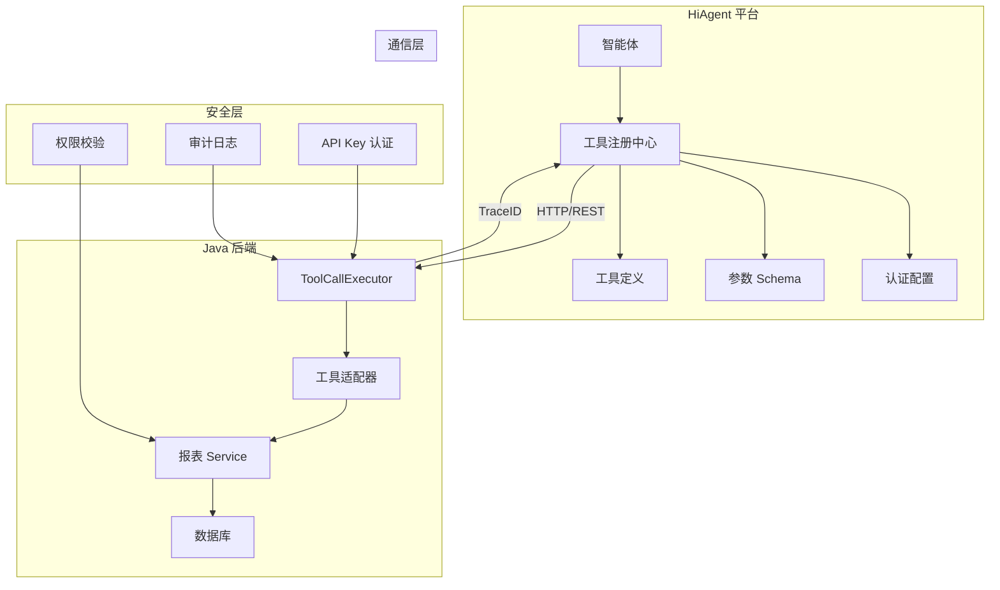
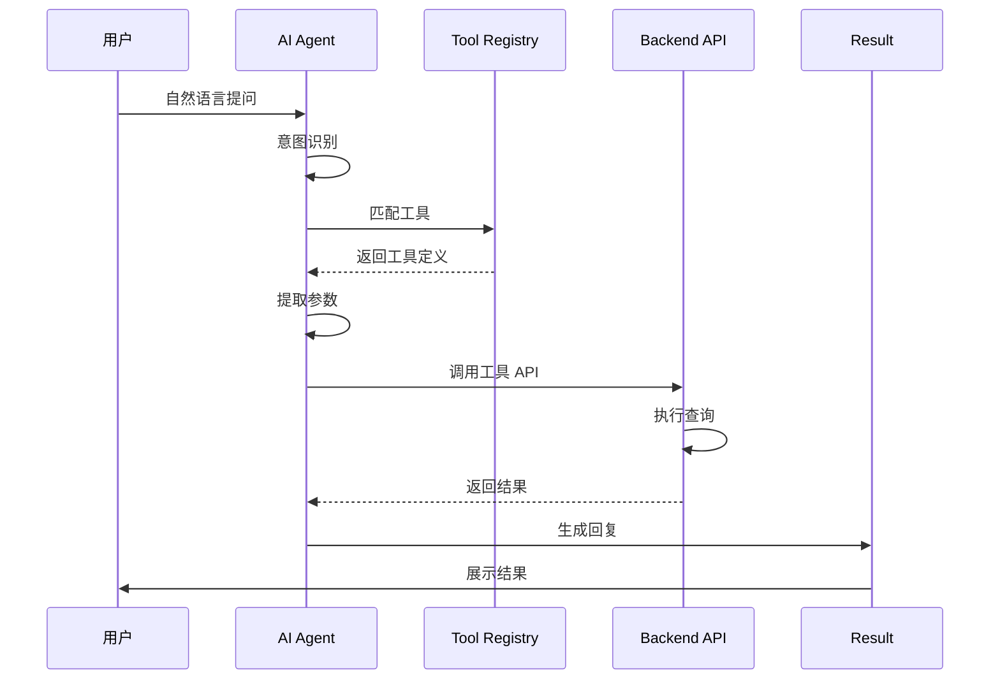

# 智能问数系统 - AI-02 工具 (Tools) 注册详细设计文档

**文档版本**: V2.0  
**最后更新**: 2026-04-02  
**适用对象**: AI 平台运维工程师、后端开发工程师、算法工程师  
**关联任务**: AI-02 工具 (Tools) 注册  
**前置依赖**: AI-01 (智能体 Agent 创建), DT-02 (报表接口标准化), BE-07 (工具调用执行器)  
**后续依赖**: AI-03 (知识库文档), AI-05 (意图识别优化)

**平台说明**: 本项目使用内网 **HiAgent v2.3+** 平台，工具注册需与 Java 后端接口对齐。

---

## 1. 任务概述

### 1.1 背景
工具 (Tools) 注册是连接 AI 智能体与后端业务系统的桥梁。通过在 HiAgent 平台注册后端 API 接口，AI 可以理解每个工具的功能、参数和调用方式，从而在识别到明确意图时自动调用相应工具执行查询。本任务需要在 HiAgent 平台完成所有报表查询工具的注册、配置和测试。

### 1.2 目标
| 目标 | 说明 | 验收标准 |
|------|------|----------|
| **标准化** | 统一工具定义格式 | 符合 OpenAPI/Swagger 规范 |
| **完整性** | 覆盖所有核心报表接口 | 工具数量 ≥ 10 个 |
| **准确性** | 参数描述清晰，AI 能准确提取 | 参数提取准确率 ≥ 90% |
| **安全性** | 工具调用需认证授权 | 认证配置完整 |
| **可维护** | 工具配置版本化管理 | 支持热更新 |
| **可测试** | 每个工具提供测试用例 | 测试通过率 100% |

### 1.3 工具清单
| 工具名 | 描述 | 后端接口 | 优先级 | 状态 |
|--------|------|----------|--------|------|
| `get_sales_report` | 查询销售报表 | `POST /api/report/sales` | P0 | 待注册 |
| `get_user_growth` | 查询用户增长 | `POST /api/report/user-growth` | P0 | 待注册 |
| `get_operation_report` | 查询运营报表 | `POST /api/report/operation` | P0 | 待注册 |
| `get_metric_definition` | 查询指标定义 | `GET /api/metric/{name}` | P1 | 待注册 |
| `get_report_list` | 获取报表列表 | `GET /api/report/list` | P1 | 待注册 |
| `export_data` | 导出数据 | `POST /api/export` | P2 | 待注册 |
| `subscribe_report` | 订阅报表 | `POST /api/subscribe` | P2 | 待注册 |
| `get_data_quality` | 数据质量检查 | `GET /api/quality/{reportId}` | P2 | 待注册 |

### 1.4 工具架构图


---

## 2. 技术选型

### 2.1 工具定义规范
| 组件 | 技术 | 版本 | 选型理由 |
|------|------|------|----------|
| 工具定义 | OpenAPI 3.0 | - | 行业标准，易维护 |
| 参数 Schema | JSON Schema | Draft 7 | 类型校验完善 |
| 认证方式 | Bearer Token | - | 与后端一致 |
| 通信协议 | HTTP/REST | - | 简单通用 |
| 数据格式 | JSON | - | 前后端统一 |

### 2.2 工具注册方式
| 方式 | 说明 | 适用场景 |
|------|------|----------|
| **手动注册** | 在 HiAgent 平台 UI 配置 | 少量工具 (<10 个) |
| **API 注册** | 调用 HiAgent API 批量注册 | 大量工具 (≥10 个) |
| **GitOps** | 配置文件存 Git，CI/CD 自动同步 | 持续集成场景 |

### 2.3 工具调用流程


---

## 3. 详细实现方案

### 3.1 工具定义模板

**文件路径**: `tools/get_sales_report.yaml`

```yaml
# 工具定义文件
tool:
  # 基本信息
  id: get_sales_report
  name: get_sales_report
  description: 查询销售报表数据，支持按地区、时间、指标筛选
  
  # 调用配置
  invocation:
    type: http
    method: POST
    url: http://askdata-router.data-ai.svc:8080/askdata/api/report/sales
    timeout_ms: 5000
    retry_count: 1
  
  # 认证配置
  authentication:
    type: bearer_token
    token_env: ASKDATA_API_KEY
    header_name: Authorization
  
  # 参数 Schema (JSON Schema Draft 7)
  parameters:
    type: object
    properties:
      region:
        type: string
        enum:
          - all
          - huadong
          - huabei
          - huanan
          - huaxi
        description: 地区代码，all 表示全国
        required: false
      
      timeType:
        type: string
        enum:
          - day
          - month
          - quarter
          - year
        description: 时间粒度
        required: true
      
      timeValue:
        type: string
        pattern: "^(\\d{4}-\\d{2}|last_\\w+)$"
        description: 时间值，如 2024-03 或 last_month
        required: true
      
      metrics:
        type: array
        items:
          type: string
          enum:
            - gmv
            - order_count
            - avg_order_value
        description: 指标代码列表
        required: true
      
      dimensions:
        type: array
        items:
          type: string
          enum:
            - region
            - dept
            - channel
        description: 分组维度列表
        required: false
    
    required:
      - timeType
      - timeValue
      - metrics
    
    additionalProperties: false
  
  # 响应映射
  response_mapping:
    success: $.code == 200
    data: $.data
    error: $.message
  
  # 权限配置
  permissions:
    required_roles:
      - employee
      - manager
      - executive
      - analyst
    data_scope: dept_based
  
  # 元数据
  metadata:
    version: 1.0.0
    owner: 数据平台部
    last_updated: 2026-04-02
    tags:
      - sales
      - report
      - core
```

### 3.2 平台操作步骤

#### 步骤 1: 进入工具管理
1. 登录 HiAgent 平台 (`http://hiagent.internal:8000`)
2. 进入「智能体管理」
3. 选择 `askdata-router-agent` 智能体
4. 点击「工具管理」标签页

#### 步骤 2: 添加工具
1. 点击「添加工具」按钮
2. 选择「自定义 API」模式
3. 填写工具基本信息 (见 3.3)
4. 配置参数 Schema (见 3.4)
5. 配置认证信息 (见 3.5)
6. 测试工具连通性 (见 3.6)
7. 保存并发布

#### 步骤 3: 填写工具基本信息
| 字段 | 填写内容 | 说明 |
|------|----------|------|
| **工具名称** | `get_sales_report` | 与后端 ToolCallExecutor 一致 |
| **工具描述** | 查询销售报表数据，支持按地区、时间、指标筛选 | AI 理解工具用途 |
| **调用方式** | `POST` | HTTP 方法 |
| **API 地址** | `http://askdata-router.data-ai.svc:8080/askdata/api/report/sales` | 后端接口地址 |
| **超时时间** | `5000ms` | 请求超时 |
| **重试次数** | `1` | 失败重试 |

#### 步骤 4: 配置参数 Schema
在「参数配置」编辑框中填入 JSON Schema：

```json
{
  "type": "object",
  "properties": {
    "region": {
      "type": "string",
      "enum": ["all", "huadong", "huabei", "huanan", "huaxi"],
      "description": "地区代码，all 表示全国"
    },
    "timeType": {
      "type": "string",
      "enum": ["day", "month", "quarter", "year"],
      "description": "时间粒度"
    },
    "timeValue": {
      "type": "string",
      "description": "时间值，如 2024-03 或 last_month",
      "pattern": "^(\\d{4}-\\d{2}|last_\\w+)$"
    },
    "metrics": {
      "type": "array",
      "items": {
        "type": "string",
        "enum": ["gmv", "order_count", "avg_order_value"]
      },
      "description": "指标代码列表"
    },
    "dimensions": {
      "type": "array",
      "items": {
        "type": "string",
        "enum": ["region", "dept", "channel"]
      },
      "description": "分组维度列表"
    }
  },
  "required": ["timeType", "timeValue", "metrics"],
  "additionalProperties": false
}
```

#### 步骤 5: 配置认证信息
| 配置项 | 填写内容 | 说明 |
|--------|----------|------|
| **认证类型** | `Bearer Token` | 与后端一致 |
| **Token 来源** | `${ASKDATA_API_KEY}` | 从环境变量读取 |
| **Header 名称** | `Authorization` | 标准 Header |
| **Token 前缀** | `Bearer` | 标准前缀 |

#### 步骤 6: 测试工具
1. 点击「测试」按钮
2. 填写测试参数：
   ```json
   {
     "region": "huadong",
     "timeType": "month",
     "timeValue": "last_month",
     "metrics": ["gmv", "order_count"]
   }
   ```
3. 点击「发送请求」
4. 检查响应：
   - 状态码：`200`
   - 响应时间：`< 3s`
   - 数据格式：正确
5. 点击「保存测试结果」

### 3.3 完整工具配置示例

**get_sales_report 工具配置**
```json
{
  "tool_id": "get_sales_report",
  "name": "get_sales_report",
  "description": "查询销售报表数据，支持按地区、时间、指标筛选",
  "invocation": {
    "type": "http",
    "method": "POST",
    "url": "http://askdata-router.data-ai.svc:8080/askdata/api/report/sales",
    "timeout_ms": 5000,
    "retry_count": 1
  },
  "authentication": {
    "type": "bearer_token",
    "token_env": "ASKDATA_API_KEY",
    "header_name": "Authorization",
    "token_prefix": "Bearer"
  },
  "parameters": {
    "type": "object",
    "properties": {
      "region": {
        "type": "string",
        "enum": ["all", "huadong", "huabei", "huanan", "huaxi"],
        "description": "地区代码，all 表示全国"
      },
      "timeType": {
        "type": "string",
        "enum": ["day", "month", "quarter", "year"],
        "description": "时间粒度"
      },
      "timeValue": {
        "type": "string",
        "description": "时间值，如 2024-03 或 last_month",
        "pattern": "^(\\d{4}-\\d{2}|last_\\w+)$"
      },
      "metrics": {
        "type": "array",
        "items": {
          "type": "string",
          "enum": ["gmv", "order_count", "avg_order_value"]
        },
        "description": "指标代码列表"
      },
      "dimensions": {
        "type": "array",
        "items": {
          "type": "string",
          "enum": ["region", "dept", "channel"]
        },
        "description": "分组维度列表"
      }
    },
    "required": ["timeType", "timeValue", "metrics"],
    "additionalProperties": false
  },
  "response_mapping": {
    "success": "$.code == 200",
    "data": "$.data",
    "error": "$.message"
  },
  "permissions": {
    "required_roles": ["employee", "manager", "executive", "analyst"],
    "data_scope": "dept_based"
  },
  "metadata": {
    "version": "1.0.0",
    "owner": "数据平台部",
    "last_updated": "2026-04-02",
    "tags": ["sales", "report", "core"]
  }
}
```

### 3.4 参数 Schema 设计规范

#### 必填参数标记
```json
{
  "required": ["timeType", "timeValue", "metrics"],
  "properties": {
    "timeType": {
      "type": "string",
      "description": "时间粒度 (必填)"
    }
  }
}
```

#### 枚举值定义
```json
{
  "region": {
    "type": "string",
    "enum": ["all", "huadong", "huabei", "huanan", "huaxi"],
    "description": "地区代码"
  }
}
```

#### 正则验证
```json
{
  "timeValue": {
    "type": "string",
    "pattern": "^(\\d{4}-\\d{2}|last_\\w+)$",
    "description": "时间值格式"
  }
}
```

#### 数组参数
```json
{
  "metrics": {
    "type": "array",
    "items": {
      "type": "string",
      "enum": ["gmv", "order_count", "avg_order_value"]
    },
    "minItems": 1,
    "maxItems": 10,
    "description": "指标列表"
  }
}
```

### 3.5 认证配置

#### Bearer Token 配置
```yaml
authentication:
  type: bearer_token
  token_env: ASKDATA_API_KEY  # 从环境变量读取
  header_name: Authorization
  token_prefix: Bearer
```

#### API Key 配置
```yaml
authentication:
  type: api_key
  key_env: ASKDATA_API_KEY
  header_name: X-API-Key
```

#### 内部服务认证 (mTLS)
```yaml
authentication:
  type: mtls
  cert_env: CLIENT_CERT_PATH
  key_env: CLIENT_KEY_PATH
  ca_env: CA_CERT_PATH
```

### 3.6 工具测试用例

#### 测试参数模板
```json
{
  "test_cases": [
    {
      "name": "正常查询",
      "params": {
        "region": "huadong",
        "timeType": "month",
        "timeValue": "last_month",
        "metrics": ["gmv"]
      },
      "expected": {
        "status": 200,
        "has_data": true
      }
    },
    {
      "name": "缺少必填参数",
      "params": {
        "region": "huadong"
      },
      "expected": {
        "status": 400,
        "has_error": true
      }
    },
    {
      "name": "非法枚举值",
      "params": {
        "region": "invalid",
        "timeType": "month",
        "timeValue": "last_month",
        "metrics": ["gmv"]
      },
      "expected": {
        "status": 400,
        "has_error": true
      }
    },
    {
      "name": "认证失败",
      "params": {
        "region": "huadong",
        "timeType": "month",
        "timeValue": "last_month",
        "metrics": ["gmv"]
      },
      "headers": {
        "Authorization": "Bearer invalid_token"
      },
      "expected": {
        "status": 401,
        "has_error": true
      }
    }
  ]
}
```

---

## 4. 注意事项 ⚠️

### 4.1 API Key 安全管理
```yaml
# ❌ 错误：硬编码 API Key
authentication:
  token: "sk-xxxxx"  # 明文存储

# ✅ 正确：从环境变量读取
authentication:
  token_env: ASKDATA_API_KEY  # 环境变量
```

### 4.2 参数校验
```json
// ❌ 错误：无参数校验
{
  "properties": {
    "region": {
      "type": "string"  // 无枚举限制
    }
  }
}

// ✅ 正确：完整校验
{
  "properties": {
    "region": {
      "type": "string",
      "enum": ["all", "huadong", "huabei"],  // 枚举限制
      "description": "地区代码"
    }
  },
  "required": ["region"],  // 必填标记
  "additionalProperties": false  // 禁止额外参数
}
```

### 4.3 超时配置
```yaml
# ❌ 错误：无超时配置
invocation:
  timeout_ms: null  # 可能无限等待

# ✅ 正确：配置超时
invocation:
  timeout_ms: 5000  # 5 秒超时
  retry_count: 1    # 重试 1 次
```

### 4.4 响应映射
```json
// ❌ 错误：无响应映射
response_mapping: null

// ✅ 正确：明确映射
response_mapping: {
  "success": "$.code == 200",
  "data": "$.data",
  "error": "$.message"
}
```

### 4.5 版本管理
```yaml
# ❌ 错误：无版本信息
metadata:
  owner: 数据平台部

# ✅ 正确：完整版本信息
metadata:
  version: 1.0.0
  owner: 数据平台部
  last_updated: 2026-04-02
  change_log:
    - version: 1.0.0
      date: 2026-04-02
      changes: 初始版本
```

---

## 5. 需要特别关注的点 🔴

### 5.1 陷阱防护矩阵

| 陷阱类型 | 风险描述 | 防护措施 | 验证方法 |
|----------|----------|----------|----------|
| **工具参数幻觉** | AI 生成非法参数值 | 参数 Schema 枚举校验 | 非法值被拦截 |
| **工具调用循环** | AI 反复调用同一工具 | 调用次数限制 | 单工具≤3 次/会话 |
| **工具权限越界** | 用户调用无权工具 | 工具权限配置 | 越权调用被拒绝 |
| **API Key 泄露** | Key 硬编码或日志打印 | 环境变量 + 脱敏 | 检查配置和日志 |
| **超时阻塞** | 工具调用超时阻塞主流程 | 配置超时 + 熔断 | 超时自动熔断 |
| **响应格式错误** | 后端返回格式变化 | 响应映射配置 | 格式错误被处理 |
| **生产环境配置** | 开发配置带到生产 | 环境变量区分 | 检查生产配置 |
| **工具版本冲突** | 工具更新导致不兼容 | 版本管理 + 灰度 | 灰度发布验证 |

### 5.2 关键配置审查点

```yaml
# 审查清单
□ 工具名称是否与后端一致
□ API 地址是否正确
□ HTTP 方法是否正确
□ 超时配置是否合理
□ 认证配置是否完整
□ 参数 Schema 是否完整
□ 必填参数是否标记
□ 枚举值是否定义
□ 正则验证是否配置
□ 响应映射是否明确
□ 权限配置是否完整
□ 元数据是否完整
□ 测试用例是否通过
□ 环境变量是否配置
□ 日志是否脱敏
```

### 5.3 性能影响评估

| 操作 | 耗时 | 优化建议 |
|------|------|----------|
| 工具匹配 | < 10ms | 无需优化 |
| 参数校验 | < 5ms | 无需优化 |
| API 调用 | 100-2000ms | 优化后端接口 |
| 响应映射 | < 5ms | 无需优化 |
| **总开销** | **100-3000ms** | **主要耗时在 API 调用** |

### 5.4 监控指标

```yaml
# 需要采集的指标
metrics:
  # 工具调用次数
  - name: hiagent.tool.call.count
    labels:
      - tool_name
      - status
    
  # 工具调用延迟
  - name: hiagent.tool.call.latency
    labels:
      - tool_name
    type: histogram
    
  # 工具调用失败数
  - name: hiagent.tool.call.failure
    labels:
      - tool_name
      - error_type
    
  # 参数校验失败数
  - name: hiagent.tool.param.validation.failure
    labels:
      - tool_name
      - param_name
```

---

## 6. 测试验证方案

### 6.1 功能测试用例
| 用例 ID | 测试场景 | 测试参数 | 预期结果 | 状态 |
|---------|----------|----------|----------|------|
| AI-TC-001 | 正常工具调用 | 完整参数 | 返回 200+ 数据 | 待测试 |
| AI-TC-002 | 缺少必填参数 | 缺少 timeType | 返回 400 错误 | 待测试 |
| AI-TC-003 | 非法枚举值 | region=invalid | 返回 400 错误 | 待测试 |
| AI-TC-004 | 认证失败 | 无效 Token | 返回 401 错误 | 待测试 |
| AI-TC-005 | 超时测试 | 模拟慢响应 | 返回 504 错误 | 待测试 |
| AI-TC-006 | 工具权限 | 普通用户查敏感工具 | 返回 403 错误 | 待测试 |
| AI-TC-007 | 响应映射 | 后端返回格式变化 | 正确映射 | 待测试 |
| AI-TC-008 | 重试机制 | 模拟首次失败 | 重试成功 | 待测试 |
| AI-TC-009 | 并发调用 | 50 并发调用 | 无错误 | 待测试 |
| AI-TC-010 | 工具版本 | 调用旧版本工具 | 兼容或提示 | 待测试 |

### 6.2 安全测试
| 测试项 | 操作 | 预期结果 |
|--------|------|----------|
| SQL 注入 | 参数注入 SQL | 被拦截 |
| XSS 攻击 | 参数注入脚本 | 被拦截 |
| 越权访问 | 尝试访问无权工具 | 被拒绝 |
| API Key 泄露 | 检查配置和日志 | 无明文 |
| 频率限制 | 1 秒内 100 次调用 | 被限流 |
| 敏感数据 | 查询敏感工具 | 返回脱敏数据 |

### 6.3 性能测试
| 指标 | 目标值 | 测量方法 |
|------|--------|----------|
| 单次调用延迟 | < 3s (P95) | HiAgent 监控 |
| 并发处理能力 | ≥ 50 QPS | 压测工具 |
| 参数校验延迟 | < 10ms | 代码计时 |
| 工具匹配延迟 | < 10ms | 代码计时 |
| 错误率 | < 1% | 日志统计 |

---

## 7. 运维配置

### 7.1 监控告警
```yaml
# Prometheus 告警规则
groups:
- name: hiagent-tool-alerts
  rules:
  - alert: ToolCallFailureRateHigh
    expr: |
      sum(rate(hiagent_tool_call_failure_total[5m])) 
      / 
      sum(rate(hiagent_tool_call_total[5m])) > 0.05
    for: 5m
    labels:
      severity: warning
    annotations:
      summary: "工具调用失败率过高 ({{ $value }})"
  
  - alert: ToolCallLatencyHigh
    expr: |
      histogram_quantile(0.95, sum(rate(hiagent_tool_call_latency_bucket[5m])) by (le)) > 3
    for: 5m
    labels:
      severity: warning
    annotations:
      summary: "工具调用 P95 延迟过高 ({{ $value }}s)"
  
  - alert: ToolParamValidationFailure
    expr: rate(hiagent_tool_param_validation_failure_total[5m]) > 0.1
    for: 5m
    labels:
      severity: warning
    annotations:
      summary: "工具参数校验频繁失败"
```

### 7.2 日志配置
```yaml
# HiAgent 工具调用日志
logging:
  tool:
    enabled: true
    level: INFO
    fields:
      - trace_id
      - tool_name
      - parameters
      - response_code
      - latency_ms
      - user_id
    output:
      - console
      - file:/var/log/hiagent/tool.log
      - elasticsearch:http://es-cluster:9200
    retention_days: 90
```

### 7.3 备份策略
| 数据类型 | 备份频率 | 保留周期 | 工具 |
|----------|----------|----------|------|
| 工具配置 | 每次变更 | 永久 | Git |
| 调用日志 | 每日 | 90 天 | ELK |
| 认证 Token | 每周 | 30 天 | Vault |
| 测试用例 | 每次发布 | 永久 | Git |

### 7.4 版本管理
```bash
# 工具版本发布流程
1. 在 HiAgent 平台复制现有工具
2. 修改版本号 (v1.0.0 → v1.1.0)
3. 更新配置
4. 测试验证
5. 发布新版本
6. 智能体配置切换到新版本
7. 观察监控指标
8. 废弃旧版本
```

---

## 8. 常见问题 (FAQ)

**Q1: 工具调用返回 401 错误怎么办？**
A: 1. 检查 API Key 是否有效；2. 检查 Token 是否过期；3. 检查环境变量配置；4. 重新生成 Token。

**Q2: 参数提取不准确怎么办？**
A: 1. 优化参数 description 描述；2. 增加 enum 约束；3. 在 Prompt 中添加工具使用示例；4. 调整 Temperature 参数。

**Q3: 工具调用超时怎么办？**
A: 1. 增加 timeout 配置；2. 优化后端接口性能；3. 检查网络连接；4. 增加后端资源。

**Q4: 如何调试工具调用？**
A: 1. 启用 HiAgent 调试模式；2. 查看工具调用日志；3. 使用 Postman 测试后端接口；4. 检查 TraceID 链路日志。

**Q5: 工具配置如何版本管理？**
A: 1. 使用 Git 存储配置；2. 每次变更创建新版本；3. 灰度发布验证；4. 记录变更日志。

**Q6: 如何支持多环境 (测试/生产)？**
A: 1. 配置不同 API 地址；2. 使用环境变量区分；3. 智能体配置多版本；4. 路由根据环境切换。

**Q7: 工具调用失败如何重试？**
A: 1. 配置 retry_count；2. 实现指数退避；3. 记录重试日志；4. 失败后降级处理。

**Q8: 如何限制工具调用频率？**
A: 1. HiAgent 平台配置限流；2. 后端接口限流；3. 用户级限流；4. 监控告警。

**Q9: 工具参数太多 AI 记不住怎么办？**
A: 1. 简化参数；2. 使用默认值；3. 分组参数；4. 在 Prompt 中提供参数说明。

**Q10: 如何废弃旧版本工具？**
A: 1. 标记为 deprecated；2. 通知使用者；3. 设置过渡期；4. 监控使用量；5. 达到 0 后删除。

---

## 9. 附录：配置模板

### 9.1 工具配置模板 (YAML)
```yaml
tool:
  id: get_sales_report
  name: get_sales_report
  description: 查询销售报表数据
  invocation:
    type: http
    method: POST
    url: ${ASKDATA_BASE_URL}/api/report/sales
    timeout_ms: 5000
    retry_count: 1
  authentication:
    type: bearer
    token_env: ASKDATA_API_KEY
  parameters:
    type: object
    properties:
      region:
        type: string
        enum: [all, huadong, huabei, huanan, huaxi]
        description: 地区代码
      timeType:
        type: string
        enum: [day, month, quarter, year]
        description: 时间粒度
      timeValue:
        type: string
        description: 时间值
      metrics:
        type: array
        items:
          type: string
          enum: [gmv, order_count, avg_order_value]
        description: 指标列表
    required:
      - timeType
      - timeValue
      - metrics
    additionalProperties: false
  response_mapping:
    success: $.code == 200
    data: $.data
    error: $.message
  permissions:
    required_roles: [employee, manager, executive, analyst]
    data_scope: dept_based
  metadata:
    version: 1.0.0
    owner: 数据平台部
    last_updated: 2026-04-02
  enabled: true
```

### 9.2 API 调用示例 (cURL)
```bash
# 调用工具
curl -X POST http://hiagent.internal:8000/api/v1/tool/invoke \
  -H "Authorization: Bearer ${API_KEY}" \
  -H "Content-Type: application/json" \
  -H "X-Trace-ID: ${TRACE_ID}" \
  -d '{
    "agent_id": "askdata-router-agent",
    "tool_name": "get_sales_report",
    "parameters": {
      "region": "huadong",
      "timeType": "month",
      "timeValue": "last_month",
      "metrics": ["gmv", "order_count"]
    },
    "user_id": "u1001",
    "context": {
      "dept_id": 100
    }
  }'
```

### 9.3 响应示例
```json
{
  "code": 200,
  "data": {
    "tool_name": "get_sales_report",
    "success": true,
    "data": [
      {
        "region": "huadong",
        "gmv": 1000000,
        "order_count": 5000,
        "time": "2024-03"
      }
    ],
    "total": 1,
    "latency_ms": 250
  },
  "trace_id": "a1b2c3d4..."
}
```

---

## 10. 开发检查清单 (Checklist)

### 10.1 工具配置
- [ ] 所有 P0 工具已注册 (≥4 个)
- [ ] 工具名称与后端一致
- [ ] 参数 Schema 配置完整
- [ ] 必填参数已标注
- [ ] 枚举值已定义
- [ ] 参数描述清晰
- [ ] 响应映射已配置
- [ ] 超时配置合理

### 10.2 认证安全
- [ ] API Key 已配置
- [ ] Token 从环境变量读取
- [ ] 认证测试通过
- [ ] 权限控制已验证
- [ ] 敏感参数已脱敏
- [ ] 审计日志已开启

### 10.3 测试验收
- [ ] 所有测试用例通过
- [ ] 性能测试达标
- [ ] 安全测试通过
- [ ] 集成测试通过
- [ ] 文档已更新

### 10.4 运维配置
- [ ] 监控指标已配置
- [ ] 告警规则已设置
- [ ] 日志采集已配置
- [ ] 备份策略已实施
- [ ] 版本管理已建立

---

## 11. 变更历史

| 版本 | 日期 | 变更内容 | 负责人 |
|------|------|----------|--------|
| V1.0 | 2026-03-25 | 初始版本 | 架构组 |
| V2.0 | 2026-04-02 | 增加参数 Schema 规范、认证配置、陷阱防护 | 架构组 |

---

## 12. 工时与优先级

| 项目 | 内容 |
|------|------|
| **工时** | 5 MD (配置 3 天 + 测试 2 天) |
| **优先级** | P0 (核心 AI 能力) |
| **依赖任务** | AI-01, DT-02, BE-07 |
| **被依赖任务** | AI-03, AI-05 |

---

## 13. 最佳实践建议

### 13.1 参数设计
```yaml
# ✅ 推荐：清晰的参数描述
parameters:
  region:
    type: string
    enum: [all, huadong, huabei]
    description: 地区代码，all 表示全国

# ❌ 不推荐：模糊描述
parameters:
  region:
    type: string
    description: 地区
```

### 13.2 认证管理
```yaml
# ✅ 推荐：环境变量管理认证
authentication:
  token_env: ASKDATA_API_KEY

# ❌ 不推荐：硬编码 Token
authentication:
  token: "sk-xxxxx"
```

### 13.3 错误处理
```yaml
# ✅ 推荐：完整响应映射
response_mapping:
  success: $.code == 200
  data: $.data
  error: $.message

# ❌ 不推荐：无响应映射
response_mapping: null
```

### 13.4 版本管理
```bash
# ✅ 推荐：Git 版本管理
git add tools/get_sales_report.yaml
git commit -m "Update tool v1.1.0"

# ❌ 不推荐：手动修改平台配置
# 无版本记录，难以回滚
```

---

**文档结束**  
**下一步**: 完成工具注册后，请提交测试团队进行 AI-02 专项验收，重点验证工具连通性、参数提取准确性、认证安全性和性能指标。