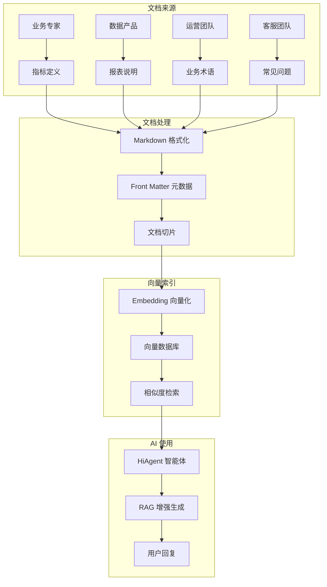

# 智能问数系统 - AI-03 知识库文档编写详细设计文档

**文档版本**: V2.0  
**最后更新**: 2026-04-02  
**适用对象**: 数据产品经理、AI 平台运维工程师、业务专家  
**关联任务**: AI-03 知识库文档编写  
**前置依赖**: AI-01 (智能体 Agent 创建), AI-02 (工具注册), DT-01 (核心指标梳理)  
**后续依赖**: AI-04 (知识库索引构建), AI-05 (意图识别优化)

**平台说明**: 本项目使用内网 **HiAgent v2.3+** 平台，知识库基于向量检索 (Embedding: bge-large-zh-v1.5)。

---

## 1. 任务概述

### 1.1 背景
知识库是智能问数系统的"大脑"，存储了指标定义、报表说明、业务术语、常见问题等结构化知识。当 AI 无法直接查询数据时，会从知识库中检索相关信息，为用户提供引导和解答。高质量的知识库文档是提升问数准确率、降低降级率的关键。

### 1.2 目标
| 目标 | 说明 | 验收标准 |
|------|------|----------|
| **完整性** | 覆盖所有核心指标和报表 | 指标覆盖率 ≥ 95% |
| **准确性** | 文档内容与业务口径一致 | 业务确认率 100% |
| **可检索** | 文档结构清晰，关键词丰富 | 检索命中率 ≥ 80% |
| **可维护** | 文档版本化管理，支持增量更新 | 支持热更新 |
| **标准化** | 统一文档模板，便于批量生成 | 模板覆盖率 100% |
| **安全性** | 敏感信息脱敏，权限控制 | 敏感信息 0 泄露 |

### 1.3 知识库分类
| 分类 | 文档数量 | 更新频率 | 负责人 | 优先级 |
|------|----------|----------|--------|--------|
| **指标字典** | ≥50 篇 | 按需更新 | 数据产品 | P0 |
| **报表说明** | ≥20 篇 | 按月更新 | 报表开发 | P0 |
| **业务术语** | ≥30 篇 | 按需更新 | 业务专家 | P1 |
| **常见问题** | ≥20 篇 | 按周更新 | 客服团队 | P1 |
| **降级引导** | ≥6 篇 | 按需更新 | AI 运维 | P2 |
| **操作指南** | ≥10 篇 | 按需更新 | 产品运营 | P2 |

### 1.4 文档生命周期


---

## 2. 技术选型

### 2.1 文档格式
| 组件 | 技术 | 版本 | 选型理由 |
|------|------|------|----------|
| 文档格式 | Markdown | - | 易读易写，版本友好 |
| 元数据 | YAML Front Matter | - | 结构化元数据 |
| 版本控制 | Git | - | 变更追溯，协同编辑 |
| 向量模型 | bge-large-zh-v1.5 | - | 中文语义理解最佳 |
| 相似度算法 | Cosine | - | 计算效率高 |

### 2.2 知识库架构


### 2.3 文档切片策略
| 策略 | 说明 | 适用场景 |
|------|------|----------|
| **固定长度** | 按 Token 数切片 (512 tokens) | 通用场景 |
| **语义切片** | 按段落/标题切片 | 结构清晰文档 |
| **重叠切片** | 切片间重叠 50 tokens | 保证语义连续性 |
| **递归切片** | 按分隔符递归切片 | 复杂结构文档 |

---

## 3. 详细实现方案

### 3.1 文档目录结构

```
askdata-knowledge-base/
├── 📁 01-指标字典/
│   ├── metric_gmv.md
│   ├── metric_dau.md
│   ├── metric_order_count.md
│   ├── metric_conversion_rate.md
│   └── _category.yaml
│
├── 📁 02-报表说明/
│   ├── report_sales_daily.md
│   ├── report_sales_monthly.md
│   ├── report_user_growth.md
│   ├── report_operation.md
│   └── _category.yaml
│
├── 📁 03-业务术语/
│   ├── term_region_mapping.md
│   ├── term_time_expression.md
│   ├── term_dept_hierarchy.md
│   ├── term_channel_definition.md
│   └── _category.yaml
│
├── 📁 04-常见问题/
│   ├── faq_001_how_to_query.md
│   ├── faq_002_data_latency.md
│   ├── faq_003_permission.md
│   ├── faq_004_export.md
│   └── _category.yaml
│
├── 📁 05-降级引导/
│   ├── fallback_no_metric.md
│   ├── fallback_no_permission.md
│   ├── fallback_unclear_intent.md
│   ├── fallback_timeout.md
│   └── _category.yaml
│
├── 📁 06-操作指南/
│   ├── guide_filter_usage.md
│   ├── guide_chart_interpretation.md
│   ├── guide_export_data.md
│   └── _category.yaml
│
├── 📄 kb_config.yaml                  # 知识库全局配置
├── 📄 README.md                       # 知识库说明
└── 📄 change_log.md                   # 变更日志
```

### 3.2 通用 Front Matter 模板

所有 Markdown 文档开头必须包含 Front Matter 元数据：

```markdown
---
meta:
  doc_id: metric_gmv_001              # 文档唯一 ID
  doc_type: metric                    # 文档类型：metric/report/term/faq/guide/fallback
  category: 指标字典                   # 所属分类
  title: GMV - 成交总额                # 文档标题
  aliases: [销售额，营收，成交金额，交易总额]  # 同义词列表 (用于检索匹配)
  tags: [销售，核心指标，财务]          # 标签列表
  version: 1.2                        # 文档版本
  last_updated: 2026-04-01            # 最后更新日期
  owner: 数据产品部                    # 负责人
  security_level: 2                   # 安全等级：1-公开 2-内部 3-保密
  
  # 关联关系
  related_metrics: [order_count, avg_order_value]  # 关联指标
  related_reports: [sales_daily, sales_monthly]    # 关联报表
  supported_dimensions: [region, time, channel, dept]  # 支持维度
  
  # 检索优化
  keywords: [销售，金额，交易，GMV, 营收]  # 检索关键词
  search_weight: 1.0                  # 检索权重 (0.0-2.0)
---
```

### 3.3 指标字典文档模板

**文件路径**: `01-指标字典/metric_{code}.md`

```markdown
---
meta:
  doc_id: metric_gmv_001
  doc_type: metric
  category: 指标字典
  title: GMV - 成交总额
  aliases: [销售额，营收，成交金额，交易总额]
  tags: [销售，核心指标，财务]
  version: 1.2
  last_updated: 2026-04-01
  owner: 数据产品部
  security_level: 2
  related_metrics: [order_count, avg_order_value]
  related_reports: [sales_daily, sales_monthly]
  supported_dimensions: [region, time, channel, dept]
  keywords: [销售，金额，交易，GMV, 营收]
  search_weight: 1.0
---

# GMV (成交总额)

## 📊 业务定义
用户下单支付的总金额，包含已付款和未付款订单。

**适用场景**: 销售分析、业绩考核、趋势监控

## 🧮 计算口径
```sql
SUM(order_amount) 
WHERE order_status IN ('paid', 'unpaid', 'pending')
AND is_deleted = 0
AND order_type != 'test'
```

**分子**: 订单金额总和  
**分母**: 无  
**单位**: 元

## 📅 数据更新频率
| 数据类型 | 更新频率 | 延迟时间 | 数据来源 |
|----------|----------|----------|----------|
| 实时数据 | 每 5 分钟 | 5 分钟 | 订单中心 |
| T+1 数据 | 每日 8:00 | 1 天 | 数据仓库 |

## 📐 可选维度
| 维度 | 代码 | 可选值 | 说明 |
|------|------|--------|------|
| 时间 | time | day/month/quarter/year | 支持相对时间（上月、近 7 天） |
| 地区 | region | 省/市/大区 | 华东=上海 + 江苏 + 浙江 |
| 渠道 | channel | app/web/mini_program | - |
| 部门 | dept | 组织架构树 | 按用户权限过滤 |

## 🔒 权限说明
| 角色 | 数据范围 | 备注 |
|------|----------|------|
| 普通员工 | 仅本部门数据 | - |
| 部门经理 | 本部门及下级部门 | - |
| 高管 | 全公司数据 | - |

## ❓ 常见问法示例
```
"上月销售额是多少"
"华东区近 7 天 GMV 趋势"
"各部门营收对比"
"查看销售数据"
```

## 📈 可视化建议
| 场景 | 推荐图表 | 说明 |
|------|----------|------|
| 趋势分析 | 折线图 | 时间序列展示 |
| 对比分析 | 柱状图 | 多类别对比 |
| 占比分析 | 饼图 | 份额分布 |
| 单指标 | 卡片 | 突出显示数值 |

## ⚠️ 注意事项
1. 包含未付款订单，与财务确认收入有差异
2. 退款订单会在 T+1 数据中冲减
3. 测试订单已过滤（order_type != 'test'）
4. 跨境订单按当日汇率换算为人民币

## 🔗 关联资源
- [销售日报表](/report/sales_daily)
- [区域对比看板](/dashboard/region_compare)
- [指标变更日志](/changelog/metric_gmv)

## 📝 变更历史
| 版本 | 日期 | 变更内容 | 负责人 |
|------|------|----------|--------|
| 1.0 | 2025-01-01 | 初始版本 | 张三 |
| 1.1 | 2025-06-01 | 增加实时数据 | 李四 |
| 1.2 | 2026-04-01 | 更新计算口径 | 王五 |
```

### 3.4 报表说明文档模板

**文件路径**: `02-报表说明/report_{code}.md`

```markdown
---
meta:
  doc_id: report_sales_daily_001
  doc_type: report
  category: 报表说明
  title: 销售日报表
  aliases: [日报，销售日报，每日销售]
  tags: [销售，日报，核心报表]
  version: 2.0
  last_updated: 2026-03-28
  owner: 销售运营部
  security_level: 2
  api_tools: [get_sales_report, get_sales_trend]
  supported_filters: [region, dept, channel, product_line]
  keywords: [销售，日报，报表，数据]
  search_weight: 1.0
---

# 销售日报表

## 📋 报表说明
展示每日销售核心指标，支持按地区、部门、渠道等多维度筛选。

**更新频率**: T+1 (每日 8:00 更新)  
**数据范围**: 全公司订单数据

## 📊 包含指标
| 指标 | 代码 | 计算口径 | 单位 |
|------|------|----------|------|
| GMV | gmv | SUM(order_amount) | 元 |
| 订单量 | order_count | COUNT(order_id) | 个 |
| 客单价 | avg_order_value | gmv / order_count | 元 |
| 退款率 | refund_rate | refund_amount / gmv | % |

## 🎛️ 筛选条件
| 条件 | 类型 | 可选值 | 默认值 |
|------|------|--------|--------|
| 时间范围 | 日期选择 | 自定义，最大跨度 90 天 | 近 30 天 |
| 地区 | 多选 | 大区/省/市三级 | 全国 |
| 部门 | 树形选择 | 按用户权限自动过滤 | 本部门 |
| 渠道 | 多选 | app/web/mini_program | 全部 |

## 📈 可视化图表
| 图表类型 | 用途 | 配置 |
|----------|------|------|
| 趋势图 | 折线图（默认） | 时间序列 |
| 对比图 | 柱状图 | 多类别对比 |
| 占比图 | 饼图 | 渠道分布 |

## 💡 推荐问法
```
"查看上月销售日报"
"华东区近 7 天销售趋势"
"各部门订单量对比"
"导出上个月的销售数据"
```

## 🔒 权限控制
| 角色 | 查看权限 | 导出权限 | 备注 |
|------|----------|----------|------|
| 普通员工 | 本部门 | ❌ | - |
| 部门经理 | 本部门 + 下级 | ✅ | - |
| 高管 | 全公司 | ✅ | - |

## 🔗 直接访问
- [大屏入口](/dashboard/sales)
- [报表入口](/report/sales_daily)
- [API 文档](/api/docs/get_sales_report)

## 📝 变更历史
| 版本 | 日期 | 变更内容 | 负责人 |
|------|------|----------|--------|
| 1.0 | 2025-01-01 | 初始版本 | 张三 |
| 2.0 | 2026-03-28 | 新增渠道筛选 | 李四 |
```

### 3.5 业务术语文档模板

**文件路径**: `03-业务术语/term_{code}.md`

```markdown
---
meta:
  doc_id: term_region_mapping_001
  doc_type: term
  category: 业务术语
  title: 地区映射关系
  aliases: [区域划分，大区定义，地区代码]
  tags: [地区，映射，基础数据]
  version: 1.0
  last_updated: 2026-04-01
  owner: 数据产品部
  security_level: 1
  keywords: [地区，华东，华北，映射，代码]
  search_weight: 0.8
---

# 地区映射关系

## 📍 大区定义
| 大区代码 | 大区名称 | 包含省份 | 省份代码 |
|----------|----------|----------|----------|
| huadong | 华东区 | 上海、江苏、浙江、安徽、福建 | shanghai, jiangsu, zhejiang, anhui, fujian |
| huabei | 华北区 | 北京、天津、河北、山西、内蒙古 | beijing, tianjin, hebei, shanxi, neimenggu |
| huanan | 华南区 | 广东、广西、海南 | guangdong, guangxi, hainan |
| huaxi | 华西区 | 四川、重庆、贵州、云南、西藏 | sichuan, chongqing, guizhou, yunnan, xizang |

## 🏢 特殊说明
1. **全国**: 代码 `all`，包含所有省份
2. **港澳台**: 单独统计，不计入大区
3. **海外**: 单独统计，不计入大区

## 💡 使用示例
```
用户问："华东区销售额"
系统识别：region = "huadong"
包含：上海、江苏、浙江、安徽、福建
```

## 🔗 关联资源
- [省份代码表](/term/province_code)
- [城市代码表](/term/city_code)
```

### 3.6 常见问题文档模板

**文件路径**: `04-常见问题/faq_{num}_{topic}.md`

```markdown
---
meta:
  doc_id: faq_001_how_to_query
  doc_type: faq
  category: 常见问题
  title: 如何提问获取数据
  aliases: [怎么问，提问方式，问法指南]
  tags: [使用指南，提问，入门]
  version: 1.0
  last_updated: 2026-04-01
  owner: 客服团队
  security_level: 1
  keywords: [提问，问法，指南，入门，如何使用]
  search_weight: 1.0
---

# 如何提问获取数据

## ❓ 问题描述
用户不知道如何提问才能获取想要的数据。

## ✅ 正确问法
提问时请尽量包含以下要素：

| 要素 | 说明 | 示例 |
|------|------|------|
| **时间** | 查询的时间范围 | 上月、近 7 天、2024 年 3 月 |
| **地区** | 查询的地区范围 | 华东区、北京、全国 |
| **指标** | 想查询的指标 | 销售额、订单量、用户数 |

## 📝 推荐问法
```
✅ "华东区上月销售额是多少"
✅ "近 7 天各部门订单量对比"
✅ "2024 年 3 月北京地区用户增长趋势"
```

## ❌ 避免问法
```
❌ "那个数据看一下" (太模糊)
❌ "卖得怎么样" (缺少要素)
❌ "查一下" (不完整)
```

## 💡 小技巧
1. 使用系统推荐的"猜你想问"
2. 参考历史查询记录
3. 查看指标字典了解可用指标

## 🔗 相关资源
- [指标字典](/category/metric_dictionary)
- [报表说明](/category/report_description)
```

### 3.7 降级引导文档模板

**文件路径**: `05-降级引导/fallback_{scenario}.md`

```markdown
---
meta:
  doc_id: fallback_no_metric_001
  doc_type: fallback
  category: 降级引导
  title: 指标不存在时的引导回复
  aliases: [指标缺失，无数据，引导]
  tags: [降级，引导，回复模板]
  version: 1.0
  last_updated: 2026-04-01
  owner: AI 运维
  security_level: 1
  trigger_conditions: [metric_not_found, semantic_layer_miss]
  priority: 1
  keywords: [指标，不存在，引导，推荐]
  search_weight: 0.5
---

# 指标不存在 - 引导回复模板

## 🎯 适用场景
用户查询的指标在语义层中未定义，无法直接执行查询。

## 💬 标准回复模板
```
抱歉，暂未找到"[用户查询的指标]"的直接数据。

但您可以尝试：
1️⃣ 查看相似指标：[推荐指标列表]
2️⃣ 浏览相关报表：[推荐报表链接]
3️⃣ 提交数据需求：[需求提交通道]

推荐问法：
• "上月销售额是多少"
• "华东区近 7 天订单量"
• "各部门营收对比"
```

## 🔧 动态变量
| 变量 | 来源 | 示例 |
|------|------|------|
| {user_metric} | 用户提问提取 | "用户留存率" |
| {similar_metrics} | 语义层相似度计算 | ["GMV", "订单量", "客单价"] |
| {related_reports} | 关联报表查询 | ["销售日报", "用户增长报表"] |
| {feedback_url} | 系统配置 | "/feedback/new" |

## 📝 回复示例
```
抱歉，暂未找到"用户留存率"的直接数据。

但您可以尝试：
1️⃣ 查看相似指标：DAU（日活）、转化率、复购率
2️⃣ 浏览相关报表：[用户增长报表](/report/user_growth)
3️⃣ 提交数据需求：[点击这里](/feedback/new)

推荐问法：
• "上月日活是多少"
• "华东区近 7 天新增用户"
• "各部门转化率对比"
```

## ⚙️ 配置说明
- 触发条件：指标在语义层不存在
- 推荐指标数量：3-5 个
- 推荐报表数量：1-2 个
- 超时时间：3 秒
```

---

## 4. 注意事项 ⚠️

### 4.1 元数据完整性
```yaml
# ❌ 错误：缺少关键元数据
---
meta:
  title: GMV
  # 缺少 doc_id, doc_type, aliases 等
---

# ✅ 正确：完整元数据
---
meta:
  doc_id: metric_gmv_001
  doc_type: metric
  title: GMV - 成交总额
  aliases: [销售额，营收，成交金额]
  version: 1.2
  last_updated: 2026-04-01
  owner: 数据产品部
---
```

### 4.2 同义词覆盖
```markdown
# ❌ 错误：同义词覆盖不足
aliases: [GMV]

# ✅ 正确：覆盖所有常见叫法
aliases: [GMV, 销售额，营收，成交金额，交易总额，流水]
```

### 4.3 敏感信息处理
```markdown
# ❌ 错误：文档含敏感信息
## 数据示例
| 用户 | 手机号 | 消费金额 |
|------|--------|----------|
| 张三 | 13800138000 | 1000 元 |

# ✅ 正确：敏感信息脱敏
## 数据示例
| 用户 | 手机号 | 消费金额 |
|------|--------|----------|
| 张三 | 138****0000 | ****元 |
```

### 4.4 版本管理
```markdown
# ❌ 错误：无版本信息
## 变更历史
(无)

# ✅ 正确：完整版本记录
## 📝 变更历史
| 版本 | 日期 | 变更内容 | 负责人 |
|------|------|----------|--------|
| 1.0 | 2025-01-01 | 初始版本 | 张三 |
| 1.1 | 2025-06-01 | 增加实时数据 | 李四 |
| 1.2 | 2026-04-01 | 更新计算口径 | 王五 |
```

### 4.5 检索优化
```markdown
# ❌ 错误：关键词不足
keywords: [销售]

# ✅ 正确：覆盖多种检索词
keywords: [销售，金额，交易，GMV, 营收，流水，成交额]
```

---

## 5. 需要特别关注的点 🔴

### 5.1 陷阱防护矩阵

| 陷阱类型 | 风险描述 | 防护措施 | 验证方法 |
|----------|----------|----------|----------|
| **检索不准** | 文档关键词不足 | 丰富 aliases 和 keywords | 检索测试命中率 ≥ 80% |
| **缓存失效** | 文档更新后缓存未更新 | 文档版本号 + 事件通知 | 变更后查询返回新数据 |
| **敏感泄露** | 文档含敏感信息 | 敏感信息脱敏审核 | 安全检查无敏感信息 |
| **版本混乱** | 多版本文档并存 | 版本管理 + 最新发布标记 | 仅最新版被检索 |
| **内容过时** | 文档内容与实际不符 | 定期审核 + 业务确认 | 业务确认率 100% |
| **切片不当** | 文档切片破坏语义 | 语义切片 + 重叠 50 tokens | 检索片段语义完整 |
| **权限失控** | 无权限用户访问敏感文档 | 文档安全等级 + 权限校验 | 越权访问被拒绝 |
| **生产环境** | 开发文档带到生产 | 环境隔离 + 发布审核 | 检查生产文档列表 |

### 5.2 关键配置审查点

```yaml
# 审查清单
□ Front Matter 元数据是否完整
□ doc_id 是否唯一
□ doc_type 是否正确
□ aliases 是否覆盖全面
□ keywords 是否丰富
□ version 是否递增
□ last_updated 是否更新
□ owner 是否明确
□ security_level 是否配置
□ 敏感信息是否脱敏
□ 计算口径是否准确
□ 示例是否完整
□ 变更历史是否记录
□ 关联资源是否有效
□ 文档格式是否规范
□ 切片策略是否合理
```

### 5.3 性能影响评估

| 操作 | 耗时 | 优化建议 |
|------|------|----------|
| 文档上传 | 100-500ms/篇 | 批量上传 |
| 向量化 | 50-200ms/篇 | 异步处理 |
| 索引构建 | 1-5 分钟/100 篇 | 增量构建 |
| 检索查询 | 100-500ms | 缓存优化 |
| **总开销** | **< 1s** | **可接受** |

### 5.4 监控指标

```yaml
# 需要采集的指标
metrics:
  # 文档数量
  - name: kb.document.count
    labels:
      - doc_type
      - category
  
  # 检索命中率
  - name: kb.retrieval.hit_rate
    labels:
      - doc_type
  
  # 检索延迟
  - name: kb.retrieval.latency
    type: histogram
    labels:
      - query_type
  
  # 文档更新频率
  - name: kb.document.update.count
    labels:
      - doc_type
      - owner
  
  # 缓存命中率
  - name: kb.cache.hit_rate
    type: gauge
```

---

## 6. 测试验证方案

### 6.1 文档质量检查
| 检查项 | 检查方法 | 通过标准 |
|--------|----------|----------|
| 元数据完整 | 脚本检查 Front Matter | 所有必填字段存在 |
| 格式规范 | Markdown  lint 工具 | 无格式错误 |
| 敏感信息 | 敏感词扫描 | 无敏感信息 |
| 链接有效 | 链接检查器 | 无 404 链接 |
| 版本递增 | 版本号对比 | 版本号递增 |
| 业务确认 | 业务专家审核 | 确认率 100% |

### 6.2 检索测试用例
| 用例 ID | 测试场景 | 测试查询 | 预期文档 | 预期分数 | 状态 |
|---------|----------|----------|----------|----------|------|
| KB-TC-01 | 指标检索 | "销售额怎么算" | metric_gmv.md | ≥ 0.80 | 待测试 |
| KB-TC-02 | 术语检索 | "华东区包括哪些省" | term_region_mapping.md | ≥ 0.85 | 待测试 |
| KB-TC-03 | 报表检索 | "如何查看销售日报" | report_sales_daily.md | ≥ 0.80 | 待测试 |
| KB-TC-04 | 问题检索 | "数据什么时候更新" | faq_002_data_latency.md | ≥ 0.75 | 待测试 |
| KB-TC-05 | 降级检索 | "指标不存在怎么办" | fallback_no_metric.md | ≥ 0.70 | 待测试 |
| KB-TC-06 | 同义词检索 | "GMV 和营收有什么区别" | metric_gmv.md | ≥ 0.75 | 待测试 |
| KB-TC-07 | 操作检索 | "怎么导出数据" | guide_export_data.md | ≥ 0.80 | 待测试 |
| KB-TC-08 | 权限检索 | "为什么我看不到全公司数据" | faq_003_permission.md | ≥ 0.80 | 待测试 |

### 6.3 性能测试
| 指标 | 目标值 | 测量方法 |
|------|--------|----------|
| 检索延迟 | < 500ms (P95) | HiAgent 监控 |
| 召回率 | ≥ 80% | 测试用例统计 |
| 准确率 | ≥ 85% | 人工评估 |
| 索引构建时间 | < 10 分钟 (100 篇) | 计时测试 |

### 6.4 安全测试
| 测试项 | 操作 | 预期结果 |
|--------|------|----------|
| 敏感信息 | 搜索敏感关键词 | 不返回敏感文档 |
| 权限控制 | 无权限用户检索 | 仅返回可访问文档 |
| 注入攻击 | 尝试注入恶意内容 | 被过滤或拦截 |
| 数据泄露 | 检查文档内容 | 无明文敏感数据 |

---

## 7. 运维配置

### 7.1 知识库配置
```yaml
# kb_config.yaml
knowledge_base:
  id: askdata-knowledge-base
  name: 智能问数知识库
  description: 企业数据问数系统知识库
  version: 1.0.0
  
  # 向量模型配置
  embedding:
    model: bge-large-zh-v1.5
    dimension: 1024
    similarity: cosine
  
  # 索引配置
  indexing:
    chunk_size: 512
    chunk_overlap: 50
    top_k: 5
    threshold: 0.65
    rerank: true
    rerank_model: bge-reranker-large
  
  # 检索配置
  retrieval:
    max_results: 10
    min_score: 0.65
    diversify: true
  
  # 权限配置
  permissions:
    view: [all]
    edit: [data_product, ai_ops, admin]
    publish: [admin]
  
  # 更新策略
  update:
    auto_index: true
    notify_on_change: true
    backup_before_update: true
```

### 7.2 监控告警
```yaml
# Prometheus 告警规则
groups:
- name: knowledge-base-alerts
  rules:
  - alert: KnowledgeBaseRetrievalHitRateLow
    expr: kb_retrieval_hit_rate < 0.6
    for: 10m
    labels:
      severity: warning
    annotations:
      summary: "知识库检索命中率过低 ({{ $value }})"
  
  - alert: KnowledgeBaseRetrievalLatencyHigh
    expr: |
      histogram_quantile(0.95, sum(rate(kb_retrieval_latency_bucket[5m])) by (le)) > 0.5
    for: 5m
    labels:
      severity: warning
    annotations:
      summary: "知识库检索 P95 延迟过高 ({{ $value }}s)"
  
  - alert: KnowledgeBaseDocumentOutdated
    expr: |
      time() - kb_document_last_updated_timestamp > 7776000  # 90 天
    for: 24h
    labels:
      severity: warning
    annotations:
      summary: "知识库文档超过 90 天未更新"
```

### 7.3 备份策略
| 数据类型 | 备份频率 | 保留周期 | 工具 |
|----------|----------|----------|------|
| 文档源码 | 每次变更 | 永久 | Git |
| 向量索引 | 每周 | 30 天 | 快照 |
| 检索日志 | 每日 | 90 天 | ELK |
| 配置变更 | 每次变更 | 永久 | Git |

### 7.4 更新流程


---

## 8. 常见问题 (FAQ)

**Q1: 文档检索不准怎么办？**
A: 1. 增加同义词到 aliases；2. 丰富 keywords；3. 优化文档结构；4. 调整相似度阈值。

**Q2: 索引构建失败怎么办？**
A: 1. 检查文档格式；2. 检查 Front Matter 语法；3. 查看索引日志；4. 联系 AI 平台管理员。

**Q3: 如何批量更新文档？**
A: 1. 使用 Git 批量提交；2. CI/CD 自动触发索引；3. 验证检索效果；4. 发布通知。

**Q4: 文档太多检索慢怎么办？**
A: 1. 启用重排序；2. 调整 top_k；3. 优化向量模型；4. 增加硬件资源。

**Q5: 如何验证文档质量？**
A: 1. 业务专家审核；2. 检索测试用例；3. 用户反馈收集；4. A/B 测试对比。

**Q6: 敏感信息泄露怎么办？**
A: 1. 立即下架文档；2. 重新索引；3. 安全扫描；4. 加强审核流程。

**Q7: 如何支持多语言？**
A: 1. 使用多语言向量模型；2. 准备多语言版本文档；3. 检测用户语言自动切换。

**Q8: 索引版本如何管理？**
A: 1. 每次更新创建快照；2. 支持版本回滚；3. 记录变更日志；4. 灰度发布验证。

**Q9: 如何优化检索权重？**
A: 1. 分析检索日志；2. 调整 search_weight；3. 测试不同配置；4. 监控效果指标。

**Q10: 文档更新后多久生效？**
A: 1. 自动索引：5-10 分钟；2. 手动索引：立即生效；3. 考虑缓存延迟。

---

## 9. 附录：配置模板

### 9.1 文档批量生成脚本 (Python)
```python
#!/usr/bin/env python3
"""
批量生成指标文档
"""

import os
import yaml
from datetime import datetime

METRICS = [
    {"code": "gmv", "name": "成交总额", "expression": "SUM(order_amount)"},
    {"code": "dau", "name": "日活跃用户", "expression": "COUNT(DISTINCT user_id)"},
    # ... 更多指标
]

TEMPLATE = """---
meta:
  doc_id: metric_{code}_001
  doc_type: metric
  category: 指标字典
  title: {name}
  aliases: [{aliases}]
  tags: [销售，核心指标]
  version: 1.0
  last_updated: {date}
  owner: 数据产品部
  security_level: 2
  keywords: [{keywords}]
  search_weight: 1.0
---

# {name}

## 📊 业务定义
{definition}

## 🧮 计算口径
```sql
{expression}
```

## 📐 可选维度
| 维度 | 代码 | 可选值 |
|------|------|--------|
| 时间 | time | day/month/quarter |
| 地区 | region | 省/市/大区 |

## ❓ 常见问法
- "上月{name}是多少"
- "华东区近 7 天{name}趋势"
"""

def generate_docs():
    for metric in METRICS:
        content = TEMPLATE.format(
            code=metric["code"],
            name=metric["name"],
            expression=metric["expression"],
            date=datetime.now().strftime("%Y-%m-%d"),
            aliases=metric["name"],
            keywords=metric["name"]
        )
        
        filename = f"01-指标字典/metric_{metric['code']}.md"
        with open(filename, "w", encoding="utf-8") as f:
            f.write(content)
        
        print(f"Generated: {filename}")

if __name__ == "__main__":
    generate_docs()
```

### 9.2 文档质量检查脚本 (Shell)
```bash
#!/bin/bash
# 检查文档质量

echo "=== 文档质量检查 ==="

# 检查 Front Matter
echo "检查 Front Matter..."
for file in 01-指标字典/*.md; do
    if ! grep -q "^---" "$file"; then
        echo "❌ $file 缺少 Front Matter"
    fi
    if ! grep -q "doc_id:" "$file"; then
        echo "❌ $file 缺少 doc_id"
    fi
    if ! grep -q "aliases:" "$file"; then
        echo "⚠️  $file 缺少 aliases"
    fi
done

# 检查敏感信息
echo "检查敏感信息..."
if grep -r "password\|secret\|token" 01-指标字典/; then
    echo "⚠️  发现敏感信息，请检查"
fi

# 检查链接
echo "检查链接..."
# 使用 link-checker 工具
link-checker 01-指标字典/

echo "=== 检查完成 ==="
```

### 9.3 检索测试 API 调用示例
```bash
# 测试知识库检索
curl -X POST http://hiagent.internal:8000/api/v1/knowledge/retrieve \
  -H "Authorization: Bearer ${API_KEY}" \
  -H "Content-Type: application/json" \
  -d '{
    "knowledge_base_id": "askdata-knowledge-base",
    "query": "销售额怎么算",
    "top_k": 5,
    "threshold": 0.65
  }'

# 预期响应
{
  "code": 200,
  "data": {
    "documents": [
      {
        "doc_id": "metric_gmv_001",
        "title": "GMV - 成交总额",
        "score": 0.92,
        "excerpt": "GMV 计算口径：SUM(order_amount)..."
      }
    ],
    "latency_ms": 150
  }
}
```

---

## 10. 开发检查清单 (Checklist)

### 10.1 文档编写
- [ ] 所有 P0 指标文档已编写 (≥50 篇)
- [ ] 所有 P0 报表文档已编写 (≥20 篇)
- [ ] 业务术语文档已编写 (≥30 篇)
- [ ] 常见问题文档已编写 (≥20 篇)
- [ ] 降级引导文档已编写 (≥6 篇)
- [ ] 所有文档 Front Matter 完整
- [ ] 所有文档通过业务审核
- [ ] 所有文档通过技术审核

### 10.2 知识库配置
- [ ] 知识库已创建
- [ ] 向量模型已配置
- [ ] 索引参数已优化
- [ ] 文档已上传并索引
- [ ] 检索测试通过
- [ ] 权限配置完成
- [ ] 备份策略已实施

### 10.3 测试验收
- [ ] 检索测试用例全部通过
- [ ] 检索命中率 ≥ 80%
- [ ] 检索延迟 < 500ms (P95)
- [ ] 文档质量检查通过
- [ ] 安全扫描通过
- [ ] 性能测试通过

### 10.4 运维配置
- [ ] 监控指标已配置
- [ ] 告警规则已设置
- [ ] 日志采集已配置
- [ ] 更新通知已配置
- [ ] 版本管理已建立

---

## 11. 变更历史

| 版本 | 日期 | 变更内容 | 负责人 |
|------|------|----------|--------|
| V1.0 | 2026-03-25 | 初始版本 | 架构组 |
| V2.0 | 2026-04-02 | 增加文档模板、检索优化、陷阱防护 | 架构组 |

---

## 12. 工时与优先级

| 项目 | 内容 |
|------|------|
| **工时** | 10 MD (编写 7 天 + 审核 3 天) |
| **优先级** | P0 (核心 AI 能力) |
| **依赖任务** | AI-01, DT-01, DT-03 |
| **被依赖任务** | AI-04, AI-05 |

---

## 13. 最佳实践建议

### 13.1 文档结构
```markdown
# ✅ 推荐：结构化文档
# 业务定义
# 计算口径
# 可选维度
# 权限说明
# 常见问法
# 注意事项

# ❌ 不推荐：自由文本
"GMV 就是销售额，计算方法..."
```

### 13.2 同义词管理
```markdown
# ✅ 推荐：覆盖所有叫法
aliases: [GMV, 销售额，营收，成交金额，交易总额，流水]

# ❌ 不推荐：仅官方名称
aliases: [GMV]
```

### 13.3 版本管理
```bash
# ✅ 推荐：Git 版本管理
git add 01-指标字典/metric_gmv.md
git commit -m "Update metric_gmv v1.2"

# ❌ 不推荐：手动修改平台
# 无版本记录，难以回滚
```

### 13.4 检索优化
```markdown
# ✅ 推荐：丰富关键词
keywords: [销售，金额，交易，GMV, 营收，流水，成交额]

# ❌ 不推荐：关键词不足
keywords: [销售]
```

---

**文档结束**  
**下一步**: 完成文档编写后，请提交测试团队进行 AI-03 专项验收，重点验证文档质量、检索准确率、索引性能和安全性。