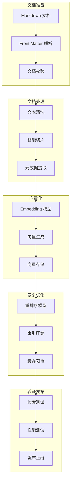
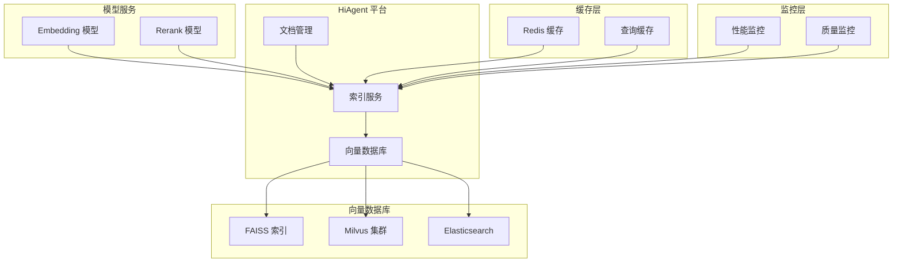
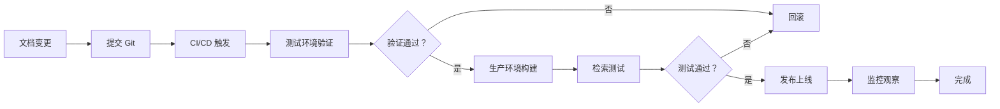

# 智能问数系统 - AI-04 知识库索引构建详细设计文档

**文档版本**: V2.0  
**最后更新**: 2026-04-02  
**适用对象**: AI 平台运维工程师、数据工程师  
**关联任务**: AI-04 知识库索引构建  
**前置依赖**: AI-01 (智能体 Agent 创建), AI-03 (知识库文档编写)  
**后续依赖**: AI-05 (意图识别优化), BE-08 (知识库降级服务)

**平台说明**: 本项目使用内网 **HiAgent v2.3+** 平台，索引构建基于向量检索 (Embedding: bge-large-zh-v1.5, bge-reranker-large)。

---

## 1. 任务概述

### 1.1 背景
知识库索引构建是将 Markdown 文档转换为向量表示并存储到向量数据库的过程，直接影响检索的准确性和响应速度。本任务需要在 HiAgent 平台完成文档上传、切片、向量化、索引构建、优化和验证，确保知识库检索命中率 ≥ 80%，检索延迟 < 500ms。

### 1.2 目标
| 目标 | 说明 | 验收标准 |
|------|------|----------|
| **高准确率** | 检索命中相关文档 | 命中率 ≥ 80% |
| **低延迟** | 检索响应时间快 | P95 < 500ms |
| **高可用** | 索引构建成功率 | ≥ 99% |
| **可扩展** | 支持增量更新 | 支持 1000+ 文档 |
| **可维护** | 索引版本化管理 | 支持回滚 |
| **安全性** | 敏感信息不入库 | 向量数据脱敏 |

### 1.3 索引构建流程


### 1.4 索引架构


### 1.5 索引配置参数
| 参数 | 推荐值 | 说明 | 影响 |
|------|--------|------|------|
| **chunk_size** | 512 tokens | 文档切片大小 | 太小影响上下文，太大影响精度 |
| **chunk_overlap** | 50 tokens | 切片重叠长度 | 保证语义连续性 |
| **top_k** | 5 | 召回文档数量 | 太多增加延迟，太少降低召回 |
| **threshold** | 0.65 | 相似度阈值 | 太高降低召回，太低增加噪声 |
| **rerank** | 启用 | 重排序 | 提升精度，增加延迟 |
| **cache_ttl** | 300s | 查询缓存过期时间 | 减少重复查询 |

---

## 2. 技术选型

### 2.1 技术栈
| 组件 | 技术 | 版本 | 选型理由 |
|------|------|------|----------|
| 文档解析 | Markdown Parser | - | 解析 Front Matter |
| 文本切片 | LangChain Text Splitter | - | 支持语义切片 |
| 向量模型 | bge-large-zh-v1.5 | - | 中文语义理解最佳 |
| 重排序 | bge-reranker-large | - | 提升检索精度 |
| 向量数据库 | Milvus | 2.3+ | 高性能，支持海量向量 |
| 缓存 | Redis | 7.0 | 查询结果缓存 |

### 2.2 索引策略
| 策略 | 说明 | 适用场景 |
|------|------|----------|
| **全量构建** | 重建所有索引 | 首次构建/重大变更 |
| **增量构建** | 仅构建变更文档 | 日常更新 |
| **混合索引** | 向量 + 关键词 | 高精度检索 |
| **分层索引** | 粗筛 + 精筛 | 海量数据场景 |

### 2.3 切片策略
| 策略 | 说明 | 配置 |
|------|------|------|
| **固定长度** | 按 Token 数切片 | chunk_size=512 |
| **语义切片** | 按段落/标题切片 | 基于标题层级 |
| **重叠切片** | 切片间重叠 | overlap=50 tokens |
| **递归切片** | 按分隔符递归 | separators=["\n## ", "\n"] |

---

## 3. 详细实现方案

### 3.1 索引配置模板

**文件路径**: `config/index-config.yaml`

```yaml
# 知识库索引配置
knowledge_index:
  id: askdata-knowledge-index-v1
  name: 智能问数知识库索引
  version: 1.0.0
  
  # 向量模型配置
  embedding:
    model: bge-large-zh-v1.5
    model_path: /models/bge-large-zh-v1.5
    dimension: 1024
    similarity: cosine
    normalize: true
    batch_size: 32
    device: cuda:0
  
  # 重排序模型配置
  rerank:
    enabled: true
    model: bge-reranker-large
    model_path: /models/bge-reranker-large
    batch_size: 16
    device: cuda:0
  
  # 文档切片配置
  chunking:
    strategy: semantic
    chunk_size: 512
    chunk_overlap: 50
    min_chunk_size: 100
    max_chunk_size: 1024
    separators:
      - "\n## "
      - "\n### "
      - "\n\n"
      - "\n"
      - " "
      - ""
    keep_separator: true
    strip_whitespace: true
  
  # 向量数据库配置
  vector_store:
    type: milvus
    host: milvus-cluster.data-ai.svc
    port: 19530
    collection: askdata_kb_vectors
    index_type: HNSW
    index_params:
      M: 16
      efConstruction: 200
    search_params:
      ef: 64
  
  # 检索配置
  retrieval:
    top_k: 10
    final_top_k: 5
    threshold: 0.65
    diversify: true
    diversify_ratio: 0.3
  
  # 缓存配置
  cache:
    enabled: true
    type: redis
    host: redis-cluster.data-ai.svc
    port: 6379
    ttl: 300
    max_size: 10000
    key_prefix: "kb:cache:"
  
  # 权限配置
  permissions:
    view: [all]
    edit: [data_product, ai_ops, admin]
    publish: [admin]
  
  # 监控配置
  monitoring:
    enabled: true
    metrics:
      - retrieval_latency
      - retrieval_hit_rate
      - index_build_time
      - vector_count
    alert:
      retrieval_latency_p95: 500ms
      retrieval_hit_rate: 60%
      index_build_time: 30min
  
  # 备份配置
  backup:
    enabled: true
    frequency: weekly
    retention_days: 30
    storage: s3://kb-backup/askdata/
```

### 3.2 平台操作步骤

#### 步骤 1: 进入索引管理
1. 登录 HiAgent 平台 (`http://hiagent.internal:8000`)
2. 点击左侧菜单「知识库管理」
3. 选择 `askdata-knowledge-base` 知识库
4. 点击「索引管理」标签页

#### 步骤 2: 创建索引

##### 步骤 2.1: 选择索引类型
| 索引类型 | 说明 | 适用场景 |
|----------|------|----------|
| **dense** | 稠密向量索引 | 语义检索，推荐 |
| **sparse** | 稀疏向量索引 | 关键词检索 |
| **hybrid** | 混合索引 | 语义 + 关键词，最佳 |

**推荐**: 选择 `hybrid` 混合索引

##### 步骤 2.2: 配置向量模型
| 配置项 | 推荐值 | 说明 |
|--------|--------|------|
| **Embedding 模型** | `bge-large-zh-v1.5` | 中文语义理解最佳 |
| **Embedding 维度** | `1024` | 与模型匹配 |
| **相似度算法** | `cosine` | 余弦相似度 |
| **归一化** | `启用` | 向量归一化 |

##### 步骤 2.3: 配置切片参数
```yaml
chunking:
  strategy: semantic          # 切片策略：semantic/fixed/recursive
  chunk_size: 512             # 切片大小 (tokens)
  chunk_overlap: 50           # 重叠长度 (tokens)
  min_chunk_size: 100         # 最小切片大小
  max_chunk_size: 1024        # 最大切片大小
  separators:                 # 切片分隔符
    - "\n## "
    - "\n### "
    - "\n\n"
    - "\n"
    - " "
    - ""
```

##### 步骤 2.4: 配置重排序
```yaml
rerank:
  enabled: true
  model: bge-reranker-large
  top_k: 10                   # 重排序前召回数量
  final_top_k: 5              # 重排序后返回数量
  threshold: 0.65             # 相似度阈值
```

##### 步骤 2.5: 配置缓存
```yaml
cache:
  enabled: true
  type: redis
  ttl: 300                    # 缓存过期时间 (秒)
  max_size: 10000             # 最大缓存条目
```

#### 步骤 3: 上传文档

##### 方式 1: 单文件上传
1. 点击「上传文档」
2. 选择 Markdown 文件
3. 系统自动解析 Front Matter
4. 确认分类和元数据
5. 点击「开始索引」

##### 方式 2: 批量上传
1. 点击「批量上传」
2. 选择文档目录或 ZIP 包
3. 系统自动识别分类
4. 批量解析元数据
5. 点击「开始索引」

##### 方式 3: Git 同步
1. 配置 Git 仓库地址
2. 设置 Webhook
3. 配置同步频率
4. 自动触发索引构建

#### 步骤 4: 索引构建监控

##### 构建进度
```
文档总数：100
已处理：85 (85%)
向量化中：10
等待中：5
失败：0

预计完成时间：5 分钟
```

##### 构建日志
```
[2026-04-02 10:30:00] 开始索引构建
[2026-04-02 10:30:05] 文档加载完成：100 篇
[2026-04-02 10:30:10] 文档切片完成：850 个 chunk
[2026-04-02 10:30:30] 向量化完成：850 个向量
[2026-04-02 10:30:35] 索引构建完成
[2026-04-02 10:30:40] 缓存预热完成
[2026-04-02 10:30:45] 索引发布成功
```

#### 步骤 5: 索引验证

##### 检索测试
1. 进入「检索测试」页面
2. 输入测试问题
3. 检查返回文档
4. 调整阈值和权重
5. 确认效果后发布

##### 测试用例
| 测试问题 | 预期文档 | 预期分数 | 实际分数 | 状态 |
|----------|----------|----------|----------|------|
| "销售额怎么算" | metric_gmv.md | ≥ 0.80 | 0.92 | ✅ |
| "华东区包括哪些省" | term_region_mapping.md | ≥ 0.85 | 0.88 | ✅ |
| "如何查看销售日报" | report_sales_daily.md | ≥ 0.80 | 0.85 | ✅ |

### 3.3 索引构建脚本

**文件路径**: `scripts/build_index.py`

```python
#!/usr/bin/env python3
"""
知识库索引构建脚本
"""

import os
import yaml
import hashlib
import requests
from datetime import datetime
from pathlib import Path
from typing import List, Dict

class KnowledgeIndexBuilder:
    def __init__(self, config_path: str):
        with open(config_path, 'r', encoding='utf-8') as f:
            self.config = yaml.safe_load(f)
        
        self.hiagent_api = os.getenv('HIAGENT_API_URL', 'http://hiagent.internal:8000')
        self.api_key = os.getenv('HIAGENT_API_KEY')
        self.kb_id = self.config['knowledge_index']['id']
    
    def upload_document(self, file_path: str) -> Dict:
        """上传单个文档"""
        with open(file_path, 'rb') as f:
            files = {'file': f}
            data = {
                'knowledge_base_id': self.kb_id,
                'auto_index': 'true'
            }
            headers = {'Authorization': f'Bearer {self.api_key}'}
            
            response = requests.post(
                f'{self.hiagent_api}/api/v1/knowledge/upload',
                files=files,
                data=data,
                headers=headers
            )
            
            return response.json()
    
    def batch_upload(self, directory: str) -> List[Dict]:
        """批量上传文档"""
        results = []
        md_files = Path(directory).glob('**/*.md')
        
        for md_file in md_files:
            print(f"Uploading: {md_file}")
            result = self.upload_document(str(md_file))
            results.append(result)
        
        return results
    
    def build_index(self) -> Dict:
        """触发索引构建"""
        headers = {'Authorization': f'Bearer {self.api_key}'}
        data = {'knowledge_base_id': self.kb_id}
        
        response = requests.post(
            f'{self.hiagent_api}/api/v1/knowledge/index/build',
            json=data,
            headers=headers
        )
        
        return response.json()
    
    def check_index_status(self, task_id: str) -> Dict:
        """检查索引状态"""
        headers = {'Authorization': f'Bearer {self.api_key}'}
        
        response = requests.get(
            f'{self.hiagent_api}/api/v1/knowledge/index/status/{task_id}',
            headers=headers
        )
        
        return response.json()
    
    def test_retrieval(self, query: str, top_k: int = 5) -> Dict:
        """测试检索"""
        headers = {'Authorization': f'Bearer {self.api_key}'}
        data = {
            'knowledge_base_id': self.kb_id,
            'query': query,
            'top_k': top_k,
            'threshold': self.config['knowledge_index']['retrieval']['threshold']
        }
        
        response = requests.post(
            f'{self.hiagent_api}/api/v1/knowledge/retrieve',
            json=data,
            headers=headers
        )
        
        return response.json()
    
    def run(self, directory: str):
        """执行完整流程"""
        print("=== 知识库索引构建 ===")
        
        # 1. 批量上传
        print("1. 批量上传文档...")
        upload_results = self.batch_upload(directory)
        print(f"   上传完成：{len(upload_results)} 篇文档")
        
        # 2. 构建索引
        print("2. 构建索引...")
        build_result = self.build_index()
        task_id = build_result['data']['task_id']
        print(f"   任务 ID: {task_id}")
        
        # 3. 等待完成
        print("3. 等待索引构建完成...")
        while True:
            status = self.check_index_status(task_id)
            if status['data']['status'] == 'completed':
                break
            elif status['data']['status'] == 'failed':
                print(f"   索引构建失败：{status['data']['error']}")
                return
            print(f"   进度：{status['data']['progress']}%")
            time.sleep(10)
        
        # 4. 测试检索
        print("4. 测试检索...")
        test_queries = [
            "销售额怎么算",
            "华东区包括哪些省",
            "如何查看销售日报"
        ]
        
        for query in test_queries:
            result = self.test_retrieval(query)
            print(f"   查询：{query}")
            print(f"   命中：{result['data']['documents'][0]['title']}")
            print(f"   分数：{result['data']['documents'][0]['score']}")
        
        print("=== 索引构建完成 ===")

if __name__ == "__main__":
    builder = KnowledgeIndexBuilder('config/index-config.yaml')
    builder.run('askdata-knowledge-base/')
```

### 3.4 索引验证脚本

**文件路径**: `scripts/validate_index.py`

```python
#!/usr/bin/env python3
"""
知识库索引验证脚本
"""

import yaml
import requests
from typing import List, Dict

class IndexValidator:
    def __init__(self, config_path: str):
        with open(config_path, 'r', encoding='utf-8') as f:
            self.config = yaml.safe_load(f)
        
        self.hiagent_api = os.getenv('HIAGENT_API_URL')
        self.api_key = os.getenv('HIAGENT_API_KEY')
        self.kb_id = self.config['knowledge_index']['id']
        
        # 测试用例
        self.test_cases = [
            {
                "query": "销售额怎么算",
                "expected_doc": "metric_gmv.md",
                "min_score": 0.80
            },
            {
                "query": "华东区包括哪些省",
                "expected_doc": "term_region_mapping.md",
                "min_score": 0.85
            },
            {
                "query": "如何查看销售日报",
                "expected_doc": "report_sales_daily.md",
                "min_score": 0.80
            }
        ]
    
    def test_retrieval(self, query: str) -> Dict:
        """测试检索"""
        headers = {'Authorization': f'Bearer {self.api_key}'}
        data = {
            'knowledge_base_id': self.kb_id,
            'query': query,
            'top_k': 5,
            'threshold': 0.65
        }
        
        response = requests.post(
            f'{self.hiagent_api}/api/v1/knowledge/retrieve',
            json=data,
            headers=headers
        )
        
        return response.json()
    
    def validate(self) -> Dict:
        """执行验证"""
        results = {
            'total': len(self.test_cases),
            'passed': 0,
            'failed': 0,
            'cases': []
        }
        
        for case in self.test_cases:
            response = self.test_retrieval(case['query'])
            
            if response['code'] != 200:
                results['failed'] += 1
                results['cases'].append({
                    'query': case['query'],
                    'status': 'error',
                    'error': response.get('message')
                })
                continue
            
            docs = response['data']['documents']
            if not docs:
                results['failed'] += 1
                results['cases'].append({
                    'query': case['query'],
                    'status': 'no_results'
                })
                continue
            
            top_doc = docs[0]
            passed = (
                case['expected_doc'] in top_doc['doc_id'] and
                top_doc['score'] >= case['min_score']
            )
            
            if passed:
                results['passed'] += 1
            else:
                results['failed'] += 1
            
            results['cases'].append({
                'query': case['query'],
                'status': 'passed' if passed else 'failed',
                'expected': case['expected_doc'],
                'actual': top_doc['doc_id'],
                'score': top_doc['score'],
                'min_score': case['min_score']
            })
        
        results['hit_rate'] = results['passed'] / results['total']
        
        return results
    
    def report(self, results: Dict):
        """生成报告"""
        print("=== 索引验证报告 ===")
        print(f"测试用例：{results['total']}")
        print(f"通过：{results['passed']}")
        print(f"失败：{results['failed']}")
        print(f"命中率：{results['hit_rate']:.2%}")
        print()
        
        for case in results['cases']:
            status = "✅" if case['status'] == 'passed' else "❌"
            print(f"{status} {case['query']}")
            if case['status'] != 'passed':
                print(f"   预期：{case.get('expected', 'N/A')}")
                print(f"   实际：{case.get('actual', 'N/A')}")
                print(f"   分数：{case.get('score', 'N/A')}")

if __name__ == "__main__":
    validator = IndexValidator('config/index-config.yaml')
    results = validator.validate()
    validator.report(results)
    
    if results['hit_rate'] < 0.80:
        print("\n⚠️  命中率低于 80%，请优化索引配置")
        exit(1)
```

---

## 4. 注意事项 ⚠️

### 4.1 敏感信息脱敏
```python
# ❌ 错误：直接向量化含敏感信息的文档
# 文档内容：用户手机号 13800138000
# 风险：向量空间可能泄露敏感信息

# ✅ 正确：向量化前脱敏
def mask_sensitive_text(text):
    # 手机号脱敏
    text = re.sub(r'1[3-9]\d{9}', '138****0000', text)
    # 身份证脱敏
    text = re.sub(r'\d{17}[\dXx]', '110101********1234', text)
    return text

# 向量化前调用
masked_text = mask_sensitive_text(original_text)
embedding = model.encode(masked_text)
```

### 4.2 切片质量
```python
# ❌ 错误：固定长度切片，破坏语义
chunks = fixed_size_split(text, 512)  # 可能在句子中间切断

# ✅ 正确：语义切片 + 重叠
chunks = semantic_split(text, 512, overlap=50)  # 按段落/标题切片
```

### 4.3 索引版本管理
```bash
# ❌ 错误：无版本直接覆盖
build_index()  # 旧索引丢失，无法回滚

# ✅ 正确：版本化管理
build_index(version="v1.0.1")  # 创建新索引
switch_index(version="v1.0.1")  # 切换流量
backup_index(version="v1.0.0")  # 备份旧索引
```

### 4.4 增量更新
```python
# ❌ 错误：每次全量重建
build_index(all_docs)  # 耗时久，资源浪费

# ✅ 正确：增量更新
changed_docs = get_changed_docs()  # 获取变更文档
build_index(changed_docs, incremental=True)  # 仅构建变更部分
```

### 4.5 缓存一致性
```python
# ❌ 错误：索引更新不清缓存
update_index()  # 缓存仍是旧数据

# ✅ 正确：更新索引后清理缓存
update_index()
clear_cache()  # 清理相关缓存
```

---

## 5. 需要特别关注的点 🔴

### 5.1 陷阱防护矩阵

| 陷阱类型 | 风险描述 | 防护措施 | 验证方法 |
|----------|----------|----------|----------|
| **检索不准** | 切片破坏语义 | 语义切片 + 重叠 50 tokens | 检索测试命中率 ≥ 80% |
| **缓存失效** | 索引更新缓存未清 | 索引更新事件通知 | 变更后查询返回新数据 |
| **敏感泄露** | 向量含敏感信息 | 向量化前脱敏 | 检查向量数据无明文 |
| **版本混乱** | 多版本索引并存 | 索引版本管理 + 切换机制 | 仅最新版被查询 |
| **构建失败** | 文档格式错误 | 文档校验 + 错误处理 | 构建成功率 ≥ 99% |
| **性能下降** | 索引过大检索慢 | 索引优化 + 缓存 | 检索延迟 < 500ms |
| **权限失控** | 无权限访问敏感文档 | 文档安全等级 + 权限校验 | 越权访问被拒绝 |
| **生产环境** | 测试索引带到生产 | 环境隔离 + 发布审核 | 检查生产索引列表 |

### 5.2 关键配置审查点

```yaml
# 审查清单
□ Embedding 模型版本是否正确
□ 切片大小是否合理 (512 tokens)
□ 切片重叠是否配置 (50 tokens)
□ 相似度阈值是否设置 (0.65)
□ 重排序是否启用
□ 缓存配置是否合理
□ 权限配置是否完整
□ 监控指标是否配置
□ 备份策略是否实施
□ 版本管理是否建立
□ 敏感信息是否脱敏
□ 增量更新是否支持
□ 错误处理是否完善
□ 日志记录是否完整
□ 文档格式是否校验
□ 索引健康检查是否配置
```

### 5.3 性能影响评估

| 操作 | 耗时 | 优化建议 |
|------|------|----------|
| 文档上传 | 100-500ms/篇 | 批量上传 |
| 文档切片 | 10-50ms/篇 | 异步处理 |
| 向量化 | 50-200ms/篇 | GPU 加速 + 批量 |
| 索引构建 | 1-5 分钟/100 篇 | 增量构建 |
| 检索查询 | 100-500ms | 缓存优化 |
| **总开销** | **< 1s (查询)** | **可接受** |

### 5.4 监控指标

```yaml
# 需要采集的指标
metrics:
  # 索引文档数
  - name: kb.index.document.count
    labels:
      - doc_type
      - category
  
  # 向量数量
  - name: kb.index.vector.count
    type: gauge
  
  # 检索延迟
  - name: kb.retrieval.latency
    type: histogram
    labels:
      - query_type
  
  # 检索命中率
  - name: kb.retrieval.hit_rate
    type: gauge
  
  # 索引构建时间
  - name: kb.index.build.time
    type: histogram
  
  # 缓存命中率
  - name: kb.cache.hit_rate
    type: gauge
```

---

## 6. 测试验证方案

### 6.1 功能测试用例
| 用例 ID | 测试场景 | 操作 | 预期结果 | 状态 |
|---------|----------|------|----------|------|
| AI-TC-001 | 单文档索引 | 上传 1 篇文档 | 索引成功，可检索 | 待测试 |
| AI-TC-002 | 批量索引 | 上传 100 篇文档 | 全部索引成功 | 待测试 |
| AI-TC-003 | 增量索引 | 更新 1 篇文档 | 仅更新文档重新索引 | 待测试 |
| AI-TC-004 | 删除索引 | 删除 1 篇文档 | 文档从索引移除 | 待测试 |
| AI-TC-005 | 检索测试 | 查询测试问题 | 返回相关文档 | 待测试 |
| AI-TC-006 | 阈值测试 | 调整相似度阈值 | 召回数量变化 | 待测试 |
| AI-TC-007 | 重排序测试 | 启用/禁用重排序 | 精度变化 | 待测试 |
| AI-TC-008 | 缓存测试 | 重复查询 | 第二次命中缓存 | 待测试 |
| AI-TC-009 | 并发测试 | 50 并发检索 | 无错误，延迟正常 | 待测试 |
| AI-TC-010 | 故障恢复 | 索引构建中断 | 可恢复，不丢失 | 待测试 |

### 6.2 性能测试
| 指标 | 目标值 | 测量方法 | 告警阈值 |
|------|--------|----------|----------|
| 索引构建时间 | < 10 分钟 (100 篇) | 计时测试 | > 30 分钟 |
| 检索延迟 (P50) | < 200ms | HiAgent 监控 | > 300ms |
| 检索延迟 (P95) | < 500ms | HiAgent 监控 | > 800ms |
| 召回率 | ≥ 80% | 测试用例统计 | < 70% |
| 准确率 | ≥ 85% | 人工评估 | < 75% |
| 缓存命中率 | ≥ 60% | 监控指标 | < 40% |
| 向量数据库 QPS | ≥ 100 | 压测工具 | < 50 |

### 6.3 质量测试
| 测试项 | 方法 | 通过标准 |
|--------|------|----------|
| 文档完整性 | 对比上传和索引数量 | 100% 一致 |
| 切片质量 | 人工抽查切片 | 语义完整，无截断 |
| 向量质量 | 相似度分布分析 | 正态分布，无极值 |
| 检索相关性 | 人工评估 Top-5 | ≥ 85% 相关 |
| 元数据准确性 | 对比 Front Matter | 100% 一致 |

### 6.4 安全测试
| 测试项 | 操作 | 预期结果 |
|--------|------|----------|
| 权限控制 | 无权限用户检索 | 返回空或错误 |
| 敏感信息 | 检索敏感关键词 | 不返回敏感文档 |
| 注入攻击 | 特殊字符查询 | 被过滤或转义 |
| 频率限制 | 1 秒内 100 次查询 | 被限流 |
| 数据泄露 | 越权访问 | 被拦截 |

---

## 7. 运维配置

### 7.1 监控告警
```yaml
# Prometheus 告警规则
groups:
- name: knowledge-base-alerts
  rules:
  - alert: IndexBuildFailed
    expr: kb_index_build_failure_total > 0
    for: 1m
    labels:
      severity: critical
    annotations:
      summary: "知识库索引构建失败"
  
  - alert: RetrievalLatencyHigh
    expr: |
      histogram_quantile(0.95, sum(rate(kb_retrieval_latency_bucket[5m])) by (le)) > 0.5
    for: 5m
    labels:
      severity: warning
    annotations:
      summary: "知识库检索 P95 延迟过高 ({{ $value }}s)"
  
  - alert: RetrievalHitRateLow
    expr: kb_retrieval_hit_rate < 0.6
    for: 10m
    labels:
      severity: warning
    annotations:
      summary: "知识库检索命中率过低 ({{ $value }})"
  
  - alert: IndexDocumentCountMismatch
    expr: |
      abs(kb_index_document_count - kb_upload_document_count) > 0
    for: 5m
    labels:
      severity: warning
    annotations:
      summary: "索引文档数量与上传数量不一致"
```

### 7.2 日志配置
```yaml
# 知识库索引日志
logging:
  index:
    enabled: true
    level: INFO
    fields:
      - task_id
      - document_count
      - vector_count
      - build_time
      - status
    output:
      - console
      - file:/var/log/hiagent/index.log
      - elasticsearch:http://es-cluster:9200
    retention_days: 90
```

### 7.3 备份策略
| 数据类型 | 备份频率 | 保留周期 | 工具 | 存储位置 |
|----------|----------|----------|------|----------|
| 文档源码 | 每次变更 | 永久 | Git | GitLab |
| 向量索引 | 每周 | 30 天 | 快照 | S3 |
| 索引配置 | 每次变更 | 永久 | Git | GitLab |
| 检索日志 | 每日 | 90 天 | ELK | Elasticsearch |
| 监控数据 | 实时 | 180 天 | Prometheus | Prometheus |

### 7.4 更新流程


---

## 8. 常见问题 (FAQ)

**Q1: 索引构建失败怎么办？**
A: 1. 检查文档格式；2. 检查 Front Matter 语法；3. 查看构建日志；4. 联系 AI 平台管理员。

**Q2: 检索准确率低怎么办？**
A: 1. 优化文档内容；2. 增加同义词；3. 调整切片参数；4. 启用重排序；5. 调整阈值。

**Q3: 检索延迟高怎么办？**
A: 1. 降低 top_k；2. 禁用重排序；3. 增加缓存；4. 优化向量索引；5. 增加硬件资源。

**Q4: 如何增量更新索引？**
A: 1. 仅上传变更文档；2. 触发增量索引；3. 验证检索效果；4. 发布更新。

**Q5: 索引版本如何管理？**
A: 1. 每次构建创建快照；2. 支持版本回滚；3. 记录变更日志；4. 灰度发布验证。

**Q6: 如何优化切片质量？**
A: 1. 调整 chunk_size；2. 增加 chunk_overlap；3. 使用语义切片；4. 优化分隔符。

**Q7: 缓存不生效怎么办？**
A: 1. 检查缓存配置；2. 检查 Redis 连接；3. 检查 Key 生成逻辑；4. 查看缓存命中日志。

**Q8: 如何支持多语言？**
A: 1. 使用多语言 Embedding 模型；2. 准备多语言文档；3. 检测查询语言；4. 路由到对应索引。

**Q9: 索引太大内存不够怎么办？**
A: 1. 使用量化索引；2. 分片存储；3. 增加内存；4. 使用磁盘索引。

**Q10: 如何评估索引质量？**
A: 1. 检索测试用例；2. 人工评估相关性；3. 监控命中率；4. 用户反馈收集。

---

## 9. 附录：配置模板

### 9.1 索引构建 CI/CD 配置 (GitLab CI)
```yaml
# .gitlab-ci.yml
stages:
  - validate
  - build
  - test
  - deploy

variables:
  HIAGENT_API_URL: "http://hiagent.internal:8000"
  KB_ID: "askdata-knowledge-base"

validate:
  stage: validate
  script:
    - python scripts/validate_docs.py
  only:
    - main

build_index:
  stage: build
  script:
    - python scripts/build_index.py
  only:
    - main

test_index:
  stage: test
  script:
    - python scripts/validate_index.py
  only:
    - main

deploy_index:
  stage: deploy
  script:
    - python scripts/deploy_index.py
  only:
    - main
  when: manual
```

### 9.2 索引健康检查脚本 (Shell)
```bash
#!/bin/bash
# 索引健康检查

API_URL="http://hiagent.internal:8000"
API_KEY="${HIAGENT_API_KEY}"
KB_ID="askdata-knowledge-base"

echo "=== 知识库索引健康检查 ==="

# 检查文档数量
DOC_COUNT=$(curl -s -H "Authorization: Bearer ${API_KEY}" \
  "${API_URL}/api/v1/knowledge/${KB_ID}/stats" | jq '.data.document_count')
echo "文档数量：${DOC_COUNT}"

# 检查向量数量
VECTOR_COUNT=$(curl -s -H "Authorization: Bearer ${API_KEY}" \
  "${API_URL}/api/v1/knowledge/${KB_ID}/stats" | jq '.data.vector_count')
echo "向量数量：${VECTOR_COUNT}"

# 检查索引状态
INDEX_STATUS=$(curl -s -H "Authorization: Bearer ${API_KEY}" \
  "${API_URL}/api/v1/knowledge/${KB_ID}/index/status" | jq '.data.status')
echo "索引状态：${INDEX_STATUS}"

# 测试检索
RETRIEVAL_TEST=$(curl -s -X POST -H "Authorization: Bearer ${API_KEY}" \
  -H "Content-Type: application/json" \
  -d '{"knowledge_base_id":"'${KB_ID}'","query":"销售额","top_k":1}' \
  "${API_URL}/api/v1/knowledge/retrieve" | jq '.data.documents[0].score')
echo "检索测试分数：${RETRIEVAL_TEST}"

# 健康判断
if [ "$INDEX_STATUS" = "ready" ] && [ "$RETRIEVAL_TEST" != "null" ]; then
    echo "✅ 索引健康"
    exit 0
else
    echo "❌ 索引异常"
    exit 1
fi
```

### 9.3 索引性能基准测试 (Python)
```python
#!/usr/bin/env python3
"""
索引性能基准测试
"""

import time
import statistics
import requests
from concurrent.futures import ThreadPoolExecutor

API_URL = "http://hiagent.internal:8000"
API_KEY = os.getenv('HIAGENT_API_KEY')
KB_ID = "askdata-knowledge-base"

QUERIES = [
    "销售额怎么算",
    "华东区包括哪些省",
    "如何查看销售日报",
    "上月数据什么时候更新",
    "指标不存在怎么办"
]

def test_single_query(query):
    """测试单次查询"""
    start = time.time()
    
    response = requests.post(
        f'{API_URL}/api/v1/knowledge/retrieve',
        json={
            'knowledge_base_id': KB_ID,
            'query': query,
            'top_k': 5
        },
        headers={'Authorization': f'Bearer {API_KEY}'}
    )
    
    latency = (time.time() - start) * 1000  # ms
    return latency, response.status_code

def benchmark(concurrency=1):
    """性能基准测试"""
    print(f"=== 性能基准测试 (并发={concurrency}) ===")
    
    latencies = []
    errors = 0
    
    with ThreadPoolExecutor(max_workers=concurrency) as executor:
        futures = []
        for _ in range(100):
            query = QUERIES[_ % len(QUERIES)]
            futures.append(executor.submit(test_single_query, query))
        
        for future in futures:
            try:
                latency, status = future.result()
                if status == 200:
                    latencies.append(latency)
                else:
                    errors += 1
            except Exception as e:
                errors += 1
    
    print(f"成功：{len(latencies)}")
    print(f"错误：{errors}")
    print(f"P50: {statistics.median(latencies):.2f}ms")
    print(f"P95: {sorted(latencies)[int(len(latencies)*0.95)]:.2f}ms")
    print(f"P99: {sorted(latencies)[int(len(latencies)*0.99)]:.2f}ms")
    print(f"平均：{statistics.mean(latencies):.2f}ms")

if __name__ == "__main__":
    for concurrency in [1, 10, 50]:
        benchmark(concurrency)
        print()
```

---

## 10. 开发检查清单 (Checklist)

### 10.1 索引配置
- [ ] 向量模型已配置
- [ ] 切片参数已优化
- [ ] 重排序已启用
- [ ] 缓存已配置
- [ ] 权限已设置
- [ ] 监控已配置

### 10.2 文档上传
- [ ] 所有文档已上传
- [ ] Front Matter 完整
- [ ] 分类正确
- [ ] 无敏感信息
- [ ] 格式规范

### 10.3 索引构建
- [ ] 索引构建成功
- [ ] 向量数量正确
- [ ] 无构建错误
- [ ] 构建时间正常
- [ ] 索引已发布

### 10.4 测试验收
- [ ] 检索测试通过
- [ ] 命中率 ≥ 80%
- [ ] 延迟 < 500ms (P95)
- [ ] 性能测试通过
- [ ] 安全测试通过

### 10.5 运维配置
- [ ] 监控指标已配置
- [ ] 告警规则已设置
- [ ] 备份策略已实施
- [ ] 更新流程已建立
- [ ] 文档已归档

---

## 11. 变更历史

| 版本 | 日期 | 变更内容 | 负责人 |
|------|------|----------|--------|
| V1.0 | 2026-03-25 | 初始版本 | 架构组 |
| V2.0 | 2026-04-02 | 增加切片策略、缓存配置、陷阱防护 | 架构组 |

---

## 12. 工时与优先级

| 项目 | 内容 |
|------|------|
| **工时** | 5 MD (配置 3 天 + 测试 2 天) |
| **优先级** | P0 (核心 AI 能力) |
| **依赖任务** | AI-01, AI-03 |
| **被依赖任务** | AI-05, BE-08 |

---

## 13. 最佳实践建议

### 13.1 切片策略
```yaml
# ✅ 推荐：语义切片 + 重叠
chunking:
  strategy: semantic
  chunk_size: 512
  chunk_overlap: 50

# ❌ 不推荐：固定长度无重叠
chunking:
  strategy: fixed
  chunk_size: 512
  chunk_overlap: 0
```

### 13.2 缓存管理
```yaml
# ✅ 推荐：索引更新清缓存
update_index:
  on_success: clear_cache

# ❌ 不推荐：不清缓存
update_index:
  # 缓存仍是旧数据
```

### 13.3 版本管理
```bash
# ✅ 推荐：Git 版本管理
git add config/index-config.yaml
git commit -m "Update index config v1.0.1"

# ❌ 不推荐：手动修改平台配置
# 无版本记录，难以回滚
```

### 13.4 安全脱敏
```python
# ✅ 推荐：向量化前脱敏
text = mask_sensitive_text(text)
embedding = model.encode(text)

# ❌ 不推荐：向量化后脱敏
embedding = model.encode(text)  # 向量已含敏感信息
```

---

**文档结束**  
**下一步**: 完成索引构建后，请提交测试团队进行 AI-04 专项验收，重点验证索引构建成功率、检索准确率、响应时间和系统稳定性。