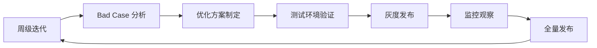

# 智能问数系统 - AI-05 意图识别优化详细设计文档

**文档版本**: V2.0  
**最后更新**: 2026-04-02  
**适用对象**: AI 平台运维工程师、算法工程师、数据产品经理  
**关联任务**: AI-05 意图识别优化  
**前置依赖**: AI-01 (智能体 Agent 创建), AI-02 (工具注册), AI-03 (知识库文档), AI-04 (知识库索引)  
**后续依赖**: 全链路测试，持续运营优化

**平台说明**: 本项目使用内网 **HiAgent v2.3+** 平台，基于离线大模型 (Qwen-14B-Chat/CodeLlama-13B)。

---

## 1. 任务概述

### 1.1 背景
意图识别是智能问数系统的第一道关卡，其准确率直接决定后续查询、澄清或降级的走向。在系统上线初期，由于用户问法多样、业务术语复杂，意图识别可能存在准确率波动、置信度校准不准、边界案例处理不当等问题。本任务旨在建立一套持续的意图识别优化机制，通过数据分析、Prompt 迭代、Few-Shot 增强等手段，将识别准确率提升至 90% 以上。

### 1.2 目标
| 目标 | 说明 | 验收标准 |
|------|------|----------|
| **高准确率** | 意图识别准确率 ≥ 90%，实体提取完整率 ≥ 85% | 黄金测试集验证 |
| **置信度校准** | 置信度分数与实际准确率匹配 (误差 < 10%) | ECE < 0.1 |
| **低延迟** | 优化后响应时间增加 < 200ms | 性能测试验证 |
| **可迭代** | 建立周级优化迭代流程 | 流程文档化 |
| **可量化** | 所有优化效果可度量、可对比 | 监控指标完善 |
| **鲁棒性** | 对抗噪点、错别字、模糊提问有较强容错能力 | 对抗测试通过 |

### 1.3 优化架构图
```mermaid
flowchart TB
    subgraph "数据收集"
        A[用户提问日志] --> B[Bad Case 标注]
        C[反馈数据 (👍/👎)] --> B
        D[人工审核记录] --> B
    end
    
    subgraph "分析诊断"
        B --> E[错误分类]
        E --> F[Prompt 问题]
        E --> G[知识缺失]
        E --> H[模型能力限制]
    end
    
    subgraph "优化策略"
        F --> I[Prompt 迭代]
        G --> J[知识库补充]
        H --> K[模型微调/换模型]
        I & J & K --> L[Few-Shot 增强]
    end
    
    subgraph "验证发布"
        L --> M[A/B 测试]
        M --> N[效果评估]
        N --> O{达标？}
        O -->|是 | P[全量发布]
        O -->|否 | B
    end
```

### 1.4 优化维度
| 维度 | 说明 | 优先级 | 预期提升 |
|------|------|--------|----------|
| **Prompt 工程** | 优化系统提示词、指令清晰度 | P0 | +5~10% |
| **Few-Shot 增强** | 增加高质量示例，覆盖边界场景 | P0 | +5~15% |
| **知识库增强** | 补充缺失的指标/术语定义 | P1 | +5~10% |
| **置信度校准** | 调整阈值，使分数更可信 | P1 | 提升用户体验 |
| **后处理规则** | 规则修正常见错误 (如时间归一化) | P2 | +2~5% |
| **模型微调** | 基于标注数据 Fine-tuning | P3 | +10~20% (成本高) |

---

## 2. 优化策略与实施

### 2.1 Prompt 迭代优化

#### 2.1.1 常见问题诊断
| 问题类型 | 表现 | 优化方向 |
|----------|------|----------|
| **指令模糊** | 模型输出不稳定，格式偶尔错误 | 强化格式约束，使用 JSON Schema |
| **上下文丢失** | 多轮对话中忘记之前参数 | 增加上下文窗口，显式传递历史 |
| **过度自信** | 不懂的问题强行回答 | 增加"不知道"的出口，降低 Temperature |
| **实体提取错误** | 时间、地区识别不准 | 增加实体定义和示例 |
| **策略推荐错误** | 该调用工具时推荐了知识库 | 明确策略选择规则 |

#### 2.1.2 Prompt 优化模板
```markdown
# 角色定义 (保持不变)
...

# 优化点 1: 强化约束
⚠️ 重要约束：
1. 必须输出严格 JSON，不要包含 ```json 标记
2. 如果无法识别意图，intent 必须为 "unknown"
3. 置信度低于 0.5 时，recommendedStrategy 必须为 "FALLBACK_KB"

# 优化点 2: 增加思维链 (CoT)
在输出 JSON 前，先在内部思考：
1. 用户的核心意图是什么？
2. 缺少哪些必要参数？
3. 哪个工具或策略最适合？

# 优化点 3: 明确边界情况
边界情况处理：
- "查一下数据" -> intent: unknown, needClarify: true
- "销售额" (无时间地区) -> intent: sales_report, needClarify: true
- "昨天" -> timeValue: "yesterday" (后端会转换)
```

#### 2.1.3 版本管理
```bash
# Prompt 版本命名
prompt_v{major}.{minor}.{patch}

# 示例
prompt_v1.0.0  # 初始版本
prompt_v1.1.0  # 增加时间实体识别约束
prompt_v1.2.0  # 优化置信度校准逻辑

# 变更日志
## [1.2.0] - 2026-04-10
### Changed
- 降低 Temperature 从 0.1 到 0.05 (提高稳定性)
- 增加"未知意图"的判定规则

### Added
- 增加 5 个边界场景的 Few-Shot 示例
```

### 2.2 Few-Shot 示例增强

#### 2.2.1 示例选择原则
| 原则 | 说明 | 示例 |
|------|------|------|
| **覆盖度** | 覆盖所有意图类型 | 销售、用户、运营、未知 |
| **多样性** | 问法多样 (口语/正式/省略) | "查销售额" vs "我想看下销售数据" |
| **边界性** | 包含模糊、缺失、错误场景 | "那个数据"、"查一下" |
| **代表性** | 选择高频提问 | 基于日志统计 Top 50 问法 |
| **正确性** | 确保标注 100% 正确 | 人工审核确认 |

#### 2.2.2 示例库管理
**文件路径**: `prompts/few_shot_examples.yaml`

```yaml
few_shot_examples:
  - id: ex_001
    category: sales_clear
    user: "华东区上月销售额"
    assistant: '{"intent": "sales_report", "confidence": 0.95, ...}'
    weight: 1.0
    
  - id: ex_002
    category: sales_vague
    user: "卖得怎么样"
    assistant: '{"intent": "unknown", "confidence": 0.30, "needClarify": true, ...}'
    weight: 1.5  # 提高权重，防止过度自信
    
  - id: ex_003
    category: multi_turn
    user: "对比一下华北区"
    context: ["上月销售额是多少", "华东区"]
    assistant: '{"intent": "sales_report", "confidence": 0.90, "filters": [{"field": "region", "value": "huabei"}], ...}'
    weight: 1.2
    
  - id: ex_004
    category: entity_error
    user: "查一下 2025 年的数据"
    assistant: '{"intent": "unknown", "confidence": 0.40, "clarifyQuestion": "2025 年数据尚未生成，您想查 2024 年吗？", ...}'
    weight: 1.0
```

#### 2.2.3 动态示例选择
在 HiAgent 平台配置动态示例检索：
1. 用户提问 -> 2. 向量检索相似示例 -> 3. 注入 Prompt -> 4. 模型生成
*优点*: 示例更相关，提升少样本学习效果。

### 2.3 置信度校准

#### 2.3.1 问题分析
模型输出的 `confidence` 分数往往过于乐观 (如实际错误但给 0.9 分)。

#### 2.3.2 校准方法
| 方法 | 说明 | 实施难度 |
|------|------|----------|
| **阈值调整** | 提高高置信度门槛 (0.85 -> 0.90) | 低 |
| **后处理校准** | 基于历史数据拟合校准曲线 | 中 |
| **Prompt 引导** | 要求模型保守评分 | 低 |
| **集成投票** | 多次生成取平均 (成本高) | 高 |

#### 2.3.3 Prompt 引导示例
```markdown
# 置信度评分指南
请根据以下标准评估置信度：
- 0.9-1.0: 意图明确，参数完整，工具匹配
- 0.7-0.9: 意图明确，但缺 1-2 个参数
- 0.5-0.7: 意图模糊，或参数缺失严重
- 0.0-0.5: 无法识别，或无关问题

⚠️ 宁低勿高：如果不确定，请给低分，触发澄清或降级。
```

#### 2.3.4 校准曲线拟合 (Python)
```python
# 基于历史日志拟合校准曲线
import numpy as np
from sklearn.calibration import calibration_curve

# 加载历史数据
predicted_conf = logs['confidence']  # 模型输出分数
actual_correct = logs['is_correct']  # 实际是否正确 (0/1)

# 计算校准曲线
fraction_of_positives, mean_predicted_value = calibration_curve(
    actual_correct, predicted_conf, n_bins=10
)

# 分析：如果 mean_predicted_value > fraction_of_positives，说明模型过度自信
# 优化：调整 Prompt 或后处理修正分数
```

### 2.4 后处理规则增强

#### 2.4.1 规则引擎
在 HiAgent 输出后，Java 后端增加一层规则校验。

**文件路径**: `src/main/java/com/company/askdata/service/IntentPostProcessor.java`

```java
public class IntentPostProcessor {
    
    /**
     * 后处理修正
     */
    public IntentResult process(IntentResult result, String userQuery) {
        // 1. 时间实体归一化
        result = normalizeTime(result, userQuery);
        
        // 2. 置信度强制修正
        result = calibrateConfidence(result, userQuery);
        
        // 3. 敏感词过滤
        result = filterSensitiveWords(result);
        
        // 4. 必填参数检查
        result = checkRequiredSlots(result);
        
        return result;
    }
    
    /**
     * 时间归一化示例
     */
    private IntentResult normalizeTime(IntentResult result, String query) {
        if (query.contains("昨天")) {
            // 强制修正 timeValue
            result.getEntities().put("timeValue", "yesterday");
        }
        return result;
    }
    
    /**
     * 置信度修正 (针对短 query)
     */
    private IntentResult calibrateConfidence(IntentResult result, String query) {
        if (query.length() < 5 && result.getConfidence() > 0.8) {
            // 太短的问题不应高置信
            result.setConfidence(0.5);
            result.setNeedClarify(true);
        }
        return result;
    }
}
```

### 2.5 知识库增强联动

#### 2.5.1 缺失指标发现
通过分析 `FALLBACK_KB` 中 `METRIC_NOT_FOUND` 的案例，发现未录入语义层的指标。

#### 2.5.2 术语同义词补充
分析用户提问用词与知识库 `aliases` 的匹配度，补充高频同义词。
*示例*: 用户常问"营收"，但知识库只有"销售额"，需添加 `aliases: ["营收"]`。

---

## 3. 测试验证方案

### 3.1 黄金测试集 (Golden Set)
构建包含 200+ 条标注数据的测试集，用于每次优化后的回归测试。

| 类别 | 数量 | 说明 |
|------|------|------|
| 明确查询 | 80 | 意图清晰，参数完整 |
| 参数缺失 | 40 | 缺时间、地区或指标 |
| 模糊提问 | 40 | "查一下"、"怎么样" |
| 多轮对话 | 20 | 依赖上下文 |
| 边界/错误 | 20 | 错别字、无关问题、未来时间 |

### 3.2 评估指标
| 指标 | 计算公式 | 目标值 | 权重 |
|------|----------|--------|------|
| **意图准确率** | 正确识别数 / 总数 | ≥ 90% | 40% |
| **实体 F1 分数** | 2 * (Precision*Recall)/(Precision+Recall) | ≥ 85% | 30% |
| **策略准确率** | 推荐策略正确数 / 总数 | ≥ 90% | 20% |
| **置信度 ECE** | Expected Calibration Error | < 0.1 | 10% |
| **平均延迟** | 总耗时 / 请求数 | < 3s | - |

### 3.3 A/B 测试方案
```mermaid
flowchart LR
    A[用户流量] --> B{路由分发}
    B -->|50%| C[对照组 (当前版本)]
    B -->|50%| D[实验组 (优化版本)]
    C --> E[指标收集]
    D --> E
    E --> F[效果对比]
    F --> G{实验组更优？}
    G -->|是 | H[全量发布]
    G -->|否 | I[回滚分析]
```

#### 对比指标
1. **意图识别准确率** (人工抽样)
2. **后续查询成功率** (自动指标)
3. **用户满意度** (👍/👎反馈)
4. **降级率变化** (Fallback 比例)

### 3.4 自动化测试脚本
**文件路径**: `scripts/run_intent_test.py`

```python
#!/usr/bin/env python3
"""
意图识别自动化测试
"""

import json
import requests
from typing import List, Dict

class IntentTester:
    def __init__(self, api_url: str, api_key: str):
        self.api_url = api_url
        self.api_key = api_key
        self.test_cases = self.load_golden_set('tests/golden_set.json')
    
    def load_golden_set(self, path: str) -> List[Dict]:
        with open(path, 'r', encoding='utf-8') as f:
            return json.load(f)
    
    def test_single(self, case: Dict) -> Dict:
        response = requests.post(
            f'{self.api_url}/api/v1/agent/recognize',
            json={'query': case['query'], 'history': case.get('history', [])},
            headers={'Authorization': f'Bearer {self.api_key}'}
        )
        result = response.json()['data']
        
        # 评估
        passed = (
            result['intent'] == case['expected_intent'] and
            result['confidence'] >= case['min_confidence']
        )
        
        return {
            'query': case['query'],
            'passed': passed,
            'expected': case['expected_intent'],
            'actual': result['intent'],
            'confidence': result['confidence']
        }
    
    def run(self):
        results = [self.test_single(case) for case in self.test_cases]
        passed = sum(1 for r in results if r['passed'])
        total = len(results)
        
        print(f"=== 意图识别测试结果 ===")
        print(f"通过率：{passed}/{total} ({passed/total:.2%})")
        
        if passed/total < 0.90:
            print("⚠️  准确率低于 90%，请优化！")
            # 打印失败案例
            for r in results:
                if not r['passed']:
                    print(f"❌ {r['query']} (预期:{r['expected']}, 实际:{r['actual']})")
            return False
        return True

if __name__ == "__main__":
    tester = IntentTester('http://hiagent.internal:8000', 'sk-test-xxx')
    success = tester.run()
    exit(0 if success else 1)
```

---

## 4. 注意事项 ⚠️

### 4.1 过拟合风险
```python
# ❌ 错误：仅优化测试集通过率
# 针对测试集特定问法调整 Prompt，导致泛化能力下降

# ✅ 正确：基于真实分布优化
# 分析线上真实用户提问分布，确保测试集代表性
```

### 4.2 置信度膨胀
```python
# ❌ 错误：盲目提高置信度阈值
# 导致大量正常请求被降级

# ✅ 正确：校准置信度
# 基于历史数据拟合校准曲线，使置信度反映真实准确率
```

### 4.3 上下文污染
```python
# ❌ 错误：多轮对话中错误参数被继承
# 用户修正后，旧参数仍存在于上下文

# ✅ 正确：上下文管理
# 显式管理已确认参数槽位，支持参数撤销/修正
```

### 4.4 性能与准确率平衡
```python
# ❌ 错误：过度增加 Few-Shot 示例
# 导致 Token 消耗过大，延迟增加

# ✅ 正确：动态示例选择
# 仅选择最相关的 5-10 个示例，控制 Token 数量
```

### 4.5 安全约束
```python
# ❌ 错误：优化时忽略安全约束
# 为提升准确率放宽安全限制

# ✅ 正确：安全优先
# 所有优化必须在安全约束范围内进行，定期安全测试
```

---

## 5. 需要特别关注的点 🔴

### 5.1 陷阱防护矩阵

| 陷阱类型 | 风险描述 | 防护措施 | 验证方法 |
|----------|----------|----------|----------|
| **过拟合** | 测试集准确率高，线上低 | 测试集代表真实分布 | 线上 A/B 测试验证 |
| **置信度膨胀** | 模型过度自信 | 置信度校准 + Prompt 引导 | ECE < 0.1 |
| **上下文污染** | 错误参数被继承 | 上下文版本控制 + 修正机制 | 多轮对话测试 |
| **性能下降** | 优化导致延迟增加 | 控制 Prompt 长度 + 动态示例 | 延迟监控 < 3s |
| **安全漏洞** | 优化引入注入风险 | 安全约束 + 输入过滤 | 安全渗透测试 |
| **数据泄露** | 优化日志含敏感信息 | 日志脱敏 + 权限控制 | 日志安全检查 |
| **版本混乱** | 多版本 Prompt 并存 | 版本管理 + 灰度发布 | 配置中心检查 |
| **评估偏差** | 人工标注不一致 | 标注规范 + 多人校验 | 标注一致性检查 |

### 5.2 关键配置审查点

```yaml
# 审查清单
□ Prompt 版本是否管理
□ Few-Shot 示例是否覆盖边界
□ 置信度校准是否实施
□ 后处理规则是否完整
□ 安全约束是否保留
□ 测试集是否具有代表性
□ A/B 测试配置是否正确
□ 监控指标是否完善
□ 回滚机制是否可用
□ 日志是否脱敏
□ 权限控制是否严格
□ 性能影响是否评估
□ 成本消耗是否可控
□ 文档是否更新
□ 团队是否培训
```

### 5.3 性能影响评估

| 操作 | 耗时 | 优化建议 |
|------|------|----------|
| Prompt 增加 | 10-50ms/100 tokens | 控制 Prompt 长度 |
| Few-Shot 检索 | 50-200ms | 缓存检索结果 |
| 置信度校准 | < 5ms | 无需优化 |
| 后处理规则 | < 10ms | 无需优化 |
| **总开销** | **< 200ms** | **可接受** |

### 5.4 监控指标

```yaml
# 需要采集的指标
metrics:
  # 意图识别准确率
  - name: ai.intent.accuracy
    labels:
      - intent_type
      - version
  
  # 置信度分布
  - name: ai.intent.confidence.distribution
    type: histogram
    labels:
      - is_correct
  
  # 校准误差 (ECE)
  - name: ai.intent.calibration.error
    type: gauge
  
  # 优化迭代次数
  - name: ai.optimization.iteration.count
    labels:
      - type
  
  # Bad Case 数量
  - name: ai.optimization.badcase.count
    labels:
      - category
```

---

## 6. 运维配置

### 6.1 监控告警
```yaml
# Prometheus 告警规则
groups:
- name: intent-optimization-alerts
  rules:
  - alert: IntentAccuracyDrop
    expr: ai_intent_accuracy < 0.85
    for: 10m
    labels:
      severity: warning
    annotations:
      summary: "意图识别准确率下降 ({{ $value }})"
  
  - alert: ConfidenceCalibrationErrorHigh
    expr: ai_intent_calibration_error > 0.15
    for: 1h
    labels:
      severity: warning
    annotations:
      summary: "置信度校准误差过高 ({{ $value }})"
  
  - alert: OptimizationIterationFailed
    expr: ai_optimization_iteration_status == 0
    for: 1h
    labels:
      severity: warning
    annotations:
      summary: "优化迭代失败"
```

### 6.2 日志配置
```yaml
# 优化日志配置
logging:
  optimization:
    enabled: true
    level: INFO
    fields:
      - trace_id
      - old_version
      - new_version
      - accuracy_before
      - accuracy_after
      - badcase_count
    output:
      - console
      - file:/var/log/hiagent/optimization.log
    retention_days: 180
```

### 6.3 备份策略
| 数据类型 | 备份频率 | 保留周期 | 工具 |
|----------|----------|----------|------|
| Prompt 配置 | 每次变更 | 永久 | Git |
| 测试集 | 每次更新 | 永久 | Git |
| 标注数据 | 每周 | 1 年 | 数据库备份 |
| 优化日志 | 每日 | 180 天 | ELK |

### 6.4 迭代流程


---

## 7. 常见问题 (FAQ)

**Q1: 优化后准确率反而下降了怎么办？**
A: 1. 立即回滚到上一版本；2. 分析新增的 Bad Case；3. 检查是否过拟合测试集；4. 扩大测试集覆盖面。

**Q2: 模型响应变慢了怎么办？**
A: 1. 减少 Few-Shot 示例数量；2. 缩短 Prompt 长度；3. 检查是否启用了重排序；4. 优化模型推理配置。

**Q3: 如何平衡准确率和召回率？**
A: 1. 调整置信度阈值；2. 对于高价值场景 (如查询)，优先保准确率；3. 对于引导场景，优先保召回率。

**Q4: 多轮对话效果不好怎么办？**
A: 1. 增加上下文窗口大小；2. 在 Prompt 中显式总结历史；3. 增加多轮对话的 Few-Shot 示例。

**Q5: 如何评估优化效果？**
A: 1. 黄金测试集通过率；2. 线上 A/B 测试数据；3. 用户反馈满意度；4. 后续查询成功率。

**Q6: 模型微调值得做吗？**
A: 1. 先尝试 Prompt 和 Few-Shot 优化 (成本低)；2. 如果瓶颈明显且数据充足 (≥1000 条标注)，再考虑微调。

**Q7: 如何处理新业务指标？**
A: 1. 更新知识库文档；2. 更新 Few-Shot 示例；3. 更新工具注册；4. 验证识别效果。

**Q8: 置信度分数一直很高怎么办？**
A: 1. 在 Prompt 中强调"宁低勿高"；2. 增加"不确定"的示例；3. 后处理强制降低短 Query 分数。

**Q9: 如何防止 Prompt 注入攻击？**
A: 1. 在 Prompt 中明确安全约束；2. 过滤用户输入特殊字符；3. 后端二次校验意图。

**Q10: 优化工作何时停止？**
A: 当准确率达到目标 (90%) 且边际收益递减时，转为日常监控和按需优化。

---

## 8. 附录：配置模板

### 8.1 优化记录表 (Excel/Markdown)
```markdown
| 日期 | 版本 | 优化内容 | 测试集准确率 | 线上反馈 | 负责人 | 状态 |
|------|------|----------|--------------|----------|--------|------|
| 04-01 | v1.0 | 初始版本 | 82% | - | 张三 | 已发布 |
| 04-08 | v1.1 | 增加时间实体示例 | 85% | 👍 提升 | 李四 | 已发布 |
| 04-15 | v1.2 | 置信度校准 | 88% | 👍 更准 | 王五 | 已发布 |
| 04-22 | v1.3 | 优化模糊提问处理 | 91% | 👍 达标 | 张三 | 已发布 |
```

### 8.2 Bad Case 标注模板
```json
{
  "id": "bad_case_001",
  "query": "查一下那个数据",
  "expected_intent": "unknown",
  "actual_intent": "sales_report",
  "error_type": "over_confident",
  "confidence": 0.85,
  "analysis": "问题太模糊，模型过度自信",
  "solution": "增加模糊提问示例，降低置信度",
  "status": "fixed"
}
```

### 8.3 优化效果报告模板
```markdown
# 意图识别优化报告 (v1.3)

## 优化目标
- 提升模糊提问识别准确率
- 校准置信度分数

## 优化措施
1. 增加 10 个模糊提问 Few-Shot 示例
2. Prompt 增加"宁低勿高"约束
3. 后处理降低短 Query 置信度

## 测试结果
- 黄金测试集：88% -> 91% (+3%)
- 线上 A/B 测试：满意度 4.2 -> 4.5
- 响应时间：2.5s -> 2.6s (+0.1s)

## 结论
✅ 优化有效，建议全量发布
```

---

## 9. 开发检查清单 (Checklist)

### 9.1 优化实施
- [ ] Bad Case 分析完成 (≥50 个案例)
- [ ] Prompt 迭代版本已保存
- [ ] Few-Shot 示例已更新 (≥20 个)
- [ ] 置信度校准策略已实施
- [ ] 后处理规则已开发
- [ ] 知识库缺失已补充

### 9.2 测试验证
- [ ] 黄金测试集通过率 ≥ 90%
- [ ] A/B 测试效果显著
- [ ] 响应时间增加 < 200ms
- [ ] 无回归错误
- [ ] 安全测试通过

### 9.3 运营配置
- [ ] 监控指标已配置
- [ ] 告警规则已设置
- [ ] 迭代流程已建立
- [ ] 文档已更新
- [ ] 团队培训已完成

---

## 10. 变更历史

| 版本 | 日期 | 变更内容 | 负责人 |
|------|------|----------|--------|
| V1.0 | 2026-03-25 | 初始版本 | 架构组 |
| V2.0 | 2026-04-02 | 增加置信度校准、陷阱防护、监控配置 | 架构组 |

---

## 11. 工时与优先级

| 项目 | 内容 |
|------|------|
| **工时** | 10 MD (分析 3 天 + 优化 5 天 + 测试 2 天) |
| **优先级** | P0 (核心 AI 能力) |
| **依赖任务** | AI-01, AI-02, AI-03, AI-04 |
| **被依赖任务** | 全链路测试，持续运营 |

---

## 12. 最佳实践建议

### 12.1 数据驱动优化
```python
# ✅ 推荐：基于真实数据优化
bad_cases = analyze_real_user_logs()
optimize_prompt(bad_cases)

# ❌ 不推荐：凭空想象优化
# 基于假设而非数据
```

### 12.2 小步快跑迭代
```bash
# ✅ 推荐：周级迭代
weekly_iteration()

# ❌ 不推荐：月度大版本
# 风险集中，难以定位问题
```

### 12.3 安全优先
```python
# ✅ 推荐：安全约束内置
prompt += "安全约束：..."

# ❌ 不推荐：事后补救
# 优化后再加安全约束
```

### 12.4 成本意识
```python
# ✅ 推荐：控制 Token 消耗
optimize_prompt_length()

# ❌ 不推荐：无限制增加
# 导致成本飙升
```

---

**文档结束**  
**下一步**: 完成优化实施后，请提交测试团队进行 AI-05 专项验收，重点验证准确率提升、置信度校准效果和系统稳定性。