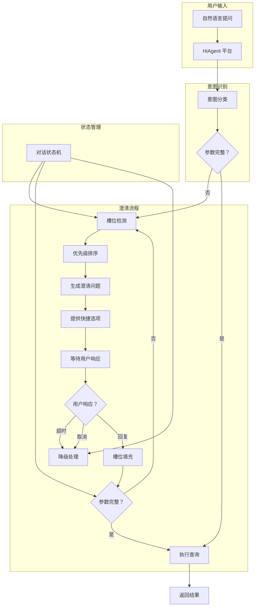
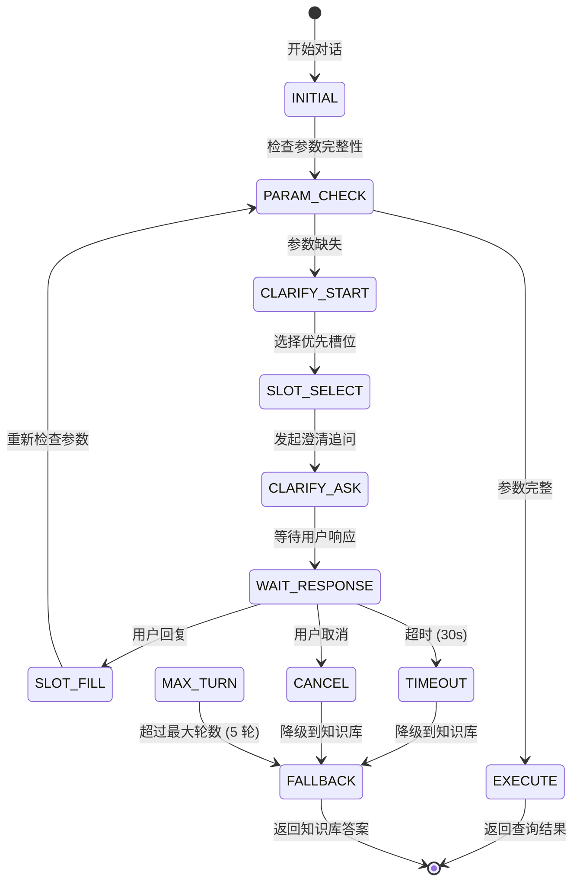
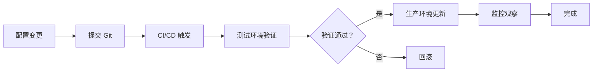

# 智能问数系统 - AI-06 澄清流程编排详细设计文档

**文档版本**: V2.0  
**最后更新**: 2026-04-02  
**适用对象**: AI 平台运维工程师、算法工程师、产品经理  
**关联任务**: AI-06 澄清流程编排  
**前置依赖**: AI-01 (智能体 Agent 创建), AI-03 (知识库文档), BE-10 (多轮对话上下文管理), FE-04 (澄清对话框组件)  
**后续依赖**: 全链路测试，上线部署

**平台说明**: 本项目使用内网 **HiAgent v2.3+** 平台，支持可视化对话流程编排和槽位填充功能。

---

## 1. 任务概述

### 1.1 背景
澄清流程编排是智能问数系统多轮对话的核心，负责在用户提问信息不完整时，主动发起澄清追问，引导用户补充必要参数（时间、地区、指标等）。通过 HiAgent 平台的可视化流程编排，可以实现状态管理、槽位填充、超时处理、轮数控制等功能，提升对话流畅度和用户满意度。

### 1.2 目标
| 目标 | 说明 | 验收标准 |
|------|------|----------|
| **高完成率** | 澄清对话完成率 ≥ 80% | 用户最终提供所需信息 |
| **低轮数** | 平均澄清轮数 ≤ 2.5 轮 | 减少用户操作成本 |
| **短耗时** | 单次澄清响应时间 < 2s (P95) | 流畅交互体验 |
| **友好体验** | 澄清问题清晰，选项合理 | 用户满意度 ≥ 4.0/5.0 |
| **可配置** | 槽位、问题、选项支持热配置 | 支持热更新 |
| **可追溯** | 完整记录澄清过程 | 日志记录率 100% |

### 1.3 澄清流程架构


### 1.4 澄清状态机


### 1.5 槽位定义与优先级
| 槽位代码 | 槽位名称 | 优先级 | 必填 | 澄清问题 | 默认选项 |
|----------|----------|--------|------|----------|----------|
| `metric` | 指标 | 1 | ✅ | 您想查看哪个指标？ | 销售额、订单量、用户数 |
| `region` | 地区 | 2 | ✅ | 您想查看哪个地区？ | 华东区、华北区、全国 |
| `time` | 时间 | 3 | ✅ | 您想查看什么时间范围？ | 上月、近 7 天、本季度 |
| `dimension` | 维度 | 4 | ❌ | 您想按什么维度分组？ | 地区、部门、渠道 |
| `filter` | 筛选 | 5 | ❌ | 需要添加其他筛选条件吗？ | 是、否 |

---

## 2. 技术选型

### 2.1 技术栈
| 组件 | 技术 | 版本 | 选型理由 |
|------|------|------|----------|
| 流程编排 | HiAgent Visual Flow | 2.3+ | 可视化编排，易维护 |
| 状态管理 | 对话状态机 | - | 明确状态流转 |
| 槽位填充 | Slot Filling | - | 参数提取与验证 |
| 超时处理 | 定时器 | - | 30 秒/60 秒超时 |
| 上下文管理 | Redis + MySQL | - | 会话状态持久化 |
| 监控告警 | Prometheus | - | 实时监控 |

### 2.2 平台配置步骤

#### 步骤 1: 进入流程编排
1. 登录 HiAgent 平台 (`http://hiagent.internal:8000`)
2. 进入「智能体管理」
3. 选择 `askdata-router-agent` 智能体
4. 点击「对话流程」标签页
5. 点击「可视化编排」按钮

#### 步骤 2: 创建澄清流程

##### 步骤 2.1: 添加意图识别节点
| 配置项 | 填写内容 | 说明 |
|--------|----------|------|
| **节点类型** | `意图识别` | 调用 NLU 模型 |
| **节点名称** | `intent_recognition` | 唯一标识 |
| **输出变量** | `intent`, `confidence`, `entities` | 供后续节点使用 |
| **超时时间** | `3000ms` | 识别超时 |

##### 步骤 2.2: 添加参数检查节点
| 配置项 | 填写内容 | 说明 |
|--------|----------|------|
| **节点类型** | `条件判断` | 检查参数完整性 |
| **节点名称** | `param_check` | 唯一标识 |
| **判断条件** | `entities.metrics != null && entities.time != null && entities.region != null` | 参数完整判断 |
| **是分支** | 指向 `execute_query` | 执行查询 |
| **否分支** | 指向 `clarify_start` | 开始澄清 |

##### 步骤 2.3: 添加槽位选择节点
| 配置项 | 填写内容 | 说明 |
|--------|----------|------|
| **节点类型** | `脚本执行` | 选择优先槽位 |
| **节点名称** | `slot_select` | 唯一标识 |
| **脚本代码** | 见 2.3 节 | Python/JavaScript |
| **输出变量** | `current_slot`, `clarify_question`, `clarify_options` | 澄清内容 |

##### 步骤 2.4: 添加澄清追问节点
| 配置项 | 填写内容 | 说明 |
|--------|----------|------|
| **节点类型** | `回复用户` | 发送澄清问题 |
| **节点名称** | `clarify_ask` | 唯一标识 |
| **回复内容** | `{{clarify_question}}` | 动态问题 |
| **快捷选项** | `{{clarify_options}}` | 动态选项 |
| **等待超时** | `30s` | 用户响应超时 |

##### 步骤 2.5: 添加槽位填充节点
| 配置项 | 填写内容 | 说明 |
|--------|----------|------|
| **节点类型** | `槽位填充` | 更新上下文 |
| **节点名称** | `slot_fill` | 唯一标识 |
| **槽位映射** | `user_response -> {{current_slot}}` | 填充槽位 |
| **输出变量** | `confirmed_slots` | 已确认槽位 |

##### 步骤 2.6: 添加轮数检查节点
| 配置项 | 填写内容 | 说明 |
|--------|----------|------|
| **节点类型** | `条件判断` | 检查澄清轮数 |
| **节点名称** | `turn_check` | 唯一标识 |
| **判断条件** | `clarify_turn_count < 5` | 最大 5 轮 |
| **是分支** | 指向 `param_check` | 继续澄清 |
| **否分支** | 指向 `fallback_kb` | 降级处理 |

### 2.3 槽位选择脚本

#### Python 脚本示例
```python
# 槽位选择脚本
# 输入：entities, confirmed_slots
# 输出：current_slot, clarify_question, clarify_options

# 定义槽位优先级
SLOT_PRIORITY = {
    'metric': 1,
    'region': 2,
    'time': 3,
    'dimension': 4,
    'filter': 5
}

# 定义槽位澄清问题
SLOT_QUESTIONS = {
    'metric': '您想查看哪个指标？',
    'region': '您想查看哪个地区？',
    'time': '您想查看什么时间范围？',
    'dimension': '您想按什么维度分组？',
    'filter': '需要添加其他筛选条件吗？'
}

# 定义槽位选项
SLOT_OPTIONS = {
    'metric': ['销售额', '订单量', '用户数', '转化率'],
    'region': ['华东区', '华北区', '华南区', '全国'],
    'time': ['上月', '近 7 天', '本季度', '本年'],
    'dimension': ['地区', '部门', '渠道', '时间'],
    'filter': ['是', '否']
}

# 获取缺失槽位
missing_slots = []
for slot, priority in SLOT_PRIORITY.items():
    if slot not in confirmed_slots and (slot not in entities or entities[slot] is None):
        missing_slots.append((slot, priority))

# 按优先级排序
missing_slots.sort(key=lambda x: x[1])

if missing_slots:
    # 选择优先级最高的缺失槽位
    current_slot = missing_slots[0][0]
    clarify_question = SLOT_QUESTIONS[current_slot]
    clarify_options = SLOT_OPTIONS[current_slot]
else:
    current_slot = None
    clarify_question = None
    clarify_options = None

# 输出
return {
    'current_slot': current_slot,
    'clarify_question': clarify_question,
    'clarify_options': clarify_options,
    'missing_count': len(missing_slots)
}
```

### 2.4 完整流程配置导出 (JSON)
```json
{
  "flow_id": "askdata_clarify_flow_v1",
  "flow_name": "智能问数澄清流程",
  "version": "1.0.0",
  "nodes": [
    {
      "id": "intent_recognition",
      "type": "intent_recognition",
      "name": "意图识别",
      "config": {
        "model": "Qwen-14B-Chat",
        "timeout_ms": 3000,
        "output_vars": ["intent", "confidence", "entities"]
      },
      "transitions": [
        {"target": "param_check"}
      ]
    },
    {
      "id": "param_check",
      "type": "condition",
      "name": "参数检查",
      "config": {
        "condition": "entities.metrics != null && entities.time != null && entities.region != null"
      },
      "transitions": [
        {"condition": "true", "target": "execute_query"},
        {"condition": "false", "target": "clarify_start"}
      ]
    },
    {
      "id": "slot_select",
      "type": "script",
      "name": "槽位选择",
      "config": {
        "language": "python",
        "script": "# 见 2.3 节脚本",
        "output_vars": ["current_slot", "clarify_question", "clarify_options"]
      },
      "transitions": [
        {"target": "clarify_ask"}
      ]
    },
    {
      "id": "clarify_ask",
      "type": "response",
      "name": "澄清追问",
      "config": {
        "message": "{{clarify_question}}",
        "quick_options": "{{clarify_options}}",
        "timeout_seconds": 30
      },
      "transitions": [
        {"event": "user_response", "target": "slot_fill"},
        {"event": "timeout", "target": "fallback_kb"},
        {"event": "cancel", "target": "fallback_kb"}
      ]
    },
    {
      "id": "slot_fill",
      "type": "slot_filling",
      "name": "槽位填充",
      "config": {
        "slot_mapping": "{{user_response}} -> {{current_slot}}",
        "output_vars": ["confirmed_slots"]
      },
      "transitions": [
        {"target": "turn_check"}
      ]
    },
    {
      "id": "turn_check",
      "type": "condition",
      "name": "轮数检查",
      "config": {
        "condition": "clarify_turn_count < 5"
      },
      "transitions": [
        {"condition": "true", "target": "param_check"},
        {"condition": "false", "target": "fallback_kb"}
      ]
    },
    {
      "id": "execute_query",
      "type": "tool_call",
      "name": "执行查询",
      "config": {
        "tool_name": "{{tool_name}}",
        "parameters": "{{entities}}"
      },
      "transitions": [
        {"target": "end"}
      ]
    },
    {
      "id": "fallback_kb",
      "type": "knowledge_base",
      "name": "知识库降级",
      "config": {
        "kb_id": "askdata-knowledge-base",
        "top_k": 5
      },
      "transitions": [
        {"target": "end"}
      ]
    }
  ],
  "variables": {
    "clarify_turn_count": 0,
    "confirmed_slots": {},
    "entities": {}
  },
  "global_config": {
    "max_turns": 5,
    "timeout_seconds": 30,
    "enable_context": true,
    "context_window": 10
  }
}
```

---

## 3. 澄清策略配置

### 3.1 槽位优先级策略
```yaml
# 槽位优先级配置
slot_priority:
  metric:
    priority: 1
    required: true
    question: "您想查看哪个指标？"
    options:
      - 销售额
      - 订单量
      - 用户数
      - 转化率
      - 客单价
  
  region:
    priority: 2
    required: true
    question: "您想查看哪个地区？"
    options:
      - 华东区
      - 华北区
      - 华南区
      - 华西区
      - 全国
  
  time:
    priority: 3
    required: true
    question: "您想查看什么时间范围？"
    options:
      - 上月
      - 近 7 天
      - 本季度
      - 本年
  
  dimension:
    priority: 4
    required: false
    question: "您想按什么维度分组？"
    options:
      - 地区
      - 部门
      - 渠道
      - 不需要分组
  
  filter:
    priority: 5
    required: false
    question: "需要添加其他筛选条件吗？"
    options:
      - 是
      - 否
```

### 3.2 澄清问题生成策略
| 策略 | 说明 | 适用场景 |
|------|------|----------|
| **单槽位追问** | 一次只问一个槽位 | 默认策略，降低认知负担 |
| **多槽位合并** | 一次问多个相关槽位 | 用户提问较完整时 |
| **智能推荐** | 基于历史推荐选项 | 老用户个性化 |
| **上下文继承** | 继承上轮对话参数 | 多轮对话场景 |

### 3.3 超时处理策略
| 超时类型 | 时长 | 处理方式 |
|----------|------|----------|
| **提示超时** | 30 秒 | 显示"长时间未操作"提示 |
| **完全超时** | 60 秒 | 自动关闭澄清，降级到知识库 |
| **会话超时** | 300 秒 | 清除会话上下文 |

### 3.4 轮数控制策略
```yaml
# 澄清轮数配置
turn_control:
  max_turns: 5                    # 最大澄清轮数
  warning_turn: 4                 # 第 4 轮开始警告
  warning_message: "问题比较复杂，这是最后一次确认"
  on_max_reached: fallback_kb     # 达到最大轮数后的操作
  reset_on_new_intent: true       # 新意图重置轮数
```

---

## 4. 上下文管理配置

### 4.1 上下文窗口配置
```yaml
# 上下文管理配置
context:
  enabled: true
  window_size: 10                 # 保留最近 10 轮对话
  compression: summary            # 超出窗口时摘要压缩
  inherit_slots: true             # 继承已确认槽位
  reset_conditions:
    - new_session                 # 新会话
    - intent_change               # 意图变更
    - user_request                # 用户明确要求
```

### 4.2 槽位继承规则
| 槽位 | 继承条件 | 不继承条件 |
|------|----------|------------|
| `metric` | 同意图对话 | 用户明确变更 |
| `region` | 同会话内 | 新会话 |
| `time` | 同会话内 | 时间过期 (>30 天) |
| `dimension` | 同意图对话 | 用户明确变更 |

### 4.3 上下文变量定义
```yaml
# 全局变量
variables:
  # 对话状态
  conversation_status: initial    # initial/clarifying/executing/completed
  clarify_turn_count: 0           # 澄清轮数
  confirmed_slots: {}             # 已确认槽位
  missing_slots: []               # 缺失槽位
  
  # 用户信息
  user_id: "{{user.id}}"
  user_role: "{{user.role}}"
  dept_id: "{{user.dept_id}}"
  
  # 会话信息
  session_id: "{{session.id}}"
  session_start_time: "{{session.start_time}}"
  last_active_time: "{{session.last_active}}"
  
  # 意图信息
  current_intent: "{{intent}}"
  intent_confidence: "{{confidence}}"
  recommended_strategy: "{{strategy}}"
```

---

## 5. 测试验证方案

### 5.1 功能测试用例
| 用例 ID | 测试场景 | 输入 | 预期流程 | 预期结果 | 状态 |
|---------|----------|------|----------|----------|------|
| CLAR-TC-01 | 参数完整 | "华东区上月销售额" | 直接执行查询 | 返回销售数据 | 待测试 |
| CLAR-TC-02 | 缺指标 | "华东区上月数据" | 澄清指标→用户选择→执行 | 返回数据 | 待测试 |
| CLAR-TC-03 | 缺地区 | "上月销售额" | 澄清地区→用户选择→执行 | 返回数据 | 待测试 |
| CLAR-TC-04 | 缺时间 | "华东区销售额" | 澄清时间→用户选择→执行 | 返回数据 | 待测试 |
| CLAR-TC-05 | 多槽位缺失 | "查一下数据" | 多次澄清→完整→执行 | 返回数据 | 待测试 |
| CLAR-TC-06 | 超时处理 | 澄清后 60 秒无响应 | 超时→降级 KB | 返回 KB 答案 | 待测试 |
| CLAR-TC-07 | 用户取消 | 澄清时点击取消 | 取消→降级 KB | 返回 KB 答案 | 待测试 |
| CLAR-TC-08 | 轮数超限 | 连续 5 轮澄清未完成 | 超限→降级 KB | 返回 KB 答案 | 待测试 |
| CLAR-TC-09 | 上下文继承 | 第 2 轮"对比华北区" | 继承指标时间→执行 | 返回对比数据 | 待测试 |
| CLAR-TC-10 | 槽位变更 | 澄清中修改已确认槽位 | 更新槽位→重新检查 | 返回新数据 | 待测试 |

### 5.2 性能测试
| 指标 | 目标值 | 测量方法 | 告警阈值 |
|------|--------|----------|----------|
| 澄清响应时间 | < 2s (P95) | HiAgent 监控 | > 3s |
| 槽位填充延迟 | < 500ms | 日志统计 | > 1s |
| 上下文查询延迟 | < 200ms | 日志统计 | > 500ms |
| 并发澄清会话 | ≥ 100 | 压测工具 | < 50 |
| 流程执行成功率 | ≥ 99% | 监控指标 | < 95% |

### 5.3 用户体验测试
| 测试项 | 方法 | 通过标准 |
|--------|------|----------|
| 问题清晰度 | 用户调研 (N=20) | ≥ 80% 认为清晰 |
| 选项合理性 | 点击率分析 | 快捷选项点击率 ≥ 60% |
| 轮数接受度 | 用户反馈 | 平均轮数 ≤ 2.5 |
| 超时设置 | 行为分析 | 超时率 < 10% |
| 取消率 | 行为分析 | 取消率 < 15% |

### 5.4 自动化测试脚本
**文件路径**: `scripts/test_clarify_flow.py`

```python
#!/usr/bin/env python3
"""
澄清流程自动化测试
"""

import requests
import time
from typing import List, Dict

class ClarifyFlowTester:
    def __init__(self, api_url: str, api_key: str):
        self.api_url = api_url
        self.api_key = api_key
        self.session_id = None
    
    def start_session(self) -> str:
        """开始新会话"""
        response = requests.post(
            f'{self.api_url}/api/v1/conversation/start',
            headers={'Authorization': f'Bearer {self.api_key}'}
        )
        self.session_id = response.json()['data']['session_id']
        return self.session_id
    
    def send_message(self, query: str) -> Dict:
        """发送消息"""
        response = requests.post(
            f'{self.api_url}/api/v1/conversation/message',
            json={
                'session_id': self.session_id,
                'query': query
            },
            headers={'Authorization': f'Bearer {self.api_key}'}
        )
        return response.json()['data']
    
    def test_clarify_flow(self, query: str, expected_turns: int) -> Dict:
        """测试澄清流程"""
        session_id = self.start_session()
        turns = 0
        max_turns = 10  # 防止无限循环
        
        current_query = query
        while turns < max_turns:
            result = self.send_message(current_query)
            turns += 1
            
            if result['type'] == 'chart' or result['type'] == 'text':
                # 查询完成
                return {
                    'success': True,
                    'turns': turns,
                    'expected_turns': expected_turns,
                    'passed': turns == expected_turns
                }
            elif result.get('need_clarify'):
                # 需要澄清，模拟用户选择第一个选项
                if result.get('clarify_options'):
                    current_query = result['clarify_options'][0]
                else:
                    return {'success': False, 'error': 'No clarify options'}
            elif result['type'] == 'fallback_kb':
                # 降级到知识库
                return {
                    'success': False,
                    'error': 'Fallback to KB',
                    'turns': turns
                }
        
        return {'success': False, 'error': 'Max turns exceeded'}
    
    def run_tests(self, test_cases: List[Dict]) -> Dict:
        """运行测试用例"""
        results = []
        for case in test_cases:
            result = self.test_clarify_flow(case['query'], case['expected_turns'])
            result['query'] = case['query']
            results.append(result)
        
        passed = sum(1 for r in results if r.get('success') and r.get('passed'))
        total = len(results)
        
        return {
            'total': total,
            'passed': passed,
            'pass_rate': passed / total if total > 0 else 0,
            'details': results
        }

if __name__ == "__main__":
    tester = ClarifyFlowTester('http://hiagent.internal:8000', 'sk-test-xxx')
    
    test_cases = [
        {'query': '华东区上月销售额', 'expected_turns': 1},
        {'query': '上月销售额', 'expected_turns': 2},
        {'query': '华东区数据', 'expected_turns': 2},
        {'query': '查一下', 'expected_turns': 4},
    ]
    
    results = tester.run_tests(test_cases)
    print(f"测试通过率：{results['pass_rate']:.2%}")
```

---

## 6. 注意事项 ⚠️

### 6.1 状态一致性
```python
# ❌ 错误：不检查版本直接更新上下文
def update_context(session, new_params):
    session.confirmed_slots.update(new_params)  # 可能覆盖其他请求的修改

# ✅ 正确：版本控制更新
def update_context(session, new_params, expected_version):
    if session.version != expected_version:
        raise ConcurrentModificationException("会话状态已变更")
    session.confirmed_slots.update(new_params)
    session.version += 1
```

### 6.2 超时清理
```python
# ❌ 错误：不清理超时会话
# 超时后会话仍占用资源

# ✅ 正确：超时后清理
def handle_timeout(session):
    session.status = 'EXPIRED'
    clear_session_cache(session.id)
    log_audit(session, 'TIMEOUT')
```

### 6.3 槽位验证
```python
# ❌ 错误：不验证槽位值
def fill_slot(slot, value):
    confirmed_slots[slot] = value  # 可能填入非法值

# ✅ 正确：验证后填充
def fill_slot(slot, value):
    if validate_slot_value(slot, value):
        confirmed_slots[slot] = value
    else:
        raise InvalidSlotValueException(f"非法槽位值：{value}")
```

### 6.4 轮数控制
```python
# ❌ 错误：不检查轮数上限
def clarify_loop():
    while not params_complete:
        ask_clarify()  # 可能无限循环

# ✅ 正确：轮数限制
def clarify_loop():
    while not params_complete and turn_count < max_turns:
        ask_clarify()
        turn_count += 1
    if turn_count >= max_turns:
        fallback_to_kb()
```

### 6.5 上下文继承
```python
# ❌ 错误：无条件继承所有参数
def inherit_context(old_context, new_query):
    return {**old_context, **new_query}  # 可能继承错误参数

# ✅ 正确：条件继承
def inherit_context(old_context, new_query, intent):
    inherited = {}
    if intent == old_context['intent']:
        # 同意图才继承
        for slot in ['metric', 'region']:
            if slot in old_context and slot not in new_query:
                inherited[slot] = old_context[slot]
    return {**inherited, **new_query}
```

---

## 7. 需要特别关注的点 🔴

### 7.1 陷阱防护矩阵

| 陷阱类型 | 风险描述 | 防护措施 | 验证方法 |
|----------|----------|----------|----------|
| **状态不一致** | 并发请求导致状态覆盖 | 乐观锁 (Version 字段) | 并发测试，版本冲突被拦截 |
| **上下文溢出** | 对话历史无限增长 | 限制历史轮数 (10 轮) | 长时间对话内存稳定 |
| **内存泄漏** | 会话未清理导致 OOM | Redis TTL+ 定时任务 | 长时间运行内存无增长 |
| **敏感泄露** | 上下文含手机号/身份证 | 上下文脱敏器 | 检查 DB/Redis 无明文 |
| **僵尸会话** | 超时会话未清理 | 定时清理任务 | 过期会话被删除 |
| **MDC 丢失** | 异步清理无 TraceID | TaskDecorator 传递 MDC | 清理日志含 TraceID |
| **缓存穿透** | 大量不存在的 SessionID | 缓存空值 (unless) | 不存在的 ID 不查库 |
| **版本回滚** | 旧版本请求覆盖新版本 | 版本号单调递增 | 旧版本请求被拒绝 |

### 7.2 关键代码审查点

```yaml
# 审查清单
□ Session 是否有 version 字段
□ 更新操作是否检查 version
□ version 是否单调递增
□ 对话历史是否限制大小
□ 敏感信息是否脱敏
□ 超时检查是否生效
□ 定时任务是否配置
□ 缓存 Key 是否规范
□ 异常是否捕获 (不影响主流程)
□ 审计日志是否记录
□ TraceID 是否透传
□ Redis TTL 是否配置
□ MySQL 索引是否优化 (sessionId, lastActiveTime)
□ 组件是否可复用
□ 无障碍访问是否支持
```

### 7.3 性能影响评估

| 操作 | 耗时 | 优化建议 |
|------|------|----------|
| Redis 读取 | < 5ms | 无需优化 |
| MySQL 读取 | 10-20ms | 加索引 |
| 版本校验 | < 1ms | 无需优化 |
| 脱敏处理 | < 5ms | 无需优化 |
| **总开销** | **< 50ms** | **可接受** |

### 7.4 监控指标

```yaml
# 需要采集的指标
metrics:
  # 活跃会话数
  - name: askdata.conversation.active.sessions
    type: gauge
  
  # 会话创建次数
  - name: askdata.conversation.session.created
    type: counter
  
  # 版本冲突次数
  - name: askdata.conversation.version.conflict
    type: counter
  
  # 超时清理次数
  - name: askdata.conversation.session.expired
    type: counter
  
  # 澄清完成率
  - name: askdata.clarify.completion.rate
    type: gauge
  
  # 平均澄清轮数
  - name: askdata.clarify.avg.turns
    type: gauge
```

---

## 8. 运维配置

### 8.1 监控告警
```yaml
# Prometheus 告警规则
groups:
- name: conversation-alerts
  rules:
  - alert: ConversationVersionConflictHigh
    expr: rate(askdata_conversation_version_conflict_total[5m]) > 0.1
    for: 5m
    labels:
      severity: warning
    annotations:
      summary: "会话版本冲突率过高 ({{ $value }})"
  
  - alert: ConversationCleanupFailed
    expr: askdata_conversation_cleanup_error_total > 0
    for: 1m
    labels:
      severity: warning
    annotations:
      summary: "会话清理任务失败"
  
  - alert: ConversationActiveSessionsHigh
    expr: askdata_conversation_active_sessions > 10000
    for: 10m
    labels:
      severity: warning
    annotations:
      summary: "活跃会话数过高 ({{ $value }})"
  
  - alert: ClarifyCompletionRateLow
    expr: askdata_clarify_completion_rate < 0.7
    for: 10m
    labels:
      severity: warning
    annotations:
      summary: "澄清完成率过低 ({{ $value }})"
```

### 8.2 日志配置
```yaml
# 对话上下文日志
logging:
  conversation:
    enabled: true
    level: INFO
    fields:
      - session_id
      - user_id
      - status
      - turn_count
      - confirmed_slots
      - latency_ms
    output:
      - console
      - file:/var/log/hiagent/conversation.log
      - elasticsearch:http://es-cluster:9200
    retention_days: 180
```

### 8.3 备份策略
| 数据类型 | 备份频率 | 保留周期 | 工具 |
|----------|----------|----------|------|
| 会话配置 | 每次变更 | 永久 | Git |
| 对话日志 | 每日 | 180 天 | ELK |
| 会话状态 | 实时 | 7 天 | Redis |
| 监控数据 | 实时 | 180 天 | Prometheus |

### 8.4 更新流程


---

## 9. 常见问题 (FAQ)

**Q1: 版本冲突如何处理？**
A: 1. 前端捕获异常；2. 自动刷新会话状态；3. 提示用户"状态已更新，请重试"；4. 保留用户输入避免丢失。

**Q2: 会话超时后数据丢失怎么办？**
A: 1. 超时前提醒用户；2. 提供会话恢复功能 (可选)；3. 审计日志保留历史记录。

**Q3: 上下文脱敏影响 AI 识别怎么办？**
A: 1. 脱敏仅针对存储/日志；2. 传给 AI 的原始参数可保留 (需安全评估)；3. 或 AI 侧也做脱敏。

**Q4: 定时清理任务不执行怎么办？**
A: 1. 检查@Scheduled 注解；2. 检查配置类是否启用；3. 检查 cron 表达式；4. 查看应用日志。

**Q5: 多实例部署会话如何共享？**
A: 1. 会话存储使用 Redis(集群)；2. 数据库共享；3. 避免本地缓存会话状态。

**Q6: 对话历史太长影响 AI 怎么办？**
A: 1. 限制轮数 (10 轮)；2. 摘要压缩 (总结前几轮)；3. 仅传递关键参数给 AI。

**Q7: 如何调试会话状态？**
A: 1. 开启调试日志；2. 查询 Redis Key；3. 查询数据库会话表；4. 使用管理后台查看。

**Q8: 组件销毁后监听还在怎么办？**
A: 确保在 `beforeDestroy` 钩子中 `removeEventListener`。

**Q9: 用户主动结束会话如何清理？**
A: 1. 调用 deleteSession 接口；2. 清理 Redis；3. 标记 MySQL 记录；4. 记录审计日志。

**Q10: 如何支持跨设备会话？**
A: 1. 会话绑定用户 ID 而非设备；2. 多端登录互斥或共享；3. 状态变更广播通知。

**Q11: 如何优化澄清体验？**
A: 1. 澄清问题简洁明了；2. 提供 3-5 个快捷选项；3. 支持自由输入；4. 记录用户偏好。

**Q12: 如何处理澄清轮数超限？**
A: 1. 检查 clarifyTurnCount；2. 达到最大轮数后自动降级；3. 提示用户。

---

## 10. 附录：配置模板

### 10.1 会话 ID 生成规范
```yaml
# 会话 ID 生成规范
session_id:
  # 格式：UUID without hyphens
  pattern: "^[0-9a-f]{32}$"
  
  # 生成方
  generator: frontend
  
  # 绑定
  binding:
    - user_id
    - trace_id
  
  # 校验
  validation:
    - format_check
    - ownership_check
```

### 10.2 上下文参数规范
```yaml
# 上下文参数命名规范
context_params:
  # 指标
  metric: "gmv, order_count, dau"
  # 地区
  region: "huadong, huabei, all"
  # 时间
  time: "last_month, last_7_days, 2024-03"
  # 维度
  dimension: "region, dept, channel"
  
  # 禁止存储
  forbidden:
    - password
    - full_id_card
    - full_phone
    - bank_card
```

### 10.3 状态流转规范
```yaml
# 状态机流转规范
state_transitions:
  INITIAL:
    - CLARIFYING
    - EXECUTING
  CLARIFYING:
    - CLARIFYING
    - EXECUTING
    - FAILED
    - EXPIRED
  EXECUTING:
    - COMPLETED
    - FAILED
  FAILED:
    - INITIAL
  EXPIRED:
    - [*]
```

### 10.4 澄清流程配置 (YAML)
```yaml
# 澄清流程配置
clarify_flow:
  id: askdata_clarify_v1
  name: 智能问数澄清流程
  version: 1.0.0
  
  # 槽位配置
  slots:
    metric:
      priority: 1
      required: true
      question: "您想查看哪个指标？"
      options: [销售额，订单量，用户数，转化率]
      validation:
        type: enum
        values: [gmv, order_count, dau, conversion_rate]
    
    region:
      priority: 2
      required: true
      question: "您想查看哪个地区？"
      options: [华东区，华北区，华南区，全国]
      validation:
        type: enum
        values: [huadong, huabei, huanan, all]
    
    time:
      priority: 3
      required: true
      question: "您想查看什么时间范围？"
      options: [上月，近 7 天，本季度，本年]
      validation:
        type: enum
        values: [last_month, last_7_days, last_quarter, this_year]
  
  # 流程控制
  control:
    max_turns: 5
    timeout_seconds: 30
    warning_turn: 4
    on_max_reached: fallback_kb
    on_timeout: fallback_kb
    on_cancel: fallback_kb
  
  # 上下文管理
  context:
    enabled: true
    window_size: 10
    inherit_slots: true
    reset_on_intent_change: true
  
  # 降级配置
  fallback:
    type: knowledge_base
    kb_id: askdata-knowledge-base
    top_k: 5
    threshold: 0.65
```

### 10.5 澄清日志分析脚本 (Python)
```python
#!/usr/bin/env python3
"""
澄清日志分析脚本
"""

import json
import elasticsearch
from datetime import datetime, timedelta
from collections import defaultdict

class ClarifyLogAnalyzer:
    def __init__(self, es_host: str):
        self.es = elasticsearch.Elasticsearch([es_host])
        self.index = "hiagent-clarify-*"
    
    def analyze_completion_rate(self, days: int = 7) -> Dict:
        """分析澄清完成率"""
        query = {
            "query": {
                "range": {
                    "@timestamp": {
                        "gte": f"now-{days}d",
                        "lte": "now"
                    }
                }
            },
            "aggs": {
                "outcomes": {
                    "terms": {"field": "outcome"}
                }
            }
        }
        
        response = self.es.search(index=self.index, body=query)
        outcomes = response['aggregations']['outcomes']['buckets']
        
        total = sum(b['doc_count'] for b in outcomes)
        completed = next((b['doc_count'] for b in outcomes if b['key'] == 'completed'), 0)
        
        return {
            'total': total,
            'completed': completed,
            'completion_rate': completed / total if total > 0 else 0,
            'outcomes': {b['key']: b['doc_count'] for b in outcomes}
        }
    
    def analyze_turn_distribution(self, days: int = 7) -> Dict:
        """分析轮数分布"""
        query = {
            "query": {
                "range": {
                    "@timestamp": {
                        "gte": f"now-{days}d",
                        "lte": "now"
                    }
                }
            },
            "aggs": {
                "avg_turns": {"avg": {"field": "turn_count"}},
                "turn_distribution": {
                    "terms": {"field": "turn_count"}
                }
            }
        }
        
        response = self.es.search(index=self.index, body=query)
        
        return {
            'average': response['aggregations']['avg_turns']['value'],
            'distribution': {
                b['key']: b['doc_count'] 
                for b in response['aggregations']['turn_distribution']['buckets']
            }
        }
    
    def analyze_slot_success_rate(self, days: int = 7) -> Dict:
        """分析槽位填充成功率"""
        query = {
            "query": {
                "range": {
                    "@timestamp": {
                        "gte": f"now-{days}d",
                        "lte": "now"
                    }
                }
            },
            "aggs": {
                "slots": {
                    "terms": {"field": "current_slot"},
                    "aggs": {
                        "success": {
                            "filter": {"term": {"outcome": "completed"}}
                        }
                    }
                }
            }
        }
        
        response = self.es.search(index=self.index, body=query)
        
        return {
            slot['key']: {
                'total': slot['doc_count'],
                'success': slot['success']['doc_count'],
                'success_rate': slot['success']['doc_count'] / slot['doc_count'] if slot['doc_count'] > 0 else 0
            }
            for slot in response['aggregations']['slots']['buckets']
        }
    
    def generate_report(self, days: int = 7) -> str:
        """生成分析报告"""
        completion = self.analyze_completion_rate(days)
        turns = self.analyze_turn_distribution(days)
        slots = self.analyze_slot_success_rate(days)
        
        report = f"""
=== 澄清流程分析报告 ({days} 天) ===

完成率：{completion['completion_rate']:.2%} ({completion['completed']}/{completion['total']})

平均轮数：{turns['average']:.2f}
轮数分布：{turns['distribution']}

槽位成功率:
"""
        for slot, stats in slots.items():
            report += f"  {slot}: {stats['success_rate']:.2%} ({stats['success']}/{stats['total']})\n"
        
        return report

if __name__ == "__main__":
    analyzer = ClarifyLogAnalyzer('http://es-cluster:9200')
    print(analyzer.generate_report(7))
```

---

## 11. 开发检查清单 (Checklist)

### 11.1 流程配置
- [ ] 意图识别节点已配置
- [ ] 参数检查节点已配置
- [ ] 槽位选择脚本已编写
- [ ] 澄清追问节点已配置
- [ ] 槽位填充节点已配置
- [ ] 轮数检查节点已配置
- [ ] 降级处理节点已配置
- [ ] 流程测试通过

### 11.2 槽位配置
- [ ] 所有槽位已定义
- [ ] 优先级已设置
- [ ] 澄清问题已配置
- [ ] 快捷选项已配置
- [ ] 验证规则已配置
- [ ] 继承规则已配置

### 11.3 上下文管理
- [ ] 上下文窗口已配置
- [ ] 槽位继承规则已设置
- [ ] 重置条件已配置
- [ ] 变量定义完整
- [ ] 状态机逻辑正确

### 11.4 测试验收
- [ ] 功能测试用例全部通过
- [ ] 澄清完成率 ≥ 80%
- [ ] 平均轮数 ≤ 2.5
- [ ] 响应时间 < 2s (P95)
- [ ] 超时率 < 15%
- [ ] 取消率 < 20%

### 11.5 运维配置
- [ ] 监控指标已配置
- [ ] 告警规则已设置
- [ ] 日志采集已配置
- [ ] 备份策略已实施
- [ ] 版本管理已建立

---

## 12. 变更历史

| 版本 | 日期 | 变更内容 | 负责人 |
|------|------|----------|--------|
| V1.0 | 2026-03-25 | 初始版本 | 架构组 |
| V2.0 | 2026-04-02 | 增加版本控制、脱敏、清理任务、陷阱防护 | 架构组 |

---

## 13. 工时与优先级

| 项目 | 内容 |
|------|------|
| **工时** | 5 MD (配置 3 天 + 测试 2 天) |
| **优先级** | P0 (核心交互能力) |
| **依赖任务** | AI-01, AI-03, BE-10, FE-04 |
| **被依赖任务** | 全链路测试，上线部署 |

---

## 14. 最佳实践建议

### 14.1 状态管理
```python
# ✅ 推荐：版本控制
def update_context(session, new_params, expected_version):
    if session.version != expected_version:
        raise ConcurrentModificationException()
    session.version += 1

# ❌ 不推荐：无版本控制
def update_context(session, new_params):
    session.confirmed_slots.update(new_params)  # 可能覆盖
```

### 14.2 上下文同步
```python
# ✅ 推荐：通过事件同步
handleRemoveParam(key) {
  const newParams = { ...this.confirmedParams };
  delete newParams[key];
  this.$emit('update:confirmedParams', newParams);
}

# ❌ 不推荐：直接修改 prop
handleRemoveParam(key) {
  delete this.confirmedParams[key];  # Vue 警告
}
```

### 14.3 资源清理
```python
# ✅ 推荐：完整清理
beforeDestroy() {
  if (this.timeoutTimer) {
    clearInterval(this.timeoutTimer);
  }
  if (this.sseClient) {
    this.sseClient.close();
  }
}

# ❌ 不推荐：遗漏清理
beforeDestroy() {
  # 只关闭 SSE，忘记清理定时器
}
```

### 14.4 用户体验
```python
# ✅ 推荐：友好提示
handleTimeout() {
  this.$message.warning('长时间未操作，已自动关闭');
}

# ❌ 不推荐：生硬提示
handleTimeout() {
  this.$message.error('超时');
}
```

---

**文档结束**  
**下一步**: 完成澄清流程编排后，请提交测试团队进行 AI-06 专项验收，重点验证澄清完成率、平均轮数、响应时间和用户体验指标。