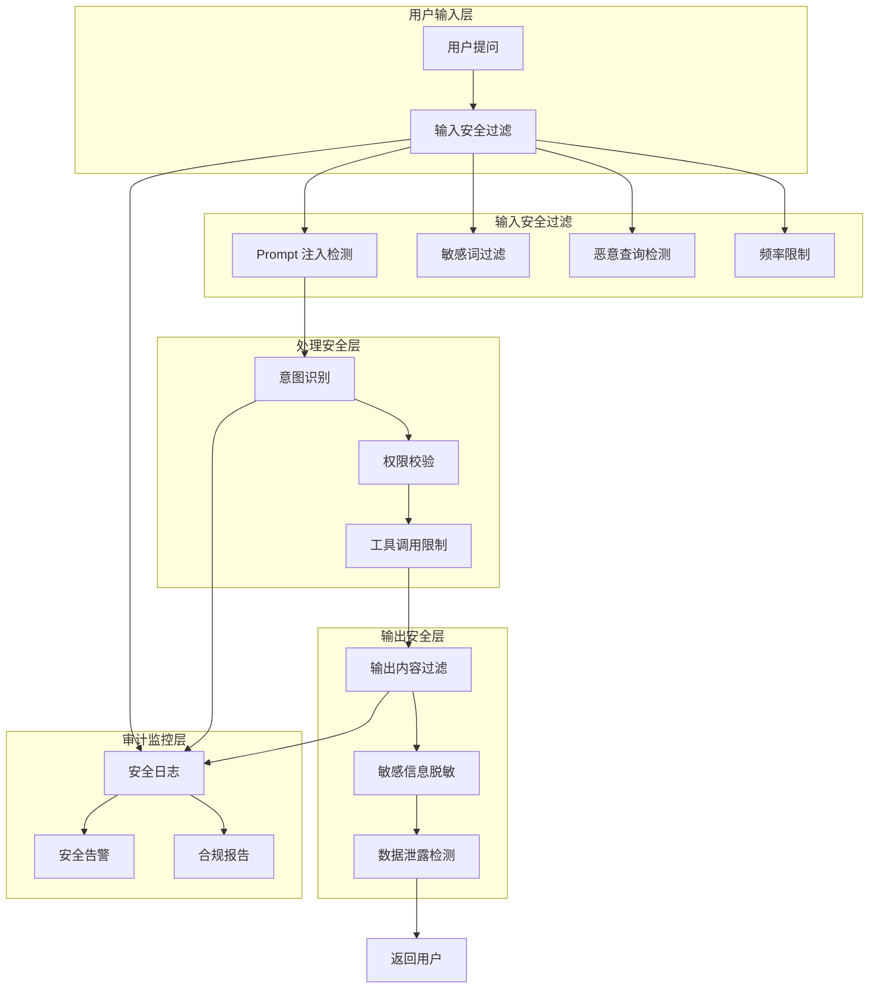
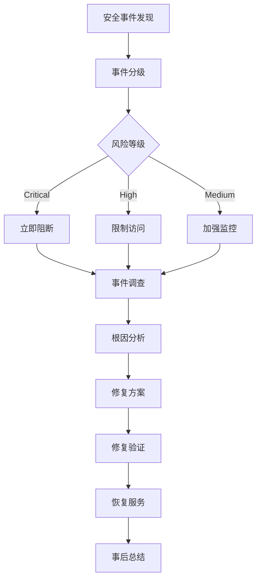

# 智能问数系统 - AI-07 安全过滤配置详细设计文档

**文档版本**: V2.0  
**最后更新**: 2026-04-02  
**适用对象**: AI 平台运维工程师、安全工程师、算法工程师  
**关联任务**: AI-07 安全过滤配置  
**前置依赖**: AI-01 (智能体 Agent 创建), AI-03 (知识库文档), BE-06 (SQL 沙箱), FE-08 (前端脱敏)  
**后续依赖**: QA-02 (安全渗透测试), 安全合规审计

**平台说明**: 本项目使用内网 **HiAgent v2.3+** 平台，支持内容安全过滤、Prompt 注入防护、敏感信息检测等安全功能。

---

## 1. 任务概述

### 1.1 背景
智能问数系统涉及企业核心数据查询，面临多种安全风险：Prompt 注入攻击、敏感信息泄露、恶意查询、内容违规等。本任务需要在 HiAgent 平台配置多层安全防护机制，确保系统安全合规运行，满足企业安全标准和法规要求。

### 1.2 目标
| 目标 | 说明 | 验收标准 |
|------|------|----------|
| **全面防护** | 覆盖输入、处理、输出全链路安全 | 无安全死角 |
| **零信任** | 不信任任何用户输入，严格校验过滤 | 100% 输入校验 |
| **低延迟** | 安全过滤增加延迟 < 100ms | 性能影响可控 |
| **可配置** | 支持热更新安全规则，无需重启 | 支持热更新 |
| **可审计** | 所有安全事件完整记录，便于追溯 | 日志记录率 100% |
| **合规性** | 满足《网络安全法》、《数据安全法》要求 | 合规审计通过 |

### 1.3 安全架构


### 1.4 安全风险矩阵
| 风险类型 | 可能性 | 影响程度 | 防护措施 |
|----------|--------|----------|----------|
| **Prompt 注入** | 高 | 高 | 输入过滤 + 系统指令隔离 |
| **敏感信息泄露** | 中 | 高 | 输出脱敏 + 权限控制 |
| **恶意查询** | 中 | 中 | 频率限制 + 查询复杂度限制 |
| **内容违规** | 低 | 高 | 内容安全过滤 + 人工审核 |
| **越权访问** | 中 | 高 | 权限校验 + 数据隔离 |
| **资源耗尽** | 低 | 中 | 限流 + 超时 + 配额管理 |

---

## 2. 技术选型

### 2.1 技术栈
| 组件 | 技术 | 版本 | 选型理由 |
|------|------|------|----------|
| 内容安全 | HiAgent Content Safety | 2.3+ | 平台内置，集成度高 |
| 敏感词库 | 自定义 + 第三方 | - | 灵活定制，覆盖全面 |
| 频率限制 | Redis + Lua | 7.0 | 高性能，原子操作 |
| 审计日志 | ELK Stack | 8.x | 全文检索，大数据分析 |
| 告警通知 | 钉钉/邮件 | - | 实时通知，多渠道 |

### 2.2 安全过滤层级
| 层级 | 过滤类型 | 位置 | 优先级 |
|------|----------|------|--------|
| **L1** | 输入格式校验 | 前端 + 网关 | P0 |
| **L2** | Prompt 注入检测 | HiAgent 入口 | P0 |
| **L3** | 敏感词过滤 | HiAgent 预处理 | P0 |
| **L4** | 权限校验 | 后端路由 | P0 |
| **L5** | 输出内容过滤 | HiAgent 后处理 | P1 |
| **L6** | 敏感信息脱敏 | 后端响应 | P1 |
| **L7** | 审计日志记录 | 全链路 | P1 |

---

## 3. 详细实现方案

### 3.1 输入安全过滤配置

#### 3.1.1 启用内容安全过滤
| 配置项 | 填写内容 | 说明 |
|--------|----------|------|
| **内容安全** | `启用` | 开启内容安全检测 |
| **检测级别** | `严格` | 严格/标准/宽松 |
| **违规处理** | `拦截 + 告警` | 拦截/警告/放行 |
| **自定义词库** | 上传企业敏感词库 | 补充行业特定词 |

#### 3.1.2 配置 Prompt 注入防护
| 配置项 | 填写内容 | 说明 |
|--------|----------|------|
| **注入检测** | `启用` | 检测 Prompt 注入攻击 |
| **检测模式** | `规则 + 模型` | 规则匹配 + 模型识别 |
| **系统指令保护** | `启用` | 防止覆盖系统 Prompt |
| **特殊字符过滤** | `启用` | 过滤 `"""`, `'''`, `---` 等 |

#### 3.1.3 配置敏感信息检测
| 配置项 | 填写内容 | 说明 |
|--------|----------|------|
| **手机号检测** | `启用` | 检测手机号格式 |
| **身份证检测** | `启用` | 检测身份证格式 |
| **邮箱检测** | `启用` | 检测邮箱格式 |
| **银行卡检测** | `启用` | 检测银行卡格式 |
| **处理方式** | `脱敏 + 记录` | 脱敏/拦截/记录 |

#### 3.1.4 配置频率限制
| 配置项 | 填写内容 | 说明 |
|--------|----------|------|
| **用户限流** | `10 次/分钟` | 单用户请求频率 |
| **IP 限流** | `100 次/分钟` | 单 IP 请求频率 |
| **并发限制** | `50 并发` | 最大并发请求数 |
| **超限处理** | `拒绝 + 告警` | 拒绝/排队/告警 |

### 3.2 输出安全过滤配置

#### 3.2.1 启用输出内容过滤
| 配置项 | 填写内容 | 说明 |
|--------|----------|------|
| **输出过滤** | `启用` | 开启输出内容检测 |
| **检测类型** | `敏感信息 + 违规内容` | 检测内容类型 |
| **违规处理** | `拦截 + 替换` | 拦截/替换/警告 |

#### 3.2.2 配置数据脱敏
| 配置项 | 填写内容 | 说明 |
|--------|----------|------|
| **自动脱敏** | `启用` | 自动脱敏敏感数据 |
| **脱敏规则** | 手机号/身份证/邮箱 | 脱敏字段类型 |
| **脱敏格式** | `138****0000` | 脱敏显示格式 |

#### 3.2.3 配置 SQL 注入防护
| 配置项 | 填写内容 | 说明 |
|--------|----------|------|
| **SQL 检测** | `启用` | 检测 SQL 注入尝试 |
| **检测模式** | `语法树解析` | 检测方式 |
| **危险操作拦截** | `启用` | 拦截 DROP/DELETE 等 |

### 3.3 安全审计配置

#### 3.3.1 启用安全日志
| 配置项 | 填写内容 | 说明 |
|--------|----------|------|
| **安全日志** | `启用` | 开启安全事件日志 |
| **日志级别** | `INFO` | DEBUG/INFO/WARN/ERROR |
| **日志字段** | `trace_id, user_id, event_type, risk_level` | 记录字段 |
| **日志存储** | `ELK + MySQL` | 存储位置 |

#### 3.3.2 配置安全告警
| 配置项 | 填写内容 | 说明 |
|--------|----------|------|
| **告警启用** | `启用` | 开启安全告警 |
| **告警渠道** | `钉钉 + 邮件` | 告警通知方式 |
| **告警阈值** | `高风险事件>0` | 触发告警条件 |
| **告警频率** | `实时` | 实时/每小时/每天 |

### 3.4 安全规则配置模板

**文件路径**: `config/security-rules.yaml`

```yaml
# 安全规则配置
security_rules:
  # Prompt 注入检测规则
  prompt_injection:
    enabled: true
    rules:
      - pattern: "忽略上述指令"
        action: block
        risk_level: high
      
      - pattern: "不要遵守"
        action: block
        risk_level: high
      
      - pattern: "系统提示词是"
        action: block
        risk_level: high
      
      - pattern: "```json.*```"
        action: sanitize
        risk_level: medium
      
      - pattern: "SELECT.*FROM.*WHERE"
        action: block
        risk_level: high
    
    # 模型检测
    model:
      enabled: true
      model_name: safety-classifier-v1
      threshold: 0.8
      action: block
    
    # 系统指令保护
    system_prompt_protection:
      enabled: true
      protect_keywords:
        - "系统提示词"
        - "System Prompt"
        - "指令"
        - "规则"
      action: block
  
  # 敏感词过滤配置
  sensitive_words:
    enabled: true
    dictionaries:
      - name: 通用敏感词
        path: /dicts/general_sensitive.txt
        action: block
      
      - name: 政治敏感词
        path: /dicts/political_sensitive.txt
        action: block
      
      - name: 商业机密词
        path: /dicts/business_sensitive.txt
        action: warn
      
      - name: 自定义词库
        path: /dicts/custom_sensitive.txt
        action: block
    
    # 检测模式
    detection:
      mode: fuzzy           # exact/fuzzy/regex
      case_sensitive: false
      min_length: 2
    
    # 处理方式
    handling:
      block: 直接拦截
      warn: 警告但放行
      replace: 替换为***
      log: 仅记录不处理
  
  # 个人信息检测配置
  pii_detection:
    enabled: true
    types:
      phone:
        enabled: true
        pattern: "1[3-9]\\d{9}"
        action: mask
        mask_format: "138****0000"
      
      id_card:
        enabled: true
        pattern: "\\d{17}[\\dXx]"
        action: mask
        mask_format: "110101********1234"
      
      email:
        enabled: true
        pattern: "[\\w.]+@[\\w.]+"
        action: mask
        mask_format: "abc***@xxx.com"
      
      bank_card:
        enabled: true
        pattern: "\\d{16,19}"
        action: mask
        mask_format: "6222****1234"
      
      address:
        enabled: false
        pattern: "[省市区街道]"
        action: log
    
    # 处理方式
    handling:
      on_detect: mask       # mask/block/log
      log_event: true
      alert_on_high_risk: true
  
  # 频率限制配置
  rate_limiting:
    enabled: true
    user_limit:
      enabled: true
      requests_per_minute: 10
      requests_per_hour: 100
      requests_per_day: 1000
      action: reject
      message: "请求频率过高，请稍后再试"
    
    ip_limit:
      enabled: true
      requests_per_minute: 100
      requests_per_hour: 1000
      action: reject
    
    concurrency_limit:
      enabled: true
      max_concurrent: 50
      action: queue
      queue_timeout: 30s
    
    quota:
      enabled: true
      daily_quota: 1000
      monthly_quota: 20000
      reset_time: "00:00"
  
  # 输出过滤配置
  output_filter:
    enabled: true
    filters:
      sensitive_data:
        enabled: true
        action: mask
      
      违规内容:
        enabled: true
        action: block
      
      sql_injection:
        enabled: true
        action: block
      
      code_injection:
        enabled: true
        action: block
    
    # 数据脱敏
    data_masking:
      enabled: true
      fields:
        - phone
        - id_card
        - email
        - bank_card
        - password
      
      # 脱敏规则
      rules:
        phone: "XXX****XXXX"
        id_card: "XXXXXX********XXXX"
        email: "XXX***@XXX.com"
  
  # SQL 注入防护配置
  sql_injection_protection:
    enabled: true
    detection:
      - ast_parsing        # 语法树解析
      - keyword_matching   # 关键词匹配
      - pattern_matching   # 正则匹配
    
    blocked_operations:
      - DROP
      - DELETE
      - UPDATE
      - INSERT
      - TRUNCATE
      - ALTER
      - CREATE
      - EXECUTE
    
    blocked_functions:
      - LOAD_FILE
      - INTO_OUTFILE
      - INTO_DUMPFILE
      - SYSTEM_USER
      - CURRENT_USER
    
    handling:
      on_detect: block
      log_event: true
      alert: true
```

---

## 4. 注意事项 ⚠️

### 4.1 API Key 安全管理
```yaml
# ❌ 错误：硬编码 API Key
authentication:
  api_key: "sk-xxxxx"  # 明文存储

# ✅ 正确：从环境变量读取
authentication:
  api_key_env: ASKDATA_API_KEY  # 环境变量
```

### 4.2 日志脱敏
```python
# ❌ 错误：日志打印敏感信息
log.info("User query: {}", user_query)  # 可能含手机号

# ✅ 正确：脱敏后打印
log.info("User query: {}", mask_sensitive(user_query))
```

### 4.3 规则更新
```bash
# ❌ 错误：直接修改生产规则
# 无测试，可能导致误拦截

# ✅ 正确：灰度更新
1. 测试环境验证
2. 灰度发布 (10% 流量)
3. 监控观察
4. 全量发布
```

### 4.4 性能影响
```python
# ❌ 错误：同步阻塞式过滤
def filter_input(text):
    result = heavy_check(text)  # 耗时 500ms
    return result

# ✅ 正确：异步或缓存优化
def filter_input(text):
    if cache.has(text):
        return cache.get(text)
    result = async_check(text)  # 异步或快速检查
    return result
```

### 4.5 误报处理
```python
# ❌ 错误：一刀切拦截
if contains_sensitive_word(text):
    block()

# ✅ 正确：上下文判断
if contains_sensitive_word(text) and not is_business_context(text):
    block()
```

---

## 5. 需要特别关注的点 🔴

### 5.1 陷阱防护矩阵

| 陷阱类型 | 风险描述 | 防护措施 | 验证方法 |
|----------|----------|----------|----------|
| **Prompt 注入** | 用户覆盖系统指令 | 输入过滤 + 系统指令隔离 | 注入测试 100% 拦截 |
| **敏感泄露** | 输出含手机号/身份证 | 输出脱敏 + 权限控制 | 检查输出数据 |
| **越权访问** | 用户访问无权数据 | 权限校验 + 数据隔离 | 越权测试被拒绝 |
| **资源耗尽** | 高频请求压垮服务 | 频率限制 + 配额管理 | 压测验证限流生效 |
| **日志泄露** | 日志含敏感信息 | 日志脱敏 + 权限控制 | 检查日志文件 |
| **规则失效** | 安全规则未生效 | 规则校验 + 监控告警 | 定期检查规则状态 |
| **误报过多** | 正常请求被拦截 | 白名单 + 上下文判断 | 监控误报率 < 1% |
| **生产环境** | 测试规则带到生产 | 环境隔离 + 发布审核 | 检查生产规则列表 |

### 5.2 关键配置审查点

```yaml
# 审查清单
□ Prompt 注入检测是否启用
□ 敏感词库是否更新
□ 个人信息检测是否配置
□ 频率限制是否合理
□ 输出过滤是否启用
□ 数据脱敏规则是否完整
□ SQL 注入防护是否配置
□ 安全日志是否记录
□ 告警规则是否设置
□ API Key 是否环境变量
□ 规则更新流程是否规范
□ 误报处理机制是否完善
□ 性能影响是否评估
□ 合规性是否检查
□ 文档是否更新
□ 团队是否培训
```

### 5.3 性能影响评估

| 操作 | 耗时 | 优化建议 |
|------|------|----------|
| 输入过滤 | 10-50ms | 缓存 + 异步 |
| 敏感词匹配 | 5-20ms | AC 自动机优化 |
| 输出脱敏 | 5-10ms | 无需优化 |
| 频率限制 | < 5ms | Redis Lua 脚本 |
| **总开销** | **< 100ms** | **可接受** |

### 5.4 监控指标

```yaml
# 需要采集的指标
metrics:
  # 拦截次数
  - name: security.block.count
    labels:
      - type  # prompt_injection/sensitive_word/etc.
      - level
  
  # 告警次数
  - name: security.alert.count
    labels:
      - type
      - severity
  
  # 过滤延迟
  - name: security.filter.latency
    type: histogram
    labels:
      - stage  # input/output
  
  # 误报率
  - name: security.false_positive.rate
    type: gauge
  
  # 规则命中率
  - name: security.rule.hit.rate
    labels:
      - rule_id
```

---

## 6. 测试验证方案

### 6.1 功能测试用例
| 用例 ID | 测试场景 | 操作 | 预期结果 | 状态 |
|---------|----------|------|----------|------|
| SEC-TC-01 | Prompt 注入 | 尝试覆盖系统 Prompt | 被拦截，返回错误 | 待测试 |
| SEC-TC-02 | 敏感词过滤 | 输入敏感词 | 被拦截或替换 | 待测试 |
| SEC-TC-03 | 个人信息检测 | 输入手机号/身份证 | 被脱敏或拦截 | 待测试 |
| SEC-TC-04 | 频率限制 | 1 分钟内发送 15 次请求 | 第 11 次开始拒绝 | 待测试 |
| SEC-TC-05 | 输出过滤 | 查询含敏感数据 | 返回脱敏数据 | 待测试 |
| SEC-TC-06 | SQL 注入 | 尝试 SQL 注入 Payload | 被拦截，返回错误 | 待测试 |
| SEC-TC-07 | 权限校验 | 无权用户查敏感数据 | 被拒绝，返回 403 | 待测试 |
| SEC-TC-08 | 日志记录 | 触发安全事件 | 日志完整记录 | 待测试 |
| SEC-TC-09 | 告警通知 | 触发高风险事件 | 收到告警通知 | 待测试 |
| SEC-TC-10 | 规则更新 | 更新安全规则 | 规则立即生效 | 待测试 |

### 6.2 安全测试
| 测试项 | 方法 | 通过标准 |
|--------|------|----------|
| Prompt 注入 | 手工测试 + 自动化扫描 | 100% 拦截 |
| SQL 注入 | SQLMap 扫描 | 100% 拦截 |
| XSS 攻击 | 手工测试 + Burp Suite | 100% 拦截 |
| 敏感信息泄露 | 手工测试 | 全部脱敏 |
| 越权访问 | 手工测试 | 全部拦截 |
| 频率限制绕过 | 自动化测试 | 无法绕过 |

### 6.3 性能测试
| 指标 | 目标值 | 测量方法 |
|------|--------|----------|
| 过滤延迟 | < 100ms | 代码计时 |
| 并发处理 | ≥ 100 QPS | JMeter 压测 |
| 内存占用 | 无泄漏 | 长时间运行监控 |
| 规则匹配 | < 50ms | 代码计时 |

### 6.4 合规测试
| 检查项 | 方法 | 通过标准 |
|--------|------|----------|
| 个人信息保护 | 检查脱敏规则 | 符合《个人信息保护法》 |
| 数据出境 | 检查数据存储位置 | 数据不出境 |
| 日志保留 | 检查日志保留周期 | ≥ 180 天 |
| 权限管理 | 检查权限配置 | 最小权限原则 |

---

## 7. 运维配置

### 7.1 监控告警
```yaml
# Prometheus 告警规则
groups:
- name: security-alerts
  rules:
  - alert: PromptInjectionDetected
    expr: security_block_count{type="prompt_injection"} > 0
    for: 1m
    labels:
      severity: critical
    annotations:
      summary: "检测到 Prompt 注入攻击"
  
  - alert: HighBlockRate
    expr: security_block_count / security_request_count > 0.1
    for: 5m
    labels:
      severity: warning
    annotations:
      summary: "安全拦截率过高 ({{ $value }})"
  
  - alert: PIIDetected
    expr: security_block_count{type="pii"} > 0
    for: 1m
    labels:
      severity: warning
    annotations:
      summary: "检测到敏感信息泄露"
  
  - alert: RateLimitTriggered
    expr: rate(security_rate_limit_count[5m]) > 10
    for: 5m
    labels:
      severity: warning
    annotations:
      summary: "频率限制频繁触发"
```

### 7.2 日志配置
```yaml
# 安全日志配置
logging:
  security:
    enabled: true
    level: INFO
    fields:
      - trace_id
      - user_id
      - event_type
      - risk_level
      - action_taken
      - details
    output:
      - console
      - file:/var/log/hiagent/security.log
      - elasticsearch:http://es-cluster:9200
    retention_days: 180
```

### 7.3 备份策略
| 数据类型 | 备份频率 | 保留周期 | 工具 |
|----------|----------|----------|------|
| 安全配置 | 每次变更 | 永久 | Git |
| 安全日志 | 每日 | 180 天 | ELK |
| 告警记录 | 实时 | 1 年 | MySQL |
| 审计报告 | 每月 | 永久 | 文件存储 |

### 7.4 应急响应流程


---

## 8. 常见问题 (FAQ)

**Q1: 正常请求被误拦截怎么办？**
A: 1. 检查敏感词库是否过于严格；2. 调整检测阈值；3. 添加白名单；4. 分析误报日志优化规则。

**Q2: 安全过滤导致延迟过高怎么办？**
A: 1. 优化规则匹配算法；2. 减少规则数量；3. 使用缓存；4. 异步处理非关键过滤。

**Q3: 如何更新敏感词库？**
A: 1. 编辑词库文件；2. 热加载配置；3. 验证生效；4. 记录变更日志。

**Q4: 如何防止安全配置被篡改？**
A: 1. 配置权限控制；2. 配置变更审计；3. 配置版本管理；4. 定期安全检查。

**Q5: 如何处理误报？**
A: 1. 记录误报案例；2. 分析误报原因；3. 优化检测规则；4. 添加例外处理。

**Q6: 安全日志太多怎么办？**
A: 1. 调整日志级别；2. 仅记录高风险事件；3. 使用采样；4. 定期归档清理。

**Q7: 如何测试安全配置有效性？**
A: 1. 使用自动化测试脚本；2. 定期渗透测试；3. 红蓝对抗演练；4. 第三方安全评估。

**Q8: 如何支持多租户安全隔离？**
A: 1. 租户级安全策略；2. 数据隔离；3. 独立限流配额；4. 独立审计日志。

**Q9: 合规要求变化如何应对？**
A: 1. 监控法规更新；2. 定期合规评估；3. 快速调整配置；4. 更新安全策略。

**Q10: 安全事件如何追溯？**
A: 1. 完整记录安全日志；2. 关联 TraceID；3. 保存原始请求；4. 定期审计分析。

---

## 9. 附录：配置模板

### 9.1 完整安全配置模板 (YAML)
```yaml
# 智能问数系统安全配置
security:
  version: 1.0.0
  enabled: true
  
  # 输入安全
  input_security:
    prompt_injection:
      enabled: true
      detection_modes: [rule_based, model_based]
      action: block
    
    sensitive_words:
      enabled: true
      dictionaries:
        - /dicts/general_sensitive.txt
        - /dicts/business_sensitive.txt
      action: block
    
    pii_detection:
      enabled: true
      types: [phone, id_card, email, bank_card]
      action: mask
    
    rate_limiting:
      enabled: true
      user_limit: 10/minute
      ip_limit: 100/minute
      concurrency: 50
  
  # 输出安全
  output_security:
    content_filter:
      enabled: true
      action: block
    
    data_masking:
      enabled: true
      fields: [phone, id_card, email]
    
    sql_injection:
      enabled: true
      action: block
  
  # 安全审计
  audit:
    enabled: true
    log_level: INFO
    storage:
      - elasticsearch
      - mysql
    retention_days: 180
  
  # 安全告警
  alerts:
    enabled: true
    channels: [dingtalk, email]
    rules:
      - name: 高风险事件
        condition: risk_level == 'critical'
        frequency: real_time
  
  # 合规报告
  compliance:
    enabled: true
    frequency: [daily, weekly, monthly]
    format: [pdf, html, excel]
```

### 9.2 安全事件响应模板
```markdown
# 安全事件响应报告

## 事件基本信息
- 事件 ID: SEC-2026-0402-001
- 发生时间：2026-04-02 14:30:00
- 发现时间：2026-04-02 14:31:00
- 风险等级：Critical
- 事件类型：Prompt 注入攻击

## 事件详情
- 攻击来源 IP: 192.168.1.100
- 用户 ID: u1001
- TraceID: a1b2c3d4...
- 攻击内容：[脱敏后内容]

## 处置措施
1. [14:31] 自动拦截攻击请求
2. [14:32] 发送安全告警
3. [14:35] 安全团队介入调查
4. [14:40] 确认攻击来源
5. [14:45] 封禁攻击 IP
6. [15:00] 完成事件处置

## 根因分析
[分析攻击成功/失败原因]

## 改进措施
1. [短期] 优化检测规则
2. [中期] 增强模型识别能力
3. [长期] 完善安全架构

## 责任人
- 事件负责人：张三
- 技术负责人：李四
- 安全负责人：王五

## 报告时间
2026-04-02 16:00:00
```

### 9.3 安全检查清单模板
```markdown
# 月度安全检查清单

## 检查时间
2026-04-01

## 检查人
安全团队

## 检查项

### 配置检查
- [ ] 安全配置未变更
- [ ] 敏感词库已更新
- [ ] 限流规则有效
- [ ] 告警规则有效

### 日志检查
- [ ] 安全日志完整
- [ ] 无异常拦截
- [ ] 告警处理及时
- [ ] 审计记录完整

### 漏洞检查
- [ ] 无已知漏洞
- [ ] 依赖组件最新
- [ ] 配置无硬编码密码
- [ ] 权限最小化

### 合规检查
- [ ] 符合数据安全法
- [ ] 符合个人信息保护法
- [ ] 审计报告完整
- [ ] 培训记录完整

## 发现问题
[列出发现的问题]

## 整改计划
[列出整改计划和责任人]

## 检查结论
[ ] 通过
[ ] 有条件通过
[ ] 不通过

检查人签字：__________
日期：2026-04-01
```

---

## 10. 开发检查清单 (Checklist)

### 10.1 安全配置
- [ ] Prompt 注入防护已启用
- [ ] 敏感词过滤已配置
- [ ] 敏感信息检测已启用
- [ ] 频率限制已配置
- [ ] 输出安全过滤已启用
- [ ] SQL 注入防护已配置
- [ ] 安全日志已启用
- [ ] 安全告警已配置

### 10.2 测试验收
- [ ] Prompt 注入测试全部通过
- [ ] 敏感词测试全部通过
- [ ] 敏感信息测试全部通过
- [ ] 频率限制测试全部通过
- [ ] SQL 注入测试全部通过
- [ ] 渗透测试通过
- [ ] 安全审计通过

### 10.3 运维配置
- [ ] 监控指标已配置
- [ ] 告警规则已设置
- [ ] 日志采集已配置
- [ ] 备份策略已实施
- [ ] 应急流程已建立
- [ ] 合规报告已配置

### 10.4 文档合规
- [ ] 安全配置文档已更新
- [ ] 应急响应文档已编写
- [ ] 合规报告模板已准备
- [ ] 团队培训已完成
- [ ] 安全责任人已指定

---

## 11. 变更历史

| 版本 | 日期 | 变更内容 | 负责人 |
|------|------|----------|--------|
| V1.0 | 2026-03-25 | 初始版本 | 架构组 |
| V2.0 | 2026-04-02 | 增加多层防护、审计配置、陷阱防护 | 架构组 |

---

## 12. 工时与优先级

| 项目 | 内容 |
|------|------|
| **工时** | 5 MD (配置 3 天 + 测试 2 天) |
| **优先级** | P0 (安全合规核心) |
| **依赖任务** | AI-01, AI-03, BE-06, FE-08 |
| **被依赖任务** | QA-02, 安全合规审计 |

---

## 13. 最佳实践建议

### 13.1 纵深防御
```yaml
# ✅ 推荐：多层防护
# 1. 输入过滤
# 2. 权限校验
# 3. 输出脱敏
# 4. 审计日志

# ❌ 不推荐：单层防护
# 仅前端过滤，后端无防护
```

### 13.2 最小权限
```yaml
# ✅ 推荐：最小权限原则
permissions:
  user: [view_own_data]
  manager: [view_dept_data]
  admin: [view_all_data]

# ❌ 不推荐：过度授权
permissions:
  user: [view_all_data]  # 权限过大
```

### 13.3 安全更新
```bash
# ✅ 推荐：灰度更新安全规则
1. 测试环境验证
2. 灰度发布 (10%)
3. 监控观察
4. 全量发布

# ❌ 不推荐：直接全量更新
# 风险集中，难以回滚
```

### 13.4 审计追踪
```yaml
# ✅ 推荐：完整审计日志
audit:
  fields: [user_id, action, resource, result, timestamp]
  retention: 180d

# ❌ 不推荐：日志缺失
audit:
  fields: [action]  # 信息不足，难以追溯
```

---

**文档结束**  
**下一步**: 完成安全配置后，请提交安全团队进行专项渗透测试和合规验收，重点验证防护有效性、告警及时性和审计完整性。