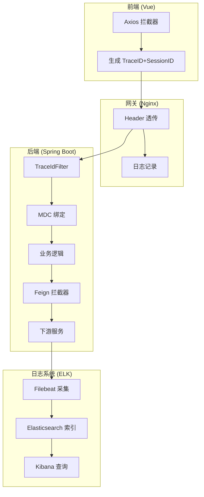

# 智能问数系统 - BE-01 TraceID 全链路透传详细设计文档

**文档版本**: V2.0  
**最后更新**: 2026-04-02  
**适用对象**: 后端开发工程师、运维工程师  
**关联任务**: BE-01 TraceID 全链路透传  
**前置依赖**: 无  
**后续依赖**: 所有后端任务 (BE-02 ~ BE-10)

---

## 1. 任务概述

### 1.1 背景
智能问数系统涉及前端、后端、AI 平台、数据库等多个组件，问题排查时需要通过唯一标识串联全链路日志。TraceID 是实现可观测性的基础设施，确保任意请求可通过一个 ID 追踪完整调用链。

### 1.2 目标
| 目标 | 说明 | 验收标准 |
|------|------|----------|
| **唯一性** | 每个请求生成全局唯一 TraceID | UUID v4，32 位十六进制 |
| **透传性** | 所有 HTTP/RPC 调用自动透传 | 跨服务不丢失 |
| **关联性** | TraceID 与 SessionID 绑定 | 同一会话多请求可关联 |
| **可查询** | 日志可通过 TraceID 检索 | ELK 支持 TraceID 查询 |
| **低开销** | 不显著增加系统开销 | 延迟增加 < 10ms |

### 1.3 范围
| 组件 | 覆盖范围 | 说明 |
|------|----------|------|
| **前端** | Axios 请求头注入 | 所有 API 请求 |
| **网关** | Nginx/K8s Ingress | Header 透传 |
| **后端** | Filter + MDC + Feign | 全链路绑定 |
| **AI 平台** | HiAgent API 调用 | Header 透传 |
| **数据库** | 慢查询日志 | 可选，需 MySQL 配置 |
| **日志系统** | ELK 索引字段 | trace_id 字段 |

---

## 2. 技术选型

### 2.1 技术栈
| 组件 | 技术 | 版本 | 选型理由 |
|------|------|------|----------|
| TraceID 生成 | UUID | JDK 内置 | 全局唯一，无依赖 |
| 日志框架 | Logback + Logstash Encoder | 7.3 | JSON 格式，ELK 友好 |
| 链路追踪 | Spring Cloud Sleuth | 3.1.5 | 自动透传，免配置 |
| MDC 绑定 | SLF4J MDC | - | 线程上下文，日志自动携带 |
| 异步传递 | TaskDecorator | - | 线程池 MDC 传递 |

### 2.2 TraceID 格式规范
```
格式：32 位十六进制字符串 (UUID without hyphens)
示例：a1b2c3d4e5f6g7h8i9j0k1l2m3n4o5p6
生成方式：UUID.randomUUID().toString().replace("-", "")
长度：32 字符
字符集：0-9, a-f
```

### 2.3 Header 规范
| Header 名称 | 说明 | 是否必填 |
|-------------|------|----------|
| `X-Trace-ID` | 链路追踪 ID | 是 |
| `X-Session-ID` | 会话 ID (多请求关联) | 是 |
| `X-Request-ID` | 单次请求 ID (可选) | 否 |

---

## 3. 详细实现方案

### 3.1 整体架构


### 3.2 核心代码实现

#### 3.2.1 TraceID 工具类
**文件路径**: `src/main/java/com/company/askdata/utils/TraceIdUtil.java`

```java
package com.company.askdata.utils;

import lombok.extern.slf4j.Slf4j;
import org.slf4j.MDC;
import java.util.UUID;

/**
 * TraceID 工具类
 * 负责 TraceID 和 SessionID 的生成、获取、清理
 */
@Slf4j
public class TraceIdUtil {
    
    /** TraceID Header 名称 */
    private static final String TRACE_ID_HEADER = "X-Trace-ID";
    
    /** SessionID Header 名称 */
    private static final String SESSION_ID_HEADER = "X-Session-ID";
    
    /** MDC TraceID Key */
    private static final String TRACE_ID_MDC_KEY = "traceId";
    
    /** MDC SessionID Key */
    private static final String SESSION_ID_MDC_KEY = "sessionId";
    
    /** ThreadLocal 存储 SessionID (会话级) */
    private static final ThreadLocal<String> SESSION_ID_HOLDER = new ThreadLocal<>();
    
    /**
     * 生成新的 TraceID
     * @return 32 位十六进制字符串
     */
    public static String generateTraceId() {
        return UUID.randomUUID().toString().replace("-", "");
    }
    
    /**
     * 生成新的 SessionID
     * @return 32 位十六进制字符串
     */
    public static String generateSessionId() {
        return UUID.randomUUID().toString().replace("-", "");
    }
    
    /**
     * 获取当前 TraceID (从 MDC)
     * @return TraceID，不存在则返回 null
     */
    public static String getTraceId() {
        return MDC.get(TRACE_ID_MDC_KEY);
    }
    
    /**
     * 获取当前 SessionID (从 ThreadLocal)
     * @return SessionID，不存在则返回 null
     */
    public static String getSessionId() {
        return SESSION_ID_HOLDER.get();
    }
    
    /**
     * 设置 TraceID 和 SessionID 到 MDC 和 ThreadLocal
     * @param traceId TraceID
     * @param sessionId SessionID
     */
    public static void set(String traceId, String sessionId) {
        if (traceId == null || traceId.trim().isEmpty()) {
            traceId = generateTraceId();
        }
        if (sessionId == null || sessionId.trim().isEmpty()) {
            sessionId = generateSessionId();
        }
        
        MDC.put(TRACE_ID_MDC_KEY, traceId);
        MDC.put(SESSION_ID_MDC_KEY, sessionId);
        SESSION_ID_HOLDER.set(sessionId);
        
        log.debug("TraceID set: traceId={}, sessionId={}", traceId, sessionId);
    }
    
    /**
     * 清理 MDC 和 ThreadLocal (必须在 finally 块中调用)
     */
    public static void clear() {
        MDC.clear();
        SESSION_ID_HOLDER.remove();
    }
    
    /**
     * 获取 Header 名称
     * @return Header 名称
     */
    public static String getTraceIdHeaderName() {
        return TRACE_ID_HEADER;
    }
    
    public static String getSessionIdHeaderName() {
        return SESSION_ID_HEADER;
    }
}
```

#### 3.2.2 TraceID 过滤器
**文件路径**: `src/main/java/com/company/askdata/filter/TraceIdFilter.java`

```java
package com.company.askdata.filter;

import com.company.askdata.utils.TraceIdUtil;
import lombok.extern.slf4j.Slf4j;
import org.slf4j.MDC;
import org.springframework.core.annotation.Order;
import org.springframework.stereotype.Component;
import org.springframework.web.filter.OncePerRequestFilter;

import javax.servlet.FilterChain;
import javax.servlet.ServletException;
import javax.servlet.http.HttpServletRequest;
import javax.servlet.http.HttpServletResponse;
import java.io.IOException;

/**
 * TraceID 过滤器
 * 负责从请求头获取或生成 TraceID/SessionID，并绑定到 MDC
 * 
 * ⚠️ 注意事项:
 * 1. 必须是最先执行的过滤器 (@Order(1))
 * 2. 必须在 finally 块中清理 MDC
 * 3. 异步线程需特殊处理 (见 TaskDecorator)
 */
@Slf4j
@Component
@Order(1) // 确保最高优先级执行
public class TraceIdFilter extends OncePerRequestFilter {
    
    @Override
    protected void doFilterInternal(
        HttpServletRequest request,
        HttpServletResponse response,
        FilterChain filterChain
    ) throws ServletException, IOException {
        
        // 1. 从请求头获取 TraceID 和 SessionID
        String traceId = request.getHeader(TraceIdUtil.getTraceIdHeaderName());
        String sessionId = request.getHeader(TraceIdUtil.getSessionIdHeaderName());
        
        // 2. 如果不存在则生成新的
        boolean isNewTrace = traceId == null || traceId.trim().isEmpty();
        boolean isNewSession = sessionId == null || sessionId.trim().isEmpty();
        
        if (isNewTrace) {
            traceId = TraceIdUtil.generateTraceId();
        }
        if (isNewSession) {
            sessionId = TraceIdUtil.generateSessionId();
        }
        
        // 3. 绑定到 MDC 和 ThreadLocal
        TraceIdUtil.set(traceId, sessionId);
        
        // 4. 响应头回写 (前端可获取)
        response.setHeader(TraceIdUtil.getTraceIdHeaderName(), traceId);
        response.setHeader(TraceIdUtil.getSessionIdHeaderName(), sessionId);
        
        // 5. 记录入口日志
        log.info("traceId={} sessionId={} method={} uri={} isNewTrace={} isNewSession={}",
            traceId, sessionId, request.getMethod(), request.getRequestURI(),
            isNewTrace, isNewSession);
        
        try {
            // 6. 执行后续过滤器链
            filterChain.doFilter(request, response);
        } finally {
            // 7. ⚠️ 关键：清理 MDC (防止线程复用导致污染)
            TraceIdUtil.clear();
        }
    }
}
```

#### 3.2.3 Feign 拦截器 (下游服务透传)
**文件路径**: `src/main/java/com/company/askdata/config/FeignTraceIdConfig.java`

```java
package com.company.askdata.config;

import com.company.askdata.utils.TraceIdUtil;
import feign.RequestInterceptor;
import lombok.extern.slf4j.Slf4j;
import org.springframework.context.annotation.Bean;
import org.springframework.context.annotation.Configuration;

/**
 * Feign 拦截器配置
 * 负责在 Feign 调用下游服务时透传 TraceID 和 SessionID
 */
@Slf4j
@Configuration
public class FeignTraceIdConfig {
    
    /**
     * TraceID 透传拦截器
     */
    @Bean
    public RequestInterceptor traceIdRequestInterceptor() {
        return template -> {
            String traceId = TraceIdUtil.getTraceId();
            String sessionId = TraceIdUtil.getSessionId();
            
            if (traceId != null) {
                template.header(TraceIdUtil.getTraceIdHeaderName(), traceId);
                log.debug("Feign request: traceId={} added to header", traceId);
            }
            
            if (sessionId != null) {
                template.header(TraceIdUtil.getSessionIdHeaderName(), sessionId);
                log.debug("Feign request: sessionId={} added to header", sessionId);
            }
            
            // 如果 MDC 为空，记录警告 (可能是异步线程未正确传递)
            if (traceId == null) {
                log.warn("Feign request: traceId is null in MDC, check TaskDecorator configuration");
            }
        };
    }
}
```

#### 3.2.4 异步线程池配置 (MDC 传递)
**文件路径**: `src/main/java/com/company/askdata/config/AsyncConfig.java`

```java
package com.company.askdata.config;

import com.company.askdata.utils.TraceIdUtil;
import lombok.extern.slf4j.Slf4j;
import org.slf4j.MDC;
import org.springframework.context.annotation.Bean;
import org.springframework.context.annotation.Configuration;
import org.springframework.scheduling.annotation.EnableAsync;
import org.springframework.scheduling.concurrent.ThreadPoolTaskExecutor;

import java.util.Map;
import java.util.concurrent.Executor;

/**
 * 异步线程池配置
 * 负责在异步线程中传递 MDC 上下文 (TraceID/SessionID)
 * 
 * ⚠️ 关键：默认线程池不会传递 MDC，必须配置 TaskDecorator
 */
@Slf4j
@Configuration
@EnableAsync
public class AsyncConfig {
    
    /**
     * 带 MDC 传递的线程池
     */
    @Bean("askdataTaskExecutor")
    public Executor taskExecutor() {
        ThreadPoolTaskExecutor executor = new ThreadPoolTaskExecutor();
        executor.setCorePoolSize(4);
        executor.setMaxPoolSize(8);
        executor.setQueueCapacity(100);
        executor.setThreadNamePrefix("askdata-async-");
        
        // ⚠️ 关键：设置 TaskDecorator 传递 MDC
        executor.setTaskDecorator(new TraceIdTaskDecorator());
        
        executor.initialize();
        log.info("Async executor initialized with MDC propagation");
        return executor;
    }
    
    /**
     * MDC 传递装饰器
     */
    static class TraceIdTaskDecorator implements org.springframework.core.task.TaskDecorator {
        @Override
        public Runnable decorate(Runnable runnable) {
            // 1. 捕获主线程的 MDC 上下文
            Map<String, String> contextMap = MDC.getCopyOfContextMap();
            String sessionId = TraceIdUtil.getSessionId();
            
            return () -> {
                try {
                    // 2. 子线程设置 MDC
                    if (contextMap != null) {
                        MDC.setContextMap(contextMap);
                    }
                    if (sessionId != null) {
                        TraceIdUtil.getSessionId(); // 恢复 SessionID
                    }
                    
                    // 3. 执行任务
                    runnable.run();
                } catch (Exception e) {
                    log.error("traceId={} async task failed", 
                        MDC.get("traceId"), e);
                    throw e;
                } finally {
                    // 4. 清理子线程 MDC (防止线程复用污染)
                    MDC.clear();
                }
            };
        }
    }
}
```

#### 3.2.5 日志配置 (logback-spring.xml)
**文件路径**: `src/main/resources/logback-spring.xml`

```xml
<?xml version="1.0" encoding="UTF-8"?>
<configuration scan="true" scanPeriod="30 seconds">
    
    <!-- 控制台输出 (JSON 格式，ELK 友好) -->
    <appender name="CONSOLE" class="ch.qos.logback.core.ConsoleAppender">
        <encoder class="net.logstash.logback.encoder.LogstashEncoder">
            <!-- 自定义字段 -->
            <customFields>{"service":"askdata-router","env":"${SPRING_PROFILES_ACTIVE}"}</customFields>
            
            <!-- 包含 MDC 字段 -->
            <includeMdc>true</includeMdc>
            
            <!-- MDC 字段映射 -->
            <mdcKeyFieldName>traceId=trace_id</mdcKeyFieldName>
            <mdcKeyFieldName>sessionId=session_id</mdcKeyFieldName>
            
            <!-- 时间格式 -->
            <timestampPattern>yyyy-MM-dd'T'HH:mm:ss.SSSZ</timestampPattern>
        </encoder>
    </appender>
    
    <!-- 文件输出 -->
    <appender name="FILE" class="ch.qos.logback.core.rolling.RollingFileAppender">
        <file>logs/askdata.log</file>
        <encoder class="net.logstash.logback.encoder.LogstashEncoder">
            <includeMdc>true</includeMdc>
            <mdcKeyFieldName>traceId=trace_id</mdcKeyFieldName>
            <mdcKeyFieldName>sessionId=session_id</mdcKeyFieldName>
        </encoder>
        <rollingPolicy class="ch.qos.logback.core.rolling.TimeBasedRollingPolicy">
            <fileNamePattern>logs/askdata.%d{yyyy-MM-dd}.log</fileNamePattern>
            <maxHistory>30</maxHistory>
            <totalSizeCap>10GB</totalSizeCap>
        </rollingPolicy>
    </appender>
    
    <!-- 异步日志 (提升性能) -->
    <appender name="ASYNC_FILE" class="ch.qos.logback.classic.AsyncAppender">
        <appender-ref ref="FILE"/>
        <queueSize>512</queueSize>
        <discardingThreshold>0</discardingThreshold>
        <includeCallerData>false</includeCallerData>
    </appender>
    
    <!-- 应用日志级别 -->
    <logger name="com.company.askdata" level="INFO" additivity="false">
        <appender-ref ref="CONSOLE"/>
        <appender-ref ref="ASYNC_FILE"/>
    </logger>
    
    <!-- 根日志级别 -->
    <root level="INFO">
        <appender-ref ref="CONSOLE"/>
        <appender-ref ref="ASYNC_FILE"/>
    </root>
    
</configuration>
```

### 3.3 前端配合 (Axios 拦截器)
**文件路径**: `src/utils/request.js`

```javascript
import axios from 'axios';
import { generateTraceId, generateSessionId } from './traceId';

// 会话级 SessionID (页面刷新不变)
let sessionId = sessionStorage.getItem('sessionId');
if (!sessionId) {
    sessionId = generateSessionId();
    sessionStorage.setItem('sessionId', sessionId);
}

// 请求拦截器
axios.interceptors.request.use(config => {
    // 每次请求生成新的 TraceID
    const traceId = generateTraceId();
    
    // 注入 Header
    config.headers['X-Trace-ID'] = traceId;
    config.headers['X-Session-ID'] = sessionId;
    
    // 开发环境打印
    if (process.env.NODE_ENV === 'development') {
        console.log(`[Request] ${config.method.toUpperCase()} ${config.url}`, {
            traceId,
            sessionId
        });
    }
    
    return config;
}, error => {
    return Promise.reject(error);
});

// 响应拦截器
axios.interceptors.response.use(response => {
    // 获取后端返回的 TraceID (用于验证)
    const backendTraceId = response.headers['x-trace-id'];
    if (backendTraceId) {
        console.log(`[Response] Backend traceId: ${backendTraceId}`);
    }
    return response;
}, error => {
    // 错误时也记录 TraceID (便于排查)
    const traceId = error.config?.headers?.['X-Trace-ID'];
    console.error(`[Error] traceId=${traceId}`, error);
    return Promise.reject(error);
});
```

---

## 4. 注意事项 ⚠️

### 4.1 MDC 清理
```java
// ❌ 错误：不在 finally 中清理
public void doFilter(...) {
    MDC.put("traceId", traceId);
    filterChain.doFilter(request, response);
    // 如果上面抛出异常，MDC 不会清理！
}

// ✅ 正确：在 finally 中清理
public void doFilter(...) {
    try {
        MDC.put("traceId", traceId);
        filterChain.doFilter(request, response);
    } finally {
        MDC.clear(); // 必须清理
    }
}
```

### 4.2 异步线程传递
```java
// ❌ 错误：直接使用 @Async
@Async
public void asyncMethod() {
    // MDC 为空！子线程无法获取 TraceID
    log.info("traceId={}", TraceIdUtil.getTraceId()); // null
}

// ✅ 正确：使用配置了 TaskDecorator 的线程池
@Async("askdataTaskExecutor")
public void asyncMethod() {
    // MDC 已传递
    log.info("traceId={}", TraceIdUtil.getTraceId()); // 有值
}
```

### 4.3 SSE 长连接处理
```java
// SSE 连接建立时确定 TraceID，整个连接期间不变
@GetMapping(value = "/api/chat", produces = MediaType.TEXT_EVENT_STREAM_VALUE)
public SseEmitter chat(@RequestParam String query) {
    // TraceID 在 Filter 中已生成
    String traceId = TraceIdUtil.getTraceId();
    
    SseEmitter emitter = new SseEmitter(300000L); // 5 分钟超时
    
    // 连接期间 TraceID 不变
    CompletableFuture.runAsync(() -> {
        // 异步发送消息，TraceID 通过 TaskDecorator 传递
        while (...) {
            emitter.send(data);
        }
    }, taskExecutor); // 使用配置了 TaskDecorator 的线程池
    
    return emitter;
}
```

### 4.4 日志敏感度
```java
// ❌ 错误：日志打印敏感信息
log.info("traceId={} query={}", traceId, userQuery); // 可能包含敏感信息

// ✅ 正确：脱敏或限制长度
log.info("traceId={} queryLength={}", traceId, 
    userQuery != null ? Math.min(userQuery.length(), 50) : 0);
```

---

## 5. 需要特别关注的点 🔴

### 5.1 陷阱防护矩阵

| 陷阱类型 | 风险描述 | 防护措施 | 验证方法 |
|----------|----------|----------|----------|
| **状态不一致陷阱** | TraceID 与 SessionID 不匹配导致日志无法关联 | TraceID+SessionID 双键绑定，SessionID 会话级不变 | 同一 Session 多请求 TraceID 不同但 SessionID 相同 |
| **异步线程丢失** | 异步线程无法获取 TraceID | 配置 TaskDecorator 传递 MDC | 异步日志含 TraceID |
| **内存泄漏** | MDC 未清理导致内存泄漏 | finally 块强制清理 | 长时间运行无 MDC 累积 |
| **线程污染** | 线程复用导致 TraceID 错乱 | 每次请求重新设置，结束后清理 | 并发请求 TraceID 不混淆 |
| **SSE 连接 TraceID 混乱** | 长连接期间 TraceID 变化 | 连接建立时确定，整个连接期间不变 | SSE 消息 TraceID 一致 |
| **Feign 调用丢失** | 下游服务无 TraceID | Feign 拦截器自动注入 | 下游服务日志含 TraceID |
| **前端 SessionID 不一致** | 页面刷新 SessionID 变化 | SessionID 存 sessionStorage | 页面刷新 SessionID 不变 |

### 5.2 关键代码审查点

```java
// 审查清单
□ Filter 是否 @Order(1) 确保最先执行
□ MDC 是否在 finally 块中清理
□ 异步线程池是否配置 TaskDecorator
□ Feign 拦截器是否注入 TraceID
□ 日志配置是否包含 trace_id 字段
□ SessionID 是否会话级不变
□ SSE 连接 TraceID 是否连接期间不变
□ 敏感信息是否脱敏打印
```

### 5.3 性能影响评估

| 操作 | 耗时 | 优化建议 |
|------|------|----------|
| UUID 生成 | < 0.1ms | 无需优化 |
| MDC 绑定 | < 0.1ms | 无需优化 |
| Header 注入 | < 0.1ms | 无需优化 |
| JSON 日志编码 | 1-5ms | 使用异步日志 |
| **总开销** | **< 10ms** | **可接受** |

---

## 6. 验收标准

### 6.1 功能验收
| 验收项 | 验收方法 | 通过标准 |
|--------|----------|----------|
| TraceID 生成 | 发送请求，检查响应头 | 32 位十六进制，不重复 |
| TraceID 透传 | 查看下游服务日志 | 含相同 TraceID |
| SessionID 绑定 | 同一会话多请求 | SessionID 相同 |
| MDC 清理 | 长时间运行监控 | 无 MDC 累积 |
| 异步传递 | 查看异步日志 | 含 TraceID |
| ELK 查询 | Kibana 搜索 trace_id | 可串联完整链路 |

### 6.2 性能验收
| 指标 | 目标值 | 测量方法 |
|------|--------|----------|
| TraceID 生成耗时 | < 0.1ms | JMH 基准测试 |
| Filter 增加延迟 | < 5ms | 对比有无 Filter |
| 日志写入延迟 | < 10ms | 异步日志配置 |
| 内存占用 | 无泄漏 | 长时间运行监控 |

### 6.3 安全验收
| 检查项 | 验收方法 | 通过标准 |
|--------|----------|----------|
| 敏感信息脱敏 | 检查日志文件 | 无明文敏感数据 |
| TraceID 可预测性 | 分析 TraceID 分布 | 随机，不可预测 |
| Header 注入防护 | 尝试注入恶意 Header | 被过滤或忽略 |

---

## 7. 测试用例

### 7.1 单元测试
**文件路径**: `src/test/java/com/company/askdata/filter/TraceIdFilterTest.java`

```java
package com.company.askdata.filter;

import com.company.askdata.utils.TraceIdUtil;
import org.junit.jupiter.api.Test;
import org.springframework.beans.factory.annotation.Autowired;
import org.springframework.boot.test.autoconfigure.web.servlet.AutoConfigureMockMvc;
import org.springframework.boot.test.context.SpringBootTest;
import org.springframework.mock.web.MockHttpServletResponse;
import org.springframework.test.web.servlet.MockMvc;

import static org.junit.jupiter.api.Assertions.*;
import static org.springframework.test.web.servlet.request.MockMvcRequestBuilders.*;

@SpringBootTest
@AutoConfigureMockMvc
class TraceIdFilterTest {
    
    @Autowired
    private MockMvc mockMvc;
    
    @Test
    void testTraceIdGeneration() throws Exception {
        // 发送请求 (不带 TraceID)
        MockHttpServletResponse response = mockMvc.perform(
            get("/api/health")
        ).andReturn().getResponse();
        
        // 验证响应头包含 TraceID
        String traceId = response.getHeader("X-Trace-ID");
        assertNotNull(traceId);
        assertEquals(32, traceId.length());
        assertTrue(traceId.matches("[0-9a-f]+"));
    }
    
    @Test
    void testTraceIdPropagation() throws Exception {
        // 发送请求 (带 TraceID)
        String inputTraceId = "12345678901234567890123456789012";
        MockHttpServletResponse response = mockMvc.perform(
            get("/api/health")
                .header("X-Trace-ID", inputTraceId)
        ).andReturn().getResponse();
        
        // 验证 TraceID 透传
        String outputTraceId = response.getHeader("X-Trace-ID");
        assertEquals(inputTraceId, outputTraceId);
    }
    
    @Test
    void testSessionIdConsistency() throws Exception {
        // 第一次请求
        MockHttpServletResponse response1 = mockMvc.perform(
            get("/api/health")
        ).andReturn().getResponse();
        String sessionId1 = response1.getHeader("X-Session-ID");
        
        // 第二次请求 (同一会话)
        MockHttpServletResponse response2 = mockMvc.perform(
            get("/api/health")
                .header("X-Session-ID", sessionId1)
        ).andReturn().getResponse();
        String sessionId2 = response2.getHeader("X-Session-ID");
        
        // 验证 SessionID 一致
        assertEquals(sessionId1, sessionId2);
    }
}
```

### 7.2 集成测试
**文件路径**: `src/test/java/com/company/askdata/integration/TraceIdIntegrationTest.java`

```java
@Test
void testAsyncTraceIdPropagation() throws Exception {
    // 发送请求
    MockHttpServletResponse response = mockMvc.perform(
        post("/api/async-test")
            .header("X-Trace-ID", "test-trace-id")
    ).andReturn().getResponse();
    
    // 等待异步日志写入
    Thread.sleep(1000);
    
    // 检查异步日志是否含 TraceID
    String logContent = readLogFile();
    assertTrue(logContent.contains("test-trace-id"));
}
```

### 7.3 压测验证
```bash
# 使用 JMeter 压测，验证 TraceID 不重复
jmeter -n -t traceid_test.jmx -l results.jtl

# 分析结果
cat results.jtl | cut -d',' -f1 | sort | uniq -c | sort -rn | head
# 应无重复 TraceID
```

---

## 8. 部署配置

### 8.1 环境变量
```yaml
# application-prod.yml
logging:
  level:
    com.company.askdata: INFO
    org.springframework.web: WARN
  
  pattern:
    console: "%d{yyyy-MM-dd HH:mm:ss} [%thread] %-5level %logger{36} - [%X{traceId}] %msg%n"
```

### 8.2 K8s 配置
```yaml
# deployment.yaml
apiVersion: apps/v1
kind: Deployment
metadata:
  name: askdata-router
spec:
  template:
    spec:
      containers:
      - name: router
        env:
        - name: SPRING_PROFILES_ACTIVE
          value: "prod"
        - name: LOG_LEVEL
          value: "INFO"
```

### 8.3 ELK 索引模板
```json
PUT _index_template/askdata-logs
{
  "index_patterns": ["askdata-logs-*"],
  "template": {
    "settings": {
      "number_of_shards": 3,
      "number_of_replicas": 1
    },
    "mappings": {
      "properties": {
        "trace_id": {"type": "keyword"},
        "session_id": {"type": "keyword"},
        "@timestamp": {"type": "date"}
      }
    }
  }
}
```

---

## 9. 工时与优先级

| 项目 | 内容 |
|------|------|
| **工时** | 2 MD (开发 1.5 天 + 测试 0.5 天) |
| **优先级** | P0 (所有任务的前置依赖) |
| **依赖任务** | 无 |
| **被依赖任务** | BE-02 ~ BE-10, 所有后端任务 |

---

## 10. 常见问题 (FAQ)

**Q1: 为什么异步日志没有 TraceID？**
A: 检查是否使用了配置 TaskDecorator 的线程池 (`@Async("askdataTaskExecutor")`)。

**Q2: TraceID 在 Feign 调用中丢失？**
A: 检查 FeignTraceIdConfig 是否生效，拦截器是否注册。

**Q3: 日志中 trace_id 字段为空？**
A: 检查 logback-spring.xml 中 `<includeMdc>true</includeMdc>` 是否配置。

**Q4: 如何验证 TraceID 全链路透传？**
A: 1. 前端发起请求；2. 查看后端日志；3. 查看 HiAgent 日志；4. 查看数据库慢查询日志；5. ELK 搜索同一 TraceID。

**Q5: SessionID 什么时候变化？**
A: SessionID 在会话期间不变，页面刷新不变，关闭浏览器后重新打开会变。

**Q6: TraceID 长度为什么是 32 位？**
A: UUID 标准格式 36 位 (含 4 个连字符)，移除连字符后 32 位，便于日志存储和传输。

**Q7: 生产环境需要调整什么配置？**
A: 1. 日志级别调整为 INFO；2. 启用异步日志；3. 配置日志滚动策略；4. ELK 索引生命周期管理。

---

## 11. 变更历史

| 版本 | 日期 | 变更内容 | 负责人 |
|------|------|----------|--------|
| V1.0 | 2026-03-25 | 初始版本 | 架构组 |
| V2.0 | 2026-04-02 | 增加 SessionID 绑定、异步线程处理、陷阱防护 | 架构组 |

---

**文档结束**  
**下一步**: 开发人员按本文档实现代码，完成后提交测试团队进行 BE-01 专项验收。验收通过后，方可开始 BE-02 ~ BE-10 的开发。