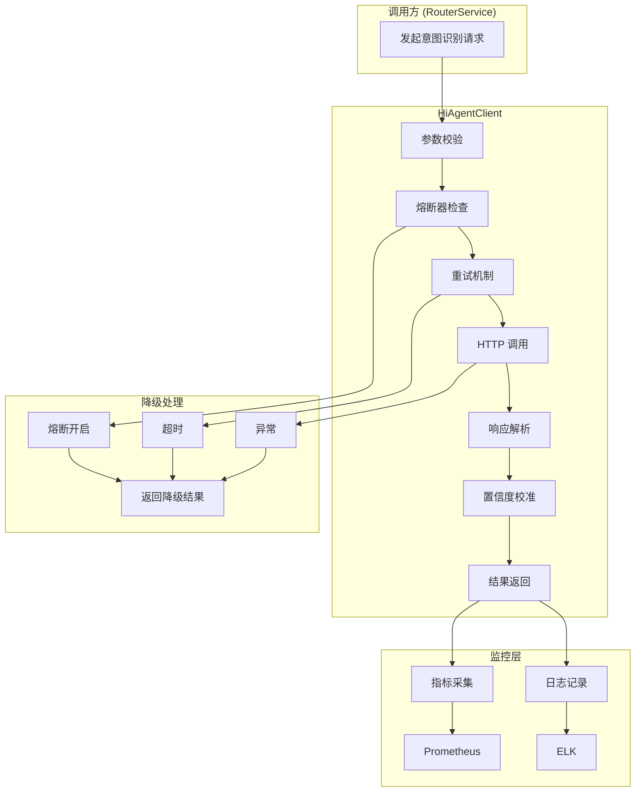

# 智能问数系统 - BE-02 HiAgent 客户端集成详细设计文档

**文档版本**: V2.0  
**最后更新**: 2026-04-02  
**适用对象**: 后端开发工程师、AI 平台运维工程师  
**关联任务**: BE-02 HiAgent 客户端集成  
**前置依赖**: BE-01 (TraceID 全链路透传)  
**后续依赖**: BE-03 (路由决策引擎), AI-01 (智能体创建)

---

## 1. 任务概述

### 1.1 背景
智能问数系统依赖 HiAgent 平台提供 AI 能力（意图识别、实体提取、知识库检索）。需要封装 HiAgent API 调用，实现超时熔断、置信度校准、版本同步等功能，确保 AI 服务调用的稳定性、安全性和可追溯性。

### 1.2 目标
| 目标 | 说明 | 验收标准 |
|------|------|----------|
| **稳定性** | AI 服务故障不影响主流程 | 熔断降级，成功率 ≥ 99% |
| **准确性** | 置信度经过校准 | 校准误差 < 10% |
| **同步性** | AI 与后端状态一致 | session_version 校验 |
| **可追溯** | 所有调用可追溯 | 日志含 TraceID |
| **低延迟** | 调用延迟可控 | P95 < 3s |

### 1.3 范围
| 接口 | 功能 | 调用频率 | SLA |
|------|------|----------|-----|
| 意图识别 | 识别用户意图、提取实体 | 每次用户提问 | P95 < 3s |
| 知识库检索 | 检索相关文档 | 降级时调用 | P95 < 2s |
| 工具注册 | 注册后端工具 (管理面) | 配置变更时 | - |
| 对话历史 | 获取/更新对话历史 | 多轮对话时 | P95 < 1s |

---

## 2. 技术选型

### 2.1 技术栈
| 组件 | 技术 | 版本 | 选型理由 |
|------|------|------|----------|
| HTTP 客户端 | RestTemplate | Spring Boot 3.2 | 简单可靠，与 Spring 集成好 |
| 熔断器 | Resilience4j | 1.7.0 | 轻量级，支持多种模式 |
| 重试机制 | Resilience4j Retry | 1.7.0 | 指数退避重试 |
| 限流器 | Resilience4j RateLimiter | 1.7.0 | 保护下游服务 |
| 本地缓存 | Caffeine | 2.9.0 | 高性能，支持过期策略 |
| 置信度校准 | 自定义校准器 | - | 基于历史数据规则校准 |
| 异步调用 | CompletableFuture | JDK | 非阻塞调用 |

### 2.2 架构设计


### 2.3 超时与重试策略
| 配置项 | 值 | 说明 |
|--------|-----|------|
| 连接超时 | 3 秒 | 建立连接超时 |
| 读取超时 | 5 秒 | 读取响应超时 |
| 最大重试次数 | 2 次 | 失败后重试次数 |
| 重试间隔 | 1 秒 | 首次重试间隔 |
| 熔断阈值 | 50% | 失败率超过 50% 触发熔断 |
| 熔断恢复时间 | 30 秒 | 熔断后 30 秒尝试恢复 |
| 半开状态请求数 | 3 | 半开状态允许的请求数 |

---

## 3. 详细实现方案

### 3.1 配置类

**HiAgentProperties.java**
```java
package com.company.askdata.config;

import lombok.Data;
import org.springframework.boot.context.properties.ConfigurationProperties;
import org.springframework.stereotype.Component;
import java.time.Duration;

/**
 * HiAgent 配置属性
 * 
 * ⚠️ 注意事项:
 * 1. API Key 必须从环境变量读取，禁止硬编码
 * 2. 超时时间需根据网络环境调整
 * 3. 置信度校准开关生产环境建议开启
 */
@Data
@Component
@ConfigurationProperties(prefix = "hiagent")
public class HiAgentProperties {
    
    /** HiAgent 平台基础 URL */
    private String baseUrl = "http://hiagent.internal:8000";
    
    /** 意图识别 API 路径 */
    private String intentApi = "/api/v1/agent/recognize";
    
    /** 知识库检索 API 路径 */
    private String knowledgeApi = "/api/v1/knowledge/retrieve";
    
    /** 连接超时 */
    private Duration connectTimeout = Duration.ofSeconds(3);
    
    /** 读取超时 */
    private Duration readTimeout = Duration.ofSeconds(5);
    
    /** API Key (从环境变量读取) */
    private String apiKey;
    
    /** 最大重试次数 */
    private int maxRetries = 2;
    
    /** 重试间隔 (毫秒) */
    private long retryIntervalMs = 1000;
    
    /** 置信度校准配置 */
    private ConfidenceCalibration calibration = new ConfidenceCalibration();
    
    /** 熔断器配置 */
    private CircuitBreakerConfig circuitBreaker = new CircuitBreakerConfig();
    
    @Data
    public static class ConfidenceCalibration {
        /** 是否启用校准 */
        private boolean enabled = true;
        /** 校准模型路径 (生产环境应加载训练好的模型) */
        private String modelPath = "/models/calibrator.pkl";
        /** 最小置信度 */
        private double minConfidence = 0.0;
        /** 最大置信度 */
        private double maxConfidence = 1.0;
        /** 短查询惩罚系数 */
        private double shortQueryPenalty = 0.8;
        /** 短查询长度阈值 */
        private int shortQueryLengthThreshold = 5;
    }
    
    @Data
    public static class CircuitBreakerConfig {
        /** 失败率阈值 (%) */
        private float failureRateThreshold = 50.0f;
        /** 等待状态持续时间 */
        private Duration waitDurationInOpenState = Duration.ofSeconds(30);
        /** 半开状态允许的请求数 */
        private int permittedNumberOfCallsInHalfOpenState = 3;
        /** 滑动窗口大小 */
        private int slidingWindowSize = 10;
    }
}
```

### 3.2 数据模型

**IntentResult.java**
```java
package com.company.askdata.model;

import com.fasterxml.jackson.annotation.JsonIgnoreProperties;
import lombok.Data;
import java.util.List;
import java.util.Map;

/**
 * 意图识别结果
 * 
 * ⚠️ 注意事项:
 * 1. 使用 @JsonIgnoreProperties 防止 HiAgent 新增字段导致反序列化失败
 * 2. 所有字段应有默认值，防止空指针
 */
@Data
@JsonIgnoreProperties(ignoreUnknown = true)
public class IntentResult {
    
    /** 意图类型 */
    private String intent = "unknown";
    
    /** 置信度 (0.0-1.0) */
    private Double confidence = 0.0;
    
    /** 推荐执行策略 */
    private String recommendedStrategy = "FALLBACK_KB";
    
    /** 提取的实体参数 */
    private Map<String, Object> entities = Map.of();
    
    /** 缺失的必填参数 */
    private List<String> missingSlots = List.of();
    
    /** 匹配的工具名称 */
    private String toolName;
    
    /** AI 生成的 SQL (仅 TEXT_TO_SQL 策略) */
    private String generatedSql;
    
    /** 是否需要澄清 */
    private Boolean needClarify = false;
    
    /** 澄清问题 */
    private String clarifyQuestion;
    
    /** 澄清选项 */
    private List<String> clarifyOptions = List.of();
    
    /** HiAgent 侧请求 ID (用于排查) */
    private String hiagentRequestId;
    
    /** 会话版本 (用于状态同步校验) */
    private Long sessionVersion;
    
    /**
     * 验证结果有效性
     * @return 是否有效
     */
    public boolean isValid() {
        return intent != null && confidence != null;
    }
    
    /**
     * 获取置信度 (防止 null)
     * @return 置信度
     */
    public double getConfidenceSafe() {
        return confidence != null ? confidence : 0.0;
    }
}
```

**KnowledgeRetrievalResult.java**
```java
package com.company.askdata.model;

import com.fasterxml.jackson.annotation.JsonIgnoreProperties;
import lombok.Data;
import java.util.List;

@Data
@JsonIgnoreProperties(ignoreUnknown = true)
public class KnowledgeRetrievalResult {
    
    /** 检索查询 */
    private String query;
    
    /** 命中文档总数 */
    private Integer totalHits = 0;
    
    /** 返回的文档数量 */
    private Integer topK = 0;
    
    /** 检索耗时 (毫秒) */
    private Long latencyMs = 0L;
    
    /** 检索置信度 */
    private Double confidence = 0.0;
    
    /** 文档列表 */
    private List<KnowledgeDocument> documents = List.of();
    
    @Data
    public static class KnowledgeDocument {
        private String docId;
        private String docTitle;
        private String docType;
        private Double relevanceScore;
        private String excerpt;
    }
    
    public boolean isValid() {
        return documents != null && !documents.isEmpty();
    }
}
```

### 3.3 核心客户端

**HiAgentClient.java**
```java
package com.company.askdata.client;

import com.company.askdata.config.HiAgentProperties;
import com.company.askdata.model.IntentResult;
import com.company.askdata.model.KnowledgeRetrievalResult;
import com.company.askdata.service.ConfidenceCalibrator;
import com.company.askdata.utils.TraceIdUtil;
import io.github.resilience4j.circuitbreaker.annotation.CircuitBreaker;
import io.github.resilience4j.retry.annotation.Retry;
import io.github.resilience4j.timelimiter.annotation.TimeLimiter;
import lombok.RequiredArgsConstructor;
import lombok.extern.slf4j.Slf4j;
import org.springframework.http.*;
import org.springframework.stereotype.Component;
import org.springframework.web.client.RestTemplate;
import org.springframework.web.util.UriComponentsBuilder;

import java.util.HashMap;
import java.util.Map;
import java.util.concurrent.CompletableFuture;

/**
 * HiAgent 客户端
 * 负责与 HiAgent 平台进行 API 调用
 * 
 * ⚠️ 关键防护点:
 * 1. 熔断器防止雪崩
 * 2. 重试机制处理临时故障
 * 3. 超时控制防止阻塞
 * 4. 置信度校准提高准确性
 * 5. 版本校验防止状态不同步
 */
@Slf4j
@Component
@RequiredArgsConstructor
public class HiAgentClient {
    
    private final HiAgentProperties properties;
    private final RestTemplate restTemplate;
    private final ConfidenceCalibrator calibrator;
    
    /**
     * 意图识别
     * 
     * @param query 用户提问
     * @param traceId 链路追踪 ID
     * @param sessionId 会话 ID
     * @param sessionVersion 会话版本 (用于状态同步校验)
     * @return 意图识别结果
     */
    @CircuitBreaker(name = "hiagent", fallbackMethod = "fallbackRecognize")
    @Retry(name = "hiagent")
    @TimeLimiter(name = "hiagent")
    public CompletableFuture<IntentResult> recognizeIntent(
        String query, 
        String traceId, 
        String sessionId,
        Long sessionVersion
    ) {
        return CompletableFuture.supplyAsync(() -> {
            long startTime = System.currentTimeMillis();
            
            // 1. 构建请求 URL
            String url = UriComponentsBuilder.fromHttpUrl(properties.getBaseUrl())
                .path(properties.getIntentApi())
                .build()
                .toUriString();
            
            // 2. 构建请求体
            Map<String, Object> requestBody = buildIntentRequestBody(
                query, traceId, sessionId, sessionVersion
            );
            
            // 3. 构建请求头
            HttpHeaders headers = buildHeaders(traceId, sessionId);
            
            HttpEntity<Map<String, Object>> entity = new HttpEntity<>(requestBody, headers);
            
            // 4. 执行调用
            IntentResult result = executeRequest(url, entity, IntentResult.class, "intent");
            
            // 5. 置信度校准
            if (result != null && properties.getCalibration().isEnabled()) {
                double rawConfidence = result.getConfidenceSafe();
                double calibrated = calibrator.calibrate(
                    rawConfidence, 
                    result.getIntent(), 
                    query != null ? query.length() : 0
                );
                result.setConfidence(calibrated);
                
                log.info("traceId={} confidence calibrated: {} -> {}", 
                    traceId, rawConfidence, calibrated);
            }
            
            // 6. 记录日志
            long latency = System.currentTimeMillis() - startTime;
            logIntentRecognition(traceId, result, latency);
            
            return result;
        });
    }
    
    /**
     * 知识库检索
     */
    @CircuitBreaker(name = "hiagent", fallbackMethod = "fallbackRetrieve")
    @Retry(name = "hiagent")
    @TimeLimiter(name = "hiagent")
    public CompletableFuture<KnowledgeRetrievalResult> retrieveKnowledge(
        String query, 
        String traceId, 
        int topK
    ) {
        return CompletableFuture.supplyAsync(() -> {
            long startTime = System.currentTimeMillis();
            
            String url = UriComponentsBuilder.fromHttpUrl(properties.getBaseUrl())
                .path(properties.getKnowledgeApi())
                .build()
                .toUriString();
            
            Map<String, Object> requestBody = new HashMap<>();
            requestBody.put("query", query);
            requestBody.put("trace_id", traceId);
            requestBody.put("top_k", topK);
            requestBody.put("threshold", 0.65);
            
            HttpHeaders headers = buildHeaders(traceId, null);
            HttpEntity<Map<String, Object>> entity = new HttpEntity<>(requestBody, headers);
            
            KnowledgeRetrievalResult result = executeRequest(url, entity, 
                KnowledgeRetrievalResult.class, "knowledge");
            
            if (result != null) {
                result.setLatencyMs(System.currentTimeMillis() - startTime);
                result.setQuery(query);
            }
            
            log.info("traceId={} knowledge retrieval completed: latency={}ms, hits={}", 
                traceId, result != null ? result.getLatencyMs() : 0,
                result != null ? result.getTotalHits() : 0);
            
            return result;
        });
    }
    
    /**
     * 构建意图识别请求体
     */
    private Map<String, Object> buildIntentRequestBody(
        String query, String traceId, String sessionId, Long sessionVersion
    ) {
        Map<String, Object> body = new HashMap<>();
        body.put("query", query);
        body.put("trace_id", traceId);
        body.put("session_id", sessionId);
        
        // ⚠️ 关键：携带会话版本，防止状态不同步
        if (sessionVersion != null) {
            body.put("session_version", sessionVersion);
        }
        
        return body;
    }
    
    /**
     * 构建请求头
     */
    private HttpHeaders buildHeaders(String traceId, String sessionId) {
        HttpHeaders headers = new HttpHeaders();
        headers.setContentType(MediaType.APPLICATION_JSON);
        headers.set("X-Trace-ID", traceId);
        
        if (sessionId != null) {
            headers.set("X-Session-ID", sessionId);
        }
        
        // ⚠️ API Key 从配置读取，禁止硬编码
        if (properties.getApiKey() != null && !properties.getApiKey().isEmpty()) {
            headers.set("Authorization", "Bearer " + properties.getApiKey());
        }
        
        return headers;
    }
    
    /**
     * 执行 HTTP 请求
     */
    private <T> T executeRequest(String url, HttpEntity<?> entity, 
                                 Class<T> responseType, String apiType) {
        try {
            ResponseEntity<T> response = restTemplate.exchange(
                url, HttpMethod.POST, entity, responseType
            );
            
            if (response.getStatusCode().is2xxSuccessful()) {
                return response.getBody();
            } else {
                log.warn("apiType={} response status={}", apiType, response.getStatusCode());
                return null;
            }
        } catch (Exception e) {
            log.error("apiType={} request failed", apiType, e);
            throw new RuntimeException("HiAgent API 调用失败：" + e.getMessage(), e);
        }
    }
    
    /**
     * 记录意图识别日志
     */
    private void logIntentRecognition(String traceId, IntentResult result, long latency) {
        log.info("traceId={} intent recognition: intent={}, confidence={}, latency={}ms", 
            traceId, 
            result != null ? result.getIntent() : "null",
            result != null ? result.getConfidenceSafe() : 0.0,
            latency);
    }
    
    /**
     * ⚠️ 熔断降级：意图识别
     */
    public CompletableFuture<IntentResult> fallbackRecognize(
        String query, String traceId, String sessionId, Long sessionVersion, 
        Throwable e
    ) {
        log.error("traceId={} intent recognition failed, using fallback", traceId, e);
        
        IntentResult fallback = new IntentResult();
        fallback.setIntent("unknown");
        fallback.setConfidence(0.0);
        fallback.setRecommendedStrategy("FALLBACK_KB");
        fallback.setNeedClarify(true);
        fallback.setClarifyQuestion("抱歉，智能服务暂时不可用，请您重新描述一下问题");
        fallback.setClarifyOptions(List.of("查看热门问题", "查看帮助文档", "联系管理员"));
        
        return CompletableFuture.completedFuture(fallback);
    }
    
    /**
     * ⚠️ 熔断降级：知识库检索
     */
    public CompletableFuture<KnowledgeRetrievalResult> fallbackRetrieve(
        String query, String traceId, int topK, Throwable e
    ) {
        log.error("traceId={} knowledge retrieval failed, using fallback", traceId, e);
        
        KnowledgeRetrievalResult fallback = new KnowledgeRetrievalResult();
        fallback.setQuery(query);
        fallback.setTotalHits(0);
        fallback.setDocuments(List.of());
        fallback.setLatencyMs(0L);
        
        return CompletableFuture.completedFuture(fallback);
    }
}
```

### 3.4 置信度校准器

**ConfidenceCalibrator.java**
```java
package com.company.askdata.service;

import com.company.askdata.config.HiAgentProperties;
import lombok.RequiredArgsConstructor;
import lombok.extern.slf4j.Slf4j;
import org.springframework.stereotype.Service;

import javax.annotation.PostConstruct;
import java.io.File;

/**
 * 置信度校准器
 * 
 * ⚠️ 陷阱防护：置信度膨胀陷阱
 * AI 模型往往过于自信，需要基于历史数据进行校准
 * 
 * 生产环境应加载训练好的校准模型 (如 Platt Scaling)
 * 当前使用简化版规则校准
 */
@Slf4j
@Service
@RequiredArgsConstructor
public class ConfidenceCalibrator {
    
    private final HiAgentProperties properties;
    
    /**
     * 校准模型 (生产环境应加载训练好的模型)
     */
    private Object calibrationModel;
    
    @PostConstruct
    public void init() {
        if (properties.getCalibration().isEnabled()) {
            String modelPath = properties.getCalibration().getModelPath();
            File modelFile = new File(modelPath);
            
            if (modelFile.exists()) {
                // 加载训练好的模型
                // calibrationModel = loadModel(modelPath);
                log.info("Confidence calibrator initialized with model: {}", modelPath);
            } else {
                log.warn("Calibration model not found at {}, using rule-based calibration", modelPath);
            }
        }
    }
    
    /**
     * 校准置信度
     * 
     * @param rawConfidence 原始置信度
     * @param intentType 意图类型
     * @param queryLength 查询长度
     * @return 校准后的置信度
     */
    public double calibrate(double rawConfidence, String intentType, int queryLength) {
        if (!properties.getCalibration().isEnabled()) {
            return rawConfidence;
        }
        
        double calibrated = rawConfidence;
        
        // 1. 短查询惩罚 (短查询往往置信度虚高)
        if (queryLength < properties.getCalibration().getShortQueryLengthThreshold()) {
            calibrated *= properties.getCalibration().getShortQueryPenalty();
            log.debug("Short query penalty applied: {} -> {}", rawConfidence, calibrated);
        }
        
        // 2. 未知意图上限 (未知意图置信度不应过高)
        if ("unknown".equals(intentType)) {
            calibrated = Math.min(calibrated, 0.5);
            log.debug("Unknown intent cap applied: {} -> {}", rawConfidence, calibrated);
        }
        
        // 3. 边界值处理
        calibrated = Math.max(
            properties.getCalibration().getMinConfidence(), 
            Math.min(properties.getCalibration().getMaxConfidence(), calibrated)
        );
        
        // 4. 保留 2 位小数
        calibrated = Math.round(calibrated * 100.0) / 100.0;
        
        return calibrated;
    }
    
    /**
     * 记录校准指标 (用于后续模型训练)
     */
    public void recordCalibrationData(double rawConfidence, double calibratedConfidence, 
                                      boolean actualCorrect, String intentType) {
        // 生产环境应记录到数据库，用于定期重新训练校准模型
        log.info("Calibration data: raw={}, calibrated={}, correct={}, intent={}", 
            rawConfidence, calibratedConfidence, actualCorrect, intentType);
    }
}
```

### 3.5 熔断器配置

**Resilience4jConfig.java**
```java
package com.company.askdata.config;

import io.github.resilience4j.circuitbreaker.CircuitBreakerRegistry;
import io.github.resilience4j.retry.RetryRegistry;
import io.github.resilience4j.timelimiter.TimeLimiterRegistry;
import io.github.resilience4j.circuitbreaker.CircuitBreakerConfig;
import io.github.resilience4j.retry.RetryConfig;
import io.github.resilience4j.timelimiter.TimeLimiterConfig;
import lombok.RequiredArgsConstructor;
import org.springframework.context.annotation.Bean;
import org.springframework.context.annotation.Configuration;

import java.time.Duration;

/**
 * Resilience4j 配置
 * 
 * ⚠️ 关键：防止 AI 服务故障导致系统雪崩
 */
@Configuration
@RequiredArgsConstructor
public class Resilience4jConfig {
    
    private final HiAgentProperties properties;
    
    @Bean
    public CircuitBreakerRegistry circuitBreakerRegistry() {
        CircuitBreakerConfig config = CircuitBreakerConfig.custom()
            // 失败率阈值
            .failureRateThreshold(properties.getCircuitBreaker().getFailureRateThreshold())
            // 等待状态持续时间
            .waitDurationInOpenState(properties.getCircuitBreaker().getWaitDurationInOpenState())
            // 半开状态允许的请求数
            .permittedNumberOfCallsInHalfOpenState(
                properties.getCircuitBreaker().getPermittedNumberOfCallsInHalfOpenState())
            // 滑动窗口大小
            .slidingWindowSize(properties.getCircuitBreaker().getSlidingWindowSize())
            // 记录异常
            .recordExceptions(Exception.class)
            .build();
        
        return CircuitBreakerRegistry.of(config);
    }
    
    @Bean
    public RetryRegistry retryRegistry() {
        RetryConfig config = RetryConfig.custom()
            // 最大重试次数
            .maxAttempts(properties.getMaxRetries())
            // 重试间隔
            .waitDuration(Duration.ofMillis(properties.getRetryIntervalMs()))
            // 指数退避
            .enableExponentialBackoff(true)
            .exponentialBackoffMultiplier(2.0)
            // 重试异常
            .retryExceptions(Exception.class)
            .build();
        
        return RetryRegistry.of(config);
    }
    
    @Bean
    public TimeLimiterRegistry timeLimiterRegistry() {
        TimeLimiterConfig config = TimeLimiterConfig.custom()
            // 超时时间 (与 readTimeout 一致)
            .timeoutDuration(properties.getReadTimeout())
            // 超时是否取消未来
            .cancelRunningFuture(true)
            .build();
        
        return TimeLimiterRegistry.of(config);
    }
}
```

---

## 4. 注意事项 ⚠️

### 4.1 API Key 安全管理
```java
// ❌ 错误：硬编码 API Key
private String apiKey = "sk-xxxxx";

// ✅ 正确：从环境变量读取
@Value("${HIAGENT_API_KEY}")
private String apiKey;

// application.yml
hiagent:
  api-key: ${HIAGENT_API_KEY}  # 从环境变量读取

# 部署时设置环境变量
export HIAGENT_API_KEY=sk-xxxxx
```

### 4.2 超时配置
```java
// ❌ 错误：无超时配置
restTemplate.exchange(url, HttpMethod.POST, entity, responseType);

// ✅ 正确：配置超时
SimpleClientHttpRequestFactory factory = new SimpleClientHttpRequestFactory();
factory.setConnectTimeout((int) properties.getConnectTimeout().toMillis());
factory.setReadTimeout((int) properties.getReadTimeout().toMillis());
RestTemplate restTemplate = new RestTemplate(factory);
```

### 4.3 异常处理
```java
// ❌ 错误：异常直接抛出
public IntentResult recognizeIntent(...) {
    return restTemplate.exchange(...).getBody(); // 可能抛异常
}

// ✅ 正确：捕获异常并降级
@CircuitBreaker(name = "hiagent", fallbackMethod = "fallbackRecognize")
public CompletableFuture<IntentResult> recognizeIntent(...) {
    try {
        return CompletableFuture.supplyAsync(() -> {
            return restTemplate.exchange(...).getBody();
        });
    } catch (Exception e) {
        log.error("Intent recognition failed", e);
        return fallbackRecognize(..., e);
    }
}
```

### 4.4 日志敏感度
```java
// ❌ 错误：日志打印完整查询
log.info("traceId={} query={}", traceId, query); // 可能包含敏感信息

// ✅ 正确：脱敏或限制长度
log.info("traceId={} queryLength={}", traceId, 
    query != null ? Math.min(query.length(), 50) : 0);
```

### 4.5 会话版本同步
```java
// ❌ 错误：不携带会话版本
requestBody.put("query", query);

// ✅ 正确：携带会话版本，防止状态不同步
requestBody.put("query", query);
requestBody.put("session_version", sessionVersion); // 关键！
```

---

## 5. 需要特别关注的点 🔴

### 5.1 陷阱防护矩阵

| 陷阱类型 | 风险描述 | 防护措施 | 验证方法 |
|----------|----------|----------|----------|
| **上下文异步不同步** | AI 与后端状态不一致 | 请求携带 session_version | AI 返回结果带 version 校验 |
| **置信度膨胀** | AI 对错误判断给高置信度 | 置信度校准器 | 校准后置信度与准确率偏差<10% |
| **服务雪崩** | HiAgent 故障导致系统崩溃 | 熔断器 + 降级 | 模拟 HiAgent 故障，系统不崩溃 |
| **Token 消耗失控** | 复杂对话 Token 消耗指数增长 | 限制 max_tokens | 监控 Token 消耗，设置告警 |
| **API Key 泄露** | Key 硬编码或日志打印 | 环境变量 + 脱敏 | 代码扫描无硬编码，日志无明文 |
| **超时阻塞** | AI 响应慢阻塞主流程 | 超时配置 + 异步调用 | 压测验证 P95 < 3s |
| **重试风暴** | 失败后频繁重试压垮服务 | 指数退避重试 | 验证重试间隔递增 |

### 5.2 关键代码审查点

```java
// 审查清单
□ API Key 是否从环境变量读取
□ 超时配置是否生效
□ 熔断器是否配置
□ 重试机制是否配置
□ 置信度校准是否启用
□ session_version 是否携带
□ 异常是否捕获并降级
□ 日志是否脱敏
□ CompletableFuture 是否正确关闭
□ 指标是否采集
```

### 5.3 性能影响评估

| 操作 | 耗时 | 优化建议 |
|------|------|----------|
| HTTP 调用 | 500-2000ms | 无法优化，依赖网络 |
| 置信度校准 | < 1ms | 无需优化 |
| 熔断器检查 | < 0.1ms | 无需优化 |
| 日志记录 | 1-5ms | 使用异步日志 |
| **总开销** | **500-3000ms** | **主要耗时在 HTTP 调用** |

### 5.4 监控指标

```java
// 需要采集的指标
@Component
public class HiAgentMetrics {
    
    private final MeterRegistry meterRegistry;
    
    // 调用次数
    meterRegistry.counter("hiagent.request.total", 
        "api", "intent", "status", "success");
    
    // 响应时间
    meterRegistry.timer("hiagent.request.latency",
        "api", "intent").record(latency, TimeUnit.MILLISECONDS);
    
    // 熔断状态
    meterRegistry.gauge("hiagent.circuitbreaker.state",
        circuitBreaker.getState().ordinal());
    
    // 置信度分布
    meterRegistry.summary("hiagent.confidence.distribution")
        .record(confidence);
}
```

---

## 6. 验收标准

### 6.1 功能验收
| 验收项 | 验收方法 | 通过标准 |
|--------|----------|----------|
| 意图识别 | 发送测试查询 | 返回有效 IntentResult |
| 知识库检索 | 发送检索请求 | 返回相关文档 |
| 熔断降级 | 模拟 HiAgent 故障 | 返回降级结果，系统不崩溃 |
| 置信度校准 | 对比校准前后 | 校准后更准确 |
| TraceID 透传 | 检查 HiAgent 日志 | 含相同 TraceID |
| 会话版本同步 | 修改 version 测试 | 版本冲突被检测 |

### 6.2 性能验收
| 指标 | 目标值 | 测量方法 |
|------|--------|----------|
| 意图识别 P95 | < 3s | JMeter 压测 |
| 知识库检索 P95 | < 2s | JMeter 压测 |
| 调用成功率 | ≥ 99% | 监控统计 |
| 熔断触发时间 | < 1s | 模拟故障测试 |
| 降级响应时间 | < 100ms | 计时测量 |

### 6.3 安全验收
| 检查项 | 验收方法 | 通过标准 |
|--------|----------|----------|
| API Key 安全 | 代码扫描 | 无硬编码 |
| 日志脱敏 | 检查日志文件 | 无敏感信息 |
| 超时控制 | 模拟慢响应 | 超时被拦截 |
| 重试限制 | 模拟连续失败 | 重试次数受限 |

---

## 7. 测试用例

### 7.1 单元测试
**文件路径**: `src/test/java/com/company/askdata/client/HiAgentClientTest.java`

```java
package com.company.askdata.client;

import com.company.askdata.config.HiAgentProperties;
import com.company.askdata.model.IntentResult;
import com.company.askdata.service.ConfidenceCalibrator;
import org.junit.jupiter.api.Test;
import org.springframework.beans.factory.annotation.Autowired;
import org.springframework.boot.test.context.SpringBootTest;
import org.springframework.boot.test.mock.mockito.MockBean;
import org.springframework.web.client.RestTemplate;

import java.util.concurrent.CompletableFuture;
import java.util.concurrent.TimeUnit;

import static org.junit.jupiter.api.Assertions.*;
import static org.mockito.ArgumentMatchers.*;
import static org.mockito.Mockito.*;

@SpringBootTest
class HiAgentClientTest {
    
    @Autowired
    private HiAgentClient client;
    
    @MockBean
    private RestTemplate restTemplate;
    
    @MockBean
    private ConfidenceCalibrator calibrator;
    
    @Test
    void testRecognizeIntentSuccess() throws Exception {
        // 准备测试数据
        IntentResult mockResult = new IntentResult();
        mockResult.setIntent("sales_report");
        mockResult.setConfidence(0.95);
        
        when(restTemplate.exchange(anyString(), any(), any(), eq(IntentResult.class)))
            .thenReturn(new ResponseEntity<>(mockResult, HttpStatus.OK));
        
        when(calibrator.calibrate(anyDouble(), anyString(), anyInt()))
            .thenReturn(0.90);
        
        // 执行测试
        CompletableFuture<IntentResult> future = client.recognizeIntent(
            "华东区上月销售额",
            "test-trace-id",
            "test-session-id",
            1L
        );
        
        IntentResult result = future.get(5, TimeUnit.SECONDS);
        
        // 验证结果
        assertNotNull(result);
        assertEquals("sales_report", result.getIntent());
        assertEquals(0.90, result.getConfidence()); // 校准后的值
    }
    
    @Test
    void testRecognizeIntentFallback() throws Exception {
        // 模拟 HiAgent 故障
        when(restTemplate.exchange(anyString(), any(), any(), eq(IntentResult.class)))
            .thenThrow(new RuntimeException("HiAgent unavailable"));
        
        // 执行测试
        CompletableFuture<IntentResult> future = client.recognizeIntent(
            "测试查询",
            "test-trace-id",
            "test-session-id",
            1L
        );
        
        IntentResult result = future.get(5, TimeUnit.SECONDS);
        
        // 验证降级结果
        assertNotNull(result);
        assertEquals("unknown", result.getIntent());
        assertEquals(0.0, result.getConfidence());
        assertTrue(result.getNeedClarify());
    }
    
    @Test
    void testConfidenceCalibration() {
        // 测试短查询惩罚
        double calibrated = calibrator.calibrate(0.9, "sales_report", 3);
        assertTrue(calibrated < 0.9); // 短查询应降低置信度
        
        // 测试未知意图上限
        calibrated = calibrator.calibrate(0.9, "unknown", 20);
        assertTrue(calibrated <= 0.5); // 未知意图上限 0.5
    }
}
```

### 7.2 集成测试
**文件路径**: `src/test/java/com/company/askdata/integration/HiAgentIntegrationTest.java`

```java
@Test
void testCircuitBreakerOpens() throws Exception {
    // 连续失败 5 次，熔断器应开启
    for (int i = 0; i < 5; i++) {
        when(restTemplate.exchange(anyString(), any(), any(), eq(IntentResult.class)))
            .thenThrow(new RuntimeException("HiAgent unavailable"));
        
        try {
            client.recognizeIntent("test", "trace-" + i, "session", 1L).get();
        } catch (Exception e) {
            // 预期异常
        }
    }
    
    // 验证熔断器状态 (需通过 Actuator 端点或指标查询)
    // 实际应检查 CircuitBreaker 状态为 OPEN
}
```

### 7.3 压测验证
```bash
# JMeter 压测脚本配置
# 线程数：100
# 持续时间：5 分钟
# 验证指标：
# - P95 响应时间 < 3s
# - 错误率 < 1%
# - 熔断器触发次数

# 执行压测
jmeter -n -t hiagent_load_test.jmx -l results.jtl

# 分析结果
jmeter -g results.jtl -o report/
```

---

## 8. 部署配置

### 8.1 环境变量
```bash
# 生产环境变量
export HIAGENT_BASE_URL=http://hiagent-prod.internal:8000
export HIAGENT_API_KEY=sk-prod-xxxxx  # 从密钥管理系统获取
export HIAGENT_CONNECT_TIMEOUT=3000
export HIAGENT_READ_TIMEOUT=5000
export HIAGENT_CALIBRATION_ENABLED=true
```

### 8.2 K8s 配置
```yaml
# deployment.yaml
apiVersion: apps/v1
kind: Deployment
metadata:
  name: askdata-router
spec:
  template:
    spec:
      containers:
      - name: router
        env:
        - name: HIAGENT_BASE_URL
          valueFrom:
            configMapKeyRef:
              name: askdata-config
              key: hiagent.base-url
        - name: HIAGENT_API_KEY
          valueFrom:
            secretKeyRef:
              name: askdata-secrets
              key: hiagent-api-key
        - name: HIAGENT_CALIBRATION_ENABLED
          value: "true"
        resources:
          requests:
            memory: "512Mi"
            cpu: "250m"
          limits:
            memory: "1Gi"
            cpu: "500m"
```

### 8.3 监控告警
```yaml
# Prometheus 告警规则
groups:
- name: hiagent-alerts
  rules:
  - alert: HiAgentHighFailureRate
    expr: |
      sum(rate(hiagent_request_total{status="failed"}[5m])) 
      / 
      sum(rate(hiagent_request_total[5m])) > 0.1
    for: 5m
    labels:
      severity: warning
    annotations:
      summary: "HiAgent 失败率过高 ({{ $value }})"
  
  - alert: HiAgentCircuitBreakerOpen
    expr: hiagent_circuitbreaker_state == 2
    for: 1m
    labels:
      severity: critical
    annotations:
      summary: "HiAgent 熔断器开启"
  
  - alert: HiAgentHighLatency
    expr: |
      histogram_quantile(0.95, sum(rate(hiagent_request_latency_bucket[5m])) by (le)) > 3
    for: 5m
    labels:
      severity: warning
    annotations:
      summary: "HiAgent P95 延迟过高 ({{ $value }}s)"
```

---

## 9. 常见问题 (FAQ)

**Q1: 调用 HiAgent 超时怎么办？**
A: 1. 检查网络连接；2. 检查 HiAgent 服务状态；3. 适当增加超时时间；4. 检查是否触发限流。

**Q2: 置信度校准不准确怎么办？**
A: 1. 收集更多历史数据；2. 重新训练校准模型；3. 调整校准规则；4. 分意图类型校准。

**Q3: 熔断器频繁触发怎么办？**
A: 1. 检查 HiAgent 服务健康度；2. 调整熔断阈值；3. 增加重试次数；4. 优化 HiAgent 性能。

**Q4: 如何验证 session_version 同步？**
A: 1. 修改后端 session version；2. 发送请求携带旧 version；3. 检查 HiAgent 是否校验；4. 验证冲突处理。

**Q5: API Key 如何轮换？**
A: 1. 在 HiAgent 平台生成新 Key；2. 更新 K8s Secret；3. 滚动重启应用；4. 验证新 Key 生效；5. 废弃旧 Key。

**Q6: 如何监控 Token 消耗？**
A: 1. HiAgent 返回 Token 使用量；2. 记录到指标系统；3. 设置预算告警；4. 定期分析优化。

**Q7: 降级结果如何优化？**
A: 1. 根据失败原因定制降级文案；2. 提供替代方案；3. 记录降级日志；4. 分析降级原因优化上游。

**Q8: 如何处理 HiAgent 返回格式变更？**
A: 1. 使用 @JsonIgnoreProperties；2. 字段设置默认值；3. 版本协商机制；4. 监控返回格式变化。

---

## 10. 变更历史

| 版本 | 日期 | 变更内容 | 负责人 |
|------|------|----------|--------|
| V1.0 | 2026-03-25 | 初始版本 | 架构组 |
| V2.0 | 2026-04-02 | 增加置信度校准、会话版本同步、陷阱防护 | 架构组 |

---

## 11. 工时与优先级

| 项目 | 内容 |
|------|------|
| **工时** | 3 MD (开发 2 天 + 测试 1 天) |
| **优先级** | P0 (核心依赖) |
| **依赖任务** | BE-01 (TraceID 透传) |
| **被依赖任务** | BE-03 (路由决策), AI-01 (智能体) |

---

**文档结束**  
**下一步**: 开发人员按本文档实现代码，完成后提交测试团队进行 BE-02 专项验收。验收通过后，方可开始 BE-03 的开发。