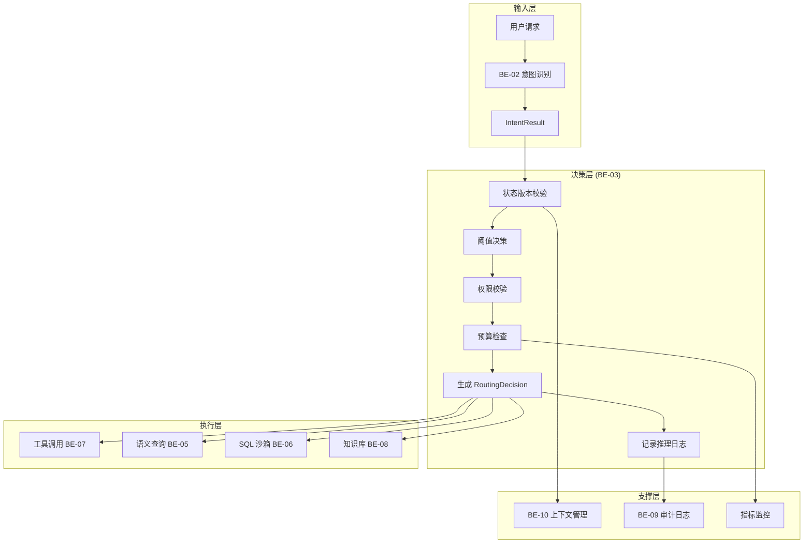
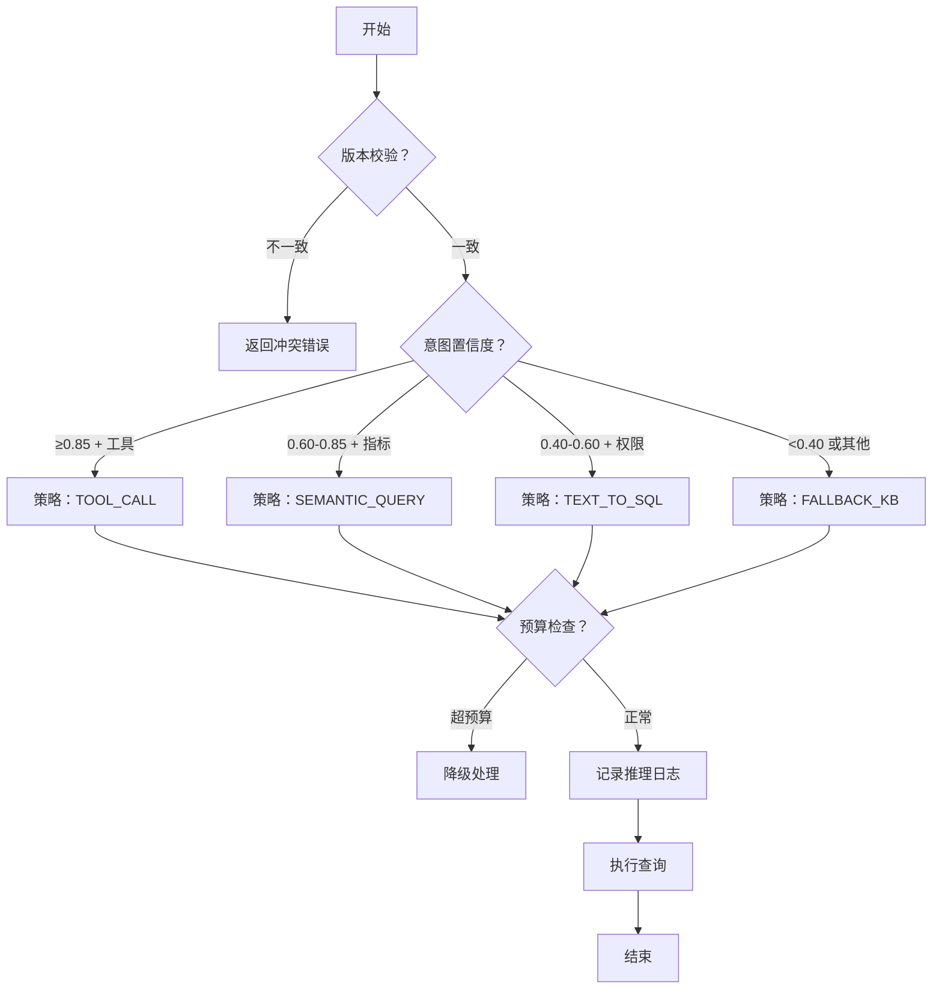

# 智能问数系统 - BE-03 路由决策引擎开发详细设计文档

**文档版本**: V2.0  
**最后更新**: 2026-04-02  
**适用对象**: 后端开发工程师、架构师  
**关联任务**: BE-03 路由决策引擎开发  
**前置依赖**: BE-01 (TraceID), BE-02 (HiAgent 客户端), BE-10 (上下文管理)  
**后续依赖**: BE-05 (语义查询), BE-06 (SQL 沙箱), BE-07 (工具调用)

---

## 1. 任务概述

### 1.1 背景
路由决策引擎是智能问数系统的"大脑"，负责根据 AI 意图识别结果，结合用户权限、语义层元数据、上下文状态，决策执行策略（工具调用/语义查询/SQL 沙箱/知识库降级）。该模块直接关系到查询准确性、系统安全性和用户体验。

### 1.2 目标
| 目标 | 说明 | 验收标准 |
|------|------|----------|
| **准确性** | 策略选择正确 | 路由准确率 ≥ 90% |
| **一致性** | 状态版本同步 | 无并发状态冲突 |
| **可控性** | 决策过程可追溯 | 推理日志完整 |
| **性能** | 决策延迟低 | 决策耗时 < 200ms |
| **鲁棒性** | 支持回退机制 | 策略失败可回退 (最多 2 次) |

### 1.3 范围
| 功能 | 说明 | 接口 |
|------|------|------|
| 策略决策 | 根据意图选择执行策略 | `decideStrategy()` |
| 状态校验 | 校验会话版本防止冲突 | `validateSessionVersion()` |
| 预算控制 | 监控各阶段延迟 | `checkBudget()` |
| 推理日志 | 记录决策原因 | `logDecisionReasoning()` |
| 执行路由 | 分发到具体执行器 | `executeQuery()` |

---

## 2. 技术选型

### 2.1 技术栈
| 组件 | 技术 | 版本 | 选型理由 |
|------|------|------|----------|
| 决策模式 | 策略模式 + 配置驱动 | - | 灵活扩展策略 |
| 状态管理 | 乐观锁 (Version) | - | 防止并发冲突 |
| 延迟监控 | Micrometer | 1.9.0 | 指标采集 |
| 日志审计 | 异步日志 | - | 不阻塞主流程 |
| 规则引擎 | 硬编码 + 配置 | - | 简单高效，暂不引入 Drools |

### 2.2 架构设计


### 2.3 决策流程图


---

## 3. 详细实现方案

### 3.1 配置类

**RouterProperties.java**
```java
package com.company.askdata.config;

import lombok.Data;
import org.springframework.boot.context.properties.ConfigurationProperties;
import org.springframework.stereotype.Component;

/**
 * 路由决策配置
 * 
 * ⚠️ 注意事项:
 * 1. 阈值应支持动态刷新 (如通过配置中心)
 * 2. 预算值应根据压测结果调整
 */
@Data
@Component
@ConfigurationProperties(prefix = "askdata.router")
public class RouterProperties {
    
    /** 置信度阈值配置 */
    private ConfidenceThresholds confidenceThresholds = new ConfidenceThresholds();
    
    /** 安全配置 */
    private SecurityConfig security = new SecurityConfig();
    
    /** 延迟预算配置 (毫秒) */
    private LatencyBudget budget = new LatencyBudget();
    
    /** 回退配置 */
    private RetryConfig retry = new RetryConfig();
    
    @Data
    public static class ConfidenceThresholds {
        /** 高置信度阈值 (工具调用) */
        private Double high = 0.85;
        /** 中置信度阈值 (语义查询) */
        private Double medium = 0.60;
        /** 低置信度阈值 (SQL 沙箱) */
        private Double low = 0.40;
    }
    
    @Data
    public static class SecurityConfig {
        /** 是否启用 SQL 沙箱 */
        private Boolean enableSqlSandbox = true;
        /** 默认降级策略 */
        private String defaultFallback = "FALLBACK_KB";
    }
    
    @Data
    public static class LatencyBudget {
        /** 意图识别预算 */
        private Integer intentRecognition = 1000;
        /** 路由决策预算 */
        private Integer routingDecision = 200;
        /** 查询执行预算 */
        private Integer queryExecution = 1500;
        /** 总预算 */
        private Integer total = 3000;
    }
    
    @Data
    public static class RetryConfig {
        /** 最大重试次数 */
        private Integer maxRetries = 2;
        /** 可回退的策略 */
        private String[] reversibleStrategies = {"TEXT_TO_SQL", "SEMANTIC_QUERY"};
    }
}
```

### 3.2 核心模型

**RoutingStrategy.java**
```java
package com.company.askdata.router;

import lombok.Getter;
import lombok.RequiredArgsConstructor;

/**
 * 路由策略枚举
 * 
 * ⚠️ 关键点：reversible 标记支持回退机制
 */
@Getter
@RequiredArgsConstructor
public enum RoutingStrategy {
    
    TOOL_CALL("工具调用", "调用预定义的报表 API 接口", 1, true),
    SEMANTIC_QUERY("语义查询", "基于指标字典动态构建查询", 2, true),
    TEXT_TO_SQL("SQL 沙箱", "AI 生成 SQL 在沙箱执行", 3, false), // SQL 执行后不可回退
    FALLBACK_KB("知识库降级", "返回知识库相关信息", 4, false);
    
    private final String name;
    private final String description;
    private final Integer priority;
    private final boolean reversible; // 是否可回退
}
```

**RoutingDecision.java**
```java
package com.company.askdata.model;

import com.company.askdata.router.RoutingStrategy;
import lombok.Data;
import java.util.List;
import java.util.Map;

/**
 * 路由决策对象
 * 
 * ⚠️ 关键点：携带 sessionVersion 防止状态不一致
 * ⚠️ 关键点：记录候选策略和得分支持可解释性
 */
@Data
public class RoutingDecision {
    
    /** 链路追踪 ID */
    private String traceId;
    
    /** 会话 ID */
    private String sessionId;
    
    /** ⚠️ 会话版本 (用于并发控制) */
    private Long sessionVersion;
    
    /** 最终选定的策略 */
    private RoutingStrategy strategy;
    
    /** 原始意图识别结果 */
    private IntentResult intentResult;
    
    /** 决策原因 */
    private String decisionReason;
    
    /** 决策耗时 (ms) */
    private Long decisionLatencyMs;
    
    /** ⚠️ 是否可回退 */
    private boolean reversible = true;
    
    /** ⚠️ 重试次数 */
    private int retryCount = 0;
    
    private static final int MAX_RETRIES = 2;
    
    /** ⚠️ 决策推理日志 (黑盒变白盒) */
    private List<String> candidateStrategies;
    private Map<String, Double> strategyScores;
    private List<String> rejectionReasons;
    
    /**
     * 检查是否可重试
     */
    public boolean canRetry() {
        return reversible && retryCount < MAX_RETRIES;
    }
    
    /**
     * 增加重试计数
     */
    public void incrementRetry() {
        this.retryCount++;
    }
    
    /**
     * 标记为不可回退 (执行后调用)
     */
    public void markIrreversible() {
        this.reversible = false;
    }
}
```

### 3.3 核心服务

**RouterService.java**
```java
package com.company.askdata.service;

import com.company.askdata.client.HiAgentClient;
import com.company.askdata.config.RouterProperties;
import com.company.askdata.executor.QueryExecutor;
import com.company.askdata.model.IntentResult;
import com.company.askdata.model.QueryResult;
import com.company.askdata.model.RoutingDecision;
import com.company.askdata.router.RoutingStrategy;
import io.micrometer.core.instrument.MeterRegistry;
import io.micrometer.core.instrument.Timer;
import lombok.RequiredArgsConstructor;
import lombok.extern.slf4j.Slf4j;
import org.springframework.stereotype.Service;
import reactor.core.publisher.Mono;

import java.util.*;
import java.util.concurrent.ConcurrentHashMap;

/**
 * 路由决策引擎
 * 
 * ⚠️ 关键防护点:
 * 1. 版本校验防止状态不一致
 * 2. 预算控制防止延迟累积
 * 3. 推理日志防止黑盒决策
 * 4. 回退机制防止过早收敛
 */
@Slf4j
@Service
@RequiredArgsConstructor
public class RouterService {
    
    private final HiAgentClient hiAgentClient;
    private final Map<RoutingStrategy, QueryExecutor> executors;
    private final RouterProperties properties;
    private final SemanticLayerService semanticLayerService;
    private final UserPermissionService permissionService;
    private final ConversationContextManager contextManager; // BE-10
    private final AuditLogger auditLogger; // BE-09
    private final MeterRegistry meterRegistry;
    
    /**
     * 处理用户请求主流程
     */
    public Mono<QueryResult> processStream(
        String query, 
        String traceId, 
        String sessionId,
        Long sessionVersion, // ⚠️ 关键：客户端传入的版本
        String userId
    ) {
        long startTime = System.currentTimeMillis();
        
        return Mono.fromCallable(() -> {
                // 1. 意图识别 (带版本校验)
                return hiAgentClient.recognizeIntent(
                    query, traceId, sessionId, sessionVersion
                ).join();
            })
            .flatMap(intentResult -> {
                // 2. 路由决策
                long decisionStart = System.currentTimeMillis();
                
                // ⚠️ 关键：获取最新会话状态进行校验
                ConversationSession currentSession = contextManager.getSession(sessionId);
                if (currentSession == null || !currentSession.getVersion().equals(sessionVersion)) {
                    log.warn("traceId={} session version mismatch: client={} server={}", 
                        traceId, sessionVersion, currentSession != null ? currentSession.getVersion() : "null");
                    throw new StateConflictException("会话状态已变更，请刷新后重试");
                }
                
                RoutingDecision decision = decideStrategy(
                    intentResult, traceId, sessionId, sessionVersion, userId
                );
                long decisionLatency = System.currentTimeMillis() - decisionStart;
                decision.setDecisionLatencyMs(decisionLatency);
                
                // ⚠️ 关键：延迟预算检查
                checkBudget("routing_decision", decisionLatency);
                
                // ⚠️ 关键：记录决策推理日志
                auditLogger.logDecisionReasoning(decision);
                
                return Mono.just(decision);
            })
            .flatMap(decision -> {
                // 3. 执行查询
                long execStart = System.currentTimeMillis();
                return executeQuery(decision, traceId)
                    .doOnSuccess(result -> {
                        long execLatency = System.currentTimeMillis() - execStart;
                        checkBudget("query_execution", execLatency);
                        result.setLatencyMs(execLatency);
                        
                        // ⚠️ 关键：执行成功后标记为不可回退
                        decision.markIrreversible();
                    })
                    .onErrorResume(e -> {
                        // ⚠️ 关键：支持回退机制
                        if (decision.canRetry()) {
                            log.warn("traceId={} execution failed, retrying... count={}", 
                                traceId, decision.getRetryCount());
                            decision.incrementRetry();
                            // 降级到知识库重试
                            decision.setStrategy(RoutingStrategy.FALLBACK_KB);
                            return executeQuery(decision, traceId);
                        } else {
                            return Mono.error(e);
                        }
                    });
            })
            .doOnNext(result -> {
                long totalLatency = System.currentTimeMillis() - startTime;
                log.info("traceId={} request completed: totalLatency={}ms", traceId, totalLatency);
                
                // 记录指标
                Timer timer = meterRegistry.timer("askdata.request.latency");
                timer.record(totalLatency, java.util.concurrent.TimeUnit.MILLISECONDS);
            })
            .onErrorResume(e -> handleFallback(e, traceId));
    }
    
    /**
     * 路由决策逻辑
     */
    private RoutingDecision decideStrategy(
        IntentResult intent, 
        String traceId, 
        String sessionId,
        Long sessionVersion,
        String userId
    ) {
        double confidence = intent.getConfidence() != null ? intent.getConfidence() : 0.0;
        RouterProperties.ConfidenceThresholds thresholds = properties.getConfidenceThresholds();
        
        RoutingDecision decision = new RoutingDecision();
        decision.setTraceId(traceId);
        decision.setSessionId(sessionId);
        decision.setSessionVersion(sessionVersion); // ⚠️ 携带版本
        decision.setIntentResult(intent);
        
        // ⚠️ 关键：记录候选策略 (用于审计)
        List<String> candidates = new ArrayList<>();
        Map<String, Double> scores = new ConcurrentHashMap<>();
        List<String> rejections = new ArrayList<>();
        
        RoutingStrategy strategy;
        String reason;
        
        // 决策逻辑
        if (confidence >= thresholds.getHigh() && intent.getToolName() != null) {
            strategy = RoutingStrategy.TOOL_CALL;
            reason = "高置信度 (" + confidence + ") 匹配已知工具 (" + intent.getToolName() + ")";
            candidates.add("TOOL_CALL");
            scores.put("TOOL_CALL", confidence);
            
        } else if (confidence >= thresholds.getMedium() && 
                   semanticLayerService.hasMetrics(intent.getEntities())) {
            strategy = RoutingStrategy.SEMANTIC_QUERY;
            reason = "中置信度 (" + confidence + ") 且指标存在于语义层";
            candidates.add("SEMANTIC_QUERY");
            scores.put("SEMANTIC_QUERY", confidence);
            
        } else if (confidence >= thresholds.getLow() && 
                   properties.getSecurity().getEnableSqlSandbox() &&
                   permissionService.hasSqlSandboxPermission(userId)) {
            strategy = RoutingStrategy.TEXT_TO_SQL;
            reason = "低置信度 (" + confidence + ") 但有 SQL 沙箱权限";
            candidates.add("TEXT_TO_SQL");
            scores.put("TEXT_TO_SQL", confidence);
            
        } else {
            strategy = RoutingStrategy.valueOf(properties.getSecurity().getDefaultFallback());
            reason = "置信度不足 (" + confidence + ") 或无权限，降级到知识库";
            candidates.add("FALLBACK_KB");
            scores.put("FALLBACK_KB", confidence);
            
            // 记录被拒绝的策略原因
            if (confidence < thresholds.getHigh()) rejections.add("置信度不足");
            if (!permissionService.hasSqlSandboxPermission(userId)) rejections.add("无 SQL 权限");
        }
        
        decision.setStrategy(strategy);
        decision.setDecisionReason(reason);
        decision.setCandidateStrategies(candidates);
        decision.setStrategyScores(scores);
        decision.setRejectionReasons(rejections);
        
        log.info("traceId={} routing decision: strategy={}, confidence={}, reason={}", 
            traceId, strategy, confidence, reason);
        
        return decision;
    }
    
    /**
     * ⚠️ 关键：延迟预算检查
     */
    private void checkBudget(String stage, long elapsedMs) {
        Integer budget = properties.getBudget().getTotal(); // 简化示例，实际应分阶段
        if (elapsedMs > budget) {
            log.warn("Stage {} exceeded budget: {}ms > {}ms", stage, elapsedMs, budget);
            meterRegistry.counter("askdata.budget.violation", "stage", stage).increment();
            // 可触发降级策略
        }
    }
    
    private Mono<QueryResult> executeQuery(RoutingDecision decision, String traceId) {
        RoutingStrategy strategy = decision.getStrategy();
        QueryExecutor executor = executors.get(strategy);
        
        if (executor == null) {
            return Mono.error(new RuntimeException("未知执行策略：" + strategy));
        }
        
        return executor.execute(decision.getIntentResult(), traceId)
            .doOnSuccess(result -> result.setStrategy(strategy.name()));
    }
    
    private Mono<QueryResult> handleFallback(Throwable e, String traceId) {
        log.error("traceId={} global fallback triggered", traceId, e);
        QueryResult result = new QueryResult();
        result.setSuccess(false);
        result.setStrategy("FALLBACK_GLOBAL");
        result.setContent("系统繁忙，请稍后重试 (" + e.getMessage() + ")");
        return Mono.just(result);
    }
}
```

### 3.4 状态校验器

**StateValidator.java**
```java
package com.company.askdata.validator;

import com.company.askdata.entity.ConversationSession;
import com.company.askdata.exception.StateConflictException;
import lombok.RequiredArgsConstructor;
import org.springframework.stereotype.Component;

/**
 * 状态校验器
 * 
 * ⚠️ 陷阱防护：状态不一致陷阱
 * 通过版本号乐观锁防止并发冲突
 */
@Component
@RequiredArgsConstructor
public class StateValidator {
    
    /**
     * 校验会话版本
     * 
     * @param clientVersion 客户端传入的版本
     * @param session 当前会话
     * @throws StateConflictException 版本不一致时抛出
     */
    public void validateSessionVersion(Long clientVersion, ConversationSession session) {
        if (session == null) {
            throw new StateConflictException("会话不存在");
        }
        
        if (clientVersion == null) {
            // 首次请求允许
            return;
        }
        
        if (!session.getVersion().equals(clientVersion)) {
            throw new StateConflictException(
                String.format("会话版本冲突：client=%d, server=%d", 
                    clientVersion, session.getVersion())
            );
        }
    }
}
```

---

## 4. 注意事项 ⚠️

### 4.1 版本校验
```java
// ❌ 错误：不校验版本直接决策
public RoutingDecision decide(IntentResult intent) {
    return buildDecision(intent); // 可能基于旧状态
}

// ✅ 正确：校验版本
public RoutingDecision decide(IntentResult intent, Long clientVersion) {
    ConversationSession session = contextManager.getSession(sessionId);
    stateValidator.validateSessionVersion(clientVersion, session); // 关键！
    return buildDecision(intent);
}
```

### 4.2 异常处理
```java
// ❌ 错误：异常直接抛出导致流程中断
public Mono<QueryResult> execute(...) {
    return executor.execute(...); // 失败直接结束
}

// ✅ 正确：支持回退
public Mono<QueryResult> execute(...) {
    return executor.execute(...)
        .onErrorResume(e -> {
            if (decision.canRetry()) {
                // 降级重试
                decision.setStrategy(FALLBACK_KB);
                return executeQuery(decision, traceId);
            } else {
                return Mono.error(e);
            }
        });
}
```

### 4.3 日志敏感信息
```java
// ❌ 错误：打印完整决策对象
log.info("decision={}", decision); // 可能含敏感信息

// ✅ 正确：脱敏或摘要
log.info("traceId={} strategy={} confidence={}", 
    traceId, decision.getStrategy(), decision.getIntentResult().getConfidence());
```

### 4.4 预算控制
```java
// ❌ 错误：无预算控制，可能超时
executeQuery(...); // 可能执行很久

// ✅ 正确：检查预算
checkBudget("query_execution", elapsedMs);
if (exceeded) {
    triggerDegradation(); // 触发降级
}
```

---

## 5. 需要特别关注的点 🔴

### 5.1 陷阱防护矩阵

| 陷阱类型 | 风险描述 | 防护措施 | 验证方法 |
|----------|----------|----------|----------|
| **状态不一致** | 并发请求导致状态覆盖 | sessionVersion 乐观锁校验 | 并发请求测试，版本冲突被拦截 |
| **过早收敛** | 策略失败无法挽回 | RoutingDecision 支持 reversible 标记 | 模拟执行失败，验证回退到 KB |
| **延迟累积** | 各阶段延迟累加超标 | 分阶段延迟预算检查 | 压测验证各阶段耗时不超预算 |
| **黑盒决策** | 无法追溯决策原因 | 记录候选策略、得分、拒绝原因 | 审计日志含完整决策推理 |
| **上下文污染** | AI 幻觉参数写入状态 | 决策前校验参数合法性 | 非法参数被拦截，不写入 Session |

### 5.2 关键代码审查点

```java
// 审查清单
□ sessionVersion 是否携带并校验
□ 决策逻辑是否可配置 (阈值)
□ 是否支持回退机制 (retryCount)
□ 延迟预算是否检查
□ 推理日志是否完整 (candidates/scores/rejections)
□ 异常是否捕获并降级
□ 敏感信息是否脱敏
□ 指标是否采集 (timer/counter)
□ 执行后是否标记 irreversible
□ 并发测试是否通过
```

### 5.3 性能影响评估

| 操作 | 耗时 | 优化建议 |
|------|------|----------|
| 版本校验 | < 0.1ms | 无需优化 |
| 决策逻辑 | < 10ms | 无需优化 |
| 预算检查 | < 0.1ms | 无需优化 |
| 推理日志 | 1-5ms | 异步写入 |
| **总开销** | **< 20ms** | **远小于预算 200ms** |

### 5.4 监控指标

```java
// 需要采集的指标
@Component
public class RouterMetrics {
    
    private final MeterRegistry meterRegistry;
    
    // 决策分布
    meterRegistry.counter("askdata.routing.strategy.total", 
        "strategy", decision.getStrategy().name());
    
    // 决策延迟
    meterRegistry.timer("askdata.routing.decision.latency")
        .record(decisionLatency, TimeUnit.MILLISECONDS);
    
    // 预算违规
    meterRegistry.counter("askdata.budget.violation", 
        "stage", "routing_decision");
    
    // 回退次数
    meterRegistry.counter("askdata.routing.retry.total")
        .increment(decision.getRetryCount());
    
    // 版本冲突
    meterRegistry.counter("askdata.routing.conflict.total").increment();
}
```

---

## 6. 验收标准

### 6.1 功能验收
| 验收项 | 验收方法 | 通过标准 |
|--------|----------|----------|
| 策略决策 | 发送不同置信度请求 | 策略选择符合阈值配置 |
| 版本校验 | 并发修改会话 | 版本冲突被拦截 |
| 回退机制 | 模拟执行失败 | 自动降级到 KB |
| 推理日志 | 查看审计日志 | 含候选策略和得分 |
| 预算控制 | 模拟慢查询 | 超预算触发降级 |
| 指标采集 | 查看 Prometheus | 指标正常上报 |

### 6.2 性能验收
| 指标 | 目标值 | 测量方法 |
|------|--------|----------|
| 决策耗时 | < 200ms | JMeter 压测 |
| 版本校验耗时 | < 1ms | 代码计时 |
| 日志写入延迟 | < 10ms | 异步日志配置 |
| 并发支持 | ≥ 100 QPS | 压测验证 |

### 6.3 安全验收
| 检查项 | 验收方法 | 通过标准 |
|--------|----------|----------|
| 权限校验 | 无权限用户尝试 SQL | 被拦截 |
| 版本冲突 | 旧版本请求 | 被拒绝 |
| 日志脱敏 | 检查审计日志 | 无敏感信息 |

---

## 7. 测试用例

### 7.1 单元测试
**文件路径**: `src/test/java/com/company/askdata/service/RouterServiceTest.java`

```java
package com.company.askdata.service;

import com.company.askdata.model.IntentResult;
import com.company.askdata.model.RoutingDecision;
import com.company.askdata.router.RoutingStrategy;
import org.junit.jupiter.api.Test;
import org.springframework.beans.factory.annotation.Autowired;
import org.springframework.boot.test.context.SpringBootTest;
import org.springframework.boot.test.mock.mockito.MockBean;

import static org.junit.jupiter.api.Assertions.*;
import static org.mockito.Mockito.*;

@SpringBootTest
class RouterServiceTest {
    
    @Autowired
    private RouterService routerService;
    
    @MockBean
    private HiAgentClient hiAgentClient;
    
    @MockBean
    private ConversationContextManager contextManager;
    
    @Test
    void testHighConfidenceRoute() {
        // 准备高置信度意图
        IntentResult intent = new IntentResult();
        intent.setConfidence(0.95);
        intent.setToolName("get_sales_report");
        
        // 模拟会话版本一致
        ConversationSession session = new ConversationSession();
        session.setVersion(1L);
        when(contextManager.getSession("session-id")).thenReturn(session);
        
        // 执行决策 (简化测试)
        RoutingDecision decision = routerService.decideStrategy(
            intent, "trace-id", "session-id", 1L, "user-id"
        );
        
        // 验证结果
        assertEquals(RoutingStrategy.TOOL_CALL, decision.getStrategy());
        assertEquals(1L, decision.getSessionVersion());
        assertNotNull(decision.getCandidateStrategies());
    }
    
    @Test
    void testVersionConflict() {
        // 模拟版本不一致
        ConversationSession session = new ConversationSession();
        session.setVersion(2L); // 服务器版本 2
        when(contextManager.getSession("session-id")).thenReturn(session);
        
        // 客户端传入版本 1
        assertThrows(StateConflictException.class, () -> {
            routerService.decideStrategy(
                new IntentResult(), "trace-id", "session-id", 1L, "user-id"
            );
        });
    }
    
    @Test
    void testRetryMechanism() {
        RoutingDecision decision = new RoutingDecision();
        decision.setReversible(true);
        
        // 验证可重试
        assertTrue(decision.canRetry());
        
        // 重试 2 次
        decision.incrementRetry();
        decision.incrementRetry();
        
        // 第 3 次不可重试
        assertFalse(decision.canRetry());
    }
}
```

### 7.2 集成测试
**文件路径**: `src/test/java/com/company/askdata/integration/RouterIntegrationTest.java`

```java
@Test
void testBudgetViolation() {
    // 模拟决策耗时超长
    long start = System.currentTimeMillis();
    Thread.sleep(300); // 超过 200ms 预算
    
    // 验证预算检查日志
    // 实际应通过日志或指标验证
}
```

### 7.3 压测验证
```bash
# JMeter 压测
# 验证决策延迟 P95 < 200ms
# 验证版本冲突率 < 0.1%
# 验证回退触发率

jmeter -n -t router_load_test.jmx -l results.jtl
```

---

## 8. 部署配置

### 8.1 环境变量
```bash
# 生产环境
export ASKDATA_ROUTER_CONFIDENCE_HIGH=0.85
export ASKDATA_ROUTER_CONFIDENCE_MEDIUM=0.60
export ASKDATA_ROUTER_BUDGET_TOTAL=3000
export ASKDATA_ROUTER_RETRY_MAX=2
```

### 8.2 K8s 配置
```yaml
# deployment.yaml
apiVersion: apps/v1
kind: Deployment
metadata:
  name: askdata-router
spec:
  template:
    spec:
      containers:
      - name: router
        env:
        - name: ASKDATA_ROUTER_CONFIDENCE_HIGH
          valueFrom:
            configMapKeyRef:
              name: askdata-config
              key: router.confidence.high
        resources:
          requests:
            memory: "512Mi"
            cpu: "250m"
          limits:
            memory: "1Gi"
            cpu: "500m"
```

### 8.3 监控告警
```yaml
# Prometheus 告警
groups:
- name: router-alerts
  rules:
  - alert: RouterHighLatency
    expr: |
      histogram_quantile(0.95, sum(rate(askdata_routing_decision_latency_bucket[5m])) by (le)) > 0.2
    for: 5m
    labels:
      severity: warning
    annotations:
      summary: "路由决策 P95 延迟过高 ({{ $value }}s)"
  
  - alert: RouterVersionConflict
    expr: rate(askdata_routing_conflict_total[5m]) > 0
    for: 1m
    labels:
      severity: warning
    annotations:
      summary: "检测到会话版本冲突"
  
  - alert: RouterBudgetViolation
    expr: rate(askdata_budget_violation_total[5m]) > 0.1
    for: 5m
    labels:
      severity: warning
    annotations:
      summary: "路由预算频繁超标"
```

---

## 9. 常见问题 (FAQ)

**Q1: 版本冲突如何处理？**
A: 1. 前端捕获冲突异常；2. 强制刷新会话状态；3. 提示用户重新提交。

**Q2: 回退机制触发条件？**
A: 1. 执行器抛出异常；2. 决策标记为 reversible；3. 重试次数未超限。

**Q3: 预算超标怎么办？**
A: 1. 记录告警；2. 触发降级策略；3. 分析瓶颈优化。

**Q4: 如何调整决策阈值？**
A: 1. 修改配置中心；2. 无需重启生效；3. 观察指标变化。

**Q5: 推理日志太多怎么办？**
A: 1. 异步写入；2. 采样记录 (如 10%)；3. 定期归档。

**Q6: 如何验证决策准确性？**
A: 1. 人工抽检日志；2. 对比预期策略；3. 计算准确率指标。

**Q7: 并发冲突率高怎么办？**
A: 1. 检查前端是否重复提交；2. 优化会话更新逻辑；3. 增加版本号。

**Q8: 如何支持新策略？**
A: 1. 新增 RoutingStrategy 枚举；2. 实现 QueryExecutor；3. 配置决策逻辑；4. 更新阈值。

---

## 10. 变更历史

| 版本 | 日期 | 变更内容 | 负责人 |
|------|------|----------|--------|
| V1.0 | 2026-03-25 | 初始版本 | 架构组 |
| V2.0 | 2026-04-02 | 增加版本校验、回退机制、预算控制、推理日志 | 架构组 |

---

## 11. 工时与优先级

| 项目 | 内容 |
|------|------|
| **工时** | 5 MD (开发 3.5 天 + 测试 1.5 天) |
| **优先级** | P0 (核心大脑) |
| **依赖任务** | BE-01, BE-02, BE-10 |
| **被依赖任务** | BE-05, BE-06, BE-07, BE-08 |

---

**文档结束**  
**下一步**: 开发人员按本文档实现代码，完成后提交测试团队进行 BE-03 专项验收。验收通过后，方可开始 BE-05 ~ BE-08 的执行器开发。