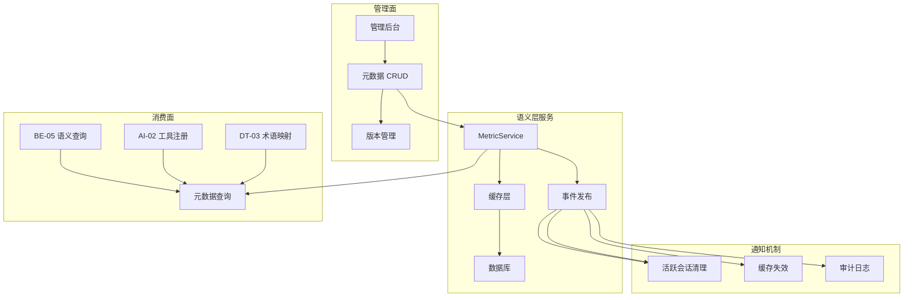

# 智能问数系统 - BE-04 语义层元数据管理详细设计文档

**文档版本**: V2.0  
**最后更新**: 2026-04-02  
**适用对象**: 后端开发工程师、数据工程师、架构师  
**关联任务**: BE-04 语义层元数据管理  
**前置依赖**: DT-01 (核心指标梳理), DT-02 (报表接口标准化), DT-03 (业务术语映射)  
**后续依赖**: BE-05 (语义查询执行器), AI-02 (工具注册)

---

## 1. 任务概述

### 1.1 背景
语义层是连接"用户自然语言"与"物理数据库"的桥梁。元数据管理负责定义和维护指标、维度、数据集等业务对象的元数据，确保 AI 提取的业务术语能正确映射到技术实现。元数据的准确性、一致性、及时性直接影响查询准确率。

### 1.2 目标
| 目标 | 说明 | 验收标准 |
|------|------|----------|
| **准确性** | 元数据与业务口径一致 | 业务确认率 100% |
| **一致性** | 缓存与数据库一致 | 变更后 5 分钟内同步 |
| **完整性** | 核心指标全覆盖 | 覆盖率 ≥ 95% |
| **可追溯** | 变更历史可追溯 | 变更记录完整 |
| **高性能** | 元数据查询快速 | P95 < 50ms |

### 1.3 范围
| 实体类型 | 说明 | 数量 |
|----------|------|------|
| 指标 (Metric) | 可聚合的数值字段 | ≥50 个 |
| 维度 (Dimension) | 可分组的分类字段 | ≥20 个 |
| 数据集 (Dataset) | 指标与维度的集合 | ≥10 个 |
| 术语映射 (Term Mapping) | 业务术语与技术代码映射 | ≥200 个 |

---

## 2. 技术选型

### 2.1 技术栈
| 组件 | 技术 | 版本 | 选型理由 |
|------|------|------|----------|
| 持久化 | JPA + MySQL | 8.0 | 事务支持，易维护 |
| 缓存 | Caffeine + Redis | 7.0 | 二级缓存，高性能 |
| 事件总线 | Spring Event | - | 解耦变更通知 |
| 版本管理 | 乐观锁 (Version) | - | 并发控制 |
| 枚举校验 | Hibernate Validator | 6.2 | 参数校验 |

### 2.2 架构设计


### 2.3 缓存策略
| 层级 | 技术 | TTL | 失效策略 |
|------|------|-----|----------|
| L1 本地缓存 | Caffeine | 5 分钟 | 事件驱动失效 |
| L2 分布式缓存 | Redis | 30 分钟 | 过期 + 事件失效 |
| 数据库 | MySQL | 持久化 | - |

---

## 3. 详细实现方案

### 3.1 数据库设计

**元数据表结构**
```sql
-- 指标定义表
CREATE TABLE `meta_metric` (
  `id` bigint(20) NOT NULL AUTO_INCREMENT,
  `metric_code` varchar(50) NOT NULL COMMENT '指标代码',
  `metric_name` varchar(100) NOT NULL COMMENT '指标名称',
  `expression` varchar(500) NOT NULL COMMENT '计算表达式',
  `data_type` varchar(20) NOT NULL COMMENT '数据类型：money/percent/count',
  `security_level` int(11) NOT NULL DEFAULT '1' COMMENT '安全等级：1-公开 2-内部 3-保密',
  `unit` varchar(20) DEFAULT NULL COMMENT '单位',
  `allowed_values` json DEFAULT NULL COMMENT '枚举值列表',
  `version` int(11) NOT NULL DEFAULT '1' COMMENT '版本号',
  `status` tinyint(4) NOT NULL DEFAULT '1' COMMENT '状态：1-启用 0-禁用',
  `created_by` varchar(50) DEFAULT NULL COMMENT '创建人',
  `updated_by` varchar(50) DEFAULT NULL COMMENT '更新人',
  `created_at` datetime NOT NULL DEFAULT CURRENT_TIMESTAMP,
  `updated_at` datetime NOT NULL DEFAULT CURRENT_TIMESTAMP ON UPDATE CURRENT_TIMESTAMP,
  PRIMARY KEY (`id`),
  UNIQUE KEY `uk_metric_code` (`metric_code`),
  KEY `idx_status` (`status`),
  KEY `idx_version` (`version`)
) ENGINE=InnoDB DEFAULT CHARSET=utf8mb4 COMMENT='指标定义表';

-- 维度定义表
CREATE TABLE `meta_dimension` (
  `id` bigint(20) NOT NULL AUTO_INCREMENT,
  `dim_code` varchar(50) NOT NULL COMMENT '维度代码',
  `dim_name` varchar(100) NOT NULL COMMENT '维度名称',
  `physical_column` varchar(100) NOT NULL COMMENT '物理字段名',
  `dim_type` varchar(20) NOT NULL COMMENT '维度类型：time/region/dept',
  `allowed_values` json DEFAULT NULL COMMENT '枚举值列表',
  `version` int(11) NOT NULL DEFAULT '1',
  `status` tinyint(4) NOT NULL DEFAULT '1',
  `created_at` datetime NOT NULL DEFAULT CURRENT_TIMESTAMP,
  `updated_at` datetime NOT NULL DEFAULT CURRENT_TIMESTAMP ON UPDATE CURRENT_TIMESTAMP,
  PRIMARY KEY (`id`),
  UNIQUE KEY `uk_dim_code` (`dim_code`)
) ENGINE=InnoDB DEFAULT CHARSET=utf8mb4 COMMENT='维度定义表';

-- 元数据变更事件表
CREATE TABLE `meta_change_event` (
  `id` bigint(20) NOT NULL AUTO_INCREMENT,
  `event_type` varchar(50) NOT NULL COMMENT '事件类型：CREATE/UPDATE/DELETE',
  `entity_type` varchar(50) NOT NULL COMMENT '实体类型：METRIC/DIMENSION',
  `entity_id` bigint(20) NOT NULL COMMENT '实体 ID',
  `entity_code` varchar(50) NOT NULL COMMENT '实体代码',
  `old_version` int(11) DEFAULT NULL COMMENT '旧版本',
  `new_version` int(11) NOT NULL COMMENT '新版本',
  `changed_by` varchar(50) DEFAULT NULL COMMENT '变更人',
  `changed_at` datetime NOT NULL DEFAULT CURRENT_TIMESTAMP,
  PRIMARY KEY (`id`),
  KEY `idx_entity` (`entity_type`, `entity_id`),
  KEY `idx_changed_at` (`changed_at`)
) ENGINE=InnoDB DEFAULT CHARSET=utf8mb4 COMMENT='元数据变更事件表';
```

### 3.2 配置类

**MetadataProperties.java**
```java
package com.company.askdata.config;

import lombok.Data;
import org.springframework.boot.context.properties.ConfigurationProperties;
import org.springframework.stereotype.Component;
import java.time.Duration;

/**
 * 元数据管理配置
 * 
 * ⚠️ 注意事项:
 * 1. 缓存 TTL 需根据变更频率调整
 * 2. 事件通知需异步处理防止阻塞
 */
@Data
@Component
@ConfigurationProperties(prefix = "askdata.metadata")
public class MetadataProperties {
    
    /** 缓存配置 */
    private CacheConfig cache = new CacheConfig();
    
    /** 事件通知配置 */
    private EventConfig event = new EventConfig();
    
    /** 校验配置 */
    private ValidationConfig validation = new ValidationConfig();
    
    @Data
    public static class CacheConfig {
        /** L1 缓存 TTL */
        private Duration l1Ttl = Duration.ofMinutes(5);
        /** L1 缓存最大数量 */
        private Long l1MaxSize = 10000L;
        /** L2 缓存 TTL */
        private Duration l2Ttl = Duration.ofMinutes(30);
        /** 预热开关 */
        private Boolean warmupEnabled = true;
    }
    
    @Data
    public static class EventConfig {
        /** 事件异步处理 */
        private Boolean asyncEnabled = true;
        /** 事件保留天数 */
        private Integer retentionDays = 90;
        /** 通知活跃会话 */
        private Boolean notifySessions = true;
    }
    
    @Data
    public static class ValidationConfig {
        /** 枚举值校验 */
        private Boolean enumValidation = true;
        /** 表达式校验 */
        private Boolean expressionValidation = true;
        /** 代码格式校验 */
        private String codePattern = "^[a-z][a-z0-9_]{0,49}$";
    }
}
```

### 3.3 核心模型

**Metric.java**
```java
package com.company.askdata.entity;

import com.fasterxml.jackson.core.type.TypeReference;
import com.fasterxml.jackson.databind.ObjectMapper;
import lombok.Data;
import javax.persistence.*;
import java.time.LocalDateTime;
import java.util.List;

/**
 * 指标实体
 * 
 * ⚠️ 关键点：
 * 1. version 字段支持乐观锁
 * 2. allowedValues 防止 AI 参数幻觉
 * 3. securityLevel 控制访问权限
 */
@Data
@Entity
@Table(name = "meta_metric")
public class Metric {
    
    @Id
    @GeneratedValue(strategy = GenerationType.IDENTITY)
    private Long id;
    
    @Column(name = "metric_code", unique = true, nullable = false, length = 50)
    private String metricCode;
    
    @Column(name = "metric_name", nullable = false, length = 100)
    private String metricName;
    
    @Column(name = "expression", nullable = false, length = 500)
    private String expression;
    
    @Column(name = "data_type", nullable = false, length = 20)
    @Enumerated(EnumType.STRING)
    private DataType dataType;
    
    @Column(name = "security_level", nullable = false)
    private Integer securityLevel;
    
    @Column(name = "unit", length = 20)
    private String unit;
    
    /** ⚠️ 关键：枚举值列表，防止 AI 幻觉 */
    @Column(name = "allowed_values", columnDefinition = "JSON")
    private String allowedValuesJson;
    
    @Column(name = "version", nullable = false)
    @Version
    private Integer version;
    
    @Column(name = "status", nullable = false)
    private Integer status;
    
    @Column(name = "created_by", length = 50)
    private String createdBy;
    
    @Column(name = "updated_by", length = 50)
    private String updatedBy;
    
    @Column(name = "created_at", nullable = false)
    private LocalDateTime createdAt;
    
    @Column(name = "updated_at", nullable = false)
    private LocalDateTime updatedAt;
    
    /**
     * 获取枚举值列表 (自动解析 JSON)
     */
    @Transient
    public List<String> getAllowedValues() {
        if (allowedValuesJson == null || allowedValuesJson.trim().equals("[]")) {
            return List.of();
        }
        try {
            return new ObjectMapper().readValue(
                allowedValuesJson, 
                new TypeReference<List<String>>() {}
            );
        } catch (Exception e) {
            return List.of();
        }
    }
    
    /**
     * 设置枚举值列表 (自动序列化 JSON)
     */
    public void setAllowedValues(List<String> values) {
        try {
            this.allowedValuesJson = new ObjectMapper().writeValueAsString(values);
        } catch (Exception e) {
            this.allowedValuesJson = "[]";
        }
    }
    
    /**
     * 校验值是否在枚举范围内
     * ⚠️ 陷阱防护：工具参数幻觉
     */
    public boolean validateValue(String value) {
        List<String> allowed = getAllowedValues();
        if (allowed == null || allowed.isEmpty()) {
            return true; // 无限制
        }
        return allowed.contains(value);
    }
    
    public enum DataType {
        MONEY("金额"),
        PERCENT("百分比"),
        COUNT("数量"),
        RATIO("比率"),
        DATE("日期");
        
        private final String description;
        DataType(String desc) { this.description = desc; }
    }
}
```

**MetadataChangeEvent.java**
```java
package com.company.askdata.event;

import lombok.Getter;
import org.springframework.context.ApplicationEvent;

/**
 * 元数据变更事件
 * 
 * ⚠️ 陷阱防护：上下文污染陷阱
 * 元数据变更后通知活跃会话清理缓存
 */
@Getter
public class MetadataChangeEvent extends ApplicationEvent {
    
    private final String eventType; // CREATE/UPDATE/DELETE
    private final String entityType; // METRIC/DIMENSION
    private final Long entityId;
    private final String entityCode;
    private final Integer oldVersion;
    private final Integer newVersion;
    private final String changedBy;
    
    public MetadataChangeEvent(
        Object source,
        String eventType,
        String entityType,
        Long entityId,
        String entityCode,
        Integer oldVersion,
        Integer newVersion,
        String changedBy
    ) {
        super(source);
        this.eventType = eventType;
        this.entityType = entityType;
        this.entityId = entityId;
        this.entityCode = entityCode;
        this.oldVersion = oldVersion;
        this.newVersion = newVersion;
        this.changedBy = changedBy;
    }
}
```

### 3.4 核心服务

**MetricService.java**
```java
package com.company.askdata.service;

import com.company.askdata.entity.Metric;
import com.company.askdata.event.MetadataChangeEvent;
import com.company.askdata.exception.MetadataException;
import com.company.askdata.repository.MetricRepository;
import com.company.askdata.validator.MetadataValidator;
import lombok.RequiredArgsConstructor;
import lombok.extern.slf4j.Slf4j;
import org.springframework.cache.annotation.Cacheable;
import org.springframework.cache.annotation.CacheEvict;
import org.springframework.context.ApplicationEventPublisher;
import org.springframework.stereotype.Service;
import org.springframework.transaction.annotation.Transactional;

import java.util.List;
import java.util.Optional;

/**
 * 指标元数据服务
 * 
 * ⚠️ 关键防护点:
 * 1. 缓存一致性 (事件驱动失效)
 * 2. 枚举值校验 (防止 AI 幻觉)
 * 3. 版本管理 (乐观锁)
 * 4. 变更通知 (活跃会话清理)
 */
@Slf4j
@Service
@RequiredArgsConstructor
public class MetricService {
    
    private final MetricRepository metricRepository;
    private final ApplicationEventPublisher eventPublisher;
    private final MetadataValidator validator;
    
    /**
     * 获取指标定义 (带缓存)
     * 
     * ⚠️ 缓存 Key 设计：避免缓存穿透
     */
    @Cacheable(value = "semantic:metric", key = "#metricCode", unless = "#result == null")
    public Metric getMetricDefinition(String metricCode) {
        Optional<Metric> metric = metricRepository.findByMetricCodeAndStatus(metricCode, 1);
        
        if (metric.isEmpty()) {
            log.warn("Metric not found: code={}", metricCode);
            throw new MetadataException("指标不存在：" + metricCode);
        }
        
        return metric.get();
    }
    
    /**
     * 批量检查指标是否存在
     */
    @Cacheable(value = "semantic:metrics", key = "#metricCodes.hashCode()")
    public boolean hasMetrics(List<String> metricCodes) {
        if (metricCodes == null || metricCodes.isEmpty()) {
            return false;
        }
        
        List<Metric> metrics = metricRepository.findByMetricCodeInAndStatus(metricCodes, 1);
        boolean exists = metrics.size() == metricCodes.size();
        
        log.debug("Metrics check: codes={}, found={}, result={}", 
            metricCodes, metrics.size(), exists);
        
        return exists;
    }
    
    /**
     * 保存指标 (带版本管理和事件通知)
     * 
     * ⚠️ 陷阱防护：上下文污染陷阱
     * 变更后发布事件，通知活跃会话清理缓存
     */
    @Transactional
    @CacheEvict(value = "semantic:metric", key = "#metric.metricCode")
    public Metric saveMetric(Metric metric, String operator) {
        // 1. ⚠️ 校验枚举值 (防止 AI 幻觉)
        if (metric.getAllowedValues() != null) {
            validator.validateEnumValues(metric.getAllowedValues());
        }
        
        // 2. ⚠️ 校验代码格式
        validator.validateMetricCode(metric.getMetricCode());
        
        // 3. 版本号管理 (乐观锁)
        Metric existing = metricRepository.findByMetricCodeAndStatus(
            metric.getMetricCode(), 1
        ).orElse(null);
        
        if (existing != null) {
            metric.setVersion(existing.getVersion() + 1);
            metric.setId(existing.getId());
        } else {
            metric.setVersion(1);
        }
        
        // 4. 设置审计字段
        metric.setUpdatedBy(operator);
        metric.setUpdatedAt(java.time.LocalDateTime.now());
        
        if (existing == null) {
            metric.setCreatedBy(operator);
            metric.setCreatedAt(java.time.LocalDateTime.now());
        }
        
        // 5. 保存
        Metric saved = metricRepository.save(metric);
        
        // 6. ⚠️ 发布变更事件 (通知活跃会话清理缓存)
        eventPublisher.publishEvent(new MetadataChangeEvent(
            this,
            existing == null ? "CREATE" : "UPDATE",
            "METRIC",
            saved.getId(),
            saved.getMetricCode(),
            existing != null ? existing.getVersion() : null,
            saved.getVersion(),
            operator
        ));
        
        log.info("Metric saved: code={}, version={}, operator={}", 
            saved.getMetricCode(), saved.getVersion(), operator);
        
        return saved;
    }
    
    /**
     * 删除指标 (逻辑删除)
     */
    @Transactional
    @CacheEvict(value = "semantic:metric", key = "#metricCode")
    public void deleteMetric(String metricCode, String operator) {
        Metric metric = metricRepository.findByMetricCodeAndStatus(metricCode, 1)
            .orElseThrow(() -> new MetadataException("指标不存在：" + metricCode));
        
        metric.setStatus(0); // 逻辑删除
        metric.setUpdatedBy(operator);
        metric.setVersion(metric.getVersion() + 1);
        
        metricRepository.save(metric);
        
        // 发布删除事件
        eventPublisher.publishEvent(new MetadataChangeEvent(
            this,
            "DELETE",
            "METRIC",
            metric.getId(),
            metricCode,
            metric.getVersion() - 1,
            metric.getVersion(),
            operator
        ));
        
        log.info("Metric deleted: code={}, operator={}", metricCode, operator);
    }
    
    /**
     * 校验指标值
     * ⚠️ 陷阱防护：工具参数幻觉
     */
    public boolean validateMetricValue(String metricCode, String value) {
        Metric metric = getMetricDefinition(metricCode);
        return metric.validateValue(value);
    }
    
    /**
     * 获取所有可用指标
     */
    public List<Metric> getAllAvailableMetrics() {
        return metricRepository.findAllByStatus(1);
    }
}
```

**MetadataValidator.java**
```java
package com.company.askdata.validator;

import com.company.askdata.config.MetadataProperties;
import com.company.askdata.exception.MetadataException;
import lombok.RequiredArgsConstructor;
import org.springframework.stereotype.Component;

import java.util.List;
import java.util.regex.Pattern;

/**
 * 元数据校验器
 * 
 * ⚠️ 陷阱防护：工具参数幻觉
 * 校验枚举值、代码格式等，防止非法数据
 */
@Component
@RequiredArgsConstructor
public class MetadataValidator {
    
    private final MetadataProperties properties;
    private static final Pattern CODE_PATTERN = Pattern.compile("^[a-z][a-z0-9_]{0,49}$");
    
    /**
     * 校验指标代码格式
     */
    public void validateMetricCode(String code) {
        if (code == null || code.trim().isEmpty()) {
            throw new MetadataException("指标代码不能为空");
        }
        
        if (!CODE_PATTERN.matcher(code).matches()) {
            throw new MetadataException(
                "指标代码格式错误：" + code + "，应符合小写字母 + 数字 + 下划线，以小写字母开头"
            );
        }
    }
    
    /**
     * 校验枚举值列表
     */
    public void validateEnumValues(List<String> values) {
        if (values == null) {
            return;
        }
        
        for (String value : values) {
            if (value == null || value.trim().isEmpty()) {
                throw new MetadataException("枚举值不能为空");
            }
            if (value.length() > 100) {
                throw new MetadataException("枚举值过长：" + value);
            }
        }
    }
    
    /**
     * 校验表达式 (防止 SQL 注入)
     */
    public void validateExpression(String expression) {
        if (expression == null || expression.trim().isEmpty()) {
            throw new MetadataException("表达式不能为空");
        }
        
        // ⚠️ 安全检查：禁止危险关键字
        String[] forbidden = {"DROP", "DELETE", "INSERT", "UPDATE", "TRUNCATE"};
        String upperExpr = expression.toUpperCase();
        
        for (String keyword : forbidden) {
            if (upperExpr.contains(keyword)) {
                throw new MetadataException("表达式包含危险关键字：" + keyword);
            }
        }
    }
}
```

### 3.5 缓存配置

**CacheConfig.java**
```java
package com.company.askdata.config;

import com.github.benmanes.caffeine.cache.Caffeine;
import lombok.RequiredArgsConstructor;
import org.springframework.cache.CacheManager;
import org.springframework.cache.caffeine.CaffeineCacheManager;
import org.springframework.context.annotation.Bean;
import org.springframework.context.annotation.Configuration;
import org.springframework.data.redis.cache.RedisCacheConfiguration;
import org.springframework.data.redis.serializer.GenericJackson2JsonRedisSerializer;
import org.springframework.data.redis.serializer.RedisSerializationContext;

import java.time.Duration;
import java.util.concurrent.TimeUnit;

/**
 * 元数据缓存配置
 * 
 * ⚠️ 关键：二级缓存策略
 * L1: Caffeine (本地，快)
 * L2: Redis (分布式，共享)
 */
@Configuration
@RequiredArgsConstructor
public class CacheConfig {
    
    private final MetadataProperties properties;
    
    /**
     * L1 本地缓存 (Caffeine)
     */
    @Bean
    public CacheManager l1CacheManager() {
        CaffeineCacheManager cacheManager = new CaffeineCacheManager(
            "semantic:metric",
            "semantic:metrics",
            "semantic:dimension"
        );
        
        cacheManager.setCaffeine(Caffeine.newBuilder()
            .expireAfterWrite(
                properties.getCache().getL1Ttl().getSeconds(), 
                TimeUnit.SECONDS
            )
            .maximumSize(properties.getCache().getL1MaxSize())
            .recordStats()
        );
        
        return cacheManager;
    }
    
    /**
     * L2 分布式缓存 (Redis)
     */
    @Bean
    public RedisCacheConfiguration redisCacheConfiguration() {
        return RedisCacheConfiguration.defaultCacheConfig()
            .entryTtl(properties.getCache().getL2Ttl())
            .disableCachingNullValues()
            .serializeValuesWith(RedisSerializationContext.SerializationPair.fromSerializer(
                new GenericJackson2JsonRedisSerializer()
            ))
            .prefixCacheNameWith("askdata:metadata:");
    }
}
```

### 3.6 事件监听器

**MetadataEventListener.java**
```java
package com.company.askdata.listener;

import com.company.askdata.event.MetadataChangeEvent;
import com.company.askdata.service.CacheService;
import lombok.RequiredArgsConstructor;
import lombok.extern.slf4j.Slf4j;
import org.springframework.context.event.EventListener;
import org.springframework.scheduling.annotation.Async;
import org.springframework.stereotype.Component;

/**
 * 元数据变更事件监听器
 * 
 * ⚠️ 陷阱防护：上下文污染陷阱
 * 元数据变更后清理相关缓存，通知活跃会话
 */
@Slf4j
@Component
@RequiredArgsConstructor
public class MetadataEventListener {
    
    private final CacheService cacheService;
    private final ConversationContextManager contextManager; // BE-10
    
    /**
     * 处理元数据变更事件
     * ⚠️ 异步处理，防止阻塞主流程
     */
    @Async
    @EventListener
    public void handleMetadataChange(MetadataChangeEvent event) {
        log.info("Metadata change event: type={}, entity={}, code={}, version={}", 
            event.getEventType(), event.getEntityType(), 
            event.getEntityCode(), event.getNewVersion());
        
        // 1. 清理缓存
        cacheService.evictMetadataCache(
            event.getEntityType(), 
            event.getEntityCode()
        );
        
        // 2. ⚠️ 通知活跃会话清理上下文缓存
        if (event.getNotifySessions()) {
            contextManager.notifyMetadataChange(
                event.getEntityType(),
                event.getEntityCode()
            );
        }
        
        // 3. 记录审计日志
        auditLog(event);
    }
    
    private void auditLog(MetadataChangeEvent event) {
        // 记录到审计日志表
        log.info("AUDIT: Metadata changed: {} {} v{}->v{} by {}", 
            event.getEntityType(),
            event.getEntityCode(),
            event.getOldVersion(),
            event.getNewVersion(),
            event.getChangedBy());
    }
}
```

---

## 4. 注意事项 ⚠️

### 4.1 缓存一致性
```java
// ❌ 错误：只清理本地缓存
@CacheEvict(value = "semantic:metric", key = "#metricCode")
public void updateMetric(...) {
    // L1 清理了，但 L2(Redis) 没清理
}

// ✅ 正确：清理所有层级缓存
@CacheEvict(value = "semantic:metric", key = "#metricCode")
public void updateMetric(...) {
    // Spring 会自动清理所有配置的缓存层
    // 额外清理相关缓存
    cacheService.evictMetadataCache("METRIC", metricCode);
}
```

### 4.2 枚举值校验
```java
// ❌ 错误：不校验枚举值，AI 可能生成非法值
public void saveMetric(Metric metric) {
    metricRepository.save(metric); // 可能保存非法枚举值
}

// ✅ 正确：校验枚举值
public void saveMetric(Metric metric) {
    validator.validateEnumValues(metric.getAllowedValues()); // 关键！
    metricRepository.save(metric);
}
```

### 4.3 版本管理
```java
// ❌ 错误：不管理版本，并发更新会覆盖
public void updateMetric(Metric metric) {
    metricRepository.save(metric); // 可能覆盖其他更新
}

// ✅ 正确：乐观锁版本管理
public void updateMetric(Metric metric) {
    Metric existing = repository.findByCode(metric.getMetricCode());
    metric.setVersion(existing.getVersion() + 1); // 版本号 +1
    repository.save(metric); // JPA @Version 自动检查
}
```

### 4.4 事件通知
```java
// ❌ 错误：同步处理事件，阻塞主流程
@EventListener
public void handleChange(MetadataChangeEvent event) {
    notifyAllSessions(); // 可能很慢
}

// ✅ 正确：异步处理事件
@Async
@EventListener
public void handleChange(MetadataChangeEvent event) {
    notifyAllSessions(); // 不阻塞主流程
}
```

---

## 5. 需要特别关注的点 🔴

### 5.1 陷阱防护矩阵

| 陷阱类型 | 风险描述 | 防护措施 | 验证方法 |
|----------|----------|----------|----------|
| **工具参数幻觉** | AI 生成非法指标代码 | 枚举值校验 + 代码格式校验 | 非法代码被拦截 |
| **上下文污染** | 元数据变更后活跃会话仍用旧数据 | 变更事件通知会话清理缓存 | 变更后 5 分钟内缓存更新 |
| **缓存不一致** | L1/L2缓存不同步 | 事件驱动统一失效 | 查询返回最新数据 |
| **并发覆盖** | 并发更新覆盖彼此修改 | 乐观锁 (version 字段) | 并发更新抛出异常 |
| **SQL 注入** | 表达式字段注入恶意 SQL | 表达式关键字过滤 | 危险关键字被拦截 |
| **缓存穿透** | 查询不存在的指标击穿缓存 | 缓存 null 值 (unless) | 不存在的指标不查库 |

### 5.2 关键代码审查点

```java
// 审查清单
□ 枚举值是否校验
□ 代码格式是否校验
□ 版本号是否管理
□ 缓存是否清理 (所有层)
□ 事件是否异步发布
□ 表达式是否安全检查
□ 审计字段是否填充
□ 异常是否妥善处理
□ 日志是否记录关键信息
□ 权限是否校验
```

### 5.3 性能影响评估

| 操作 | 耗时 | 优化建议 |
|------|------|----------|
| 缓存查询 (L1) | < 1ms | 无需优化 |
| 缓存查询 (L2) | 5-10ms | 无需优化 |
| 数据库查询 | 10-50ms | 加索引 |
| 事件发布 | < 1ms | 异步处理 |
| 缓存失效 | < 5ms | 批量失效 |
| **总开销** | **< 50ms** | **满足 P95 < 50ms 目标** |

### 5.4 监控指标

```java
// 需要采集的指标
@Component
public class MetadataMetrics {
    
    private final MeterRegistry meterRegistry;
    
    // 缓存命中率
    meterRegistry.gauge("askdata.metadata.cache.hit_rate", 
        cacheStats.hitRate());
    
    // 查询延迟
    meterRegistry.timer("askdata.metadata.query.latency")
        .record(latency, TimeUnit.MILLISECONDS);
    
    // 变更次数
    meterRegistry.counter("askdata.metadata.change.total", 
        "entity_type", event.getEntityType(),
        "event_type", event.getEventType());
    
    // 校验失败次数
    meterRegistry.counter("askdata.metadata.validation.failure")
        .increment();
}
```

---

## 6. 验收标准

### 6.1 功能验收
| 验收项 | 验收方法 | 通过标准 |
|--------|----------|----------|
| 指标 CRUD | 创建/查询/更新/删除 | 操作成功，数据正确 |
| 缓存生效 | 查询两次 | 第二次命中缓存 |
| 缓存失效 | 更新后查询 | 返回新数据 |
| 枚举校验 | 保存非法枚举值 | 被拦截，返回错误 |
| 版本管理 | 并发更新 | 后更新者抛出异常 |
| 事件通知 | 更新后检查会话 | 会话收到通知 |

### 6.2 性能验收
| 指标 | 目标值 | 测量方法 |
|------|--------|----------|
| 查询 P95 | < 50ms | JMeter 压测 |
| 缓存命中率 | ≥ 90% | 监控统计 |
| 变更通知延迟 | < 5s | 事件日志 |
| 并发支持 | ≥ 100 QPS | 压测验证 |

### 6.3 安全验收
| 检查项 | 验收方法 | 通过标准 |
|--------|----------|----------|
| 代码格式校验 | 尝试非法代码 | 被拦截 |
| 表达式安全 | 尝试注入 SQL | 被拦截 |
| 枚举值校验 | 尝试非法枚举 | 被拦截 |
| 权限控制 | 无权限用户修改 | 被拒绝 |

---

## 7. 测试用例

### 7.1 单元测试
**文件路径**: `src/test/java/com/company/askdata/service/MetricServiceTest.java`

```java
package com.company.askdata.service;

import com.company.askdata.entity.Metric;
import com.company.askdata.exception.MetadataException;
import com.company.askdata.repository.MetricRepository;
import org.junit.jupiter.api.Test;
import org.springframework.beans.factory.annotation.Autowired;
import org.springframework.boot.test.context.SpringBootTest;
import org.springframework.boot.test.mock.mockito.MockBean;

import java.util.List;
import java.util.Optional;

import static org.junit.jupiter.api.Assertions.*;
import static org.mockito.ArgumentMatchers.*;
import static org.mockito.Mockito.*;

@SpringBootTest
class MetricServiceTest {
    
    @Autowired
    private MetricService metricService;
    
    @MockBean
    private MetricRepository metricRepository;
    
    @Test
    void testGetMetricDefinition() {
        // 准备测试数据
        Metric mockMetric = new Metric();
        mockMetric.setMetricCode("gmv");
        mockMetric.setMetricName("成交总额");
        mockMetric.setStatus(1);
        
        when(metricRepository.findByMetricCodeAndStatus("gmv", 1))
            .thenReturn(Optional.of(mockMetric));
        
        // 执行测试
        Metric result = metricService.getMetricDefinition("gmv");
        
        // 验证结果
        assertNotNull(result);
        assertEquals("gmv", result.getMetricCode());
    }
    
    @Test
    void testGetMetricNotFound() {
        when(metricRepository.findByMetricCodeAndStatus("not_exist", 1))
            .thenReturn(Optional.empty());
        
        // 验证异常
        assertThrows(MetadataException.class, () -> {
            metricService.getMetricDefinition("not_exist");
        });
    }
    
    @Test
    void testSaveMetricWithEnumValidation() {
        Metric metric = new Metric();
        metric.setMetricCode("test_metric");
        metric.setMetricName("测试指标");
        metric.setAllowedValues(List.of("value1", "value2", "value3"));
        
        // 执行测试
        Metric saved = metricService.saveMetric(metric, "test_user");
        
        // 验证
        assertNotNull(saved);
        assertEquals(1, saved.getVersion());
        verify(metricRepository, times(1)).save(any());
    }
    
    @Test
    void testSaveMetricWithInvalidEnum() {
        Metric metric = new Metric();
        metric.setMetricCode("test_metric");
        metric.setAllowedValues(List.of("value1", "", "value3")); // 空值
        
        // 验证异常
        assertThrows(MetadataException.class, () -> {
            metricService.saveMetric(metric, "test_user");
        });
    }
    
    @Test
    void testValidateMetricValue() {
        Metric mockMetric = new Metric();
        mockMetric.setMetricCode("region");
        mockMetric.setAllowedValues(List.of("huadong", "huabei", "huanan"));
        
        when(metricRepository.findByMetricCodeAndStatus("region", 1))
            .thenReturn(Optional.of(mockMetric));
        
        // 验证合法值
        assertTrue(metricService.validateMetricValue("region", "huadong"));
        
        // 验证非法值
        assertFalse(metricService.validateMetricValue("region", "invalid"));
    }
}
```

### 7.2 集成测试
**文件路径**: `src/test/java/com/company/askdata/integration/MetadataIntegrationTest.java`

```java
@Test
void testCacheEvictionOnUpdate() {
    // 1. 创建指标
    Metric metric = createTestMetric();
    metricService.saveMetric(metric, "test_user");
    
    // 2. 查询 (应命中缓存)
    Metric result1 = metricService.getMetricDefinition("test_metric");
    
    // 3. 更新指标
    metric.setMetricName("更新后的名称");
    metricService.saveMetric(metric, "test_user");
    
    // 4. 再次查询 (应返回新数据，缓存已失效)
    Metric result2 = metricService.getMetricDefinition("test_metric");
    
    assertEquals("更新后的名称", result2.getMetricName());
}

@Test
void testConcurrentUpdate() {
    // 1. 创建指标
    Metric metric = createTestMetric();
    metricService.saveMetric(metric, "test_user");
    
    // 2. 模拟并发更新
    Metric metric1 = metricService.getMetricDefinition("test_metric");
    Metric metric2 = metricService.getMetricDefinition("test_metric");
    
    metric1.setMetricName("更新 1");
    metric2.setMetricName("更新 2");
    
    // 3. 第一个更新成功
    metricService.saveMetric(metric1, "user1");
    
    // 4. 第二个更新应失败 (版本冲突)
    assertThrows(OptimisticLockingFailureException.class, () -> {
        metricService.saveMetric(metric2, "user2");
    });
}
```

### 7.3 压测验证
```bash
# JMeter 压测
# 验证查询 P95 < 50ms
# 验证缓存命中率 ≥ 90%

jmeter -n -t metadata_load_test.jmx -l results.jtl

# 分析缓存命中率
# 缓存命中次数 / 总查询次数 ≥ 0.9
```

---

## 8. 部署配置

### 8.1 环境变量
```bash
# 生产环境
export ASKDATA_METADATA_CACHE_L1_TTL=300
export ASKDATA_METADATA_CACHE_L2_TTL=1800
export ASKDATA_METADATA_VALIDATION_ENUM=true
export ASKDATA_METADATA_VALIDATION_EXPRESSION=true
```

### 8.2 K8s 配置
```yaml
# deployment.yaml
apiVersion: apps/v1
kind: Deployment
metadata:
  name: askdata-router
spec:
  template:
    spec:
      containers:
      - name: router
        env:
        - name: ASKDATA_METADATA_CACHE_L1_TTL
          valueFrom:
            configMapKeyRef:
              name: askdata-config
              key: metadata.cache.l1-ttl
        resources:
          requests:
            memory: "512Mi"
            cpu: "250m"
          limits:
            memory: "1Gi"
            cpu: "500m"
```

### 8.3 监控告警
```yaml
# Prometheus 告警
groups:
- name: metadata-alerts
  rules:
  - alert: MetadataCacheHitRateLow
    expr: askdata_metadata_cache_hit_rate < 0.8
    for: 10m
    labels:
      severity: warning
    annotations:
      summary: "元数据缓存命中率过低 ({{ $value }})"
  
  - alert: MetadataQueryLatencyHigh
    expr: |
      histogram_quantile(0.95, sum(rate(askdata_metadata_query_latency_bucket[5m])) by (le)) > 0.05
    for: 5m
    labels:
      severity: warning
    annotations:
      summary: "元数据查询 P95 延迟过高 ({{ $value }}s)"
  
  - alert: MetadataValidationFailure
    expr: rate(askdata_metadata_validation_failure_total[5m]) > 0.1
    for: 5m
    labels:
      severity: warning
    annotations:
      summary: "元数据校验频繁失败"
```

---

## 9. 常见问题 (FAQ)

**Q1: 缓存不生效怎么办？**
A: 1. 检查 @Cacheable 注解是否生效；2. 检查缓存配置是否加载；3. 检查 Key 生成策略；4. 查看缓存统计指标。

**Q2: 元数据变更后查询还是旧数据？**
A: 1. 检查 @CacheEvict 是否生效；2. 检查事件是否发布；3. 检查监听器是否执行；4. 手动清理缓存验证。

**Q3: 并发更新如何处理？**
A: 1. JPA @Version 自动检测；2. 捕获 OptimisticLockingFailureException；3. 提示用户刷新后重试。

**Q4: 枚举值太多影响性能吗？**
A: 1. 枚举值存储在 JSON 字段；2. 查询时加载到内存；3. 校验是内存操作，影响可忽略。

**Q5: 如何批量导入指标？**
A: 1. 开发批量导入接口；2. 事务控制；3. 逐个校验；4. 失败回滚。

**Q6: 表达式如何校验安全性？**
A: 1. 禁止危险关键字；2. 白名单函数；3. 测试环境验证；4. 审计日志记录。

**Q7: 如何追溯元数据变更历史？**
A: 1. meta_change_event 表记录；2. 查询事件表；3. 展示变更时间线。

**Q8: 缓存预热如何做？**
A: 1. 启动时加载核心指标；2. 后台任务定期预热；3. 变更时预热相关缓存。

---

## 10. 变更历史

| 版本 | 日期 | 变更内容 | 负责人 |
|------|------|----------|--------|
| V1.0 | 2026-03-25 | 初始版本 | 架构组 |
| V2.0 | 2026-04-02 | 增加枚举校验、版本管理、事件通知、陷阱防护 | 架构组 |

---

## 11. 工时与优先级

| 项目 | 内容 |
|------|------|
| **工时** | 5 MD (开发 3.5 天 + 测试 1.5 天) |
| **优先级** | P0 (核心基础) |
| **依赖任务** | DT-01, DT-02, DT-03 |
| **被依赖任务** | BE-05, AI-02, BE-07 |

---

**文档结束**  
**下一步**: 开发人员按本文档实现代码，完成后提交测试团队进行 BE-04 专项验收。验收通过后，方可开始 BE-05 语义查询执行器的开发。