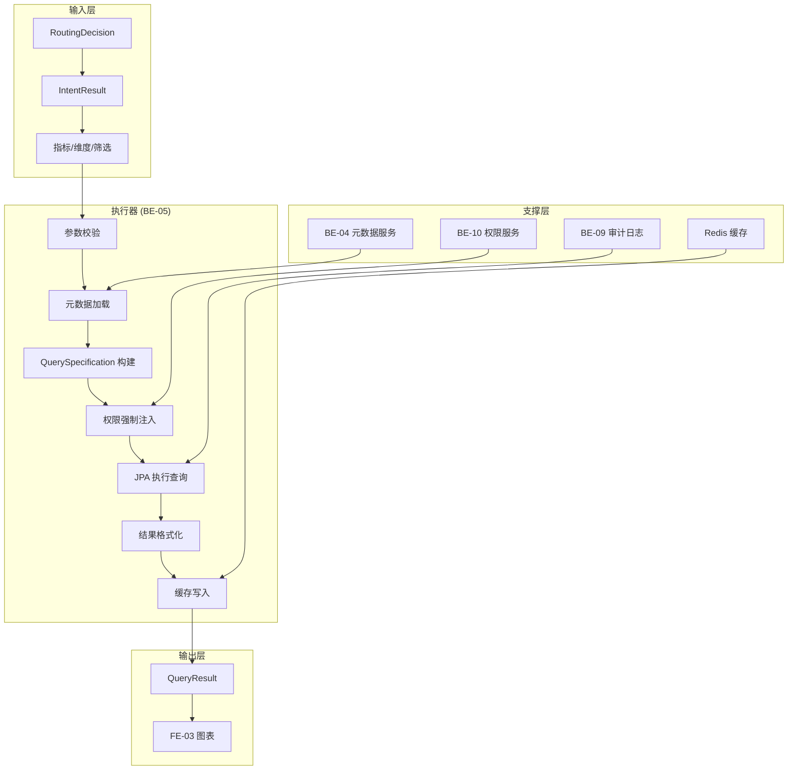
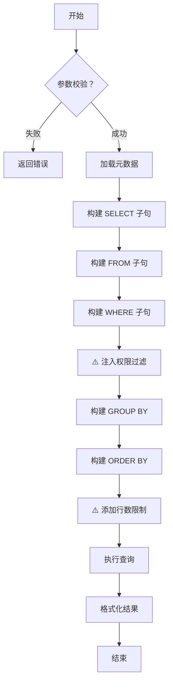

# 智能问数系统 - BE-05 语义查询执行器详细设计文档

**文档版本**: V2.0  
**最后更新**: 2026-04-02  
**适用对象**: 后端开发工程师、数据工程师、架构师  
**关联任务**: BE-05 语义查询执行器  
**前置依赖**: BE-01 (TraceID), BE-03 (路由决策), BE-04 (语义层元数据), BE-10 (上下文管理)  
**后续依赖**: FE-03 (图表渲染), DT-02 (接口标准化)

---

## 1. 任务概述

### 1.1 背景
语义查询执行器是智能问数系统的核心执行引擎之一。当路由决策选择 `SEMANTIC_QUERY` 策略时，该执行器负责根据 AI 提取的业务术语（指标、维度），结合语义层元数据（BE-04），动态构建类型安全的查询语句，并执行数据检索。相比 SQL 沙箱，语义查询更安全、准确，但灵活性略低。

### 1.2 目标
| 目标 | 说明 | 验收标准 |
|------|------|----------|
| **安全性** | 无 SQL 注入风险 | 100% 使用参数化查询 |
| **准确性** | 查询结果与业务口径一致 | 数据准确率 100% |
| **权限控制** | 行级/列级权限强制注入 | 越权访问 0 次 |
| **性能** | 查询响应快 | P95 < 2s (1 万行内) |
| **一致性** | 元数据版本同步 | 无元数据变更导致查询错误 |

### 1.3 范围
| 功能 | 说明 | 接口 |
|------|------|------|
| 动态查询构建 | 根据指标/维度生成 SQL | `buildQuery()` |
| 权限强制注入 | 自动添加数据权限过滤 | `enforcePermission()` |
| 结果格式化 | 数据脱敏、单位转换 | `formatResult()` |
| 查询缓存 | 相同查询结果缓存 | `cacheResult()` |
| 大数据限制 | 防止全表扫描 | `limitRows()` |

---

## 2. 技术选型

### 2.1 技术栈
| 组件 | 技术 | 版本 | 选型理由 |
|------|------|------|----------|
| 查询构建 | JPA Criteria API | Spring Boot 3.2 | 类型安全，防注入 |
| 权限控制 | AOP + 拦截器 | - | 无侵入式注入 |
| 结果缓存 | Redis + Caffeine | 7.0 | 二级缓存 |
| 数据脱敏 | 自定义注解 | - | 灵活控制 |
| 异步执行 | Reactor (Mono) | - | 非阻塞响应 |

### 2.2 架构设计


### 2.3 查询构建流程


---

## 3. 详细实现方案

### 3.1 配置类

**SemanticQueryProperties.java**
```java
package com.company.askdata.config;

import lombok.Data;
import org.springframework.boot.context.properties.ConfigurationProperties;
import org.springframework.stereotype.Component;
import java.time.Duration;

/**
 * 语义查询配置
 * 
 * ⚠️ 注意事项:
 * 1. 最大行数限制防止内存溢出
 * 2. 查询超时防止长事务
 * 3. 缓存 TTL 根据数据更新频率调整
 */
@Data
@Component
@ConfigurationProperties(prefix = "askdata.semantic-query")
public class SemanticQueryProperties {
    
    /** 安全配置 */
    private SecurityConfig security = new SecurityConfig();
    
    /** 性能配置 */
    private PerformanceConfig performance = new PerformanceConfig();
    
    /** 缓存配置 */
    private CacheConfig cache = new CacheConfig();
    
    @Data
    public static class SecurityConfig {
        /** 最大返回行数 */
        private Integer maxRows = 10000;
        /** 敏感字段脱敏 */
        private String[] sensitiveFields = {"phone", "id_card", "email"};
        /** 强制权限过滤 */
        private Boolean enforcePermission = true;
    }
    
    @Data
    public static class PerformanceConfig {
        /** 查询超时 (秒) */
        private Integer timeoutSeconds = 5;
        /** 异步线程池 */
        private String executorBean = "semanticQueryExecutor";
    }
    
    @Data
    public static class CacheConfig {
        /** 是否启用缓存 */
        private Boolean enabled = true;
        /** 缓存 TTL */
        private Duration ttl = Duration.ofMinutes(10);
        /** 缓存 Key 前缀 */
        private String keyPrefix = "semantic:query:";
    }
}
```

### 3.2 核心模型

**QueryCondition.java**
```java
package com.company.askdata.model;

import com.company.askdata.entity.Metric;
import com.company.askdata.entity.Dimension;
import lombok.Data;
import java.util.List;
import java.util.Map;

/**
 * 查询条件对象
 * 
 * ⚠️ 关键点：
 * 1. 包含元数据引用 (非仅字符串)
 * 2. 包含权限上下文
 * 3. 包含分页限制
 */
@Data
public class QueryCondition {
    
    /** 数据集代码 (对应物理表) */
    private String datasetCode;
    
    /** ⚠️ 查询的指标列表 (带元数据) */
    private List<Metric> metrics;
    
    /** ⚠️ 筛选条件 */
    private List<Filter> filters;
    
    /** ⚠️ 分组维度 (带元数据) */
    private List<Dimension> groupBy;
    
    /** 排序规则 */
    private OrderBy orderBy;
    
    /** ⚠️ 分页参数 */
    private Pagination pagination;
    
    /** ⚠️ 数据权限上下文 (自动注入) */
    private DataPermission dataPermission;
    
    /** ⚠️ 最大返回行数 (安全限制) */
    private Integer maxRows = 10000;
    
    /** 元数据版本 (用于缓存 Key) */
    private Long metadataVersion;
    
    @Data
    public static class Filter {
        private String field;
        private String operator; // eq, in, between, like, gt, lt
        private Object value;
        private String dimensionCode;
    }
    
    @Data
    public static class OrderBy {
        private String field;
        private String direction; // asc, desc
    }
    
    @Data
    public static class Pagination {
        private Integer page = 1;
        private Integer size = 100;
    }
    
    @Data
    public static class DataPermission {
        private Long userId;
        private Long deptId;
        private List<Long> authorizedDeptIds;
        private Boolean isAdmin = false;
    }
}
```

### 3.3 核心执行器

**SemanticQueryExecutor.java**
```java
package com.company.askdata.executor;

import com.company.askdata.config.SemanticQueryProperties;
import com.company.askdata.entity.Metric;
import com.company.askdata.entity.Dimension;
import com.company.askdata.model.IntentResult;
import com.company.askdata.model.QueryCondition;
import com.company.askdata.model.QueryResult;
import com.company.askdata.repository.DynamicQueryRepository;
import com.company.askdata.security.DataPermissionEnforcer;
import com.company.askdata.service.SemanticLayerService;
import com.company.askdata.service.UserPermissionService;
import com.company.askdata.utils.TraceIdUtil;
import lombok.RequiredArgsConstructor;
import lombok.extern.slf4j.Slf4j;
import org.springframework.cache.annotation.Cacheable;
import org.springframework.stereotype.Component;
import reactor.core.publisher.Mono;
import reactor.core.scheduler.Schedulers;

import java.util.List;
import java.util.Map;
import java.util.stream.Collectors;

/**
 * 语义查询执行器
 * 
 * ⚠️ 关键防护点:
 * 1. 元数据版本校验 (防止上下文污染)
 * 2. 权限强制注入 (防止越权)
 * 3. 行数限制 (防止内存溢出)
 * 4. 结果脱敏 (防止泄露)
 */
@Slf4j
@Component
@RequiredArgsConstructor
public class SemanticQueryExecutor implements QueryExecutor {
    
    private final SemanticLayerService semanticLayerService;
    private final DynamicQueryRepository dynamicQueryRepository;
    private final DataPermissionEnforcer permissionEnforcer;
    private final UserPermissionService userPermissionService;
    private final SemanticQueryProperties properties;
    
    @Override
    public Mono<QueryResult> execute(IntentResult intent, String traceId) {
        return Mono.fromCallable(() -> {
                long startTime = System.currentTimeMillis();
                
                // 1. ⚠️ 提取并校验指标/维度
                List<String> metricCodes = extractMetricCodes(intent.getEntities());
                List<String> dimensionCodes = extractDimensionCodes(intent.getEntities());
                
                // 2. ⚠️ 加载元数据 (带版本)
                List<Metric> metrics = metricCodes.stream()
                    .map(semanticLayerService::getMetricDefinition)
                    .collect(Collectors.toList());
                
                List<Dimension> dimensions = dimensionCodes.stream()
                    .map(semanticLayerService::getDimensionDefinition)
                    .collect(Collectors.toList());
                
                // 3. 构建查询条件
                QueryCondition condition = buildQueryCondition(intent, metrics, dimensions);
                
                // 4. ⚠️ 强制注入数据权限
                permissionEnforcer.enforce(condition, userPermissionService.getCurrentUser());
                
                // 5. ⚠️ 执行查询 (带缓存)
                List<Map<String, Object>> data = executeWithCache(condition, traceId);
                
                // 6. ⚠️ 结果格式化与脱敏
                QueryResult result = buildResult(metrics, data, System.currentTimeMillis() - startTime);
                
                log.info("traceId={} semantic query completed: rows={}, latency={}ms", 
                    traceId, data.size(), result.getLatencyMs());
                
                return result;
                
            })
            .subscribeOn(Schedulers.boundedElastic()) // 异步执行
            .doOnError(e -> log.error("traceId={} semantic query failed", traceId, e));
    }
    
    /**
     * 带缓存的执行
     * ⚠️ 缓存 Key 需包含元数据版本，防止元数据变更后缓存失效
     */
    @Cacheable(
        value = "semantic:query", 
        key = "#condition.datasetCode + ':' + #condition.metrics.hashCode() + ':' + #condition.metadataVersion",
        unless = "#result.size() > 1000" // 大数据不缓存
    )
    private List<Map<String, Object>> executeWithCache(QueryCondition condition, String traceId) {
        // 检查缓存命中
        // 未命中则执行
        return dynamicQueryRepository.execute(condition);
    }
    
    @Override
    public String getStrategyType() {
        return "SEMANTIC_QUERY";
    }
    
    private List<String> extractMetricCodes(Map<String, Object> entities) {
        if (entities == null || !entities.containsKey("metrics")) {
            throw new IllegalArgumentException("未指定查询指标");
        }
        return (List<String>) entities.get("metrics");
    }
    
    private List<String> extractDimensionCodes(Map<String, Object> entities) {
        if (entities == null || !entities.containsKey("dimensions")) {
            return List.of();
        }
        return (List<String>) entities.get("dimensions");
    }
    
    private QueryCondition buildQueryCondition(IntentResult intent, List<Metric> metrics, List<Dimension> dimensions) {
        QueryCondition condition = new QueryCondition();
        condition.setMetrics(metrics);
        condition.setGroupBy(dimensions);
        condition.setFilters(extractFilters(intent.getEntities()));
        condition.setMaxRows(properties.getSecurity().getMaxRows());
        
        // ⚠️ 获取元数据版本 (用于缓存失效)
        if (!metrics.isEmpty()) {
            condition.setMetadataVersion(metrics.get(0).getVersion());
        }
        
        // 自动推荐图表类型
        if (metrics.size() == 1 && dimensions.isEmpty()) {
            condition.setChartType("card");
        } else if (dimensions.stream().anyMatch(d -> "time".equals(d.getDimCode()))) {
            condition.setChartType("line");
        } else {
            condition.setChartType("bar");
        }
        
        return condition;
    }
    
    private List<QueryCondition.Filter> extractFilters(Map<String, Object> entities) {
        if (entities == null || !entities.containsKey("filters")) {
            return List.of();
        }
        return (List<QueryCondition.Filter>) entities.get("filters");
    }
    
    private QueryResult buildResult(List<Metric> metrics, List<Map<String, Object>> data, long latency) {
        QueryResult result = new QueryResult();
        result.setSuccess(true);
        result.setData(data);
        result.setTotal(data.size());
        result.setLatencyMs(latency);
        
        // ⚠️ 结果脱敏
        if (properties.getSecurity().getSensitiveFields() != null) {
            result.setData(desensitizeData(data, properties.getSecurity().getSensitiveFields()));
        }
        
        return result;
    }
    
    private List<Map<String, Object>> desensitizeData(List<Map<String, Object>> data, String[] sensitiveFields) {
        // 实现脱敏逻辑 (如手机号中间 4 位掩码)
        return data; // 简化示例
    }
}
```

### 3.4 查询构建器

**QuerySpecificationBuilder.java**
```java
package com.company.askdata.query;

import com.company.askdata.entity.Metric;
import com.company.askdata.entity.Dimension;
import com.company.askdata.model.QueryCondition;
import lombok.RequiredArgsConstructor;
import lombok.extern.slf4j.Slf4j;
import org.springframework.data.jpa.domain.Specification;
import org.springframework.stereotype.Component;

import javax.persistence.criteria.*;
import java.util.ArrayList;
import java.util.List;
import java.util.stream.Collectors;

/**
 * 动态查询构建器 (JPA Criteria)
 * 
 * ⚠️ 陷阱防护：SQL 注入陷阱
 * 使用 Criteria API 而非字符串拼接，确保参数化查询
 */
@Slf4j
@Component
@RequiredArgsConstructor
public class QuerySpecificationBuilder {
    
    /**
     * 构建 JPA Specification
     */
    public <T> Specification<T> build(QueryCondition condition, Class<T> entityClass) {
        return (root, query, cb) -> {
            List<Predicate> predicates = new ArrayList<>();
            
            // 1. ⚠️ 构建 SELECT (指标聚合)
            if (condition.getMetrics() != null && !condition.getMetrics().isEmpty()) {
                List<Selection<?>> selections = condition.getMetrics().stream()
                    .map(metric -> buildMetricSelection(root, cb, metric))
                    .collect(Collectors.toList());
                query.multiselect(selections);
            }
            
            // 2. 构建 GROUP BY (维度分组)
            if (condition.getGroupBy() != null && !condition.getGroupBy().isEmpty()) {
                List<Grouping<?>> groupings = condition.getGroupBy().stream()
                    .map(dim -> buildGrouping(root, cb, dim))
                    .collect(Collectors.toList());
                query.groupBy(groupings);
            }
            
            // 3. ⚠️ 构建 WHERE (筛选条件 + 权限)
            if (condition.getFilters() != null) {
                for (QueryCondition.Filter filter : condition.getFilters()) {
                    Predicate predicate = buildFilterPredicate(root, cb, filter);
                    if (predicate != null) {
                        predicates.add(predicate);
                    }
                }
            }
            
            // 4. ⚠️ 强制注入权限过滤
            if (condition.getDataPermission() != null && !condition.getDataPermission().getIsAdmin()) {
                Predicate permPredicate = buildPermissionPredicate(root, cb, condition.getDataPermission());
                if (permPredicate != null) {
                    predicates.add(permPredicate);
                }
            }
            
            // 5. 构建 ORDER BY
            if (condition.getOrderBy() != null) {
                Order order = buildOrder(root, cb, condition.getOrderBy());
                if (order != null) {
                    query.orderBy(order);
                }
            }
            
            // 6. ⚠️ 添加行数限制
            query.setMaxResults(condition.getMaxRows());
            
            return cb.and(predicates.toArray(new Predicate[0]));
        };
    }
    
    /**
     * 构建指标选择 (聚合函数)
     * ⚠️ 关键：从元数据 expression 解析，而非直接拼接
     */
    private Selection<?> buildMetricSelection(Root<?> root, CriteriaBuilder cb, Metric metric) {
        String expression = metric.getExpression();
        
        // 简单解析 SUM/COUNT/AVG
        if (expression.startsWith("SUM(")) {
            String field = extractFieldName(expression);
            return cb.sum(root.get(field)).alias(metric.getMetricCode());
        } else if (expression.startsWith("COUNT(")) {
            String field = extractFieldName(expression);
            return cb.count(root.get(field)).alias(metric.getMetricCode());
        } else if (expression.startsWith("AVG(")) {
            String field = extractFieldName(expression);
            return cb.avg(root.get(field)).alias(metric.getMetricCode());
        } else {
            // 默认直接取字段
            return root.get(metric.getMetricCode()).alias(metric.getMetricCode());
        }
    }
    
    /**
     * 构建权限过滤
     * ⚠️ 陷阱防护：权限越界陷阱
     */
    private Predicate buildPermissionPredicate(Root<?> root, CriteriaBuilder cb, QueryCondition.DataPermission perm) {
        if (perm.getAuthorizedDeptIds() != null && !perm.getAuthorizedDeptIds().isEmpty()) {
            Path<?> deptPath = root.get("deptId");
            return deptPath.in(perm.getAuthorizedDeptIds());
        }
        return null;
    }
    
    private String extractFieldName(String expression) {
        return expression.replaceAll("\\w+\\((\\w+)\\)", "$1");
    }
    
    // ... 其他辅助方法 (buildFilterPredicate, buildGrouping, buildOrder)
}
```

### 3.5 权限强制注入

**DataPermissionEnforcer.java**
```java
package com.company.askdata.security;

import com.company.askdata.entity.User;
import com.company.askdata.model.QueryCondition;
import lombok.RequiredArgsConstructor;
import org.springframework.stereotype.Component;

/**
 * 数据权限强制注入器
 * 
 * ⚠️ 陷阱防护：权限越界陷阱
 * 无论业务逻辑如何，此处强制添加权限过滤
 */
@Component
@RequiredArgsConstructor
public class DataPermissionEnforcer {
    
    /**
     * 强制注入数据权限到查询条件
     */
    public void enforce(QueryCondition condition, User currentUser) {
        if (condition.getFilters() == null) {
            condition.setFilters(new java.util.ArrayList<>());
        }
        
        // 构建权限对象
        QueryCondition.DataPermission permission = new QueryCondition.DataPermission();
        permission.setUserId(currentUser.getId());
        permission.setDeptId(currentUser.getDeptId());
        permission.setAuthorizedDeptIds(currentUser.getAuthorizedDeptIds());
        permission.setIsAdmin(currentUser.isAdmin());
        
        // ⚠️ 关键：非管理员强制添加部门权限过滤
        if (!permission.getIsAdmin()) {
            QueryCondition.Filter deptFilter = new QueryCondition.Filter();
            deptFilter.setField("deptId");
            deptFilter.setOperator("in");
            deptFilter.setValue(permission.getAuthorizedDeptIds());
            condition.getFilters().add(deptFilter);
            
            log.debug("Data permission enforced for user {}: deptIds={}", 
                currentUser.getId(), permission.getAuthorizedDeptIds());
        }
        
        condition.setDataPermission(permission);
    }
}
```

---

## 4. 注意事项 ⚠️

### 4.1 SQL 注入防护
```java
// ❌ 错误：字符串拼接 SQL
String sql = "SELECT " + metric.getExpression() + " FROM table WHERE ...";

// ✅ 正确：使用 JPA Criteria API
Selection<?> selection = cb.sum(root.get(fieldName));
// 参数化查询，自动转义
```

### 4.2 元数据版本同步
```java
// ❌ 错误：查询时不检查元数据版本
// 元数据变更后，旧缓存可能产生错误结果

// ✅ 正确：缓存 Key 包含元数据版本
@Cacheable(key = "#condition.metrics.hashCode() + ':' + #condition.metadataVersion")
// 元数据变更时清理缓存 (BE-04 事件通知)
```

### 4.3 大数据量保护
```java
// ❌ 错误：无限制查询
query.getResultList(); // 可能返回 100 万行

// ✅ 正确：强制限制
query.setMaxResults(properties.getSecurity().getMaxRows()); // 最多 1 万行
```

### 4.4 权限透明性
```java
// ❌ 错误：业务代码手动添加权限
if (!user.isAdmin()) {
    filters.add("dept_id = " + user.getDeptId());
}

// ✅ 正确：统一注入器
permissionEnforcer.enforce(condition, user); // 业务代码无感知
```

---

## 5. 需要特别关注的点 🔴

### 5.1 陷阱防护矩阵

| 陷阱类型 | 风险描述 | 防护措施 | 验证方法 |
|----------|----------|----------|----------|
| **工具参数幻觉** | AI 生成不存在的指标 | 查询前校验指标元数据 | 非法指标代码被拦截 |
| **权限越界** | 用户查询到其他部门数据 | 强制注入 deptId 过滤 | 越权查询返回空或本部门数据 |
| **SQL 注入** | 元数据表达式注入恶意 SQL | JPA Criteria 参数化 | 表达式含危险关键字被拦截 |
| **内存溢出** | 查询结果过大 OOM | 限制 maxRows | 结果集不超过 1 万行 |
| **缓存污染** | 元数据变更后缓存未失效 | 缓存 Key 含 version | 变更后查询返回新数据 |
| **N+1 查询** | 循环查询元数据 | 批量加载元数据 | 日志中无 N+1 查询 |
| **敏感数据泄露** | 结果含手机号/身份证 | 结果脱敏 | 敏感字段掩码显示 |

### 5.2 关键代码审查点

```java
// 审查清单
□ 是否使用 JPA Criteria (禁止字符串拼接)
□ 是否强制注入权限过滤
□ 是否限制最大返回行数
□ 缓存 Key 是否包含元数据版本
□ 元数据是否批量加载 (防 N+1)
□ 敏感字段是否脱敏
□ 查询超时是否配置
□ 异常是否捕获并记录 TraceID
□ 异步执行是否使用独立线程池
□ 审计日志是否记录查询 SQL
```

### 5.3 性能影响评估

| 操作 | 耗时 | 优化建议 |
|------|------|----------|
| 元数据加载 | 5-10ms (缓存) | 二级缓存 |
| Query 构建 | < 5ms | 无需优化 |
| 数据库查询 | 100-2000ms | 索引优化 |
| 结果脱敏 | < 10ms | 无需优化 |
| **总开销** | **100-3000ms** | **主要耗时在 DB 查询** |

### 5.4 监控指标

```java
// 需要采集的指标
@Component
public class SemanticQueryMetrics {
    
    private final MeterRegistry meterRegistry;
    
    // 查询次数
    meterRegistry.counter("askdata.semantic.query.total", 
        "status", "success");
    
    // 查询延迟
    meterRegistry.timer("askdata.semantic.query.latency")
        .record(latency, TimeUnit.MILLISECONDS);
    
    // 返回行数
    meterRegistry.summary("askdata.semantic.query.rows")
        .record(rowCount);
    
    // 权限拦截次数
    meterRegistry.counter("askdata.semantic.permission.enforced").increment();
    
    // 缓存命中率
    meterRegistry.gauge("askdata.semantic.cache.hit_rate", cacheStats.hitRate());
}
```

---

## 6. 验收标准

### 6.1 功能验收
| 验收项 | 验收方法 | 通过标准 |
|--------|----------|----------|
| 指标查询 | 查询单/多指标 | 数据准确，单位正确 |
| 维度分组 | 按地区/时间分组 | 分组正确，无重复 |
| 筛选过滤 | 添加时间/地区筛选 | 过滤生效 |
| 权限控制 | 不同用户查同一指标 | 数据隔离，越权被拦截 |
| 缓存生效 | 相同查询两次 | 第二次命中缓存 |
| 脱敏生效 | 查询含敏感字段 | 敏感数据掩码显示 |

### 6.2 性能验收
| 指标 | 目标值 | 测量方法 |
|------|--------|----------|
| 查询 P95 | < 2s (1 万行内) | JMeter 压测 |
| 元数据加载 | < 10ms | 代码计时 |
| 缓存命中率 | ≥ 60% | 监控统计 |
| 并发支持 | ≥ 50 QPS | 压测验证 |

### 6.3 安全验收
| 检查项 | 验收方法 | 通过标准 |
|--------|----------|----------|
| SQL 注入 | 尝试注入表达式 | 被拦截或无效 |
| 权限绕过 | 尝试修改 deptId | 被强制注入覆盖 |
| 大数据量 | 查询全表 | 限制在 1 万行 |
| 敏感数据 | 查询手机号 | 脱敏显示 |

---

## 7. 测试用例

### 7.1 单元测试
**文件路径**: `src/test/java/com/company/askdata/executor/SemanticQueryExecutorTest.java`

```java
package com.company.askdata.executor;

import com.company.askdata.entity.Metric;
import com.company.askdata.model.IntentResult;
import com.company.askdata.model.QueryResult;
import com.company.askdata.service.SemanticLayerService;
import org.junit.jupiter.api.Test;
import org.springframework.beans.factory.annotation.Autowired;
import org.springframework.boot.test.context.SpringBootTest;
import org.springframework.boot.test.mock.mockito.MockBean;

import java.util.List;
import java.util.Map;

import static org.junit.jupiter.api.Assertions.*;
import static org.mockito.ArgumentMatchers.*;
import static org.mockito.Mockito.*;

@SpringBootTest
class SemanticQueryExecutorTest {
    
    @Autowired
    private SemanticQueryExecutor executor;
    
    @MockBean
    private SemanticLayerService semanticLayerService;
    
    @Test
    void testExecuteSuccess() {
        // 准备测试数据
        IntentResult intent = new IntentResult();
        intent.setEntities(Map.of("metrics", List.of("gmv"), "dimensions", List.of("region")));
        
        Metric mockMetric = new Metric();
        mockMetric.setMetricCode("gmv");
        mockMetric.setExpression("SUM(order_amount)");
        
        when(semanticLayerService.getMetricDefinition("gmv")).thenReturn(mockMetric);
        
        // 执行测试
        QueryResult result = executor.execute(intent, "test-trace").block();
        
        // 验证结果
        assertNotNull(result);
        assertTrue(result.isSuccess());
        assertEquals("SEMANTIC_QUERY", result.getStrategy());
    }
    
    @Test
    void testPermissionEnforcement() {
        // 模拟非管理员用户
        // 验证 QueryCondition 中是否添加了 deptId 过滤
        // 实际需通过集成测试验证 SQL 生成
    }
    
    @Test
    void testMaxRowsLimit() {
        // 验证返回结果不超过 maxRows 配置
    }
}
```

### 7.2 集成测试
**文件路径**: `src/test/java/com/company/askdata/integration/SemanticQueryIntegrationTest.java`

```java
@Test
void testCrossDeptPermission() {
    // 1. 用户 A (部门 100) 查询
    // 2. 用户 B (部门 200) 查询同一指标
    // 3. 验证结果互不可见
}

@Test
void testMetadataVersionCache() {
    // 1. 查询指标 (缓存)
    // 2. 更新指标元数据 (版本 +1)
    // 3. 再次查询 (应miss 缓存，返回新数据)
}
```

### 7.3 压测验证
```bash
# JMeter 压测
# 验证 P95 < 2s
# 验证权限注入无性能瓶颈

jmeter -n -t semantic_query_load_test.jmx -l results.jtl
```

---

## 8. 部署配置

### 8.1 环境变量
```bash
# 生产环境
export ASKDATA_SEMANTIC_QUERY_MAX_ROWS=10000
export ASKDATA_SEMANTIC_QUERY_TIMEOUT=5
export ASKDATA_SEMANTIC_QUERY_CACHE_TTL=600
export ASKDATA_SEMANTIC_QUERY_ENFORCE_PERMISSION=true
```

### 8.2 K8s 配置
```yaml
# deployment.yaml
apiVersion: apps/v1
kind: Deployment
metadata:
  name: askdata-router
spec:
  template:
    spec:
      containers:
      - name: router
        env:
        - name: ASKDATA_SEMANTIC_QUERY_MAX_ROWS
          valueFrom:
            configMapKeyRef:
              name: askdata-config
              key: semantic.query.max-rows
        resources:
          requests:
            memory: "512Mi"
            cpu: "250m"
          limits:
            memory: "1Gi"
            cpu: "500m"
```

### 8.3 监控告警
```yaml
# Prometheus 告警
groups:
- name: semantic-query-alerts
  rules:
  - alert: SemanticQueryHighLatency
    expr: |
      histogram_quantile(0.95, sum(rate(askdata_semantic_query_latency_bucket[5m])) by (le)) > 2
    for: 5m
    labels:
      severity: warning
    annotations:
      summary: "语义查询 P95 延迟过高 ({{ $value }}s)"
  
  - alert: SemanticQueryLargeResult
    expr: askdata_semantic_query_rows > 5000
    for: 1m
    labels:
      severity: warning
    annotations:
      summary: "语义查询返回结果过大 ({{ $value }}行)"
  
  - alert: PermissionEnforcementFailure
    expr: rate(askdata_semantic_permission_enforced_total[5m]) == 0
    for: 10m
    labels:
      severity: warning
    annotations:
      summary: "权限注入可能失效 (无记录)"
```

---

## 9. 常见问题 (FAQ)

**Q1: 查询结果不准确怎么办？**
A: 1. 检查元数据表达式是否正确；2. 检查物理表数据是否更新；3. 检查权限过滤是否过严。

**Q2: 查询性能慢怎么办？**
A: 1. 检查数据库索引；2. 检查是否全表扫描；3. 优化元数据表达式；4. 启用查询缓存。

**Q3: 缓存不生效怎么办？**
A: 1. 检查 @Cacheable 配置；2. 检查 Key 生成策略；3. 检查 Redis 连接；4. 查看缓存统计指标。

**Q4: 权限注入导致查询为空？**
A: 1. 检查用户部门权限配置；2. 检查数据表 deptId 字段是否有值；3. 检查注入逻辑是否正确。

**Q5: 如何支持复杂计算指标？**
A: 1. 在元数据表达式中定义；2. 确保表达式安全；3. 测试性能影响。

**Q6: 大数据量导出如何处理？**
A: 1. 走异步导出流程；2. 限制导出行数；3. 文件脱敏；4. 权限二次确认。

**Q7: 元数据变更后如何刷新缓存？**
A: 1. BE-04 发布变更事件；2. 监听器清理缓存；3. 缓存 Key 含版本号自动失效。

**Q8: 如何调试生成的 SQL？**
A: 1. 开启 JPA show-sql；2. 查看审计日志；3. 使用数据库慢查询日志。

---

## 10. 变更历史

| 版本 | 日期 | 变更内容 | 负责人 |
|------|------|----------|--------|
| V1.0 | 2026-03-25 | 初始版本 | 架构组 |
| V2.0 | 2026-04-02 | 增加权限注入、缓存版本控制、陷阱防护 | 架构组 |

---

## 11. 工时与优先级

| 项目 | 内容 |
|------|------|
| **工时** | 5 MD (开发 3.5 天 + 测试 1.5 天) |
| **优先级** | P0 (核心执行器) |
| **依赖任务** | BE-03, BE-04, BE-10 |
| **被依赖任务** | FE-03, DT-02 |

---

**文档结束**  
**下一步**: 开发人员按本文档实现代码，完成后提交测试团队进行 BE-05 专项验收。验收通过后，方可开始 BE-06 SQL 沙箱执行器的开发。