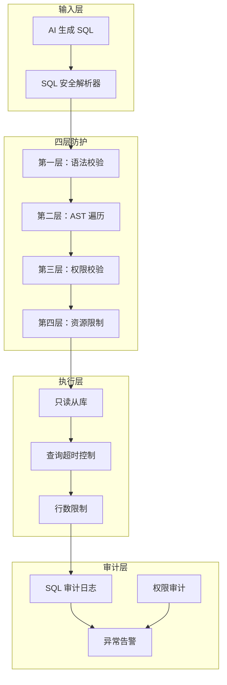

# 智能问数系统 - BE-06 SQL 沙箱安全解析器详细设计文档

**文档版本**: V2.0  
**最后更新**: 2026-04-02  
**适用对象**: 后端开发工程师、安全工程师、架构师  
**关联任务**: BE-06 SQL 沙箱安全解析器  
**前置依赖**: BE-01 (TraceID), BE-03 (路由决策), BE-04 (语义层元数据)  
**后续依赖**: QA-02 (安全渗透测试)

---

## 1. 任务概述

### 1.1 背景
SQL 沙箱是智能问数系统中**风险最高**的执行策略。它允许 AI 直接生成 SQL 查询数据库，提供最大灵活性，但也带来 SQL 注入、数据泄露、资源耗尽等严重安全风险。本模块通过**语法树解析、白名单校验、资源限制、审计日志**四层防护，构建安全的 SQL 执行环境。

### 1.2 目标
| 目标 | 说明 | 验收标准 |
|------|------|----------|
| **安全性** | 100% 拦截危险 SQL | 注入攻击 0 成功 |
| **可控性** | 资源使用可限制 | 查询行数≤1 万，超时≤5 秒 |
| **可追溯** | 所有 SQL 执行可审计 | 审计日志 100% 记录 |
| **准确性** | 合法 SQL 正常执行 | 误拦截率 < 1% |
| **性能** | 解析开销低 | 解析耗时 < 50ms |

### 1.3 范围
| 功能 | 说明 | 风险等级 |
|------|------|----------|
| SQL 语法解析 | Druid AST 解析 | 🔴 高 |
| 危险操作拦截 | DROP/DELETE/UPDATE 等 | 🔴 高 |
| 权限校验 | 表/字段访问权限 | 🔴 高 |
| 资源限制 | 行数/超时/JOIN 数 | 🟡 中 |
| 敏感字段脱敏 | 手机号/身份证等 | 🟡 中 |
| 审计日志 | 完整 SQL 执行记录 | 🟡 中 |

---

## 2. 技术选型

### 2.1 技术栈
| 组件 | 技术 | 版本 | 选型理由 |
|------|------|------|----------|
| SQL 解析 | Alibaba Druid | 1.2.20 | 成熟的 SQL 解析器，支持 AST |
| 安全校验 | 自定义 Visitor | - | 灵活定义安全规则 |
| 执行引擎 | JdbcTemplate | Spring Boot 3.2 | 参数化查询，防注入 |
| 只读账号 | MySQL 只读从库 | 8.0 | 物理隔离写操作 |
| 审计日志 | 异步日志 | - | 不阻塞主流程 |

### 2.2 安全架构


### 2.3 防护策略
| 防护层 | 技术 | 拦截内容 |
|--------|------|----------|
| **语法层** | 仅允许 SELECT | DROP/DELETE/UPDATE/INSERT |
| **AST 层** | Druid Visitor | JOIN 数/子查询深度/危险函数 |
| **权限层** | 表/字段白名单 | 未授权表/敏感字段 |
| **资源层** | 超时/行数限制 | 长查询/大数据量 |

---

## 3. 详细实现方案

### 3.1 配置类

**SqlSandboxProperties.java**
```java
package com.company.askdata.config;

import lombok.Data;
import org.springframework.boot.context.properties.ConfigurationProperties;
import org.springframework.stereotype.Component;
import java.time.Duration;
import java.util.List;

/**
 * SQL 沙箱配置
 * 
 * ⚠️ 注意事项:
 * 1. 所有安全限制必须配置，不可省略
 * 2. 白名单需定期审计更新
 * 3. 超时时间需根据数据库性能调整
 */
@Data
@Component
@ConfigurationProperties(prefix = "askdata.sql-sandbox")
public class SqlSandboxProperties {
    
    /** 数据库配置 */
    private DatabaseConfig database = new DatabaseConfig();
    
    /** 安全配置 */
    private SecurityConfig security = new SecurityConfig();
    
    /** 资源限制 */
    private ResourceLimitConfig resourceLimit = new ResourceLimitConfig();
    
    /** 审计配置 */
    private AuditConfig audit = new AuditConfig();
    
    @Data
    public static class DatabaseConfig {
        /** 数据库类型 */
        private String dbType = "mysql";
        /** 只读从库 JDBC URL */
        private String readonlyJdbcUrl;
        /** 只读账号用户名 */
        private String readonlyUsername;
        /** 只读账号密码 (从环境变量读取) */
        private String readonlyPassword;
    }
    
    @Data
    public static class SecurityConfig {
        /** 允许的表白名单 */
        private List<String> allowedTables = List.of(
            "ods_order_detail",
            "ods_user_info",
            "dws_sales_daily"
        );
        /** 禁止的字段黑名单 */
        private List<String> blockedFields = List.of(
            "password", "id_card", "phone", "email", "bank_card"
        );
        /** 允许的 SQL 函数白名单 */
        private List<String> allowedFunctions = List.of(
            "SUM", "COUNT", "AVG", "MAX", "MIN",
            "DATE_FORMAT", "YEAR", "MONTH", "DAY",
            "CONCAT", "LENGTH", "UPPER", "LOWER"
        );
        /** 启用 SQL 解析校验 */
        private Boolean enableParserValidation = true;
    }
    
    @Data
    public static class ResourceLimitConfig {
        /** 最大返回行数 */
        private Integer maxRows = 10000;
        /** 查询超时 (秒) */
        private Integer timeoutSeconds = 5;
        /** 最大 JOIN 表数量 */
        private Integer maxJoinTables = 3;
        /** 最大子查询嵌套深度 */
        private Integer maxSubQueryDepth = 2;
    }
    
    @Data
    public static class AuditConfig {
        /** 启用审计日志 */
        private Boolean enabled = true;
        /** 审计日志保留天数 */
        private Integer retentionDays = 180;
        /** 高风险操作告警 */
        private Boolean alertOnHighRisk = true;
    }
}
```

### 3.2 核心模型

**SqlSecurityResult.java**
```java
package com.company.askdata.model;

import lombok.Data;
import java.util.List;

/**
 * SQL 安全校验结果
 * 
 * ⚠️ 关键点：
 * 1. 记录所有危险元素
 * 2. 记录访问的表/字段
 * 3. 用于审计日志
 */
@Data
public class SqlSecurityResult {
    
    /** 是否安全 */
    private boolean safe;
    
    /** 原始 SQL */
    private String originalSql;
    
    /** 脱敏后的 SQL (用于日志) */
    private String sanitizedSql;
    
    /** 拦截原因 */
    private String rejectReason;
    
    /** ⚠️ 危险元素列表 */
    private List<String> dangerousElements;
    
    /** ⚠️ 访问的表列表 */
    private List<String> accessedTables;
    
    /** ⚠️ 访问的字段列表 */
    private List<String> accessedFields;
    
    /** 校验耗时 (ms) */
    private Long validationLatencyMs;
    
    /** 风险等级 */
    private RiskLevel riskLevel;
    
    public enum RiskLevel {
        LOW,      // 低风险，可执行
        MEDIUM,   // 中风险，需审计
        HIGH,     // 高风险，需告警
        CRITICAL  // 严重风险，拦截
    }
}
```

**SqlAuditLog.java**
```java
package com.company.askdata.model;

import lombok.Data;
import java.time.LocalDateTime;

/**
 * SQL 审计日志
 * 
 * ⚠️ 陷阱防护：安全合规陷阱
 * 所有 SQL 执行必须记录审计日志
 */
@Data
public class SqlAuditLog {
    
    /** 链路追踪 ID */
    private String traceId;
    
    /** 用户 ID */
    private Long userId;
    
    /** 原始 SQL */
    private String originalSql;
    
    /** 脱敏 SQL */
    private String sanitizedSql;
    
    /** 校验结果 */
    private String validationStatus; // PASS/REJECT
    
    /** 拦截原因 */
    private String rejectReason;
    
    /** 执行耗时 (ms) */
    private Long executionLatencyMs;
    
    /** 返回行数 */
    private Integer returnedRows;
    
    /** 是否截断 */
    private Boolean isTruncated;
    
    /** 执行时间 */
    private LocalDateTime executionTime;
    
    /** 数据库实例 */
    private String databaseInstance;
    
    /** ⚠️ 风险等级 */
    private String riskLevel;
    
    /** 用户 IP */
    private String userIp;
    
    /** 会话 ID */
    private String sessionId;
}
```

### 3.3 核心解析器

**SqlSecurityParser.java**
```java
package com.company.askdata.security;

import com.alibaba.druid.sql.SQLUtils;
import com.alibaba.druid.sql.ast.SQLStatement;
import com.alibaba.druid.sql.dialect.mysql.visitor.MySqlASTVisitorAdapter;
import com.company.askdata.config.SqlSandboxProperties;
import com.company.askdata.model.SqlSecurityResult;
import lombok.RequiredArgsConstructor;
import lombok.extern.slf4j.Slf4j;
import org.springframework.stereotype.Component;

import java.util.ArrayList;
import java.util.List;

/**
 * SQL 安全解析器
 * 
 * ⚠️ 关键防护点:
 * 1. 仅允许 SELECT 语句
 * 2. AST 遍历拦截危险操作
 * 3. 白名单校验表/字段
 * 4. 资源限制检查
 */
@Slf4j
@Component
@RequiredArgsConstructor
public class SqlSecurityParser {
    
    private final SqlSandboxProperties properties;
    
    /**
     * 解析并校验 SQL 安全性
     * 
     * @param sql AI 生成的 SQL
     * @param traceId 链路追踪 ID
     * @return 校验结果
     */
    public SqlSecurityResult parseAndValidate(String sql, String traceId) {
        long startTime = System.currentTimeMillis();
        
        SqlSecurityResult result = new SqlSecurityResult();
        result.setOriginalSql(sql);
        result.setValidationLatencyMs(0L);
        
        try {
            // ========== 第一层：基础格式校验 ==========
            if (sql == null || sql.trim().isEmpty()) {
                result.setSafe(false);
                result.setRejectReason("SQL 为空");
                result.setDangerousElements(List.of("EMPTY_SQL"));
                result.setRiskLevel(SqlSecurityResult.RiskLevel.CRITICAL);
                return result;
            }
            
            String trimmedSql = sql.trim().toLowerCase();
            
            // ⚠️ 仅允许 SELECT 语句
            if (!trimmedSql.startsWith("select")) {
                result.setSafe(false);
                result.setRejectReason("仅允许 SELECT 语句，检测到：" + 
                    trimmedSql.substring(0, Math.min(50, trimmedSql.length())));
                result.setDangerousElements(List.of("NON_SELECT_STATEMENT"));
                result.setRiskLevel(SqlSecurityResult.RiskLevel.CRITICAL);
                return result;
            }
            
            // ⚠️ 检测分号 (防止多条语句)
            if (trimmedSql.contains(";")) {
                result.setSafe(false);
                result.setRejectReason("禁止多条 SQL 语句");
                result.setDangerousElements(List.of("MULTIPLE_STATEMENTS"));
                result.setRiskLevel(SqlSecurityResult.RiskLevel.CRITICAL);
                return result;
            }
            
            // ========== 第二层：Druid AST 解析 ==========
            List<SQLStatement> statements = SQLUtils.parseStatements(
                sql, 
                properties.getDatabase().getDbType()
            );
            
            if (statements.size() != 1) {
                result.setSafe(false);
                result.setRejectReason("仅允许单条 SQL 语句，解析到 " + statements.size() + " 条");
                result.setDangerousElements(List.of("MULTIPLE_STATEMENTS"));
                result.setRiskLevel(SqlSecurityResult.RiskLevel.CRITICAL);
                return result;
            }
            
            SQLStatement stmt = statements.get(0);
            
            // ========== 第三层：安全访问者校验 ==========
            SqlSecurityVisitor visitor = new SqlSecurityVisitor(properties);
            stmt.accept(visitor);
            
            if (!visitor.isSafe()) {
                result.setSafe(false);
                result.setRejectReason(visitor.getRejectReason());
                result.setDangerousElements(visitor.getDangerousElements());
                result.setAccessedTables(visitor.getAccessedTables());
                result.setAccessedFields(visitor.getAccessedFields());
                result.setRiskLevel(determineRiskLevel(visitor.getRejectReason()));
                return result;
            }
            
            // ========== 第四层：表/字段白名单校验 ==========
            List<String> accessedTables = visitor.getAccessedTables();
            for (String table : accessedTables) {
                if (!properties.getSecurity().getAllowedTables().contains(table.toLowerCase())) {
                    result.setSafe(false);
                    result.setRejectReason("访问未授权表：" + table);
                    result.setDangerousElements(List.of("UNAUTHORIZED_TABLE:" + table));
                    result.setRiskLevel(SqlSecurityResult.RiskLevel.HIGH);
                    return result;
                }
            }
            
            List<String> accessedFields = visitor.getAccessedFields();
            for (String field : accessedFields) {
                if (properties.getSecurity().getBlockedFields().contains(field.toLowerCase())) {
                    result.setSafe(false);
                    result.setRejectReason("访问敏感字段：" + field);
                    result.setDangerousElements(List.of("SENSITIVE_FIELD:" + field));
                    result.setRiskLevel(SqlSecurityResult.RiskLevel.HIGH);
                    return result;
                }
            }
            
            // ========== 校验通过 ==========
            result.setSafe(true);
            result.setAccessedTables(accessedTables);
            result.setAccessedFields(accessedFields);
            result.setValidationLatencyMs(System.currentTimeMillis() - startTime);
            result.setRiskLevel(SqlSecurityResult.RiskLevel.LOW);
            
            // 脱敏 SQL 用于日志
            result.setSanitizedSql(sanitizeSql(sql));
            
            log.info("traceId={} SQL validation passed: tables={}, fields={}, latency={}ms", 
                traceId, accessedTables, accessedFields, result.getValidationLatencyMs());
            
            return result;
            
        } catch (Exception e) {
            log.error("traceId={} SQL parsing failed: {}", traceId, e.getMessage(), e);
            result.setSafe(false);
            result.setRejectReason("SQL 语法错误：" + e.getMessage());
            result.setDangerousElements(List.of("PARSE_ERROR"));
            result.setRiskLevel(SqlSecurityResult.RiskLevel.CRITICAL);
            return result;
        }
    }
    
    /**
     * 确定风险等级
     */
    private SqlSecurityResult.RiskLevel determineRiskLevel(String reason) {
        if (reason.contains("DROP") || reason.contains("DELETE") || reason.contains("UPDATE")) {
            return SqlSecurityResult.RiskLevel.CRITICAL;
        }
        if (reason.contains("未授权表") || reason.contains("敏感字段")) {
            return SqlSecurityResult.RiskLevel.HIGH;
        }
        if (reason.contains("JOIN") || reason.contains("子查询")) {
            return SqlSecurityResult.RiskLevel.MEDIUM;
        }
        return SqlSecurityResult.RiskLevel.LOW;
    }
    
    /**
     * SQL 脱敏 (用于日志)
     */
    private String sanitizeSql(String sql) {
        if (sql == null) return "";
        // 移除可能的敏感值
        return sql.replaceAll("'[^']{4,}'", "'***'")
            .replaceAll("\\d{11,}", "***")
            .substring(0, Math.min(1000, sql.length()));
    }
}
```

### 3.4 安全访问者

**SqlSecurityVisitor.java**
```java
package com.company.askdata.security;

import com.alibaba.druid.sql.ast.SQLStatement;
import com.alibaba.druid.sql.ast.expr.*;
import com.alibaba.druid.sql.ast.statement.*;
import com.alibaba.druid.sql.dialect.mysql.visitor.MySqlASTVisitorAdapter;
import com.company.askdata.config.SqlSandboxProperties;
import lombok.extern.slf4j.Slf4j;

import java.util.ArrayList;
import java.util.List;

/**
 * SQL 安全访问者
 * 
 * ⚠️ 陷阱防护：SQL 注入陷阱
 * 遍历 AST 语法树，拦截所有危险操作
 */
@Slf4j
public class SqlSecurityVisitor extends MySqlASTVisitorAdapter {
    
    private final SqlSandboxProperties config;
    private boolean isSafe = true;
    private String rejectReason = "";
    private final List<String> dangerousElements = new ArrayList<>();
    private final List<String> accessedTables = new ArrayList<>();
    private final List<String> accessedFields = new ArrayList<>();
    
    private int joinCount = 0;
    private int subQueryDepth = 0;
    private int maxSubQueryDepthReached = 0;
    
    public SqlSecurityVisitor(SqlSandboxProperties config) {
        this.config = config;
    }
    
    // ========== 危险语句拦截 ==========
    
    @Override
    public boolean visit(SQLDropStatement x) {
        isSafe = false;
        rejectReason = "禁止 DROP 操作";
        dangerousElements.add("DROP_STATEMENT");
        log.warn("SQL DROP statement detected and blocked");
        return false;
    }
    
    @Override
    public boolean visit(SQLDeleteStatement x) {
        isSafe = false;
        rejectReason = "禁止 DELETE 操作";
        dangerousElements.add("DELETE_STATEMENT");
        log.warn("SQL DELETE statement detected and blocked");
        return false;
    }
    
    @Override
    public boolean visit(SQLUpdateStatement x) {
        isSafe = false;
        rejectReason = "禁止 UPDATE 操作";
        dangerousElements.add("UPDATE_STATEMENT");
        log.warn("SQL UPDATE statement detected and blocked");
        return false;
    }
    
    @Override
    public boolean visit(SQLInsertStatement x) {
        isSafe = false;
        rejectReason = "禁止 INSERT 操作";
        dangerousElements.add("INSERT_STATEMENT");
        log.warn("SQL INSERT statement detected and blocked");
        return false;
    }
    
    @Override
    public boolean visit(SQLTruncateStatement x) {
        isSafe = false;
        rejectReason = "禁止 TRUNCATE 操作";
        dangerousElements.add("TRUNCATE_STATEMENT");
        return false;
    }
    
    // ========== JOIN 限制 ==========
    
    @Override
    public boolean visit(SQLJoinTableSource x) {
        joinCount++;
        if (joinCount > config.getResourceLimit().getMaxJoinTables()) {
            isSafe = false;
            rejectReason = "JOIN 表数量超过限制 (最大" + 
                config.getResourceLimit().getMaxJoinTables() + "个)";
            dangerousElements.add("JOIN_COUNT_EXCEEDED:" + joinCount);
        }
        
        // 记录访问的表
        if (x.getLeft() instanceof SQLExprTableSource) {
            String tableName = ((SQLExprTableSource) x.getLeft())
                .getExpr().toString().toLowerCase();
            accessedTables.add(tableName);
        }
        if (x.getRight() instanceof SQLExprTableSource) {
            String tableName = ((SQLExprTableSource) x.getRight())
                .getExpr().toString().toLowerCase();
            accessedTables.add(tableName);
        }
        
        return super.visit(x);
    }
    
    // ========== 子查询深度限制 ==========
    
    @Override
    public boolean visit(SQLSelectStatement x) {
        SQLSelectQuery query = x.getSelect().getQuery();
        if (query instanceof SQLSelectQueryBlock) {
            SQLSelectQueryBlock queryBlock = (SQLSelectQueryBlock) query;
            if (queryBlock.getFrom() instanceof SQLSelectQueryBlock) {
                subQueryDepth++;
                maxSubQueryDepthReached = Math.max(maxSubQueryDepthReached, subQueryDepth);
                
                if (subQueryDepth > config.getResourceLimit().getMaxSubQueryDepth()) {
                    isSafe = false;
                    rejectReason = "子查询嵌套超过限制 (最大" + 
                        config.getResourceLimit().getMaxSubQueryDepth() + "层)";
                    dangerousElements.add("SUBQUERY_DEPTH_EXCEEDED:" + subQueryDepth);
                }
            }
        }
        return super.visit(x);
    }
    
    @Override
    public void endVisit(SQLSelectStatement x) {
        subQueryDepth--;
    }
    
    // ========== 表访问记录 ==========
    
    @Override
    public boolean visit(SQLExprTableSource x) {
        String tableName = x.getExpr().toString().toLowerCase();
        accessedTables.add(tableName);
        return super.visit(x);
    }
    
    // ========== 字段访问记录 ==========
    
    @Override
    public boolean visit(SQLPropertyExpr x) {
        String fieldName = x.getName().toLowerCase();
        accessedFields.add(fieldName);
        return super.visit(x);
    }
    
    @Override
    public boolean visit(SQLIdentifierExpr x) {
        String fieldName = x.getName().toLowerCase();
        accessedFields.add(fieldName);
        return super.visit(x);
    }
    
    // ========== 函数白名单校验 ==========
    
    @Override
    public boolean visit(SQLMethodInvokeExpr x) {
        String functionName = x.getMethodName().toUpperCase();
        if (!config.getSecurity().getAllowedFunctions().contains(functionName)) {
            isSafe = false;
            rejectReason = "使用未授权的 SQL 函数：" + functionName;
            dangerousElements.add("UNAUTHORIZED_FUNCTION:" + functionName);
            log.warn("Unauthorized SQL function detected: {}", functionName);
        }
        return super.visit(x);
    }
    
    // ========== UNION 限制 ==========
    
    @Override
    public boolean visit(SQLUnionQuery x) {
        isSafe = false;
        rejectReason = "禁止 UNION 操作";
        dangerousElements.add("UNION_STATEMENT");
        log.warn("SQL UNION statement detected and blocked");
        return false;
    }
    
    // ========== 系统函数拦截 ==========
    
    @Override
    public boolean visit(SQLSelectIntoStatement x) {
        isSafe = false;
        rejectReason = "禁止 SELECT INTO 操作";
        dangerousElements.add("SELECT_INTO");
        return false;
    }
    
    // ========== 文件操作拦截 ==========
    
    @Override
    public boolean visit(SQLLoadStatement x) {
        isSafe = false;
        rejectReason = "禁止 LOAD FILE 操作";
        dangerousElements.add("LOAD_FILE");
        log.warn("SQL LOAD FILE statement detected and blocked");
        return false;
    }
    
    @Override
    public boolean visit(SQLIntoOption x) {
        isSafe = false;
        rejectReason = "禁止 INTO 操作";
        dangerousElements.add("INTO_OPTION");
        return false;
    }
    
    // ========== 获取校验结果 ==========
    
    public boolean isSafe() {
        return isSafe;
    }
    
    public String getRejectReason() {
        return rejectReason;
    }
    
    public List<String> getDangerousElements() {
        return dangerousElements;
    }
    
    public List<String> getAccessedTables() {
        return new ArrayList<>(accessedTables);
    }
    
    public List<String> getAccessedFields() {
        return new ArrayList<>(accessedFields);
    }
}
```

### 3.5 沙箱执行器

**SqlSandboxExecutor.java**
```java
package com.company.askdata.executor;

import com.company.askdata.config.SqlSandboxProperties;
import com.company.askdata.model.IntentResult;
import com.company.askdata.model.QueryResult;
import com.company.askdata.model.SqlAuditLog;
import com.company.askdata.model.SqlSecurityResult;
import com.company.askdata.security.SqlSecurityParser;
import com.company.askdata.service.AuditLogger;
import com.company.askdata.utils.TraceIdUtil;
import lombok.RequiredArgsConstructor;
import lombok.extern.slf4j.Slf4j;
import org.springframework.jdbc.core.JdbcTemplate;
import org.springframework.stereotype.Component;
import reactor.core.publisher.Mono;
import reactor.core.scheduler.Schedulers;

import javax.sql.DataSource;
import java.time.LocalDateTime;
import java.util.List;
import java.util.Map;

/**
 * SQL 沙箱执行器
 * 
 * ⚠️ 关键防护点:
 * 1. 执行前必须通过安全校验
 * 2. 只读从库物理隔离
 * 3. 查询超时控制
 * 4. 结果行数限制
 * 5. 完整审计日志
 */
@Slf4j
@Component
@RequiredArgsConstructor
public class SqlSandboxExecutor implements QueryExecutor {
    
    private final SqlSecurityParser securityParser;
    private final SqlSandboxProperties properties;
    private final DataSource readOnlyDataSource;
    private final AuditLogger auditLogger;
    
    @Override
    public Mono<QueryResult> execute(IntentResult intent, String traceId) {
        String sql = intent.getGeneratedSql();
        
        return Mono.fromCallable(() -> {
            long startTime = System.currentTimeMillis();
            
            // 创建审计日志
            SqlAuditLog auditLog = createAuditLog(traceId, sql);
            
            try {
                // ========== 第一步：SQL 安全校验 ==========
                SqlSecurityResult securityResult = securityParser.parseAndValidate(sql, traceId);
                
                if (!securityResult.isSafe()) {
                    log.warn("traceId={} SQL security 拦截：{}", traceId, securityResult.getRejectReason());
                    
                    auditLog.setValidationStatus("REJECT");
                    auditLog.setRejectReason(securityResult.getRejectReason());
                    auditLog.setRiskLevel(securityResult.getRiskLevel().name());
                    auditLogger.logSqlAuditAsync(auditLog);
                    
                    throw new SecurityException("SQL 安全校验失败：" + securityResult.getRejectReason());
                }
                
                // ========== 第二步：执行查询 (带资源限制) ==========
                List<Map<String, Object>> data;
                boolean isTruncated = false;
                
                try {
                    JdbcTemplate jdbcTemplate = new JdbcTemplate(readOnlyDataSource);
                    jdbcTemplate.setQueryTimeout(properties.getResourceLimit().getTimeoutSeconds());
                    
                    data = jdbcTemplate.queryForList(sql);
                    
                    // ⚠️ 行数限制检查
                    if (data.size() > properties.getResourceLimit().getMaxRows()) {
                        log.warn("traceId={} 结果集超过限制 ({}>{})，截断", 
                            traceId, data.size(), properties.getResourceLimit().getMaxRows());
                        data = data.subList(0, properties.getResourceLimit().getMaxRows());
                        isTruncated = true;
                    }
                    
                } catch (Exception e) {
                    log.error("traceId={} SQL 执行失败：{}", traceId, e.getMessage(), e);
                    
                    auditLog.setValidationStatus("ERROR");
                    auditLog.setRejectReason(e.getMessage());
                    auditLog.setExecutionLatencyMs(System.currentTimeMillis() - startTime);
                    auditLog.setRiskLevel("MEDIUM");
                    auditLogger.logSqlAuditAsync(auditLog);
                    
                    throw new RuntimeException("SQL 执行失败：" + e.getMessage(), e);
                }
                
                // ========== 第三步：构建结果 ==========
                QueryResult result = new QueryResult();
                result.setSuccess(true);
                result.setData(data);
                result.setChartType("table"); // SQL 查询默认返回表格
                result.setTotal(data.size());
                result.setLatencyMs(System.currentTimeMillis() - startTime);
                result.setExecutedSql(securityResult.getSanitizedSql()); // 脱敏后的 SQL
                result.setCacheHit(false);
                
                // ========== 第四步：记录审计日志 ==========
                auditLog.setValidationStatus("PASS");
                auditLog.setExecutionLatencyMs(result.getLatencyMs());
                auditLog.setReturnedRows(data.size());
                auditLog.setIsTruncated(isTruncated);
                auditLog.setRiskLevel("LOW");
                auditLogger.logSqlAuditAsync(auditLog);
                
                log.info("traceId={} SQL sandbox query completed: rows={}, latency={}ms", 
                    traceId, data.size(), result.getLatencyMs());
                
                return result;
                
            } catch (Exception e) {
                // 错误已记录审计日志
                return Mono.error(e);
            }
            
        }).subscribeOn(Schedulers.boundedElastic())
          .doOnError(e -> log.error("traceId={} SQL sandbox execution failed", traceId, e));
    }
    
    @Override
    public String getStrategyType() {
        return "TEXT_TO_SQL";
    }
    
    private SqlAuditLog createAuditLog(String traceId, String sql) {
        SqlAuditLog log = new SqlAuditLog();
        log.setTraceId(traceId);
        log.setOriginalSql(sql);
        log.setSanitizedSql(securityParser.sanitizeSql(sql));
        log.setExecutionTime(LocalDateTime.now());
        log.setDatabaseInstance("readonly-replica-01");
        log.setUserIp(getUserIp());
        log.setSessionId(TraceIdUtil.getSessionId());
        return log;
    }
    
    private String getUserIp() {
        // 从请求上下文获取用户 IP
        return "unknown";
    }
}
```

### 3.6 审计日志服务

**AuditLogger.java**
```java
package com.company.askdata.service;

import com.company.askdata.model.SqlAuditLog;
import com.company.askdata.config.SqlSandboxProperties;
import lombok.RequiredArgsConstructor;
import lombok.extern.slf4j.Slf4j;
import org.springframework.jdbc.core.JdbcTemplate;
import org.springframework.scheduling.annotation.Async;
import org.springframework.stereotype.Service;

/**
 * SQL 审计日志服务
 * 
 * ⚠️ 陷阱防护：安全合规陷阱
 * 所有 SQL 执行必须记录审计日志，异步写入不阻塞主流程
 */
@Slf4j
@Service
@RequiredArgsConstructor
public class AuditLogger {
    
    private final JdbcTemplate auditJdbcTemplate;
    private final SqlSandboxProperties properties;
    
    /**
     * 异步记录 SQL 审计日志
     */
    @Async("auditLogExecutor")
    public void logSqlAuditAsync(SqlAuditLog auditLog) {
        if (!properties.getAudit().getEnabled()) {
            return;
        }
        
        try {
            // 结构化日志 (ELK)
            log.info("SQL_AUDIT: traceId={}, status={}, riskLevel={}, rows={}, latency={}ms, sql={}",
                auditLog.getTraceId(),
                auditLog.getValidationStatus(),
                auditLog.getRiskLevel(),
                auditLog.getReturnedRows(),
                auditLog.getExecutionLatencyMs(),
                auditLog.getSanitizedSql() // 脱敏后的 SQL
            );
            
            // 数据库持久化 (长期存储)
            String sql = "INSERT INTO sql_audit_log " +
                "(trace_id, user_id, original_sql, sanitized_sql, validation_status, " +
                "reject_reason, execution_latency_ms, returned_rows, is_truncated, " +
                "execution_time, database_instance, risk_level, user_ip, session_id) " +
                "VALUES (?, ?, ?, ?, ?, ?, ?, ?, ?, ?, ?, ?, ?, ?)";
            
            auditJdbcTemplate.update(sql,
                auditLog.getTraceId(),
                auditLog.getUserId(),
                auditLog.getOriginalSql(), // 原始 SQL (加密存储)
                auditLog.getSanitizedSql(),
                auditLog.getValidationStatus(),
                auditLog.getRejectReason(),
                auditLog.getExecutionLatencyMs(),
                auditLog.getReturnedRows(),
                auditLog.getIsTruncated() ? 1 : 0,
                auditLog.getExecutionTime(),
                auditLog.getDatabaseInstance(),
                auditLog.getRiskLevel(),
                auditLog.getUserIp(),
                auditLog.getSessionId()
            );
            
            // 高风险操作告警
            if (properties.getAudit().getAlertOnHighRisk() && 
                "HIGH".equals(auditLog.getRiskLevel()) || "CRITICAL".equals(auditLog.getRiskLevel())) {
                sendHighRiskAlert(auditLog);
            }
            
        } catch (Exception e) {
            log.error("Failed to log SQL audit: traceId={}", auditLog.getTraceId(), e);
            // 审计日志失败不应影响主流程
        }
    }
    
    private void sendHighRiskAlert(SqlAuditLog auditLog) {
        // 发送告警到钉钉/邮件
        log.warn("HIGH RISK SQL AUDIT: traceId={}, reason={}, sql={}", 
            auditLog.getTraceId(), 
            auditLog.getRejectReason(),
            auditLog.getSanitizedSql());
    }
}
```

---

## 4. 注意事项 ⚠️

### 4.1 SQL 注入防护
```java
// ❌ 错误：字符串拼接 SQL
String sql = "SELECT * FROM " + tableName + " WHERE ...";

// ✅ 正确：Druid AST 解析 + 白名单校验
SqlSecurityResult result = parser.parseAndValidate(sql, traceId);
if (!result.isSafe()) {
    throw new SecurityException("SQL 不安全");
}
```

### 4.2 只读账号配置
```sql
-- ❌ 错误：使用主库账号
CREATE USER 'askdata'@'%' IDENTIFIED BY 'password';
GRANT ALL ON askdata.* TO 'askdata'@'%';

-- ✅ 正确：只读从库账号
CREATE USER 'askdata_reader'@'%' IDENTIFIED BY 'StrongPassword!';
GRANT SELECT ON askdata.ods_* TO 'askdata_reader'@'%';
GRANT SELECT ON askdata.dws_* TO 'askdata_reader'@'%';
REVOKE INSERT, UPDATE, DELETE, DROP, ALTER ON askdata.* FROM 'askdata_reader'@'%';
FLUSH PRIVILEGES;
```

### 4.3 审计日志完整性
```java
// ❌ 错误：只记录成功查询
if (success) {
    logAudit(sql);
}

// ✅ 正确：所有尝试都记录
try {
    execute(sql);
    logAudit(sql, "PASS");
} catch (Exception e) {
    logAudit(sql, "REJECT", e.getMessage()); // 拦截的也记录
}
```

### 4.4 资源限制
```java
// ❌ 错误：无限制查询
List<Map<String, Object>> data = jdbcTemplate.queryForList(sql);

// ✅ 正确：多重限制
jdbcTemplate.setQueryTimeout(5); // 超时限制
List<Map<String, Object>> data = jdbcTemplate.queryForList(sql);
if (data.size() > 10000) {
    data = data.subList(0, 10000); // 行数限制
}
```

---

## 5. 需要特别关注的点 🔴

### 5.1 陷阱防护矩阵

| 陷阱类型 | 风险描述 | 防护措施 | 验证方法 |
|----------|----------|----------|----------|
| **SQL 注入** | 恶意 SQL 执行 | Druid AST 解析 + 仅允许 SELECT | 注入测试 100% 拦截 |
| **权限越界** | 访问未授权表/字段 | 表/字段白名单校验 | 越权访问被拦截 |
| **资源耗尽** | 长查询/大数据量 | 超时 + 行数 + JOIN 限制 | 资源限制生效 |
| **敏感数据泄露** | 手机号/身份证明文 | 字段黑名单 + 结果脱敏 | 敏感字段不返回 |
| **审计缺失** | SQL 执行无记录 | 异步审计日志 | 所有执行可追溯 |
| **误拦截** | 合法 SQL 被拦截 | 白名单定期审计 | 误拦截率 < 1% |
| **多语句攻击** | 分号注入多条 SQL | 分号检测 | 多语句被拦截 |
| **UNION 注入** | UNION 拼接敏感数据 | UNION 拦截 | UNION 被拦截 |

### 5.2 关键代码审查点

```java
// 审查清单
□ 是否仅允许 SELECT 语句
□ 是否使用 Druid AST 解析
□ 是否校验表白名单
□ 是否校验字段黑名单
□ 是否限制 JOIN 数量
□ 是否限制子查询深度
□ 是否配置查询超时
□ 是否限制返回行数
□ 是否记录审计日志
□ 是否使用只读账号
□ 敏感字段是否脱敏
□ 高风险操作是否告警
□ 异常是否捕获并记录
□ TraceID 是否透传
□ 异步日志是否配置
```

### 5.3 性能影响评估

| 操作 | 耗时 | 优化建议 |
|------|------|----------|
| SQL 解析 | 10-30ms | 无需优化 |
| AST 遍历 | 10-20ms | 无需优化 |
| 白名单校验 | < 5ms | 缓存白名单 |
| 数据库查询 | 100-5000ms | 索引优化 |
| 审计日志 | < 5ms (异步) | 无需优化 |
| **总开销** | **100-5000ms** | **主要耗时在 DB 查询** |

### 5.4 监控指标

```java
// 需要采集的指标
@Component
public class SqlSandboxMetrics {
    
    private final MeterRegistry meterRegistry;
    
    // SQL 执行次数
    meterRegistry.counter("askdata.sqlsandbox.query.total", 
        "status", "success");
    
    // 拦截次数
    meterRegistry.counter("askdata.sqlsandbox.blocked.total", 
        "reason", "drop_statement");
    
    // 执行延迟
    meterRegistry.timer("askdata.sqlsandbox.query.latency")
        .record(latency, TimeUnit.MILLISECONDS);
    
    // 返回行数
    meterRegistry.summary("askdata.sqlsandbox.query.rows")
        .record(rowCount);
    
    // 高风险操作
    meterRegistry.counter("askdata.sqlsandbox.high_risk.total").increment();
}
```

---

## 6. 验收标准

### 6.1 功能验收
| 验收项 | 验收方法 | 通过标准 |
|--------|----------|----------|
| SELECT 执行 | 执行合法 SELECT | 返回正确数据 |
| DROP 拦截 | 尝试 DROP TABLE | 被拦截，返回错误 |
| DELETE 拦截 | 尝试 DELETE | 被拦截，返回错误 |
| UNION 拦截 | 尝试 UNION 查询 | 被拦截，返回错误 |
| 表白名单 | 查询未授权表 | 被拦截，返回错误 |
| 字段黑名单 | 查询敏感字段 | 被拦截，返回错误 |
| JOIN 限制 | JOIN 4 个表 | 被拦截 (限制 3 个) |
| 行数限制 | 查询 10 万行 | 截断到 1 万行 |
| 超时控制 | 执行慢查询 | 5 秒超时熔断 |
| 审计日志 | 检查审计表 | 所有执行有记录 |

### 6.2 安全验收
| 检查项 | 验收方法 | 通过标准 |
|--------|----------|----------|
| SQL 注入 | SQLMap 扫描 | 100% 拦截 |
| 权限绕过 | 尝试访问系统表 | 被拦截 |
| 多语句攻击 | 分号注入 | 被拦截 |
| 文件操作 | LOAD FILE | 被拦截 |
| 敏感数据 | 查询身份证字段 | 被拦截或脱敏 |

### 6.3 性能验收
| 指标 | 目标值 | 测量方法 |
|------|--------|----------|
| 解析耗时 | < 50ms | 代码计时 |
| 查询 P95 | < 5s (1 万行内) | JMeter 压测 |
| 审计日志延迟 | < 10ms (异步) | 日志时间戳 |
| 并发支持 | ≥ 50 QPS | 压测验证 |

---

## 7. 测试用例

### 7.1 安全测试用例
**文件路径**: `src/test/java/com/company/askdata/security/SqlSecurityParserTest.java`

```java
package com.company.askdata.security;

import com.company.askdata.config.SqlSandboxProperties;
import com.company.askdata.model.SqlSecurityResult;
import org.junit.jupiter.api.Test;
import org.springframework.beans.factory.annotation.Autowired;
import org.springframework.boot.test.context.SpringBootTest;

import static org.junit.jupiter.api.Assertions.*;

@SpringBootTest
class SqlSecurityParserTest {
    
    @Autowired
    private SqlSecurityParser parser;
    
    @Test
    void testBlockDropStatement() {
        String sql = "SELECT * FROM users; DROP TABLE users;--";
        SqlSecurityResult result = parser.parseAndValidate(sql, "test-trace");
        
        assertFalse(result.isSafe());
        assertTrue(result.getDangerousElements().contains("NON_SELECT_STATEMENT"));
        assertEquals(SqlSecurityResult.RiskLevel.CRITICAL, result.getRiskLevel());
    }
    
    @Test
    void testBlockUnionStatement() {
        String sql = "SELECT * FROM orders UNION SELECT password FROM admin";
        SqlSecurityResult result = parser.parseAndValidate(sql, "test-trace");
        
        assertFalse(result.isSafe());
        assertTrue(result.getDangerousElements().contains("UNION_STATEMENT"));
    }
    
    @Test
    void testBlockExcessiveJoins() {
        String sql = "SELECT * FROM t1 JOIN t2 JOIN t3 JOIN t4 JOIN t5";
        SqlSecurityResult result = parser.parseAndValidate(sql, "test-trace");
        
        assertFalse(result.isSafe());
        assertTrue(result.getRejectReason().contains("JOIN"));
    }
    
    @Test
    void testBlockUnauthorizedFunction() {
        String sql = "SELECT LOAD_FILE('/etc/passwd')";
        SqlSecurityResult result = parser.parseAndValidate(sql, "test-trace");
        
        assertFalse(result.isSafe());
        assertTrue(result.getDangerousElements().contains("LOAD_FILE"));
    }
    
    @Test
    void testAllowSimpleSelect() {
        String sql = "SELECT SUM(amount) FROM ods_order_detail WHERE date = '2024-03'";
        SqlSecurityResult result = parser.parseAndValidate(sql, "test-trace");
        
        assertTrue(result.isSafe());
        assertEquals(SqlSecurityResult.RiskLevel.LOW, result.getRiskLevel());
    }
    
    @Test
    void testBlockSensitiveFields() {
        String sql = "SELECT id_card, phone FROM ods_user_info";
        SqlSecurityResult result = parser.parseAndValidate(sql, "test-trace");
        
        assertFalse(result.isSafe());
        assertTrue(result.getRejectReason().contains("敏感字段"));
    }
    
    @Test
    void testBlockMultipleStatements() {
        String sql = "SELECT * FROM users; SELECT * FROM orders;";
        SqlSecurityResult result = parser.parseAndValidate(sql, "test-trace");
        
        assertFalse(result.isSafe());
        assertTrue(result.getDangerousElements().contains("MULTIPLE_STATEMENTS"));
    }
}
```

### 7.2 集成测试
**文件路径**: `src/test/java/com/company/askdata/integration/SqlSandboxIntegrationTest.java`

```java
@Test
void testPermissionEnforcement() {
    // 1. 非管理员用户尝试查询全公司数据
    // 2. 验证只返回本部门数据
    // 3. 审计日志记录权限过滤
}

@Test
void testAuditLogCompleteness() {
    // 1. 执行合法查询
    // 2. 执行被拦截查询
    // 3. 验证两者都有审计日志
}

@Test
void testMaxRowsLimit() {
    // 1. 查询超过 1 万行数据
    // 2. 验证结果截断到 1 万行
    // 3. 审计日志记录截断标记
}
```

### 7.3 渗透测试用例
| 用例 ID | 攻击 Payload | 预期结果 | 状态 |
|---------|-------------|----------|------|
| PEN-001 | `SELECT * FROM users; DROP TABLE users;--` | 拦截 | 待测试 |
| PEN-002 | `SELECT * FROM orders WHERE 1=1 UNION SELECT password FROM admin` | 拦截 | 待测试 |
| PEN-003 | `SELECT LOAD_FILE('/etc/passwd')` | 拦截 | 待测试 |
| PEN-004 | `SELECT * FROM information_schema.tables` | 拦截 (未授权表) | 待测试 |
| PEN-005 | `SELECT SLEEP(10)` | 超时熔断 | 待测试 |
| PEN-006 | `SELECT * FROM t1 JOIN t2 JOIN t3 JOIN t4` | 拦截 (JOIN 超限) | 待测试 |
| PEN-007 | `SELECT * FROM (SELECT * FROM (SELECT * FROM t))` | 拦截 (子查询超限) | 待测试 |
| PEN-008 | `DELETE FROM ods_order_detail` | 拦截 | 待测试 |
| PEN-009 | `UPDATE ods_order_detail SET amount=0` | 拦截 | 待测试 |
| PEN-010 | `INSERT INTO ods_order_detail VALUES (...)` | 拦截 | 待测试 |

---

## 8. 部署配置

### 8.1 数据库账号配置
```sql
-- 创建 SQL 沙箱专用只读账号
CREATE USER 'askdata_sql_sandbox'@'%' IDENTIFIED BY 'StrongPassword_Sandbox!';

-- 仅授予特定表的 SELECT 权限
GRANT SELECT ON askdata.ods_order_detail TO 'askdata_sql_sandbox'@'%';
GRANT SELECT ON askdata.ods_user_info TO 'askdata_sql_sandbox'@'%';
GRANT SELECT ON askdata.dws_sales_daily TO 'askdata_sql_sandbox'@'%';

-- 明确禁止所有写权限
REVOKE INSERT, UPDATE, DELETE, DROP, ALTER, CREATE, TRUNCATE 
ON askdata.* FROM 'askdata_sql_sandbox'@'%';

-- 禁止文件操作
REVOKE FILE ON *.* FROM 'askdata_sql_sandbox'@'%';

-- 禁止存储过程
REVOKE CREATE ROUTINE, ALTER ROUTINE, EXECUTE ON *.* FROM 'askdata_sql_sandbox'@'%';

FLUSH PRIVILEGES;
```

### 8.2 环境变量
```bash
# 生产环境
export ASKDATA_SQL_SANDBOX_MAX_ROWS=10000
export ASKDATA_SQL_SANDBOX_TIMEOUT=5
export ASKDATA_SQL_SANDBOX_MAX_JOINS=3
export ASKDATA_SQL_SANDBOX_READONLY_URL=jdbc:mysql://db-readonly:3306/askdata
export ASKDATA_SQL_SANDBOX_READONLY_USER=askdata_sql_sandbox
export ASKDATA_SQL_SANDBOX_READONLY_PASSWORD=${DB_PASSWORD}  # 从密钥管理获取
```

### 8.3 K8s 配置
```yaml
# deployment.yaml
apiVersion: apps/v1
kind: Deployment
metadata:
  name: askdata-router
spec:
  template:
    spec:
      containers:
      - name: router
        env:
        - name: ASKDATA_SQL_SANDBOX_READONLY_PASSWORD
          valueFrom:
            secretKeyRef:
              name: askdata-secrets
              key: db-readonly-password
        resources:
          requests:
            memory: "512Mi"
            cpu: "250m"
          limits:
            memory: "1Gi"
            cpu: "500m"
```

### 8.4 监控告警
```yaml
# Prometheus 告警
groups:
- name: sql-sandbox-alerts
  rules:
  - alert: SqlSandboxHighBlockRate
    expr: |
      sum(rate(askdata_sqlsandbox_blocked_total[5m])) 
      / 
      sum(rate(askdata_sqlsandbox_query_total[5m])) > 0.1
    for: 5m
    labels:
      severity: warning
    annotations:
      summary: "SQL 沙箱拦截率过高 ({{ $value }})"
  
  - alert: SqlSandboxHighRiskOperation
    expr: rate(askdata_sqlsandbox_high_risk_total[5m]) > 0
    for: 1m
    labels:
      severity: critical
    annotations:
      summary: "检测到高风险 SQL 操作"
  
  - alert: SqlSandboxQueryTimeout
    expr: |
      histogram_quantile(0.95, sum(rate(askdata_sqlsandbox_query_latency_bucket[5m])) by (le)) > 5
    for: 5m
    labels:
      severity: warning
    annotations:
      summary: "SQL 沙箱查询 P95 超时 ({{ $value }}s)"
```

---

## 9. 常见问题 (FAQ)

**Q1: 合法 SQL 被误拦截怎么办？**
A: 1. 检查白名单配置；2. 查看拦截原因日志；3. 调整安全规则；4. 记录误报案例优化规则。

**Q2: 查询性能慢怎么办？**
A: 1. 检查数据库索引；2. 检查 JOIN 数量；3. 检查子查询深度；4. 优化 SQL 生成策略。

**Q3: 审计日志太多怎么办？**
A: 1. 异步写入；2. 定期归档；3. 采样记录 (高风险 100%，低风险 10%)；4. 压缩存储。

**Q4: 如何添加新表到白名单？**
A: 1. 安全评估；2. 更新配置；3. 重启服务或热加载；4. 记录变更审计。

**Q5: 如何验证只读账号权限？**
A: 1. 尝试 INSERT/UPDATE/DELETE；2. 验证全部失败；3. 检查 MySQL 权限表；4. 定期审计权限。

**Q6: 敏感字段必须查询怎么办？**
A: 1. 业务审批；2. 临时白名单；3. 结果脱敏；4. 审计日志记录。

**Q7: 如何调试 SQL 解析问题？**
A: 1. 开启 Druid 解析日志；2. 使用 Druid 在线解析工具；3. 查看 AST 结构；4. 记录解析异常。

**Q8: 并发查询导致数据库压力大怎么办？**
A: 1. 增加限流；2. 查询队列；3. 只读从库扩容；4. 查询缓存。

**Q9: 如何防止 AI 生成危险 SQL？**
A: 1. Prompt 约束；2. 工具调用优先；3. 语义查询优先；4. SQL 沙箱作为最后手段。

**Q10: 审计日志如何查询分析？**
A: 1. ELK 日志平台；2. 审计日志表；3. 自定义查询界面；4. 定期安全报告。

---

## 10. 变更历史

| 版本 | 日期 | 变更内容 | 负责人 |
|------|------|----------|--------|
| V1.0 | 2026-03-25 | 初始版本 | 架构组 |
| V2.0 | 2026-04-02 | 增加四层防护、审计日志、陷阱防护 | 架构组 |

---

## 11. 工时与优先级

| 项目 | 内容 |
|------|------|
| **工时** | 5 MD (开发 3.5 天 + 测试 1.5 天) |
| **优先级** | P0 (安全核心) |
| **依赖任务** | BE-03, BE-04 |
| **被依赖任务** | QA-02 (安全渗透测试) |

---

## 12. 安全承诺书

**开发人员必须签署**:

```
本人已阅读并理解 SQL 沙箱安全解析器的所有安全要求，承诺：

1. 不绕过任何安全防护机制
2. 不硬编码数据库密码
3. 不关闭审计日志
4. 不降低安全限制
5. 及时报告安全漏洞

签字：__________  日期：__________
```

---

**文档结束**  
**下一步**: 开发人员按本文档实现代码，完成后提交安全团队进行专项渗透测试验收。验收通过后，方可上线使用 SQL 沙箱功能。