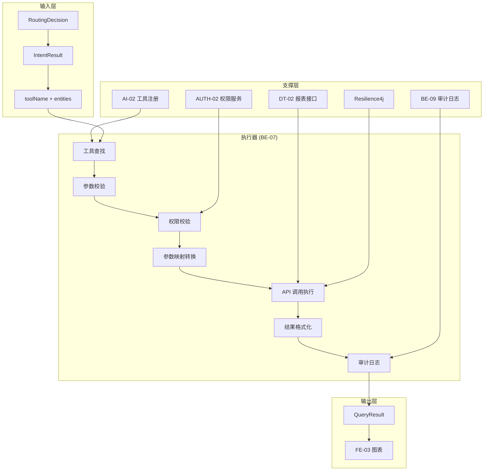
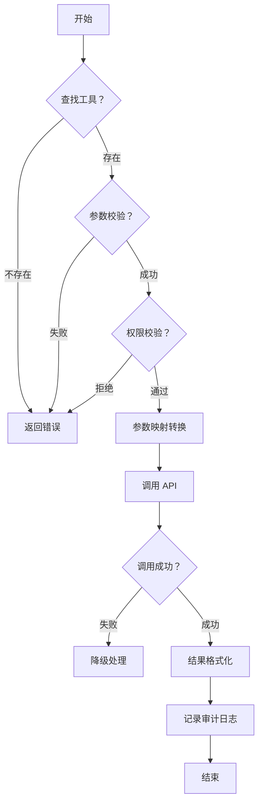

# 智能问数系统 - BE-07 工具调用执行器详细设计文档

**文档版本**: V2.0  
**最后更新**: 2026-04-02  
**适用对象**: 后端开发工程师、架构师  
**关联任务**: BE-07 工具调用执行器  
**前置依赖**: BE-01 (TraceID), BE-03 (路由决策), DT-02 (报表接口标准化), AI-02 (工具注册)  
**后续依赖**: FE-03 (图表渲染), QA-01 (集成测试)

---

## 1. 任务概述

### 1.1 背景
工具调用执行器是智能问数系统的核心执行引擎之一。当路由决策选择 `TOOL_CALL` 策略时，该执行器负责将 AI 识别的工具调用意图转换为实际的后端 API 调用，执行预定义的报表查询接口。相比 SQL 沙箱，工具调用更安全、准确、性能更好，是**首选执行策略**。

### 1.2 目标
| 目标 | 说明 | 验收标准 |
|------|------|----------|
| **安全性** | 权限强制校验 | 越权访问 0 次 |
| **准确性** | 参数映射准确 | 参数错误率 < 1% |
| **性能** | 调用响应快 | P95 < 2s |
| **可靠性** | 故障自动降级 | 降级成功率 100% |
| **可追溯** | 调用全程可审计 | 审计日志 100% 记录 |

### 1.3 范围
| 功能 | 说明 | 风险等级 |
|------|------|----------|
| 工具注册管理 | 工具定义、参数 Schema | 🟡 中 |
| 参数映射转换 | AI 参数→API 参数 | 🟡 中 |
| 权限校验 | 工具访问权限控制 | 🔴 高 |
| API 调用执行 | 调用后端报表接口 | 🟡 中 |
| 结果格式化 | 统一响应格式 | 🟢 低 |
| 调用审计 | 完整调用记录 | 🟡 中 |
| 故障降级 | 调用失败降级处理 | 🟡 中 |

---

## 2. 技术选型

### 2.1 技术栈
| 组件 | 技术 | 版本 | 选型理由 |
|------|------|------|----------|
| 工具注册 | Spring Bean | - | 自动发现，易扩展 |
| 参数校验 | Hibernate Validator | 6.2 | 标准校验框架 |
| API 调用 | RestTemplate/WebClient | Spring Boot 3.2 | 成熟稳定 |
| 熔断降级 | Resilience4j | 1.7.0 | 轻量级熔断器 |
| 审计日志 | 异步日志 | - | 不阻塞主流程 |
| 缓存 | Caffeine + Redis | 7.0 | 二级缓存 |

### 2.2 架构设计


### 2.3 执行流程


---

## 3. 详细实现方案

### 3.1 配置类

**ToolCallProperties.java**
```java
package com.company.askdata.config;

import lombok.Data;
import org.springframework.boot.context.properties.ConfigurationProperties;
import org.springframework.stereotype.Component;
import java.time.Duration;
import java.util.List;

/**
 * 工具调用配置
 * 
 * ⚠️ 注意事项:
 * 1. 超时时间需根据 API 性能调整
 * 2. 白名单需定期审计更新
 * 3. 降级策略需明确定义
 */
@Data
@Component
@ConfigurationProperties(prefix = "askdata.tool-call")
public class ToolCallProperties {
    
    /** 安全配置 */
    private SecurityConfig security = new SecurityConfig();
    
    /** 性能配置 */
    private PerformanceConfig performance = new PerformanceConfig();
    
    /** 降级配置 */
    private FallbackConfig fallback = new FallbackConfig();
    
    /** 审计配置 */
    private AuditConfig audit = new AuditConfig();
    
    @Data
    public static class SecurityConfig {
        /** 启用的工具白名单 */
        private List<String> enabledTools = List.of(
            "get_sales_report",
            "get_user_growth",
            "get_operation_report"
        );
        /** 敏感工具列表 (需额外授权) */
        private List<String> sensitiveTools = List.of(
            "get_finance_report",
            "export_data"
        );
        /** 强制权限校验 */
        private Boolean enforcePermission = true;
    }
    
    @Data
    public static class PerformanceConfig {
        /** 调用超时 (秒) */
        private Integer timeoutSeconds = 5;
        /** 最大重试次数 */
        private Integer maxRetries = 2;
        /** 重试间隔 (毫秒) */
        private Integer retryIntervalMs = 1000;
        /** 并发限制 */
        private Integer maxConcurrentCalls = 50;
    }
    
    @Data
    public static class FallbackConfig {
        /** 启用降级 */
        private Boolean enabled = true;
        /** 降级策略 */
        private String strategy = "SEMANTIC_QUERY"; // 或 FALLBACK_KB
        /** 降级提示模板 */
        private String messageTemplate = "工具调用失败，已降级到 {fallback_strategy}";
    }
    
    @Data
    public static class AuditConfig {
        /** 启用审计日志 */
        private Boolean enabled = true;
        /** 记录请求参数 */
        private Boolean logRequestParams = true;
        /** 记录响应数据 */
        private Boolean logResponseData = false; // 防止敏感数据泄露
        /** 审计日志保留天数 */
        private Integer retentionDays = 180;
    }
}
```

### 3.2 核心模型

**ReportTool.java**
```java
package com.company.askdata.executor.tool;

import com.company.askdata.model.QueryResult;
import com.company.askdata.model.ToolContext;

/**
 * 报表工具标准接口
 * 
 * ⚠️ 关键点：
 * 1. 所有工具必须实现此接口
 * 2. 支持自动发现注册
 * 3. 统一执行入口
 */
public interface ReportTool {
    
    /**
     * 工具唯一标识 (对应 HiAgent 注册的工具名)
     */
    String getToolName();
    
    /**
     * 工具描述 (用于 AI 理解)
     */
    String getDescription();
    
    /**
     * 执行查询
     * @param context 包含 AI 提取的参数、用户信息、TraceID
     * @return 标准化查询结果
     */
    QueryResult execute(ToolContext context);
    
    /**
     * 参数校验器 (可选实现，默认通过)
     */
    default void validateParams(ToolContext context) {
        // 默认空实现，子类可重写
    }
    
    /**
     * 工具版本 (用于兼容性管理)
     */
    default String getVersion() {
        return "1.0.0";
    }
    
    /**
     * 是否敏感工具 (需额外授权)
     */
    default boolean isSensitive() {
        return false;
    }
}
```

**ToolContext.java**
```java
package com.company.askdata.model;

import lombok.Data;
import java.util.Map;

/**
 * 工具调用上下文
 * 
 * ⚠️ 关键点：
 * 1. 包含用户权限信息
 * 2. 包含链路追踪 ID
 * 3. 包含原始和转换后参数
 */
@Data
public class ToolContext {
    
    /** 链路追踪 ID */
    private String traceId;
    
    /** 当前用户 ID */
    private Long userId;
    
    /** 当前部门 ID */
    private Long deptId;
    
    /** 用户角色 */
    private String userRole;
    
    /** AI 提取的原始参数 (Key-Value) */
    private Map<String, Object> rawParams;
    
    /** 转换后的强类型参数 (由执行器填充) */
    private Object typedParams;
    
    /** 超时时间 (毫秒) */
    private Long timeoutMs = 5000L;
    
    /** 会话版本 (用于状态同步校验) */
    private Long sessionVersion;
    
    /** 调用来源 */
    private String source = "AI_AGENT";
}
```

**ToolCallAuditLog.java**
```java
package com.company.askdata.model;

import lombok.Data;
import java.time.LocalDateTime;

/**
 * 工具调用审计日志
 * 
 * ⚠️ 陷阱防护：安全合规陷阱
 * 所有工具调用必须记录审计日志
 */
@Data
public class ToolCallAuditLog {
    
    /** 链路追踪 ID */
    private String traceId;
    
    /** 用户 ID */
    private Long userId;
    
    /** 工具名称 */
    private String toolName;
    
    /** 调用参数 (脱敏) */
    private String sanitizedParams;
    
    /** 调用状态 */
    private String status; // SUCCESS/FAILURE/FALLBACK
    
    /** 错误信息 */
    private String errorMessage;
    
    /** 调用耗时 (ms) */
    private Long executionLatencyMs;
    
    /** 返回行数 */
    private Integer returnedRows;
    
    /** 是否降级 */
    private Boolean isFallback;
    
    /** 降级策略 */
    private String fallbackStrategy;
    
    /** 执行时间 */
    private LocalDateTime executionTime;
    
    /** 用户 IP */
    private String userIp;
    
    /** 会话 ID */
    private String sessionId;
    
    /** 风险等级 */
    private String riskLevel;
}
```

### 3.3 工具注册中心

**ToolRegistry.java**
```java
package com.company.askdata.executor.tool;

import lombok.extern.slf4j.Slf4j;
import org.springframework.stereotype.Component;

import java.util.List;
import java.util.Map;
import java.util.concurrent.ConcurrentHashMap;

/**
 * 工具注册中心
 * 
 * ⚠️ 陷阱防护：工具调用循环陷阱
 * 自动发现并注册所有 ReportTool 实现类
 */
@Slf4j
@Component
public class ToolRegistry {
    
    private final Map<String, ReportTool> tools = new ConcurrentHashMap<>();
    
    /**
     * Spring 容器启动时自动注入所有 ReportTool 实现类
     */
    public ToolRegistry(List<ReportTool> toolList) {
        for (ReportTool tool : toolList) {
            String toolName = tool.getToolName();
            
            // ⚠️ 检查工具名重复
            if (tools.containsKey(toolName)) {
                log.error("Duplicate tool name detected: {}", toolName);
                throw new IllegalStateException("Duplicate tool name: " + toolName);
            }
            
            tools.put(toolName, tool);
            log.info("Registered report tool: {} (version={})", 
                toolName, tool.getVersion());
        }
        
        log.info("Total {} report tools registered", tools.size());
    }
    
    /**
     * 根据工具名获取实例
     */
    public ReportTool getTool(String toolName) {
        ReportTool tool = tools.get(toolName);
        if (tool == null) {
            log.warn("Tool not found: {}", toolName);
            throw new IllegalArgumentException("未找到工具：" + toolName);
        }
        return tool;
    }
    
    /**
     * 获取所有已注册工具名
     */
    public List<String> getAllToolNames() {
        return List.copyOf(tools.keySet());
    }
    
    /**
     * 检查工具是否启用
     */
    public boolean isToolEnabled(String toolName, List<String> enabledTools) {
        return enabledTools == null || enabledTools.contains(toolName);
    }
}
```

### 3.4 核心执行器

**ToolCallExecutor.java**
```java
package com.company.askdata.executor;

import com.company.askdata.config.ToolCallProperties;
import com.company.askdata.executor.tool.ReportTool;
import com.company.askdata.executor.tool.ToolRegistry;
import com.company.askdata.model.IntentResult;
import com.company.askdata.model.QueryResult;
import com.company.askdata.model.ToolCallAuditLog;
import com.company.askdata.model.ToolContext;
import com.company.askdata.security.ToolCallLimiter;
import com.company.askdata.service.AuditLogger;
import com.company.askdata.service.UserPermissionService;
import com.company.askdata.utils.TraceIdUtil;
import io.github.resilience4j.circuitbreaker.annotation.CircuitBreaker;
import io.github.resilience4j.retry.annotation.Retry;
import lombok.RequiredArgsConstructor;
import lombok.extern.slf4j.Slf4j;
import org.springframework.stereotype.Component;
import reactor.core.publisher.Mono;
import reactor.core.scheduler.Schedulers;

import java.time.LocalDateTime;

/**
 * 工具调用执行器
 * 
 * ⚠️ 关键防护点:
 * 1. 工具白名单校验
 * 2. 权限强制校验
 * 3. 参数校验转换
 * 4. 熔断降级处理
 * 5. 完整审计日志
 */
@Slf4j
@Component
@RequiredArgsConstructor
public class ToolCallExecutor implements QueryExecutor {
    
    private final ToolRegistry toolRegistry;
    private final ToolCallProperties properties;
    private final UserPermissionService permissionService;
    private final ToolCallLimiter callLimiter;
    private final AuditLogger auditLogger;
    
    @Override
    @CircuitBreaker(name = "toolCall", fallbackMethod = "fallbackExecute")
    @Retry(name = "toolCall")
    public Mono<QueryResult> execute(IntentResult intent, String traceId) {
        String toolName = intent.getToolName();
        
        return Mono.fromCallable(() -> {
            long startTime = System.currentTimeMillis();
            
            // 创建审计日志
            ToolCallAuditLog auditLog = createAuditLog(traceId, toolName, intent);
            
            try {
                // ========== 第一步：工具白名单校验 ==========
                if (!toolRegistry.isToolEnabled(toolName, properties.getSecurity().getEnabledTools())) {
                    log.warn("traceId={} tool not in whitelist: {}", traceId, toolName);
                    
                    auditLog.setStatus("REJECT");
                    auditLog.setErrorMessage("工具未在白名单中");
                    auditLogger.logToolCallAuditAsync(auditLog);
                    
                    throw new SecurityException("工具未启用：" + toolName);
                }
                
                // ========== 第二步：获取工具实例 ==========
                ReportTool tool = toolRegistry.getTool(toolName);
                log.info("traceId={} executing tool: {}", traceId, toolName);
                
                // ========== 第三步：调用次数限制 ==========
                callLimiter.checkLimit(toolName, TraceIdUtil.getSessionId());
                
                // ========== 第四步：构建上下文 ==========
                ToolContext context = buildContext(intent, traceId);
                
                // ========== 第五步：权限校验 ==========
                if (properties.getSecurity().getEnforcePermission()) {
                    permissionService.checkToolPermission(context.getUserId(), toolName);
                    
                    // 敏感工具需额外授权
                    if (tool.isSensitive()) {
                        permissionService.checkSensitiveToolPermission(context.getUserId(), toolName);
                    }
                }
                
                // ========== 第六步：参数校验 ==========
                tool.validateParams(context);
                
                // ========== 第七步：执行查询 ==========
                QueryResult result = tool.execute(context);
                
                // ========== 第八步：记录审计日志 ==========
                auditLog.setStatus("SUCCESS");
                auditLog.setExecutionLatencyMs(System.currentTimeMillis() - startTime);
                auditLog.setReturnedRows(result.getData() != null ? result.getData().size() : 0);
                auditLog.setRiskLevel("LOW");
                auditLogger.logToolCallAuditAsync(auditLog);
                
                log.info("traceId={} tool execution completed: tool={}, latency={}ms, rows={}", 
                    traceId, toolName, auditLog.getExecutionLatencyMs(), auditLog.getReturnedRows());
                
                return result;
                
            } catch (Exception e) {
                log.error("traceId={} tool execution failed: {}", traceId, e.getMessage(), e);
                
                auditLog.setStatus("FAILURE");
                auditLog.setErrorMessage(e.getMessage());
                auditLog.setExecutionLatencyMs(System.currentTimeMillis() - startTime);
                auditLog.setRiskLevel("MEDIUM");
                auditLogger.logToolCallAuditAsync(auditLog);
                
                throw e;
            }
            
        }).subscribeOn(Schedulers.boundedElastic())
          .doOnError(e -> log.error("traceId={} tool call failed", traceId, e));
    }
    
    @Override
    public String getStrategyType() {
        return "TOOL_CALL";
    }
    
    /**
     * 构建工具调用上下文
     */
    private ToolContext buildContext(IntentResult intent, String traceId) {
        ToolContext context = new ToolContext();
        context.setTraceId(traceId);
        context.setRawParams(intent.getEntities());
        
        // 获取当前用户信息
        var currentUser = permissionService.getCurrentUser();
        context.setUserId(currentUser.getId());
        context.setDeptId(currentUser.getDeptId());
        context.setUserRole(currentUser.getRole());
        context.setTimeoutMs(properties.getPerformance().getTimeoutSeconds() * 1000L);
        
        return context;
    }
    
    /**
     * 创建审计日志
     */
    private ToolCallAuditLog createAuditLog(String traceId, String toolName, IntentResult intent) {
        ToolCallAuditLog log = new ToolCallAuditLog();
        log.setTraceId(traceId);
        log.setToolName(toolName);
        log.setSanitizedParams(sanitizeParams(intent.getEntities()));
        log.setExecutionTime(LocalDateTime.now());
        log.setUserIp(getUserIp());
        log.setSessionId(TraceIdUtil.getSessionId());
        return log;
    }
    
    /**
     * 参数脱敏 (用于日志)
     */
    private String sanitizeParams(Map<String, Object> params) {
        if (params == null) return "{}";
        // 移除敏感值
        return params.toString().replaceAll("'[^']{4,}'", "'***'");
    }
    
    private String getUserIp() {
        return "unknown";
    }
    
    /**
     * ⚠️ 熔断降级处理
     */
    public Mono<QueryResult> fallbackExecute(IntentResult intent, String traceId, Throwable e) {
        log.warn("traceId={} tool call failed, triggering fallback: {}", traceId, e.getMessage());
        
        if (!properties.getFallback().getEnabled()) {
            return Mono.error(e);
        }
        
        // 记录降级审计日志
        ToolCallAuditLog auditLog = createAuditLog(traceId, intent.getToolName(), intent);
        auditLog.setStatus("FALLBACK");
        auditLog.setErrorMessage(e.getMessage());
        auditLog.setIsFallback(true);
        auditLog.setFallbackStrategy(properties.getFallback().getStrategy());
        auditLogger.logToolCallAuditAsync(auditLog);
        
        // 返回降级提示
        QueryResult fallbackResult = new QueryResult();
        fallbackResult.setSuccess(false);
        fallbackResult.setStrategy("FALLBACK_" + properties.getFallback().getStrategy());
        fallbackResult.setContent(properties.getFallback().getMessageTemplate()
            .replace("{fallback_strategy}", properties.getFallback().getStrategy()));
        
        return Mono.just(fallbackResult);
    }
}
```

### 3.5 调用限流器

**ToolCallLimiter.java**
```java
package com.company.askdata.security;

import com.company.askdata.config.ToolCallProperties;
import com.google.common.util.concurrent.RateLimiter;
import lombok.RequiredArgsConstructor;
import lombok.extern.slf4j.Slf4j;
import org.springframework.stereotype.Component;

import java.util.concurrent.ConcurrentHashMap;

/**
 * 工具调用限流器
 * 
 * ⚠️ 陷阱防护：工具调用循环陷阱
 * 防止单一工具被高频调用
 */
@Slf4j
@Component
@RequiredArgsConstructor
public class ToolCallLimiter {
    
    private final ToolCallProperties properties;
    private final ConcurrentHashMap<String, RateLimiter> toolLimiters = new ConcurrentHashMap<>();
    private final ConcurrentHashMap<String, RateLimiter> sessionLimiters = new ConcurrentHashMap<>();
    
    /**
     * 检查调用限制
     */
    public void checkLimit(String toolName, String sessionId) {
        // 工具级限流
        RateLimiter toolLimiter = toolLimiters.computeIfAbsent(
            toolName, 
            k -> RateLimiter.create(properties.getPerformance().getMaxConcurrentCalls())
        );
        
        if (!toolLimiter.tryAcquire()) {
            log.warn("Tool call rate limit exceeded: tool={}", toolName);
            throw new RuntimeException("工具调用频率超限：" + toolName);
        }
        
        // 会话级限流 (防止单用户滥用)
        RateLimiter sessionLimiter = sessionLimiters.computeIfAbsent(
            sessionId,
            k -> RateLimiter.create(10.0) // 每会话 10 次/秒
        );
        
        if (!sessionLimiter.tryAcquire()) {
            log.warn("Session call rate limit exceeded: session={}", sessionId);
            throw new RuntimeException("会话调用频率超限");
        }
    }
}
```

### 3.6 工具适配器示例

**SalesReportTool.java**
```java
package com.company.askdata.executor.tool.impl;

import com.company.askdata.executor.tool.ReportTool;
import com.company.askdata.model.QueryResult;
import com.company.askdata.model.ToolContext;
import com.company.askdata.service.SalesReportService;
import lombok.RequiredArgsConstructor;
import lombok.extern.slf4j.Slf4j;
import org.springframework.stereotype.Component;

import java.util.List;
import java.util.Map;

/**
 * 销售报表工具适配器
 * 
 * ⚠️ 关键点：
 * 1. 实现 ReportTool 接口
 * 2. 参数校验和转换
 * 3. 调用原有业务服务
 */
@Slf4j
@Component
@RequiredArgsConstructor
public class SalesReportTool implements ReportTool {
    
    private final SalesReportService salesReportService;
    
    @Override
    public String getToolName() {
        return "get_sales_report";
    }
    
    @Override
    public String getDescription() {
        return "查询销售报表数据，支持按地区、时间、指标筛选";
    }
    
    @Override
    public void validateParams(ToolContext context) {
        Map<String, Object> params = context.getRawParams();
        
        // 必填参数校验
        if (!params.containsKey("timeValue")) {
            throw new IllegalArgumentException("缺少必填参数：timeValue");
        }
        
        // 枚举值校验
        String region = (String) params.get("region");
        List<String> allowedRegions = List.of("all", "huadong", "huabei", "huanan", "huaxi");
        if (region != null && !allowedRegions.contains(region)) {
            throw new IllegalArgumentException("非法地区参数：" + region);
        }
        
        // 指标校验
        @SuppressWarnings("unchecked")
        List<String> metrics = (List<String>) params.get("metrics");
        if (metrics == null || metrics.isEmpty()) {
            throw new IllegalArgumentException("指标列表不能为空");
        }
    }
    
    @Override
    public QueryResult execute(ToolContext context) {
        Map<String, Object> params = context.getRawParams();
        
        // 参数转换
        String region = (String) params.getOrDefault("region", "all");
        String timeValue = (String) params.get("timeValue");
        @SuppressWarnings("unchecked")
        List<String> metrics = (List<String>) params.get("metrics");
        
        // 调用原有服务 (注意传递权限信息)
        var data = salesReportService.getSalesData(
            region, 
            timeValue, 
            metrics,
            context.getDeptId() // 权限过滤
        );
        
        // 构建结果
        QueryResult result = new QueryResult();
        result.setSuccess(true);
        result.setData(convertToMapList(data));
        result.setChartType("bar"); // 默认图表类型
        result.setTotal(data.size());
        
        return result;
    }
    
    @Override
    public boolean isSensitive() {
        return false; // 销售报表非敏感工具
    }
    
    private List<Map<String, Object>> convertToMapList(Object data) {
        // 实现 VO 到 Map 的转换逻辑
        return List.of(); // 简化示例
    }
}
```

---

## 4. 注意事项 ⚠️

### 4.1 工具注册
```java
// ❌ 错误：手动注册工具
toolRegistry.register("get_sales_report", new SalesReportTool());

// ✅ 正确：Spring 自动发现
@Component
public class SalesReportTool implements ReportTool {
    // Spring 自动扫描注册
}
```

### 4.2 权限校验
```java
// ❌ 错误：不校验权限直接调用
public QueryResult execute(ToolContext context) {
    return service.getData(); // 可能越权
}

// ✅ 正确：强制权限校验
public QueryResult execute(ToolContext context) {
    permissionService.checkToolPermission(context.getUserId(), toolName);
    return service.getData(context.getDeptId()); // 传递权限信息
}
```

### 4.3 参数校验
```java
// ❌ 错误：不校验参数直接调用
public QueryResult execute(ToolContext context) {
    String region = (String) context.getRawParams().get("region");
    return service.getData(region); // 可能非法值
}

// ✅ 正确：校验参数
public void validateParams(ToolContext context) {
    String region = (String) context.getRawParams().get("region");
    if (!allowedRegions.contains(region)) {
        throw new IllegalArgumentException("非法地区参数：" + region);
    }
}
```

### 4.4 审计日志
```java
// ❌ 错误：只记录成功调用
if (success) {
    logAudit(toolName);
}

// ✅ 正确：所有调用都记录
try {
    execute(toolName);
    logAudit(toolName, "SUCCESS");
} catch (Exception e) {
    logAudit(toolName, "FAILURE", e.getMessage()); // 失败也记录
}
```

---

## 5. 需要特别关注的点 🔴

### 5.1 陷阱防护矩阵

| 陷阱类型 | 风险描述 | 防护措施 | 验证方法 |
|----------|----------|----------|----------|
| **工具调用循环** | AI 反复调用同一工具 | 调用次数限流器 | 单工具≤3 次/会话 |
| **工具参数幻觉** | AI 生成非法参数值 | 参数枚举值校验 | 非法值被拦截 |
| **工具权限越界** | 用户调用无权工具 | 工具权限白名单 | 越权调用被拒绝 |
| **状态不一致** | 工具调用与会话状态不同步 | 携带 sessionVersion | 版本冲突被检测 |
| **敏感数据泄露** | 工具返回敏感数据 | 结果脱敏 + 审计 | 敏感字段掩码 |
| **熔断失效** | 工具故障导致雪崩 | Resilience4j 熔断器 | 故障自动降级 |
| **审计缺失** | 工具调用无记录 | 异步审计日志 | 所有调用可追溯 |
| **N+1 查询** | 循环调用工具 | 批量调用优化 | 日志中无 N+1 |

### 5.2 关键代码审查点

```java
// 审查清单
□ 工具是否实现 ReportTool 接口
□ 工具名是否与 HiAgent 注册一致
□ 参数校验是否完整 (必填/枚举/格式)
□ 权限校验是否强制
□ 敏感工具是否额外授权
□ 调用次数是否限制
□ 熔断降级是否配置
□ 审计日志是否记录
□ 参数是否脱敏打印
□ 异常是否捕获并记录 TraceID
□ 异步执行是否使用独立线程池
□ 结果是否格式化统一
□ 超时配置是否生效
□ 重试机制是否配置
□ 工具版本是否管理
```

### 5.3 性能影响评估

| 操作 | 耗时 | 优化建议 |
|------|------|----------|
| 工具查找 | < 1ms | 无需优化 |
| 参数校验 | 5-10ms | 无需优化 |
| 权限校验 | 5-10ms (缓存) | 缓存权限结果 |
| API 调用 | 100-2000ms | 优化后端接口 |
| 审计日志 | < 5ms (异步) | 无需优化 |
| **总开销** | **100-3000ms** | **主要耗时在 API 调用** |

### 5.4 监控指标

```java
// 需要采集的指标
@Component
public class ToolCallMetrics {
    
    private final MeterRegistry meterRegistry;
    
    // 调用次数
    meterRegistry.counter("askdata.toolcall.query.total", 
        "tool", toolName, "status", "success");
    
    // 调用延迟
    meterRegistry.timer("askdata.toolcall.query.latency")
        .record(latency, TimeUnit.MILLISECONDS);
    
    // 拦截次数
    meterRegistry.counter("askdata.toolcall.blocked.total", 
        "reason", "permission_denied");
    
    // 降级次数
    meterRegistry.counter("askdata.toolcall.fallback.total").increment();
    
    // 限流次数
    meterRegistry.counter("askdata.toolcall.ratelimit.total").increment();
}
```

---

## 6. 验收标准

### 6.1 功能验收
| 验收项 | 验收方法 | 通过标准 |
|--------|----------|----------|
| 工具调用 | 调用已注册工具 | 返回正确数据 |
| 白名单校验 | 调用未启用工具 | 被拦截，返回错误 |
| 权限校验 | 无权用户调用工具 | 被拒绝，返回 403 |
| 参数校验 | 传入非法参数 | 被拦截，返回 400 |
| 敏感工具 | 调用敏感工具无授权 | 被拒绝，返回 403 |
| 熔断降级 | 模拟工具故障 | 自动降级，不崩溃 |
| 审计日志 | 检查审计表 | 所有调用有记录 |
| 限流生效 | 高频调用工具 | 被限流，返回 429 |

### 6.2 安全验收
| 检查项 | 验收方法 | 通过标准 |
|--------|----------|----------|
| 工具白名单 | 尝试调用未注册工具 | 被拦截 |
| 权限绕过 | 尝试越权调用 | 被拒绝 |
| 参数注入 | 尝试注入恶意参数 | 被校验拦截 |
| 敏感数据 | 查询敏感工具 | 结果脱敏 |
| 审计完整性 | 检查审计日志 | 100% 记录 |

### 6.3 性能验收
| 指标 | 目标值 | 测量方法 |
|------|--------|----------|
| 调用 P95 | < 2s | JMeter 压测 |
| 工具查找 | < 1ms | 代码计时 |
| 参数校验 | < 10ms | 代码计时 |
| 审计日志延迟 | < 10ms (异步) | 日志时间戳 |
| 并发支持 | ≥ 50 QPS | 压测验证 |

---

## 7. 测试用例

### 7.1 单元测试
**文件路径**: `src/test/java/com/company/askdata/executor/ToolCallExecutorTest.java`

```java
package com.company.askdata.executor;

import com.company.askdata.executor.tool.ReportTool;
import com.company.askdata.executor.tool.ToolRegistry;
import com.company.askdata.model.IntentResult;
import com.company.askdata.model.QueryResult;
import org.junit.jupiter.api.Test;
import org.springframework.beans.factory.annotation.Autowired;
import org.springframework.boot.test.context.SpringBootTest;
import org.springframework.boot.test.mock.mockito.MockBean;

import java.util.Map;

import static org.junit.jupiter.api.Assertions.*;
import static org.mockito.ArgumentMatchers.*;
import static org.mockito.Mockito.*;

@SpringBootTest
class ToolCallExecutorTest {
    
    @Autowired
    private ToolCallExecutor executor;
    
    @MockBean
    private ToolRegistry toolRegistry;
    
    @Test
    void testExecuteSuccess() {
        // 准备测试数据
        IntentResult intent = new IntentResult();
        intent.setToolName("get_sales_report");
        intent.setEntities(Map.of(
            "timeValue", "last_month",
            "region", "huadong",
            "metrics", List.of("gmv")
        ));
        
        ReportTool mockTool = mock(ReportTool.class);
        when(toolRegistry.getTool("get_sales_report")).thenReturn(mockTool);
        
        QueryResult mockResult = new QueryResult();
        mockResult.setSuccess(true);
        when(mockTool.execute(any())).thenReturn(mockResult);
        
        // 执行测试
        QueryResult result = executor.execute(intent, "test-trace").block();
        
        // 验证结果
        assertNotNull(result);
        assertTrue(result.isSuccess());
        assertEquals("TOOL_CALL", result.getStrategy());
    }
    
    @Test
    void testToolNotFound() {
        IntentResult intent = new IntentResult();
        intent.setToolName("non_existent_tool");
        
        when(toolRegistry.getTool("non_existent_tool"))
            .thenThrow(new IllegalArgumentException("未找到工具"));
        
        // 验证异常
        assertThrows(Exception.class, () -> {
            executor.execute(intent, "test-trace").block();
        });
    }
    
    @Test
    void testParamValidation() {
        IntentResult intent = new IntentResult();
        intent.setToolName("get_sales_report");
        intent.setEntities(Map.of()); // 缺少必填参数
        
        ReportTool mockTool = mock(ReportTool.class);
        doThrow(new IllegalArgumentException("缺少必填参数"))
            .when(mockTool).validateParams(any());
        when(toolRegistry.getTool("get_sales_report")).thenReturn(mockTool);
        
        // 验证异常
        assertThrows(Exception.class, () -> {
            executor.execute(intent, "test-trace").block();
        });
    }
    
    @Test
    void testFallbackTrigger() {
        // 模拟工具调用失败，验证降级触发
        IntentResult intent = new IntentResult();
        intent.setToolName("get_sales_report");
        
        when(toolRegistry.getTool("get_sales_report"))
            .thenThrow(new RuntimeException("Tool unavailable"));
        
        QueryResult result = executor.execute(intent, "test-trace").block();
        
        // 验证降级结果
        assertNotNull(result);
        assertTrue(result.getStrategy().contains("FALLBACK"));
    }
}
```

### 7.2 集成测试
**文件路径**: `src/test/java/com/company/askdata/integration/ToolCallIntegrationTest.java`

```java
@Test
void testPermissionEnforcement() {
    // 1. 普通用户尝试调用敏感工具
    // 2. 验证被拒绝
    // 3. 审计日志记录权限拒绝
}

@Test
void testRateLimiting() {
    // 1. 高频调用同一工具 (超过限流阈值)
    // 2. 验证被限流
    // 3. 审计日志记录限流事件
}

@Test
void testAuditLogCompleteness() {
    // 1. 执行成功调用
    // 2. 执行失败调用
    // 3. 执行降级调用
    // 4. 验证三者都有审计日志
}
```

### 7.3 压测验证
```bash
# JMeter 压测
# 验证 P95 < 2s
# 验证限流生效
# 验证熔断触发

jmeter -n -t toolcall_load_test.jmx -l results.jtl

# 分析限流效果
# 限流触发次数 / 总调用次数
```

---

## 8. 部署配置

### 8.1 环境变量
```bash
# 生产环境
export ASKDATA_TOOL_CALL_TIMEOUT=5
export ASKDATA_TOOL_CALL_MAX_RETRIES=2
export ASKDATA_TOOL_CALL_ENABLED_TOOLS=get_sales_report,get_user_growth
export ASKDATA_TOOL_CALL_SENSITIVE_TOOLS=get_finance_report,export_data
export ASKDATA_TOOL_CALL_AUDIT_ENABLED=true
```

### 8.2 K8s 配置
```yaml
# deployment.yaml
apiVersion: apps/v1
kind: Deployment
metadata:
  name: askdata-router
spec:
  template:
    spec:
      containers:
      - name: router
        env:
        - name: ASKDATA_TOOL_CALL_ENABLED_TOOLS
          valueFrom:
            configMapKeyRef:
              name: askdata-config
              key: toolcall.enabled-tools
        resources:
          requests:
            memory: "512Mi"
            cpu: "250m"
          limits:
            memory: "1Gi"
            cpu: "500m"
```

### 8.3 监控告警
```yaml
# Prometheus 告警
groups:
- name: tool-call-alerts
  rules:
  - alert: ToolCallHighFailureRate
    expr: |
      sum(rate(askdata_toolcall_query_total{status="failure"}[5m])) 
      / 
      sum(rate(askdata_toolcall_query_total[5m])) > 0.1
    for: 5m
    labels:
      severity: warning
    annotations:
      summary: "工具调用失败率过高 ({{ $value }})"
  
  - alert: ToolCallHighFallbackRate
    expr: rate(askdata_toolcall_fallback_total[5m]) > 0.1
    for: 5m
    labels:
      severity: warning
    annotations:
      summary: "工具调用频繁降级"
  
  - alert: ToolCallRateLimitExceeded
    expr: rate(askdata_toolcall_ratelimit_total[5m]) > 0
    for: 1m
    labels:
      severity: warning
    annotations:
      summary: "工具调用触发限流"
```

---

## 9. 常见问题 (FAQ)

**Q1: 工具调用失败怎么办？**
A: 1. 检查工具是否注册；2. 检查参数是否合法；3. 检查权限是否足够；4. 查看审计日志定位原因。

**Q2: 如何添加新工具？**
A: 1. 实现 ReportTool 接口；2. 添加@Component 注解；3. 在 HiAgent 平台注册；4. 更新白名单配置。

**Q3: 限流阈值如何调整？**
A: 1. 修改配置中心；2. 无需重启生效；3. 观察限流指标；4. 根据业务调整。

**Q4: 敏感工具如何授权？**
A: 1. 权限系统配置；2. 用户角色绑定；3. 临时授权审批；4. 审计日志记录。

**Q5: 如何调试工具调用？**
A: 1. 开启调试日志；2. 查看审计日志；3. 使用 TraceID 追踪；4. 检查参数映射。

**Q6: 熔断后如何恢复？**
A: 1. 等待熔断窗口过期；2. 半开状态探测；3. 成功则恢复；4. 失败则继续熔断。

**Q7: 如何优化工具调用性能？**
A: 1. 缓存调用结果；2. 批量调用优化；3. 异步调用；4. 后端接口优化。

**Q8: 审计日志太多怎么办？**
A: 1. 异步写入；2. 定期归档；3. 采样记录；4. 压缩存储。

**Q9: 如何防止工具滥用？**
A: 1. 调用次数限制；2. 权限严格控制；3. 审计日志监控；4. 异常行为告警。

**Q10: 工具版本如何管理？**
A: 1. 工具接口增加 version 方法；2. 向后兼容设计；3. 版本协商机制；4. 废弃工具标记。

---

## 10. 变更历史

| 版本 | 日期 | 变更内容 | 负责人 |
|------|------|----------|--------|
| V1.0 | 2026-03-25 | 初始版本 | 架构组 |
| V2.0 | 2026-04-02 | 增加限流器、熔断降级、审计日志、陷阱防护 | 架构组 |

---

## 11. 工时与优先级

| 项目 | 内容 |
|------|------|
| **工时** | 5 MD (开发 3.5 天 + 测试 1.5 天) |
| **优先级** | P0 (核心执行器) |
| **依赖任务** | BE-03, DT-02, AI-02, AUTH-02 |
| **被依赖任务** | FE-03, QA-01 |

---

## 12. 工具开发规范

### 12.1 工具命名规范
```yaml
# 工具命名规范
naming:
  # 格式：get_{业务}_{资源}
  pattern: "^get_[a-z]+_[a-z]+$"
  
  # 示例
  examples:
    valid:
      - get_sales_report
      - get_user_growth
      - get_operation_report
    invalid:
      - getSalesReport      # 驼峰
      - GET_SALES_REPORT    # 大写
      - sales_report        # 缺少 get 前缀
```

### 12.2 参数校验规范
```java
// 必填参数校验
if (!params.containsKey("requiredParam")) {
    throw new IllegalArgumentException("缺少必填参数：requiredParam");
}

// 枚举值校验
List<String> allowedValues = List.of("value1", "value2");
if (!allowedValues.contains(paramValue)) {
    throw new IllegalArgumentException("参数值不在允许范围内：" + paramValue);
}

// 格式校验
if (!pattern.matcher(paramValue).matches()) {
    throw new IllegalArgumentException("参数格式错误：" + paramValue);
}
```

### 12.3 错误处理规范
```java
// 业务错误
throw new IllegalArgumentException("参数错误：" + message);

// 权限错误
throw new AccessDeniedException("无权访问工具：" + toolName);

// 系统错误
throw new RuntimeException("工具调用失败：" + message);

// 限流错误
throw new TooManyRequestsException("调用频率超限");
```

---

**文档结束**  
**下一步**: 开发人员按本文档实现代码，完成后提交测试团队进行 BE-07 专项验收。验收通过后，方可开始 FE-03 图表渲染的对接开发。