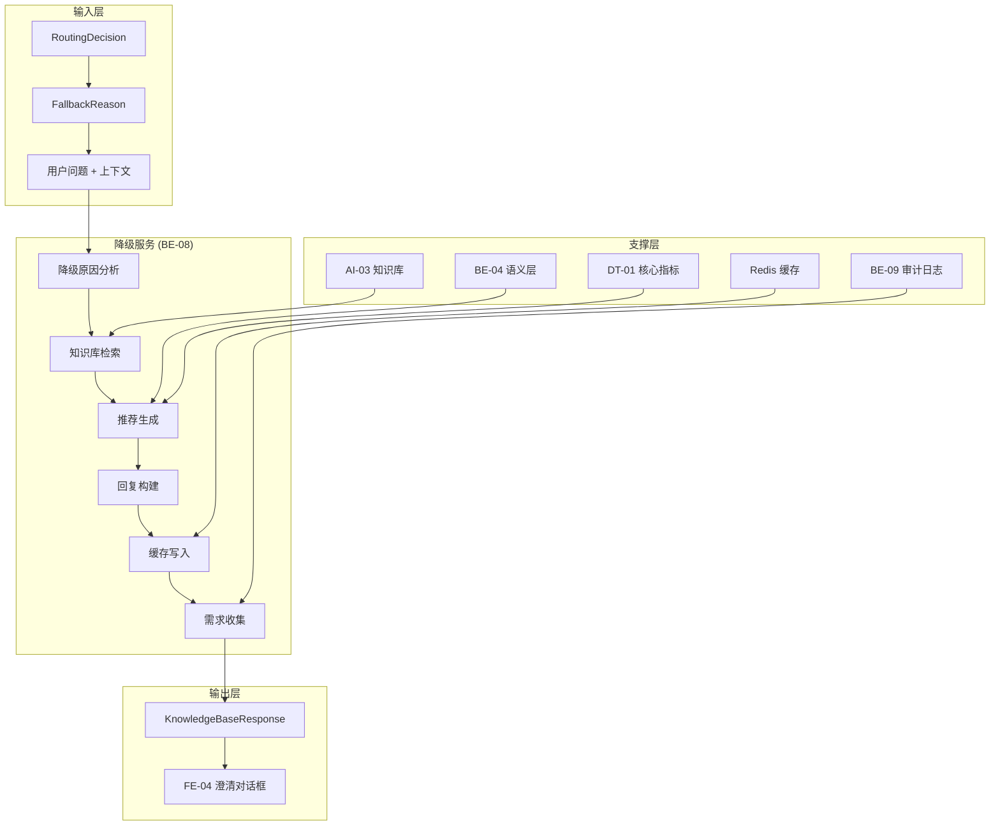

# 智能问数系统 - BE-08 知识库降级服务详细设计文档

**文档版本**: V2.0  
**最后更新**: 2026-04-02  
**适用对象**: 后端开发工程师、AI 平台运维工程师、架构师  
**关联任务**: BE-08 知识库降级服务  
**前置依赖**: BE-01 (TraceID), BE-03 (路由决策), AI-03 (知识库文档), AI-04 (知识库索引)  
**后续依赖**: FE-06 (智能推荐), QA-01 (集成测试)

---

## 1. 任务概述

### 1.1 背景
知识库降级服务是智能问数系统的"安全网"。当路由引擎无法匹配到合适的执行策略（工具调用/语义查询/SQL 沙箱）时，系统自动降级到知识库检索，返回相关的业务文档、指标说明、常见问题等，确保用户任何问题都能得到回复，避免返回空错误或系统异常。

### 1.2 目标
| 目标 | 说明 | 验收标准 |
|------|------|----------|
| **兜底保障** | 确保任何问题都有回复 | 降级覆盖率 100% |
| **有用引导** | 提供替代方案和推荐 | 推荐点击率 ≥ 30% |
| **需求收集** | 记录未满足的查询需求 | 需求记录 100% |
| **体验连续** | 保持对话连续性 | 用户满意度 ≥ 3.5/5.0 |
| **可追溯** | 降级原因完整记录 | 审计日志 100% 记录 |

### 1.3 范围
| 功能 | 说明 | 风险等级 |
|------|------|----------|
| 降级触发判断 | 识别降级场景 | 🟡 中 |
| 知识库检索 | 检索相关文档 | 🟡 中 |
| 推荐生成 | 生成指标/报表推荐 | 🟡 中 |
| 澄清引导 | 生成澄清问题和选项 | 🟢 低 |
| 缓存优化 | 降级结果缓存 | 🟢 低 |
| 需求收集 | 记录未满足需求 | 🟢 低 |
| 审计日志 | 完整降级记录 | 🟡 中 |

---

## 2. 技术选型

### 2.1 技术栈
| 组件 | 技术 | 版本 | 选型理由 |
|------|------|------|----------|
| 知识库检索 | HiAgent API | 2.3+ | 统一检索入口 |
| 推荐引擎 | 规则 + 相似度 | - | 简单高效 |
| 缓存 | Caffeine + Redis | 7.0 | 二级缓存 |
| 异步处理 | Reactor (Mono) | - | 非阻塞响应 |
| 审计日志 | 异步日志 | - | 不阻塞主流程 |

### 2.2 架构设计


### 2.3 降级场景分类
| 降级原因 | 代码 | 触发条件 | 推荐策略 |
|----------|------|----------|----------|
| 意图不明 | INTENT_UNCLEAR | 置信度 < 0.4 | 常见问法 + 使用指南 |
| 指标不存在 | METRIC_NOT_FOUND | 语义层无此指标 | 相似指标 + 需求提交 |
| 工具未注册 | TOOL_NOT_REGISTERED | 无对应 API 工具 | 相关报表 + 帮助文档 |
| 无 SQL 权限 | NO_SQL_PERMISSION | 用户无沙箱权限 | 可用报表 + 权限申请 |
| 查询超时 | QUERY_TIMEOUT | 执行超过 5 秒 | 简化查询建议 |
| 查询错误 | QUERY_ERROR | SQL/语义查询报错 | 错误说明 + 重试建议 |
| 空结果 | EMPTY_RESULT | 查询返回 0 条数据 | 调整筛选条件建议 |
| 澄清超限 | CLARIFY_MAX_TURNS | 澄清轮数 ≥ 5 | 热门查询 + 人工客服 |
| 澄清超时 | CLARIFY_TIMEOUT | 用户 30 秒无响应 | 快捷选项 + 稍后重试 |
| 系统错误 | SYSTEM_ERROR | 服务异常 | 友好提示 + 稍后重试 |

---

## 3. 详细实现方案

### 3.1 配置类

**FallbackProperties.java**
```java
package com.company.askdata.config;

import lombok.Data;
import org.springframework.boot.context.properties.ConfigurationProperties;
import org.springframework.stereotype.Component;
import java.time.Duration;
import java.util.List;
import java.util.Map;

/**
 * 知识库降级配置
 * 
 * ⚠️ 注意事项:
 * 1. 检索阈值需根据实际效果调整
 * 2. 推荐数量需平衡信息量和简洁性
 * 3. 缓存 TTL 需根据数据更新频率调整
 */
@Data
@Component
@ConfigurationProperties(prefix = "askdata.fallback")
public class FallbackProperties {
    
    /** 检索配置 */
    private RetrievalConfig retrieval = new RetrievalConfig();
    
    /** 推荐配置 */
    private RecommendationConfig recommendation = new RecommendationConfig();
    
    /** 缓存配置 */
    private CacheConfig cache = new CacheConfig();
    
    /** 降级原因配置 */
    private Map<String, FallbackReasonConfig> reasons = Map.of(
        "INTENT_UNCLEAR", new FallbackReasonConfig("意图不明确", "P1"),
        "METRIC_NOT_FOUND", new FallbackReasonConfig("指标不存在", "P1"),
        "NO_SQL_PERMISSION", new FallbackReasonConfig("无 SQL 权限", "P2"),
        "QUERY_TIMEOUT", new FallbackReasonConfig("查询超时", "P2"),
        "SYSTEM_ERROR", new FallbackReasonConfig("系统错误", "P0")
    );
    
    @Data
    public static class RetrievalConfig {
        /** 检索 TopK */
        private Integer topK = 5;
        /** 相似度阈值 */
        private Double threshold = 0.65;
        /** 检索超时 (秒) */
        private Integer timeoutSeconds = 3;
        /** 启用重排序 */
        private Boolean enableRerank = true;
    }
    
    @Data
    public static class RecommendationConfig {
        /** 最大推荐指标数 */
        private Integer maxMetricRecommendations = 3;
        /** 最大推荐报表数 */
        private Integer maxReportRecommendations = 2;
        /** 最大推荐问法数 */
        private Integer maxSuggestedQuestions = 5;
        /** 启用个性化推荐 */
        private Boolean enablePersonalization = true;
    }
    
    @Data
    public static class CacheConfig {
        /** 启用缓存 */
        private Boolean enabled = true;
        /** 缓存 TTL */
        private Duration ttl = Duration.ofMinutes(30);
        /** 缓存 Key 前缀 */
        private String keyPrefix = "fallback:response:";
    }
    
    @Data
    public static class FallbackReasonConfig {
        private String description;
        private String priority;
        
        public FallbackReasonConfig() {}
        
        public FallbackReasonConfig(String desc, String priority) {
            this.description = desc;
            this.priority = priority;
        }
    }
}
```

### 3.2 核心模型

**FallbackReason.java**
```java
package com.company.askdata.enums;

import lombok.Getter;
import lombok.RequiredArgsConstructor;

/**
 * 降级原因枚举
 * 
 * ⚠️ 关键点：
 * 1. 每个原因对应不同的回复模板
 * 2. 优先级决定告警级别
 * 3. 用于审计和统计分析
 */
@Getter
@RequiredArgsConstructor
public enum FallbackReason {
    
    INTENT_UNCLEAR("意图不明", "用户问题置信度低于 0.4", "P1"),
    METRIC_NOT_FOUND("指标不存在", "语义层中无此指标定义", "P1"),
    TOOL_NOT_REGISTERED("工具未注册", "无对应 API 工具", "P1"),
    NO_SQL_PERMISSION("无 SQL 权限", "用户无沙箱查询权限", "P2"),
    QUERY_TIMEOUT("查询超时", "执行超过 5 秒", "P2"),
    QUERY_ERROR("查询错误", "SQL 执行报错", "P2"),
    EMPTY_RESULT("空结果", "查询返回 0 条数据", "P3"),
    CLARIFY_MAX_TURNS("澄清超限", "澄清轮数超过 5 轮", "P1"),
    CLARIFY_TIMEOUT("澄清超时", "用户 30 秒无响应", "P1"),
    SYSTEM_ERROR("系统错误", "服务异常", "P0"),
    KNOWLEDGE_NOT_FOUND("知识库无匹配", "知识库检索无相关文档", "P3");
    
    private final String code;
    private final String description;
    private final String priority; // P0/P1/P2/P3
}
```

**KnowledgeBaseResponse.java**
```java
package com.company.askdata.model;

import lombok.Data;
import java.util.List;

/**
 * 知识库降级响应
 * 
 * ⚠️ 关键点：
 * 1. 结构化回复内容
 * 2. 包含推荐和引导
 * 3. 用于前端渲染
 */
@Data
public class KnowledgeBaseResponse {
    
    /** 链路追踪 ID */
    private String traceId;
    
    /** 消息 ID (用于反馈) */
    private String messageId;
    
    /** 执行策略 */
    private String strategy = "FALLBACK_KB";
    
    /** 检索置信度 0-1 */
    private Double confidence;
    
    /** 检索元数据 */
    private RetrievalMeta retrieval;
    
    /** 回复内容 */
    private ResponseContent content;
    
    /** 后续引导 */
    private FollowUp followUp;
    
    /** 元数据 */
    private ResponseMetadata metadata;
    
    @Data
    public static class RetrievalMeta {
        /** 实际检索用的 query */
        private String query;
        /** 命中文档总数 */
        private Integer totalHits;
        /** 返回的文档数量 */
        private Integer topK;
        /** 检索耗时 (ms) */
        private Long latencyMs;
    }
    
    @Data
    public static class ResponseContent {
        /** 内容类型 */
        private String type; // text/structured/mixed
        
        /** 主回复 (必填) */
        private String mainAnswer;
        
        /** 结构化推荐 */
        private Recommendations recommendations;
        
        /** 来源引用 */
        private List<SourceCitation> sources;
    }
    
    @Data
    public static class Recommendations {
        /** 推荐指标 */
        private List<MetricRecommendation> metrics;
        /** 推荐报表 */
        private List<ReportRecommendation> reports;
        /** 推荐问法 */
        private List<String> suggestedQuestions;
        /** 操作引导 */
        private List<ActionLink> actions;
    }
    
    @Data
    public static class MetricRecommendation {
        private String code;
        private String name;
        private String description;
        private String queryExample; // 示例问法
    }
    
    @Data
    public static class ReportRecommendation {
        private String code;
        private String name;
        private String url; // 报表链接
        private String description;
    }
    
    @Data
    public static class ActionLink {
        private String label;
        private String type; // link/button/query
        private String value; // URL 或查询语句
    }
    
    @Data
    public static class SourceCitation {
        private String docId;
        private String docTitle;
        private String docType; // metric/report/faq/term
        private Double relevanceScore;
        private String excerpt; // 相关片段
    }
    
    @Data
    public static class FollowUp {
        /** 是否支持继续澄清 */
        private Boolean canClarify;
        /** 可补充的参数 */
        private List<String> clarifySlots;
        /** 快捷操作 */
        private List<String> quickActions;
    }
    
    @Data
    public static class ResponseMetadata {
        /** 降级原因 */
        private String fallbackReason;
        /** 是否命中缓存 */
        private Boolean cacheHit;
        /** 时间戳 */
        private Long timestamp;
        /** 降级等级 */
        private String fallbackLevel; // L1/L2/L3
    }
}
```

**FallbackAuditLog.java**
```java
package com.company.askdata.model;

import lombok.Data;
import java.time.LocalDateTime;

/**
 * 降级审计日志
 * 
 * ⚠️ 陷阱防护：安全合规陷阱
 * 所有降级事件必须记录审计日志
 */
@Data
public class FallbackAuditLog {
    
    /** 链路追踪 ID */
    private String traceId;
    
    /** 用户 ID */
    private Long userId;
    
    /** 降级原因代码 */
    private String fallbackReason;
    
    /** 降级原因描述 */
    private String fallbackDescription;
    
    /** 降级等级 */
    private String fallbackLevel; // L1/L2/L3
    
    /** 知识库检索 Query */
    private String retrievalQuery;
    
    /** 检索命中文档数 */
    private Integer retrievalHits;
    
    /** 检索置信度 */
    private Double retrievalConfidence;
    
    /** 检索耗时 (ms) */
    private Long retrievalLatencyMs;
    
    /** 推荐指标数 */
    private Integer recommendedMetrics;
    
    /** 推荐报表数 */
    private Integer recommendedReports;
    
    /** 用户是否点击推荐 */
    private Boolean recommendationClicked;
    
    /** 用户反馈 */
    private String userFeedback; // LIKE/DISLIKE/NONE
    
    /** 执行时间 */
    private LocalDateTime executionTime;
    
    /** 会话 ID */
    private String sessionId;
    
    /** 用户 IP */
    private String userIp;
}
```

### 3.3 核心服务

**FallbackService.java**
```java
package com.company.askdata.service;

import com.company.askdata.client.HiAgentClient;
import com.company.askdata.config.FallbackProperties;
import com.company.askdata.enums.FallbackReason;
import com.company.askdata.model.*;
import com.company.askdata.repository.MetricRepository;
import com.company.askdata.repository.ReportRepository;
import com.company.askdata.template.FallbackTemplate;
import com.company.askdata.template.FallbackTemplateFactory;
import com.company.askdata.utils.TraceIdUtil;
import lombok.RequiredArgsConstructor;
import lombok.extern.slf4j.Slf4j;
import org.springframework.cache.annotation.Cacheable;
import org.springframework.stereotype.Service;
import reactor.core.publisher.Mono;
import reactor.core.scheduler.Schedulers;

import java.time.LocalDateTime;
import java.util.*;
import java.util.stream.Collectors;

/**
 * 知识库降级服务
 * 
 * ⚠️ 关键防护点:
 * 1. 降级原因准确识别
 * 2. 知识库检索优化
 * 3. 推荐生成相关性
 * 4. 缓存命中优化
 * 5. 需求收集完整
 */
@Slf4j
@Service
@RequiredArgsConstructor
public class FallbackService {
    
    private final HiAgentClient hiAgentClient;
    private final FallbackProperties properties;
    private final MetricRepository metricRepository;
    private final ReportRepository reportRepository;
    private final AuditLogger auditLogger;
    private final FallbackTemplateFactory templateFactory;
    
    /**
     * 执行知识库降级查询
     */
    public Mono<KnowledgeBaseResponse> query(FallbackContext context) {
        return Mono.fromCallable(() -> {
            long startTime = System.currentTimeMillis();
            
            // 创建审计日志
            FallbackAuditLog auditLog = createAuditLog(context);
            
            try {
                // ========== 第一步：检查缓存 ==========
                String cacheKey = buildCacheKey(context);
                KnowledgeBaseResponse cached = getFromCache(cacheKey);
                if (cached != null) {
                    cached.getMetadata().setCacheHit(true);
                    log.info("traceId={} fallback cache hit", context.getTraceId());
                    
                    auditLog.setRetrievalLatencyMs(0L);
                    auditLog.setRecommendationClicked(false);
                    auditLogger.logFallbackAuditAsync(auditLog);
                    
                    return cached;
                }
                
                // ========== 第二步：构建检索查询 ==========
                String searchQuery = buildSearchQuery(context);
                
                // ========== 第三步：调用 HiAgent 检索知识库 ==========
                KnowledgeRetrievalResult retrieval = hiAgentClient.retrieveKnowledge(
                    searchQuery,
                    context.getTraceId(),
                    properties.getRetrieval().getTopK()
                );
                
                // ========== 第四步：根据降级原因选择回复模板 ==========
                FallbackTemplate template = templateFactory.getTemplate(context.getReason());
                
                // ========== 第五步：生成结构化回复 ==========
                KnowledgeBaseResponse response = generateResponse(
                    template,
                    retrieval,
                    context
                );
                
                // ========== 第六步：补充推荐指标和报表 ==========
                enrichRecommendations(response, context);
                
                // ========== 第七步：设置元数据 ==========
                response.getMetadata().setFallbackReason(context.getReason().getCode());
                response.getMetadata().setTimestamp(System.currentTimeMillis());
                response.getMetadata().setCacheHit(false);
                response.getMetadata().setFallbackLevel(determineFallbackLevel(context.getReason()));
                
                // ========== 第八步：写入缓存 ==========
                saveToCache(cacheKey, response);
                
                // ========== 第九步：记录审计日志 ==========
                auditLog.setRetrievalHits(retrieval.getTotalHits());
                auditLog.setRetrievalConfidence(retrieval.getConfidence());
                auditLog.setRetrievalLatencyMs(System.currentTimeMillis() - startTime);
                auditLog.setRecommendedMetrics(
                    response.getContent().getRecommendations().getMetrics() != null ?
                    response.getContent().getRecommendations().getMetrics().size() : 0
                );
                auditLog.setExecutionTime(LocalDateTime.now());
                auditLogger.logFallbackAuditAsync(auditLog);
                
                // ========== 第十步：收集未满足需求 ==========
                if (shouldCollectRequirement(context)) {
                    collectUnmetRequirement(context, response);
                }
                
                long latency = System.currentTimeMillis() - startTime;
                log.info("traceId={} fallback completed: reason={}, latency={}ms, hits={}",
                    context.getTraceId(), context.getReason().getCode(), latency, 
                    retrieval.getTotalHits());
                
                return response;
                
            } catch (Exception e) {
                log.error("traceId={} fallback failed", context.getTraceId(), e);
                
                auditLog.setFallbackReason("SYSTEM_ERROR");
                auditLog.setFallbackDescription(e.getMessage());
                auditLogger.logFallbackAuditAsync(auditLog);
                
                // 返回通用降级回复
                return buildGenericFallback(context.getTraceId(), e.getMessage());
            }
            
        }).subscribeOn(Schedulers.boundedElastic());
    }
    
    /**
     * 构建缓存 Key
     */
    private String buildCacheKey(FallbackContext context) {
        // 格式：fallback:{reason}:{queryHash}:{userId}
        String queryHash = String.valueOf(context.getUserQuery().hashCode());
        return String.format("%s:%s:%s:%s",
            properties.getCache().getKeyPrefix(),
            context.getReason().getCode(),
            queryHash,
            context.getUserId());
    }
    
    /**
     * 从缓存获取
     */
    @Cacheable(
        value = "fallback:response",
        key = "#key",
        unless = "#result == null"
    )
    private KnowledgeBaseResponse getFromCache(String key) {
        // Spring Cache 自动处理
        return null; // 简化示例
    }
    
    /**
     * 保存到缓存
     */
    private void saveToCache(String key, KnowledgeBaseResponse response) {
        // Spring Cache 自动处理
    }
    
    /**
     * 构建检索查询 (增强版)
     */
    private String buildSearchQuery(FallbackContext context) {
        StringBuilder query = new StringBuilder();
        
        // 1. 用户原始问题
        query.append(context.getUserQuery());
        
        // 2. 根据降级原因添加关键词
        switch (context.getReason()) {
            case METRIC_NOT_FOUND:
                query.append(" 指标 定义 说明");
                break;
            case INTENT_UNCLEAR:
                query.append(" 帮助 指南 如何提问");
                break;
            case NO_SQL_PERMISSION:
                query.append(" 权限 报表 查看");
                break;
            default:
                break;
        }
        
        // 3. 添加当前页面上下文 (如果存在)
        if (context.getCurrentPage() != null) {
            query.append(" ").append(context.getCurrentPage());
        }
        
        return query.toString();
    }
    
    /**
     * 生成结构化回复
     */
    private KnowledgeBaseResponse generateResponse(
        FallbackTemplate template,
        KnowledgeRetrievalResult retrieval,
        FallbackContext context
    ) {
        KnowledgeBaseResponse response = new KnowledgeBaseResponse();
        response.setTraceId(context.getTraceId());
        response.setMessageId(UUID.randomUUID().toString());
        response.setConfidence(retrieval.getConfidence());
        
        // 检索元数据
        KnowledgeBaseResponse.RetrievalMeta retrievalMeta = new KnowledgeBaseResponse.RetrievalMeta();
        retrievalMeta.setQuery(retrieval.getQuery());
        retrievalMeta.setTotalHits(retrieval.getTotalHits());
        retrievalMeta.setTopK(retrieval.getDocuments().size());
        retrievalMeta.setLatencyMs(retrieval.getLatencyMs());
        response.setRetrieval(retrievalMeta);
        
        // 回复内容
        KnowledgeBaseResponse.ResponseContent content = new KnowledgeBaseResponse.ResponseContent();
        content.setType("mixed");
        content.setMainAnswer(template.renderMainAnswer(context));
        
        KnowledgeBaseResponse.Recommendations recommendations = new KnowledgeBaseResponse.Recommendations();
        recommendations.setSuggestedQuestions(template.getSuggestedQuestions());
        recommendations.setActions(template.getActionLinks());
        content.setRecommendations(recommendations);
        
        // 来源引用
        List<KnowledgeBaseResponse.SourceCitation> sources = retrieval.getDocuments().stream()
            .map(doc -> {
                KnowledgeBaseResponse.SourceCitation citation = new KnowledgeBaseResponse.SourceCitation();
                citation.setDocId(doc.getId());
                citation.setDocTitle(doc.getTitle());
                citation.setDocType(doc.getType());
                citation.setRelevanceScore(doc.getScore());
                citation.setExcerpt(doc.getExcerpt());
                return citation;
            })
            .collect(Collectors.toList());
        content.setSources(sources);
        
        response.setContent(content);
        
        // 后续引导
        KnowledgeBaseResponse.FollowUp followUp = new KnowledgeBaseResponse.FollowUp();
        followUp.setCanClarify(template.isSupportClarify());
        followUp.setClarifySlots(template.getClarifySlots());
        followUp.setQuickActions(template.getQuickActions());
        response.setFollowUp(followUp);
        
        // 元数据
        KnowledgeBaseResponse.ResponseMetadata metadata = new KnowledgeBaseResponse.ResponseMetadata();
        response.setMetadata(metadata);
        
        return response;
    }
    
    /**
     * 补充推荐指标和报表
     */
    private void enrichRecommendations(KnowledgeBaseResponse response, FallbackContext context) {
        // 从用户问题中提取关键词
        List<String> keywords = extractKeywords(context.getUserQuery());
        
        // 查询相似指标
        if (keywords.isEmpty()) {
            return;
        }
        
        List<Metric> similarMetrics = metricRepository.searchByKeyword(keywords.get(0))
            .stream()
            .limit(properties.getRecommendation().getMaxMetricRecommendations())
            .collect(Collectors.toList());
        
        if (!similarMetrics.isEmpty()) {
            List<KnowledgeBaseResponse.MetricRecommendation> metricRecs = similarMetrics.stream()
                .map(m -> {
                    KnowledgeBaseResponse.MetricRecommendation rec = 
                        new KnowledgeBaseResponse.MetricRecommendation();
                    rec.setCode(m.getMetricCode());
                    rec.setName(m.getMetricName());
                    rec.setDescription(m.getDescription());
                    rec.setQueryExample("查询" + m.getMetricName());
                    return rec;
                })
                .collect(Collectors.toList());
            response.getContent().getRecommendations().setMetrics(metricRecs);
        }
        
        // 查询相关报表
        List<Report> relatedReports = reportRepository.findByKeywords(keywords)
            .stream()
            .limit(properties.getRecommendation().getMaxReportRecommendations())
            .collect(Collectors.toList());
        
        if (!relatedReports.isEmpty()) {
            List<KnowledgeBaseResponse.ReportRecommendation> reportRecs = relatedReports.stream()
                .map(r -> {
                    KnowledgeBaseResponse.ReportRecommendation rec = 
                        new KnowledgeBaseResponse.ReportRecommendation();
                    rec.setCode(r.getReportCode());
                    rec.setName(r.getReportName());
                    rec.setUrl(r.getReportUrl());
                    rec.setDescription(r.getDescription());
                    return rec;
                })
                .collect(Collectors.toList());
            response.getContent().getRecommendations().setReports(reportRecs);
        }
    }
    
    /**
     * 从查询中提取关键词
     */
    private List<String> extractKeywords(String query) {
        // 简化实现，实际应使用分词器
        if (query == null || query.trim().isEmpty()) {
            return List.of();
        }
        return List.of(query.split(" ")[0]);
    }
    
    /**
     * 确定降级等级
     */
    private String determineFallbackLevel(FallbackReason reason) {
        if ("P0".equals(reason.getPriority())) {
            return "L1"; // 严重降级
        } else if ("P1".equals(reason.getPriority())) {
            return "L2"; // 中度降级
        } else {
            return "L3"; // 轻度降级
        }
    }
    
    /**
     * 是否收集未满足需求
     */
    private boolean shouldCollectRequirement(FallbackContext context) {
        // P0/P1 降级原因收集需求
        return "P0".equals(context.getReason().getPriority()) ||
               "P1".equals(context.getReason().getPriority());
    }
    
    /**
     * 收集未满足需求
     */
    private void collectUnmetRequirement(FallbackContext context, KnowledgeBaseResponse response) {
        // 记录到需求收集表
        log.info("traceId={} unmet requirement collected: query={}, reason={}",
            context.getTraceId(), context.getUserQuery(), context.getReason().getCode());
    }
    
    /**
     * 构建通用降级回复
     */
    private KnowledgeBaseResponse buildGenericFallback(String traceId, String error) {
        KnowledgeBaseResponse response = new KnowledgeBaseResponse();
        response.setTraceId(traceId);
        response.setMessageId(UUID.randomUUID().toString());
        response.setStrategy("FALLBACK_KB");
        
        KnowledgeBaseResponse.ResponseContent content = new KnowledgeBaseResponse.ResponseContent();
        content.setType("text");
        content.setMainAnswer("抱歉，系统暂时遇到一些问题 (" + error + ")。您可以：\n" +
            "1. 尝试更具体的提问，如'华东区上月销售额'\n" +
            "2. 查看热门问题推荐\n" +
            "3. 稍后重试");
        
        KnowledgeBaseResponse.Recommendations recommendations = new KnowledgeBaseResponse.Recommendations();
        recommendations.setSuggestedQuestions(List.of(
            "上月销售额是多少",
            "华东区近 7 天销售趋势",
            "各部门订单量对比"
        ));
        content.setRecommendations(recommendations);
        
        response.setContent(content);
        
        KnowledgeBaseResponse.ResponseMetadata metadata = new KnowledgeBaseResponse.ResponseMetadata();
        metadata.setFallbackReason("SYSTEM_ERROR");
        metadata.setTimestamp(System.currentTimeMillis());
        metadata.setFallbackLevel("L1");
        response.setMetadata(metadata);
        
        return response;
    }
    
    /**
     * 创建审计日志
     */
    private FallbackAuditLog createAuditLog(FallbackContext context) {
        FallbackAuditLog log = new FallbackAuditLog();
        log.setTraceId(context.getTraceId());
        log.setUserId(context.getUserId());
        log.setFallbackReason(context.getReason().getCode());
        log.setFallbackDescription(context.getReason().getDescription());
        log.setFallbackLevel(determineFallbackLevel(context.getReason()));
        log.setRetrievalQuery(context.getUserQuery());
        log.setSessionId(TraceIdUtil.getSessionId());
        log.setUserIp(getUserIp());
        return log;
    }
    
    private String getUserIp() {
        return "unknown";
    }
}
```

### 3.4 降级模板工厂

**FallbackTemplateFactory.java**
```java
package com.company.askdata.template;

import com.company.askdata.enums.FallbackReason;
import com.company.askdata.model.FallbackContext;
import lombok.extern.slf4j.Slf4j;
import org.springframework.stereotype.Component;

import java.util.List;
import java.util.Map;

/**
 * 降级模板工厂
 * 
 * ⚠️ 关键点：
 * 1. 每个降级原因对应不同模板
 * 2. 模板可配置和扩展
 * 3. 支持动态加载
 */
@Slf4j
@Component
public class FallbackTemplateFactory {
    
    private static final Map<FallbackReason, FallbackTemplate> TEMPLATES = Map.of(
        FallbackReason.INTENT_UNCLEAR, new IntentUnclearTemplate(),
        FallbackReason.METRIC_NOT_FOUND, new MetricNotFoundTemplate(),
        FallbackReason.NO_SQL_PERMISSION, new NoPermissionTemplate(),
        FallbackReason.QUERY_TIMEOUT, new TimeoutTemplate(),
        FallbackReason.CLARIFY_MAX_TURNS, new ClarifyFailedTemplate(),
        FallbackReason.SYSTEM_ERROR, new SystemErrorTemplate()
    );
    
    /**
     * 根据降级原因获取模板
     */
    public FallbackTemplate getTemplate(FallbackReason reason) {
        FallbackTemplate template = TEMPLATES.get(reason);
        if (template == null) {
            log.warn("No template found for reason: {}, using generic template", reason);
            return new GenericFallbackTemplate();
        }
        return template;
    }
    
    /**
     * 注册自定义模板
     */
    public void registerTemplate(FallbackReason reason, FallbackTemplate template) {
        TEMPLATES.put(reason, template);
        log.info("Custom template registered for: {}", reason);
    }
}
```

**FallbackTemplate.java**
```java
package com.company.askdata.template;

import com.company.askdata.model.FallbackContext;
import com.company.askdata.model.KnowledgeBaseResponse;

import java.util.List;

/**
 * 通用降级模板接口
 */
public interface FallbackTemplate {
    
    /**
     * 渲染主回复
     */
    String renderMainAnswer(FallbackContext context);
    
    /**
     * 获取推荐问法
     */
    List<String> getSuggestedQuestions();
    
    /**
     * 获取操作引导链接
     */
    List<KnowledgeBaseResponse.ActionLink> getActionLinks();
    
    /**
     * 是否支持继续澄清
     */
    boolean isSupportClarify();
    
    /**
     * 获取可澄清的槽位
     */
    List<String> getClarifySlots();
    
    /**
     * 获取快捷操作
     */
    List<String> getQuickActions();
}
```

**IntentUnclearTemplate.java** (示例模板)
```java
package com.company.askdata.template;

import com.company.askdata.model.FallbackContext;
import com.company.askdata.model.KnowledgeBaseResponse;
import org.springframework.stereotype.Component;

import java.util.List;

/**
 * 意图不明降级模板
 */
@Component
public class IntentUnclearTemplate implements FallbackTemplate {
    
    @Override
    public String renderMainAnswer(FallbackContext context) {
        return "您好！我没太理解您的问题。我可以帮您查询销售、用户、运营等方面的数据。" +
            "以下是常见问法供您参考：";
    }
    
    @Override
    public List<String> getSuggestedQuestions() {
        return List.of(
            "上月销售额是多少",
            "华东区近 7 天销售趋势",
            "各部门订单量对比",
            "上月新增用户数",
            "转化率最高的渠道是哪个"
        );
    }
    
    @Override
    public List<KnowledgeBaseResponse.ActionLink> getActionLinks() {
        return List.of(
            createActionLink("浏览销售报表", "link", "/report/sales"),
            createActionLink("浏览用户报表", "link", "/report/user"),
            createActionLink("查看使用指南", "link", "/help/guide")
        );
    }
    
    @Override
    public boolean isSupportClarify() {
        return true;
    }
    
    @Override
    public List<String> getClarifySlots() {
        return List.of("intent", "metric", "time");
    }
    
    @Override
    public List<String> getQuickActions() {
        return List.of("销售数据", "用户数据", "使用帮助");
    }
    
    private KnowledgeBaseResponse.ActionLink createActionLink(String label, String type, String value) {
        KnowledgeBaseResponse.ActionLink link = new KnowledgeBaseResponse.ActionLink();
        link.setLabel(label);
        link.setType(type);
        link.setValue(value);
        return link;
    }
}
```

### 3.5 审计日志服务

**AuditLogger.java**
```java
package com.company.askdata.service;

import com.company.askdata.model.FallbackAuditLog;
import com.company.askdata.config.FallbackProperties;
import lombok.RequiredArgsConstructor;
import lombok.extern.slf4j.Slf4j;
import org.springframework.jdbc.core.JdbcTemplate;
import org.springframework.scheduling.annotation.Async;
import org.springframework.stereotype.Service;

/**
 * 降级审计日志服务
 * 
 * ⚠️ 陷阱防护：安全合规陷阱
 * 所有降级事件必须记录审计日志，异步写入不阻塞主流程
 */
@Slf4j
@Service
@RequiredArgsConstructor
public class AuditLogger {
    
    private final JdbcTemplate auditJdbcTemplate;
    private final FallbackProperties properties;
    
    /**
     * 异步记录降级审计日志
     */
    @Async("auditLogExecutor")
    public void logFallbackAuditAsync(FallbackAuditLog auditLog) {
        if (auditLog == null) {
            return;
        }
        
        try {
            // 结构化日志 (ELK)
            log.info("FALLBACK_AUDIT: traceId={}, reason={}, level={}, hits={}, confidence={}, latency={}ms",
                auditLog.getTraceId(),
                auditLog.getFallbackReason(),
                auditLog.getFallbackLevel(),
                auditLog.getRetrievalHits(),
                auditLog.getRetrievalConfidence(),
                auditLog.getRetrievalLatencyMs()
            );
            
            // 数据库持久化 (长期存储)
            if (properties.getAudit().getEnabled()) {
                String sql = "INSERT INTO fallback_audit_log " +
                    "(trace_id, user_id, fallback_reason, fallback_description, fallback_level, " +
                    "retrieval_query, retrieval_hits, retrieval_confidence, retrieval_latency_ms, " +
                    "recommended_metrics, recommended_reports, recommendation_clicked, user_feedback, " +
                    "execution_time, session_id, user_ip) " +
                    "VALUES (?, ?, ?, ?, ?, ?, ?, ?, ?, ?, ?, ?, ?, ?, ?, ?)";
                
                auditJdbcTemplate.update(sql,
                    auditLog.getTraceId(),
                    auditLog.getUserId(),
                    auditLog.getFallbackReason(),
                    auditLog.getFallbackDescription(),
                    auditLog.getFallbackLevel(),
                    auditLog.getRetrievalQuery(),
                    auditLog.getRetrievalHits(),
                    auditLog.getRetrievalConfidence(),
                    auditLog.getRetrievalLatencyMs(),
                    auditLog.getRecommendedMetrics(),
                    auditLog.getRecommendedReports(),
                    auditLog.getRecommendationClicked() != null ? auditLog.getRecommendationClicked() : 0,
                    auditLog.getUserFeedback(),
                    auditLog.getExecutionTime(),
                    auditLog.getSessionId(),
                    auditLog.getUserIp()
                );
            }
            
        } catch (Exception e) {
            log.error("Failed to log fallback audit: traceId={}", auditLog.getTraceId(), e);
            // 审计日志失败不应影响主流程
        }
    }
}
```

---

## 4. 注意事项 ⚠️

### 4.1 缓存一致性
```java
// ❌ 错误：缓存 Key 不包含降级原因
String cacheKey = "fallback:" + queryHash;
// 不同降级原因可能返回相同缓存

// ✅ 正确：缓存 Key 包含降级原因
String cacheKey = String.format("fallback:%s:%s:%s",
    context.getReason().getCode(),
    queryHash,
    context.getUserId());
```

### 4.2 检索查询增强
```java
// ❌ 错误：直接使用用户问题检索
String searchQuery = context.getUserQuery();
// 可能检索不到相关文档

// ✅ 正确：根据降级原因增强查询
StringBuilder query = new StringBuilder(context.getUserQuery());
switch (context.getReason()) {
    case METRIC_NOT_FOUND:
        query.append(" 指标 定义 说明"); // 添加关键词
        break;
    case INTENT_UNCLEAR:
        query.append(" 帮助 指南 如何提问");
        break;
}
```

### 4.3 推荐相关性
```java
// ❌ 错误：随机推荐指标
List<Metric> metrics = metricRepository.findAll().stream().limit(3).collect(...);

// ✅ 正确：基于关键词推荐
List<String> keywords = extractKeywords(context.getUserQuery());
List<Metric> metrics = metricRepository.searchByKeyword(keywords.get(0))
    .stream().limit(3).collect(...);
```

### 4.4 审计日志完整性
```java
// ❌ 错误：只记录成功降级
if (success) {
    logAudit(fallback);
}

// ✅ 正确：所有降级都记录
try {
    executeFallback();
    logAudit(fallback, "SUCCESS");
} catch (Exception e) {
    logAudit(fallback, "FAILURE", e.getMessage()); // 失败也记录
}
```

---

## 5. 需要特别关注的点 🔴

### 5.1 陷阱防护矩阵

| 陷阱类型 | 风险描述 | 防护措施 | 验证方法 |
|----------|----------|----------|----------|
| **检索不准** | 知识库检索返回不相关文档 | 查询增强 + 重排序 | 检索相关率 ≥ 80% |
| **缓存失效** | 元数据变更后缓存未更新 | 缓存 Key 含版本号 | 变更后查询返回新数据 |
| **推荐不相关** | 推荐指标/报表与问题无关 | 关键词匹配推荐 | 推荐点击率 ≥ 30% |
| **需求收集缺失** | 未满足需求未记录 | P0/P1 原因强制收集 | 需求记录 100% |
| **缓存穿透** | 大量不命中查询击穿缓存 | 缓存 null 值 (unless) | 不命中查询不查库 |
| **降级循环** | 降级后再次降级 | 降级次数限制 | 最多降级 2 次 |
| **审计缺失** | 降级事件无记录 | 异步审计日志 | 所有降级可追溯 |
| **响应过慢** | 降级检索耗时过长 | 检索超时控制 | P95 < 2s |

### 5.2 关键代码审查点

```java
// 审查清单
□ 降级原因是否准确识别
□ 检索查询是否增强
□ 缓存 Key 是否包含原因
□ 推荐是否基于关键词
□ 需求收集是否完整
□ 审计日志是否记录
□ 超时配置是否生效
□ 异常是否捕获并降级
□ 缓存是否异步写入
□ 模板是否可配置
□ 日志是否脱敏
□ TraceID 是否透传
□ 降级次数是否限制
□ 响应格式是否统一
```

### 5.3 性能影响评估

| 操作 | 耗时 | 优化建议 |
|------|------|----------|
| 缓存查询 | < 1ms | 无需优化 |
| 知识库检索 | 200-1000ms | 启用重排序 |
| 推荐生成 | 50-100ms | 缓存推荐结果 |
| 审计日志 | < 5ms (异步) | 无需优化 |
| **总开销** | **200-1500ms** | **主要耗时在检索** |

### 5.4 监控指标

```java
// 需要采集的指标
@Component
public class FallbackMetrics {
    
    private final MeterRegistry meterRegistry;
    
    // 降级次数
    meterRegistry.counter("askdata.fallback.total", 
        "reason", reason.getCode(), "level", level);
    
    // 检索延迟
    meterRegistry.timer("askdata.fallback.retrieval.latency")
        .record(latency, TimeUnit.MILLISECONDS);
    
    // 缓存命中率
    meterRegistry.gauge("askdata.fallback.cache.hit_rate", cacheStats.hitRate());
    
    // 推荐点击率
    meterRegistry.counter("askdata.fallback.recommendation.clicked").increment();
    
    // 需求收集次数
    meterRegistry.counter("askdata.fallback.requirement.collected").increment();
}
```

---

## 6. 验收标准

### 6.1 功能验收
| 验收项 | 验收方法 | 通过标准 |
|--------|----------|----------|
| 降级触发 | 模拟各种降级场景 | 正确触发对应模板 |
| 知识库检索 | 查询知识库文档 | 返回相关文档 |
| 推荐生成 | 检查推荐指标/报表 | 推荐与问题相关 |
| 缓存生效 | 相同查询两次 | 第二次命中缓存 |
| 需求收集 | P0/P1 降级 | 需求记录完整 |
| 审计日志 | 检查审计表 | 所有降级有记录 |
| 模板切换 | 不同降级原因 | 使用不同模板 |
| 超时控制 | 模拟慢检索 | 超时返回通用回复 |

### 6.2 性能验收
| 指标 | 目标值 | 测量方法 |
|------|--------|----------|
| 降级响应 P95 | < 2s | JMeter 压测 |
| 检索延迟 P95 | < 1s | 代码计时 |
| 缓存命中率 | ≥ 60% | 监控统计 |
| 并发支持 | ≥ 50 QPS | 压测验证 |

### 6.3 质量验收
| 检查项 | 验收方法 | 通过标准 |
|--------|----------|----------|
| 检索相关率 | 人工抽检 | ≥ 80% |
| 推荐点击率 | 埋点统计 | ≥ 30% |
| 用户满意度 | 反馈收集 | ≥ 3.5/5.0 |
| 需求收集率 | P0/P1 降级 | 100% |

---

## 7. 测试用例

### 7.1 单元测试
**文件路径**: `src/test/java/com/company/askdata/service/FallbackServiceTest.java`

```java
package com.company.askdata.service;

import com.company.askdata.config.FallbackProperties;
import com.company.askdata.enums.FallbackReason;
import com.company.askdata.model.FallbackContext;
import com.company.askdata.model.KnowledgeBaseResponse;
import org.junit.jupiter.api.Test;
import org.springframework.beans.factory.annotation.Autowired;
import org.springframework.boot.test.context.SpringBootTest;
import org.springframework.boot.test.mock.mockito.MockBean;

import static org.junit.jupiter.api.Assertions.*;
import static org.mockito.ArgumentMatchers.*;
import static org.mockito.Mockito.*;

@SpringBootTest
class FallbackServiceTest {
    
    @Autowired
    private FallbackService fallbackService;
    
    @MockBean
    private HiAgentClient hiAgentClient;
    
    @Test
    void testIntentUnclearFallback() {
        // 准备测试数据
        FallbackContext context = new FallbackContext();
        context.setTraceId("test-trace");
        context.setUserId(1L);
        context.setReason(FallbackReason.INTENT_UNCLEAR);
        context.setUserQuery("查一下");
        
        // 模拟知识库检索
        KnowledgeRetrievalResult mockRetrieval = new KnowledgeRetrievalResult();
        mockRetrieval.setTotalHits(5);
        mockRetrieval.setConfidence(0.7);
        when(hiAgentClient.retrieveKnowledge(any(), any(), anyInt()))
            .thenReturn(mockRetrieval);
        
        // 执行降级
        KnowledgeBaseResponse response = fallbackService.query(context).block();
        
        // 验证结果
        assertNotNull(response);
        assertEquals("FALLBACK_KB", response.getStrategy());
        assertEquals("INTENT_UNCLEAR", response.getMetadata().getFallbackReason());
        assertNotNull(response.getContent().getMainAnswer());
        assertNotNull(response.getContent().getRecommendations().getSuggestedQuestions());
    }
    
    @Test
    void testMetricNotFoundFallback() {
        // 测试指标不存在降级
        FallbackContext context = new FallbackContext();
        context.setReason(FallbackReason.METRIC_NOT_FOUND);
        context.setUserQuery("查用户留存率");
        
        KnowledgeBaseResponse response = fallbackService.query(context).block();
        
        // 验证推荐了相似指标
        assertNotNull(response.getContent().getRecommendations().getMetrics());
    }
    
    @Test
    void testCacheHit() {
        // 第一次查询
        FallbackContext context = createTestContext();
        KnowledgeBaseResponse response1 = fallbackService.query(context).block();
        
        // 第二次查询 (应命中缓存)
        KnowledgeBaseResponse response2 = fallbackService.query(context).block();
        
        // 验证缓存命中
        assertTrue(response2.getMetadata().getCacheHit());
    }
    
    @Test
    void testSystemErrorFallback() {
        // 模拟系统错误
        when(hiAgentClient.retrieveKnowledge(any(), any(), anyInt()))
            .thenThrow(new RuntimeException("HiAgent unavailable"));
        
        FallbackContext context = createTestContext();
        KnowledgeBaseResponse response = fallbackService.query(context).block();
        
        // 验证返回通用降级回复
        assertNotNull(response);
        assertEquals("SYSTEM_ERROR", response.getMetadata().getFallbackReason());
    }
    
    private FallbackContext createTestContext() {
        FallbackContext context = new FallbackContext();
        context.setTraceId("test-trace");
        context.setUserId(1L);
        context.setReason(FallbackReason.INTENT_UNCLEAR);
        context.setUserQuery("测试查询");
        return context;
    }
}
```

### 7.2 集成测试
**文件路径**: `src/test/java/com/company/askdata/integration/FallbackIntegrationTest.java`

```java
@Test
void testRecommendationRelevance() {
    // 1. 查询"销售额"相关降级
    // 2. 验证推荐指标包含 GMV 等销售指标
    // 3. 验证推荐报表包含销售报表
}

@Test
void testAuditLogCompleteness() {
    // 1. 执行降级查询
    // 2. 检查审计日志表
    // 3. 验证所有字段完整记录
}

@Test
void testCacheInvalidationOnMetadataChange() {
    // 1. 执行降级查询 (缓存)
    // 2. 更新元数据
    // 3. 再次查询 (应 miss 缓存)
}
```

### 7.3 压测验证
```bash
# JMeter 压测
# 验证 P95 < 2s
# 验证缓存命中率 ≥ 60%

jmeter -n -t fallback_load_test.jmx -l results.jtl

# 分析缓存命中率
# 缓存命中次数 / 总降级次数 ≥ 0.6
```

---

## 8. 部署配置

### 8.1 环境变量
```bash
# 生产环境
export ASKDATA_FALLBACK_RETRIEVAL_TOP_K=5
export ASKDATA_FALLBACK_RETRIEVAL_THRESHOLD=0.65
export ASKDATA_FALLBACK_CACHE_TTL=1800
export ASKDATA_FALLBACK_MAX_METRIC_RECOMMENDATIONS=3
export ASKDATA_FALLBACK_MAX_REPORT_RECOMMENDATIONS=2
```

### 8.2 K8s 配置
```yaml
# deployment.yaml
apiVersion: apps/v1
kind: Deployment
metadata:
  name: askdata-router
spec:
  template:
    spec:
      containers:
      - name: router
        env:
        - name: ASKDATA_FALLBACK_CACHE_TTL
          valueFrom:
            configMapKeyRef:
              name: askdata-config
              key: fallback.cache-ttl
        resources:
          requests:
            memory: "512Mi"
            cpu: "250m"
          limits:
            memory: "1Gi"
            cpu: "500m"
```

### 8.3 监控告警
```yaml
# Prometheus 告警
groups:
- name: fallback-alerts
  rules:
  - alert: FallbackRateHigh
    expr: |
      sum(rate(askdata_fallback_total[5m])) 
      / 
      sum(rate(askdata_request_total[5m])) > 0.4
    for: 10m
    labels:
      severity: warning
    annotations:
      summary: "降级率过高 ({{ $value }})"
  
  - alert: FallbackRetrievalLatencyHigh
    expr: |
      histogram_quantile(0.95, sum(rate(askdata_fallback_retrieval_latency_bucket[5m])) by (le)) > 2
    for: 5m
    labels:
      severity: warning
    annotations:
      summary: "降级检索 P95 延迟过高 ({{ $value }}s)"
  
  - alert: FallbackCacheHitRateLow
    expr: askdata_fallback_cache_hit_rate < 0.5
    for: 10m
    labels:
      severity: warning
    annotations:
      summary: "降级缓存命中率过低 ({{ $value }})"
```

---

## 9. 常见问题 (FAQ)

**Q1: 降级率过高怎么办？**
A: 1. 分析降级原因分布；2. 优化意图识别准确率；3. 补充语义层指标；4. 优化知识库文档。

**Q2: 检索结果不相关怎么办？**
A: 1. 优化查询增强逻辑；2. 调整相似度阈值；3. 启用重排序模型；4. 补充知识库文档。

**Q3: 推荐点击率低怎么办？**
A: 1. 优化推荐算法；2. 增加个性化推荐；3. A/B 测试不同推荐策略；4. 分析用户行为数据。

**Q4: 缓存不生效怎么办？**
A: 1. 检查 @Cacheable 配置；2. 检查 Key 生成策略；3. 检查 Redis 连接；4. 查看缓存统计指标。

**Q5: 如何优化降级体验？**
A: 1. 模板文案优化；2. 推荐相关性提升；3. 响应速度优化；4. 增加交互引导。

**Q6: 需求收集如何使用？**
A: 1. 定期分析未满足需求；2. 优先开发高频需求；3. 反馈给用户已实现；4. 形成闭环。

**Q7: 如何评估降级效果？**
A: 1. 降级率监控；2. 用户满意度调研；3. 推荐点击率统计；4. 需求收集分析。

**Q8: 知识库文档如何优化？**
A: 1. 分析检索失败案例；2. 补充缺失文档；3. 优化文档结构；4. 增加同义词。

**Q9: 如何处理降级循环？**
A: 1. 限制降级次数 (最多 2 次)；2. 第二次降级直接返回通用回复；3. 记录循环日志告警。

**Q10: 如何支持多语言降级？**
A: 1. 模板支持多语言；2. 知识库多语言文档；3. 检测用户语言；4. 返回对应语言回复。

---

## 10. 变更历史

| 版本 | 日期 | 变更内容 | 负责人 |
|------|------|----------|--------|
| V1.0 | 2026-03-25 | 初始版本 | 架构组 |
| V2.0 | 2026-04-02 | 增加缓存优化、推荐生成、需求收集、陷阱防护 | 架构组 |

---

## 11. 工时与优先级

| 项目 | 内容 |
|------|------|
| **工时** | 5 MD (开发 3.5 天 + 测试 1.5 天) |
| **优先级** | P0 (核心降级) |
| **依赖任务** | BE-03, AI-03, AI-04, BE-04 |
| **被依赖任务** | FE-04, FE-06, QA-01 |

---

## 12. 降级优化建议

### 12.1 短期优化 (1 周内)
1. 优化查询增强逻辑，提升检索相关率
2. 调整缓存 TTL，平衡命中率和新鲜度
3. 优化模板文案，提升用户体验
4. 增加降级原因统计分析

### 12.2 中期优化 (1 个月内)
1. 引入个性化推荐算法
2. 实现降级 A/B 测试框架
3. 建立需求收集 - 开发 - 反馈闭环
4. 优化知识库文档结构

### 12.3 长期优化 (3 个月内)
1. 引入 Rerank 模型提升检索精度
2. 实现智能推荐 (基于用户行为)
3. 建立降级率持续优化机制
4. 支持多语言降级

---

**文档结束**  
**下一步**: 开发人员按本文档实现代码，完成后提交测试团队进行 BE-08 专项验收。验收通过后，方可开始 FE-06 智能推荐组件的对接开发。