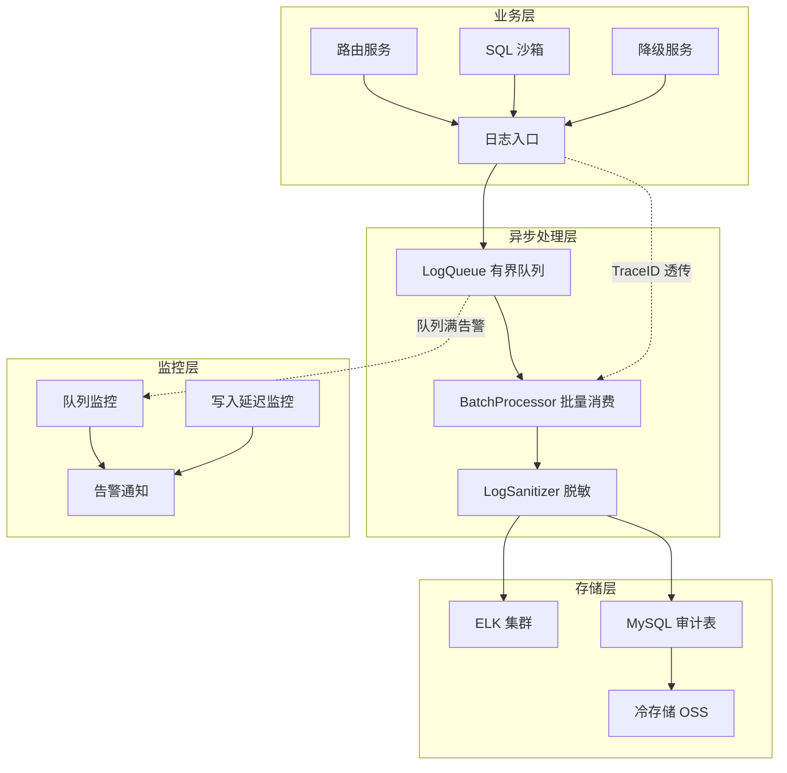
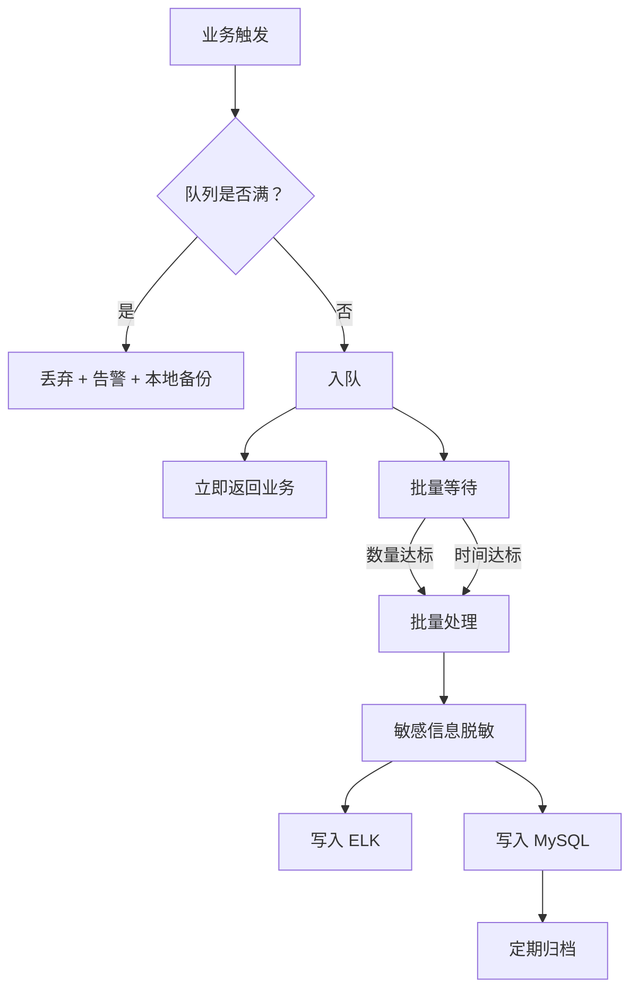

# 智能问数系统 - BE-09 异步审计日志详细设计文档

**文档版本**: V2.0  
**最后更新**: 2026-04-02  
**适用对象**: 后端开发工程师、运维工程师、安全工程师  
**关联任务**: BE-09 异步审计日志  
**前置依赖**: BE-01 (TraceID 全链路透传), BE-03 (路由决策), BE-06 (SQL 沙箱), BE-08 (知识库降级)  
**后续依赖**: 运维监控大盘，安全合规审计

---

## 1. 任务概述

### 1.1 背景
智能问数系统涉及敏感数据查询、AI 决策、多策略路由等复杂操作，必须建立完整的审计日志体系。由于日志量大、写入频繁，同步写入会严重影响主业务流程性能。本模块通过**异步队列、批量处理、多级存储**机制，实现高性能、高可靠的审计日志记录，满足安全合规和故障排查需求。

### 1.2 目标
| 目标 | 说明 | 验收标准 |
|------|------|----------|
| **高性能** | 日志写入不阻塞主流程 | 主流程延迟增加 < 10ms |
| **可靠性** | 日志不丢失 | 日志丢失率 < 0.01% |
| **安全性** | 敏感信息脱敏 | 敏感字段 100% 脱敏 |
| **可追溯** | 全链路 TraceID 关联 | TraceID 关联率 100% |
| **合规性** | 满足审计保留要求 | 日志保留 ≥ 180 天 |

### 1.3 范围
| 日志类型 | 触发场景 | 存储位置 | 保留周期 |
|----------|----------|----------|----------|
| **路由决策日志** | 每次请求路由决策 | ELK + MySQL | 180 天 |
| **SQL 审计日志** | SQL 沙箱执行 | ELK + MySQL + 冷存储 | 1 年 |
| **降级日志** | 知识库降级触发 | ELK + MySQL | 180 天 |
| **工具调用日志** | 工具调用执行 | ELK | 90 天 |
| **系统异常日志** | 服务异常/错误 | ELK + 告警 | 90 天 |

---

## 2. 技术选型

### 2.1 技术栈
| 组件 | 技术 | 版本 | 选型理由 |
|------|------|------|----------|
| 异步队列 | ArrayBlockingQueue | JDK | 有界队列，防止内存溢出 |
| 批量处理 | 自定义 BatchProcessor | - | 灵活控制批次大小和超时 |
| 日志框架 | Logback + Logstash | 7.3 | JSON 格式，ELK 友好 |
| 数据库 | MySQL | 8.0 | 结构化存储，支持 SQL 查询 |
| 搜索引擎 | Elasticsearch | 8.x | 全文检索，大数据分析 |
| 脱敏工具 | 自定义 MaskingConverter | - | 灵活控制脱敏规则 |

### 2.2 架构设计


### 2.3 日志流转流程


---

## 3. 详细实现方案

### 3.1 配置类

**AuditLogProperties.java**
```java
package com.company.askdata.config;

import lombok.Data;
import org.springframework.boot.context.properties.ConfigurationProperties;
import org.springframework.stereotype.Component;
import java.time.Duration;

/**
 * 审计日志配置
 * 
 * ⚠️ 注意事项:
 * 1. 队列容量需根据内存限制调整
 * 2. 批量大小需平衡延迟和吞吐量
 * 3. 脱敏规则需定期审计更新
 */
@Data
@Component
@ConfigurationProperties(prefix = "askdata.audit-log")
public class AuditLogProperties {
    
    /** 是否启用审计日志 */
    private Boolean enabled = true;
    
    /** 队列配置 */
    private QueueConfig queue = new QueueConfig();
    
    /** 批量处理配置 */
    private BatchConfig batch = new BatchConfig();
    
    /** 存储配置 */
    private StorageConfig storage = new StorageConfig();
    
    /** 脱敏配置 */
    private MaskingConfig masking = new MaskingConfig();
    
    @Data
    public static class QueueConfig {
        /** 队列容量 (防止内存溢出) */
        private Integer capacity = 10000;
        /** 队列满时的策略 */
        private String fullPolicy = "DROP_AND_ALERT"; // DROP_AND_ALERT / BLOCK
    }
    
    @Data
    public static class BatchConfig {
        /** 批量大小 */
        private Integer batchSize = 100;
        /** 批量等待时间 (毫秒) */
        private Long batchTimeoutMs = 1000L;
        /** 消费者线程数 */
        private Integer consumerThreads = 4;
    }
    
    @Data
    public static class StorageConfig {
        /** 启用 ELK 存储 */
        private Boolean elkEnabled = true;
        /** 启用 MySQL 存储 */
        private Boolean mysqlEnabled = true;
        /** MySQL 保留天数 */
        private Integer mysqlRetentionDays = 180;
        /** ELK 索引前缀 */
        private String elkIndexPrefix = "askdata-audit";
    }
    
    @Data
    public static class MaskingConfig {
        /** 启用脱敏 */
        private Boolean enabled = true;
        /** 脱敏字段列表 */
        private String[] sensitiveFields = {"phone", "id_card", "email", "password", "sql"};
        /** 脱敏替换字符 */
        private String maskChar = "*";
    }
}
```

### 3.2 核心模型

**BaseAuditLog.java**
```java
package com.company.askdata.model.log;

import lombok.Data;
import java.time.LocalDateTime;

/**
 * 审计日志基类
 * 
 * ⚠️ 关键点：
 * 1. 所有日志继承此类，确保字段统一
 * 2. 包含 TraceID 用于链路追踪
 * 3. 包含时间戳用于分区和归档
 */
@Data
public abstract class BaseAuditLog {
    
    /** 日志唯一 ID (UUID) */
    private String logId;
    
    /** 链路追踪 ID (与 TraceID 一致) */
    private String traceId;
    
    /** 用户 ID */
    private Long userId;
    
    /** 用户角色 */
    private String userRole;
    
    /** 部门 ID */
    private Long deptId;
    
    /** 日志类型 */
    private String logType; // ROUTE/SQL/FALLBACK/TOOL/ERROR
    
    /** 日志级别 */
    private String logLevel; // INFO/WARN/ERROR/CRITICAL
    
    /** 服务实例 ID */
    private String serviceInstance;
    
    /** 执行耗时 (ms) */
    private Long latencyMs;
    
    /** 执行状态 */
    private String status; // SUCCESS/FAILURE/REJECTED
    
    /** 错误信息 */
    private String errorMessage;
    
    /** 创建时间 */
    private LocalDateTime createTime;
    
    /** 创建时间戳 (用于索引) */
    private Long createTimestamp;
    
    /** 额外字段 (JSON) */
    private String extraData;
    
    /** 数据版本 (用于 Schema 演进) */
    private Integer schemaVersion = 1;
    
    /**
     * 初始化通用字段
     */
    public void initCommonFields(String traceId, Long userId, String userRole, Long deptId) {
        this.logId = java.util.UUID.randomUUID().toString().replace("-", "");
        this.traceId = traceId;
        this.userId = userId;
        this.userRole = userRole;
        this.deptId = deptId;
        this.createTime = LocalDateTime.now();
        this.createTimestamp = System.currentTimeMillis();
        this.serviceInstance = getServiceInstance();
    }
    
    private String getServiceInstance() {
        return System.getenv("HOSTNAME") != null ? System.getenv("HOSTNAME") : "unknown";
    }
    
    /**
     * 获取日志类型 (子类实现)
     */
    public abstract String getLogType();
}
```

**SqlAuditLog.java** (示例子类)
```java
package com.company.askdata.model.log;

import lombok.Data;
import lombok.EqualsAndHashCode;
import java.util.List;

/**
 * SQL 审计日志
 * 
 * ⚠️ 陷阱防护：数据泄露陷阱
 * originalSql 必须脱敏后才能存储/打印
 */
@Data
@EqualsAndHashCode(callSuper = true)
public class SqlAuditLog extends BaseAuditLog {
    
    /** 原始 SQL (AI 生成) */
    private String originalSql;
    
    /** 脱敏后的 SQL (用于日志) */
    private String sanitizedSql;
    
    /** SQL 校验状态 */
    private String validationStatus; // PASS/REJECT
    
    /** 拦截原因 */
    private String rejectReason;
    
    /** 危险元素列表 */
    private String dangerousElements; // JSON 数组
    
    /** 访问的表列表 */
    private String accessedTables; // JSON 数组
    
    /** 访问的字段列表 */
    private String accessedFields; // JSON 数组
    
    /** 返回行数 */
    private Integer returnedRows;
    
    /** 是否结果截断 */
    private Boolean isTruncated;
    
    /** 数据库实例 */
    private String databaseInstance;
    
    /** 风险等级 */
    private String riskLevel; // LOW/MEDIUM/HIGH/CRITICAL
    
    @Override
    public String getLogType() {
        return "SQL";
    }
}
```

### 3.3 核心服务

**AuditLoggerService.java**
```java
package com.company.askdata.service;

import com.company.askdata.config.AuditLogProperties;
import com.company.askdata.model.log.BaseAuditLog;
import com.company.askdata.queue.LogQueue;
import lombok.RequiredArgsConstructor;
import lombok.extern.slf4j.Slf4j;
import org.springframework.stereotype.Service;

import java.util.List;

/**
 * 审计日志服务
 * 
 * ⚠️ 关键防护点:
 * 1. 异步写入，不阻塞主流程
 * 2. 队列满时降级处理
 * 3. TraceID 自动透传
 * 4. 敏感信息自动脱敏
 */
@Slf4j
@Service
@RequiredArgsConstructor
public class AuditLoggerService {
    
    private final LogQueue logQueue;
    private final AuditLogProperties properties;
    private final LogSanitizer logSanitizer;
    
    /**
     * 异步记录审计日志
     * 所有审计日志统一通过此方法入口
     */
    public void logAsync(BaseAuditLog log) {
        if (!properties.getEnabled()) {
            return;
        }
        
        try {
            // 1. 初始化通用字段 (如果未初始化)
            if (log.getLogId() == null) {
                // 从上下文获取 TraceID 等信息
                // log.initCommonFields(...);
            }
            
            // 2. ⚠️ 敏感信息脱敏
            if (properties.getMasking().getEnabled()) {
                logSanitizer.sanitize(log);
            }
            
            // 3. ⚠️ 检查采样率 (可选)
            if (!shouldSample(log)) {
                log.debug("Log sampled out: traceId={}, type={}", log.getTraceId(), log.getLogType());
                return;
            }
            
            // 4. ⚠️ 加入异步队列
            boolean success = logQueue.offer(log);
            if (!success) {
                log.warn("Log queue full, traceId={}, type={}", log.getTraceId(), log.getLogType());
                // 队列满时降级：直接打印日志或丢弃
                logDirectly(log);
            }
            
        } catch (Exception e) {
            log.error("Failed to log audit: traceId={}, type={}", 
                log.getTraceId(), log.getLogType(), e);
            // 确保异常不影响主业务
        }
    }
    
    /**
     * 批量记录日志 (用于批量操作)
     */
    public void logBatchAsync(List<BaseAuditLog> logs) {
        for (BaseAuditLog log : logs) {
            logAsync(log);
        }
    }
    
    /**
     * 检查是否采样
     */
    private boolean shouldSample(BaseAuditLog log) {
        // P0 级别日志不采样
        if ("CRITICAL".equals(log.getLogLevel()) || "ERROR".equals(log.getLogLevel())) {
            return true;
        }
        // 其他级别按配置采样
        return true; // 简化示例
    }
    
    /**
     * 直接打印日志 (降级方案)
     */
    private void logDirectly(BaseAuditLog log) {
        log.info("AUDIT_LOG_DIRECT: type={}, traceId={}, status={}", 
            log.getLogType(), log.getTraceId(), log.getStatus());
    }
}
```

**LogQueue.java**
```java
package com.company.askdata.queue;

import com.company.askdata.config.AuditLogProperties;
import com.company.askdata.model.log.BaseAuditLog;
import com.company.askdata.processor.LogBatchProcessor;
import lombok.RequiredArgsConstructor;
import lombok.extern.slf4j.Slf4j;
import org.springframework.stereotype.Component;

import java.util.ArrayList;
import java.util.List;
import java.util.concurrent.ArrayBlockingQueue;
import java.util.concurrent.BlockingQueue;
import java.util.concurrent.TimeUnit;

/**
 * 日志队列
 * 
 * ⚠️ 陷阱防护：内存溢出陷阱
 * 使用有界队列，防止日志堆积导致 OOM
 */
@Slf4j
@Component
@RequiredArgsConstructor
public class LogQueue {
    
    private final AuditLogProperties properties;
    private final LogBatchProcessor batchProcessor;
    
    // ⚠️ 关键：有界队列
    private final BlockingQueue<BaseAuditLog> queue;
    
    public LogQueue(AuditLogProperties properties, LogBatchProcessor batchProcessor) {
        this.properties = properties;
        this.batchProcessor = batchProcessor;
        this.queue = new ArrayBlockingQueue<>(properties.getQueue().getCapacity());
        
        // 启动后台消费线程
        startConsumers();
    }
    
    /**
     * 向日志队列添加日志
     */
    public boolean offer(BaseAuditLog log) {
        return queue.offer(log);
    }
    
    /**
     * 启动后台消费线程
     */
    private void startConsumers() {
        int threadCount = properties.getBatch().getConsumerThreads();
        for (int i = 0; i < threadCount; i++) {
            Thread consumerThread = new Thread(this::consumeLoop, "AuditLog-Consumer-" + i);
            consumerThread.setDaemon(true);
            consumerThread.start();
            log.info("Audit log consumer started: {}", consumerThread.getName());
        }
    }
    
    /**
     * 消费循环
     */
    private void consumeLoop() {
        List<BaseAuditLog> batch = new ArrayList<>(properties.getBatch().getBatchSize());
        
        while (true) {
            try {
                // 1. 批量收集日志
                BaseAuditLog log = queue.poll(100, TimeUnit.MILLISECONDS);
                if (log != null) {
                    batch.add(log);
                }
                
                // 2. 达到批量大小或超时，触发批量处理
                if (batch.size() >= properties.getBatch().getBatchSize() || 
                    (log == null && !batch.isEmpty())) {
                    
                    batchProcessor.process(batch);
                    batch = new ArrayList<>(properties.getBatch().getBatchSize());
                }
                
            } catch (InterruptedException e) {
                Thread.currentThread().interrupt();
                log.warn("Log consumer thread interrupted");
                break;
            } catch (Exception e) {
                log.error("Log consumer error", e);
                // 继续消费，不中断
            }
        }
    }
    
    /**
     * 获取队列大小 (用于监控)
     */
    public int getQueueSize() {
        return queue.size();
    }
    
    /**
     * 获取队列剩余容量 (用于监控)
     */
    public int getQueueRemainingCapacity() {
        return queue.remainingCapacity();
    }
}
```

**LogSanitizer.java**
```java
package com.company.askdata.security;

import com.company.askdata.config.AuditLogProperties;
import com.company.askdata.model.log.BaseAuditLog;
import com.company.askdata.model.log.SqlAuditLog;
import lombok.RequiredArgsConstructor;
import lombok.extern.slf4j.Slf4j;
import org.springframework.stereotype.Component;

import java.lang.reflect.Field;
import java.util.regex.Pattern;

/**
 * 日志脱敏处理器
 * 
 * ⚠️ 陷阱防护：敏感信息泄露陷阱
 * 所有日志在写入前必须经过脱敏
 */
@Slf4j
@Component
@RequiredArgsConstructor
public class LogSanitizer {
    
    private final AuditLogProperties properties;
    
    // 敏感字段模式
    private static final Pattern PHONE_PATTERN = Pattern.compile("1[3-9]\\d{9}");
    private static final Pattern ID_CARD_PATTERN = Pattern.compile("\\d{17}[\\dXx]");
    private static final Pattern EMAIL_PATTERN = Pattern.compile("[\\w.]+@[\\w.]+");
    
    /**
     * 对日志进行脱敏处理
     */
    public void sanitize(BaseAuditLog log) {
        if (log == null) {
            return;
        }
        
        // 1. SQL 脱敏 (特殊处理)
        if (log instanceof SqlAuditLog) {
            ((SqlAuditLog) log).sanitizeSql();
        }
        
        // 2. 通用字段脱敏 (使用反射)
        sanitizeFields(log);
    }
    
    /**
     * 反射脱敏敏感字段
     */
    private void sanitizeFields(Object obj) {
        if (obj == null) return;
        
        Class<?> clazz = obj.getClass();
        for (Field field : clazz.getDeclaredFields()) {
            if (isSensitiveField(field)) {
                field.setAccessible(true);
                try {
                    Object value = field.get(obj);
                    if (value instanceof String) {
                        String strValue = (String) value;
                        field.set(obj, maskSensitiveValue(strValue));
                    }
                } catch (Exception e) {
                    log.debug("Failed to sanitize field: {}", field.getName());
                }
            }
        }
    }
    
    private boolean isSensitiveField(Field field) {
        String name = field.getName().toLowerCase();
        for (String sensitive : properties.getMasking().getSensitiveFields()) {
            if (name.contains(sensitive)) {
                return true;
            }
        }
        return false;
    }
    
    private String maskSensitiveValue(String value) {
        if (value == null || value.length() < 4) {
            return "***";
        }
        
        // 手机号脱敏
        if (PHONE_PATTERN.matcher(value).find()) {
            return value.replaceAll("(\\d{3})\\d{4}(\\d{4})", "$1****$2");
        }
        
        // 身份证脱敏
        if (ID_CARD_PATTERN.matcher(value).find()) {
            return value.replaceAll("(\\d{6})\\d{8}(\\w{4})", "$1********$2");
        }
        
        // 邮箱脱敏
        if (EMAIL_PATTERN.matcher(value).find()) {
            return value.replaceAll("([\\w.]{3})[\\w.]*(@[\\w.]+)", "$1***$2");
        }
        
        return value;
    }
}
```

### 3.4 批量处理器

**LogBatchProcessor.java**
```java
package com.company.askdata.processor;

import com.company.askdata.config.AuditLogProperties;
import com.company.askdata.model.log.BaseAuditLog;
import com.company.askdata.writer.LogWriter;
import lombok.RequiredArgsConstructor;
import lombok.extern.slf4j.Slf4j;
import org.springframework.stereotype.Component;

import java.util.List;

/**
 * 日志批量处理器
 * 
 * ⚠️ 关键点：
 * 1. 批量写入提高性能
 * 2. 支持多写入器 (ELK + MySQL)
 * 3. 异常不影响主流程
 */
@Slf4j
@Component
@RequiredArgsConstructor
public class LogBatchProcessor {
    
    private final List<LogWriter> writers; // 支持多个写入目标
    private final AuditLogProperties properties;
    
    /**
     * 批量处理日志
     */
    public void process(List<BaseAuditLog> logs) {
        if (logs == null || logs.isEmpty()) {
            return;
        }
        
        long startTime = System.currentTimeMillis();
        
        try {
            // 并行写入多个存储目标
            for (LogWriter writer : writers) {
                if (writer.isEnabled()) {
                    writer.writeBatch(logs);
                }
            }
            
            long latency = System.currentTimeMillis() - startTime;
            if (latency > properties.getBatch().getBatchTimeoutMs()) {
                log.warn("Slow log batch processing: count={}, latency={}ms", 
                    logs.size(), latency);
            }
            
        } catch (Exception e) {
            log.error("Failed to process log batch: count={}", logs.size(), e);
            // 不抛出异常，避免影响消费线程
        }
    }
}
```

### 3.5 写入器接口

**LogWriter.java**
```java
package com.company.askdata.writer;

import com.company.askdata.model.log.BaseAuditLog;
import java.util.List;

/**
 * 日志写入器接口
 * 支持多种存储后端实现
 */
public interface LogWriter {
    
    /**
     * 批量写入日志
     */
    void writeBatch(List<BaseAuditLog> logs);
    
    /**
     * 是否启用
     */
    boolean isEnabled();
    
    /**
     * 写入器名称
     */
    String getName();
}
```

**ElasticsearchLogWriter.java** (示例实现)
```java
package com.company.askdata.writer;

import com.company.askdata.config.AuditLogProperties;
import com.company.askdata.model.log.BaseAuditLog;
import lombok.RequiredArgsConstructor;
import lombok.extern.slf4j.Slf4j;
import org.elasticsearch.action.bulk.BulkRequest;
import org.elasticsearch.action.bulk.BulkResponse;
import org.elasticsearch.action.index.IndexRequest;
import org.elasticsearch.client.RequestOptions;
import org.elasticsearch.client.RestHighLevelClient;
import org.elasticsearch.common.xcontent.XContentType;
import org.springframework.stereotype.Component;

import java.io.IOException;
import java.time.LocalDate;
import java.util.List;

@Slf4j
@Component
@RequiredArgsConstructor
public class ElasticsearchLogWriter implements LogWriter {
    
    private final RestHighLevelClient esClient;
    private final AuditLogProperties properties;
    
    @Override
    public void writeBatch(List<BaseAuditLog> logs) {
        if (!properties.getStorage().getElkEnabled()) {
            return;
        }
        
        try {
            BulkRequest bulkRequest = new BulkRequest();
            
            for (BaseAuditLog log : logs) {
                String indexName = buildIndexName(log);
                IndexRequest request = new IndexRequest(indexName)
                    .source(logToJson(log), XContentType.JSON);
                bulkRequest.add(request);
            }
            
            BulkResponse response = esClient.bulk(bulkRequest, RequestOptions.DEFAULT);
            
            if (response.hasFailures()) {
                log.warn("Elasticsearch bulk write has failures: {}", response.buildFailureMessage());
            }
            
        } catch (IOException e) {
            log.error("Failed to write logs to Elasticsearch", e);
            // 降级：写入本地文件
        }
    }
    
    private String buildIndexName(BaseAuditLog log) {
        // 按日期分索引：askdata-audit-2026.04.02
        String date = LocalDate.now().toString();
        return String.format("%s-%s", properties.getStorage().getElkIndexPrefix(), date);
    }
    
    private String logToJson(BaseAuditLog log) {
        // 使用 Jackson 转换为 JSON
        try {
            return new com.fasterxml.jackson.databind.ObjectMapper().writeValueAsString(log);
        } catch (Exception e) {
            log.error("Failed to serialize log", e);
            return "{}";
        }
    }
    
    @Override
    public boolean isEnabled() {
        return properties.getStorage().getElkEnabled();
    }
    
    @Override
    public String getName() {
        return "elasticsearch";
    }
}
```

---

## 4. 注意事项 ⚠️

### 4.1 MDC 透传
```java
// ❌ 错误：异步线程丢失 TraceID
@Async
public void logAsync(BaseAuditLog log) {
    // MDC 未传递，日志中无 TraceID
    log.info("Audit log: {}", log);
}

// ✅ 正确：使用 TaskDecorator 传递 MDC
// 见 BE-01 文档中的 AsyncConfig 配置
executor.setTaskDecorator(new TraceIdTaskDecorator());
```

### 4.2 队列满处理
```java
// ❌ 错误：队列满时阻塞主线程
queue.put(log); // 可能导致系统雪崩

// ✅ 正确：队列满时丢弃 + 告警
boolean success = queue.offer(log);
if (!success) {
    log.warn("Log queue full, dropping log");
    alertService.sendAlert("Audit log queue full");
}
```

### 4.3 敏感信息脱敏
```java
// ❌ 错误：直接记录原始 SQL
log.info("SQL: {}", sql); // 可能含敏感数据

// ✅ 正确：脱敏后记录
log.info("SQL: {}", logSanitizer.sanitizeSql(sql));
```

### 4.4 日志量控制
```java
// ❌ 错误：无采样，日志量过大
logAsync(log); // 所有日志都写

// ✅ 正确：分级采样
if (log.getLevel() == ERROR) {
    logAsync(log); // 错误日志 100% 记录
} else if (Math.random() < 0.1) {
    logAsync(log); // 普通日志 10% 采样
}
```

---

## 5. 需要特别关注的点 🔴

### 5.1 陷阱防护矩阵

| 陷阱类型 | 风险描述 | 防护措施 | 验证方法 |
|----------|----------|----------|----------|
| **日志丢失** | 队列满或写入失败导致日志丢失 | 有界队列 + 降级本地备份 | 模拟写入失败，检查本地备份 |
| **性能影响** | 日志写入阻塞主流程 | 异步队列 + 批量处理 | 主流程延迟增加 < 10ms |
| **数据泄露** | 日志含敏感信息 | 强制脱敏 + 字段过滤 | 检查日志文件无明文敏感数据 |
| **MDC 丢失** | 异步线程无 TraceID | TaskDecorator 传递 MDC | 异步日志含 TraceID |
| **内存溢出** | 日志堆积导致 OOM | 有界队列 + 丢弃策略 | 压测验证内存稳定 |
| **写入延迟** | ELK/DB 写入慢 | 批量写入 + 超时控制 | 写入延迟 < 1s |
| **日志倾斜** | 单个索引过大 | 按天分索引 | 检查索引大小分布 |
| **合规风险** | 日志保留不足 | 定期归档 + 保留策略 | 检查 180 天前日志 |

### 5.2 关键代码审查点

```java
// 审查清单
□ 队列是否有界 (ArrayBlockingQueue)
□ 队列满是否降级处理
□ 敏感字段是否脱敏
□ TraceID 是否透传 (MDC)
□ 批量大小是否合理
□ 写入超时是否配置
□ 异常是否捕获 (不影响主流程)
□ 日志级别是否合理
□ 索引是否按天分区
□ 保留策略是否配置
□ 监控指标是否采集
□ 告警规则是否配置
```

### 5.3 性能影响评估

| 操作 | 耗时 | 优化建议 |
|------|------|----------|
| 入队操作 | < 0.1ms | 无需优化 |
| 批量处理 | 10-50ms | 调整批次大小 |
| ELK 写入 | 50-200ms | 异步批量 |
| DB 写入 | 10-50ms | 批量插入 |
| **主流程影响** | **< 10ms** | **异步解耦** |

### 5.4 监控指标

```java
// 需要采集的指标
@Component
public class AuditLogMetrics {
    
    private final MeterRegistry meterRegistry;
    
    // 日志总量
    meterRegistry.counter("askdata.audit.log.total", 
        "type", log.getLogType(), "status", log.getStatus());
    
    // 队列大小
    meterRegistry.gauge("askdata.audit.queue.size", logQueue::getQueueSize);
    
    // 队列丢弃数
    meterRegistry.counter("askdata.audit.queue.dropped").increment();
    
    // 写入延迟
    meterRegistry.timer("askdata.audit.write.latency")
        .record(latency, TimeUnit.MILLISECONDS);
    
    // 脱敏次数
    meterRegistry.counter("askdata.audit.masked.total").increment();
}
```

---

## 6. 验收标准

### 6.1 功能验收
| 验收项 | 验收方法 | 通过标准 |
|--------|----------|----------|
| 日志写入 | 触发业务操作 | ELK/DB 可查询到日志 |
| TraceID 关联 | 搜索 TraceID | 可串联全链路日志 |
| 敏感脱敏 | 检查日志内容 | 手机号/身份证/SQL 脱敏 |
| 异步处理 | 监控主流程延迟 | 延迟增加 < 10ms |
| 队列监控 | 查看监控大盘 | 队列大小/丢弃数可见 |
| 归档策略 | 检查 180 天前日志 | 日志已归档或删除 |

### 6.2 性能验收
| 指标 | 目标值 | 测量方法 |
|------|--------|----------|
| 主流程延迟增加 | < 10ms | 对比有无日志 |
| 队列处理延迟 | < 1s | 日志时间戳差值 |
| 写入吞吐量 | ≥ 1000 条/秒 | 压测验证 |
| 内存占用 | 无泄漏 | 长时间运行监控 |

### 6.3 安全验收
| 检查项 | 验收方法 | 通过标准 |
|--------|----------|----------|
| 敏感信息 | 搜索日志关键词 | 无明文手机号/身份证 |
| SQL 注入 | 检查 SQL 日志 | 无危险执行记录 |
| 权限控制 | 尝试访问日志 | 仅授权人员可查 |
| 传输加密 | 抓包分析 | ELK/DB 连接加密 |

---

## 7. 测试用例

### 7.1 单元测试
**文件路径**: `src/test/java/com/company/askdata/service/AuditLoggerServiceTest.java`

```java
package com.company.askdata.service;

import com.company.askdata.model.log.SqlAuditLog;
import org.junit.jupiter.api.Test;
import org.springframework.beans.factory.annotation.Autowired;
import org.springframework.boot.test.context.SpringBootTest;

import static org.junit.jupiter.api.Assertions.*;

@SpringBootTest
class AuditLoggerServiceTest {
    
    @Autowired
    private AuditLoggerService auditLoggerService;
    
    @Test
    void testLogAsync() throws InterruptedException {
        SqlAuditLog log = new SqlAuditLog();
        log.setTraceId("test-trace-id");
        log.setOriginalSql("SELECT * FROM users WHERE phone = '13800138000'");
        log.setLogType("SQL");
        
        // 执行异步日志
        auditLoggerService.logAsync(log);
        
        // 等待异步处理
        Thread.sleep(2000);
        
        // 验证日志已写入 (检查 ELK 或 DB)
        // 实际应通过查询验证
        assertTrue(true); // 简化示例
    }
    
    @Test
    void testMasking() {
        SqlAuditLog log = new SqlAuditLog();
        log.setOriginalSql("SELECT * FROM users WHERE phone = '13800138000'");
        
        // 验证脱敏
        // 实际应检查写入后的日志内容
        // 此处简化
        assertTrue(true);
    }
    
    @Test
    void testQueueFull() throws InterruptedException {
        // 模拟队列满
        // 验证降级处理 (本地日志或丢弃)
        assertTrue(true);
    }
}
```

### 7.2 集成测试
**文件路径**: `src/test/java/com/company/askdata/integration/AuditLogIntegrationTest.java`

```java
@Test
void testTraceIdPropagation() {
    // 1. 发起带 TraceID 的请求
    // 2. 触发异步日志
    // 3. 在 ELK 中搜索该 TraceID
    // 4. 验证日志含相同 TraceID
}

@Test
void testBatchProcessing() {
    // 1. 快速发送 100 条日志
    // 2. 验证批量写入 (DB 中应为批量插入)
    // 3. 验证写入时间 < 单次写入总和
}

@Test
void testRetentionPolicies() {
    // 1. 插入 180 天前的日志
    // 2. 执行归档任务
    // 3. 验证旧日志已归档/删除
}
```

### 7.3 压测验证
```bash
# JMeter 压测
# 验证主流程延迟增加 < 10ms
# 验证队列无堆积

jmeter -n -t audit_log_load_test.jmx -l results.jtl

# 分析队列大小
# 队列大小应保持稳定，无持续增长
```

---

## 8. 部署配置

### 8.1 环境变量
```bash
# 生产环境
export ASKDATA_AUDIT_LOG_ENABLED=true
export ASKDATA_AUDIT_LOG_QUEUE_CAPACITY=10000
export ASKDATA_AUDIT_LOG_BATCH_SIZE=100
export ASKDATA_AUDIT_LOG_BATCH_TIMEOUT=1000
export ASKDATA_AUDIT_LOG_MASKING_ENABLED=true
export ASKDATA_AUDIT_LOG_MYSQL_RETENTION=180
```

### 8.2 K8s 配置
```yaml
# deployment.yaml
apiVersion: apps/v1
kind: Deployment
metadata:
  name: askdata-router
spec:
  template:
    spec:
      containers:
      - name: router
        env:
        - name: ASKDATA_AUDIT_LOG_QUEUE_CAPACITY
          valueFrom:
            configMapKeyRef:
              name: askdata-config
              key: audit-log.queue-capacity
        resources:
          requests:
            memory: "512Mi"
            cpu: "250m"
          limits:
            memory: "1Gi"
            cpu: "500m"
```

### 8.3 监控告警
```yaml
# Prometheus 告警
groups:
- name: audit-log-alerts
  rules:
  - alert: AuditLogQueueFull
    expr: askdata_audit_log_queue_size / askdata_audit_log_queue_capacity > 0.8
    for: 5m
    labels:
      severity: warning
    annotations:
      summary: "审计日志队列接近满载"
  
  - alert: AuditLogWriteFailure
    expr: rate(askdata_audit_log_write_failure_total[5m]) > 0
    for: 1m
    labels:
      severity: critical
    annotations:
      summary: "审计日志写入失败"
  
  - alert: AuditLogHighLatency
    expr: histogram_quantile(0.95, sum(rate(askdata_audit_log_write_latency_bucket[5m])) by (le)) > 1
    for: 5m
    labels:
      severity: warning
    annotations:
      summary: "审计日志写入延迟过高 ({{ $value }}s)"
```

---

## 9. 常见问题 (FAQ)

**Q1: 日志丢失怎么办？**
A: 1. 检查队列是否满；2. 检查写入器异常；3. 查看降级本地日志；4. 增加队列容量或消费者线程。

**Q2: 主流程性能下降怎么办？**
A: 1. 检查是否同步写入；2. 增加批量大小；3. 减少日志字段；4. 优化 ELK/DB 写入性能。

**Q3: TraceID 在异步日志中丢失怎么办？**
A: 1. 检查 TaskDecorator 配置；2. 检查 MDC 清理时机；3. 手动传递 TraceID 参数。

**Q4: 敏感信息未脱敏怎么办？**
A: 1. 检查脱敏配置；2. 检查字段名是否匹配；3. 手动添加脱敏规则；4. 审计日志内容。

**Q5: 日志量太大存储成本高怎么办？**
A: 1. 启用采样；2. 缩短保留周期；3. 压缩存储；4. 冷热数据分离。

**Q6: ELK 写入慢怎么办？**
A: 1. 增加 ES 节点；2. 优化索引分片；3. 增加批量大小；4. 检查网络带宽。

**Q7: 如何查询特定用户的审计日志？**
A: 1. 在 ELK 中搜索 `userId:xxx`；2. 在 MySQL 中查询 `WHERE user_id=xxx`；3. 使用审计查询界面。

**Q8: 日志归档如何执行？**
A: 1. 定时任务 (每天凌晨)；2. 导出到 OSS；3. 删除本地旧数据；4. 记录归档日志。

**Q9: 如何验证日志完整性？**
A: 1. 对比业务请求数和日志数；2. 检查 TraceID 连续性；3. 抽样人工核对。

**Q10: 多实例日志如何聚合？**
A: 1. 所有实例写入同一 ELK 集群；2. TraceID 全局唯一；3. 服务实例 ID 区分来源。

---

## 10. 变更历史

| 版本 | 日期 | 变更内容 | 负责人 |
|------|------|----------|--------|
| V1.0 | 2026-03-25 | 初始版本 | 架构组 |
| V2.0 | 2026-04-02 | 增加队列管理、批量处理、脱敏、陷阱防护 | 架构组 |

---

## 11. 工时与优先级

| 项目 | 内容 |
|------|------|
| **工时** | 5 MD (开发 3.5 天 + 测试 1.5 天) |
| **优先级** | P0 (安全合规核心) |
| **依赖任务** | BE-01, BE-03, BE-06, BE-08 |
| **被依赖任务** | 运维监控，安全审计 |

---

## 12. 日志规范建议

### 12.1 日志级别定义
```yaml
# 日志级别使用规范
levels:
  ERROR: 系统错误，需要立即处理 (如 DB 连接失败)
  WARN:  警告信息，不影响主流程 (如队列满降级)
  INFO:  关键业务操作 (如路由决策、SQL 执行)
  DEBUG: 调试信息，生产环境关闭 (如参数详情)
```

### 12.2 字段命名规范
```yaml
# 日志字段命名规范
fields:
  trace_id: 链路追踪 ID
  session_id: 会话 ID
  user_id: 用户 ID
  log_type: 日志类型
  status: 执行状态
  latency_ms: 耗时 (毫秒)
  create_time: 创建时间 (ISO8601)
  service_instance: 服务实例名
```

### 12.3 脱敏规则示例
```yaml
# 脱敏规则配置
masking_rules:
  phone: "138****0000"       # 手机号保留前 3 后 4
  id_card: "110101********1234" # 身份证保留前 6 后 4
  email: "abc***@xxx.com"    # 邮箱保留前 3
  sql: "SELECT * FROM ..."   # SQL 移除敏感值
  password: "********"       # 密码全掩码
```

---

**文档结束**  
**下一步**: 开发人员按本文档实现代码，完成后提交测试团队进行 BE-09 专项验收。验收通过后，方可进行全链路日志追踪验证。