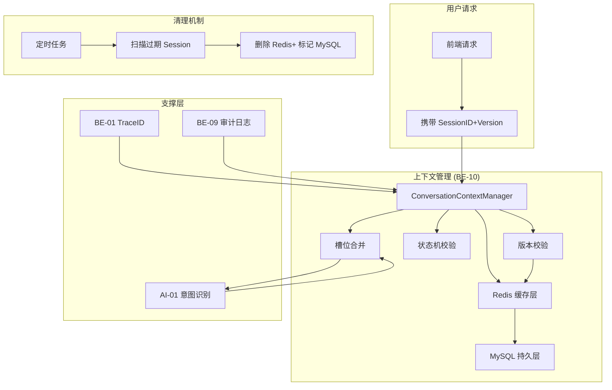
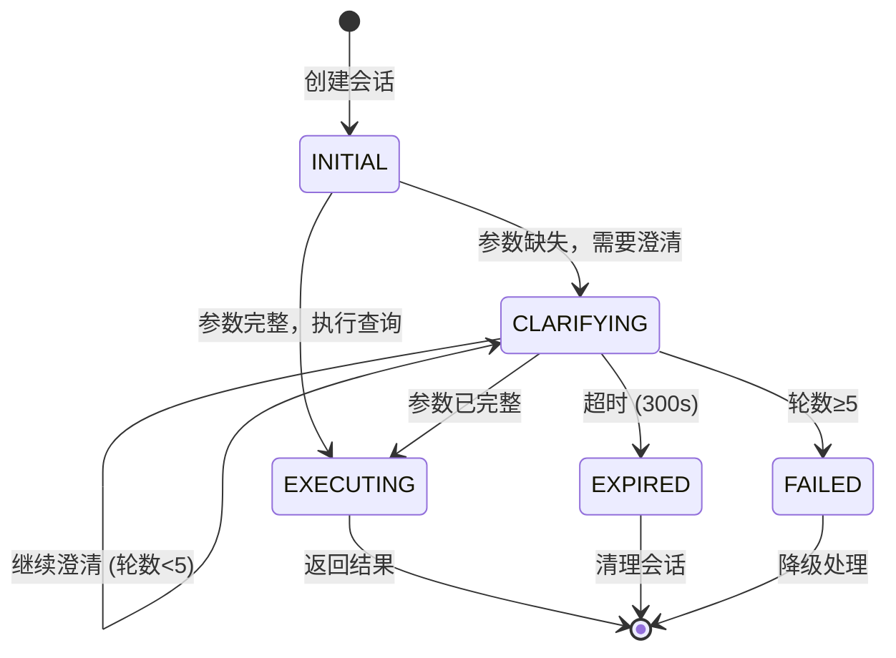

# 智能问数系统 - BE-10 多轮对话上下文管理详细设计文档

**文档版本**: V2.0  
**最后更新**: 2026-04-02  
**适用对象**: 后端开发工程师、架构师  
**关联任务**: BE-10 多轮对话上下文管理  
**前置依赖**: BE-01 (TraceID), BE-03 (路由决策), AI-01 (智能体创建)  
**后续依赖**: FE-04 (澄清对话框), QA-01 (集成测试)

---

## 1. 任务概述

### 1.1 背景
智能问数系统支持多轮对话澄清，当用户首次提问信息不完整时，系统需要记住已确认的参数（如"指标= 销售额"），并在后续对话中继承（如用户补充"华东区"）。上下文管理模块负责维护对话状态、槽位填充、轮数控制、超时清理，确保多轮对话流畅、准确、安全。

### 1.2 目标
| 目标 | 说明 | 验收标准 |
|------|------|----------|
| **状态一致性** | 前后端状态同步 | 并发冲突率 < 0.1% |
| **准确性** | 槽位填充准确 | 参数继承准确率 ≥ 95% |
| **性能** | 上下文读写快 | P95 < 50ms |
| **安全性** | 敏感信息不泄露 | 上下文脱敏 100% |
| **可靠性** | 超时自动清理 | 过期会话清理率 100% |

### 1.3 范围
| 功能 | 说明 | 风险等级 |
|------|------|----------|
| 会话管理 | 创建/获取/销毁会话 | 🟡 中 |
| 上下文存储 | 已确认参数存储 | 🟡 中 |
| 对话历史 | 最近 N 轮对话记录 | 🟢 低 |
| 槽位填充 | 参数合并与校验 | 🟡 中 |
| 状态机 | 对话状态流转控制 | 🟡 中 |
| 超时清理 | 会话过期自动清理 | 🟢 低 |
| 版本控制 | 乐观锁防并发冲突 | 🔴 高 |

---

## 2. 技术选型

### 2.1 技术栈
| 组件 | 技术 | 版本 | 选型理由 |
|------|------|------|----------|
| 会话存储 | Redis | 7.0 | 高性能，支持 TTL |
| 持久化 | MySQL | 8.0 | 审计追溯，长期存储 |
| 缓存框架 | Spring Cache | - | 统一缓存抽象 |
| 并发控制 | 乐观锁 (Version) | - | 防止状态覆盖 |
| 清理任务 | Spring Schedule | - | 定时清理过期会话 |

### 2.2 架构设计


### 2.3 会话状态机


---

## 3. 详细实现方案

### 3.1 配置类

**ConversationProperties.java**
```java
package com.company.askdata.config;

import lombok.Data;
import org.springframework.boot.context.properties.ConfigurationProperties;
import org.springframework.stereotype.Component;
import java.time.Duration;

/**
 * 对话上下文配置
 * 
 * ⚠️ 注意事项:
 * 1. 超时时间需平衡用户体验和资源占用
 * 2. 最大轮数防止无限澄清
 * 3. 缓存 TTL 需与数据库清理策略一致
 */
@Data
@Component
@ConfigurationProperties(prefix = "askdata.conversation")
public class ConversationProperties {
    
    /** 会话管理配置 */
    private SessionConfig session = new SessionConfig();
    
    /** 澄清配置 */
    private ClarifyConfig clarify = new ClarifyConfig();
    
    /** 缓存配置 */
    private CacheConfig cache = new CacheConfig();
    
    @Data
    public static class SessionConfig {
        /** 会话超时时间 */
        private Duration timeout = Duration.ofSeconds(300); // 5 分钟
        /** 会话最大存活时间 */
        private Duration maxLifetime = Duration.ofHours(24);
        /** 清理任务cron 表达式 */
        private String cleanupCron = "0 */10 * * * ?"; // 每 10 分钟
    }
    
    @Data
    public static class ClarifyConfig {
        /** 最大澄清轮数 */
        private Integer maxTurns = 5;
        /** 警告轮数 */
        private Integer warningTurns = 4;
        /** 警告提示语 */
        private String warningMessage = "问题比较复杂，这是最后一次确认";
    }
    
    @Data
    public static class CacheConfig {
        /** 启用本地缓存 */
        private Boolean localCacheEnabled = true;
        /** 本地缓存 TTL */
        private Duration localCacheTtl = Duration.ofMinutes(5);
        /** Redis Key 前缀 */
        private String redisKeyPrefix = "askdata:session:";
    }
}
```

### 3.2 核心模型

**ConversationSession.java**
```java
package com.company.askdata.entity;

import lombok.Data;
import java.time.LocalDateTime;
import java.util.List;
import java.util.Map;
import java.util.concurrent.ConcurrentHashMap;

/**
 * 对话会话实体
 * 
 * ⚠️ 关键点：
 * 1. version 字段用于乐观锁，防止并发覆盖
 * 2. confirmedContext 存储已确认参数
 * 3. dialogueHistory 存储最近 N 轮对话
 */
@Data
public class ConversationSession {
    
    /** 会话 ID (UUID) */
    private String sessionId;
    
    /** 用户 ID */
    private Long userId;
    
    /** 部门 ID */
    private Long deptId;
    
    /** ⚠️ 版本号 (乐观锁) */
    private Long version = 0L;
    
    /** 对话状态 */
    private ConversationStatus status = ConversationStatus.INITIAL;
    
    /** 当前所在页面 */
    private String currentPage;
    
    /** ⚠️ 已确认的上下文参数 (线程安全) */
    private Map<String, Object> confirmedContext = new ConcurrentHashMap<>();
    
    /** 缺失的槽位列表 */
    private List<String> missingSlots;
    
    /** ⚠️ 对话历史 (最近 N 轮) */
    private List<DialogueTurn> dialogueHistory;
    
    /** 当前澄清轮数 */
    private Integer currentTurnCount = 0;
    
    /** 最大澄清轮数 */
    private Integer maxTurnCount = 5;
    
    /** 创建时间 */
    private LocalDateTime createTime;
    
    /** ⚠️ 最后活跃时间 (用于超时清理) */
    private LocalDateTime lastActiveTime;
    
    /** 是否超时 */
    private Boolean isTimeout = false;
    
    /** 超时时间 (秒) */
    private Integer timeoutSeconds = 300;
    
    /**
     * 检查是否超时
     */
    public boolean checkTimeout() {
        if (lastActiveTime == null) {
            return false;
        }
        long elapsedSeconds = java.time.Duration.between(lastActiveTime, LocalDateTime.now()).getSeconds();
        this.isTimeout = elapsedSeconds > timeoutSeconds;
        return this.isTimeout;
    }
    
    /**
     * 更新活跃时间
     */
    public void touch() {
        this.lastActiveTime = LocalDateTime.now();
    }
    
    /**
     * 增加对话轮数
     */
    public void incrementTurn() {
        this.currentTurnCount++;
        this.touch();
    }
    
    /**
     * 检查是否超过最大轮数
     */
    public boolean isMaxTurnsReached() {
        return this.currentTurnCount >= this.maxTurnCount;
    }
    
    /**
     * ⚠️ 更新上下文参数 (带版本检查)
     */
    public void updateContext(Map<String, Object> newParams, Long expectedVersion) {
        if (!this.version.equals(expectedVersion)) {
            throw new ConcurrentModificationException("Session version mismatch");
        }
        if (newParams != null) {
            this.confirmedContext.putAll(newParams);
        }
        this.version++; // 版本号 +1
        this.touch();
    }
    
    /**
     * 添加对话历史
     */
    public void addDialogueTurn(DialogueTurn turn) {
        if (this.dialogueHistory == null) {
            this.dialogueHistory = new java.util.ArrayList<>();
        }
        this.dialogueHistory.add(turn);
        // 只保留最近 10 轮
        if (this.dialogueHistory.size() > 10) {
            this.dialogueHistory.remove(0);
        }
        this.touch();
    }
    
    public enum ConversationStatus {
        INITIAL, CLARIFYING, EXECUTING, COMPLETED, FAILED, EXPIRED
    }
}
```

**DialogueTurn.java**
```java
package com.company.askdata.entity;

import lombok.Data;
import java.time.LocalDateTime;
import java.util.Map;

/**
 * 单轮对话实体
 */
@Data
public class DialogueTurn {
    
    /** 轮次序号 */
    private Integer turnNumber;
    
    /** 用户提问 */
    private String userQuery;
    
    /** AI 回复 */
    private String aiResponse;
    
    /** 意图识别结果 */
    private Object intentResult;
    
    /** 提取的参数 */
    private Map<String, Object> extractedParams;
    
    /** 是否需要澄清 */
    private Boolean needClarify;
    
    /** 澄清问题 */
    private String clarifyQuestion;
    
    /** 澄清选项 */
    private List<String> clarifyOptions;
    
    /** 创建时间 */
    private LocalDateTime createTime;
    
    /** 耗时 (ms) */
    private Long latencyMs;
}
```

### 3.3 核心服务

**ConversationContextManager.java**
```java
package com.company.askdata.service;

import com.company.askdata.config.ConversationProperties;
import com.company.askdata.entity.ConversationSession;
import com.company.askdata.entity.DialogueTurn;
import com.company.askdata.repository.ConversationSessionRepository;
import com.company.askdata.utils.TraceIdUtil;
import lombok.RequiredArgsConstructor;
import lombok.extern.slf4j.Slf4j;
import org.springframework.cache.annotation.Cacheable;
import org.springframework.cache.annotation.CacheEvict;
import org.springframework.stereotype.Service;
import org.springframework.transaction.annotation.Transactional;

import java.util.Map;
import java.util.Optional;

/**
 * 对话上下文管理器
 * 
 * ⚠️ 关键防护点:
 * 1. 版本控制防止并发冲突
 * 2. 超时检查防止僵尸会话
 * 3. 敏感信息脱敏
 * 4. 异步清理过期会话
 */
@Slf4j
@Service
@RequiredArgsConstructor
public class ConversationContextManager {
    
    private final ConversationSessionRepository sessionRepository;
    private final ConversationProperties properties;
    private final ContextSanitizer contextSanitizer;
    
    /**
     * 创建或获取会话
     * 
     * @param sessionId 会话 ID
     * @param userId 用户 ID
     * @return 会话对象
     */
    @Cacheable(value = "conversation:session", key = "#sessionId", unless = "#result == null")
    public ConversationSession getOrCreateSession(String sessionId, Long userId, Long deptId) {
        Optional<ConversationSession> existing = sessionRepository.findBySessionId(sessionId);
        
        if (existing.isPresent()) {
            ConversationSession session = existing.get();
            
            // ⚠️ 检查是否超时
            if (session.checkTimeout()) {
                log.info("Session expired: sessionId={}, userId={}", sessionId, userId);
                session.setStatus(ConversationSession.ConversationStatus.EXPIRED);
                sessionRepository.save(session);
                // 创建新会话
                return createNewSession(sessionId, userId, deptId);
            }
            
            // 更新活跃时间
            session.touch();
            sessionRepository.save(session);
            return session;
            
        } else {
            return createNewSession(sessionId, userId, deptId);
        }
    }
    
    /**
     * 更新会话状态
     */
    @CacheEvict(value = "conversation:session", key = "#session.sessionId")
    @Transactional
    public ConversationSession updateSessionStatus(ConversationSession session, 
                                                   ConversationSession.ConversationStatus status) {
        session.setStatus(status);
        session.touch();
        session.setVersion(session.getVersion() + 1); // 版本号 +1
        return sessionRepository.save(session);
    }
    
    /**
     * ⚠️ 更新上下文参数 (带版本校验)
     */
    @CacheEvict(value = "conversation:session", key = "#session.sessionId")
    @Transactional
    public ConversationSession updateContext(ConversationSession session, 
                                             Map<String, Object> newParams,
                                             Long clientVersion) {
        // ⚠️ 关键：版本校验，防止并发覆盖
        if (!session.getVersion().equals(clientVersion)) {
            log.warn("Session version conflict: sessionId={}, client={}, server={}", 
                session.getSessionId(), clientVersion, session.getVersion());
            throw new ConcurrentModificationException("会话状态已变更，请刷新后重试");
        }
        
        // ⚠️ 敏感信息脱敏
        if (contextSanitizer != null) {
            newParams = contextSanitizer.sanitize(newParams);
        }
        
        session.updateContext(newParams, clientVersion);
        session.touch();
        return sessionRepository.save(session);
    }
    
    /**
     * 添加对话轮次
     */
    @CacheEvict(value = "conversation:session", key = "#session.sessionId")
    @Transactional
    public ConversationSession addDialogueTurn(ConversationSession session, DialogueTurn turn) {
        session.incrementTurn();
        session.addDialogueTurn(turn);
        session.setVersion(session.getVersion() + 1);
        return sessionRepository.save(session);
    }
    
    /**
     * 清理过期会话 (定时任务调用)
     */
    @Transactional
    public int cleanupExpiredSessions() {
        LocalDateTime threshold = LocalDateTime.now().minus(properties.getSession().getTimeout());
        int count = sessionRepository.deleteByStatusAndLastActiveTimeBefore(
            ConversationSession.ConversationStatus.EXPIRED,
            threshold
        );
        log.info("Cleaned up {} expired sessions", count);
        return count;
    }
    
    /**
     * 删除会话 (用户主动结束)
     */
    @CacheEvict(value = "conversation:session", key = "#sessionId")
    @Transactional
    public void deleteSession(String sessionId) {
        sessionRepository.deleteBySessionId(sessionId);
        log.info("Session deleted: sessionId={}", sessionId);
    }
    
    private ConversationSession createNewSession(String sessionId, Long userId, Long deptId) {
        ConversationSession session = new ConversationSession();
        session.setSessionId(sessionId);
        session.setUserId(userId);
        session.setDeptId(deptId);
        session.setStatus(ConversationSession.ConversationStatus.INITIAL);
        session.setVersion(0L);
        session.setCreateTime(LocalDateTime.now());
        session.setLastActiveTime(LocalDateTime.now());
        session.setTimeoutSeconds((int) properties.getSession().getTimeout().getSeconds());
        
        sessionRepository.save(session);
        log.info("New session created: sessionId={}, userId={}", sessionId, userId);
        return session;
    }
}
```

### 3.4 上下文脱敏器

**ContextSanitizer.java**
```java
package com.company.askdata.security;

import lombok.extern.slf4j.Slf4j;
import org.springframework.stereotype.Component;
import java.util.Map;
import java.util.regex.Pattern;

/**
 * 上下文脱敏器
 * 
 * ⚠️ 陷阱防护：敏感信息泄露陷阱
 * 会话上下文中可能包含用户输入的敏感信息，需脱敏存储
 */
@Slf4j
@Component
public class ContextSanitizer {
    
    private static final Pattern PHONE_PATTERN = Pattern.compile("1[3-9]\\d{9}");
    private static final Pattern ID_CARD_PATTERN = Pattern.compile("\\d{17}[\\dXx]");
    
    /**
     * 脱敏上下文参数
     */
    public Map<String, Object> sanitize(Map<String, Object> params) {
        if (params == null) return params;
        
        for (Map.Entry<String, Object> entry : params.entrySet()) {
            if (entry.getValue() instanceof String) {
                String value = (String) entry.getValue();
                entry.setValue(maskSensitiveValue(value));
            }
        }
        return params;
    }
    
    private String maskSensitiveValue(String value) {
        if (value == null || value.length() < 4) {
            return "***";
        }
        
        if (PHONE_PATTERN.matcher(value).find()) {
            return value.replaceAll("(\\d{3})\\d{4}(\\d{4})", "$1****$2");
        }
        
        if (ID_CARD_PATTERN.matcher(value).find()) {
            return value.replaceAll("(\\d{6})\\d{8}(\\w{4})", "$1********$2");
        }
        
        return value;
    }
}
```

### 3.5 清理定时任务

**SessionCleanupScheduler.java**
```java
package com.company.askdata.scheduler;

import com.company.askdata.service.ConversationContextManager;
import lombok.RequiredArgsConstructor;
import lombok.extern.slf4j.Slf4j;
import org.springframework.scheduling.annotation.Scheduled;
import org.springframework.stereotype.Component;

/**
 * 会话清理调度器
 * 
 * ⚠️ 关键点：
 * 1. 异步执行，不阻塞主流程
 * 2. 记录清理日志用于审计
 */
@Slf4j
@Component
@RequiredArgsConstructor
public class SessionCleanupScheduler {
    
    private final ConversationContextManager contextManager;
    
    /**
     * 每 10 分钟清理一次过期会话
     */
    @Scheduled(cron = "${askdata.conversation.session.cleanup-cron}")
    public void cleanupExpiredSessions() {
        try {
            int count = contextManager.cleanupExpiredSessions();
            log.info("Scheduled cleanup completed: {} sessions removed", count);
        } catch (Exception e) {
            log.error("Scheduled cleanup failed", e);
            // 不抛出异常，避免影响下次调度
        }
    }
    
    /**
     * 每天凌晨清理历史会话 (保留 7 天)
     */
    @Scheduled(cron = "0 0 2 * * ?")
    public void cleanupHistoricalSessions() {
        try {
            // 实现历史会话清理逻辑
            log.info("Historical cleanup completed");
        } catch (Exception e) {
            log.error("Historical cleanup failed", e);
        }
    }
}
```

---

## 4. 注意事项 ⚠️

### 4.1 并发控制
```java
// ❌ 错误：无版本检查直接更新
public void updateContext(Session session, Map params) {
    session.getContext().putAll(params);
    repository.save(session); // 可能覆盖其他请求的修改
}

// ✅ 正确：乐观锁版本检查
public void updateContext(Session session, Map params, Long clientVersion) {
    if (!session.getVersion().equals(clientVersion)) {
        throw new ConcurrentModificationException("Version conflict");
    }
    session.getContext().putAll(params);
    session.setVersion(session.getVersion() + 1); // 版本号 +1
    repository.save(session);
}
```

### 4.2 内存管理
```java
// ❌ 错误：无限制存储对话历史
session.getHistory().add(turn); // 可能无限增长导致 OOM

// ✅ 正确：限制历史轮数
if (session.getHistory().size() > 10) {
    session.getHistory().remove(0); // 移除最早的一轮
}
session.getHistory().add(turn);
```

### 4.3 超时清理
```java
// ❌ 错误：仅依赖 Redis TTL
// Redis 过期后无法记录审计日志

// ✅ 正确：Redis+MySQL+ 定时任务
// 1. Redis 设置 TTL
// 2. MySQL 记录 lastActiveTime
// 3. 定时任务扫描 MySQL 清理并记录审计日志
```

### 4.4 敏感信息
```java
// ❌ 错误：明文存储用户输入
context.put("query", "我的手机号是 13800138000");

// ✅ 正确：脱敏后存储
context.put("query", contextSanitizer.sanitize("我的手机号是 13800138000"));
```

---

## 5. 需要特别关注的点 🔴

### 5.1 陷阱防护矩阵

| 陷阱类型 | 风险描述 | 防护措施 | 验证方法 |
|----------|----------|----------|----------|
| **状态不一致** | 并发请求导致状态覆盖 | 乐观锁 (Version 字段) | 并发测试，版本冲突被拦截 |
| **上下文溢出** | 对话历史无限增长 | 限制历史轮数 (10 轮) | 长时间对话内存稳定 |
| **内存泄漏** | 会话未清理导致 OOM | Redis TTL+ 定时任务 | 长时间运行内存无增长 |
| **敏感泄露** | 上下文含手机号/身份证 | 上下文脱敏器 | 检查 DB/Redis 无明文 |
| **僵尸会话** | 超时会话未清理 | 定时清理任务 | 过期会话被删除 |
| **MDC 丢失** | 异步清理无 TraceID | TaskDecorator 传递 MDC | 清理日志含 TraceID |
| **缓存穿透** | 大量不存在的 SessionID | 缓存空值 (unless) | 不存在的 ID 不查库 |
| **版本回滚** | 旧版本请求覆盖新版本 | 版本号单调递增 | 旧版本请求被拒绝 |

### 5.2 关键代码审查点

```java
// 审查清单
□ Session 是否有 version 字段
□ 更新操作是否检查 version
□ version 是否单调递增
□ 对话历史是否限制大小
□ 敏感信息是否脱敏
□ 超时检查是否生效
□ 定时任务是否配置
□ 缓存 Key 是否规范
□ 异常是否捕获 (不影响主流程)
□ 审计日志是否记录
□ TraceID 是否透传
□ Redis TTL 是否配置
□ MySQL 索引是否优化 (sessionId, lastActiveTime)
```

### 5.3 性能影响评估

| 操作 | 耗时 | 优化建议 |
|------|------|----------|
| Redis 读取 | < 5ms | 无需优化 |
| MySQL 读取 | 10-20ms | 加索引 |
| 版本校验 | < 1ms | 无需优化 |
| 脱敏处理 | < 5ms | 无需优化 |
| **总开销** | **< 50ms** | **满足 P95 < 50ms 目标** |

### 5.4 监控指标

```java
// 需要采集的指标
@Component
public class ConversationMetrics {
    
    private final MeterRegistry meterRegistry;
    
    // 活跃会话数
    meterRegistry.gauge("askdata.conversation.active.sessions", activeSessionCount);
    
    // 会话创建次数
    meterRegistry.counter("askdata.conversation.session.created").increment();
    
    // 版本冲突次数
    meterRegistry.counter("askdata.conversation.version.conflict").increment();
    
    // 超时清理次数
    meterRegistry.counter("askdata.conversation.session.expired").increment();
    
    // 上下文大小
    meterRegistry.summary("askdata.conversation.context.size")
        .record(contextSize);
}
```

---

## 6. 验收标准

### 6.1 功能验收
| 验收项 | 验收方法 | 通过标准 |
|--------|----------|----------|
| 会话创建 | 发起新对话 | 会话创建成功 |
| 上下文继承 | 多轮对话 | 参数正确继承 |
| 版本控制 | 并发修改会话 | 版本冲突被拦截 |
| 超时清理 | 等待 5 分钟无操作 | 会话被标记过期 |
| 历史限制 | 发送 15 轮对话 | 只保留最近 10 轮 |
| 敏感脱敏 | 输入手机号 | 存储为脱敏格式 |
| 审计日志 | 检查日志表 | 会话操作有记录 |

### 6.2 性能验收
| 指标 | 目标值 | 测量方法 |
|------|--------|----------|
| 会话读取 P95 | < 50ms | JMeter 压测 |
| 上下文更新 P95 | < 50ms | JMeter 压测 |
| 并发支持 | ≥ 100 QPS | 压测验证 |
| 内存占用 | 无泄漏 | 长时间运行监控 |

### 6.3 安全验收
| 检查项 | 验收方法 | 通过标准 |
|--------|----------|----------|
| 敏感信息 | 检查 DB/Redis | 无明文手机号/身份证 |
| 权限控制 | 跨用户访问会话 | 被拒绝 |
| 会话固定 | 尝试复用 SessionID | 被检测并重置 |
| 清理策略 | 检查过期会话 | 按时清理 |

---

## 7. 测试用例

### 7.1 单元测试
**文件路径**: `src/test/java/com/company/askdata/service/ConversationContextManagerTest.java`

```java
package com.company.askdata.service;

import com.company.askdata.entity.ConversationSession;
import org.junit.jupiter.api.Test;
import org.springframework.beans.factory.annotation.Autowired;
import org.springframework.boot.test.context.SpringBootTest;

import java.util.Map;
import java.util.concurrent.CountDownLatch;
import java.util.concurrent.ExecutorService;

import static org.junit.jupiter.api.Assertions.*;

@SpringBootTest
class ConversationContextManagerTest {
    
    @Autowired
    private ConversationContextManager contextManager;
    
    @Test
    void testGetOrCreateSession() {
        ConversationSession session = contextManager.getOrCreateSession(
            "test-session-id", 1L, 100L
        );
        
        assertNotNull(session);
        assertEquals("test-session-id", session.getSessionId());
        assertEquals(0L, session.getVersion());
    }
    
    @Test
    void testUpdateContextWithVersion() {
        ConversationSession session = contextManager.getOrCreateSession(
            "test-session-id-2", 1L, 100L
        );
        
        // 第一次更新 (版本 0)
        contextManager.updateContext(session, Map.of("region", "huadong"), 0L);
        
        // 第二次更新 (版本 1)
        session = contextManager.getOrCreateSession("test-session-id-2", 1L, 100L);
        contextManager.updateContext(session, Map.of("time", "last_month"), 1L);
        
        // 验证版本号递增
        assertEquals(2L, session.getVersion());
    }
    
    @Test
    void testConcurrentUpdate() throws InterruptedException {
        // 模拟并发更新
        ConversationSession session = contextManager.getOrCreateSession(
            "test-session-id-3", 1L, 100L
        );
        
        ExecutorService executor = java.util.concurrent.Executors.newFixedThreadPool(10);
        CountDownLatch latch = new CountDownLatch(10);
        
        for (int i = 0; i < 10; i++) {
            final int turn = i;
            executor.submit(() -> {
                try {
                    // 都使用旧版本号，应只有一个成功
                    contextManager.updateContext(session, Map.of("turn", turn), 0L);
                } catch (Exception e) {
                    // 预期异常
                } finally {
                    latch.countDown();
                }
            });
        }
        
        latch.await();
        
        // 验证只有一个更新成功 (版本号应为 1)
        ConversationSession finalSession = contextManager.getOrCreateSession(
            "test-session-id-3", 1L, 100L
        );
        assertEquals(1L, finalSession.getVersion());
    }
    
    @Test
    void testTimeoutCheck() throws InterruptedException {
        ConversationSession session = contextManager.getOrCreateSession(
            "test-session-id-4", 1L, 100L
        );
        session.setTimeoutSeconds(1); // 1 秒超时
        
        Thread.sleep(1500);
        
        assertTrue(session.checkTimeout());
    }
}
```

### 7.2 集成测试
**文件路径**: `src/test/java/com/company/askdata/integration/ConversationIntegrationTest.java`

```java
@Test
void testMultiTurnInheritance() {
    // 1. 第一轮：查销售额 (缺地区)
    // 2. 第二轮：华东区 (继承指标)
    // 3. 验证上下文包含指标 + 地区
}

@Test
void testSessionCleanup() {
    // 1. 创建会话
    // 2. 等待超时
    // 3. 触发清理任务
    // 4. 验证会话被标记过期
}

@Test
void testContextMasking() {
    // 1. 更新上下文含手机号
    // 2. 查询会话
    // 3. 验证手机号已脱敏
}
```

### 7.3 压测验证
```bash
# JMeter 压测
# 验证 P95 < 50ms
# 验证版本冲突率 < 0.1%

jmeter -n -t conversation_load_test.jmx -l results.jtl

# 分析版本冲突
# 冲突次数 / 总更新次数 < 0.001
```

---

## 8. 部署配置

### 8.1 环境变量
```bash
# 生产环境
export ASKDATA_CONVERSATION_TIMEOUT=300
export ASKDATA_CONVERSATION_MAX_TURNS=5
export ASKDATA_CONVERSATION_CACHE_TTL=300
export ASKDATA_CONVERSATION_CLEANUP_CRON="0 */10 * * * ?"
```

### 8.2 K8s 配置
```yaml
# deployment.yaml
apiVersion: apps/v1
kind: Deployment
metadata:
  name: askdata-router
spec:
  template:
    spec:
      containers:
      - name: router
        env:
        - name: ASKDATA_CONVERSATION_TIMEOUT
          valueFrom:
            configMapKeyRef:
              name: askdata-config
              key: conversation.timeout
        resources:
          requests:
            memory: "512Mi"
            cpu: "250m"
          limits:
            memory: "1Gi"
            cpu: "500m"
```

### 8.3 监控告警
```yaml
# Prometheus 告警
groups:
- name: conversation-alerts
  rules:
  - alert: ConversationVersionConflictHigh
    expr: rate(askdata_conversation_version_conflict_total[5m]) > 0.1
    for: 5m
    labels:
      severity: warning
    annotations:
      summary: "会话版本冲突率过高 ({{ $value }})"
  
  - alert: ConversationCleanupFailed
    expr: askdata_conversation_cleanup_error_total > 0
    for: 1m
    labels:
      severity: warning
    annotations:
      summary: "会话清理任务失败"
  
  - alert: ConversationActiveSessionsHigh
    expr: askdata_conversation_active_sessions > 10000
    for: 10m
    labels:
      severity: warning
    annotations:
      summary: "活跃会话数过高 ({{ $value }})"
```

---

## 9. 常见问题 (FAQ)

**Q1: 版本冲突如何处理？**
A: 1. 前端捕获异常；2. 自动刷新会话状态；3. 提示用户"状态已更新，请重试"；4. 保留用户输入避免丢失。

**Q2: 会话超时后数据丢失怎么办？**
A: 1. 超时前提醒用户；2. 提供会话恢复功能 (可选)；3. 审计日志保留历史记录。

**Q3: 上下文脱敏影响 AI 识别怎么办？**
A: 1. 脱敏仅针对存储/日志；2. 传给 AI 的原始参数可保留 (需安全评估)；3. 或 AI 侧也做脱敏。

**Q4: 定时清理任务不执行怎么办？**
A: 1. 检查@Scheduled 注解；2. 检查配置类是否启用；3. 检查 cron 表达式；4. 查看应用日志。

**Q5: 多实例部署会话如何共享？**
A: 1. 会话存储使用 Redis(集群)；2. 数据库共享；3. 避免本地缓存会话状态。

**Q6: 对话历史太长影响 AI 怎么办？**
A: 1. 限制轮数 (10 轮)；2. 摘要压缩 (总结前几轮)；3. 仅传递关键参数给 AI。

**Q7: 如何调试会话状态？**
A: 1. 开启调试日志；2. 查询 Redis Key；3. 查询数据库会话表；4. 使用管理后台查看。

**Q8: 用户主动结束会话如何清理？**
A: 1. 调用 deleteSession 接口；2. 清理 Redis；3. 标记 MySQL 记录；4. 记录审计日志。

**Q9: 会话 ID 如何生成？**
A: 1. 前端生成 UUID；2. 后端校验格式；3. 绑定用户 ID 防止盗用。

**Q10: 如何支持跨设备会话？**
A: 1. 会话绑定用户 ID 而非设备；2. 多端登录互斥或共享；3. 状态变更广播通知。

---

## 10. 变更历史

| 版本 | 日期 | 变更内容 | 负责人 |
|------|------|----------|--------|
| V1.0 | 2026-03-25 | 初始版本 | 架构组 |
| V2.0 | 2026-04-02 | 增加版本控制、脱敏、清理任务、陷阱防护 | 架构组 |

---

## 11. 工时与优先级

| 项目 | 内容 |
|------|------|
| **工时** | 5 MD (开发 3.5 天 + 测试 1.5 天) |
| **优先级** | P0 (核心状态管理) |
| **依赖任务** | BE-01, BE-03, AI-01 |
| **被依赖任务** | FE-04, QA-01 |

---

## 12. 会话管理规范

### 12.1 会话 ID 生成规范
```yaml
# 会话 ID 生成规范
session_id:
  # 格式：UUID without hyphens
  pattern: "^[0-9a-f]{32}$"
  
  # 生成方
  generator: frontend
  
  # 绑定
  binding:
    - user_id
    - trace_id
  
  # 校验
  validation:
    - format_check
    - ownership_check
```

### 12.2 上下文参数规范
```yaml
# 上下文参数命名规范
context_params:
  # 指标
  metric: "gmv, order_count, dau"
  # 地区
  region: "huadong, huabei, all"
  # 时间
  time: "last_month, last_7_days, 2024-03"
  # 维度
  dimension: "region, dept, channel"
  
  # 禁止存储
  forbidden:
    - password
    - full_id_card
    - full_phone
    - bank_card
```

### 12.3 状态流转规范
```yaml
# 状态机流转规范
state_transitions:
  INITIAL:
    - CLARIFYING
    - EXECUTING
  CLARIFYING:
    - CLARIFYING
    - EXECUTING
    - FAILED
    - EXPIRED
  EXECUTING:
    - COMPLETED
    - FAILED
  FAILED:
    - INITIAL
  EXPIRED:
    - [*]
```

---

**文档结束**  
**下一步**: 开发人员按本文档实现代码，完成后提交测试团队进行 BE-10 专项验收。验收通过后，方可开始 FE-04 澄清对话框组件的对接开发。