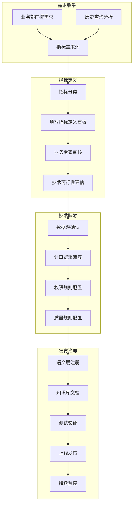
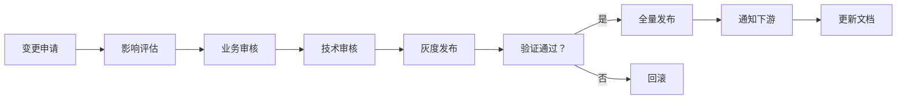

# 智能问数系统 - DT-01 核心指标梳理详细设计文档

**文档版本**: V2.0  
**最后更新**: 2026-04-02  
**适用对象**: 数据产品经理、数据工程师、业务专家  
**关联任务**: DT-01 核心指标梳理  
**前置依赖**: 业务需求调研，数据源盘点  
**后续依赖**: BE-04 (语义层元数据管理), AI-03 (知识库文档编写), 前端图表配置

**项目说明**: 本任务是智能问数系统数据治理的基础工作，负责梳理、定义、标准化所有可查询的核心业务指标，为后续语义层构建、意图识别、查询执行提供准确的数据基础。

---

## 1. 任务概述

### 1.1 背景
智能问数系统的核心价值是让用户通过自然语言查询业务数据。要实现这一目标，首先需要明确"可以查什么数据"，即系统支持哪些指标、这些指标如何计算、数据来源是什么、权限如何控制。核心指标梳理是连接业务需求与技术实现的桥梁，直接影响系统的可用性、准确性和可信度。

### 1.2 目标
| 目标 | 说明 | 验收标准 |
|------|------|----------|
| **完整性** | 覆盖核心业务场景的所有关键指标 | 指标数量 ≥ 50 个 |
| **准确性** | 指标定义与业务口径 100% 一致 | 业务确认率 100% |
| **标准化** | 统一命名规范、分类体系、文档模板 | 模板覆盖率 100% |
| **可追溯** | 每个指标可追溯到数据源、负责人、变更历史 | 血缘清晰 |
| **可扩展** | 支持指标动态新增，不影响现有功能 | 支持热更新 |
| **可治理** | 支持指标质量监控、血缘分析、影响评估 | 监控覆盖 P0 指标 |

### 1.3 指标分类体系
```
核心指标体系
├── 📊 销售指标 (Sales Metrics)
│   ├── 规模类：GMV、订单量、客单价
│   ├── 效率类：转化率、复购率、退货率
│   └── 趋势类：环比、同比、增长率
│
├── 👥 用户指标 (User Metrics)
│   ├── 规模类：DAU、MAU、新增用户
│   ├── 质量类：留存率、活跃度、付费率
│   └── 行为类：访问时长、页面浏览、点击率
│
├── ⚙️ 运营指标 (Operation Metrics)
│   ├── 渠道类：渠道占比、渠道转化率
│   ├── 商品类：商品销量、库存周转、售罄率
│   └── 服务类：响应时效、满意度、投诉率
│
├── 💰 财务指标 (Finance Metrics) [受限]
│   ├── 收入类：营收、毛利、净利润
│   ├── 成本类：获客成本、运营成本
│   └── 效率类：ROI、LTV、CAC
│
└── 🎯 自定义指标 (Custom Metrics)
    ├── 业务自定义：部门特定指标
    └── 临时指标：活动/项目专属指标
```

### 1.4 指标梳理流程


---

## 2. 技术标准与规范

### 2.1 指标命名规范
| 规范项 | 规则 | 示例 |
|--------|------|------|
| **命名风格** | snake_case (小写 + 下划线) | `gmv`, `order_count` |
| **长度限制** | 2-50 字符 | `gmv` (✅), `very_long_metric_name` (❌) |
| **字符限制** | a-z, 0-9, _ | `gmv_2024` (✅), `GMV` (❌) |
| **语义清晰** | 见名知意，避免缩写 | `gross_merchandise_volume` (❌), `gmv` (✅) |
| **唯一性** | 全局唯一，不重复 | `sales_amount` (❌ 重复), `sales_gmv` (✅) |

### 2.2 指标定义模板
所有指标必须按以下模板填写，确保信息完整、格式统一。

**文件路径**: `docs/metrics/template/metric_definition.md`

```markdown
## 指标基本信息

| 字段 | 填写说明 | 示例 |
|------|----------|------|
| **指标代码** | 唯一标识，snake_case，英文 | `gmv` |
| **指标名称** | 中文业务名称 | `成交总额` |
| **英文名称** | 英文业务名称 (可选) | `Gross Merchandise Volume` |
| **指标别名** | 业务常用叫法，逗号分隔 | `销售额，营收，交易金额` |
| **指标分类** | 所属大类/子类 | `销售指标/规模类` |
| **业务口径** | 业务层面的定义描述 | 用户下单支付的总金额，包含已付款和未付款订单 |
| **技术口径** | 可执行的计算逻辑 (SQL/公式) | `SUM(order_amount) WHERE order_status IN ('paid','unpaid')` |
| **数据类型** | money/percent/count/ratio/date | `money` |
| **单位** | 元/个/%/天等 | `元` |
| **精度** | 小数位数 | `2` |
| **更新频率** | 实时/小时/天/周/月 | `T+1` |
| **数据延迟** | 数据可用时间 | `每日 08:00` |
| **数据来源** | 表名/系统名 | `ods_order_detail.order_amount` |
| **负责人** | 业务负责人 | `销售运营部 - 张三` |
| **技术负责人** | 数据开发负责人 | `数据平台部 - 李四` |
| **安全等级** | 1-公开 2-内部 3-保密 4-绝密 | `2` |
| **状态** | active/deprecated/removed | `active` |

## 维度支持

| 维度代码 | 维度名称 | 是否必选 | 可选值/说明 |
|----------|----------|----------|-------------|
| `time` | 时间 | ✅ | day/month/quarter/year，支持相对时间 |
| `region` | 地区 | ✅ | 大区/省/市三级，华东=上海 + 江苏 + 浙江 |
| `dept` | 部门 | ✅ | 按组织架构树，自动权限过滤 |
| `channel` | 渠道 | ❌ | app/web/mini_program |
| `product_line` | 产品线 | ❌ | 按产品分类 |

## 筛选条件

| 筛选字段 | 字段说明 | 可选值/格式 | 默认值 |
|----------|----------|-------------|--------|
| `order_status` | 订单状态 | paid/unpaid/pending | `['paid','unpaid']` |
| `order_type` | 订单类型 | normal/test/refund | `['normal']` |
| `is_deleted` | 是否删除 | 0/1 | `0` |

## 关联指标

| 关联类型 | 关联指标代码 | 说明 |
|----------|--------------|------|
| 衍生指标 | `order_count` | GMV = 客单价 × 订单量 |
| 对比指标 | `gmv_last_month` | 用于计算环比 |
| 组成指标 | `paid_gmv`, `unpaid_gmv` | GMV 的组成部分 |

## 可视化建议

| 场景 | 推荐图表 | 配置建议 |
|------|----------|----------|
| 趋势分析 | 折线图 | 时间序列，支持同比对比 |
| 对比分析 | 柱状图 | 多类别对比，支持排序 |
| 占比分析 | 饼图/环形图 | 份额分布，显示百分比 |
| 单指标展示 | 卡片/仪表盘 | 突出显示数值，带单位 |

## 常见问题

| 问题 | 答案 |
|------|------|
| 是否包含退款订单？ | 不包含，退款会在 T+1 数据中冲减 |
| 是否包含测试订单？ | 不包含，已过滤 order_type='test' |
| 跨境订单如何计算？ | 按当日汇率换算为人民币 |
| 与财务收入的区别？ | 财务收入按确认原则，本指标按下单时间 |

## 变更历史

| 版本 | 日期 | 变更内容 | 负责人 | 影响范围 |
|------|------|----------|--------|----------|
| 1.0 | 2025-01-01 | 初始定义 | 张三 | - |
| 1.1 | 2025-06-01 | 增加实时数据支持 | 李四 | 查询接口 |
| 1.2 | 2026-04-01 | 更新计算口径，排除测试订单 | 王五 | 所有查询 |
```

### 2.3 指标注册配置 (YAML)
用于语义层自动注册，与后端配置对齐。

**文件路径**: `config/metrics/gmv.yaml`

```yaml
# 指标注册配置 - gmv.yaml
metric:
  code: gmv
  name: 成交总额
  name_en: Gross Merchandise Volume
  aliases:
    - 销售额
    - 营收
    - 交易金额
    - GMV
  
  category:
    level1: sales
    level2: scale
  
  definition:
    business: 用户下单支付的总金额，包含已付款和未付款订单
    technical: |
      SUM(order_amount) 
      WHERE order_status IN ('paid', 'unpaid', 'pending')
        AND is_deleted = 0
        AND order_type != 'test'
  
  data_type: money
  unit: 元
  precision: 2
  
  refresh:
    frequency: T+1
    time: "08:00"
    timezone: Asia/Shanghai
  
  source:
    system: order_center
    table: ods_order_detail
    field: order_amount
    filter: |
      order_status IN ('paid', 'unpaid', 'pending')
      AND is_deleted = 0
      AND order_type != 'test'
  
  dimensions:
    - code: time
      name: 时间
      required: true
      values: [day, month, quarter, year]
      relative_time: true
    
    - code: region
      name: 地区
      required: true
      values: [all, huadong, huabei, huanan, huaxi]
      mapping:
        huadong: [shanghai, jiangsu, zhejiang, anhui, fujian]
    
    - code: dept
      name: 部门
      required: true
      permission_filter: true  # 自动按用户权限过滤
    
    - code: channel
      name: 渠道
      required: false
      values: [app, web, mini_program]
  
  filters:
    - field: order_status
      default: ['paid', 'unpaid']
      allowed: ['paid', 'unpaid', 'pending']
    
    - field: order_type
      default: ['normal']
      allowed: ['normal']
      hidden: true  # 用户不可见
  
  related_metrics:
    - code: order_count
      relation: component
      formula: gmv = avg_order_value * order_count
    
    - code: avg_order_value
      relation: derived
      formula: avg_order_value = gmv / order_count
  
  visualization:
    default_chart: line
    recommendations:
      - scenario: trend
        chart: line
        config: { compare: true }
      - scenario: compare
        chart: bar
        config: { sort: desc }
      - scenario: single
        chart: card
        config: { show_trend: true }
  
  security:
    level: 2  # 2=internal
    roles:
      view: [all]
      export: [manager, analyst]
      modify: [admin]
  
  quality:
    rules:
      - type: not_null
        field: order_amount
        threshold: 99.9%
      
      - type: range_check
        field: order_amount
        min: 0
        max: 1000000
      
      - type: consistency
        compare_with: finance_revenue
        tolerance: 5%
  
  owner:
    business: 销售运营部 - 张三
    technical: 数据平台部 - 李四
    contact: zhangsan@company.com
  
  status: active
  version: 1.2.0
  last_updated: 2026-04-01
```

---

## 3. 核心指标清单 (P0 优先级)

### 3.1 销售指标
| 指标代码 | 指标名称 | 业务口径 | 计算逻辑 | 更新频率 | 安全等级 |
|----------|----------|----------|----------|----------|----------|
| `gmv` | 成交总额 | 用户下单支付的总金额 | `SUM(order_amount)` | T+1 | 2 |
| `order_count` | 订单量 | 有效订单数量 | `COUNT(DISTINCT order_id)` | T+1 | 1 |
| `avg_order_value` | 客单价 | 平均每单金额 | `gmv / order_count` | T+1 | 2 |
| `paid_gmv` | 已付款成交额 | 已付款订单的总金额 | `SUM(order_amount) WHERE status='paid'` | T+1 | 2 |
| `refund_rate` | 退款率 | 退款金额占比 | `refund_amount / gmv` | T+1 | 2 |
| `conversion_rate` | 转化率 | 下单用户占比 | `order_users / visit_users` | T+1 | 2 |
| `repeat_purchase_rate` | 复购率 | 再次购买用户占比 | `repeat_users / total_users` | T+7 | 2 |
| `sales_growth` | 销售增长率 | 同比/环比增长 | `(current - last) / last` | T+1 | 2 |

### 3.2 用户指标
| 指标代码 | 指标名称 | 业务口径 | 计算逻辑 | 更新频率 | 安全等级 |
|----------|----------|----------|----------|----------|----------|
| `dau` | 日活跃用户 | 当日有行为的去重用户数 | `COUNT(DISTINCT user_id)` | T+1 | 2 |
| `mau` | 月活跃用户 | 当月有行为的去重用户数 | `COUNT(DISTINCT user_id)` | T+1 | 2 |
| `new_user` | 新增用户 | 首次注册/登录的用户数 | `COUNT(DISTINCT user_id) WHERE first_login_date = today` | T+1 | 2 |
| `retention_rate_d1` | 次日留存率 | 次日回访用户占比 | `retained_users / new_users` | T+2 | 2 |
| `retention_rate_d7` | 7 日留存率 | 7 日后回访用户占比 | `retained_users / new_users` | T+8 | 2 |
| `active_rate` | 活跃率 | 活跃用户占比 | `active_users / total_users` | T+1 | 2 |
| `pay_user_rate` | 付费用户占比 | 付费用户占比 | `pay_users / active_users` | T+1 | 2 |
| `user_ltv` | 用户生命周期价值 | 用户平均贡献价值 | `SUM(revenue) / user_count` | T+30 | 3 |

### 3.3 运营指标
| 指标代码 | 指标名称 | 业务口径 | 计算逻辑 | 更新频率 | 安全等级 |
|----------|----------|----------|----------|----------|----------|
| `channel_gmv_ratio` | 渠道销售占比 | 各渠道销售占比 | `channel_gmv / total_gmv` | T+1 | 2 |
| `channel_conversion` | 渠道转化率 | 各渠道转化效率 | `channel_orders / channel_visits` | T+1 | 2 |
| `product_sales` | 商品销量 | 商品销售数量 | `SUM(quantity)` | T+1 | 2 |
| `inventory_turnover` | 库存周转率 | 库存周转效率 | `sales_cost / avg_inventory` | T+7 | 3 |
| `sell_through_rate` | 售罄率 | 商品售罄比例 | `sold_quantity / total_quantity` | T+1 | 2 |
| `response_time` | 服务响应时效 | 平均响应时间 | `AVG(response_time)` | 实时 | 2 |
| `satisfaction_score` | 用户满意度 | 满意度评分 | `AVG(score)` | T+1 | 2 |
| `complaint_rate` | 投诉率 | 投诉订单占比 | `complaint_orders / total_orders` | T+1 | 2 |

---

## 4. 注意事项 ⚠️

### 4.1 业务口径与技术口径一致性
```yaml
# ❌ 错误：口径不一致
# 业务定义：包含未付款订单
# 技术实现：WHERE status = 'paid'  # 只包含已付款

# ✅ 正确：严格对齐
# 业务定义：包含未付款订单
# 技术实现：WHERE status IN ('paid', 'unpaid')
```

### 4.2 数据源依赖
```yaml
# ❌ 错误：依赖不稳定的临时表
source:
  table: tmp_user_behavior_20240401  # 临时表，可能删除

# ✅ 正确：依赖稳定的 ODS/DWS 层
source:
  table: ods_user_behavior  # 稳定数据源
```

### 4.3 权限控制
```yaml
# ❌ 错误：无权限控制
security:
  level: 1  # 公开，所有人都能看

# ✅ 正确：分级控制
security:
  level: 2  # 内部，仅登录用户
  roles:
    view: [employee, manager]  # 限制角色
```

### 4.4 空值与异常处理
```sql
-- ❌ 错误：未处理除零错误
SELECT gmv / order_count AS avg_value

-- ✅ 正确：处理除零和空值
SELECT 
  CASE 
    WHEN order_count = 0 OR order_count IS NULL THEN 0 
    ELSE gmv / order_count 
  END AS avg_value
```

### 4.5 变更影响评估
```markdown
# ❌ 错误：直接修改不通知
# 修改 GMV 计算逻辑，下游报表全部错误

# ✅ 正确：变更流程
1. 评估影响范围 (下游报表/接口)
2. 通知相关方
3. 灰度发布
4. 验证无误后全量
```

---

## 5. 需要特别关注的点 🔴

### 5.1 陷阱防护矩阵

| 陷阱类型 | 风险描述 | 防护措施 | 验证方法 |
|----------|----------|----------|----------|
| **口径不一致** | 业务与技术定义冲突 | 业务专家 + 技术双重审核 | 口径确认书签字 |
| **数据源不稳定** | 源表结构变更导致指标失效 | 依赖 ODS/DWS 稳定层 | 血缘分析检查 |
| **权限泄露** | 敏感指标被无权用户访问 | 行/列级权限控制 | 越权访问测试 |
| **计算性能差** | 复杂计算导致查询超时 | 预聚合到 DWS 层 | 查询耗时监控 |
| **空值污染** | 除零/空值导致结果异常 | SQL 中处理 null/0 | 边界数据测试 |
| **变更失控** | 指标变更未通知下游 | 变更管理流程 + 通知 | 变更日志检查 |
| **命名冲突** | 指标代码重复 | 全局唯一性校验 | 注册时查重 |
| **生产环境** | 测试指标带到生产 | 环境隔离 + 发布审核 | 生产指标列表检查 |

### 5.2 关键配置审查点

```yaml
# 审查清单
□ 指标代码是否全局唯一
□ 业务口径是否清晰无歧义
□ 技术口径是否可执行 (SQL)
□ 数据源是否稳定 (ODS/DWS)
□ 更新频率是否明确
□ 安全等级是否配置
□ 权限角色是否定义
□ 维度支持是否完整
□ 筛选条件是否合理
□ 关联指标是否准确
□ 可视化建议是否适用
□ 质量规则是否配置
□ 负责人是否明确
□ 变更历史是否记录
□ 别名是否覆盖常用叫法 (AI 识别关键)
□ 敏感信息是否脱敏
```

### 5.3 性能影响评估

| 操作 | 耗时 | 优化建议 |
|------|------|----------|
| 指标定义加载 | < 10ms | 缓存元数据 |
| 权限校验 | < 5ms | 缓存权限结果 |
| 简单指标查询 | 100-500ms | 索引优化 |
| 复杂指标查询 | 1-5s | 预聚合/DWS 层 |
| **总开销** | **< 5s** | **可接受** |

### 5.4 监控指标

```yaml
# 需要采集的指标
metrics:
  # 指标覆盖率
  - name: dt.metric.coverage.rate
    type: gauge
  
  # 指标查询次数
  - name: dt.metric.query.count
    labels:
      - metric_code
  
  # 指标查询延迟
  - name: dt.metric.query.latency
    type: histogram
    labels:
      - metric_code
  
  # 数据质量告警
  - name: dt.metric.quality.alert
    labels:
      - metric_code
      - rule_type
  
  # 口径变更次数
  - name: dt.metric.definition.change.count
    type: counter
```

---

## 6. 测试验证方案

### 6.1 指标定义验证
| 验证项 | 验证方法 | 通过标准 |
|--------|----------|----------|
| 业务口径一致性 | 业务专家评审 | 100% 确认 |
| 技术口径可执行 | 开发编写 SQL 验证 | 可执行且结果正确 |
| 数据源可用性 | 查询源表验证 | 数据存在且质量合格 |
| 权限规则正确性 | 多角色测试 | 权限控制符合预期 |
| 质量规则有效性 | 注入异常数据测试 | 能正确检测并告警 |

### 6.2 数据准确性验证
```sql
-- 1. 基础计算验证
SELECT 
    DATE(order_date) as date,
    SUM(order_amount) as calculated_gmv,
    (SELECT daily_gmv FROM dws_sales_daily WHERE date = DATE(order_date)) as expected_gmv
FROM ods_order_detail
WHERE order_status IN ('paid', 'unpaid', 'pending')
  AND is_deleted = 0
  AND order_type != 'test'
GROUP BY DATE(order_date)
HAVING ABS(calculated_gmv - expected_gmv) / expected_gmv > 0.01;  -- 误差>1% 则告警

-- 2. 维度聚合验证
SELECT 
    region_code,
    COUNT(DISTINCT order_id) as order_count,
    SUM(order_amount) as gmv
FROM ods_order_detail
WHERE order_status IN ('paid', 'unpaid')
  AND is_deleted = 0
GROUP BY region_code;

-- 3. 权限过滤验证 (模拟不同用户)
-- 用户 A (dept_id=100): 应只看到本部门数据
SELECT COUNT(*) FROM ods_order_detail WHERE dept_id = 100;

-- 用户 B (dept_id=200): 应只看到本部门数据
SELECT COUNT(*) FROM ods_order_detail WHERE dept_id = 200;
```

### 6.3 自动化测试脚本
**文件路径**: `scripts/validate_metrics.py`

```python
#!/usr/bin/env python3
"""
指标定义自动化验证脚本
"""

import yaml
import pymysql
from typing import List, Dict

class MetricValidator:
    def __init__(self, db_config: Dict, metrics_dir: str):
        self.db_config = db_config
        self.metrics_dir = metrics_dir
        self.metrics = self.load_metrics()
    
    def load_metrics(self) -> List[Dict]:
        """加载所有指标定义"""
        metrics = []
        import os
        for file in os.listdir(self.metrics_dir):
            if file.endswith('.yaml'):
                with open(f"{self.metrics_dir}/{file}", 'r', encoding='utf-8') as f:
                    metrics.append(yaml.safe_load(f))
        return metrics
    
    def validate_metric_definition(self, metric: Dict) -> Dict:
        """验证单个指标定义"""
        result = {
            'code': metric['metric']['code'],
            'passed': True,
            'errors': []
        }
        
        # 1. 必填字段检查
        required_fields = ['code', 'name', 'definition', 'data_type', 'source']
        for field in required_fields:
            if field not in metric['metric']:
                result['errors'].append(f"缺少必填字段：{field}")
                result['passed'] = False
        
        # 2. 计算逻辑可执行检查
        if 'technical' in metric['metric']['definition']:
            try:
                # 模拟执行计算逻辑 (简化)
                sql = metric['metric']['definition']['technical']
                # 实际应连接数据库执行验证
                result['sql_valid'] = True
            except Exception as e:
                result['errors'].append(f"计算逻辑执行失败：{e}")
                result['passed'] = False
        
        # 3. 数据源存在性检查
        if 'source' in metric['metric']:
            try:
                conn = pymysql.connect(**self.db_config)
                cursor = conn.cursor()
                table = metric['metric']['source']['table']
                cursor.execute(f"SELECT 1 FROM {table} LIMIT 1")
                cursor.close()
                conn.close()
                result['source_exists'] = True
            except Exception as e:
                result['errors'].append(f"数据源不存在：{e}")
                result['passed'] = False
        
        return result
    
    def run(self) -> Dict:
        """执行全部验证"""
        results = [self.validate_metric_definition(m) for m in self.metrics]
        passed = sum(1 for r in results if r['passed'])
        
        return {
            'total': len(results),
            'passed': passed,
            'failed': len(results) - passed,
            'pass_rate': passed / len(results) if results else 0,
            'details': results
        }
    
    def report(self, results: Dict):
        """生成验证报告"""
        print(f"=== 指标定义验证报告 ===")
        print(f"指标总数：{results['total']}")
        print(f"验证通过：{results['passed']}")
        print(f"验证失败：{results['failed']}")
        print(f"通过率：{results['pass_rate']:.2%}")
        print()
        
        for detail in results['details']:
            if not detail['passed']:
                print(f"❌ {detail['code']}:")
                for error in detail['errors']:
                    print(f"   - {error}")

if __name__ == "__main__":
    db_config = {
        'host': 'db-primary',
        'user': 'askdata_app',
        'password': 'xxx',
        'database': 'askdata'
    }
    
    validator = MetricValidator(db_config, 'metrics/')
    results = validator.run()
    validator.report(results)
    
    if results['pass_rate'] < 1.0:
        exit(1)
```

---

## 7. 运维配置

### 7.1 数据质量监控
```yaml
# 质量规则配置
quality_rules:
  gmv:
    - rule_id: gmv_not_null
      type: not_null
      field: order_amount
      threshold: 99.9%
      action: alert
    
    - rule_id: gmv_positive
      type: range_check
      field: order_amount
      min: 0
      max: 10000000  # 1000 万上限
      action: block
    
    - rule_id: gmv_consistency
      type: consistency
      compare_metric: paid_gmv
      condition: gmv >= paid_gmv
      tolerance: 0
      action: alert
    
    - rule_id: gmv_daily_range
      type: anomaly_detection
      field: daily_gmv
      method: 3sigma
      action: alert
    
    - rule_id: gmv_finance_diff
      type: cross_system_check
      compare_system: finance
      compare_field: revenue
      tolerance: 5%
      action: alert
```

### 7.2 变更管理流程


### 7.3 备份策略
| 数据类型 | 备份频率 | 保留周期 | 工具 |
|----------|----------|----------|------|
| 指标定义 | 每次变更 | 永久 | Git |
| 计算逻辑 | 每次变更 | 永久 | Git |
| 质量规则 | 每次变更 | 永久 | Git |
| 变更日志 | 实时 | 永久 | 数据库 |

---

## 8. 常见问题 (FAQ)

**Q1: 业务口径和技术口径不一致怎么办？**
A: 1. 组织业务 + 技术 + 数据三方对齐会议；2. 以业务口径为准调整技术实现；3. 在指标文档中明确说明差异原因。

**Q2: 指标计算结果与报表不一致怎么办？**
A: 1. 核对计算逻辑是否一致；2. 检查数据源和过滤条件；3. 确认更新频率和时间点；4. 如有差异，在文档中说明。

**Q3: 如何支持指标动态新增？**
A: 1. 遵循标准模板填写；2. 提交指标评审；3. 自动注册到语义层；4. 同步更新知识库文档。

**Q4: 敏感指标如何控制访问？**
A: 1. 设置安全等级≥3；2. 配置角色权限规则；3. 启用列级脱敏；4. 导出需审批。

**Q5: 指标计算性能慢怎么办？**
A: 1. 检查是否缺少索引；2. 考虑预聚合到 DWS 层；3. 启用查询缓存；4. 限制查询时间范围。

**Q6: 如何处理指标口径变更？**
A: 1. 评估变更影响范围；2. 通知相关使用者；3. 更新指标定义和版本；4. 保留历史口径查询能力。

**Q7: 如何保证指标数据质量？**
A: 1. 配置质量校验规则；2. 设置监控告警；3. 定期数据对账；4. 建立问题响应机制。

**Q8: 指标太多用户找不到怎么办？**
A: 1. 优化分类体系；2. 增加搜索和推荐；3. 提供指标字典；4. 在知识库中丰富描述。

**Q9: 如何支持自定义指标？**
A: 1. 提供指标配置界面；2. 支持简单公式计算；3. 限制数据源范围；4. 审核发布流程。

**Q10: 指标梳理工作何时完成？**
A: 1. P0 指标优先上线；2. 按业务优先级分批梳理；3. 建立持续运营机制；4. 根据使用反馈迭代优化。

---

## 9. 附录：配置模板

### 9.1 指标批量导入脚本 (Python)
```python
#!/usr/bin/env python3
"""
指标定义批量导入脚本
"""

import yaml
import requests
from pathlib import Path

class MetricImporter:
    def __init__(self, api_url: str, api_key: str):
        self.api_url = api_url
        self.api_key = api_key
    
    def import_metric(self, metric_yaml: str) -> Dict:
        """导入单个指标"""
        metric = yaml.safe_load(metric_yaml)
        
        response = requests.post(
            f'{self.api_url}/api/v1/metrics',
            json=metric,
            headers={
                'Authorization': f'Bearer {self.api_key}',
                'Content-Type': 'application/json'
            }
        )
        
        return response.json()
    
    def batch_import(self, metrics_dir: str) -> List[Dict]:
        """批量导入指标"""
        results = []
        for yaml_file in Path(metrics_dir).glob('*.yaml'):
            with open(yaml_file, 'r', encoding='utf-8') as f:
                content = f.read()
            
            print(f"Importing: {yaml_file.name}")
            result = self.import_metric(content)
            results.append({
                'file': yaml_file.name,
                'success': result.get('code') == 200,
                'message': result.get('message')
            })
        
        return results
    
    def report(self, results: List[Dict]):
        """生成导入报告"""
        success = sum(1 for r in results if r['success'])
        print(f"=== 指标导入报告 ===")
        print(f"总数：{len(results)}")
        print(f"成功：{success}")
        print(f"失败：{len(results) - success}")
        
        for r in results:
            if not r['success']:
                print(f"❌ {r['file']}: {r['message']}")

if __name__ == "__main__":
    importer = MetricImporter(
        api_url='http://askdata-router:8080',
        api_key='sk-askdata-xxx'
    )
    results = importer.batch_import('metrics/')
    importer.report(results)
```

### 9.2 指标变更通知模板
```markdown
# 指标变更通知

## 变更基本信息
- 指标代码：`gmv`
- 指标名称：成交总额
- 变更版本：1.2.0 → 1.3.0
- 变更时间：2026-04-10
- 变更类型：□ 新增  □ 修改  ☑ 废弃  □ 其他

## 变更内容
### 修改前
- 计算口径：`SUM(order_amount) WHERE status IN ('paid','unpaid')`
- 包含测试订单

### 修改后
- 计算口径：`SUM(order_amount) WHERE status IN ('paid','unpaid') AND order_type != 'test'`
- 排除测试订单

## 影响范围
- 受影响报表：销售日报、区域对比看板
- 受影响接口：`/api/report/sales`
- 受影响用户：所有查询 GMV 的用户

## 兼容性说明
- 历史数据：保持原口径，新数据按新口径
- 查询接口：自动兼容，无需修改代码
- 导出文件：新增`include_test_orders`参数控制

## 回滚方案
如发现问题，可紧急回滚到 v1.2.0：
kubectl rollout undo deployment/askdata-router -n data-ai


## 负责人
- 业务负责人：张三 (销售运营部)
- 技术负责人：李四 (数据平台部)
- 联系方式：zhangsan@company.com

## 确认回执
请相关团队确认知悉：
- [ ] 前端团队
- [ ] 后端团队
- [ ] 测试团队
- [ ] 业务团队

通知时间：2026-04-10 10:00
生效时间：2026-04-15 00:00
```

### 9.3 指标质量监控看板配置
```yaml
# Grafana 监控面板配置
dashboard:
  title: "核心指标质量监控"
  refresh: 5m
  
  panels:
    - title: "指标计算成功率"
      type: stat
      query: |
        sum(rate(metric_calc_success_total[5m])) 
        / 
        sum(rate(metric_calc_total[5m]))
      thresholds:
        - value: 0.99
          color: green
        - value: 0.95
          color: yellow
        - value: 0
          color: red
    
    - title: "数据延迟监控"
      type: graph
      query: |
        metric_data_latency_seconds{quantile="0.95"}
      alert:
        condition: "> 3600"  # 延迟>1 小时告警
    
    - title: "质量规则触发"
      type: table
      query: |
        quality_rule_triggered_total
      columns:
        - metric
        - rule_id
        - triggered_count
        - last_triggered
    
    - title: "权限拒绝统计"
      type: bar
      query: |
        sum by (metric, user_role) (rate(permission_denied_total[1h]))
```

---

## 10. 开发检查清单 (Checklist)

### 10.1 指标定义
- [ ] 所有 P0 指标已定义 (≥20 个)
- [ ] 所有指标按模板填写完整
- [ ] 业务口径经业务专家确认
- [ ] 技术口径可执行且已验证
- [ ] 数据源已确认且可访问
- [ ] 权限规则已配置
- [ ] 质量规则已配置
- [ ] 指标已注册到语义层

### 10.2 数据映射
- [ ] 所有指标的数据源已映射
- [ ] 字段映射关系正确
- [ ] 维度关联已配置
- [ ] 筛选条件已定义
- [ ] 默认值已设置

### 10.3 权限控制
- [ ] 指标权限矩阵已确认
- [ ] 行级权限规则已配置
- [ ] 列级脱敏规则已配置
- [ ] 导出权限已配置
- [ ] 权限测试通过

### 10.4 质量保障
- [ ] 数据质量规则已配置
- [ ] 异常检测规则已配置
- [ ] 跨系统一致性规则已配置
- [ ] 告警阈值已设置
- [ ] 质量监控已启用

### 10.5 测试验收
- [ ] 指标定义验证通过
- [ ] 计算逻辑验证通过
- [ ] 端到端测试用例通过
- [ ] 权限控制测试通过
- [ ] 数据质量测试通过
- [ ] 自动化测试脚本通过

---

## 11. 变更历史

| 版本 | 日期 | 变更内容 | 负责人 |
|------|------|----------|--------|
| V1.0 | 2026-03-25 | 初始版本 | 架构组 |
| V2.0 | 2026-04-02 | 增加 YAML 配置、质量规则、陷阱防护 | 架构组 |

---

## 12. 工时与优先级

| 项目 | 内容 |
|------|------|
| **工时** | 10 MD (梳理 7 天 + 审核 3 天) |
| **优先级** | P0 (数据基础核心) |
| **依赖任务** | 业务需求调研，数据源盘点 |
| **被依赖任务** | BE-04, AI-03, 前端图表 |

---

## 13. 最佳实践建议

### 13.1 指标命名
```yaml
# ✅ 推荐：语义清晰
metric_code: gmv  # 通用缩写
metric_code: order_count  # 见名知意

# ❌ 不推荐：含糊不清
metric_code: col1  # 无意义
metric_code: sales  # 太宽泛
```

### 13.2 口径管理
```yaml
# ✅ 推荐：版本化
version: 1.2.0
change_log:
  - version: 1.2.0
    date: 2026-04-01
    change: 排除测试订单

# ❌ 不推荐：无版本
# 无法追溯历史口径
```

### 13.3 权限控制
```yaml
# ✅ 推荐：最小权限
security:
  level: 2
  roles:
    view: [employee]  # 仅查看

# ❌ 不推荐：过度授权
security:
  level: 1  # 公开
  roles:
    view: [all]
```

### 13.4 质量监控
```yaml
# ✅ 推荐：主动监控
quality:
  rules:
    - type: not_null
      threshold: 99.9%
      action: alert

# ❌ 不推荐：被动发现
# 等用户反馈数据错误才处理
```

---

**文档结束**  
**下一步**: 完成指标梳理后，请提交数据治理团队进行专项验收，重点验证指标定义准确性、计算逻辑正确性、权限控制有效性和数据质量合规性。