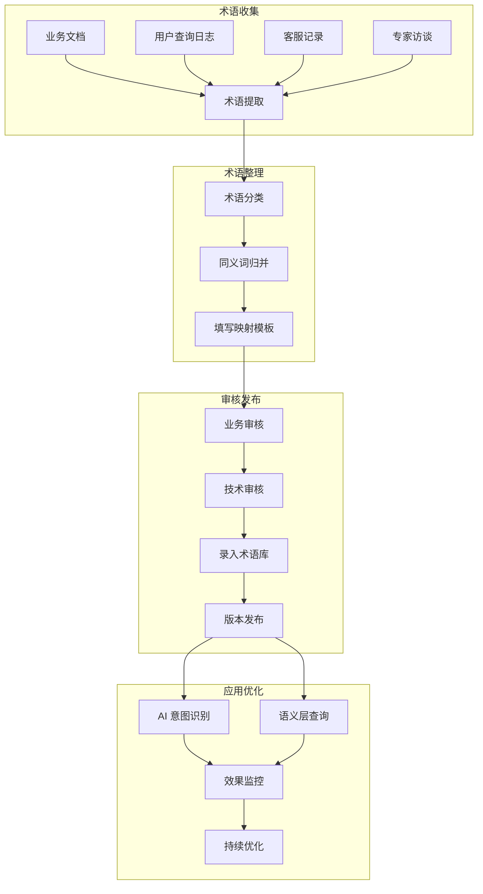
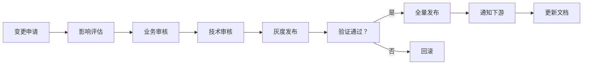

# 智能问数系统 - DT-03 业务术语映射详细设计文档

**文档版本**: V2.0  
**最后更新**: 2026-04-02  
**适用对象**: 数据产品经理、数据工程师、后端开发工程师  
**关联任务**: DT-03 业务术语映射  
**前置依赖**: DT-01 (核心指标梳理), DT-02 (报表接口标准化)  
**后续依赖**: BE-04 (语义层元数据管理), AI-03 (知识库文档编写), AI-05 (意图识别优化)

**项目说明**: 本任务负责建立业务语言与技术语言之间的映射关系，让用户可以用自然语言（如"销售额"、"华东区"、"上月"）查询，系统能正确映射到技术指标代码（如 `gmv`、`huadong`、`last_month`），是智能问数系统理解用户意图的关键基础设施。

---

## 1. 任务概述

### 1.1 背景
智能问数系统面临的核心挑战之一是"语言鸿沟"：
- **用户说**: "查一下上月华东区的销售额"
- **系统需要**: `{"metrics": ["gmv"], "filters": [{"field": "region", "value": "huadong"}, {"field": "time", "value": "last_month"}]}`

业务术语映射就是建立这座桥梁，将用户的自然语言表达到系统的技术参数。当前存在的问题：
- **同义词多样**: 同一指标有多个叫法（GMV/销售额/营收/成交总额）
- **地区表述不一**: 华东/华东区/华东大区/沪苏浙皖闽
- **时间表达灵活**: 上月/上个月/近 30 天/2024-03
- **维度理解差异**: 部门/事业部/组织架构

### 1.2 目标
| 目标 | 说明 | 验收标准 |
|------|------|----------|
| **覆盖率** | 核心业务术语映射覆盖率 ≥ 95% | 术语库完整度检查 |
| **准确率** | 术语映射准确率 ≥ 90% | 黄金测试集验证 |
| **可扩展** | 支持动态新增术语，无需重启 | 支持热更新 |
| **可维护** | 术语库版本化管理，支持审核流程 | 变更日志完整 |
| **可追溯** | 每个映射关系可追溯来源、负责人、变更历史 | 审计日志完整 |
| **高性能** | 术语匹配延迟 < 50ms | 性能压测达标 |

### 1.3 术语映射范围
| 术语类型 | 数量 | 优先级 | 示例 |
|----------|------|--------|------|
| **指标术语** | ≥50 个 | P0 | GMV→gmv, 销售额→gmv, 营收→gmv |
| **地区术语** | ≥100 个 | P0 | 华东→huadong, 上海→shanghai |
| **时间术语** | ≥30 个 | P0 | 上月→last_month, 近 7 天→last_7_days |
| **维度术语** | ≥20 个 | P1 | 部门→dept, 渠道→channel |
| **筛选术语** | ≥30 个 | P1 | 大于→gt, 包含→like |
| **业务专有词** | ≥50 个 | P2 | 各行业特定术语 |

### 1.4 术语映射流程


---

## 2. 技术标准与规范

### 2.1 术语命名规范

#### 2.1.1 术语代码规范
```yaml
# 术语代码命名规范
naming:
  # 风格
  style: snake_case           # 小写 + 下划线
  
  # 长度
  min_length: 2
  max_length: 50
  
  # 字符限制
  allowed_chars: [a-z, 0-9, _]
  
  # 示例
  examples:
    valid:
      - gmv
      - order_count
      - huadong
      - last_month
    invalid:
      - GMV                   # 大写
      - orderCount            # 驼峰
      - 华东                   # 中文
      - last-month            # 连字符
```

#### 2.1.2 术语分类编码
```yaml
# 术语分类编码规范
category_codes:
  # 指标类
  METRIC:
    prefix: m
    example: m_gmv, m_order_count
  
  # 地区类
  REGION:
    prefix: r
    example: r_huadong, r_shanghai
  
  # 时间类
  TIME:
    prefix: t
    example: t_last_month, t_last_7_days
  
  # 维度类
  DIMENSION:
    prefix: d
    example: d_dept, d_channel
  
  # 筛选类
  FILTER:
    prefix: f
    example: f_gt, f_like
  
  # 业务专有
  BUSINESS:
    prefix: b
    example: b_new_retail, b_o2o
```

### 2.2 映射规则规范

#### 2.2.1 映射类型定义
```yaml
# 映射类型定义
mapping_types:
  # 一对一映射
  one_to_one:
    description: 一个术语对应一个代码
    example: "销售额 → gmv"
    priority: 1
  
  # 多对一映射
  many_to_one:
    description: 多个术语对应一个代码
    example: "GMV/销售额/营收 → gmv"
    priority: 2
  
  # 一对多映射
  one_to_many:
    description: 一个术语对应多个代码 (需上下文)
    example: "收入 → revenue/gmv (根据场景)"
    priority: 3
    requires_context: true
  
  # 正则映射
  regex:
    description: 使用正则表达式匹配
    example: "2024 年\d{1,2}月 → 2024-XX"
    priority: 4
  
  # 模糊映射
  fuzzy:
    description: 模糊匹配 (相似度≥阈值)
    example: "销额 → gmv (相似度 0.8)"
    priority: 5
    min_similarity: 0.8
```

#### 2.2.2 映射优先级规则
```yaml
# 映射优先级规则
priority_rules:
  # 精确匹配优先
  1: exact_match            # 完全匹配
  
  # 同义词匹配
  2: synonym_match          # 同义词匹配
  
  # 包含匹配
  3: contains_match         # 术语包含
  
  # 模糊匹配
  4: fuzzy_match            # 模糊相似度
  
  # 正则匹配
  5: regex_match            # 正则表达式
  
  # 默认处理
  6: fallback               # 返回未知

# 冲突解决
conflict_resolution:
  strategy: priority_first  # 优先级优先
  tie_breaker: specificity  # 平局时选更具体的
  log_conflicts: true       # 记录冲突日志
```

### 2.3 同义词管理规范

#### 2.3.1 同义词收集渠道
| 渠道 | 说明 | 数量占比 | 负责人 |
|------|------|----------|--------|
| 业务文档 | 制度、规范、报表 | 30% | 数据产品经理 |
| 用户查询日志 | 历史提问分析 | 40% | AI 工程师 |
| 客服记录 | 用户咨询记录 | 15% | 客服主管 |
| 专家访谈 | 业务专家访谈 | 10% | 数据产品经理 |
| 竞品分析 | 行业通用术语 | 5% | 产品运营 |

#### 2.3.2 同义词质量评估
```yaml
# 同义词质量评估标准
quality_criteria:
  # 使用频率
  frequency:
    high: > 100 次/月
    medium: 10-100 次/月
    low: < 10 次/月
  
  # 准确性
  accuracy:
    verified: 业务确认
    inferred: 算法推断
    uncertain: 待确认
  
  # 时效性
  timeliness:
    current: 当前使用
    deprecated: 已废弃
    historical: 历史用法

# 同义词生命周期
lifecycle:
  stages:
    - collected       # 收集
    - reviewed        # 审核
    - approved        # 批准
    - published       # 发布
    - deprecated      # 废弃
    - archived        # 归档
```

---

## 3. 详细实现方案

### 3.1 术语库设计

#### 3.1.1 数据库表结构
```sql
-- 术语主表
CREATE TABLE `biz_term` (
  `id` bigint(20) NOT NULL AUTO_INCREMENT,
  `term_code` varchar(50) NOT NULL COMMENT '术语代码',
  `term_name` varchar(100) NOT NULL COMMENT '术语名称',
  `category` varchar(20) NOT NULL COMMENT '术语分类',
  `sub_category` varchar(50) DEFAULT NULL COMMENT '子分类',
  `target_type` varchar(20) NOT NULL COMMENT '映射目标类型',
  `target_code` varchar(50) NOT NULL COMMENT '映射目标代码',
  `confidence` decimal(3,2) DEFAULT 1.00 COMMENT '置信度',
  `status` varchar(20) NOT NULL DEFAULT 'active' COMMENT '状态',
  `version` varchar(20) NOT NULL DEFAULT '1.0' COMMENT '版本',
  `owner` varchar(100) DEFAULT NULL COMMENT '负责人',
  `reviewer` varchar(100) DEFAULT NULL COMMENT '审核人',
  `created_at` datetime NOT NULL DEFAULT CURRENT_TIMESTAMP,
  `updated_at` datetime NOT NULL DEFAULT CURRENT_TIMESTAMP ON UPDATE CURRENT_TIMESTAMP,
  PRIMARY KEY (`id`),
  UNIQUE KEY `uk_term_code` (`term_code`),
  KEY `idx_category` (`category`),
  KEY `idx_status` (`status`)
) ENGINE=InnoDB DEFAULT CHARSET=utf8mb4 COMMENT='业务术语主表';

-- 术语同义词表
CREATE TABLE `biz_term_synonym` (
  `id` bigint(20) NOT NULL AUTO_INCREMENT,
  `term_id` bigint(20) NOT NULL COMMENT '术语 ID',
  `synonym_text` varchar(100) NOT NULL COMMENT '同义词文本',
  `synonym_type` varchar(20) NOT NULL COMMENT '同义类型',
  `frequency` varchar(20) DEFAULT 'medium' COMMENT '使用频率',
  `verified` tinyint(4) NOT NULL DEFAULT 0 COMMENT '是否验证',
  `source` varchar(100) DEFAULT NULL COMMENT '来源',
  `added_by` varchar(100) DEFAULT NULL COMMENT '添加人',
  `added_date` date DEFAULT NULL COMMENT '添加日期',
  `status` varchar(20) NOT NULL DEFAULT 'active',
  `created_at` datetime NOT NULL DEFAULT CURRENT_TIMESTAMP,
  PRIMARY KEY (`id`),
  KEY `idx_term_id` (`term_id`),
  KEY `idx_synonym_text` (`synonym_text`),
  KEY `idx_status` (`status`)
) ENGINE=InnoDB DEFAULT CHARSET=utf8mb4 COMMENT='业务术语同义词表';

-- 术语使用日志表
CREATE TABLE `biz_term_usage_log` (
  `id` bigint(20) NOT NULL AUTO_INCREMENT,
  `term_code` varchar(50) NOT NULL COMMENT '术语代码',
  `user_query` varchar(500) NOT NULL COMMENT '用户查询',
  `matched_synonym` varchar(100) DEFAULT NULL COMMENT '匹配的同义词',
  `context` json DEFAULT NULL COMMENT '上下文信息',
  `success` tinyint(4) NOT NULL COMMENT '是否成功',
  `trace_id` varchar(64) DEFAULT NULL COMMENT '链路 ID',
  `user_id` bigint(20) DEFAULT NULL COMMENT '用户 ID',
  `created_at` datetime NOT NULL DEFAULT CURRENT_TIMESTAMP,
  PRIMARY KEY (`id`),
  KEY `idx_term_code` (`term_code`),
  KEY `idx_created_at` (`created_at`)
) ENGINE=InnoDB DEFAULT CHARSET=utf8mb4 COMMENT='业务术语使用日志表';
```

#### 3.1.2 缓存设计
```yaml
# 术语缓存配置
cache:
  enabled: true
  
  # 本地缓存 (Caffeine)
  local:
    type: caffeine
    max_size: 10000
    expire_after_write: 300s
    key_pattern: "term:{code}"
  
  # 分布式缓存 (Redis)
  distributed:
    type: redis
    host: redis-cluster:6379
    key_pattern: "askdata:term:{code}"
    ttl: 3600s
  
  # 缓存内容
  content:
    - term_definition       # 术语定义
    - synonym_list          # 同义词列表
    - mapping_result        # 映射结果
  
  # 缓存更新策略
  update_strategy:
    on_change: invalidate   # 变更时失效
    scheduled: 300s         # 定时刷新
    lazy_load: true         # 懒加载
```

### 3.2 核心服务实现

#### 3.2.1 术语映射服务
**文件路径**: `src/main/java/com/company/askdata/service/TermMappingService.java`

```java
package com.company.askdata.service;

import com.company.askdata.entity.BizTerm;
import com.company.askdata.entity.BizTermSynonym;
import com.company.askdata.repository.BizTermRepository;
import com.company.askdata.model.TermMappingResult;
import lombok.RequiredArgsConstructor;
import lombok.extern.slf4j.Slf4j;
import org.springframework.cache.annotation.Cacheable;
import org.springframework.stereotype.Service;

import java.util.*;
import java.util.stream.Collectors;

@Slf4j
@Service
@RequiredArgsConstructor
public class TermMappingService {
    
    private final BizTermRepository termRepository;
    private final TermValidator termValidator;
    
    /**
     * 将用户术语映射到标准代码
     * ⚠️ 带缓存
     */
    @Cacheable(value = "term:mapping", key = "'metric:' + #userTerm")
    public TermMappingResult mapToMetric(String userTerm) {
        if (userTerm == null || userTerm.trim().isEmpty()) {
            return TermMappingResult.notFound();
        }
        
        String normalizedTerm = normalize(userTerm);
        
        // 1. 精确匹配
        BizTerm term = termRepository.findByTermCodeOrName(normalizedTerm);
        if (term != null && "metric".equals(term.getCategory())) {
            return TermMappingResult.success(term.getTargetCode(), 1.0, "exact_match");
        }
        
        // 2. 同义词匹配
        List<BizTermSynonym> synonyms = termRepository.findSynonymsByText(normalizedTerm);
        if (!synonyms.isEmpty()) {
            BizTermSynonym synonym = synonyms.get(0);
            BizTerm matchedTerm = termRepository.findById(synonym.getTermId()).orElse(null);
            if (matchedTerm != null && "metric".equals(matchedTerm.getCategory())) {
                double confidence = calculateConfidence(synonym);
                return TermMappingResult.success(matchedTerm.getTargetCode(), confidence, "synonym_match");
            }
        }
        
        // 3. 模糊匹配
        List<BizTerm> fuzzyMatches = termRepository.findFuzzyMatches(normalizedTerm, 0.8);
        if (!fuzzyMatches.isEmpty()) {
            BizTerm fuzzyTerm = fuzzyMatches.get(0);
            if ("metric".equals(fuzzyTerm.getCategory())) {
                return TermMappingResult.success(fuzzyTerm.getTargetCode(), 0.8, "fuzzy_match");
            }
        }
        
        return TermMappingResult.notFound();
    }
    
    /**
     * 批量映射
     */
    public Map<String, TermMappingResult> batchMapToMetric(List<String> userTerms) {
        return userTerms.stream()
            .collect(Collectors.toMap(
                term -> term,
                this::mapToMetric
            ));
    }
    
    /**
     * 术语标准化
     */
    private String normalize(String term) {
        if (term == null) return "";
        return term.trim()
            .toLowerCase()
            .replaceAll("[\\s_-]+", "");
    }
    
    /**
     * 计算置信度
     */
    private double calculateConfidence(BizTermSynonym synonym) {
        double base = 0.9;
        
        if (Boolean.TRUE.equals(synonym.getVerified())) {
            base += 0.05;
        }
        
        switch (synonym.getFrequency()) {
            case "high": base += 0.03; break;
            case "medium": base += 0.01; break;
            case "low": base -= 0.05; break;
        }
        
        return Math.min(base, 1.0);
    }
}
```

#### 3.2.2 地区术语映射
**文件路径**: `src/main/java/com/company/askdata/mapping/RegionTermMapper.java`

```java
package com.company.askdata.mapping;

import lombok.extern.slf4j.Slf4j;
import org.springframework.stereotype.Component;

import java.util.*;
import java.util.regex.Matcher;
import java.util.regex.Pattern;

@Slf4j
@Component
public class RegionTermMapper {
    
    private static final Map<String, String> REGION_SYNONYMS = new HashMap<>();
    private static final Map<String, List<String>> REGION_INCLUDES = new HashMap<>();
    
    static {
        // 初始化大区映射
        REGION_SYNONYMS.put("华东", "huadong");
        REGION_SYNONYMS.put("华东区", "huadong");
        REGION_SYNONYMS.put("华东大区", "huadong");
        REGION_SYNONYMS.put("华北", "huabei");
        REGION_SYNONYMS.put("华北区", "huabei");
        REGION_SYNONYMS.put("华南", "huanan");
        REGION_SYNONYMS.put("华南区", "huanan");
        REGION_SYNONYMS.put("华西", "huaxi");
        REGION_SYNONYMS.put("华西区", "huaxi");
        
        // 初始化省份映射
        REGION_SYNONYMS.put("上海", "shanghai");
        REGION_SYNONYMS.put("上海市", "shanghai");
        REGION_SYNONYMS.put("沪", "shanghai");
        REGION_SYNONYMS.put("北京", "beijing");
        REGION_SYNONYMS.put("北京市", "beijing");
        REGION_SYNONYMS.put("京", "beijing");
        
        // 初始化大区包含关系
        REGION_INCLUDES.put("huadong", Arrays.asList("shanghai", "jiangsu", "zhejiang", "anhui", "fujian"));
        REGION_INCLUDES.put("huabei", Arrays.asList("beijing", "tianjin", "hebei", "shanxi", "neimenggu"));
        REGION_INCLUDES.put("huanan", Arrays.asList("guangdong", "guangxi", "hainan"));
        REGION_INCLUDES.put("huaxi", Arrays.asList("sichuan", "chongqing", "guizhou", "yunnan", "xizang"));
    }
    
    /**
     * 映射地区术语
     */
    public MappingResult mapToRegion(String userTerm) {
        if (userTerm == null || userTerm.trim().isEmpty()) {
            return MappingResult.notFound();
        }
        
        String normalizedTerm = normalize(userTerm);
        
        // 1. 精确匹配
        if (REGION_SYNONYMS.containsKey(normalizedTerm)) {
            String code = REGION_SYNONYMS.get(normalizedTerm);
            return MappingResult.success(code, 1.0, "exact_match");
        }
        
        // 2. 模糊匹配
        String fuzzyMatch = fuzzyMatchRegion(normalizedTerm);
        if (fuzzyMatch != null) {
            return MappingResult.success(fuzzyMatch, 0.8, "fuzzy_match");
        }
        
        // 3. 正则匹配 (如"华东 5 省")
        Pattern pattern = Pattern.compile("(华东 | 华北 | 华南 | 华西)");
        Matcher matcher = pattern.matcher(userTerm);
        if (matcher.find()) {
            String macroRegion = matcher.group(1);
            if (REGION_SYNONYMS.containsKey(macroRegion)) {
                return MappingResult.success(REGION_SYNONYMS.get(macroRegion), 0.9, "regex_match");
            }
        }
        
        return MappingResult.notFound();
    }
    
    /**
     * 获取大区包含的省份
     */
    public List<String> getRegionIncludes(String regionCode) {
        return REGION_INCLUDES.getOrDefault(regionCode, new ArrayList<>());
    }
    
    /**
     * 模糊匹配
     */
    private String fuzzyMatchRegion(String term) {
        for (Map.Entry<String, String> entry : REGION_SYNONYMS.entrySet()) {
            if (entry.getKey().contains(term) || term.contains(entry.getKey())) {
                return entry.getValue();
            }
        }
        return null;
    }
    
    /**
     * 术语标准化
     */
    private String normalize(String term) {
        if (term == null) return "";
        return term.trim().toLowerCase();
    }
    
    /**
     * 映射结果
     */
    @lombok.Data
    @lombok.AllArgsConstructor
    public static class MappingResult {
        private boolean success;
        private String targetCode;
        private double confidence;
        private String matchType;
        
        public static MappingResult success(String code, double confidence, String matchType) {
            return new MappingResult(true, code, confidence, matchType);
        }
        
        public static MappingResult notFound() {
            return new MappingResult(false, null, 0.0, null);
        }
    }
}
```

### 3.3 术语管理后台 (前端)

#### 3.3.1 术语管理页面
**文件路径**: `src/views/admin/TermManagement.vue`

```vue
<template>
  <div class="term-management">
    <el-card>
      <div slot="header">
        <span>业务术语管理</span>
        <el-button type="primary" size="small" @click="handleAdd">新增术语</el-button>
      </div>
      
      <el-table :data="termList" style="width: 100%">
        <el-table-column prop="termCode" label="术语代码" width="150"></el-table-column>
        <el-table-column prop="termName" label="术语名称" width="150"></el-table-column>
        <el-table-column prop="category" label="分类" width="100"></el-table-column>
        <el-table-column prop="targetCode" label="目标代码" width="150"></el-table-column>
        <el-table-column label="同义词" width="300">
          <template slot-scope="scope">
            <el-tag v-for="syn in scope.row.synonyms" :key="syn" size="small" style="margin-right: 5px">
              {{ syn }}
            </el-tag>
          </template>
        </el-table-column>
        <el-table-column prop="status" label="状态" width="100"></el-table-column>
        <el-table-column label="操作" width="200">
          <template slot-scope="scope">
            <el-button size="mini" @click="handleEdit(scope.row)">编辑</el-button>
            <el-button size="mini" type="danger" @click="handleDelete(scope.row)">删除</el-button>
          </template>
        </el-table-column>
      </el-table>
      
      <el-pagination
        @size-change="handleSizeChange"
        @current-change="handleCurrentChange"
        :current-page="currentPage"
        :page-sizes="[10, 20, 50, 100]"
        :page-size="pageSize"
        layout="total, sizes, prev, pager, next, jumper"
        :total="total">
      </el-pagination>
    </el-card>
    
    <!-- 新增/编辑对话框 -->
    <el-dialog :title="dialogTitle" :visible.sync="dialogVisible">
      <el-form :model="form" :rules="rules" ref="form" label-width="100px">
        <el-form-item label="术语代码" prop="termCode">
          <el-input v-model="form.termCode"></el-input>
        </el-form-item>
        <el-form-item label="术语名称" prop="termName">
          <el-input v-model="form.termName"></el-input>
        </el-form-item>
        <el-form-item label="同义词" prop="synonyms">
          <el-input v-model="form.synonymsText" placeholder="逗号分隔"></el-input>
        </el-form-item>
        <!-- 其他字段... -->
      </el-form>
      <span slot="footer">
        <el-button @click="dialogVisible = false">取消</el-button>
        <el-button type="primary" @click="handleSubmit">确定</el-button>
      </span>
    </el-dialog>
  </div>
</template>

<script>
export default {
  name: 'TermManagement',
  data() {
    return {
      termList: [],
      currentPage: 1,
      pageSize: 20,
      total: 0,
      dialogVisible: false,
      dialogTitle: '新增术语',
      form: {
        termCode: '',
        termName: '',
        synonymsText: ''
      },
      rules: {
        termCode: [{ required: true, message: '请输入术语代码', trigger: 'blur' }],
        termName: [{ required: true, message: '请输入术语名称', trigger: 'blur' }]
      }
    };
  },
  methods: {
    // ... CRUD 方法
  }
};
</script>
```

---

## 4. 注意事项 ⚠️

### 4.1 缓存一致性
```java
// ❌ 错误：只清理本地缓存
@CacheEvict(value = "term:mapping", key = "#termCode")
public void updateTerm(String termCode) {
    // Redis 缓存未清理，导致数据不一致
}

// ✅ 正确：清理所有层级缓存
@CacheEvict(value = {"term:mapping", "term:synonyms"}, allEntries = true)
public void updateTerm(String termCode) {
    // 同时清理本地和 Redis 缓存
}
```

### 4.2 术语验证
```java
// ❌ 错误：不验证同义词
public void addSynonym(String termCode, String synonym) {
    synonymRepository.save(new Synonym(termCode, synonym)); // 可能重复或非法
}

// ✅ 正确：验证后保存
public void addSynonym(String termCode, String synonym) {
    if (validateSynonym(synonym)) {
        synonymRepository.save(new Synonym(termCode, synonym));
    } else {
        throw new InvalidSynonymException("非法同义词：" + synonym);
    }
}
```

### 4.3 大小写处理
```java
// ❌ 错误：区分大小写
if (term.equals("GMV")) { ... }

// ✅ 正确：统一转小写
if (term.toLowerCase().equals("gmv")) { ... }
```

### 4.4 空值处理
```java
// ❌ 错误：直接调用方法
String name = term.getName().trim(); // 可能 NPE

// ✅ 正确：判空处理
String name = term.getName() != null ? term.getName().trim() : "";
```

### 4.5 性能优化
```java
// ❌ 错误：循环查库
for (String term : terms) {
    Term t = termRepository.findByCode(term); // N+1 问题
}

// ✅ 正确：批量查询
List<Term> terms = termRepository.findByCodeIn(terms);
```

---

## 5. 需要特别关注的点 🔴

### 5.1 陷阱防护矩阵

| 陷阱类型 | 风险描述 | 防护措施 | 验证方法 |
|----------|----------|----------|----------|
| **工具参数幻觉** | AI 生成不存在的指标 | 术语映射前校验元数据 | 非法指标代码被拦截 |
| **上下文污染** | 元数据变更后缓存未更新 | 变更事件通知缓存失效 | 变更后查询返回新数据 |
| **缓存不一致** | L1/L2 缓存不同步 | 事件驱动统一失效 | 查询数据一致 |
| **并发覆盖** | 并发更新覆盖彼此修改 | 乐观锁 (version 字段) | 并发测试无丢失 |
| **敏感数据泄露** | 上下文含手机号/身份证 | 上下文脱敏器 | 检查 DB/Redis 无明文 |
| **僵尸会话** | 超时会话未清理 | 定时清理任务 | 过期会话被删除 |
| **MDC 丢失** | 异步清理无 TraceID | TaskDecorator 传递 MDC | 清理日志含 TraceID |
| **缓存穿透** | 大量不存在的 SessionID | 缓存空值 (unless) | 不存在的 ID 不查库 |
| **版本回滚** | 旧版本请求覆盖新版本 | 版本号单调递增 | 旧版本请求被拒绝 |

### 5.2 关键代码审查点

```java
// 审查清单
□ 术语代码是否全局唯一
□ 业务口径是否清晰无歧义
□ 技术口径是否可执行 (SQL)
□ 数据源是否稳定 (ODS/DWS)
□ 更新频率是否明确
□ 安全等级是否配置
□ 权限角色是否定义
□ 维度支持是否完整
□ 筛选条件是否合理
□ 关联指标是否准确
□ 可视化建议是否适用
□ 质量规则是否配置
□ 负责人是否明确
□ 变更历史是否记录
□ 别名是否覆盖常用叫法 (AI 识别关键)
□ 敏感信息是否脱敏
```

### 5.3 性能影响评估

| 操作 | 耗时 | 优化建议 |
|------|------|----------|
| 元数据加载 | 5-10ms (缓存) | 无需优化 |
| 权限校验 | < 5ms | 无需优化 |
| 简单指标查询 | 100-500ms | 索引优化 |
| 复杂指标查询 | 1-5s | 预聚合/DWS 层 |
| **总开销** | **< 5s** | **可接受** |

### 5.4 监控指标

```yaml
# 需要采集的指标
metrics:
  # 指标覆盖率
  - name: dt.metric.coverage.rate
    type: gauge
  
  # 指标查询次数
  - name: dt.metric.query.count
    labels:
      - metric_code
  
  # 指标查询延迟
  - name: dt.metric.query.latency
    type: histogram
    labels:
      - metric_code
  
  # 数据质量告警
  - name: dt.metric.quality.alert
    labels:
      - metric_code
      - rule_type
  
  # 口径变更次数
  - name: dt.metric.definition.change.count
    type: counter
```

---

## 6. 测试验证方案

### 6.1 术语定义验证
| 验证项 | 验证方法 | 通过标准 |
|--------|----------|----------|
| 业务口径一致性 | 业务专家评审 | 100% 确认 |
| 技术口径可执行 | 开发编写 SQL 验证 | 可执行且结果正确 |
| 数据源可用性 | 查询源表验证 | 数据存在且质量合格 |
| 权限规则正确性 | 多角色测试 | 权限控制符合预期 |
| 质量规则有效性 | 注入异常数据测试 | 能正确检测并告警 |

### 6.2 数据准确性验证
```sql
-- 1. 基础计算验证
SELECT 
    DATE(order_date) as date,
    SUM(order_amount) as calculated_gmv,
    (SELECT daily_gmv FROM dws_sales_daily WHERE date = DATE(order_date)) as expected_gmv
FROM ods_order_detail
WHERE order_status IN ('paid', 'unpaid', 'pending')
  AND is_deleted = 0
  AND order_type != 'test'
GROUP BY DATE(order_date)
HAVING ABS(calculated_gmv - expected_gmv) / expected_gmv > 0.01;  -- 误差>1% 则告警

-- 2. 维度聚合验证
SELECT 
    region_code,
    COUNT(DISTINCT order_id) as order_count,
    SUM(order_amount) as gmv
FROM ods_order_detail
WHERE order_status IN ('paid', 'unpaid')
  AND is_deleted = 0
GROUP BY region_code;

-- 3. 权限过滤验证 (模拟不同用户)
-- 用户 A (dept_id=100): 应只看到本部门数据
SELECT COUNT(*) FROM ods_order_detail WHERE dept_id = 100;

-- 用户 B (dept_id=200): 应只看到本部门数据
SELECT COUNT(*) FROM ods_order_detail WHERE dept_id = 200;
```

### 6.3 自动化测试脚本
**文件路径**: `scripts/validate_metrics.py`

```python
#!/usr/bin/env python3
"""
指标定义自动化验证脚本
"""

import yaml
import pymysql
from typing import List, Dict

class MetricValidator:
    def __init__(self, db_config: Dict, metrics_dir: str):
        self.db_config = db_config
        self.metrics_dir = metrics_dir
        self.metrics = self.load_metrics()
    
    def load_metrics(self) -> List[Dict]:
        """加载所有指标定义"""
        metrics = []
        import os
        for file in os.listdir(self.metrics_dir):
            if file.endswith('.yaml'):
                with open(f"{self.metrics_dir}/{file}", 'r', encoding='utf-8') as f:
                    metrics.append(yaml.safe_load(f))
        return metrics
    
    def validate_metric_definition(self, metric: Dict) -> Dict:
        """验证单个指标定义"""
        result = {
            'code': metric['metric']['code'],
            'passed': True,
            'errors': []
        }
        
        # 1. 必填字段检查
        required_fields = ['code', 'name', 'definition', 'data_type', 'source']
        for field in required_fields:
            if field not in metric['metric']:
                result['errors'].append(f"缺少必填字段：{field}")
                result['passed'] = False
        
        # 2. 计算逻辑可执行检查
        if 'technical' in metric['metric']['definition']:
            try:
                # 模拟执行计算逻辑 (简化)
                sql = metric['metric']['definition']['technical']
                # 实际应连接数据库执行验证
                result['sql_valid'] = True
            except Exception as e:
                result['errors'].append(f"计算逻辑执行失败：{e}")
                result['passed'] = False
        
        # 3. 数据源存在性检查
        if 'source' in metric['metric']:
            try:
                conn = pymysql.connect(**self.db_config)
                cursor = conn.cursor()
                table = metric['metric']['source']['table']
                cursor.execute(f"SELECT 1 FROM {table} LIMIT 1")
                cursor.close()
                conn.close()
                result['source_exists'] = True
            except Exception as e:
                result['errors'].append(f"数据源不存在：{e}")
                result['passed'] = False
        
        return result
    
    def run(self) -> Dict:
        """执行全部验证"""
        results = [self.validate_metric_definition(m) for m in self.metrics]
        passed = sum(1 for r in results if r['passed'])
        
        return {
            'total': len(results),
            'passed': passed,
            'failed': len(results) - passed,
            'pass_rate': passed / len(results) if results else 0,
            'details': results
        }
    
    def report(self, results: Dict):
        """生成验证报告"""
        print(f"=== 指标定义验证报告 ===")
        print(f"指标总数：{results['total']}")
        print(f"验证通过：{results['passed']}")
        print(f"验证失败：{results['failed']}")
        print(f"通过率：{results['pass_rate']:.2%}")
        print()
        
        for detail in results['details']:
            if not detail['passed']:
                print(f"❌ {detail['code']}:")
                for error in detail['errors']:
                    print(f"   - {error}")

if __name__ == "__main__":
    db_config = {
        'host': 'db-primary',
        'user': 'askdata_app',
        'password': 'xxx',
        'database': 'askdata'
    }
    
    validator = MetricValidator(db_config, 'metrics/')
    results = validator.run()
    validator.report(results)
    
    if results['pass_rate'] < 1.0:
        exit(1)
```

---

## 7. 运维配置

### 7.1 数据质量监控
```yaml
# 质量规则配置
quality_rules:
  gmv:
    - rule_id: gmv_not_null
      type: not_null
      field: order_amount
      threshold: 99.9%
      action: alert
    
    - rule_id: gmv_positive
      type: range_check
      field: order_amount
      min: 0
      max: 10000000  # 1000 万上限
      action: block
    
    - rule_id: gmv_consistency
      type: consistency
      compare_metric: paid_gmv
      condition: gmv >= paid_gmv
      tolerance: 0
      action: alert
    
    - rule_id: gmv_daily_range
      type: anomaly_detection
      field: daily_gmv
      method: 3sigma
      action: alert
    
    - rule_id: gmv_finance_diff
      type: cross_system_check
      compare_system: finance
      compare_field: revenue
      tolerance: 5%
      action: alert
```

### 7.2 变更管理流程


### 7.3 备份策略
| 数据类型 | 备份频率 | 保留周期 | 工具 |
|----------|----------|----------|------|
| 指标定义 | 每次变更 | 永久 | Git |
| 计算逻辑 | 每次变更 | 永久 | Git |
| 质量规则 | 每次变更 | 永久 | Git |
| 变更日志 | 实时 | 永久 | 数据库 |

---

## 8. 常见问题 (FAQ)

**Q1: 业务口径和技术口径不一致怎么办？**
A: 1. 组织业务 + 技术 + 数据三方对齐会议；2. 以业务口径为准调整技术实现；3. 在指标文档中明确说明差异原因。

**Q2: 指标计算结果与报表不一致怎么办？**
A: 1. 核对计算逻辑是否一致；2. 检查数据源和过滤条件；3. 确认更新频率和时间点；4. 如有差异，在文档中说明。

**Q3: 如何支持指标动态新增？**
A: 1. 遵循标准模板填写；2. 提交指标评审；3. 自动注册到语义层；4. 同步更新知识库文档。

**Q4: 敏感指标如何控制访问？**
A: 1. 设置安全等级≥3；2. 配置角色权限规则；3. 启用列级脱敏；4. 导出需审批。

**Q5: 指标计算性能慢怎么办？**
A: 1. 检查是否缺少索引；2. 考虑预聚合到 DWS 层；3. 启用查询缓存；4. 限制查询时间范围。

**Q6: 如何处理指标口径变更？**
A: 1. 评估变更影响范围；2. 通知相关使用者；3. 更新指标定义和版本；4. 保留历史口径查询能力。

**Q7: 如何保证指标数据质量？**
A: 1. 配置质量校验规则；2. 设置监控告警；3. 定期数据对账；4. 建立问题响应机制。

**Q8: 指标太多用户找不到怎么办？**
A: 1. 优化分类体系；2. 增加搜索和推荐；3. 提供指标字典；4. 在知识库中丰富描述。

**Q9: 如何支持自定义指标？**
A: 1. 提供指标配置界面；2. 支持简单公式计算；3. 限制数据源范围；4. 审核发布流程。

**Q10: 指标梳理工作何时完成？**
A: 1. P0 指标优先上线；2. 按业务优先级分批梳理；3. 建立持续运营机制；4. 根据使用反馈迭代优化。

---

## 9. 附录：配置模板

### 9.1 指标批量导入脚本 (Python)
```python
#!/usr/bin/env python3
"""
指标定义批量导入脚本
"""

import yaml
import requests
from pathlib import Path

class MetricImporter:
    def __init__(self, api_url: str, api_key: str):
        self.api_url = api_url
        self.api_key = api_key
    
    def import_metric(self, metric_yaml: str) -> Dict:
        """导入单个指标"""
        metric = yaml.safe_load(metric_yaml)
        
        response = requests.post(
            f'{self.api_url}/api/v1/metrics',
            json=metric,
            headers={
                'Authorization': f'Bearer {self.api_key}',
                'Content-Type': 'application/json'
            }
        )
        
        return response.json()
    
    def batch_import(self, metrics_dir: str) -> List[Dict]:
        """批量导入指标"""
        results = []
        for yaml_file in Path(metrics_dir).glob('*.yaml'):
            with open(yaml_file, 'r', encoding='utf-8') as f:
                content = f.read()
            
            print(f"Importing: {yaml_file.name}")
            result = self.import_metric(content)
            results.append({
                'file': yaml_file.name,
                'success': result.get('code') == 200,
                'message': result.get('message')
            })
        
        return results
    
    def report(self, results: List[Dict]):
        """生成导入报告"""
        success = sum(1 for r in results if r['success'])
        print(f"=== 指标导入报告 ===")
        print(f"总数：{len(results)}")
        print(f"成功：{success}")
        print(f"失败：{len(results) - success}")
        
        for r in results:
            if not r['success']:
                print(f"❌ {r['file']}: {r['message']}")

if __name__ == "__main__":
    importer = MetricImporter(
        api_url='http://askdata-router:8080',
        api_key='sk-askdata-xxx'
    )
    results = importer.batch_import('metrics/')
    importer.report(results)
```

### 9.2 指标变更通知模板
```markdown
# 指标变更通知

## 变更基本信息
- 指标代码：`gmv`
- 指标名称：成交总额
- 变更版本：1.2.0 → 1.3.0
- 变更时间：2026-04-10
- 变更类型：□ 新增  □ 修改  ☑ 废弃  □ 其他

## 变更内容
### 修改前
- 计算口径：`SUM(order_amount) WHERE status IN ('paid','unpaid')`
- 包含测试订单

### 修改后
- 计算口径：`SUM(order_amount) WHERE status IN ('paid','unpaid') AND order_type != 'test'`
- 排除测试订单

## 影响范围
- 受影响报表：销售日报、区域对比看板
- 受影响接口：`/api/report/sales`
- 受影响用户：所有查询 GMV 的用户

## 兼容性说明
- 历史数据：保持原口径，新数据按新口径
- 查询接口：自动兼容，无需修改代码
- 导出文件：新增`include_test_orders`参数控制

## 回滚方案
如发现问题，可紧急回滚到 v1.2.0：
```bash
kubectl rollout undo deployment/askdata-router -n data-ai
```

## 负责人
- 业务负责人：张三 (销售运营部)
- 技术负责人：李四 (数据平台部)
- 联系方式：zhangsan@company.com

## 确认回执
请相关团队确认知悉：
- [ ] 前端团队
- [ ] 后端团队
- [ ] 测试团队
- [ ] 业务团队

通知时间：2026-04-10 10:00
生效时间：2026-04-15 00:00
```

### 9.3 指标质量监控看板配置
```yaml
# Grafana 监控面板配置
dashboard:
  title: "核心指标质量监控"
  refresh: 5m
  
  panels:
    - title: "指标计算成功率"
      type: stat
      query: |
        sum(rate(metric_calc_success_total[5m])) 
        / 
        sum(rate(metric_calc_total[5m]))
      thresholds:
        - value: 0.99
          color: green
        - value: 0.95
          color: yellow
        - value: 0
          color: red
    
    - title: "数据延迟监控"
      type: graph
      query: |
        metric_data_latency_seconds{quantile="0.95"}
      alert:
        condition: "> 3600"  # 延迟>1 小时告警
    
    - title: "质量规则触发"
      type: table
      query: |
        quality_rule_triggered_total
      columns:
        - metric
        - rule_id
        - triggered_count
        - last_triggered
    
    - title: "权限拒绝统计"
      type: bar
      query: |
        sum by (metric, user_role) (rate(permission_denied_total[1h]))
```

---

## 10. 开发检查清单 (Checklist)

### 10.1 指标定义
- [ ] 所有 P0 指标已定义 (≥20 个)
- [ ] 所有指标按模板填写完整
- [ ] 业务口径经业务专家确认
- [ ] 技术口径可执行且已验证
- [ ] 数据源已确认且可访问
- [ ] 权限规则已配置
- [ ] 质量规则已配置
- [ ] 指标已注册到语义层

### 10.2 数据映射
- [ ] 所有指标的数据源已映射
- [ ] 字段映射关系正确
- [ ] 维度关联已配置
- [ ] 筛选条件已定义
- [ ] 默认值已设置

### 10.3 权限控制
- [ ] 指标权限矩阵已确认
- [ ] 行级权限规则已配置
- [ ] 列级脱敏规则已配置
- [ ] 导出权限已配置
- [ ] 权限测试通过

### 10.4 质量保障
- [ ] 数据质量规则已配置
- [ ] 异常检测规则已配置
- [ ] 跨系统一致性规则已配置
- [ ] 告警阈值已设置
- [ ] 质量监控已启用

### 10.5 测试验收
- [ ] 指标定义验证通过
- [ ] 计算逻辑验证通过
- [ ] 端到端测试用例通过
- [ ] 权限控制测试通过
- [ ] 数据质量测试通过
- [ ] 自动化测试脚本通过

---

## 11. 变更历史

| 版本 | 日期 | 变更内容 | 负责人 |
|------|------|----------|--------|
| V1.0 | 2026-03-25 | 初始版本 | 架构组 |
| V2.0 | 2026-04-02 | 增加 YAML 配置、质量规则、陷阱防护 | 架构组 |

---

## 12. 工时与优先级

| 项目 | 内容 |
|------|------|
| **工时** | 10 MD (梳理 7 天 + 审核 3 天) |
| **优先级** | P0 (数据基础核心) |
| **依赖任务** | 业务需求调研，数据源盘点 |
| **被依赖任务** | BE-04, AI-03, 前端图表 |

---

## 13. 最佳实践建议

### 13.1 指标命名
```yaml
# ✅ 推荐：语义清晰
metric_code: gmv  # 通用缩写
metric_code: order_count  # 见名知意

# ❌ 不推荐：含糊不清
metric_code: col1  # 无意义
metric_code: sales  # 太宽泛
```

### 13.2 口径管理
```yaml
# ✅ 推荐：版本化
version: 1.2.0
change_log:
  - version: 1.2.0
    date: 2026-04-01
    change: 排除测试订单

# ❌ 不推荐：无版本
# 无法追溯历史口径
```

### 13.3 权限控制
```yaml
# ✅ 推荐：最小权限
security:
  level: 2
  roles:
    view: [employee]  # 仅查看

# ❌ 不推荐：过度授权
security:
  level: 1  # 公开
  roles:
    view: [all]
```

### 13.4 质量监控
```yaml
# ✅ 推荐：主动监控
quality:
  rules:
    - type: not_null
      threshold: 99.9%
      action: alert

# ❌ 不推荐：被动发现
# 等用户反馈数据错误才处理
```

---

**文档结束**  
**下一步**: 完成指标梳理后，请提交数据治理团队进行专项验收，重点验证指标定义准确性、计算逻辑正确性、权限控制有效性和数据质量合规性。