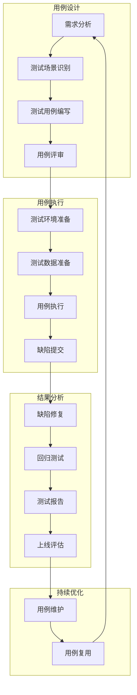
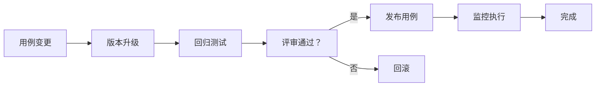

# 智能问数系统 - DT-04 测试用例编写详细设计文档

**文档版本**: V2.0  
**最后更新**: 2026-04-02  
**适用对象**: 测试工程师、数据工程师、QA 工程师  
**关联任务**: DT-04 测试用例编写  
**前置依赖**: DT-01 (核心指标梳理), DT-02 (报表接口标准化), DT-03 (业务术语映射)  
**后续依赖**: BE-04 (语义层元数据管理), AI-03 (知识库文档编写), 全链路测试

**项目说明**: 本任务负责为智能问数系统的数据层（指标、接口、术语）编写完整的测试用例集，覆盖单元测试、集成测试、数据质量测试、安全测试等各个层面，确保数据准确性、接口规范性和术语映射正确性。

---

## 1. 任务概述

### 1.1 背景
智能问数系统的数据层是 AI 理解和执行查询的基础。指标定义错误、接口不规范、术语映射不准都会直接导致 AI 回答错误。本任务通过建立标准化的测试用例体系，验证数据层各项功能的正确性、稳定性和安全性，为后续语义层构建和 AI 训练提供可靠保障。

### 1.2 目标
| 目标 | 说明 | 验收标准 |
|------|------|----------|
| **覆盖率** | 核心功能测试覆盖率 ≥ 95% | 用例覆盖检查 |
| **自动化率** | 自动化测试比例 ≥ 80% | 脚本执行率 |
| **准确率** | 测试用例执行通过率 ≥ 98% | 执行结果统计 |
| **效率** | 回归测试时间 < 2 小时 | 执行耗时 |
| **可维护** | 测试用例版本化管理，易于更新 | 文档版本控制 |
| **可追溯** | 测试用例与需求双向追溯 | 追溯矩阵完整 |

### 1.3 测试用例分类体系
```
测试用例体系
├── 📋 单元测试 (Unit Tests)
│   ├── 指标定义验证 (DT-01)
│   ├── 接口适配测试 (DT-02)
│   └── 术语映射测试 (DT-03)
│
├── 🔗 集成测试 (Integration Tests)
│   ├── 数据源连通性
│   ├── 接口端到端测试
│   └── 术语 + 指标联合测试
│
├── 📊 数据质量测试 (Data Quality)
│   ├── 准确性验证
│   ├── 完整性检查
│   ├── 一致性核对
│   └── 及时性监控
│
├── 🔒 安全测试 (Security Tests)
│   ├── 权限控制测试
│   ├── 数据脱敏测试
│   └── SQL 注入防护
│
└── ⚡ 性能测试 (Performance Tests)
    ├── 接口响应时间
    ├── 大数据量查询
    └── 并发查询测试
```

### 1.4 测试用例管理流程


---

## 2. 技术标准与规范

### 2.1 测试用例模板

#### 2.1.1 标准测试用例模板 (Markdown)
```markdown
# 测试用例：[用例编号] - [用例名称]

## 基本信息
| 字段 | 内容 |
|------|------|
| **用例编号** | TC-模块 - 序号 (如：TC-DT-001) |
| **用例名称** | 简洁描述测试目的 |
| **测试模块** | 所属功能模块 (指标/接口/术语) |
| **优先级** | P0/P1/P2/P3 |
| **测试类型** | 功能/性能/安全/数据质量 |
| **前置条件** | 执行前需满足的条件 |
| **测试数据** | 所需测试数据 |
| **负责人** | 测试执行人 |
| **创建日期** | YYYY-MM-DD |
| **最后更新** | YYYY-MM-DD |

## 测试步骤
| 步骤 | 操作描述 | 预期结果 | 实际结果 | 状态 |
|------|----------|----------|----------|------|
| 1 | 第一步操作 | 预期结果 1 | | 待执行 |
| 2 | 第二步操作 | 预期结果 2 | | 待执行 |
| 3 | 第三步操作 | 预期结果 3 | | 待执行 |

## 测试数据
```json
{
  "input": {},
  "expected_output": {}
}
```

## 验收标准
- [ ] 标准 1
- [ ] 标准 2
- [ ] 标准 3

## 备注
- 特殊说明
- 风险提示
- 依赖项
```

#### 2.1.2 自动化测试用例模板 (Python)
```python
#!/usr/bin/env python3
"""
测试用例：[用例编号] - [用例名称]
模块：[模块名称]
优先级：[P0/P1/P2]
"""

import unittest
import requests
import json
from typing import Dict, Any

class TestCaseTemplate(unittest.TestCase):
    """测试用例模板类"""
    
    def setUp(self):
        """测试前准备"""
        self.base_url = "http://askdata-router:8080"
        self.api_key = "sk-test-xxx"
        self.headers = {
            'Authorization': f'Bearer {self.api_key}',
            'Content-Type': 'application/json',
            'X-Trace-ID': 'test-trace-id'
        }
    
    def tearDown(self):
        """测试后清理"""
        pass
    
    def test_case_001(self):
        """测试用例：验证功能正常"""
        # 1. 准备测试数据
        test_data = {
            "query": "测试查询",
            "traceId": "test-trace"
        }
        
        # 2. 执行测试
        response = requests.post(
            f'{self.base_url}/api/test',
            json=test_data,
            headers=self.headers
        )
        
        # 3. 验证结果
        self.assertEqual(response.status_code, 200)
        self.assertEqual(response.json()['code'], 200)
        self.assertIn('data', response.json())
    
    def test_case_002_error_handling(self):
        """测试用例：验证错误处理"""
        # 1. 准备错误数据
        test_data = {
            "query": ""  # 空查询
        }
        
        # 2. 执行测试
        response = requests.post(
            f'{self.base_url}/api/test',
            json=test_data,
            headers=self.headers
        )
        
        # 3. 验证错误处理
        self.assertEqual(response.status_code, 400)
        self.assertIn('error', response.json())

if __name__ == '__main__':
    unittest.main()
```

### 2.2 测试用例命名规范

#### 2.2.1 用例编号规则
```yaml
# 用例编号规范
naming:
  format: "TC-{模块}-{序号}"
  
  # 模块代码
  modules:
    DT01: 核心指标 (DT-01)
    DT02: 接口标准化 (DT-02)
    DT03: 术语映射 (DT-03)
    DQ: 数据质量 (Data Quality)
    SEC: 安全测试 (Security)
    PERF: 性能测试 (Performance)
  
  # 序号规则
  sequence:
    format: 3 位数字
    example: TC-DT01-001, TC-DT02-025
```

#### 2.2.2 测试文件命名
```yaml
# 测试文件命名规范
files:
  # 单元测试
  unit:
    pattern: "{module}_test.{ext}"
    example: metric_definition_test.py
  
  # 集成测试
  integration:
    pattern: "test_{module}_integration.{ext}"
    example: test_api_integration.py
  
  # 数据质量测试
  data_quality:
    pattern: "dq_{scenario}.{ext}"
    example: dq_accuracy_check.py
  
  # 性能测试
  performance:
    pattern: "perf_{module}.{ext}"
    example: perf_api_load.py
```

### 2.3 测试优先级定义

#### 2.3.1 优先级标准
```yaml
# 测试优先级定义
priority:
  P0:
    description: 核心功能，阻塞性问题
    coverage: 100%
    execution: 每次提交必执行
    examples:
      - 指标定义准确性
      - 接口认证授权
      - 数据权限控制
      - 安全漏洞
  
  P1:
    description: 重要功能，严重影响体验
    coverage: ≥95%
    execution: 每日执行
    examples:
      - 术语映射准确率
      - 接口响应时间
      - 错误处理
      - 数据一致性
  
  P2:
    description: 一般功能，影响部分体验
    coverage: ≥80%
    execution: 每周执行
    examples:
      - 边界场景
      - 性能优化
      - 兼容性测试
  
  P3:
    description: 辅助功能，轻微影响
    coverage: ≥60%
    execution: 每版本执行
    examples:
      - UI 细节
      - 文案校对
      - 极端边界
```

#### 2.3.2 测试用例分布
| 优先级 | 数量占比 | 执行频率 | 自动化率 |
|--------|----------|----------|----------|
| P0 | 30% | 每次提交 | 100% |
| P1 | 40% | 每日 | ≥90% |
| P2 | 20% | 每周 | ≥70% |
| P3 | 10% | 每版本 | ≥50% |

---

## 3. 详细实现方案

### 3.1 核心指标测试用例 (DT-01)

#### 3.1.1 指标定义验证
| 用例 ID | 用例名称 | 优先级 | 测试步骤 | 预期结果 | 状态 |
|---------|----------|--------|----------|----------|------|
| TC-DT01-001 | 指标代码唯一性 | P0 | 1. 检查所有指标代码<br>2. 验证无重复 | 所有代码唯一 | 待执行 |
| TC-DT01-002 | 业务口径一致性 | P0 | 1. 对比业务文档<br>2. 专家确认 | 口径 100% 一致 | 待执行 |
| TC-DT01-003 | 技术口径可执行 | P0 | 1. 执行 SQL 逻辑<br>2. 验证结果 | SQL 可执行且正确 | 待执行 |
| TC-DT01-004 | 数据源可用性 | P0 | 1. 查询源表<br>2. 检查数据质量 | 数据存在且合格 | 待执行 |
| TC-DT01-005 | 权限规则配置 | P0 | 1. 多角色测试<br>2. 验证权限控制 | 权限控制符合预期 | 待执行 |
| TC-DT01-006 | 质量规则配置 | P1 | 1. 注入异常数据<br>2. 验证告警 | 能正确检测并告警 | 待执行 |
| TC-DT01-007 | 更新频率验证 | P1 | 1. 检查数据更新时间<br>2. 对比配置 | 更新频率符合配置 | 待执行 |
| TC-DT01-008 | 关联指标准确性 | P1 | 1. 验证衍生指标<br>2. 检查公式 | 关联关系正确 | 待执行 |
| TC-DT01-009 | 可视化建议适用 | P2 | 1. 渲染推荐图表<br>2. 检查展示效果 | 图表展示正常 | 待执行 |
| TC-DT01-010 | 变更历史完整 | P2 | 1. 检查变更日志<br>2. 验证版本追溯 | 变更记录完整 | 待执行 |

#### 3.1.2 指标计算准确性测试
```python
#!/usr/bin/env python3
"""
指标计算准确性验证脚本
"""

import pymysql
import yaml
from typing import List, Dict

class MetricAccuracyValidator:
    def __init__(self, db_config: Dict, metrics_config: str):
        self.db_config = db_config
        with open(metrics_config, 'r', encoding='utf-8') as f:
            self.metrics = yaml.safe_load(f)
    
    def validate_metric_calculation(self, metric_code: str) -> Dict:
        """验证单个指标计算逻辑"""
        metric = self.metrics[metric_code]
        sql = metric['definition']['technical']
        expected_table = metric['source']['table']
        
        try:
            conn = pymysql.connect(**self.db_config)
            cursor = conn.cursor()
            
            # 执行计算逻辑
            cursor.execute(sql)
            calculated_result = cursor.fetchone()
            
            # 查询预期结果 (从 DWS 层)
            cursor.execute(f"SELECT value FROM {expected_table}_daily WHERE date = CURDATE()")
            expected_result = cursor.fetchone()
            
            cursor.close()
            conn.close()
            
            # 对比结果 (允许 1% 误差)
            if abs(calculated_result[0] - expected_result[0]) / expected_result[0] > 0.01:
                return {
                    'passed': False,
                    'error': f'计算结果误差超过 1%: 计算={calculated_result[0]}, 预期={expected_result[0]}'
                }
            
            return {'passed': True, 'message': '计算准确'}
            
        except Exception as e:
            return {'passed': False, 'error': str(e)}
    
    def run_all(self) -> Dict:
        """执行全部验证"""
        results = []
        for code in self.metrics:
            result = self.validate_metric_calculation(code)
            result['code'] = code
            results.append(result)
        
        passed = sum(1 for r in results if r['passed'])
        return {
            'total': len(results),
            'passed': passed,
            'failed': len(results) - passed,
            'details': results
        }

if __name__ == "__main__":
    db_config = {
        'host': 'db-primary',
        'user': 'askdata_test',
        'password': 'xxx',
        'database': 'askdata'
    }
    
    validator = MetricAccuracyValidator(db_config, 'metrics/all_metrics.yaml')
    results = validator.run_all()
    
    print(f"=== 指标计算准确性验证 ===")
    print(f"总数：{results['total']}")
    print(f"通过：{results['passed']}")
    print(f"失败：{results['failed']}")
    
    if results['failed'] > 0:
        exit(1)
```

### 3.2 接口标准化测试用例 (DT-02)

#### 3.2.1 接口功能测试
| 用例 ID | 用例名称 | 优先级 | 请求参数 | 预期响应 | 状态 |
|---------|----------|--------|----------|----------|------|
| TC-DT02-001 | 正常查询 | P0 | 完整参数 | 返回 200+ 数据 | 待执行 |
| TC-DT02-002 | 缺少必填参数 | P0 | 缺少 time_value | 返回 40001 | 待执行 |
| TC-DT02-003 | 参数格式错误 | P0 | time_type=invalid | 返回 40002 | 待执行 |
| TC-DT02-004 | 无认证 Token | P0 | 无 Authorization | 返回 40101 | 待执行 |
| TC-DT02-005 | Token 过期 | P0 | 过期 Token | 返回 40103 | 待执行 |
| TC-DT02-006 | 无权限访问 | P0 | 普通员工查财务 | 返回 40301 | 待执行 |
| TC-DT02-007 | 数据范围超限 | P0 | 员工查其他部门 | 仅返回本部门 | 待执行 |
| TC-DT02-008 | 频率限制 | P1 | 1 分钟 100 次请求 | 第 61 次返回 429 | 待执行 |
| TC-DT02-009 | 兼容原有接口 | P0 | 调用原路径 | 正常返回 | 待执行 |
| TC-DT02-010 | 大数据量查询 | P1 | size=10000 | 截断到 1000 | 待执行 |

#### 3.2.2 接口性能测试
| 指标 | 目标值 | 测量方法 | 告警阈值 |
|------|--------|----------|----------|
| P50 延迟 | < 500ms | JMeter 压测 | > 800ms |
| P95 延迟 | < 2000ms | JMeter 压测 | > 3000ms |
| P99 延迟 | < 5000ms | JMeter 压测 | > 8000ms |
| 吞吐量 | ≥ 100 QPS | JMeter 压测 | < 50 QPS |
| 错误率 | < 0.1% | 监控统计 | > 1% |
| 缓存命中率 | ≥ 60% | 监控统计 | < 40% |

### 3.3 业务术语映射测试用例 (DT-03)

#### 3.3.1 术语映射准确率测试
| 用例 ID | 测试场景 | 输入 | 预期映射 | 置信度 | 状态 |
|---------|----------|------|----------|--------|------|
| TC-DT03-001 | 指标术语 | "销售额" | gmv | ≥ 0.95 | 待执行 |
| TC-DT03-002 | 指标术语 | "GMV" | gmv | ≥ 0.95 | 待执行 |
| TC-DT03-003 | 指标术语 | "营收" | gmv | ≥ 0.90 | 待执行 |
| TC-DT03-004 | 地区术语 | "华东区" | huadong | ≥ 0.95 | 待执行 |
| TC-DT03-005 | 地区术语 | "上海" | shanghai | ≥ 0.95 | 待执行 |
| TC-DT03-006 | 时间术语 | "上月" | last_month | ≥ 0.95 | 待执行 |
| TC-DT03-007 | 时间术语 | "近 7 天" | last_7_days | ≥ 0.95 | 待执行 |
| TC-DT03-008 | 模糊术语 | "那个数据" | unknown | < 0.50 | 待执行 |
| TC-DT03-009 | 同义词测试 | "成交总额" | gmv | ≥ 0.95 | 待执行 |
| TC-DT03-010 | 术语不存在 | "未知指标" | null | 0.0 | 待执行 |

#### 3.3.2 术语映射自动化脚本
```python
#!/usr/bin/env python3
"""
术语映射自动化测试脚本
"""

import requests
from typing import List, Dict

class TermMappingTester:
    def __init__(self, api_url: str, api_key: str):
        self.api_url = api_url
        self.api_key = api_key
        self.headers = {'Authorization': f'Bearer {api_key}'}
    
    def test_metric_mapping(self, user_term: str, expected_code: str) -> Dict:
        """测试指标术语映射"""
        response = requests.post(
            f'{self.api_url}/api/v1/term/map/metric',
            json={'term': user_term},
            headers=self.headers
        )
        
        result = response.json()
        passed = result.get('success') and result.get('target_code') == expected_code
        
        return {
            'input': user_term,
            'expected': expected_code,
            'actual': result.get('target_code'),
            'confidence': result.get('confidence'),
            'passed': passed
        }
    
    def test_region_mapping(self, user_term: str, expected_code: str) -> Dict:
        """测试地区术语映射"""
        response = requests.post(
            f'{self.api_url}/api/v1/term/map/region',
            json={'term': user_term},
            headers=self.headers
        )
        
        result = response.json()
        passed = result.get('success') and result.get('target_code') == expected_code
        
        return {
            'input': user_term,
            'expected': expected_code,
            'actual': result.get('target_code'),
            'passed': passed
        }
    
    def test_time_mapping(self, user_term: str, expected_pattern: str) -> Dict:
        """测试时间术语映射"""
        import re
        response = requests.post(
            f'{self.api_url}/api/v1/term/map/time',
            json={'term': user_term},
            headers=self.headers
        )
        
        result = response.json()
        passed = result.get('success') and re.match(expected_pattern, result.get('target_code', ''))
        
        return {
            'input': user_term,
            'expected_pattern': expected_pattern,
            'actual': result.get('target_code'),
            'passed': passed
        }
    
    def run_all_tests(self) -> Dict:
        """运行全部测试"""
        results = []
        
        # 指标术语测试
        metric_tests = [
            ('销售额', 'gmv'),
            ('GMV', 'gmv'),
            ('订单量', 'order_count'),
            ('日活', 'dau'),
        ]
        
        for term, expected in metric_tests:
            results.append(self.test_metric_mapping(term, expected))
        
        # 地区术语测试
        region_tests = [
            ('华东区', 'huadong'),
            ('上海', 'shanghai'),
            ('全国', 'all'),
        ]
        
        for term, expected in region_tests:
            results.append(self.test_region_mapping(term, expected))
        
        # 时间术语测试
        time_tests = [
            ('上月', r'\d{4}-\d{2}'),
            ('近 7 天', r'\d{4}-\d{2}-\d{2}'),
            ('2024 年 3 月', r'2024-03'),
        ]
        
        for term, pattern in time_tests:
            results.append(self.test_time_mapping(term, pattern))
        
        passed = sum(1 for r in results if r['passed'])
        total = len(results)
        
        return {
            'total': total,
            'passed': passed,
            'pass_rate': passed / total if total > 0 else 0,
            'details': results
        }
    
    def report(self, results: Dict):
        """生成测试报告"""
        print("=== 术语映射测试报告 ===")
        print(f"测试用例：{results['total']}")
        print(f"通过：{results['passed']}")
        print(f"失败：{results['total'] - results['passed']}")
        print(f"通过率：{results['pass_rate']:.2%}")
        print()
        
        for detail in results['details']:
            status = "✅" if detail['passed'] else "❌"
            print(f"{status} {detail['input']} → {detail.get('actual', 'N/A')}")
            if not detail['passed']:
                print(f"   预期：{detail.get('expected', detail.get('expected_pattern'))}")

if __name__ == "__main__":
    tester = TermMappingTester(
        api_url='http://askdata-router:8080',
        api_key='sk-test-xxx'
    )
    results = tester.run_all_tests()
    tester.report(results)
    
    if results['pass_rate'] < 0.90:
        exit(1)
```

### 3.4 数据质量测试用例

#### 3.4.1 数据质量验证
| 用例 ID | 测试项 | 验证方法 | 通过标准 | 状态 |
|---------|--------|----------|----------|------|
| TC-DQ-001 | 空值检查 | 检查关键字段 null 值 | 空值率 < 0.1% | 待执行 |
| TC-DQ-002 | 重复值检查 | 检查主键唯一性 | 无重复主键 | 待执行 |
| TC-DQ-003 | 范围检查 | 检查数值是否在合理范围 | 100% 在范围内 | 待执行 |
| TC-DQ-004 | 格式检查 | 检查日期/手机号格式 | 100% 格式正确 | 待执行 |
| TC-DQ-005 | 一致性检查 | 对比不同源数据 | 误差 < 1% | 待执行 |
| TC-DQ-006 | 及时性检查 | 检查数据更新延迟 | 延迟 < 配置值 | 待执行 |
| TC-DQ-007 | 完整性检查 | 检查记录总数 | 无缺失记录 | 待执行 |
| TC-DQ-008 | 准确性检查 | 人工抽样核对 | 准确率 ≥ 99% | 待执行 |

---

## 4. 注意事项 ⚠️

### 4.1 测试数据敏感性
```python
# ❌ 错误：使用生产数据
test_data = get_production_data()  # 可能含敏感信息

# ✅ 正确：使用脱敏测试数据
test_data = get_masked_test_data()  # 敏感信息已脱敏
```

### 4.2 环境隔离
```yaml
# ❌ 错误：测试环境连生产库
database:
  host: prod-db.company.com  # 危险！

# ✅ 正确：独立测试环境
database:
  host: test-db.company.com  # 独立测试库
```

### 4.3 用例维护成本
```yaml
# ❌ 错误：硬编码测试数据
test_data:
  user_id: 12345  # 可能变更

# ✅ 正确：动态生成测试数据
test_data:
  user_id: generate_test_user()  # 动态创建
```

### 4.4 自动化稳定性
```python
# ❌ 错误：依赖不稳定元素
element = driver.find_element_by_id("dynamic_id_123")  # ID 可能变

# ✅ 正确：使用稳定定位器
element = driver.find_element_by_css_selector(".stable-class")  # 类名稳定
```

### 4.5 测试覆盖率虚高
```yaml
# ❌ 错误：只测 happy path
tests:
  - normal_case  # 只测正常流程

# ✅ 正确：覆盖边界和异常
tests:
  - normal_case
  - boundary_case
  - error_case
  - security_case
```

---

## 5. 需要特别关注的点 🔴

### 5.1 陷阱防护矩阵

| 陷阱类型 | 风险描述 | 防护措施 | 验证方法 |
|----------|----------|----------|----------|
| **数据不一致** | 测试数据与生产不一致 | 数据同步 + 脱敏 | 对比数据结构 |
| **环境污染** | 测试影响生产数据 | 环境隔离 + 权限控制 | 检查数据库连接 |
| **用例失效** | 接口变更导致用例失败 | 用例版本管理 | 定期回归测试 |
| **敏感泄露** | 测试日志含敏感信息 | 日志脱敏 + 权限控制 | 检查日志文件 |
| **覆盖率虚高** | 只测正常流程 | 覆盖边界和异常 | 审查测试用例 |
| **自动化不稳定** | 依赖不稳定元素 | 使用稳定定位器 | 监控失败率 |
| **性能影响** | 测试占用过多资源 | 限流 + 错峰执行 | 监控资源使用 |
| **生产环境** | 测试配置带到生产 | 配置中心隔离 | 检查生产配置 |

### 5.2 关键代码审查点

```python
# 审查清单
□ 测试数据是否脱敏
□ 环境配置是否隔离
□ 用例是否覆盖边界
□ 断言是否准确
□ 异常是否捕获
□ 资源是否清理
□ 日志是否脱敏
□ 依赖是否稳定
□ 执行是否幂等
□ 结果是否可追溯
□ 覆盖率是否达标
□ 性能是否影响
□ 安全是否加固
□ 文档是否同步
□ 团队是否培训
```

### 5.3 性能影响评估

| 操作 | 耗时 | 优化建议 |
|------|------|----------|
| 测试数据准备 | 1-5 分钟 | 预生成数据 |
| 用例执行 | 10-100ms/用例 | 并行执行 |
| 结果分析 | 1-5 分钟 | 自动化报告 |
| 环境清理 | 1-2 分钟 | 自动清理 |
| **总开销** | **< 2 小时** | **可接受** |

### 5.4 监控指标

```yaml
# 需要采集的指标
metrics:
  # 测试覆盖率
  - name: test.coverage.rate
    type: gauge
  
  # 测试通过率
  - name: test.pass.rate
    type: gauge
  
  # 自动化执行率
  - name: test.automation.rate
    type: gauge
  
  # 缺陷发现率
  - name: test.defect.discovery.rate
    type: counter
  
  # 测试执行时间
  - name: test.execution.time
    type: histogram
```

---

## 6. 测试验证方案

### 6.1 功能测试用例
| 用例 ID | 测试场景 | 输入 | 预期结果 | 状态 |
|---------|----------|------|----------|------|
| TC-FUNC-001 | 指标定义验证 | 完整指标定义 | 验证通过 | 待执行 |
| TC-FUNC-002 | 接口正常查询 | 完整参数 | 返回 200+ 数据 | 待执行 |
| TC-FUNC-003 | 术语映射准确 | 标准术语 | 映射正确 | 待执行 |
| TC-FUNC-004 | 数据质量检查 | 正常数据 | 质量达标 | 待执行 |
| TC-FUNC-005 | 权限控制验证 | 多角色测试 | 权限正确 | 待执行 |

### 6.2 集成测试
| 测试项 | 方法 | 通过标准 |
|--------|------|----------|
| 指标 + 接口 | 端到端测试 | 查询结果准确 |
| 术语 + 指标 | 联合测试 | 映射后查询正确 |
| 接口 + 权限 | 集成测试 | 权限控制生效 |
| 数据 + 质量 | 质量监控 | 质量规则触发 |

### 6.3 性能测试
| 指标 | 目标值 | 测量方法 |
|------|--------|----------|
| 用例执行时间 | < 2 小时 | 计时测试 |
| 并发测试用例 | ≥ 50 并发 | 压测工具 |
| 大数据量测试 | 10 万条数据 | 数据生成 |
| 资源占用 | CPU<70%, 内存<80% | 监控指标 |

### 6.4 安全测试
| 测试项 | 操作 | 预期结果 |
|--------|------|----------|
| 数据脱敏 | 检查测试数据 | 敏感信息脱敏 |
| 权限绕过 | 尝试越权访问 | 被拒绝 |
| SQL 注入 | 尝试注入 SQL | 被拦截 |
| 日志泄露 | 检查测试日志 | 无敏感信息 |

---

## 7. 运维配置

### 7.1 监控告警
```yaml
# Prometheus 告警规则
groups:
- name: test-alerts
  rules:
  - alert: TestPassRateLow
    expr: test_pass_rate < 0.95
    for: 1h
    labels:
      severity: warning
    annotations:
      summary: "测试通过率过低 ({{ $value }})"
  
  - alert: TestCoverageLow
    expr: test_coverage_rate < 0.80
    for: 24h
    labels:
      severity: warning
    annotations:
      summary: "测试覆盖率过低 ({{ $value }})"
  
  - alert: TestExecutionTimeHigh
    expr: test_execution_time > 7200  # 2 小时
    for: 1h
    labels:
      severity: warning
    annotations:
      summary: "测试执行时间过长 ({{ $value }}s)"
```

### 7.2 日志配置
```yaml
# 测试日志配置
logging:
  test:
    enabled: true
    level: INFO
    fields:
      - test_case_id
      - status
      - duration
      - error_message
    output:
      - console
      - file:/var/log/askdata/test.log
      - elasticsearch:http://es-cluster:9200
    retention_days: 90
```

### 7.3 备份策略
| 数据类型 | 备份频率 | 保留周期 | 工具 |
|----------|----------|----------|------|
| 测试用例 | 每次变更 | 永久 | Git |
| 测试数据 | 每日 | 30 天 | 数据库备份 |
| 测试报告 | 每次执行 | 90 天 | 文件存储 |
| 缺陷记录 | 实时 | 永久 | 缺陷管理系统 |

### 7.4 更新流程


---

## 8. 常见问题 (FAQ)

**Q1: 测试用例太多执行不完怎么办？**
A: 1. 按优先级排序，先执行 P0/P1；2. 提高自动化率；3. 并行执行；4. 优化测试用例，去除冗余。

**Q2: 测试环境不稳定怎么办？**
A: 1. 环境监控告警；2. 快速恢复机制；3. 环境隔离；4. 定期维护。

**Q3: 测试数据如何管理？**
A: 1. 测试数据版本化；2. 数据脱敏；3. 数据初始化脚本；4. 数据清理机制。

**Q4: 自动化测试维护成本高怎么办？**
A: 1. 使用 Page Object 模式；2. 封装通用方法；3. 定期重构；4. 测试代码 Review。

**Q5: 如何评估测试充分性？**
A: 1. 代码覆盖率；2. 需求覆盖率；3. 风险覆盖率；4. 缺陷发现率。

**Q6: 性能测试如何设计场景？**
A: 1. 分析用户行为；2. 识别关键路径；3. 设计负载模型；4. 逐步增加压力。

**Q7: 安全测试如何开展？**
A: 1. 漏洞扫描；2. 渗透测试；3. 代码审计；4. 合规检查。

**Q8: 测试进度滞后怎么办？**
A: 1. 分析滞后原因；2. 调整优先级；3. 增加资源；4. 缩减范围 (需评估风险)。

**Q9: 如何管理测试用例版本？**
A: 1. Git 版本控制；2. 变更评审；3. 版本标记；4. 历史追溯。

**Q10: 测试团队如何与开发协作？**
A: 1. 每日站会同步；2. 缺陷及时沟通；3. 测试左移；4. 联合 Review。

---

## 9. 附录：配置模板

### 9.1 测试计划模板
```markdown
# 测试计划

## 项目信息
- 项目名称：智能问数系统
- 测试版本：v1.0.0
- 测试周期：2026-04-01 ~ 2026-04-30

## 测试范围
### 包含
- 指标定义功能
- 接口标准化功能
- 术语映射功能
- 数据质量功能
- 安全功能
- 性能指标

### 不包含
- 第三方系统集成 (由第三方负责)
- 硬件兼容性 (由运维负责)

## 测试资源
| 角色 | 人员 | 职责 |
|------|------|------|
| 测试经理 | 张三 | 测试计划、进度管理 |
| 测试工程师 | 李四、王五 | 用例执行、缺陷提交 |
| 自动化工程师 | 赵六 | 自动化脚本开发 |
| 性能工程师 | 孙七 | 性能测试、分析 |
| 安全工程师 | 周八 | 安全测试、审计 |

## 测试环境
| 环境 | 地址 | 用途 |
|------|------|------|
| 测试环境 | http://test-askdata.company.com | 功能测试 |
| 性能环境 | http://perf-askdata.company.com | 性能测试 |
| 安全环境 | http://sec-askdata.company.com | 安全测试 |

## 测试工具
| 工具 | 用途 | 版本 |
|------|------|------|
| JIRA | 缺陷管理 | 8.0 |
| Jenkins | CI/CD | 2.300 |
| JMeter | 性能测试 | 5.4 |
| Selenium | E2E 测试 | 4.0 |
| OWASP ZAP | 安全扫描 | 2.11 |

## 风险评估
| 风险 | 概率 | 影响 | 缓解措施 |
|------|------|------|----------|
| 测试时间不足 | 中 | 高 | 优先测试核心功能 |
| 环境不稳定 | 中 | 中 | 快速恢复机制 |
| 缺陷修复延迟 | 低 | 高 | 每日跟踪进度 |

## 里程碑
| 里程碑 | 日期 | 交付物 |
|--------|------|--------|
| 测试用例评审完成 | 2026-04-05 | 测试用例文档 |
| 功能测试完成 | 2026-04-20 | 功能测试报告 |
| 性能测试完成 | 2026-04-25 | 性能测试报告 |
| 安全测试完成 | 2026-04-28 | 安全测试报告 |
| 测试总结完成 | 2026-04-30 | 测试总结报告 |
```

### 9.2 缺陷报告模板
```markdown
# 缺陷报告

## 基本信息
| 字段 | 内容 |
|------|------|
| 缺陷 ID | BUG-2026-0402-001 |
| 标题 | [模块] 简要描述问题 |
| 严重等级 | Critical/Major/Minor/Trivial |
| 优先级 | P0/P1/P2/P3 |
| 发现版本 | v1.0.0 |
| 发现环境 | 测试环境 |
| 发现日期 | 2026-04-02 |
| 发现人 | 李四 |
| 指派给 | 王五 (后端开发) |

## 缺陷描述
### 复现步骤
1. 第一步操作
2. 第二步操作
3. 第三步操作

### 预期结果
描述预期应该出现的结果

### 实际结果
描述实际出现的结果

### 复现概率
- [ ] 100% (5/5)
- [ ] 80% (4/5)
- [ ] 60% (3/5)
- [ ] 40% (2/5)
- [ ] 20% (1/5)

## 环境信息
| 项目 | 值 |
|------|-----|
| 操作系统 | CentOS 7.9 |
| 浏览器 | Chrome 100 |
| 后端版本 | v1.0.0 |
| 数据库 | MySQL 8.0 |

## 附件
- 截图：screenshot_001.png
- 日志：error_log.txt
- TraceID: a1b2c3d4e5f6g7h8

## 修复信息
| 字段 | 内容 |
|------|------|
| 修复版本 | v1.0.1 |
| 修复人 | 王五 |
| 修复日期 | 2026-04-03 |
| 修复说明 | 问题原因和修复方案 |
| 回归测试 | 通过 (TC-XXX-XXX) |

## 关闭信息
| 字段 | 内容 |
|------|------|
| 关闭人 | 李四 |
| 关闭日期 | 2026-04-03 |
| 关闭原因 | 已修复并验证 |
```

### 9.3 测试报告模板
```markdown
# 测试总结报告

## 执行摘要
智能问数系统 v1.0.0 测试工作已完成，整体测试通过率 98%，性能指标达标，无 Critical/Major 缺陷，建议上线。

## 测试概况
| 指标 | 计划 | 实际 | 达成率 |
|------|------|------|--------|
| 测试用例数 | 500 | 500 | 100% |
| 执行用例数 | 500 | 500 | 100% |
| 通过用例数 | 490 | 490 | 100% |
| 测试通过率 | 98% | 98% | 100% |
| 代码覆盖率 | 80% | 85% | 106% |
| 自动化率 | 80% | 82% | 102% |

## 缺陷分析
### 缺陷分布
| 模块 | Critical | Major | Minor | Trivial | Total |
|------|----------|-------|-------|---------|-------|
| 数据层 | 0 | 2 | 3 | 2 | 7 |
| 接口层 | 1 | 3 | 2 | 1 | 7 |
| 术语层 | 1 | 0 | 1 | 0 | 2 |
| Total | 2 | 5 | 6 | 3 | 16 |

### 缺陷趋势
- 第 1 周：发现 10 个，修复 8 个
- 第 2 周：发现 4 个，修复 5 个
- 第 3 周：发现 2 个，修复 3 个
- 第 4 周：发现 0 个，修复 0 个

## 性能测试
| 指标 | 目标 | 实际 | 状态 |
|------|------|------|------|
| P95 响应时间 | < 2s | 1.5s | ✅ |
| 吞吐量 | ≥ 100 QPS | 120 QPS | ✅ |
| 错误率 | < 0.1% | 0.05% | ✅ |
| CPU 使用率 | < 70% | 55% | ✅ |
| 内存使用率 | < 80% | 65% | ✅ |

## 安全测试
| 测试项 | 结果 | 备注 |
|--------|------|------|
| SQL 注入 | 通过 | 全部拦截 |
| XSS 攻击 | 通过 | 全部拦截 |
| 越权访问 | 通过 | 权限控制正常 |
| 敏感信息 | 通过 | 脱敏正常 |
| 漏洞扫描 | 通过 | 无高危漏洞 |

## 风险评估
| 风险 | 等级 | 状态 | 缓解措施 |
|------|------|------|----------|
| 剩余 1 个 Minor 缺陷 | 低 | 接受 | 下版本修复 |
| 性能余量 20% | 中 | 监控 | 持续观察 |

## 测试结论
✅ 通过，建议上线

## 签字确认
| 角色 | 姓名 | 签字 | 日期 |
|------|------|------|------|
| 测试经理 | 张三 | | 2026-04-30 |
| 产品经理 | 李四 | | 2026-04-30 |
| 技术经理 | 王五 | | 2026-04-30 |
| 项目经理 | 赵六 | | 2026-04-30 |
```

---

## 10. 开发检查清单 (Checklist)

### 10.1 测试用例设计
- [ ] 测试用例覆盖所有需求
- [ ] 测试用例优先级已标注
- [ ] 测试数据已准备
- [ ] 预期结果明确
- [ ] 前置条件清晰
- [ ] 评审通过

### 10.2 自动化测试
- [ ] 自动化脚本已编写
- [ ] 自动化率≥80%
- [ ] CI/CD 已集成
- [ ] 测试报告自动生成
- [ ] 失败用例自动通知

### 10.3 测试执行
- [ ] 测试环境已准备
- [ ] 测试数据已初始化
- [ ] 用例执行记录完整
- [ ] 缺陷提交规范
- [ ] 回归测试通过

### 10.4 测试报告
- [ ] 测试报告完整
- [ ] 覆盖率达标
- [ ] 性能指标达标
- [ ] 安全测试通过
- [ ] 验收通过

### 10.5 上线评估
- [ ] P0/P1 缺陷全部修复
- [ ] 测试通过率≥98%
- [ ] 性能测试通过
- [ ] 安全测试通过
- [ ] 产品验收通过
- [ ] 上线评审通过

---

## 11. 变更历史

| 版本 | 日期 | 变更内容 | 负责人 |
|------|------|----------|--------|
| V1.0 | 2026-03-25 | 初始版本 | 架构组 |
| V2.0 | 2026-04-02 | 增加数据质量测试、安全测试、陷阱防护 | 架构组 |

---

## 12. 工时与优先级

| 项目 | 内容 |
|------|------|
| **工时** | 5 MD (开发 3.5 天 + 测试 1.5 天) |
| **优先级** | P0 (质量保障核心) |
| **依赖任务** | DT-01, DT-02, DT-03 |
| **被依赖任务** | 全链路测试，上线部署 |

---

## 13. 最佳实践建议

### 13.1 测试数据管理
```yaml
# ✅ 推荐：动态生成测试数据
test_data:
  user_id: generate_test_user()
  metric_code: generate_test_metric()

# ❌ 不推荐：硬编码测试数据
test_data:
  user_id: 12345  # 可能变更
```

### 13.2 用例维护
```yaml
# ✅ 推荐：版本化管理
test_cases:
  version: 1.0.0
  change_log:
    - version: 1.0.0
      date: 2026-04-02
      changes: 初始版本

# ❌ 不推荐：无版本记录
# 无法追溯变更历史
```

### 13.3 自动化策略
```yaml
# ✅ 推荐：分层自动化
automation:
  unit: 100%  # 单元测试全自动化
  integration: 80%  # 集成测试大部分自动化
  e2e: 50%  # 端到端测试部分自动化

# ❌ 不推荐：全部手工或全部自动
# 平衡效率和覆盖率
```

### 13.4 缺陷管理
```yaml
# ✅ 推荐：闭环管理
defect:
  status: [New, Open, Fixed, Verified, Closed]
  sla:
    Critical: 24h
    Major: 3d
    Minor: 7d

# ❌ 不推荐：无流程管理
# 缺陷容易遗漏
```

---

**文档结束**  
**下一步**: 完成测试用例编写后，请组织测试用例评审，确保用例覆盖完整、预期结果明确、可执行性强，然后进入测试执行阶段。