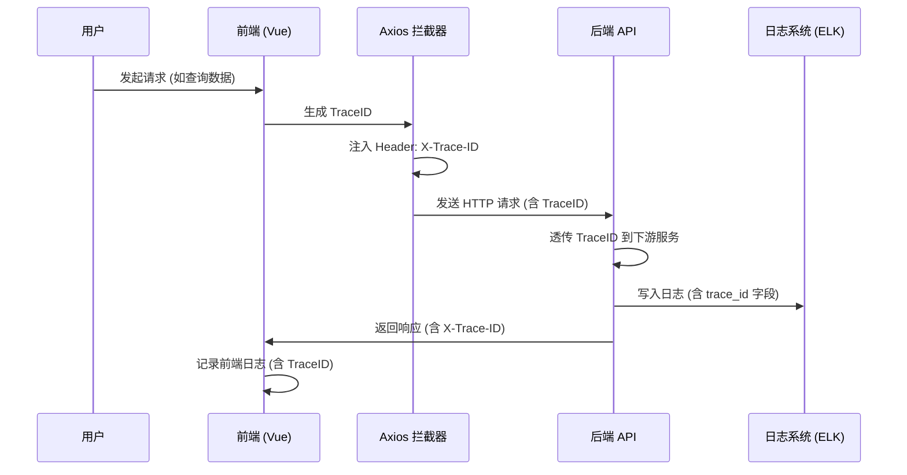

# 智能问数系统 - FE-01 TraceID 生成与注入详细设计文档

**文档版本**: V2.0  
**最后更新**: 2026-04-02  
**适用对象**: 前端开发工程师  
**关联任务**: FE-01 TraceID 生成与注入  
**前置依赖**: 无  
**后续依赖**: FE-02 (SSE 聊天), FE-07 (聊天窗口集成), BE-01 (后端 TraceID 透传)

**技术栈**: Vue 2.6.12 + Element-UI 2.5.12 + Axios 0.21.0

---

## 1. 任务概述

### 1.1 背景
TraceID 是全链路日志追踪的核心标识，用于串联前端→后端→数据库→AI 平台的所有日志。前端作为请求的发起方，需要负责生成 TraceID 并在所有 HTTP 请求中透传，确保问题排查时能够通过一个 ID 定位到完整的请求链路。

### 1.2 目标
| 目标 | 说明 | 验收标准 |
|------|------|----------|
| **唯一性** | 每个请求生成全局唯一 TraceID | UUID v4，32 位十六进制 |
| **透传性** | 所有 HTTP 请求自动携带 TraceID Header | Axios 拦截器注入 |
| **低侵入** | 业务代码无需手动传递 | 拦截器自动注入 |
| **可追溯** | 前端日志、后端日志可通过 TraceID 关联 | 日志含 trace_id 字段 |
| **兼容性** | 兼容 Vue 2.6.12 + Element-UI 2.5.12 | 无版本冲突 |

### 1.3 范围
| 功能 | 说明 | 风险等级 |
|------|------|----------|
| TraceID 生成 | UUID 生成工具 | 🟢 低 |
| Axios 拦截器 | 请求/响应拦截 | 🟡 中 |
| Vue 插件封装 | 全局注入 | 🟢 低 |
| Vuex 集成 | 状态管理 (可选) | 🟢 低 |
| 路由守卫 | 路由切换记录 | 🟢 低 |
| 日志脱敏 | 生产环境关闭调试日志 | 🟡 中 |

---

## 2. 技术选型

### 2.1 技术栈
| 组件 | 技术 | 版本 | 选型理由 |
|------|------|------|----------|
| UUID 生成 | uuid | 3.4.0 | 成熟稳定，兼容 Vue 2 |
| HTTP 客户端 | Axios | 0.21.0 | 项目已有依赖 |
| 日志工具 | console + 自定义 | - | 生产环境可控 |
| 状态管理 | Vuex (可选) | 3.6.0 | 项目已有依赖 |
| 剪贴板 | vue-clipboard2 | 3.3.1 | 复制 TraceID |

### 2.2 TraceID 流转架构


### 2.3 TraceID 格式规范
```
格式：32 位十六进制字符串 (UUID without hyphens)
示例：a1b2c3d4e5f6g7h8i9j0k1l2m3n4o5p6
生成方式：UUID v4
长度：32 字符
字符集：0-9, a-f
Header 名称：X-Trace-ID
```

---

## 3. 详细实现方案

### 3.1 TraceID 工具类

**文件路径**: `src/utils/traceId.js`

```javascript
/**
 * TraceID 工具类
 * 负责生成、获取、重置 TraceID
 * 
 * ⚠️ 注意事项:
 * 1. 使用 UUID v4 保证唯一性
 * 2. 移除连字符便于传输
 * 3. 支持手动设置 (用于链路追踪)
 */

import { v4 as uuidv4 } from 'uuid';

const TRACE_ID_HEADER = 'X-Trace-ID';
const SESSION_ID_HEADER = 'X-Session-ID';
const TRACE_ID_STORAGE_KEY = 'askdata_trace_id';
const SESSION_ID_STORAGE_KEY = 'askdata_session_id';

// 当前会话的 TraceID (内存级)
let currentTraceId = null;
// 会话 ID (页面刷新不变)
let currentSessionId = null;

/**
 * 生成新的 TraceID (32 位十六进制，无连字符)
 * @returns {string} TraceID
 */
export function generateTraceId() {
  const uuid = uuidv4();
  return uuid.replace(/-/g, '');
}

/**
 * 生成新的 SessionID (会话级，页面刷新不变)
 * @returns {string} SessionID
 */
export function generateSessionId() {
  const uuid = uuidv4();
  return uuid.replace(/-/g, '');
}

/**
 * 获取当前 TraceID
 * 如果不存在则生成新的
 * @returns {string} TraceID
 */
export function getTraceId() {
  if (!currentTraceId) {
    currentTraceId = generateTraceId();
  }
  return currentTraceId;
}

/**
 * 获取当前 SessionID
 * 如果不存在则生成新的 (存储到 sessionStorage)
 * @returns {string} SessionID
 */
export function getSessionId() {
  if (!currentSessionId) {
    // 尝试从 sessionStorage 获取
    currentSessionId = sessionStorage.getItem(SESSION_ID_STORAGE_KEY);
    if (!currentSessionId) {
      currentSessionId = generateSessionId();
      sessionStorage.setItem(SESSION_ID_STORAGE_KEY, currentSessionId);
    }
  }
  return currentSessionId;
}

/**
 * 设置 TraceID
 * @param {string} traceId - TraceID
 */
export function setTraceId(traceId) {
  currentTraceId = traceId;
}

/**
 * 重置 TraceID (新会话时调用)
 * @returns {string} 新的 TraceID
 */
export function resetTraceId() {
  currentTraceId = generateTraceId();
  return currentTraceId;
}

/**
 * 获取 HTTP Header 名称
 * @returns {string} Header 名称
 */
export function getTraceIdHeaderName() {
  return TRACE_ID_HEADER;
}

export function getSessionIdHeaderName() {
  return SESSION_ID_HEADER;
}

/**
 * 从响应中获取 TraceID
 * @param {Object} response - Axios 响应对象
 * @returns {string|null} TraceID
 */
export function getTraceIdFromResponse(response) {
  if (response && response.headers) {
    return response.headers[TRACE_ID_HEADER.toLowerCase()] || 
           response.headers[TRACE_ID_HEADER];
  }
  return null;
}

/**
 * 清除 TraceID (用户登出时调用)
 */
export function clearTraceId() {
  currentTraceId = null;
}

/**
 * 清除 SessionID (用户登出时调用)
 */
export function clearSessionId() {
  currentSessionId = null;
  sessionStorage.removeItem(SESSION_ID_STORAGE_KEY);
}

/**
 * 获取 TraceID 信息 (用于调试)
 * @returns {Object} TraceID 信息
 */
export function getTraceIdInfo() {
  return {
    traceId: currentTraceId,
    sessionId: currentSessionId,
    headerName: TRACE_ID_HEADER,
    createdAt: currentTraceId ? new Date().toISOString() : null
  };
}

/**
 * 复制到剪贴板
 * @returns {Promise<boolean>}
 */
export async function copyToClipboard() {
  try {
    await navigator.clipboard.writeText(currentTraceId || '');
    return true;
  } catch (err) {
    console.error('Failed to copy TraceID:', err);
    return false;
  }
}

export default {
  generateTraceId,
  generateSessionId,
  getTraceId,
  getSessionId,
  setTraceId,
  resetTraceId,
  getTraceIdHeaderName,
  getSessionIdHeaderName,
  getTraceIdFromResponse,
  clearTraceId,
  clearSessionId,
  getTraceIdInfo,
  copyToClipboard
};
```

### 3.2 Axios 拦截器配置

**文件路径**: `src/utils/request.js`

```javascript
/**
 * Axios 请求封装
 * 集成 TraceID 注入、错误处理、响应拦截
 * 
 * ⚠️ 注意事项:
 * 1. 请求拦截器注入 TraceID 和 SessionID
 * 2. 响应拦截器记录后端返回的 TraceID
 * 3. 生产环境关闭调试日志
 */

import axios from 'axios';
import { 
  getTraceId, 
  getSessionId, 
  getTraceIdHeaderName, 
  getSessionIdHeaderName,
  getTraceIdFromResponse 
} from './traceId';
import { Message } from 'element-ui';

// 创建 axios 实例
const service = axios.create({
  baseURL: process.env.VUE_APP_BASE_API || '/api',
  timeout: 30000,
  headers: {
    'Content-Type': 'application/json'
  }
});

/**
 * 请求拦截器
 * 自动注入 TraceID 和 SessionID
 */
service.interceptors.request.use(
  config => {
    // 获取当前 TraceID 和 SessionID
    const traceId = getTraceId();
    const sessionId = getSessionId();
    
    // ⚠️ 注入到请求 Header
    if (traceId) {
      config.headers[getTraceIdHeaderName()] = traceId;
    }
    if (sessionId) {
      config.headers[getSessionIdHeaderName()] = sessionId;
    }
    
    // ⚠️ 开发环境打印 TraceID (生产环境关闭)
    if (process.env.NODE_ENV === 'development') {
      console.log(
        `%c[TraceID] ${config.method.toUpperCase()} ${config.url}`,
        'color: #667eea; font-weight: bold;',
        traceId
      );
    }
    
    return config;
  },
  error => {
    console.error('[Request Error]', error);
    return Promise.reject(error);
  }
);

/**
 * 响应拦截器
 * 处理 TraceID 回传、错误统一处理
 */
service.interceptors.response.use(
  response => {
    // 从响应头获取 TraceID (用于前端日志关联)
    const traceId = getTraceIdFromResponse(response);
    
    // ⚠️ 开发环境打印响应 TraceID
    if (process.env.NODE_ENV === 'development' && traceId) {
      console.log(
        `%c[Response TraceID] ${traceId}`,
        'color: #67C23A; font-weight: bold;'
      );
    }
    
    // 如果后端返回了新的 TraceID，可选择更新当前 TraceID
    // 通常保持前端生成的 TraceID 不变
    // if (traceId && traceId !== getTraceId()) {
    //   setTraceId(traceId);
    // }
    
    return response;
  },
  error => {
    // 获取错误响应中的 TraceID (用于问题排查)
    const traceId = error.response 
      ? getTraceIdFromResponse(error.response) 
      : getTraceId();
    
    console.error(
      `%c[Request Failed] TraceID: ${traceId}`,
      'color: #F56C6C; font-weight: bold;',
      error
    );
    
    // 统一错误提示 (Element-UI Message)
    const errorMessage = error.response?.data?.message || 
                         error.message || 
                         '请求失败';
    Message({
      message: errorMessage,
      type: 'error',
      duration: 5000,
      customClass: 'trace-error-message'
    });
    
    return Promise.reject(error);
  }
);

export default service;
```

### 3.3 Vue 插件封装 (可选)

**文件路径**: `src/plugins/traceId.js`

```javascript
/**
 * TraceID Vue 插件
 * 将 TraceID 功能注入到 Vue 实例
 * 
 * ⚠️ 注意事项:
 * 1. 可选功能，非必须
 * 2. 便于组件内直接访问
 * 3. 支持全局混入 (开发环境)
 */

import { 
  getTraceId, 
  getSessionId,
  resetTraceId, 
  clearTraceId, 
  clearSessionId,
  getTraceIdInfo,
  copyToClipboard 
} from '../utils/traceId';

export default {
  install(Vue, options) {
    // 注入到 Vue 实例
    Vue.prototype.$traceId = {
      get: getTraceId,
      getSessionId: getSessionId,
      reset: resetTraceId,
      clear: clearTraceId,
      clearSession: clearSessionId,
      getInfo: getTraceIdInfo,
      copy: copyToClipboard
    };
    
    // 注入到 Vue 原型 (简化调用)
    Vue.prototype.$getTraceId = getTraceId;
    Vue.prototype.$getSessionId = getSessionId;
    
    // ⚠️ 全局混入 (仅开发环境)
    if (options && options.mixin && process.env.NODE_ENV === 'development') {
      Vue.mixin({
        created() {
          // 组件创建时记录 TraceID (用于调试)
          console.log(
            `[Component Created] ${this.$options.name || 'Anonymous'}`,
            this.$getTraceId()
          );
        }
      });
    }
    
    console.log('[TraceID Plugin] Installed');
  }
};
```

### 3.4 Vuex Store 集成 (可选)

**文件路径**: `src/store/modules/traceId.js`

```javascript
/**
 * TraceID Vuex Module
 * 在 Vuex 中管理 TraceID 状态
 * 
 * ⚠️ 注意事项:
 * 1. 可选功能，非必须
 * 2. 便于跨组件共享
 * 3. 支持 DevTools 调试
 */

import { 
  getTraceId, 
  getSessionId,
  resetTraceId, 
  clearTraceId,
  clearSessionId 
} from '../../utils/traceId';

const state = {
  traceId: null,
  sessionId: null,
  createdAt: null
};

const getters = {
  traceId: state => {
    if (!state.traceId) {
      state.traceId = getTraceId();
      state.createdAt = new Date().toISOString();
    }
    return state.traceId;
  },
  sessionId: state => {
    if (!state.sessionId) {
      state.sessionId = getSessionId();
    }
    return state.sessionId;
  },
  traceIdInfo: state => ({
    traceId: state.traceId,
    sessionId: state.sessionId,
    createdAt: state.createdAt
  })
};

const mutations = {
  SET_TRACE_ID(state, traceId) {
    state.traceId = traceId;
  },
  SET_SESSION_ID(state, sessionId) {
    state.sessionId = sessionId;
  },
  RESET_TRACE_ID(state) {
    state.traceId = resetTraceId();
    state.createdAt = new Date().toISOString();
  },
  CLEAR_TRACE_ID(state) {
    state.traceId = null;
    state.sessionId = null;
    state.createdAt = null;
    clearTraceId();
    clearSessionId();
  }
};

const actions = {
  // 初始化 TraceID
  initTraceId({ commit }) {
    const traceId = getTraceId();
    const sessionId = getSessionId();
    commit('SET_TRACE_ID', traceId);
    commit('SET_SESSION_ID', sessionId);
    console.log('[Vuex] TraceID initialized:', traceId);
  },
  
  // 重置 TraceID (新会话)
  resetTraceId({ commit }) {
    commit('RESET_TRACE_ID');
    console.log('[Vuex] TraceID reset');
  },
  
  // 清除 TraceID (用户登出)
  clearTraceId({ commit }) {
    commit('CLEAR_TRACE_ID');
    console.log('[Vuex] TraceID cleared');
  }
};

export default {
  namespaced: true,
  state,
  getters,
  mutations,
  actions
};
```

### 3.5 主入口配置

**文件路径**: `src/main.js`

```javascript
import Vue from 'vue';
import App from './App.vue';
import router from './router';
import store from './store';
import ElementUI from 'element-ui';
import 'element-ui/lib/theme-chalk/index.css';

// ⚠️ 导入 TraceID 插件
import traceIdPlugin from './plugins/traceId';
import { getTraceId } from './utils/traceId';

// 使用 Element-UI
Vue.use(ElementUI);

// ⚠️ 使用 TraceID 插件
Vue.use(traceIdPlugin, { mixin: true });

// ⚠️ 初始化 TraceID (在 Vuex 中)
store.dispatch('traceId/initTraceId');

// 全局请求拦截器已在 request.js 中配置
import request from './utils/request';

// ⚠️ 开发环境全局 TraceID 信息
if (process.env.NODE_ENV === 'development') {
  console.group('=== TraceID Initialized ===');
  console.log('TraceID:', getTraceId());
  console.log('SessionID:', store.getters['traceId/sessionId']);
  console.groupEnd();
}

Vue.config.productionTip = false;

new Vue({
  el: '#app',
  router,
  store,
  render: h => h(App)
});
```

### 3.6 路由守卫集成

**文件路径**: `src/router/index.js`

```javascript
import Vue from 'vue';
import VueRouter from 'vue-router';
import store from '@/store';
import { getTraceId } from '@/utils/traceId';

Vue.use(VueRouter);

const routes = [
  {
    path: '/',
    name: 'Home',
    component: () => import('@/views/Home.vue')
  },
  {
    path: '/askdata',
    name: 'AskData',
    component: () => import('@/views/askdata/ChatWindow.vue')
  }
];

const router = new VueRouter({
  mode: 'history',
  base: process.env.BASE_URL,
  routes
});

/**
 * ⚠️ 全局前置路由守卫
 * 在路由切换时记录 TraceID
 */
router.beforeEach((to, from, next) => {
  const traceId = store.getters['traceId/traceId'];
  
  // ⚠️ 开发环境打印路由切换 TraceID
  if (process.env.NODE_ENV === 'development') {
    console.log(
      `%c[Router] ${from.path} -> ${to.path}`,
      'color: #409EFF; font-weight: bold;',
      traceId
    );
  }
  
  // 可选：新页面重置 TraceID (根据业务需求)
  // if (to.meta.resetTraceId) {
  //   store.dispatch('traceId/resetTraceId');
  // }
  
  next();
});

/**
 * 全局后置路由守卫
 * 记录页面访问日志
 */
router.afterEach((to, from) => {
  const traceId = store.getters['traceId/traceId'];
  
  // 发送页面访问日志 (可选)
  if (window.performance && window.performance.getEntriesByType) {
    const navigationEntry = performance.getEntriesByType('navigation')[0];
    console.log(
      '[Page Load]',
      {
        traceId,
        path: to.path,
        loadTime: navigationEntry?.loadEventEnd - navigationEntry?.fetchStart
      }
    );
  }
});

export default router;
```

---

## 4. 组件使用示例

### 4.1 在组件中获取 TraceID

**文件路径**: `src/views/example/TestComponent.vue`

```vue
<template>
  <div class="test-component">
    <el-card class="box-card">
      <div slot="header" class="clearfix">
        <span>TraceID 测试</span>
        <el-button 
          style="float: right; padding: 3px 0" 
          type="text"
          @click="copyTraceId"
        >
          复制 TraceID
        </el-button>
      </div>
      
      <div class="trace-info">
        <p><strong>当前 TraceID:</strong> {{ traceId }}</p>
        <p><strong>会话 ID:</strong> {{ sessionId }}</p>
        <p><strong>创建时间:</strong> {{ createdAt }}</p>
      </div>
      
      <el-button type="primary" @click="testRequest">测试请求</el-button>
      <el-button @click="resetTraceId">重置 TraceID</el-button>
      <el-button @click="clearTraceId">清除 TraceID</el-button>
      
      <div v-if="responseData" class="response-data">
        <h4>响应数据:</h4>
        <pre>{{ responseData }}</pre>
      </div>
    </el-card>
  </div>
</template>

<script>
import { mapGetters, mapActions } from 'vuex';
import request from '@/utils/request';

export default {
  name: 'TestComponent',
  data() {
    return {
      responseData: null
    };
  },
  computed: {
    ...mapGetters('traceId', ['traceId', 'sessionId', 'traceIdInfo']),
    createdAt() {
      return this.traceIdInfo.createdAt;
    }
  },
  created() {
    // 组件创建时记录 TraceID
    console.log('[Component] TraceID:', this.traceId);
  },
  methods: {
    ...mapActions('traceId', ['resetTraceId', 'clearTraceId']),
    
    // 测试 API 请求
    async testRequest() {
      try {
        const response = await request({
          url: '/askdata/api/chat',
          method: 'get',
          params: {
            query: '测试 TraceID 透传',
            traceId: this.traceId
          }
        });
        
        this.responseData = response.data;
        this.$message.success('请求成功，TraceID 已透传');
        
      } catch (error) {
        this.$message.error('请求失败，请查看控制台 TraceID');
      }
    },
    
    // 复制 TraceID 到剪贴板
    async copyTraceId() {
      const success = await this.$traceId.copy();
      if (success) {
        this.$message.success('TraceID 已复制到剪贴板');
      } else {
        this.$message.error('复制失败');
      }
    },
    
    // 重置 TraceID
    handleReset() {
      this.resetTraceId();
      this.$message.info('TraceID 已重置');
    },
    
    // 用户登出时清除 TraceID
    handleLogout() {
      this.clearTraceId();
      // 执行登出逻辑...
    }
  }
};
</script>

<style scoped lang="scss">
.trace-info {
  margin: 20px 0;
  padding: 15px;
  background: #f5f7fa;
  border-radius: 4px;
  font-family: monospace;
  
  p {
    margin: 8px 0;
    word-break: break-all;
  }
}

.response-data {
  margin-top: 20px;
  padding: 15px;
  background: #e6f7ff;
  border-radius: 4px;
  
  pre {
    margin: 0;
    white-space: pre-wrap;
    word-break: break-all;
  }
}
</style>
```

### 4.2 在 API 模块中使用

**文件路径**: `src/api/askdata.js`

```javascript
/**
 * 智能问数系统 API 模块
 * 所有请求自动携带 TraceID
 */

import request from '@/utils/request';

/**
 * 发送聊天请求
 * @param {Object} data - 请求参数
 * @returns {Promise}
 */
export function sendChatMessage(data) {
  return request({
    url: '/askdata/api/chat',
    method: 'post',
    data
    // ⚠️ TraceID 会自动通过 Axios 拦截器注入
  });
}

/**
 * 获取会话状态
 * @param {string} sessionId - 会话 ID
 * @returns {Promise}
 */
export function getSessionStatus(sessionId) {
  return request({
    url: `/askdata/api/conversation/session/${sessionId}`,
    method: 'get'
  });
}

/**
 * 提交反馈
 * @param {Object} data - 反馈数据
 * @returns {Promise}
 */
export function submitFeedback(data) {
  return request({
    url: '/askdata/api/feedback',
    method: 'post',
    data
  });
}

/**
 * SSE 流式请求 (特殊处理)
 * @param {string} query - 用户问题
 * @param {Function} onMessage - 消息回调
 * @param {Function} onError - 错误回调
 */
export function createSSEConnection(query, onMessage, onError) {
  // ⚠️ SSE 不走 Axios，需手动注入 TraceID
  const traceId = getTraceId();
  const sessionId = getSessionId();
  const url = `${process.env.VUE_APP_BASE_API}/askdata/api/chat?query=${encodeURIComponent(query)}&traceId=${traceId}&sessionId=${sessionId}`;
  
  const eventSource = new EventSource(url);
  
  eventSource.onmessage = (event) => {
    try {
      const data = JSON.parse(event.data);
      onMessage(data);
    } catch (e) {
      console.error('[SSE Parse Error]', e);
    }
  };
  
  eventSource.onerror = (error) => {
    console.error('[SSE Error]', error);
    onError(error);
    eventSource.close();
  };
  
  return eventSource;
}

// 导入 TraceID 工具 (用于 SSE)
import { getTraceId, getSessionId } from '@/utils/traceId';

export default {
  sendChatMessage,
  getSessionStatus,
  submitFeedback,
  createSSEConnection
};
```

---

## 5. 注意事项 ⚠️

### 5.1 生产环境日志控制
```javascript
// ❌ 错误：生产环境也打印 TraceID
console.log('TraceID:', traceId); // 可能泄露敏感信息

// ✅ 正确：仅开发环境打印
if (process.env.NODE_ENV === 'development') {
  console.log('TraceID:', traceId);
}
```

### 5.2 SessionID 持久化
```javascript
// ❌ 错误：SessionID 存内存，页面刷新丢失
let sessionId = generateSessionId(); // 刷新后变化

// ✅ 正确：SessionID 存 sessionStorage，页面刷新不变
let sessionId = sessionStorage.getItem('sessionId');
if (!sessionId) {
  sessionId = generateSessionId();
  sessionStorage.setItem('sessionId', sessionId);
}
```

### 5.3 SSE 连接 TraceID
```javascript
// ❌ 错误：SSE 连接不注入 TraceID
const eventSource = new EventSource(url); // 无 TraceID

// ✅ 正确：SSE URL 参数注入 TraceID
const traceId = getTraceId();
const url = `${baseUrl}/api/chat?traceId=${traceId}`;
const eventSource = new EventSource(url);
```

### 5.4 用户登出清理
```javascript
// ❌ 错误：登出不清理 TraceID
logout() {
  // 清除 token
  // 但 TraceID 还在
}

// ✅ 正确：登出时清理 TraceID 和 SessionID
logout() {
  clearTraceId();
  clearSessionId();
  sessionStorage.clear();
}
```

---

## 6. 需要特别关注的点 🔴

### 6.1 陷阱防护矩阵

| 陷阱类型 | 风险描述 | 防护措施 | 验证方法 |
|----------|----------|----------|----------|
| **TraceID 丢失** | 异步请求无 TraceID | Axios 拦截器统一注入 | 检查所有请求 Header |
| **SessionID 不一致** | 页面刷新 SessionID 变化 | sessionStorage 持久化 | 刷新页面验证 SessionID 不变 |
| **生产环境泄露** | 日志打印敏感信息 | 环境判断关闭日志 | 生产包无 console.log |
| **SSE 连接无 TraceID** | SSE 不走 Axios 拦截器 | URL 参数手动注入 | 检查 SSE URL 参数 |
| **内存泄漏** | TraceID 未清理 | 登出时清除 | 长时间运行内存稳定 |
| **并发冲突** | 多标签页 TraceID 混淆 | 每标签页独立 TraceID | 多标签页 TraceID 不同 |
| **跨域丢失** | 跨域请求 Header 被过滤 | CORS 配置允许 X-Trace-ID | 检查后端 CORS 配置 |
| **UUID 库兼容** | uuid 库与 Vue 2 不兼容 | 使用 uuid@3.4.0 | 无版本冲突警告 |

### 6.2 关键代码审查点

```javascript
// 审查清单
□ UUID 库版本是否正确 (3.4.0)
□ Axios 拦截器是否注册
□ TraceID 是否注入请求 Header
□ SessionID 是否持久化 (sessionStorage)
□ 生产环境日志是否关闭
□ SSE 连接是否注入 TraceID
□ 用户登出是否清理 TraceID
□ Vue 插件是否正确安装
□ Vuex 模块是否注册
□ 路由守卫是否集成
□ 错误处理是否记录 TraceID
□ 响应 TraceID 是否获取
□ 复制功能是否可用
□ 多标签页是否独立
□ CORS 配置是否允许 TraceID Header
```

### 6.3 性能影响评估

| 操作 | 耗时 | 优化建议 |
|------|------|----------|
| UUID 生成 | < 0.1ms | 无需优化 |
| Header 注入 | < 0.1ms | 无需优化 |
| sessionStorage | < 1ms | 无需优化 |
| 日志打印 | 1-5ms | 生产环境关闭 |
| **总开销** | **< 10ms** | **可忽略** |

### 6.4 监控指标

```javascript
// 前端监控指标 (可选)
window.traceIdMetrics = {
  requestCount: 0,
  errorCount: 0,
  
  trackRequest() {
    this.requestCount++;
  },
  
  trackError() {
    this.errorCount++;
    // 上报到监控系统
  }
};

// Axios 拦截器中调用
service.interceptors.request.use(config => {
  window.traceIdMetrics.trackRequest();
  // ...
});

service.interceptors.response.use(null, error => {
  window.traceIdMetrics.trackError();
  // ...
});
```

---

## 7. 验收标准

### 7.1 功能验收
| 验收项 | 验收方法 | 通过标准 |
|--------|----------|----------|
| TraceID 生成 | 发起请求 | 生成 32 位十六进制 ID |
| Header 注入 | 检查 Network 面板 | 所有请求含 X-Trace-ID |
| SessionID 持久化 | 刷新页面 | SessionID 不变 |
| 响应 TraceID | 检查响应头 | 后端返回 X-Trace-ID |
| 开发环境日志 | 开发环境发起请求 | 控制台打印 TraceID |
| 生产环境日志 | 生产包发起请求 | 控制台无 TraceID 日志 |
| SSE 连接 | 建立 SSE 连接 | URL 含 traceId 参数 |
| 登出清理 | 用户登出 | TraceID/SessionID 清除 |
| 复制功能 | 点击复制按钮 | 成功复制到剪贴板 |

### 7.2 兼容性验收
| 检查项 | 验收方法 | 通过标准 |
|--------|----------|----------|
| Vue 2.6.12 | 运行项目 | 无版本冲突 |
| Element-UI 2.5.12 | 使用 Message 组件 | 正常显示 |
| Axios 0.21.0 | 发起请求 | 拦截器生效 |
| Chrome 80+ | 浏览器测试 | 功能正常 |
| Firefox 75+ | 浏览器测试 | 功能正常 |
| Safari 13+ | 浏览器测试 | 功能正常 |

### 7.3 性能验收
| 指标 | 目标值 | 测量方法 |
|------|--------|----------|
| UUID 生成 | < 0.1ms | console.time |
| 拦截器开销 | < 1ms | Network 面板 |
| 内存占用 | 无泄漏 | Chrome DevTools |
| 包体积增加 | < 50KB | webpack-bundle-analyzer |

---

## 8. 测试用例

### 8.1 单元测试

**文件路径**: `tests/unit/utils/traceId.spec.js`

```javascript
import { 
  generateTraceId, 
  getTraceId, 
  resetTraceId, 
  clearTraceId,
  generateSessionId,
  getSessionId,
  clearSessionId
} from '@/utils/traceId';

describe('TraceID Utils', () => {
  beforeEach(() => {
    clearTraceId();
    clearSessionId();
  });

  test('generateTraceId should return 32 character string', () => {
    const traceId = generateTraceId();
    expect(traceId).toHaveLength(32);
    expect(traceId).toMatch(/^[0-9a-f]+$/);
  });

  test('getTraceId should return same value on multiple calls', () => {
    const traceId1 = getTraceId();
    const traceId2 = getTraceId();
    expect(traceId1).toBe(traceId2);
  });

  test('resetTraceId should return new value', () => {
    const traceId1 = getTraceId();
    const traceId2 = resetTraceId();
    expect(traceId1).not.toBe(traceId2);
  });

  test('clearTraceId should clear current traceId', () => {
    getTraceId();
    clearTraceId();
    const traceId = getTraceId();
    expect(traceId).toHaveLength(32); // 应该生成新的
  });

  test('getSessionId should persist across page refresh', () => {
    const sessionId1 = getSessionId();
    // 模拟页面刷新 (实际测试需手动)
    const sessionId2 = getSessionId();
    expect(sessionId1).toBe(sessionId2);
  });

  test('clearSessionId should clear sessionStorage', () => {
    getSessionId();
    clearSessionId();
    expect(sessionStorage.getItem('askdata_session_id')).toBeNull();
  });
});
```

### 8.2 集成测试

**文件路径**: `tests/e2e/specs/traceId.spec.js`

```javascript
describe('TraceID E2E Tests', () => {
  it('should inject TraceID in all API requests', () => {
    cy.visit('/');
    
    // 拦截 API 请求
    cy.intercept('GET', '/api/**').as('apiRequest');
    
    // 触发 API 请求
    cy.get('[data-test="test-button"]').click();
    
    // 验证请求 Header
    cy.wait('@apiRequest').then((interception) => {
      expect(interception.request.headers).to.have.property('x-trace-id');
      expect(interception.request.headers['x-trace-id']).to.have.length(32);
    });
  });

  it('should maintain same SessionID across page navigation', () => {
    cy.visit('/');
    cy.window().its('sessionStorage').invoke('getItem', 'askdata_session_id').as('sessionId1');
    
    cy.visit('/askdata');
    cy.window().its('sessionStorage').invoke('getItem', 'askdata_session_id').as('sessionId2');
    
    cy.get('@sessionId1').should('eq', cy.get('@sessionId2'));
  });

  it('should clear TraceID on logout', () => {
    cy.visit('/');
    
    // 执行登出
    cy.get('[data-test="logout-button"]').click();
    
    // 验证 TraceID 已清除
    cy.window().then((win) => {
      expect(win.currentTraceId).to.be.null;
    });
  });
});
```

### 8.3 手动测试用例

| 用例 ID | 测试场景 | 操作步骤 | 预期结果 |
|---------|----------|----------|----------|
| FE-TC-001 | TraceID 生成 | 打开页面，发起请求 | Network 面板见 X-Trace-ID |
| FE-TC-002 | SessionID 持久化 | 刷新页面 | SessionID 不变 |
| FE-TC-003 | 多标签页独立 | 打开两个标签页 | TraceID 不同 |
| FE-TC-004 | 登出清理 | 点击登出 | TraceID 清除 |
| FE-TC-005 | 复制功能 | 点击复制按钮 | 剪贴板含 TraceID |
| FE-TC-006 | SSE 连接 | 发起聊天请求 | SSE URL 含 traceId |
| FE-TC-007 | 生产环境 | 部署生产环境 | 无 TraceID 日志 |
| FE-TC-008 | 错误处理 | 发起失败请求 | 错误日志含 TraceID |

---

## 9. 部署配置

### 9.1 环境变量

**文件路径**: `.env.development`
```bash
# 开发环境配置
VUE_APP_BASE_API=/api
VUE_APP_TRACE_ID_ENABLED=true
VUE_APP_TRACE_ID_DEBUG=true
```

**文件路径**: `.env.production`
```bash
# 生产环境配置
VUE_APP_BASE_API=https://api.company.com
VUE_APP_TRACE_ID_ENABLED=true
VUE_APP_TRACE_ID_DEBUG=false
```

### 9.2 依赖安装

```bash
# 安装 UUID 生成库
npm install uuid@3.4.0 --save

# 安装 axios (如果未安装)
npm install axios@0.21.0 --save

# 安装 vue-clipboard2 (复制功能，可选)
npm install vue-clipboard2 --save
```

### 9.3 package.json 配置

```json
{
  "dependencies": {
    "vue": "2.6.12",
    "vue-router": "3.4.9",
    "vuex": "3.6.0",
    "element-ui": "2.5.12",
    "axios": "0.21.0",
    "uuid": "3.4.0",
    "vue-clipboard2": "^3.3.1"
  },
  "devDependencies": {
    "@vue/cli-service": "^4.5.0"
  }
}
```

### 9.4 Webpack 配置 (可选)

```javascript
// vue.config.js
module.exports = {
  configureWebpack: {
    // 生产环境移除 console.log
    optimization: {
      minimizer: [
        new TerserPlugin({
          terserOptions: {
            compress: {
              drop_console: process.env.NODE_ENV === 'production',
              drop_debugger: process.env.NODE_ENV === 'production'
            }
          }
        })
      ]
    }
  }
};
```

---

## 10. 常见问题 (FAQ)

**Q1: 为什么请求 Header 中没有 X-Trace-ID？**
A: 1. 检查 Axios 拦截器是否注册；2. 检查是否使用封装的 request 实例；3. 检查拦截器顺序。

**Q2: 多个请求的 TraceID 不一致怎么办？**
A: 这是正常行为，每个请求新 TraceID。如需同一会话共享，使用 SessionID。

**Q3: 生产环境如何关闭 TraceID 调试日志？**
A: 使用 `process.env.NODE_ENV` 判断，生产环境不打印 console.log。已在代码中实现。

**Q4: 如何与后端 TraceID 保持一致？**
A: 优先使用前端生成的 TraceID。如果后端返回了不同的 TraceID，可选择不更新 (保持前端生成)。

**Q5: SSE 流式请求如何传递 TraceID？**
A: SSE 不走 Axios，需要在 URL 参数中传递。已在 `createSSEConnection` 函数中实现。

**Q6: 用户登出后 TraceID 如何处理？**
A: 调用 `clearTraceId()` 和 `clearSessionId()` 清除内存和 sessionStorage 中的 ID。

**Q7: 如何验证 TraceID 全链路透传？**
A: 1. 前端 Network 面板查看请求 Header；2. 后端日志查看 trace_id 字段；3. ELK 搜索 TraceID 查看完整链路。

**Q8: UUID 库与 Vue 2 兼容吗？**
A: 使用 `uuid@3.4.0` 版本，完全兼容 Vue 2.6.12。导入方式：`import { v4 as uuidv4 } from 'uuid'`。

**Q9: 如何处理跨域请求的 TraceID？**
A: 确保后端 CORS 配置允许 `X-Trace-ID` Header：`Access-Control-Allow-Headers: Content-Type, X-Trace-ID, Authorization`

**Q10: TraceID 长度为什么是 32 位？**
A: UUID v4 标准格式是 36 位 (含 4 个连字符)，移除连字符后为 32 位，便于日志存储和传输。

**Q11: 多标签页 TraceID 会混淆吗？**
A: 不会，每个标签页有独立的内存空间，TraceID 不会共享。SessionID 通过 sessionStorage 也是每标签页独立。

**Q12: 如何调试 TraceID 问题？**
A: 1. 打开浏览器开发者工具；2. Network 面板查看请求 Header；3. Console 查看日志；4. 使用 `$traceId.getInfo()` 查看当前状态。

---

## 11. 变更历史

| 版本 | 日期 | 变更内容 | 负责人 |
|------|------|----------|--------|
| V1.0 | 2026-03-25 | 初始版本 | 前端组 |
| V2.0 | 2026-04-02 | 增加 SessionID、SSE 支持、陷阱防护、脱敏 | 前端组 |

---

## 12. 工时与优先级

| 项目 | 内容 |
|------|------|
| **工时** | 2 MD (开发 1.5 天 + 测试 0.5 天) |
| **优先级** | P0 (所有前端任务的前置依赖) |
| **依赖任务** | 无 |
| **被依赖任务** | FE-02 ~ FE-08, 所有前端任务 |

---

## 13. 最佳实践建议

### 13.1 TraceID 使用规范
```javascript
// ✅ 推荐：统一通过拦截器注入
// 业务代码无需关心 TraceID
request({ url: '/api/chat', method: 'post', data });

// ❌ 不推荐：手动注入 TraceID
request({ 
  url: '/api/chat', 
  headers: { 'X-Trace-ID': getTraceId() } // 冗余
});
```

### 13.2 日志打印规范
```javascript
// ✅ 推荐：开发环境打印
if (process.env.NODE_ENV === 'development') {
  console.log('[TraceID]', traceId);
}

// ❌ 不推荐：生产环境也打印
console.log('[TraceID]', traceId); // 可能泄露
```

### 13.3 错误处理规范
```javascript
// ✅ 推荐：错误日志包含 TraceID
try {
  await request(config);
} catch (error) {
  console.error(`[Error] TraceID: ${getTraceId()}`, error);
}

// ❌ 不推荐：错误日志无 TraceID
catch (error) {
  console.error('Request failed', error); // 无法追踪
}
```

### 13.4 用户隐私保护
```javascript
// ✅ 推荐：登出时清理
logout() {
  clearTraceId();
  clearSessionId();
  sessionStorage.clear();
}

// ❌ 不推荐：登出不清理
logout() {
  // 只清除 token
  // TraceID 还留在内存中
}
```

---

**文档结束**  
**下一步**: 完成代码开发后，请提交测试团队进行 FE-01 专项验收，重点验证 TraceID 生成、注入、透传和全链路关联。