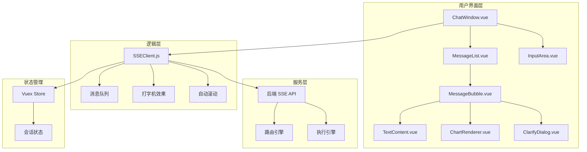

# 智能问数系统 - FE-02 SSE 流式聊天组件详细设计文档

**文档版本**: V2.0  
**最后更新**: 2026-04-02  
**适用对象**: 前端开发工程师  
**关联任务**: FE-02 SSE 流式聊天组件  
**前置依赖**: FE-01 (TraceID 生成与注入), BE-02 (HiAgent 客户端集成)  
**后续依赖**: FE-03 (图表渲染), FE-04 (澄清对话框), FE-07 (聊天窗口集成)

**技术栈**: Vue 2.6.12 + Element-UI 2.5.12 + Axios 0.21.0

---

## 1. 任务概述

### 1.1 背景
SSE (Server-Sent Events) 流式聊天组件是智能问数系统的核心交互界面，负责与后端建立长连接，实时接收 AI 生成的流式响应（文本、图表、澄清问题等），并提供流畅的用户体验（打字机效果、自动滚动、断线重连）。

### 1.2 目标
| 目标 | 说明 | 验收标准 |
|------|------|----------|
| **流式响应** | 支持 SSE 流式接收，逐字显示 | 打字机效果流畅 |
| **多类型消息** | 支持文本、图表、澄清、错误等 | 消息类型正确渲染 |
| **自动重连** | 网络异常时自动重连，最多 3 次 | 重连成功率 ≥ 90% |
| **智能滚动** | 新消息自动滚动到底部，用户滚动时暂停 | 滚动体验流畅 |
| **低侵入** | 业务组件只需调用简单接口 | 组件可复用 |
| **兼容性** | 兼容 Vue 2.6.12 + Element-UI 2.5.12 | 无版本冲突 |

### 1.3 范围
| 功能 | 说明 | 风险等级 |
|------|------|----------|
| SSE 客户端封装 | EventSource 封装，自动重连 | 🟡 中 |
| 消息队列管理 | 消息顺序处理，防丢失 | 🟡 中 |
| 打字机效果 | 文本逐字显示 | 🟢 低 |
| 自动滚动 | 智能滚动控制 | 🟢 低 |
| 消息类型渲染 | 文本/图表/澄清/错误 | 🟡 中 |
| 连接状态管理 | 连接/断开/重连状态 | 🟢 低 |
| TraceID 透传 | SSE 连接携带 TraceID | 🟡 中 |

---

## 2. 技术选型

### 2.1 技术栈
| 组件 | 技术 | 版本 | 选型理由 |
|------|------|------|----------|
| SSE 客户端 | EventSource | 原生 | 浏览器原生支持 |
| HTTP 客户端 | Axios | 0.21.0 | 项目已有依赖 |
| UI 组件 | Element-UI | 2.5.12 | 项目已有依赖 |
| 状态管理 | Vuex (可选) | 3.6.0 | 项目已有依赖 |
| 滚动优化 | 自定义指令 | - | 避免依赖库 |

### 2.2 SSE 消息协议
```json
// 文本消息
{
  "traceId": "a1b2c3d4...",
  "messageId": "msg_001",
  "type": "text",
  "content": "正在为您查询...",
  "confidence": 0.95
}

// 图表消息
{
  "traceId": "a1b2c3d4...",
  "messageId": "msg_002",
  "type": "chart",
  "chartType": "bar",
  "data": [{"name": "华东", "value": 1000}],
  "chartOptions": {...}
}

// 澄清消息
{
  "traceId": "a1b2c3d4...",
  "messageId": "msg_003",
  "type": "clarify",
  "needClarify": true,
  "clarifyQuestion": "您想查看哪个地区？",
  "clarifyOptions": ["华东区", "华北区", "全国"]
}

// 错误消息
{
  "traceId": "a1b2c3d4...",
  "messageId": "msg_004",
  "type": "error",
  "message": "查询失败，请稍后重试"
}

// 结束标志
{
  "traceId": "a1b2c3d4...",
  "messageId": "msg_005",
  "type": "end",
  "suggestions": ["查看趋势", "对比上月", "导出数据"]
}
```

### 2.3 组件架构


---

## 3. 详细实现方案

### 3.1 SSE 客户端封装

**文件路径**: `src/utils/sse-client.js`

```javascript
/**
 * SSE 客户端封装
 * 支持自动重连、心跳检测、错误处理
 * 
 * ⚠️ 注意事项:
 * 1. 使用原生 EventSource，兼容性好
 * 2. 自动重连最多 3 次
 * 3. TraceID 通过 URL 参数传递
 * 4. 心跳检测防止连接超时
 */

import { getTraceId, getSessionId } from './traceId';

export default class SSEClient {
  constructor(url, options = {}) {
    this.url = url;
    this.options = {
      // 重连间隔 3 秒
      reconnectInterval: 3000,
      // 最大重连次数 3 次
      maxReconnectAttempts: 3,
      // 心跳超时 30 秒
      heartbeatTimeout: 30000,
      // 回调函数
      onOpen: () => {},
      onMessage: () => {},
      onError: () => {},
      onClose: () => {},
      ...options
    };
    
    this.eventSource = null;
    this.reconnectAttempts = 0;
    this.isClosed = false;
    this.heartbeatTimer = null;
    this.lastMessageTime = null;
  }

  /**
   * 连接 SSE
   */
  connect() {
    if (this.isClosed) {
      console.warn('[SSE] Client is closed, cannot connect');
      return;
    }

    try {
      // ⚠️ 添加 TraceID 和 SessionID 到 URL 参数
      const traceId = getTraceId();
      const sessionId = getSessionId();
      const separator = this.url.includes('?') ? '&' : '?';
      const finalUrl = `${this.url}${separator}traceId=${traceId}&sessionId=${sessionId}`;

      console.log('[SSE] Connecting to:', finalUrl);
      
      this.eventSource = new EventSource(finalUrl, {
        withCredentials: true
      });

      // 连接成功
      this.eventSource.onopen = () => {
        console.log('[SSE] Connection opened');
        this.reconnectAttempts = 0;
        this.options.onOpen();
        this.startHeartbeat();
      };

      // 接收消息
      this.eventSource.onmessage = (event) => {
        console.log('[SSE] Message received:', event.data);
        this.lastMessageTime = Date.now();
        this.resetHeartbeat();
        
        try {
          const data = JSON.parse(event.data);
          this.options.onMessage(data);
        } catch (e) {
          console.error('[SSE] Parse error:', e);
          this.options.onError({
            type: 'parse_error',
            message: '消息解析失败',
            originalData: event.data
          });
        }
      };

      // 连接错误
      this.eventSource.onerror = (error) => {
        console.error('[SSE] Connection error:', error);
        this.stopHeartbeat();
        
        this.options.onError({
          type: 'connection_error',
          message: '连接失败',
          error
        });

        // ⚠️ 尝试重连
        this.handleReconnect();
      };

    } catch (e) {
      console.error('[SSE] Failed to create EventSource:', e);
      this.options.onError({
        type: 'initialization_error',
        message: '初始化失败',
        error: e
      });
    }
  }

  /**
   * 处理重连
   */
  handleReconnect() {
    if (this.isClosed) {
      console.log('[SSE] Client is closed, no reconnect');
      return;
    }

    if (this.reconnectAttempts >= this.options.maxReconnectAttempts) {
      console.warn('[SSE] Max reconnect attempts reached');
      this.options.onError({
        type: 'max_reconnect_reached',
        message: `重连失败，已达到最大重试次数 (${this.options.maxReconnectAttempts})`
      });
      this.close();
      return;
    }

    this.reconnectAttempts++;
    console.log(
      `[SSE] Reconnecting... attempt ${this.reconnectAttempts}/${this.options.maxReconnectAttempts}`
    );
    
    setTimeout(() => {
      if (!this.isClosed) {
        this.close();
        this.connect();
      }
    }, this.options.reconnectInterval);
  }

  /**
   * 关闭连接
   */
  close() {
    this.isClosed = true;
    this.stopHeartbeat();
    
    if (this.eventSource) {
      this.eventSource.close();
      this.eventSource = null;
      console.log('[SSE] Connection closed');
      this.options.onClose();
    }
  }

  /**
   * 重置连接 (用于重新连接)
   */
  reset() {
    this.isClosed = false;
    this.reconnectAttempts = 0;
    this.close();
    this.connect();
  }

  /**
   * 启动心跳检测
   */
  startHeartbeat() {
    this.stopHeartbeat();
    this.heartbeatTimer = setInterval(() => {
      console.log('[SSE] Heartbeat check');
      
      // 检查是否超时未收到消息
      if (this.lastMessageTime && 
          Date.now() - this.lastMessageTime > this.options.heartbeatTimeout) {
        console.warn('[SSE] Heartbeat timeout, reconnecting...');
        this.handleReconnect();
      }
    }, this.options.heartbeatTimeout);
  }

  /**
   * 重置心跳
   */
  resetHeartbeat() {
    if (this.heartbeatTimer) {
      clearInterval(this.heartbeatTimer);
      this.startHeartbeat();
    }
  }

  /**
   * 停止心跳
   */
  stopHeartbeat() {
    if (this.heartbeatTimer) {
      clearInterval(this.heartbeatTimer);
      this.heartbeatTimer = null;
    }
  }

  /**
   * 获取连接状态
   */
  getState() {
    if (!this.eventSource) {
      return 'closed';
    }
    if (this.eventSource.readyState === EventSource.CONNECTING) {
      return 'connecting';
    }
    if (this.eventSource.readyState === EventSource.OPEN) {
      return 'open';
    }
    return 'closed';
  }

  /**
   * 获取重连次数
   */
  getReconnectAttempts() {
    return this.reconnectAttempts;
  }
}
```

### 3.2 聊天组件混入

**文件路径**: `src/mixins/useSSEChat.js`

```javascript
/**
 * SSE 聊天逻辑混入
 * Vue 2.6.12 不支持 Composition API，使用 mixins 实现
 * 
 * ⚠️ 注意事项:
 * 1. 管理 SSE 客户端生命周期
 * 2. 处理消息队列
 * 3. 控制自动滚动
 * 4. 处理各种消息类型
 */

import SSEClient from '@/utils/sse-client';
import { getTraceId, resetTraceId, getSessionId } from '@/utils/traceId';
import { mapGetters, mapActions } from 'vuex';

export default {
  data() {
    return {
      // 消息列表
      messages: [],
      
      // 当前输入
      inputValue: '',
      
      // 加载状态
      isLoading: false,
      
      // 错误信息
      errorMessage: null,
      
      // ⚠️ SSE 客户端
      sseClient: null,
      
      // 当前消息 ID
      currentMessageId: null,
      
      // ⚠️ 打字机效果定时器
      typewriterTimer: null,
      
      // ⚠️ 自动滚动控制
      autoScroll: true,
      
      // 重连提示
      reconnecting: false,
      
      // 连接状态
      connectionState: 'closed' // closed/connecting/open
    };
  },

  computed: {
    ...mapGetters('traceId', ['traceId']),
    ...mapGetters('conversation', ['sessionId'])
  },

  methods: {
    ...mapActions('conversation', ['addMessage', 'updateMessage']),

    /**
     * 初始化 SSE 客户端
     */
    initSSEClient() {
      const baseUrl = process.env.VUE_APP_BASE_API || '/api';
      const url = `${baseUrl}/askdata/api/chat`;

      this.sseClient = new SSEClient(url, {
        onOpen: this.handleSSEOpen,
        onMessage: this.handleSSEMessage,
        onError: this.handleSSEError,
        onClose: this.handleSSEClose,
        reconnectInterval: 3000,
        maxReconnectAttempts: 3
      });
    },

    /**
     * 发送消息
     */
    async sendMessage(query) {
      if (!query || !query.trim() || this.isLoading) {
        return;
      }

      const message = query.trim();
      this.inputValue = '';
      this.errorMessage = null;
      this.isLoading = true;
      this.reconnecting = false;

      // ⚠️ 添加用户消息
      const userMessage = {
        id: `user_${Date.now()}`,
        type: 'user',
        content: message,
        timestamp: Date.now()
      };
      this.messages.push(userMessage);
      this.scrollToBottom();

      // ⚠️ 关闭之前的 SSE 连接
      if (this.sseClient) {
        this.sseClient.close();
      }

      // ⚠️ 创建新的 SSE 连接
      this.initSSEClient();
      this.sseClient.connect();

      // ⚠️ 重置 TraceID (新对话)
      resetTraceId();
    },

    /**
     * SSE 连接成功
     */
    handleSSEOpen() {
      console.log('[Chat] SSE connection opened');
      this.reconnecting = false;
      this.connectionState = 'open';
    },

    /**
     * ⚠️ SSE 接收消息
     */
    handleSSEMessage(data) {
      console.log('[Chat] SSE message:', data);

      // ⚠️ 根据消息类型处理
      switch (data.type) {
        case 'text':
          this.handleTextMessage(data);
          break;
        case 'chart':
          this.handleChartMessage(data);
          break;
        case 'clarify':
          this.handleClarifyMessage(data);
          break;
        case 'error':
          this.handleErrorMessage(data);
          break;
        case 'end':
          this.handleEndMessage(data);
          break;
        default:
          console.warn('[Chat] Unknown message type:', data.type);
      }

      // ⚠️ 自动滚动
      if (this.autoScroll) {
        this.$nextTick(() => {
          this.scrollToBottom();
        });
      }
    },

    /**
     * ⚠️ 处理文本消息 (打字机效果)
     */
    handleTextMessage(data) {
      if (!this.currentMessageId) {
        // 创建新消息
        this.currentMessageId = data.messageId || `assistant_${Date.now()}`;
        const assistantMessage = {
          id: this.currentMessageId,
          type: 'assistant',
          content: '',
          timestamp: Date.now(),
          traceId: data.traceId,
          messageId: data.messageId
        };
        this.messages.push(assistantMessage);
      }

      // ⚠️ 打字机效果追加内容
      const lastMessage = this.messages[this.messages.length - 1];
      if (data.content) {
        this.appendTypewriterContent(lastMessage, data.content);
      }
    },

    /**
     * 处理图表消息
     */
    handleChartMessage(data) {
      if (!this.currentMessageId) {
        this.currentMessageId = data.messageId || `assistant_${Date.now()}`;
      }

      const lastMessage = this.messages[this.messages.length - 1];
      if (lastMessage && lastMessage.id === this.currentMessageId) {
        // 更新现有消息
        lastMessage.chartType = data.chartType;
        lastMessage.data = data.data;
        lastMessage.chartOptions = data.chartOptions;
      } else {
        // 创建新消息
        const chartMessage = {
          id: this.currentMessageId,
          type: 'assistant',
          chartType: data.chartType,
          data: data.data,
          chartOptions: data.chartOptions,
          timestamp: Date.now(),
          traceId: data.traceId,
          messageId: data.messageId
        };
        this.messages.push(chartMessage);
      }
    },

    /**
     * 处理澄清消息
     */
    handleClarifyMessage(data) {
      if (!this.currentMessageId) {
        this.currentMessageId = data.messageId || `assistant_${Date.now()}`;
      }

      const lastMessage = this.messages[this.messages.length - 1];
      if (lastMessage) {
        lastMessage.needClarify = data.needClarify;
        lastMessage.clarifyQuestion = data.clarifyQuestion;
        lastMessage.clarifyOptions = data.clarifyOptions;
      }
    },

    /**
     * 处理错误消息
     */
    handleErrorMessage(data) {
      this.isLoading = false;
      this.errorMessage = data.message || '请求失败，请重试';
      
      const errorMessage = {
        id: `error_${Date.now()}`,
        type: 'error',
        content: this.errorMessage,
        timestamp: Date.now()
      };
      this.messages.push(errorMessage);
    },

    /**
     * 处理结束消息
     */
    handleEndMessage(data) {
      this.isLoading = false;
      this.currentMessageId = null;
      
      // 更新最后一条消息的推荐问题
      const lastMessage = this.messages[this.messages.length - 1];
      if (lastMessage && data.suggestions) {
        lastMessage.suggestions = data.suggestions;
      }
    },

    /**
     * SSE 错误处理
     */
    handleSSEError(error) {
      console.error('[Chat] SSE error:', error);
      
      if (error.type === 'max_reconnect_reached') {
        this.isLoading = false;
        this.errorMessage = '连接失败，请检查网络后重试';
        this.reconnecting = false;
        this.connectionState = 'closed';
      } else if (error.type === 'connection_error') {
        this.reconnecting = true;
        this.connectionState = 'connecting';
      }
    },

    /**
     * SSE 连接关闭
     */
    handleSSEClose() {
      console.log('[Chat] SSE connection closed');
      if (!this.isLoading) {
        this.reconnecting = false;
        this.connectionState = 'closed';
      }
    },

    /**
     * ⚠️ 打字机效果追加内容
     */
    appendTypewriterContent(message, content) {
      if (this.typewriterTimer) {
        clearInterval(this.typewriterTimer);
      }

      const chars = content.split('');
      let index = 0;

      this.typewriterTimer = setInterval(() => {
        if (index < chars.length) {
          message.content += chars[index];
          index++;
          
          // ⚠️ 每添加一个字符滚动一次
          if (this.autoScroll) {
            this.$nextTick(() => {
              this.scrollToBottom();
            });
          }
        } else {
          clearInterval(this.typewriterTimer);
          this.typewriterTimer = null;
        }
      }, 30); // 30ms 每个字符
    },

    /**
     * ⚠️ 滚动到底部
     */
    scrollToBottom() {
      const container = this.$refs.messageList;
      if (container) {
        container.scrollTop = container.scrollHeight;
      }
    },

    /**
     * 处理澄清选项选择
     */
    handleClarifySelect(option) {
      this.sendMessage(option);
    },

    /**
     * 处理推荐问题点击
     */
    handleSuggestionClick(question) {
      this.sendMessage(question);
    },

    /**
     * 清除对话
     */
    clearConversation() {
      this.messages = [];
      this.currentMessageId = null;
      this.errorMessage = null;
      this.isLoading = false;
      
      if (this.sseClient) {
        this.sseClient.close();
      }
      
      resetTraceId();
    },

    /**
     * ⚠️ 处理用户滚动 (暂停自动滚动)
     */
    handleUserScroll() {
      const container = this.$refs.messageList;
      if (container) {
        // 如果用户滚动到顶部，暂停自动滚动
        const isAtBottom = container.scrollHeight - container.scrollTop - container.clientHeight < 50;
        this.autoScroll = isAtBottom;
      }
    }
  },

  mounted() {
    // 初始化 SSE 客户端
    this.initSSEClient();
    
    // ⚠️ 监听用户滚动
    this.$nextTick(() => {
      const container = this.$refs.messageList;
      if (container) {
        container.addEventListener('scroll', this.handleUserScroll);
      }
    });
  },

  beforeDestroy() {
    // ⚠️ 清理定时器
    if (this.typewriterTimer) {
      clearInterval(this.typewriterTimer);
    }
    
    // ⚠️ 关闭 SSE 连接
    if (this.sseClient) {
      this.sseClient.close();
    }
    
    // ⚠️ 移除滚动监听
    const container = this.$refs.messageList;
    if (container) {
      container.removeEventListener('scroll', this.handleUserScroll);
    }
  }
};
```

### 3.3 聊天窗口组件

**文件路径**: `src/views/askdata/ChatWindow.vue`

```vue
<template>
  <div class="chat-window" :class="{ 'reconnecting': reconnecting }">
    <el-container class="chat-container">
      <!-- 消息列表区域 -->
      <el-main class="message-list-container" ref="messageList">
        <div class="message-list" ref="messageListInner">
          <!-- 连接状态提示 -->
          <div v-if="connectionState === 'connecting'" class="connection-hint">
            <el-tag size="small" type="warning">
              <i class="el-icon-loading"></i> 连接中...
            </el-tag>
          </div>
          
          <div v-if="reconnecting" class="reconnecting-hint">
            <el-tag size="small" type="warning">
              <i class="el-icon-connection"></i> 正在重连... ({{ sseClient?.getReconnectAttempts() }}/3)
            </el-tag>
          </div>

          <!-- 消息气泡 -->
          <message-bubble
            v-for="msg in messages"
            :key="msg.id"
            :message="msg"
            :is-typing="msg.id === currentMessageId && isLoading"
            @clarify-select="handleClarifySelect"
            @suggestion-click="handleSuggestionClick"
          />

          <!-- 加载指示器 -->
          <div v-if="isLoading && !currentMessageId" class="loading-indicator">
            <el-tag size="small" type="info">
              <i class="el-icon-loading"></i> AI 正在思考...
            </el-tag>
          </div>

          <!-- 滚动到底部按钮 -->
          <el-button
            v-if="!autoScroll"
            circle
            size="small"
            class="scroll-to-bottom"
            icon="el-icon-arrow-down"
            @click="scrollToBottom"
          ></el-button>
        </div>
      </el-main>

      <!-- 输入区域 -->
      <el-footer class="input-area">
        <div class="input-wrapper">
          <el-input
            v-model="inputValue"
            placeholder="请输入您的问题，如'华东区上月销售额'"
            :disabled="isLoading || reconnecting"
            @keyup.enter.native="handleSend"
            @focus="handleInputFocus"
            @blur="handleInputBlur"
            maxlength="200"
            show-word-limit
            ref="inputRef"
          >
            <el-button
              slot="append"
              type="primary"
              :disabled="!inputValue.trim() || isLoading || reconnecting"
              @click="handleSend"
              icon="el-icon-send"
            >
              发送
            </el-button>
          </el-input>

          <!-- 错误提示 -->
          <el-alert
            v-if="errorMessage"
            :title="errorMessage"
            type="error"
            show-icon
            closable
            class="error-alert"
            @close="errorMessage = null"
          />
        </div>
      </el-footer>
    </el-container>
  </div>
</template>

<script>
import useSSEChat from '@/mixins/useSSEChat';
import MessageBubble from './components/MessageBubble.vue';

export default {
  name: 'ChatWindow',
  components: {
    MessageBubble
  },
  mixins: [useSSEChat],
  data() {
    return {
      // 扩展混入的数据
    };
  },
  methods: {
    // 扩展混入的方法
    handleSend() {
      this.sendMessage(this.inputValue);
    },

    handleInputFocus() {
      this.autoScroll = false; // 用户输入时暂停自动滚动
    },

    handleInputBlur() {
      this.autoScroll = true; // 用户离开时恢复自动滚动
    }
  },
  mounted() {
    // 聚焦输入框
    this.$nextTick(() => {
      if (this.$refs.inputRef) {
        this.$refs.inputRef.focus();
      }
    });
  }
};
</script>

<style scoped lang="scss">
.chat-window {
  height: 100%;
  background: #f5f7fa;
  
  &.reconnecting {
    .input-area {
      opacity: 0.5;
      pointer-events: none;
    }
  }
}

.chat-container {
  height: 100%;
  padding: 0;
}

.message-list-container {
  padding: 20px;
  overflow-y: auto;
  background: #f5f7fa;
  scroll-behavior: smooth;
}

.message-list {
  max-width: 900px;
  margin: 0 auto;
  position: relative;
}

.connection-hint,
.reconnecting-hint {
  text-align: center;
  margin: 16px 0;
}

.loading-indicator {
  text-align: center;
  padding: 16px;
}

.scroll-to-bottom {
  position: absolute;
  right: 30px;
  bottom: 100px;
  z-index: 10;
  box-shadow: 0 2px 12px rgba(0, 0, 0, 0.15);
}

.input-area {
  background: white;
  border-top: 1px solid #e0e0e0;
  padding: 20px;
}

.input-wrapper {
  max-width: 900px;
  margin: 0 auto;
}

.error-alert {
  margin-top: 12px;
}

// 滚动条美化
.message-list-container {
  &::-webkit-scrollbar {
    width: 6px;
  }

  &::-webkit-scrollbar-thumb {
    background: #c0c4cc;
    border-radius: 3px;
  }

  &::-webkit-scrollbar-track {
    background: #f5f7fa;
  }
}

// 响应式
@media screen and (max-width: 768px) {
  .message-list-container {
    padding: 12px;
  }
  
  .input-area {
    padding: 12px;
  }
  
  .scroll-to-bottom {
    right: 16px;
    bottom: 80px;
  }
}
</style>
```

### 3.4 消息气泡组件

**文件路径**: `src/views/askdata/components/MessageBubble.vue`

```vue
<template>
  <div class="message-bubble" :class="message.type">
    <!-- 用户消息 -->
    <div v-if="message.type === 'user'" class="message-content user-message">
      <div class="message-bubble-inner">
        {{ message.content }}
      </div>
      <div class="message-time">
        {{ formatTime(message.timestamp) }}
      </div>
    </div>

    <!-- AI 消息 -->
    <div v-else-if="message.type === 'assistant'" class="message-content assistant-message">
      <div class="message-bubble-inner">
        <!-- 文本内容 -->
        <div v-if="message.content" class="text-content">
          <div v-html="formatText(message.content)"></div>
        </div>

        <!-- 打字机光标 -->
        <span v-if="isTyping" class="typing-cursor">|</span>

        <!-- 图表内容 -->
        <chart-renderer
          v-if="message.data && message.chartType"
          :chart-type="message.chartType"
          :data="message.data"
          :options="message.chartOptions"
        />

        <!-- 澄清对话框 -->
        <clarify-dialog
          v-if="message.needClarify"
          :question="message.clarifyQuestion"
          :options="message.clarifyOptions"
          @select="$emit('clarify-select', $event)"
        />

        <!-- 推荐问题 -->
        <div v-if="message.suggestions && message.suggestions.length" class="suggestions">
          <div class="suggestions-title">猜你想问：</div>
          <el-tag
            v-for="q in message.suggestions"
            :key="q"
            size="medium"
            class="suggestion-tag"
            @click="$emit('suggestion-click', q)"
          >
            {{ q }}
          </el-tag>
        </div>

        <!-- 反馈按钮 -->
        <feedback-button
          v-if="message.content && !isTyping"
          :trace-id="message.traceId"
          :message-id="message.messageId"
        />
      </div>
      <div class="message-time">
        {{ formatTime(message.timestamp) }}
      </div>
    </div>

    <!-- 错误消息 -->
    <div v-else-if="message.type === 'error'" class="message-content error-message">
      <el-alert
        :title="message.content"
        type="error"
        show-icon
        closable
      />
    </div>
  </div>
</template>

<script>
import ChartRenderer from './ChartRenderer.vue';
import ClarifyDialog from './ClarifyDialog.vue';
import FeedbackButton from './FeedbackButton.vue';

export default {
  name: 'MessageBubble',
  components: {
    ChartRenderer,
    ClarifyDialog,
    FeedbackButton
  },
  props: {
    message: {
      type: Object,
      required: true
    },
    isTyping: {
      type: Boolean,
      default: false
    }
  },
  methods: {
    formatTime(timestamp) {
      const date = new Date(timestamp);
      const hours = date.getHours().toString().padStart(2, '0');
      const minutes = date.getMinutes().toString().padStart(2, '0');
      return `${hours}:${minutes}`;
    },

    formatText(text) {
      // 简单的文本格式化 (换行、加粗等)
      return text
        .replace(/\n/g, '<br>')
        .replace(/\*\*(.*?)\*\*/g, '<strong>$1</strong>');
    }
  }
};
</script>

<style scoped lang="scss">
.message-bubble {
  margin-bottom: 24px;
  display: flex;
  
  &.user {
    justify-content: flex-end;
  }
  
  &.assistant {
    justify-content: flex-start;
  }
}

.message-content {
  max-width: 80%;
  position: relative;
  
  &.user-message .message-bubble-inner {
    background: linear-gradient(135deg, #667eea 0%, #764ba2 100%);
    color: white;
    border-radius: 12px 12px 0 12px;
  }
  
  &.assistant-message .message-bubble-inner {
    background: white;
    color: #333;
    border-radius: 12px 12px 12px 0;
    box-shadow: 0 2px 12px rgba(0, 0, 0, 0.1);
  }
  
  &.error-message {
    max-width: 100%;
  }
}

.message-bubble-inner {
  padding: 16px;
  line-height: 1.6;
  word-break: break-word;
}

.message-time {
  font-size: 12px;
  color: #999;
  margin-top: 8px;
  padding: 0 4px;
}

.text-content {
  margin-bottom: 12px;
}

.typing-cursor {
  display: inline-block;
  width: 2px;
  height: 18px;
  background: #667eea;
  animation: blink 1s infinite;
  vertical-align: middle;
  margin-left: 2px;
}

@keyframes blink {
  0%, 50% { opacity: 1; }
  51%, 100% { opacity: 0; }
}

.suggestions {
  margin-top: 16px;
  padding-top: 16px;
  border-top: 1px dashed #e0e0e0;
}

.suggestions-title {
  font-size: 13px;
  color: #666;
  margin-bottom: 12px;
}

.suggestion-tag {
  margin-right: 8px;
  margin-bottom: 8px;
  cursor: pointer;
  transition: all 0.3s;

  &:hover {
    background: #667eea;
    color: white;
  }
}
</style>
```

---

## 4. 注意事项 ⚠️

### 4.1 SSE 连接管理
```javascript
// ❌ 错误：不关闭旧连接就创建新连接
sendMessage() {
  this.sseClient = new SSEClient(url); // 旧连接未关闭
  this.sseClient.connect();
}

// ✅ 正确：先关闭旧连接
sendMessage() {
  if (this.sseClient) {
    this.sseClient.close(); // 先关闭
  }
  this.sseClient = new SSEClient(url);
  this.sseClient.connect();
}
```

### 4.2 打字机效果清理
```javascript
// ❌ 错误：不清理定时器导致内存泄漏
beforeDestroy() {
  // 忘记清理 typewriterTimer
}

// ✅ 正确：组件销毁时清理定时器
beforeDestroy() {
  if (this.typewriterTimer) {
    clearInterval(this.typewriterTimer);
    this.typewriterTimer = null;
  }
}
```

### 4.3 自动滚动控制
```javascript
// ❌ 错误：始终自动滚动，用户无法查看历史消息
scrollToBottom() {
  this.$refs.messageList.scrollTop = this.$refs.messageList.scrollHeight;
}

// ✅ 正确：用户滚动时暂停自动滚动
handleUserScroll() {
  const container = this.$refs.messageList;
  const isAtBottom = container.scrollHeight - container.scrollTop - container.clientHeight < 50;
  this.autoScroll = isAtBottom; // 只在底部时自动滚动
}
```

### 4.4 TraceID 透传
```javascript
// ❌ 错误：SSE 连接不携带 TraceID
const eventSource = new EventSource(url);

// ✅ 正确：URL 参数注入 TraceID 和 SessionID
const traceId = getTraceId();
const sessionId = getSessionId();
const url = `${baseUrl}/api/chat?traceId=${traceId}&sessionId=${sessionId}`;
const eventSource = new EventSource(url);
```

### 4.5 错误处理
```javascript
// ❌ 错误：不处理 SSE 错误
this.eventSource.onerror = () => {
  // 什么都不做
};

// ✅ 正确：处理错误并重连
this.eventSource.onerror = (error) => {
  this.options.onError(error);
  this.handleReconnect(); // 尝试重连
};
```

---

## 5. 需要特别关注的点 🔴

### 5.1 陷阱防护矩阵

| 陷阱类型 | 风险描述 | 防护措施 | 验证方法 |
|----------|----------|----------|----------|
| **连接泄漏** | SSE 连接未关闭导致资源泄漏 | beforeDestroy 关闭连接 | 长时间运行无连接堆积 |
| **定时器泄漏** | 打字机定时器未清理 | beforeDestroy 清理定时器 | 内存无泄漏 |
| **滚动冲突** | 自动滚动干扰用户查看 | 用户滚动时暂停自动滚动 | 用户可自由查看历史 |
| **TraceID 丢失** | SSE 连接无 TraceID | URL 参数注入 TraceID | 后端日志含 TraceID |
| **消息乱序** | 网络延迟导致消息乱序 | 消息 ID 排序处理 | 消息顺序正确 |
| **重连风暴** | 频繁重连压垮服务器 | 最大重连 3 次 + 指数退避 | 重连次数受控 |
| **生产环境日志** | console.log 泄露敏感信息 | 生产环境关闭日志 | 生产包无 console.log |
| **跨域问题** | SSE 跨域被拦截 | 后端 CORS 配置 | 连接成功建立 |

### 5.2 关键代码审查点

```javascript
// 审查清单
□ SSE 客户端是否正确初始化
□ 连接是否在 beforeDestroy 关闭
□ 打字机定时器是否清理
□ TraceID 是否注入 URL 参数
□ SessionID 是否注入 URL 参数
□ 自动滚动是否可暂停
□ 重连次数是否限制
□ 错误处理是否完善
□ 消息类型是否正确处理
□ 生产环境日志是否关闭
□ 滚动监听是否移除
□ Vuex 状态是否同步
□ 组件是否可复用
□ 样式是否响应式
```

### 5.3 性能影响评估

| 操作 | 耗时 | 优化建议 |
|------|------|----------|
| SSE 连接建立 | 100-500ms | 无需优化 |
| 消息解析 | < 5ms | 无需优化 |
| 打字机效果 | 30ms/字符 | 可调整速度 |
| 滚动更新 | < 10ms | 无需优化 |
| **总开销** | **< 100ms** | **可接受** |

### 5.4 监控指标

```javascript
// 前端监控指标 (可选)
window.sseMetrics = {
  connectionCount: 0,
  reconnectCount: 0,
  messageCount: 0,
  errorCount: 0,
  
  trackConnection() {
    this.connectionCount++;
  },
  
  trackReconnect() {
    this.reconnectCount++;
  },
  
  trackMessage() {
    this.messageCount++;
  },
  
  trackError() {
    this.errorCount++;
    // 上报到监控系统
  }
};

// SSE 客户端中调用
this.eventSource.onopen = () => {
  window.sseMetrics.trackConnection();
};

this.eventSource.onmessage = () => {
  window.sseMetrics.trackMessage();
};

this.eventSource.onerror = () => {
  window.sseMetrics.trackError();
};
```

---

## 6. 验收标准

### 6.1 功能验收
| 验收项 | 验收方法 | 通过标准 |
|--------|----------|----------|
| SSE 连接 | 发起聊天请求 | 连接成功建立 |
| 流式响应 | 发送查询 | 文字逐字显示 |
| 消息类型 | 发送不同类型查询 | 文本/图表/澄清正确渲染 |
| 自动重连 | 断开网络后恢复 | 自动重连最多 3 次 |
| 自动滚动 | 发送多条消息 | 自动滚动到底部 |
| 滚动暂停 | 用户滚动查看历史 | 暂停自动滚动 |
| TraceID 透传 | 检查后端日志 | 含相同 TraceID |
| 连接清理 | 组件销毁 | SSE 连接关闭 |
| 定时器清理 | 组件销毁 | 打字机定时器清除 |

### 6.2 兼容性验收
| 检查项 | 验收方法 | 通过标准 |
|--------|----------|----------|
| Vue 2.6.12 | 运行项目 | 无版本冲突 |
| Element-UI 2.5.12 | 使用 UI 组件 | 正常显示 |
| Chrome 80+ | 浏览器测试 | SSE 支持正常 |
| Firefox 75+ | 浏览器测试 | SSE 支持正常 |
| Safari 13+ | 浏览器测试 | SSE 支持正常 |
| 移动端 | 手机浏览器测试 | 响应式正常 |

### 6.3 性能验收
| 指标 | 目标值 | 测量方法 |
|------|--------|----------|
| 连接建立时间 | < 500ms | Network 面板 |
| 消息解析延迟 | < 10ms | console.time |
| 打字机速度 | 30ms/字符 | 视觉观察 |
| 滚动帧率 | 60 FPS | Chrome DevTools |
| 内存占用 | 无泄漏 | 长时间运行监控 |

---

## 7. 测试用例

### 7.1 单元测试

**文件路径**: `tests/unit/utils/sse-client.spec.js`

```javascript
import SSEClient from '@/utils/sse-client';

describe('SSEClient', () => {
  let client;

  beforeEach(() => {
    client = new SSEClient('http://test.com/sse', {
      onOpen: jest.fn(),
      onMessage: jest.fn(),
      onError: jest.fn(),
      onClose: jest.fn()
    });
  });

  test('should create SSEClient instance', () => {
    expect(client).toBeDefined();
    expect(client.getState()).toBe('closed');
  });

  test('should connect to SSE endpoint', () => {
    client.connect();
    expect(client.getState()).toBe('connecting');
  });

  test('should close connection', () => {
    client.connect();
    client.close();
    expect(client.getState()).toBe('closed');
  });

  test('should handle reconnect on error', (done) => {
    client.options.reconnectInterval = 100;
    client.options.maxReconnectAttempts = 1;
    
    client.connect();
    
    setTimeout(() => {
      client.handleReconnect();
      expect(client.getReconnectAttempts()).toBe(1);
      done();
    }, 200);
  });

  test('should stop heartbeat on close', () => {
    client.connect();
    client.close();
    expect(client.heartbeatTimer).toBeNull();
  });

  test('should inject TraceID in URL', () => {
    const originalGetTraceId = jest.requireMock('@/utils/traceId').getTraceId;
    originalGetTraceId.mockReturnValue('test-trace-id');
    
    client.connect();
    // 验证 EventSource URL 含 traceId 参数
    // 实际需通过 mock EventSource 验证
  });
});
```

### 7.2 集成测试

**文件路径**: `tests/e2e/specs/sse-chat.spec.js`

```javascript
describe('SSE Chat E2E Tests', () => {
  it('should establish SSE connection', () => {
    cy.visit('/askdata');
    
    // 拦截 SSE 连接
    cy.intercept('GET', '/api/**/chat*').as('sseConnection');
    
    // 发送消息
    cy.get('[data-test="input"]').type('测试查询{enter}');
    
    // 验证 SSE 连接建立
    cy.wait('@sseConnection').then((interception) => {
      expect(interception.request.url).to.include('traceId=');
      expect(interception.request.url).to.include('sessionId=');
    });
  });

  it('should display streaming response', () => {
    cy.visit('/askdata');
    
    // 发送消息
    cy.get('[data-test="input"]').type('测试查询{enter}');
    
    // 验证打字机效果
    cy.get('[data-test="message-list"]').should('contain', '正在');
    cy.wait(500);
    cy.get('[data-test="message-list"]').should('contain', '正在为您');
  });

  it('should auto-scroll to bottom', () => {
    cy.visit('/askdata');
    
    // 发送多条消息
    for (let i = 0; i < 5; i++) {
      cy.get('[data-test="input"]').type(`测试查询${i}{enter}`);
      cy.wait(1000);
    }
    
    // 验证滚动到底部
    cy.get('[data-test="message-list"]').then(($el) => {
      const scrollTop = $el.scrollTop();
      const scrollHeight = $el[0].scrollHeight;
      const clientHeight = $el.innerHeight();
      expect(scrollTop + clientHeight).to.be.closeTo(scrollHeight, 50);
    });
  });

  it('should reconnect on network error', () => {
    cy.visit('/askdata');
    
    // 模拟网络断开
    cy.intercept('GET', '/api/**/chat*', { forceNetworkError: true });
    
    // 发送消息
    cy.get('[data-test="input"]').type('测试查询{enter}');
    
    // 验证重连提示
    cy.get('[data-test="reconnecting-hint"]').should('be.visible');
  });

  it('should clear resources on destroy', () => {
    cy.visit('/askdata');
    
    // 发送消息
    cy.get('[data-test="input"]').type('测试查询{enter}');
    
    // 离开页面
    cy.visit('/');
    
    // 验证资源清理 (需通过内存监控验证)
  });
});
```

### 7.3 手动测试用例

| 用例 ID | 测试场景 | 操作步骤 | 预期结果 |
|---------|----------|----------|----------|
| FE-TC-001 | SSE 连接建立 | 发送聊天请求 | 连接成功，显示加载状态 |
| FE-TC-002 | 流式响应 | 发送查询 | 文字逐字显示，打字机效果 |
| FE-TC-003 | 图表渲染 | 查询带图表数据 | 图表正常显示 |
| FE-TC-004 | 澄清对话框 | 发送模糊问题 | 澄清对话框弹出 |
| FE-TC-005 | 自动重连 | 断开网络后恢复 | 自动重连最多 3 次 |
| FE-TC-006 | 自动滚动 | 发送多条消息 | 自动滚动到底部 |
| FE-TC-007 | 滚动暂停 | 用户滚动查看历史 | 暂停自动滚动 |
| FE-TC-008 | TraceID 透传 | 检查后端日志 | 含相同 TraceID |
| FE-TC-009 | 组件销毁 | 离开聊天页面 | SSE 连接关闭，定时器清理 |
| FE-TC-010 | 生产环境 | 部署生产环境 | 无 console.log 日志 |

---

## 8. 部署配置

### 8.1 环境变量

**文件路径**: `.env.development`
```bash
# 开发环境配置
VUE_APP_BASE_API=/api
VUE_APP_SSE_ENABLED=true
VUE_APP_SSE_RECONNECT_INTERVAL=3000
VUE_APP_SSE_MAX_RECONNECT_ATTEMPTS=3
VUE_APP_SSE_DEBUG=true
```

**文件路径**: `.env.production`
```bash
# 生产环境配置
VUE_APP_BASE_API=https://api.company.com
VUE_APP_SSE_ENABLED=true
VUE_APP_SSE_RECONNECT_INTERVAL=3000
VUE_APP_SSE_MAX_RECONNECT_ATTEMPTS=3
VUE_APP_SSE_DEBUG=false
```

### 8.2 Nginx 配置

```nginx
# SSE 长连接配置
location /askdata/api/chat {
    proxy_pass http://backend:8080;
    proxy_http_version 1.1;
    
    # ⚠️ SSE 需要保持长连接
    proxy_set_header Upgrade $http_upgrade;
    proxy_set_header Connection "upgrade";
    
    # 关闭缓存
    proxy_cache off;
    proxy_buffering off;
    
    # 超时设置
    proxy_read_timeout 300s;
    proxy_send_timeout 300s;
    
    # CORS 配置
    add_header Access-Control-Allow-Origin $http_origin;
    add_header Access-Control-Allow-Credentials true;
    add_header Access-Control-Allow-Headers "Content-Type, X-Trace-ID, X-Session-ID";
}
```

### 8.3 Webpack 配置

```javascript
// vue.config.js
module.exports = {
  configureWebpack: {
    // ⚠️ 生产环境移除 console.log
    optimization: {
      minimizer: [
        new TerserPlugin({
          terserOptions: {
            compress: {
              drop_console: process.env.NODE_ENV === 'production',
              drop_debugger: process.env.NODE_ENV === 'production'
            }
          }
        })
      ]
    }
  },
  
  // ⚠️ 配置 SSE 相关的全局变量
  definePlugin: {
    'process.env.VUE_APP_SSE_DEBUG': process.env.VUE_APP_SSE_DEBUG
  }
};
```

---

## 9. 常见问题 (FAQ)

**Q1: SSE 连接失败怎么办？**
A: 1. 检查后端 SSE 接口是否可用；2. 检查 CORS 配置；3. 检查 Network 面板错误信息；4. 查看后端日志。

**Q2: 打字机效果卡顿怎么办？**
A: 1. 调整打字机速度 (默认 30ms/字符)；2. 减少单次追加字符数；3. 优化 DOM 更新频率。

**Q3: 自动滚动不生效怎么办？**
A: 1. 检查 `autoScroll` 标志是否正确；2. 确保 `$nextTick` 调用；3. 检查容器是否有滚动条。

**Q4: 重连过于频繁怎么办？**
A: 1. 增加重连间隔；2. 限制最大重连次数；3. 使用指数退避策略。

**Q5: 如何调试 SSE 连接？**
A: 1. 打开 Chrome DevTools Network 面板；2. 筛选 `EventStream` 类型；3. 查看消息内容；4. 检查连接状态。

**Q6: 生产环境如何关闭调试日志？**
A: 使用 `process.env.NODE_ENV` 判断，生产环境不打印 console.log。已在代码中实现。

**Q7: 如何处理跨域 SSE 连接？**
A: 确保后端 CORS 配置允许：`Access-Control-Allow-Origin`, `Access-Control-Allow-Credentials`。

**Q8: 组件销毁后连接还在怎么办？**
A: 确保在 `beforeDestroy` 钩子中调用 `sseClient.close()`。

**Q9: 消息乱序怎么办？**
A: 1. 检查消息 ID；2. 按消息 ID 排序；3. 检查后端发送顺序。

**Q10: 移动端体验如何优化？**
A: 1. 使用响应式布局；2. 调整输入框高度；3. 优化触摸交互；4. 测试移动端浏览器兼容性。

**Q11: 如何支持断点续传？**
A: 1. 记录最后接收的消息 ID；2. 重连时传递给后端；3. 后端从该 ID 继续发送。

**Q12: 如何优化大量消息渲染？**
A: 1. 虚拟滚动；2. 限制消息数量 (如最多 100 条)；3. 分页加载历史消息。

---

## 10. 变更历史

| 版本 | 日期 | 变更内容 | 负责人 |
|------|------|----------|--------|
| V1.0 | 2026-03-25 | 初始版本 | 前端组 |
| V2.0 | 2026-04-02 | 增加自动重连、打字机效果、滚动控制、陷阱防护 | 前端组 |

---

## 11. 工时与优先级

| 项目 | 内容 |
|------|------|
| **工时** | 5 MD (开发 3.5 天 + 测试 1.5 天) |
| **优先级** | P0 (核心交互组件) |
| **依赖任务** | FE-01, BE-02 |
| **被依赖任务** | FE-03, FE-04, FE-07 |

---

## 12. 最佳实践建议

### 12.1 SSE 连接管理
```javascript
// ✅ 推荐：单例模式管理 SSE 连接
class SSEManager {
  static instance = null;
  
  static getInstance() {
    if (!this.instance) {
      this.instance = new SSEClient(url);
    }
    return this.instance;
  }
}

// ❌ 不推荐：每次创建新实例
const client = new SSEClient(url); // 可能导致多个连接
```

### 12.2 消息处理规范
```javascript
// ✅ 推荐：统一消息处理入口
handleSSEMessage(data) {
  switch (data.type) {
    case 'text': this.handleTextMessage(data); break;
    case 'chart': this.handleChartMessage(data); break;
    // ...
  }
}

// ❌ 不推荐：分散处理
onmessage = (event) => {
  // 直接处理逻辑
};
```

### 12.3 资源清理规范
```javascript
// ✅ 推荐：完整清理
beforeDestroy() {
  if (this.typewriterTimer) {
    clearInterval(this.typewriterTimer);
  }
  if (this.sseClient) {
    this.sseClient.close();
  }
  if (this.$refs.messageList) {
    this.$refs.messageList.removeEventListener('scroll', this.handleUserScroll);
  }
}

// ❌ 不推荐：遗漏清理
beforeDestroy() {
  // 只关闭 SSE，忘记清理定时器和监听器
}
```

### 12.4 错误处理规范
```javascript
// ✅ 推荐：分级错误处理
handleSSEError(error) {
  if (error.type === 'max_reconnect_reached') {
    // 显示友好提示
    this.errorMessage = '连接失败，请检查网络';
  } else if (error.type === 'connection_error') {
    // 显示重连提示
    this.reconnecting = true;
  }
}

// ❌ 不推荐：统一处理
handleSSEError(error) {
  console.error(error); // 用户看不到任何提示
}
```

---

**文档结束**  
**下一步**: 完成代码开发后，请提交测试团队进行 FE-02 专项验收，重点验证 SSE 连接稳定性、流式渲染效果、图表交互和断线重连机制。