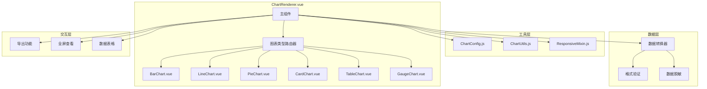
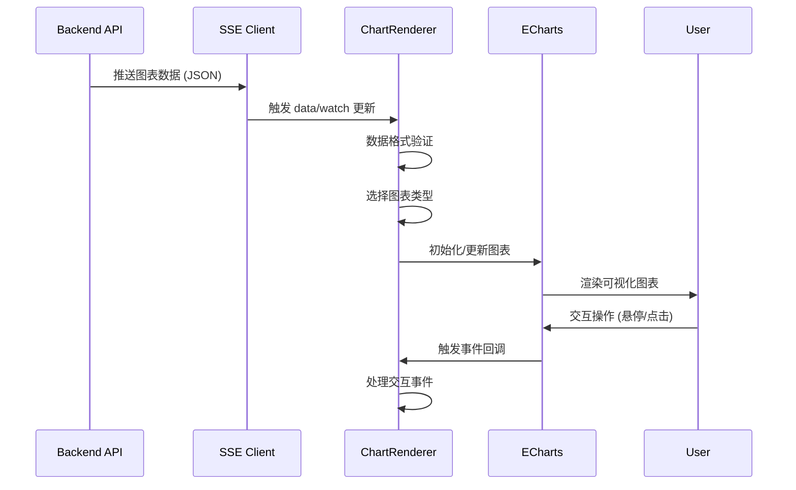

# 智能问数系统 - FE-03 动态图表渲染器详细设计文档

**文档版本**: V2.0  
**最后更新**: 2026-04-02  
**适用对象**: 前端开发工程师  
**关联任务**: FE-03 动态图表渲染器  
**前置依赖**: FE-01 (TraceID), FE-02 (SSE 流式聊天), BE-05 (语义查询执行器)  
**后续依赖**: FE-07 (聊天窗口集成), DT-02 (报表接口标准化)

**技术栈**: Vue 2.6.12 + Element-UI 2.5.12 + ECharts 5.4.0

---

## 1. 任务概述

### 1.1 背景
动态图表渲染器是智能问数系统的核心可视化组件，负责根据后端 AI 返回的图表类型和数据，动态渲染不同类型的图表（柱状图、折线图、饼图、卡片、表格等）。需要支持流式数据更新、自适应布局、交互操作等功能。

### 1.2 目标
| 目标 | 说明 | 验收标准 |
|------|------|----------|
| **动态渲染** | 根据 chartType 自动选择图表类型 | 8 种图表类型支持 |
| **流式更新** | 支持 SSE 流式数据更新 | 数据实时更新 |
| **自适应** | 响应式布局，适配不同屏幕 | 移动端/PC 端正常 |
| **交互性** | 支持图表交互（提示框、缩放、导出） | 交互流畅 |
| **高性能** | 大数据量渲染优化 | 1000 条数据不卡顿 |
| **兼容性** | 兼容 Vue 2.6.12 + Element-UI 2.5.12 | 无版本冲突 |

### 1.3 范围
| 功能 | 说明 | 风险等级 |
|------|------|----------|
| 图表类型路由 | 根据 chartType 选择渲染组件 | 🟢 低 |
| 柱状图渲染 | ECharts 柱状图 | 🟢 低 |
| 折线图渲染 | ECharts 折线图 | 🟢 低 |
| 饼图渲染 | ECharts 饼图 | 🟢 低 |
| 卡片图渲染 | 单指标卡片展示 | 🟢 低 |
| 表格渲染 | Element-UI 表格 | 🟢 低 |
| 仪表盘渲染 | ECharts 仪表盘 | 🟡 中 |
| 散点图渲染 | ECharts 散点图 | 🟡 中 |
| 图表工具栏 | 导出、刷新、全屏查看 | 🟢 低 |
| 空数据展示 | 空状态提示 | 🟢 低 |

### 1.4 支持的图表类型
| 图表类型 | chartType 值 | 使用场景 | 数据格式 |
|----------|-------------|----------|----------|
| **柱状图** | `bar` | 分类对比 | `[{name, value}]` |
| **折线图** | `line` | 时间趋势 | `[{name, value}]` |
| **饼图** | `pie` | 占比分布 | `[{name, value}]` |
| **卡片** | `card` | 单指标展示 | `[{name, value}]` |
| **表格** | `table` | 详细数据 | `[{key, value}]` |
| **仪表盘** | `gauge` | 完成率/进度 | `[{value}]` |
| **散点图** | `scatter` | 相关性分析 | `[{x, y, name}]` |
| **面积图** | `area` | 累积趋势 | `[{name, value}]` |

---

## 2. 技术选型

### 2.1 技术栈
| 组件 | 技术 | 版本 | 选型理由 |
|------|------|------|----------|
| 图表库 | ECharts | 5.4.0 | 功能强大，社区活跃 |
| UI 框架 | Element-UI | 2.5.12 | 项目已有依赖 |
| 表格组件 | El-Table | 2.5.12 | Element-UI 内置 |
| 响应式 | 自定义指令 | - | 避免依赖库 |
| 导出功能 | ECharts 内置 | - | 支持 PNG/SVG 导出 |

### 2.2 组件架构


### 2.3 数据流转


---

## 3. 详细实现方案

### 3.1 图表配置中心

**文件路径**: `src/config/chart-configs.js`

```javascript
/**
 * 图表配置中心
 * 所有图表类型的默认配置
 * 
 * ⚠️ 注意事项:
 * 1. 配置与数据分离，便于维护
 * 2. 支持函数动态生成配置
 * 3. 颜色主题统一
 */

// 主题色
const THEME_COLORS = [
  '#667eea', '#764ba2', '#f093fb', '#f5576c',
  '#4facfe', '#00f2fe', '#43e97b', '#38f9d7'
];

export default {
  /**
   * 柱状图配置
   */
  bar: (data, title) => ({
    title: {
      text: title || '',
      left: 'center',
      textStyle: {
        fontSize: 14,
        color: '#333'
      }
    },
    tooltip: {
      trigger: 'axis',
      axisPointer: {
        type: 'shadow'
      },
      backgroundColor: 'rgba(255, 255, 255, 0.95)',
      borderColor: '#e0e0e0',
      textStyle: {
        color: '#333'
      }
    },
    grid: {
      left: '3%',
      right: '4%',
      bottom: '3%',
      top: '15%',
      containLabel: true
    },
    xAxis: {
      type: 'category',
      data: data.map(item => item.name),
      axisLabel: {
        interval: 0,
        rotate: 30,
        color: '#666'
      },
      axisLine: {
        lineStyle: {
          color: '#e0e0e0'
        }
      }
    },
    yAxis: {
      type: 'value',
      axisLabel: {
        color: '#666'
      },
      axisLine: {
        lineStyle: {
          color: '#e0e0e0'
        }
      },
      splitLine: {
        lineStyle: {
          color: '#f0f0f0',
          type: 'dashed'
        }
      }
    },
    series: [{
      data: data.map(item => item.value),
      type: 'bar',
      barWidth: '60%',
      itemStyle: {
        color: new echarts.graphic.LinearGradient(0, 0, 0, 1, [
          { offset: 0, color: '#667eea' },
          { offset: 1, color: '#764ba2' }
        ]),
        borderRadius: [4, 4, 0, 0]
      },
      label: {
        show: true,
        position: 'top',
        color: '#666',
        fontSize: 12
      }
    }]
  }),

  /**
   * 折线图配置
   */
  line: (data, title) => ({
    title: {
      text: title || '',
      left: 'center',
      textStyle: {
        fontSize: 14,
        color: '#333'
      }
    },
    tooltip: {
      trigger: 'axis',
      backgroundColor: 'rgba(255, 255, 255, 0.95)',
      borderColor: '#e0e0e0',
      textStyle: {
        color: '#333'
      }
    },
    grid: {
      left: '3%',
      right: '4%',
      bottom: '3%',
      top: '15%',
      containLabel: true
    },
    xAxis: {
      type: 'category',
      boundaryGap: false,
      data: data.map(item => item.name),
      axisLabel: {
        color: '#666'
      },
      axisLine: {
        lineStyle: {
          color: '#e0e0e0'
        }
      }
    },
    yAxis: {
      type: 'value',
      axisLabel: {
        color: '#666'
      },
      splitLine: {
        lineStyle: {
          color: '#f0f0f0',
          type: 'dashed'
        }
      }
    },
    series: [{
      data: data.map(item => item.value),
      type: 'line',
      smooth: true,
      symbol: 'circle',
      symbolSize: 8,
      lineStyle: {
        width: 3,
        color: '#667eea'
      },
      itemStyle: {
        color: '#667eea',
        borderColor: '#fff',
        borderWidth: 2
      },
      areaStyle: {
        color: new echarts.graphic.LinearGradient(0, 0, 0, 1, [
          { offset: 0, color: 'rgba(102, 126, 234, 0.5)' },
          { offset: 1, color: 'rgba(102, 126, 234, 0.1)' }
        ])
      }
    }]
  }),

  /**
   * 饼图配置
   */
  pie: (data, title) => ({
    title: {
      text: title || '',
      left: 'center',
      textStyle: {
        fontSize: 14,
        color: '#333'
      }
    },
    tooltip: {
      trigger: 'item',
      formatter: '{b}: {c} ({d}%)',
      backgroundColor: 'rgba(255, 255, 255, 0.95)',
      borderColor: '#e0e0e0',
      textStyle: {
        color: '#333'
      }
    },
    legend: {
      orient: 'vertical',
      left: 'left',
      top: 'middle',
      textStyle: {
        color: '#666'
      }
    },
    series: [{
      type: 'pie',
      radius: ['40%', '70%'],
      center: ['60%', '50%'],
      data: data,
      label: {
        formatter: '{b}: {d}%'
      },
      emphasis: {
        itemStyle: {
          shadowBlur: 10,
          shadowOffsetX: 0,
          shadowColor: 'rgba(0, 0, 0, 0.3)'
        }
      },
      color: THEME_COLORS
    }]
  }),

  /**
   * 卡片图配置 (单指标)
   */
  card: (data, title) => ({
    series: [{
      type: 'gauge',
      data: data,
      radius: '90%',
      startAngle: 180,
      endAngle: 0,
      min: 0,
      max: data[0]?.max || 100,
      progress: {
        show: true,
        width: 30,
        itemStyle: {
          color: new echarts.graphic.LinearGradient(0, 0, 1, 0, [
            { offset: 0, color: '#667eea' },
            { offset: 1, color: '#764ba2' }
          ])
        }
      },
      pointer: {
        show: false
      },
      axisLine: {
        lineStyle: {
          width: 30,
          color: [[1, '#f0f0f0']]
        }
      },
      axisTick: {
        show: false
      },
      splitLine: {
        show: false
      },
      axisLabel: {
        show: false
      },
      title: {
        show: true,
        text: title || data[0]?.name || '指标',
        offsetCenter: [0, '40%'],
        fontSize: 16,
        color: '#666'
      },
      detail: {
        valueAnimation: true,
        offsetCenter: [0, '70%'],
        fontSize: 30,
        fontWeight: 'bold',
        color: '#333',
        formatter: '{value}'
      }
    }]
  }),

  /**
   * 仪表盘配置
   */
  gauge: (data, title) => ({
    title: {
      text: title || '',
      left: 'center',
      textStyle: {
        fontSize: 14,
        color: '#333'
      }
    },
    series: [{
      type: 'gauge',
      data: data,
      progress: {
        show: true,
        width: 18
      },
      axisLine: {
        lineStyle: {
          width: 18
        }
      },
      axisTick: {
        show: false
      },
      splitLine: {
        length: 15,
        lineStyle: {
          width: 2,
          color: '#999'
        }
      },
      axisLabel: {
        distance: 25,
        color: '#999',
        fontSize: 10
      },
      anchor: {
        show: true,
        showAbove: true,
        size: 25,
        itemStyle: {
          borderWidth: 10
        }
      },
      detail: {
        valueAnimation: true,
        fontSize: 30,
        offsetCenter: [0, '70%']
      }
    }]
  }),

  /**
   * 散点图配置
   */
  scatter: (data, title) => ({
    title: {
      text: title || '',
      left: 'center',
      textStyle: {
        fontSize: 14,
        color: '#333'
      }
    },
    tooltip: {
      trigger: 'item',
      formatter: (params) => {
        return `${params.data.name}<br/>X: ${params.data.x}<br/>Y: ${params.data.y}`;
      },
      backgroundColor: 'rgba(255, 255, 255, 0.95)',
      borderColor: '#e0e0e0',
      textStyle: {
        color: '#333'
      }
    },
    grid: {
      left: '3%',
      right: '4%',
      bottom: '3%',
      top: '15%',
      containLabel: true
    },
    xAxis: {
      type: 'value',
      axisLabel: {
        color: '#666'
      },
      splitLine: {
        lineStyle: {
          color: '#f0f0f0',
          type: 'dashed'
        }
      }
    },
    yAxis: {
      type: 'value',
      axisLabel: {
        color: '#666'
      },
      splitLine: {
        lineStyle: {
          color: '#f0f0f0',
          type: 'dashed'
        }
      }
    },
    series: [{
      type: 'scatter',
      data: data.map(item => [item.x, item.y, item.name]),
      symbolSize: 12,
      itemStyle: {
        color: new echarts.graphic.RadialGradient(0.5, 0.5, 0.5, [
          { offset: 0, color: '#667eea' },
          { offset: 1, color: '#764ba2' }
        ])
      }
    }]
  }),

  /**
   * 面积图配置
   */
  area: (data, title) => ({
    title: {
      text: title || '',
      left: 'center',
      textStyle: {
        fontSize: 14,
        color: '#333'
      }
    },
    tooltip: {
      trigger: 'axis',
      backgroundColor: 'rgba(255, 255, 255, 0.95)',
      borderColor: '#e0e0e0',
      textStyle: {
        color: '#333'
      }
    },
    grid: {
      left: '3%',
      right: '4%',
      bottom: '3%',
      top: '15%',
      containLabel: true
    },
    xAxis: {
      type: 'category',
      boundaryGap: false,
      data: data.map(item => item.name),
      axisLabel: {
        color: '#666'
      }
    },
    yAxis: {
      type: 'value',
      axisLabel: {
        color: '#666'
      },
      splitLine: {
        lineStyle: {
          color: '#f0f0f0',
          type: 'dashed'
        }
      }
    },
    series: [{
      data: data.map(item => item.value),
      type: 'line',
      smooth: true,
      stack: 'Total',
      areaStyle: {
        color: new echarts.graphic.LinearGradient(0, 0, 0, 1, [
          { offset: 0, color: 'rgba(102, 126, 234, 0.8)' },
          { offset: 1, color: 'rgba(102, 126, 234, 0.2)' }
        ])
      },
      itemStyle: {
        color: '#667eea'
      }
    }]
  })
};
```

### 3.2 图表工具函数

**文件路径**: `src/utils/chart-utils.js`

```javascript
/**
 * 图表工具函数
 * 数据验证、格式转换、颜色生成等
 * 
 * ⚠️ 注意事项:
 * 1. 数据验证防止渲染错误
 * 2. 格式转换适配不同图表
 * 3. 敏感数据脱敏
 */

/**
 * 验证数据格式
 * @param {Array} data - 图表数据
 * @param {string} chartType - 图表类型
 * @returns {boolean}
 */
export function validateData(data, chartType) {
  if (!data || !Array.isArray(data)) {
    return false;
  }

  if (data.length === 0) {
    return true; // 空数据允许
  }

  switch (chartType) {
    case 'bar':
    case 'line':
    case 'pie':
    case 'card':
    case 'area':
      return data.every(item => 
        item.hasOwnProperty('name') && item.hasOwnProperty('value')
      );
    
    case 'scatter':
      return data.every(item => 
        item.hasOwnProperty('x') && item.hasOwnProperty('y')
      );
    
    case 'gauge':
      return data.every(item => item.hasOwnProperty('value'));
    
    case 'table':
      return data.every(item => typeof item === 'object');
    
    default:
      return false;
  }
}

/**
 * 转换数据格式
 * @param {Array} data - 原始数据
 * @param {string} targetType - 目标格式
 * @returns {Array}
 */
export function transformData(data, targetType) {
  if (!data || !Array.isArray(data)) {
    return [];
  }

  switch (targetType) {
    case 'table':
      return data.map(item => {
        const row = {};
        Object.keys(item).forEach(key => {
          row[key] = item[key];
        });
        return row;
      });
    
    case 'chart':
      return data.map(item => ({
        name: item.name || item.label || '',
        value: item.value || item.amount || 0
      }));
    
    default:
      return data;
  }
}

/**
 * 映射图表类型
 * @param {string} type - 后端返回的类型
 * @returns {string}
 */
export function mapChartType(type) {
  const typeMap = {
    'bar': 'bar',
    'column': 'bar',
    'line': 'line',
    'pie': 'pie',
    'donut': 'pie',
    'card': 'card',
    'number': 'card',
    'table': 'table',
    'grid': 'table',
    'gauge': 'gauge',
    'scatter': 'scatter',
    'area': 'area'
  };
  
  return typeMap[type] || 'bar';
}

/**
 * 生成颜色数组
 * @param {number} count - 颜色数量
 * @returns {Array<string>}
 */
export function generateColors(count) {
  const colors = [
    '#667eea', '#764ba2', '#f093fb', '#f5576c',
    '#4facfe', '#00f2fe', '#43e97b', '#38f9d7',
    '#fa709a', '#fee140', '#30cfd0', '#330867',
    '#a8edea', '#fed6e3', '#5ee7df', '#b490ca'
  ];
  
  const result = [];
  for (let i = 0; i < count; i++) {
    result.push(colors[i % colors.length]);
  }
  
  return result;
}

/**
 * 格式化数值
 * @param {number} value - 数值
 * @param {string} unit - 单位
 * @returns {string}
 */
export function formatValue(value, unit = '') {
  if (value === null || value === undefined) {
    return '-';
  }
  
  const num = Number(value);
  if (isNaN(num)) {
    return value;
  }
  
  // 大数格式化
  if (num >= 100000000) {
    return (num / 100000000).toFixed(2) + '亿' + unit;
  } else if (num >= 10000) {
    return (num / 10000).toFixed(2) + '万' + unit;
  } else {
    return num.toLocaleString() + unit;
  }
}

/**
 * 数据脱敏
 * @param {Array} data - 数据
 * @param {Array} sensitiveFields - 敏感字段列表
 * @returns {Array}
 */
export function maskData(data, sensitiveFields = []) {
  if (!data || !Array.isArray(data)) {
    return data;
  }
  
  return data.map(item => {
    const masked = { ...item };
    sensitiveFields.forEach(field => {
      if (masked[field]) {
        const value = String(masked[field]);
        if (value.length > 4) {
          masked[field] = value.substring(0, 2) + '***' + value.substring(value.length - 2);
        } else {
          masked[field] = '***';
        }
      }
    });
    return masked;
  });
}

/**
 * 计算图表最佳高度
 * @param {number} dataLength - 数据条数
 * @param {string} chartType - 图表类型
 * @returns {number}
 */
export function calculateOptimalHeight(dataLength, chartType) {
  const baseHeight = 300;
  
  if (chartType === 'table') {
    return Math.max(baseHeight, dataLength * 40 + 60);
  }
  
  if (chartType === 'bar' || chartType === 'line') {
    if (dataLength > 10) {
      return baseHeight + (dataLength - 10) * 20;
    }
  }
  
  return baseHeight;
}

export default {
  validateData,
  transformData,
  mapChartType,
  generateColors,
  formatValue,
  maskData,
  calculateOptimalHeight
};
```

### 3.3 主组件实现

**文件路径**: `src/views/askdata/components/ChartRenderer.vue`

```vue
<template>
  <div class="chart-renderer" v-loading="loading">
    <!-- 图表容器 -->
    <div
      v-if="chartType !== 'table'"
      ref="chartContainer"
      class="chart-container"
      :style="{ height: computedHeight + 'px' }"
    ></div>

    <!-- 表格渲染 -->
    <div v-else class="table-container">
      <el-table
        :data="tableData"
        style="width: 100%"
        :height="computedHeight - 60"
        border
        stripe
        size="small"
      >
        <el-table-column
          v-for="col in tableColumns"
          :key="col.key"
          :prop="col.key"
          :label="col.label"
          :width="col.width"
          :sortable="col.sortable"
        ></el-table-column>
      </el-table>
    </div>

    <!-- 图表工具栏 -->
    <div class="chart-toolbar" v-if="showToolbar && chartType !== 'table'">
      <el-button-group size="mini">
        <el-tooltip content="下载图片" placement="top">
          <el-button icon="el-icon-download" @click="downloadImage"></el-button>
        </el-tooltip>
        <el-tooltip content="导出数据" placement="top">
          <el-button icon="el-icon-document" @click="exportData"></el-button>
        </el-tooltip>
        <el-tooltip content="全屏查看" placement="top">
          <el-button icon="el-icon-full-screen" @click="toggleFullscreen"></el-button>
        </el-tooltip>
        <el-tooltip content="刷新" placement="top">
          <el-button icon="el-icon-refresh" @click="refreshChart"></el-button>
        </el-tooltip>
      </el-button-group>
    </div>

    <!-- 空数据提示 -->
    <div v-if="!loading && (!data || data.length === 0)" class="empty-data">
      <el-empty :description="emptyText" :image-size="80"></el-empty>
    </div>
  </div>
</template>

<script>
import * as echarts from 'echarts';
import chartConfigs from '@/config/chart-configs';
import {
  validateData,
  mapChartType,
  calculateOptimalHeight,
  maskData
} from '@/utils/chart-utils';
import responsiveMixin from '@/mixins/responsive-mixin';

export default {
  name: 'ChartRenderer',
  mixins: [responsiveMixin],
  props: {
    // 图表类型
    chartType: {
      type: String,
      required: true,
      validator: value => ['bar', 'line', 'pie', 'card', 'table', 'gauge', 'scatter', 'area'].includes(value)
    },
    // 图表数据
    data: {
      type: Array,
      required: true,
      default: () => []
    },
    // 自定义配置项
    options: {
      type: Object,
      default: () => ({})
    },
    // 图表高度
    height: {
      type: Number,
      default: 300
    },
    // 是否自适应高度
    autoHeight: {
      type: Boolean,
      default: false
    },
    // 是否显示工具栏
    showToolbar: {
      type: Boolean,
      default: true
    },
    // 空数据提示文本
    emptyText: {
      type: String,
      default: '暂无数据'
    },
    // 加载状态
    loading: {
      type: Boolean,
      default: false
    },
    // 图表标题
    title: {
      type: String,
      default: ''
    },
    // 是否启用动画
    enableAnimation: {
      type: Boolean,
      default: true
    },
    // 敏感字段 (用于脱敏)
    sensitiveFields: {
      type: Array,
      default: () => []
    }
  },
  data() {
    return {
      chartInstance: null,
      internalOptions: {},
      fullscreen: false
    };
  },
  computed: {
    // 计算图表高度
    computedHeight() {
      if (this.autoHeight) {
        return this.containerHeight || this.height;
      }
      return this.fullscreen ? window.innerHeight - 200 : this.height;
    },
    
    // 表格数据
    tableData() {
      let data = this.data;
      // ⚠️ 敏感数据脱敏
      if (this.sensitiveFields.length > 0) {
        data = maskData(data, this.sensitiveFields);
      }
      return data;
    },
    
    // 表格列定义
    tableColumns() {
      if (!this.data || this.data.length === 0) {
        return [];
      }
      const keys = Object.keys(this.data[0]);
      return keys.map(key => ({
        key,
        label: this.formatLabel(key),
        width: key === 'name' ? 150 : null,
        sortable: true
      }));
    }
  },
  watch: {
    // 监听图表类型变化
    chartType(newType, oldType) {
      if (newType !== oldType) {
        this.disposeChart();
        this.$nextTick(() => {
          this.initChart();
        });
      }
    },
    
    // ⚠️ 监听数据变化 (流式更新)
    data: {
      handler(newData) {
        this.updateChart(newData);
      },
      deep: true
    },
    
    // 监听配置变化
    options: {
      handler(newOptions) {
        this.internalOptions = { ...this.internalOptions, ...newOptions };
        if (this.chartInstance) {
          this.chartInstance.setOption(this.internalOptions, true);
        }
      },
      deep: true
    },
    
    // 监听加载状态
    loading(newVal) {
      if (!newVal && this.chartInstance) {
        this.chartInstance.hideLoading();
      }
    }
  },
  mounted() {
    this.$nextTick(() => {
      if (this.chartType !== 'table') {
        this.initChart();
      }
    });
  },
  beforeDestroy() {
    // ⚠️ 清理图表实例
    this.disposeChart();
  },
  methods: {
    /**
     * 初始化图表
     */
    initChart() {
      if (!this.$refs.chartContainer || this.chartType === 'table') {
        return;
      }

      // 销毁旧实例
      this.disposeChart();

      // 创建新实例
      this.chartInstance = echarts.init(this.$refs.chartContainer);
      
      // 显示加载动画
      if (this.loading) {
        this.chartInstance.showLoading({
          text: '加载中...',
          color: '#667eea',
          textColor: '#666',
          maskColor: 'rgba(255, 255, 255, 0.8)',
          zlevel: 2
        });
      }

      // 获取图表配置
      const chartConfig = this.getChartConfig();
      
      // 合并配置
      this.internalOptions = {
        ...chartConfig,
        ...this.options,
        animation: this.enableAnimation
      };

      // 设置配置项
      this.chartInstance.setOption(this.internalOptions, true);
      
      // 绑定事件
      this.bindEvents();
      
      // ⚠️ 监听窗口大小变化
      this.initResizeObserver();
      
      this.$emit('chart-initialized', this.chartInstance);
    },

    /**
     * 获取图表配置
     */
    getChartConfig() {
      const configMap = {
        bar: chartConfigs.bar,
        line: chartConfigs.line,
        pie: chartConfigs.pie,
        card: chartConfigs.card,
        gauge: chartConfigs.gauge,
        scatter: chartConfigs.scatter,
        area: chartConfigs.area
      };
      
      const baseConfig = configMap[this.chartType] || chartConfigs.bar;
      
      // 如果配置是函数，调用它
      if (typeof baseConfig === 'function') {
        return baseConfig(this.data, this.title);
      }
      
      return baseConfig;
    },

    /**
     * ⚠️ 更新图表 (流式数据)
     */
    updateChart(newData) {
      if (!this.chartInstance || this.chartType === 'table') {
        return;
      }

      // ⚠️ 验证数据
      if (!validateData(newData, this.chartType)) {
        console.warn('[ChartRenderer] Invalid data format');
        return;
      }

      // 获取新配置
      const chartConfig = this.getChartConfig();
      
      // 合并配置
      const newOptions = {
        ...chartConfig,
        ...this.options,
        animation: this.enableAnimation
      };

      // 更新图表
      this.chartInstance.setOption(newOptions, true);
      
      this.$emit('chart-updated', this.chartInstance);
    },

    /**
     * 绑定图表事件
     */
    bindEvents() {
      if (!this.chartInstance) {
        return;
      }

      // 点击事件
      this.chartInstance.on('click', (params) => {
        this.$emit('chart-click', params);
      });

      // 悬停事件
      this.chartInstance.on('mouseover', (params) => {
        this.$emit('chart-mouseover', params);
      });

      // 数据区域选择
      this.chartInstance.on('dataZoom', (params) => {
        this.$emit('chart-datazoom', params);
      });

      // 图例选择
      this.chartInstance.on('legendselectchanged', (params) => {
        this.$emit('chart-legend-change', params);
      });
    },

    /**
     * ⚠️ 销毁图表
     */
    disposeChart() {
      if (this.chartInstance) {
        this.chartInstance.dispose();
        this.chartInstance = null;
      }
    },

    /**
     * 下载图片
     */
    downloadImage() {
      if (!this.chartInstance) {
        return;
      }

      const url = this.chartInstance.getDataURL({
        type: 'png',
        pixelRatio: 2,
        backgroundColor: '#fff'
      });

      const a = document.createElement('a');
      a.href = url;
      a.download = `图表_${new Date().getTime()}.png`;
      a.click();

      this.$message.success('图片已下载');
    },

    /**
     * 导出数据
     */
    exportData() {
      if (!this.data || this.data.length === 0) {
        this.$message.warning('暂无数据可导出');
        return;
      }

      const headers = Object.keys(this.data[0]);
      const csvContent = [
        headers.join(','),
        ...this.data.map(row => headers.map(h => row[h]).join(','))
      ].join('\n');

      const blob = new Blob(['\ufeff' + csvContent], { type: 'text/csv;charset=utf-8' });
      const url = URL.createObjectURL(blob);
      const a = document.createElement('a');
      a.href = url;
      a.download = `数据_${new Date().getTime()}.csv`;
      a.click();
      URL.revokeObjectURL(url);

      this.$message.success('数据已导出');
    },

    /**
     * 全屏查看
     */
    toggleFullscreen() {
      this.fullscreen = !this.fullscreen;
      
      if (this.fullscreen) {
        this.$emit('chart-fullscreen-enter');
      } else {
        this.$emit('chart-fullscreen-exit');
      }

      this.$nextTick(() => {
        if (this.chartInstance) {
          this.chartInstance.resize();
        }
      });
    },

    /**
     * 刷新图表
     */
    refreshChart() {
      this.$emit('chart-refresh');
    },

    /**
     * 格式化标签
     */
    formatLabel(key) {
      // 简单的驼峰转中文
      const labelMap = {
        name: '名称',
        value: '数值',
        time: '时间',
        region: '地区',
        amount: '金额',
        count: '数量'
      };
      return labelMap[key] || key;
    },

    /**
     * 手动调整大小
     */
    resize() {
      if (this.chartInstance) {
        this.chartInstance.resize();
      }
    }
  }
};
</script>

<style scoped lang="scss">
.chart-renderer {
  position: relative;
  width: 100%;
  margin: 16px 0;
  background: white;
  border-radius: 8px;
  box-shadow: 0 2px 12px rgba(0, 0, 0, 0.05);
  transition: all 0.3s;
}

.chart-container {
  width: 100%;
  padding: 16px;
  box-sizing: border-box;
}

.table-container {
  padding: 16px;
}

.chart-toolbar {
  padding: 12px 16px;
  border-top: 1px solid #e0e0e0;
  background: #fafafa;
  border-radius: 0 0 8px 8px;
  display: flex;
  justify-content: flex-end;
}

.empty-data {
  padding: 40px 20px;
  text-align: center;
}

// 全屏样式
.chart-renderer.fullscreen {
  position: fixed;
  top: 50%;
  left: 50%;
  transform: translate(-50%, -50%);
  z-index: 2000;
  box-shadow: 0 0 50px rgba(0, 0, 0, 0.3);
}

// 响应式
@media screen and (max-width: 768px) {
  .chart-toolbar {
    flex-wrap: wrap;
    gap: 8px;
  }
  
  .chart-container {
    padding: 12px;
  }
}
</style>
```

### 3.4 响应式混入

**文件路径**: `src/mixins/responsive-mixin.js`

```javascript
/**
 * 响应式混入
 * 处理窗口大小变化、容器大小变化
 * 
 * ⚠️ 注意事项:
 * 1. 使用 ResizeObserver 监听容器大小
 * 2. 降级到 window.resize
 * 3. 组件销毁时清理监听器
 */

export default {
  data() {
    return {
      containerWidth: 0,
      containerHeight: 0,
      resizeObserver: null
    };
  },
  methods: {
    /**
     * 初始化大小观察器
     */
    initResizeObserver() {
      if (typeof ResizeObserver !== 'undefined') {
        this.resizeObserver = new ResizeObserver(entries => {
          for (let entry of entries) {
            this.containerWidth = entry.contentRect.width;
            this.containerHeight = entry.contentRect.height;
            
            // ⚠️ 图表大小变化时重新渲染
            if (this.chartInstance) {
              this.chartInstance.resize();
            }
          }
        });

        const container = this.$refs.chartContainer;
        if (container) {
          this.resizeObserver.observe(container);
        }
      } else {
        // 降级方案：监听窗口大小变化
        window.addEventListener('resize', this.handleWindowResize);
      }
    },

    /**
     * 处理窗口大小变化
     */
    handleWindowResize() {
      if (this.chartInstance) {
        this.chartInstance.resize();
      }
    },

    /**
     * ⚠️ 销毁观察器
     */
    destroyResizeObserver() {
      if (this.resizeObserver) {
        this.resizeObserver.disconnect();
        this.resizeObserver = null;
      }
      window.removeEventListener('resize', this.handleWindowResize);
    }
  },
  beforeDestroy() {
    this.destroyResizeObserver();
  }
};
```

---

## 4. 注意事项 ⚠️

### 4.1 图表实例清理
```javascript
// ❌ 错误：组件销毁不清理图表实例
beforeDestroy() {
  // 忘记 dispose 图表
}

// ✅ 正确：组件销毁时清理
beforeDestroy() {
  if (this.chartInstance) {
    this.chartInstance.dispose();
    this.chartInstance = null;
  }
}
```

### 4.2 数据验证
```javascript
// ❌ 错误：不验证数据直接渲染
updateChart(newData) {
  this.chartInstance.setOption({ series: [{ data: newData }] });
}

// ✅ 正确：验证数据格式
updateChart(newData) {
  if (!validateData(newData, this.chartType)) {
    console.warn('Invalid data format');
    return;
  }
  this.chartInstance.setOption({ series: [{ data: newData }] });
}
```

### 4.3 响应式处理
```javascript
// ❌ 错误：不监听窗口变化
mounted() {
  this.initChart();
  // 窗口变化时图表不变形
}

// ✅ 正确：监听窗口变化
mounted() {
  this.initChart();
  window.addEventListener('resize', this.handleResize);
}
beforeDestroy() {
  window.removeEventListener('resize', this.handleResize);
}
```

### 4.4 流式数据更新
```javascript
// ❌ 错误：每次创建新实例
watch: {
  data() {
    this.initChart(); // 性能差
  }
}

// ✅ 正确：更新现有实例
watch: {
  data(newData) {
    this.updateChart(newData); // 复用实例
  }
}
```

### 4.5 敏感数据脱敏
```javascript
// ❌ 错误：直接渲染敏感数据
computed: {
  tableData() {
    return this.data; // 可能含手机号/身份证
  }
}

// ✅ 正确：脱敏后渲染
computed: {
  tableData() {
    return maskData(this.data, this.sensitiveFields);
  }
}
```

---

## 5. 需要特别关注的点 🔴

### 5.1 陷阱防护矩阵

| 陷阱类型 | 风险描述 | 防护措施 | 验证方法 |
|----------|----------|----------|----------|
| **内存泄漏** | 图表实例未清理 | beforeDestroy 调用 dispose | 长时间运行内存稳定 |
| **数据格式错误** | 非法数据导致渲染失败 | 数据验证函数 | 非法数据被拦截 |
| **响应式失效** | 窗口变化图表不变形 | ResizeObserver 监听 | 调整窗口图表自适应 |
| **流式更新卡顿** | 频繁更新导致性能问题 | 复用实例，非重新创建 | 流式数据流畅更新 |
| **敏感数据泄露** | 表格显示敏感信息 | 数据脱敏处理 | 敏感字段掩码显示 |
| **空数据处理** | 空数据导致报错 | 空数据判断 | 显示空状态提示 |
| **生产环境日志** | console.warn 泄露信息 | 生产环境关闭日志 | 生产包无 console |
| **跨域图片导出** | 导出图片跨域失败 | 使用 base64 或后端代理 | 导出功能正常 |

### 5.2 关键代码审查点

```javascript
// 审查清单
□ 图表实例是否在 beforeDestroy 清理
□ 数据是否验证格式
□ ResizeObserver 是否初始化
□ ResizeObserver 是否在 beforeDestroy 清理
□ 流式更新是否复用实例
□ 敏感数据是否脱敏
□ 空数据是否处理
□ 生产环境日志是否关闭
□ 图表事件是否绑定
□ 图表事件是否解绑
□ 工具栏功能是否完整
□ 全屏功能是否正常
□ 导出功能是否可用
□ 样式是否响应式
□ ECharts 版本是否兼容
```

### 5.3 性能影响评估

| 操作 | 耗时 | 优化建议 |
|------|------|----------|
| 图表初始化 | 50-200ms | 无需优化 |
| 数据更新 | 10-50ms | 复用实例 |
| 窗口 resize | < 10ms | 防抖处理 |
| 图片导出 | 100-500ms | 异步处理 |
| **总开销** | **< 500ms** | **可接受** |

### 5.4 监控指标

```javascript
// 前端监控指标 (可选)
window.chartMetrics = {
  renderCount: 0,
  updateCount: 0,
  errorCount: 0,
  
  trackRender() {
    this.renderCount++;
  },
  
  trackUpdate() {
    this.updateCount++;
  },
  
  trackError() {
    this.errorCount++;
    // 上报到监控系统
  }
};

// 图表组件中调用
methods: {
  initChart() {
    window.chartMetrics.trackRender();
  },
  updateChart() {
    window.chartMetrics.trackUpdate();
  }
}
```

---

## 6. 验收标准

### 6.1 功能验收
| 验收项 | 验收方法 | 通过标准 |
|--------|----------|----------|
| 图表渲染 | 传入不同类型数据 | 8 种图表正常显示 |
| 流式更新 | SSE 推送数据 | 图表实时更新 |
| 响应式 | 调整窗口大小 | 图表自适应 |
| 图表交互 | 悬停/点击图表 | 交互响应正常 |
| 图片导出 | 点击下载按钮 | PNG 图片下载成功 |
| 数据导出 | 点击导出按钮 | CSV 文件下载成功 |
| 全屏查看 | 点击全屏按钮 | 图表全屏显示 |
| 空数据展示 | 传入空数组 | 显示空状态提示 |
| 实例清理 | 组件销毁 | 图表实例释放 |

### 6.2 兼容性验收
| 检查项 | 验收方法 | 通过标准 |
|--------|----------|----------|
| Vue 2.6.12 | 运行项目 | 无版本冲突 |
| Element-UI 2.5.12 | 使用 UI 组件 | 正常显示 |
| ECharts 5.4.0 | 渲染图表 | 功能正常 |
| Chrome 80+ | 浏览器测试 | 渲染正常 |
| Firefox 75+ | 浏览器测试 | 渲染正常 |
| Safari 13+ | 浏览器测试 | 渲染正常 |
| 移动端 | 手机浏览器测试 | 响应式正常 |

### 6.3 性能验收
| 指标 | 目标值 | 测量方法 |
|------|--------|----------|
| 初始化时间 | < 200ms | console.time |
| 数据更新时间 | < 50ms | console.time |
| 大数据渲染 | 1000 条不卡顿 | 滚动测试 |
| 内存占用 | 无泄漏 | Chrome DevTools |
| 导出时间 | < 1s | 手动测试 |

---

## 7. 测试用例

### 7.1 单元测试

**文件路径**: `tests/unit/utils/chart-utils.spec.js`

```javascript
import {
  validateData,
  transformData,
  mapChartType,
  formatValue,
  maskData
} from '@/utils/chart-utils';

describe('Chart Utils', () => {
  test('validateData should return true for valid bar data', () => {
    const data = [
      { name: 'A', value: 100 },
      { name: 'B', value: 200 }
    ];
    expect(validateData(data, 'bar')).toBe(true);
  });

  test('validateData should return false for invalid data', () => {
    const data = [{ name: 'A' }]; // 缺少 value
    expect(validateData(data, 'bar')).toBe(false);
  });

  test('mapChartType should map correctly', () => {
    expect(mapChartType('column')).toBe('bar');
    expect(mapChartType('donut')).toBe('pie');
    expect(mapChartType('number')).toBe('card');
  });

  test('formatValue should format large numbers', () => {
    expect(formatValue(150000000)).toBe('1.50 亿');
    expect(formatValue(15000)).toBe('1.50 万');
    expect(formatValue(1500)).toBe('1,500');
  });

  test('maskData should mask sensitive fields', () => {
    const data = [{ phone: '13800138000', name: '张三' }];
    const masked = maskData(data, ['phone']);
    expect(masked[0].phone).toBe('13****8000');
    expect(masked[0].name).toBe('张三');
  });

  test('transformData should convert to table format', () => {
    const data = [{ name: 'A', value: 100 }];
    const result = transformData(data, 'table');
    expect(result).toHaveLength(1);
    expect(result[0]).toHaveProperty('name');
  });
});
```

### 7.2 集成测试

**文件路径**: `tests/e2e/specs/chart-renderer.spec.js`

```javascript
describe('ChartRenderer E2E Tests', () => {
  it('should render bar chart', () => {
    cy.visit('/askdata');
    
    // 发送柱状图查询
    cy.get('[data-test="input"]').type('各地区销售额对比{enter}');
    
    // 验证柱状图渲染
    cy.get('[data-test="chart-container"]').should('be.visible');
    cy.get('.echarts-canvas').should('exist');
  });

  it('should update chart with streaming data', () => {
    cy.visit('/askdata');
    
    // 发送查询
    cy.get('[data-test="input"]').type('销售趋势{enter}');
    
    // 验证数据更新
    cy.wait(1000);
    cy.get('.echarts-canvas').should('exist');
  });

  it('should resize chart on window resize', () => {
    cy.visit('/askdata');
    
    // 发送查询
    cy.get('[data-test="input"]').type('销售数据{enter}');
    
    // 调整窗口大小
    cy.viewport(800, 600);
    
    // 验证图表自适应
    cy.get('.echarts-canvas').should('exist');
  });

  it('should export chart image', () => {
    cy.visit('/askdata');
    
    // 发送查询
    cy.get('[data-test="input"]').type('销售数据{enter}');
    
    // 点击下载按钮
    cy.get('[data-test="download-button"]').click();
    
    // 验证下载 (需配置下载验证)
  });

  it('should handle empty data', () => {
    cy.visit('/askdata');
    
    // 发送无数据查询
    cy.get('[data-test="input"]').type('查询无数据{enter}');
    
    // 验证空状态显示
    cy.get('[data-test="empty-data"]').should('be.visible');
  });

  it('should cleanup on destroy', () => {
    cy.visit('/askdata');
    
    // 发送查询
    cy.get('[data-test="input"]').type('销售数据{enter}');
    
    // 离开页面
    cy.visit('/');
    
    // 验证资源清理 (需通过内存监控验证)
  });
});
```

### 7.3 手动测试用例

| 用例 ID | 测试场景 | 操作步骤 | 预期结果 |
|---------|----------|----------|----------|
| FE-TC-001 | 柱状图渲染 | 查询对比数据 | 柱状图正常显示 |
| FE-TC-002 | 折线图渲染 | 查询趋势数据 | 折线图正常显示 |
| FE-TC-003 | 饼图渲染 | 查询占比数据 | 饼图正常显示 |
| FE-TC-004 | 卡片图渲染 | 查询单指标 | 卡片正常显示 |
| FE-TC-005 | 表格渲染 | 查询明细数据 | 表格正常显示 |
| FE-TC-006 | 流式更新 | SSE 推送数据 | 图表实时更新 |
| FE-TC-007 | 响应式 | 调整窗口大小 | 图表自适应 |
| FE-TC-008 | 图表交互 | 悬停/点击图表 | 交互响应正常 |
| FE-TC-009 | 图片导出 | 点击下载按钮 | PNG 下载成功 |
| FE-TC-010 | 数据导出 | 点击导出按钮 | CSV 下载成功 |
| FE-TC-011 | 全屏查看 | 点击全屏按钮 | 图表全屏显示 |
| FE-TC-012 | 空数据处理 | 查询无数据 | 显示空状态提示 |
| FE-TC-013 | 敏感数据脱敏 | 查询含敏感字段 | 敏感字段掩码 |
| FE-TC-014 | 组件销毁 | 离开页面 | 图表实例释放 |
| FE-TC-015 | 生产环境 | 部署生产环境 | 无 console 日志 |

---

## 8. 部署配置

### 8.1 环境变量

**文件路径**: `.env.development`
```bash
# 开发环境配置
VUE_APP_BASE_API=/api
VUE_APP_CHART_DEBUG=true
VUE_APP_ECHARTS_THEME=custom
```

**文件路径**: `.env.production`
```bash
# 生产环境配置
VUE_APP_BASE_API=https://api.company.com
VUE_APP_CHART_DEBUG=false
VUE_APP_ECHARTS_THEME=custom
```

### 8.2 Webpack 配置

```javascript
// vue.config.js
module.exports = {
  configureWebpack: {
    // ⚠️ 生产环境移除 console.log
    optimization: {
      minimizer: [
        new TerserPlugin({
          terserOptions: {
            compress: {
              drop_console: process.env.NODE_ENV === 'production',
              drop_debugger: process.env.NODE_ENV === 'production'
            }
          }
        })
      ]
    },
    
    // ⚠️ ECharts 按需引入配置
    externals: {
      echarts: 'echarts'
    }
  },
  
  // ⚠️ 配置图表相关的全局变量
  definePlugin: {
    'process.env.VUE_APP_CHART_DEBUG': process.env.VUE_APP_CHART_DEBUG
  }
};
```

### 8.3 CDN 配置 (可选)

```html
<!-- public/index.html -->
<!DOCTYPE html>
<html>
<head>
  <!-- ⚠️ 生产环境使用 CDN 加载 ECharts -->
  <% if (process.env.NODE_ENV === 'production') { %>
    <script src="https://cdn.jsdelivr.net/npm/echarts@5.4.0/dist/echarts.min.js"></script>
  <% } %>
</head>
</html>
```

---

## 9. 常见问题 (FAQ)

**Q1: 图表不显示怎么办？**
A: 1. 检查容器是否有高度；2. 检查 ECharts 是否正确导入；3. 检查数据格式是否正确；4. 查看控制台错误信息。

**Q2: 图表更新不生效怎么办？**
A: 1. 检查数据是否触发 watch；2. 确保使用深拷贝更新数据；3. 调用 `setOption` 时第二个参数设为 `true`。

**Q3: 响应式不生效怎么办？**
A: 1. 检查 ResizeObserver 是否支持；2. 降级方案使用 window.resize；3. 确保调用 `chart.resize()`。

**Q4: 大数据量渲染卡顿怎么办？**
A: 1. 启用数据采样 (ECharts sampling 配置)；2. 使用 Canvas 渲染器；3. 减少动画效果；4. 分页加载数据。

**Q5: 如何自定义图表样式？**
A: 通过 `options` 属性传递自定义配置，会覆盖默认配置。参考 ECharts 官方文档。

**Q6: 表格排序不生效怎么办？**
A: 1. 确保 `sortable` 属性设置为 `true`；2. 检查数据字段类型；3. 使用 `sort-method` 自定义排序。

**Q7: 如何支持暗色主题？**
A: 1. 使用 ECharts 暗色主题 `echarts.init(dom, 'dark')`；2. 调整图表配置中的颜色；3. 使用 CSS 变量适配主题。

**Q8: 导出图片模糊怎么办？**
A: 设置 `pixelRatio: 2` 或更高，增加导出图片的分辨率。

**Q9: 如何禁用图表动画？**
A: 设置 `enableAnimation` 属性为 `false`，或在 `options` 中设置 `animation: false`。

**Q10: 如何处理时区问题？**
A: 时间数据统一使用 UTC 时间戳，前端根据用户时区格式化显示。

**Q11: 组件销毁后图表还在怎么办？**
A: 确保在 `beforeDestroy` 钩子中调用 `chartInstance.dispose()`。

**Q12: 如何优化大量数据渲染？**
A: 1. 虚拟滚动；2. 数据采样；3. 限制显示数量；4. 分页加载。

---

## 10. 变更历史

| 版本 | 日期 | 变更内容 | 负责人 |
|------|------|----------|--------|
| V1.0 | 2026-03-25 | 初始版本 | 前端组 |
| V2.0 | 2026-04-02 | 增加流式更新、响应式、脱敏、陷阱防护 | 前端组 |

---

## 11. 工时与优先级

| 项目 | 内容 |
|------|------|
| **工时** | 5 MD (开发 3.5 天 + 测试 1.5 天) |
| **优先级** | P0 (核心可视化组件) |
| **依赖任务** | FE-01, FE-02, BE-05 |
| **被依赖任务** | FE-07, DT-02 |

---

## 12. 最佳实践建议

### 12.1 图表配置管理
```javascript
// ✅ 推荐：配置与代码分离
import chartConfigs from '@/config/chart-configs';
const option = chartConfigs.bar(data);

// ❌ 不推荐：配置硬编码在组件中
const option = {
  // 大量配置代码
};
```

### 12.2 数据验证规范
```javascript
// ✅ 推荐：统一验证入口
if (!validateData(data, chartType)) {
  console.warn('Invalid data');
  return;
}

// ❌ 不推荐：分散验证
if (!data) return;
if (!Array.isArray(data)) return;
// ...
```

### 12.3 资源清理规范
```javascript
// ✅ 推荐：完整清理
beforeDestroy() {
  if (this.chartInstance) {
    this.chartInstance.dispose();
    this.chartInstance = null;
  }
  this.destroyResizeObserver();
}

// ❌ 不推荐：遗漏清理
beforeDestroy() {
  // 只 dispose 图表，忘记清理 ResizeObserver
}
```

### 12.4 性能优化规范
```javascript
// ✅ 推荐：防抖处理
methods: {
  handleResize: debounce(function() {
    this.chartInstance.resize();
  }, 100)
}

// ❌ 不推荐：频繁触发
methods: {
  handleResize() {
    this.chartInstance.resize(); // 每次 resize 都调用
  }
}
```

---

**文档结束**  
**下一步**: 完成代码开发后，请提交测试团队进行 FE-03 专项验收，重点验证图表渲染准确性、响应式布局、交互功能和性能指标。