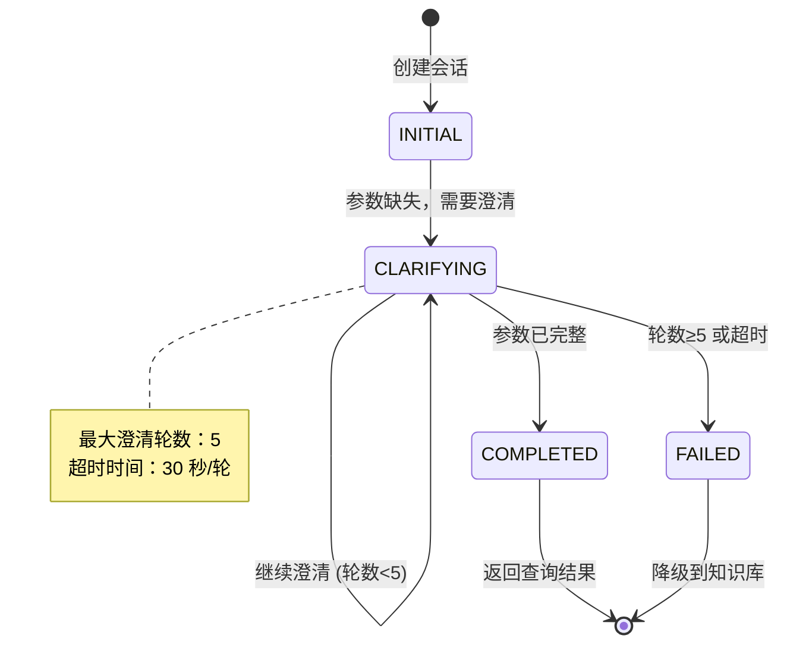

# 智能问数系统 - FE-04 澄清对话框组件详细设计文档

**文档版本**: V2.0  
**最后更新**: 2026-04-02  
**适用对象**: 前端开发工程师  
**关联任务**: FE-04 澄清对话框组件  
**前置依赖**: FE-01 (TraceID), FE-02 (SSE 流式聊天), BE-10 (多轮对话上下文管理)  
**后续依赖**: FE-07 (聊天窗口集成), AI-06 (澄清流程编排)

**技术栈**: Vue 2.6.12 + Element-UI 2.5.12

---

## 1. 任务概述

### 1.1 背景
澄清对话框组件是智能问数系统多轮对话的核心交互组件。当 AI 无法从用户首次提问中提取完整参数时（如缺少时间、地区、指标等），需要主动追问，并在后续对话中记住已确认的信息，避免用户重复输入。本组件提供友好的澄清交互界面，支持快捷选项、自由输入、超时处理等功能。

### 1.2 目标
| 目标 | 说明 | 验收标准 |
|------|------|----------|
| **友好交互** | 提供清晰的澄清问题和快捷选项 | 用户理解率 ≥ 90% |
| **多模式支持** | 支持快捷选项、自由输入、混合模式 | 3 种模式可用 |
| **超时处理** | 30 秒无响应自动提示，60 秒自动关闭 | 超时机制生效 |
| **上下文记忆** | 显示已确认的参数，增强用户掌控感 | 已确认参数显示正确 |
| **可取消** | 用户可随时取消澄清，返回正常对话 | 取消功能正常 |
| **兼容性** | 兼容 Vue 2.6.12 + Element-UI 2.5.12 | 无版本冲突 |

### 1.3 范围
| 功能 | 说明 | 风险等级 |
|------|------|----------|
| 澄清问题展示 | 显示 AI 生成的澄清问题 | 🟢 低 |
| 快捷选项 | 提供 3-5 个快捷选项 | 🟢 低 |
| 自由输入 | 支持用户自定义输入 | 🟢 低 |
| 已确认参数 | 显示已确认的参数标签 | 🟡 中 |
| 超时提示 | 30 秒/60 秒超时处理 | 🟡 中 |
| 取消功能 | 用户可取消澄清 | 🟢 低 |
| 多轮澄清 | 支持最多 5 轮澄清 | 🟡 中 |
| 上下文继承 | 继承上一轮已确认参数 | 🟡 中 |

### 1.4 澄清场景示例
| 场景 | 缺失参数 | 澄清问题 | 快捷选项 |
|------|----------|----------|----------|
| 指标缺失 | metric | 您想查看哪个指标？ | 销售额、订单量、用户数 |
| 地区缺失 | region | 您想查看哪个地区？ | 华东区、华北区、全国 |
| 时间缺失 | time | 您想查看什么时间范围？ | 上月、近 7 天、本季度 |
| 多维度缺失 | metric+region | 您想查看哪个地区的什么指标？ | 组合选项 |
| 模糊提问 | intent | 我没理解您的问题，您能具体说说吗？ | 销售数据、用户数据、帮助 |

---

## 2. 技术选型

### 2.1 技术栈
| 组件 | 技术 | 版本 | 选型理由 |
|------|------|------|----------|
| UI 框架 | Element-UI | 2.5.12 | 项目已有依赖 |
| 对话框 | El-Dialog | 2.5.12 | Element-UI 内置 |
| 标签 | El-Tag | 2.5.12 | 显示已确认参数 |
| 输入框 | El-Input | 2.5.12 | 自由输入 |
| 按钮 | El-Button | 2.5.12 | 选项按钮 |
| 倒计时 | 自定义定时器 | - | 超时处理 |
| 状态管理 | Vuex (可选) | 3.6.0 | 项目已有依赖 |

### 2.2 组件架构
```mermaid
flowchart TB
    subgraph "ClarifyDialog.vue"
        A[主组件] --> B[澄清问题区域]
        A --> C[快捷选项区域]
        A --> D[自由输入区域]
        A --> E[已确认参数区域]
        A --> F[超时提示区域]
    end
    
    subgraph "逻辑层"
        A --> G[超时计时器]
        A --> H[选项选择处理]
        A --> I[输入验证]
        A --> J[上下文合并]
    end
    
    subgraph "事件层"
        A --> K[@select 事件]
        A --> L[@cancel 事件]
        A --> M[@timeout 事件]
    end
    
    subgraph "样式层"
        A --> N[主题配置]
        A --> O[动画效果]
        A --> P[响应式布局]
    end
```

### 2.3 对话状态机


---

## 3. 详细实现方案

### 3.1 澄清配置中心

**文件路径**: `src/config/clarify-config.js`

```javascript
/**
 * 澄清配置中心
 * 定义槽位、澄清问题、选项等
 * 
 * ⚠️ 注意事项:
 * 1. 配置与代码分离，便于维护
 * 2. 支持动态加载
 * 3. 支持多语言
 */

export default {
  /**
   * 槽位定义
   */
  slots: {
    metric: {
      code: 'metric',
      name: '指标',
      required: true,
      priority: 1,
      clarifyQuestion: '您想查看哪个指标？',
      defaultOptions: ['销售额', '订单量', '用户数', '转化率', '客单价'],
      validate: (value) => {
        return value && value.length > 0;
      }
    },
    
    region: {
      code: 'region',
      name: '地区',
      required: true,
      priority: 2,
      clarifyQuestion: '您想查看哪个地区？',
      defaultOptions: ['华东区', '华北区', '华南区', '华西区', '全国'],
      validate: (value) => {
        return value && value.length > 0;
      }
    },
    
    time: {
      code: 'time',
      name: '时间',
      required: true,
      priority: 3,
      clarifyQuestion: '您想查看什么时间范围？',
      defaultOptions: ['上月', '近 7 天', '本季度', '本月', '自定义'],
      validate: (value) => {
        return value && value.length > 0;
      }
    },
    
    dimension: {
      code: 'dimension',
      name: '维度',
      required: false,
      priority: 4,
      clarifyQuestion: '您想按什么维度分组？',
      defaultOptions: ['地区', '部门', '渠道', '时间'],
      validate: (value) => {
        return true; // 可选参数
      }
    }
  },
  
  /**
   * 超时配置
   */
  timeout: {
    // 提示超时 (秒)
    hintTimeout: 30,
    // 完全超时 (秒)
    fullTimeout: 60,
    // 超时提示文案
    hintMessage: '长时间未操作，对话即将关闭',
    // 超时后操作
    onTimeout: 'fallback_to_kb' // fallback_to_kb / close_only
  },
  
  /**
   * 澄清轮数配置
   */
  turns: {
    // 最大澄清轮数
    maxTurns: 5,
    // 达到最大轮数后的提示
    maxTurnsMessage: '问题比较复杂，为您推荐相似查询',
    // 达到最大轮数后的操作
    onMaxTurns: 'fallback_to_kb'
  },
  
  /**
   * 快捷选项配置
   */
  options: {
    // 最多显示选项数
    maxVisible: 6,
    // 选项超出时显示"更多"
    showMore: true,
    // 更多选项文案
    moreText: '更多选项',
    // 选项按钮大小
    buttonSize: 'small',
    // 选项按钮类型
    buttonType: 'default'
  },
  
  /**
   * 输入框配置
   */
  input: {
    // 占位符
    placeholder: '或直接输入您的答案...',
    // 最大长度
    maxLength: 100,
    // 是否显示字数限制
    showWordLimit: true,
    // 是否自动聚焦
    autoFocus: true,
    // 输入验证规则
    validate: (value) => {
      return value && value.trim().length > 0;
    }
  },
  
  /**
   * 动画配置
   */
  animation: {
    // 显示动画
    enter: 'clarify-fade',
    // 选项点击动画
    optionClick: 'pulse',
    // 动画时长 (ms)
    duration: 300
  }
};
```

### 3.2 澄清对话框组件

**文件路径**: `src/views/askdata/components/ClarifyDialog.vue`

```vue
<template>
  <transition :name="animationClass">
    <div v-if="visible" class="clarify-dialog-overlay" @click.self="handleCancel">
      <div class="clarify-dialog" :class="{ 'is-timeout': isTimeout }">
        <!-- 头部 -->
        <div class="clarify-header">
          <i class="el-icon-question clarify-icon"></i>
          <span class="clarify-title">需要确认一下</span>
          <el-button
            type="text"
            icon="el-icon-close"
            size="mini"
            class="close-btn"
            @click="handleCancel"
          ></el-button>
        </div>

        <!-- 澄清问题 -->
        <div class="clarify-question">
          {{ question }}
        </div>

        <!-- ⚠️ 已确认参数 -->
        <div v-if="confirmedParams && Object.keys(confirmedParams).length > 0" class="confirmed-params">
          <div class="params-title">已确认：</div>
          <el-tag
            v-for="(value, key) in confirmedParams"
            :key="key"
            size="small"
            type="info"
            closable
            @close="handleRemoveParam(key)"
            class="param-tag"
          >
            {{ formatParamKey(key) }}: {{ formatParamValue(value) }}
          </el-tag>
        </div>

        <!-- ⚠️ 快捷选项 -->
        <div v-if="options && options.length > 0" class="clarify-options">
          <el-button
            v-for="(option, index) in displayOptions"
            :key="index"
            size="small"
            :type="selectedIndex === index ? 'primary' : 'default'"
            @click="handleSelectOption(option, index)"
            :loading="selecting && selectedIndex === index"
            class="option-btn"
          >
            {{ option }}
          </el-button>
          
          <!-- 更多选项 -->
          <el-button
            v-if="hasMore && !isExpanded"
            size="small"
            type="text"
            @click="toggleExpand"
            class="expand-btn"
          >
            {{ moreText }} <i class="el-icon-arrow-down"></i>
          </el-button>
          <el-button
            v-if="isExpanded"
            size="small"
            type="text"
            @click="toggleExpand"
            class="expand-btn"
          >
            收起 <i class="el-icon-arrow-up"></i>
          </el-button>
        </div>

        <!-- ⚠️ 自由输入 -->
        <div class="clarify-input">
          <el-input
            ref="inputRef"
            v-model="userInput"
            :placeholder="inputPlaceholder"
            size="small"
            @keyup.enter.native="handleInputSubmit"
            @focus="handleInputFocus"
            @blur="handleInputBlur"
            :maxlength="maxLength"
            :show-word-limit="showWordLimit"
            :disabled="selecting"
          >
            <el-button
              slot="append"
              icon="el-icon-check"
              type="primary"
              @click="handleInputSubmit"
              :loading="selecting"
              :disabled="!canSubmit"
            >
              发送
            </el-button>
          </el-input>
        </div>

        <!-- ⚠️ 超时提示 -->
        <div v-if="isTimeout" class="timeout-hint">
          <el-alert
            :title="timeoutMessage"
            type="warning"
            :closable="false"
            show-icon
            size="small"
          />
          <div class="timeout-countdown">
            剩余 {{ countdownSeconds }} 秒
          </div>
        </div>

        <!-- 底部操作 -->
        <div class="clarify-footer">
          <el-button size="small" @click="handleCancel">
            取消
          </el-button>
          <el-button
            type="primary"
            size="small"
            :disabled="!canSubmit"
            :loading="selecting"
            @click="handleInputSubmit"
          >
            确定
          </el-button>
        </div>
      </div>
    </div>
  </transition>
</template>

<script>
import clarifyConfig from '@/config/clarify-config';

export default {
  name: 'ClarifyDialog',
  props: {
    // 是否显示
    visible: {
      type: Boolean,
      default: false
    },
    
    // 澄清问题
    question: {
      type: String,
      required: true
    },
    
    // 快捷选项
    options: {
      type: Array,
      default: () => []
    },
    
    // 已确认的参数
    confirmedParams: {
      type: Object,
      default: () => ({})
    },
    
    // 输入框占位符
    inputPlaceholder: {
      type: String,
      default: '或直接输入您的答案...'
    },
    
    // 超时时间 (秒)
    timeoutSeconds: {
      type: Number,
      default: 60
    },
    
    // 提示超时时间 (秒)
    hintTimeoutSeconds: {
      type: Number,
      default: 30
    },
    
    // 是否允许取消
    allowCancel: {
      type: Boolean,
      default: true
    },
    
    // 是否自动聚焦输入框
    autoFocus: {
      type: Boolean,
      default: true
    },
    
    // 最大显示选项数
    maxVisibleOptions: {
      type: Number,
      default: 6
    },
    
    // 动画类名
    animationClass: {
      type: String,
      default: 'clarify-fade'
    }
  },
  data() {
    return {
      userInput: '',
      selecting: false,
      selectedIndex: null,
      isTimeout: false,
      countdownSeconds: 0,
      timeoutTimer: null,
      hintTimer: null,
      inputFocused: false,
      isExpanded: false,
      config: clarifyConfig
    };
  },
  computed: {
    // 是否可以提交
    canSubmit() {
      return this.userInput.trim() || this.selectedIndex !== null;
    },
    
    // 显示选项 (支持展开/收起)
    displayOptions() {
      if (this.isExpanded) {
        return this.options;
      }
      return this.options.slice(0, this.maxVisibleOptions);
    },
    
    // 是否有更多选项
    hasMore() {
      return this.options.length > this.maxVisibleOptions;
    },
    
    // 更多选项文案
    moreText() {
      return this.config.options.moreText;
    },
    
    // 超时提示文案
    timeoutMessage() {
      return this.config.timeout.hintMessage;
    },
    
    // 输入框最大长度
    maxLength() {
      return this.config.input.maxLength;
    },
    
    // 是否显示字数限制
    showWordLimit() {
      return this.config.input.showWordLimit;
    }
  },
  watch: {
    // 监听显示状态
    visible(newVal) {
      if (newVal) {
        this.startTimeout();
        this.$nextTick(() => {
          if (this.autoFocus && this.$refs.inputRef) {
            this.$refs.inputRef.focus();
          }
        });
      } else {
        this.clearTimeout();
        this.reset();
      }
    }
  },
  methods: {
    /**
     * ⚠️ 选择快捷选项
     */
    handleSelectOption(option, index) {
      if (this.selecting) {
        return;
      }
      
      this.selecting = true;
      this.selectedIndex = index;
      this.userInput = option;
      
      // 延迟提交，给用户视觉反馈
      setTimeout(() => {
        this.submit(option);
      }, this.config.animation.duration);
    },

    /**
     * ⚠️ 输入框提交
     */
    handleInputSubmit() {
      if (!this.canSubmit || this.selecting) {
        return;
      }
      
      const value = this.userInput.trim() || this.options[this.selectedIndex];
      this.submit(value);
    },

    /**
     * ⚠️ 提交澄清结果
     */
    submit(value) {
      this.clearTimeout();
      this.$emit('select', {
        value,
        optionIndex: this.selectedIndex,
        isCustomInput: this.selectedIndex === null
      });
    },

    /**
     * ⚠️ 取消澄清
     */
    handleCancel() {
      if (!this.allowCancel) {
        return;
      }
      
      this.clearTimeout();
      this.$emit('cancel');
    },

    /**
     * ⚠️ 移除已确认参数
     */
    handleRemoveParam(key) {
      const newParams = { ...this.confirmedParams };
      delete newParams[key];
      this.$emit('update:confirmedParams', newParams);
    },

    /**
     * 输入框聚焦
     */
    handleInputFocus() {
      this.inputFocused = true;
      this.pauseTimeout();
    },

    /**
     * 输入框失焦
     */
    handleInputBlur() {
      this.inputFocused = false;
      this.resumeTimeout();
    },

    /**
     * ⚠️ 启动超时计时
     */
    startTimeout() {
      this.clearTimeout();
      this.isTimeout = false;
      this.countdownSeconds = this.timeoutSeconds;
      
      // 提示超时
      this.hintTimer = setTimeout(() => {
        this.isTimeout = true;
        this.countdownSeconds = this.timeoutSeconds - this.hintTimeoutSeconds;
      }, this.hintTimeoutSeconds * 1000);
      
      // 完全超时
      this.timeoutTimer = setInterval(() => {
        this.countdownSeconds--;
        
        if (this.countdownSeconds <= 0) {
          this.handleTimeout();
        }
      }, 1000);
    },

    /**
     * 暂停超时计时
     */
    pauseTimeout() {
      if (this.timeoutTimer) {
        clearInterval(this.timeoutTimer);
        this.timeoutTimer = null;
      }
    },

    /**
     * 恢复超时计时
     */
    resumeTimeout() {
      if (!this.timeoutTimer && !this.isTimeout) {
        this.startTimeout();
      }
    },

    /**
     * ⚠️ 清除超时计时
     */
    clearTimeout() {
      if (this.timeoutTimer) {
        clearInterval(this.timeoutTimer);
        this.timeoutTimer = null;
      }
      if (this.hintTimer) {
        clearTimeout(this.hintTimer);
        this.hintTimer = null;
      }
    },

    /**
     * ⚠️ 处理超时
     */
    handleTimeout() {
      this.clearTimeout();
      this.$emit('timeout');
    },

    /**
     * 重置组件状态
     */
    reset() {
      this.userInput = '';
      this.selecting = false;
      this.selectedIndex = null;
      this.isTimeout = false;
      this.countdownSeconds = 0;
      this.isExpanded = false;
    },

    /**
     * 格式化参数键
     */
    formatParamKey(key) {
      const keyMap = {
        metric: '指标',
        region: '地区',
        time: '时间',
        dimension: '维度'
      };
      return keyMap[key] || key;
    },

    /**
     * 格式化参数值
     */
    formatParamValue(value) {
      if (typeof value === 'object') {
        return JSON.stringify(value);
      }
      return String(value);
    },

    /**
     * 切换展开/收起
     */
    toggleExpand() {
      this.isExpanded = !this.isExpanded;
    }
  },
  beforeDestroy() {
    // ⚠️ 清理定时器
    this.clearTimeout();
  }
};
</script>

<style scoped lang="scss">
.clarify-fade-enter-active,
.clarify-fade-leave-active {
  transition: opacity 0.3s;
}

.clarify-fade-enter,
.clarify-fade-leave-to {
  opacity: 0;
}

.clarify-dialog-overlay {
  position: fixed;
  top: 0;
  left: 0;
  width: 100%;
  height: 100%;
  background: rgba(0, 0, 0, 0.5);
  display: flex;
  align-items: center;
  justify-content: center;
  z-index: 2000;
}

.clarify-dialog {
  background: white;
  border-radius: 12px;
  box-shadow: 0 4px 24px rgba(0, 0, 0, 0.15);
  width: 90%;
  max-width: 500px;
  max-height: 80vh;
  overflow-y: auto;
  animation: slide-up 0.3s ease-out;
  
  &.is-timeout {
    border: 2px solid #E6A23C;
  }
}

@keyframes slide-up {
  from {
    transform: translateY(20px);
    opacity: 0;
  }
  to {
    transform: translateY(0);
    opacity: 1;
  }
}

.clarify-header {
  display: flex;
  align-items: center;
  padding: 16px 20px;
  border-bottom: 1px solid #e0e0e0;
  
  .clarify-icon {
    font-size: 20px;
    color: #667eea;
    margin-right: 8px;
  }
  
  .clarify-title {
    flex: 1;
    font-size: 16px;
    font-weight: 600;
    color: #333;
  }
  
  .close-btn {
    color: #999;
    font-size: 18px;
    
    &:hover {
      color: #333;
    }
  }
}

.clarify-question {
  padding: 20px;
  font-size: 15px;
  color: #333;
  line-height: 1.6;
  background: #f5f7fa;
}

.confirmed-params {
  padding: 12px 20px;
  border-bottom: 1px solid #e0e0e0;
  
  .params-title {
    font-size: 13px;
    color: #666;
    margin-bottom: 8px;
  }
  
  .param-tag {
    margin-right: 8px;
    margin-bottom: 8px;
  }
}

.clarify-options {
  padding: 16px 20px;
  display: flex;
  flex-wrap: wrap;
  gap: 8px;
  
  .option-btn {
    min-width: 80px;
    
    &:hover {
      transform: translateY(-2px);
      box-shadow: 0 2px 8px rgba(102, 126, 234, 0.3);
    }
  }
  
  .expand-btn {
    width: 100%;
    margin-top: 8px;
  }
}

.clarify-input {
  padding: 0 20px 16px;
}

.timeout-hint {
  padding: 0 20px 16px;
  
  .timeout-countdown {
    margin-top: 8px;
    font-size: 13px;
    color: #E6A23C;
    text-align: right;
  }
}

.clarify-footer {
  display: flex;
  justify-content: flex-end;
  gap: 8px;
  padding: 16px 20px;
  border-top: 1px solid #e0e0e0;
  background: #fafafa;
  border-radius: 0 0 12px 12px;
}

// 响应式
@media screen and (max-width: 768px) {
  .clarify-dialog {
    width: 95%;
    max-width: none;
  }
  
  .clarify-options {
    justify-content: center;
  }
  
  .option-btn {
    width: 100%;
  }
}
</style>
```

### 3.3 澄清混入

**文件路径**: `src/mixins/clarify-mixin.js`

```javascript
/**
 * 澄清逻辑混入
 * 为聊天组件提供澄清功能
 * 
 * ⚠️ 注意事项:
 * 1. 管理澄清对话框状态
 * 2. 处理澄清选择
 * 3. 处理澄清取消
 * 4. 处理澄清超时
 */

export default {
  data() {
    return {
      // 澄清对话框显示状态
      clarifyVisible: false,
      
      // 澄清问题
      clarifyQuestion: '',
      
      // 澄清选项
      clarifyOptions: [],
      
      // 已确认的参数
      confirmedParams: {},
      
      // 当前澄清的槽位
      currentSlot: null,
      
      // 澄清轮数
      clarifyTurnCount: 0,
      
      // 最大澄清轮数
      maxClarifyTurns: 5
    };
  },
  methods: {
    /**
     * ⚠️ 显示澄清对话框
     */
    showClarifyDialog(question, options, confirmedParams = {}) {
      this.clarifyQuestion = question;
      this.clarifyOptions = options || [];
      this.confirmedParams = confirmedParams || {};
      this.clarifyVisible = true;
      this.clarifyTurnCount++;
    },

    /**
     * 隐藏澄清对话框
     */
    hideClarifyDialog() {
      this.clarifyVisible = false;
    },

    /**
     * ⚠️ 处理澄清选择
     */
    handleClarifySelect({ value, optionIndex, isCustomInput }) {
      this.hideClarifyDialog();
      
      // 更新已确认参数
      if (this.currentSlot) {
        this.confirmedParams[this.currentSlot] = value;
      }
      
      // 发送澄清结果到后端
      this.sendClarifyResponse(value);
      
      this.$message.success('已确认');
    },

    /**
     * ⚠️ 处理澄清取消
     */
    handleClarifyCancel() {
      this.hideClarifyDialog();
      this.$message.info('已取消澄清');
      
      // 降级到知识库
      this.fallbackToKnowledgeBase();
    },

    /**
     * ⚠️ 处理澄清超时
     */
    handleClarifyTimeout() {
      this.hideClarifyDialog();
      this.$message.warning('长时间未操作，已自动关闭');
      
      // 降级到知识库
      this.fallbackToKnowledgeBase();
    },

    /**
     * 发送澄清响应到后端
     */
    sendClarifyResponse(value) {
      // 将澄清结果作为新消息发送
      this.sendMessage(value);
    },

    /**
     * 降级到知识库
     */
    fallbackToKnowledgeBase() {
      this.$emit('fallback', {
        reason: 'CLARIFY_CANCELLED',
        confirmedParams: this.confirmedParams
      });
    },

    /**
     * ⚠️ 检查是否超过最大澄清轮数
     */
    checkMaxTurns() {
      if (this.clarifyTurnCount >= this.maxClarifyTurns) {
        this.$message.warning(this.maxClarifyTurnsMessage);
        this.hideClarifyDialog();
        this.fallbackToKnowledgeBase();
        return true;
      }
      return false;
    },

    /**
     * 重置澄清状态
     */
    resetClarifyState() {
      this.clarifyVisible = false;
      this.clarifyQuestion = '';
      this.clarifyOptions = [];
      this.confirmedParams = {};
      this.currentSlot = null;
      this.clarifyTurnCount = 0;
    }
  },
  beforeDestroy() {
    // ⚠️ 清理澄清状态
    this.resetClarifyState();
  }
};
```

### 3.4 澄清上下文管理器

**文件路径**: `src/utils/clarify-context.js`

```javascript
/**
 * 澄清上下文管理器
 * 管理澄清过程中的上下文状态
 * 
 * ⚠️ 注意事项:
 * 1. 上下文版本控制
 * 2. 参数合并逻辑
 * 3. 冲突检测
 */

class ClarifyContext {
  constructor() {
    this.sessionId = null;
    this.version = 0;
    this.confirmedParams = {};
    this.missingSlots = [];
    this.turnCount = 0;
  }

  /**
   * ⚠️ 更新上下文 (带版本控制)
   */
  update(newParams, expectedVersion) {
    if (this.version !== expectedVersion) {
      throw new Error('Context version mismatch');
    }
    
    // 合并参数
    this.confirmedParams = { ...this.confirmedParams, ...newParams };
    this.version++;
    
    return this.version;
  }

  /**
   * 获取缺失的槽位
   */
  getMissingSlots(requiredSlots) {
    return requiredSlots.filter(slot => 
      !this.confirmedParams[slot]
    );
  }

  /**
   * ⚠️ 合并新旧参数
   */
  mergeContext(existing, newParams) {
    if (!existing) {
      return newParams;
    }
    if (!newParams) {
      return existing;
    }
    
    // 新参数优先，但保留旧参数中未被覆盖的部分
    const merged = { ...existing, ...newParams };
    
    return merged;
  }

  /**
   * 重置上下文
   */
  reset() {
    this.sessionId = null;
    this.version = 0;
    this.confirmedParams = {};
    this.missingSlots = [];
    this.turnCount = 0;
  }
}

export default new ClarifyContext();
```

---

## 4. 注意事项 ⚠️

### 4.1 定时器清理
```javascript
// ❌ 错误：组件销毁不清理定时器
beforeDestroy() {
  // 忘记清理 timeoutTimer
}

// ✅ 正确：组件销毁时清理定时器
beforeDestroy() {
  this.clearTimeout();
}
```

### 4.2 超时处理
```javascript
// ❌ 错误：超时后不通知父组件
handleTimeout() {
  this.isTimeout = true;
  // 不触发 timeout 事件
}

// ✅ 正确：超时后触发事件
handleTimeout() {
  this.clearTimeout();
  this.$emit('timeout'); // 通知父组件
}
```

### 4.3 参数验证
```javascript
// ❌ 错误：不验证用户输入
handleInputSubmit() {
  this.submit(this.userInput); // 可能为空
}

// ✅ 正确：验证后提交
handleInputSubmit() {
  if (!this.canSubmit) {
    return;
  }
  this.submit(this.userInput.trim());
}
```

### 4.4 上下文同步
```javascript
// ❌ 错误：直接修改父组件传入的对象
handleRemoveParam(key) {
  delete this.confirmedParams[key]; // 直接修改 prop
}

// ✅ 正确：触发事件让父组件修改
handleRemoveParam(key) {
  const newParams = { ...this.confirmedParams };
  delete newParams[key];
  this.$emit('update:confirmedParams', newParams);
}
```

### 4.5 焦点管理
```javascript
// ❌ 错误：不管理输入框焦点
visible() {
  // 不聚焦输入框
}

// ✅ 正确：显示时自动聚焦
visible(newVal) {
  if (newVal) {
    this.$nextTick(() => {
      if (this.$refs.inputRef) {
        this.$refs.inputRef.focus();
      }
    });
  }
}
```

---

## 5. 需要特别关注的点 🔴

### 5.1 陷阱防护矩阵

| 陷阱类型 | 风险描述 | 防护措施 | 验证方法 |
|----------|----------|----------|----------|
| **定时器泄漏** | 组件销毁后定时器仍在运行 | beforeDestroy 清理定时器 | 内存无泄漏 |
| **超时未通知** | 超时后父组件不知情 | 触发 timeout 事件 | 父组件收到事件 |
| **参数验证缺失** | 空参数提交到后端 | 提交前验证 | 空参数被拦截 |
| **上下文不同步** | 父子组件参数不一致 | 使用 v-model 或事件 | 参数同步正确 |
| **焦点丢失** | 对话框显示输入框未聚焦 | visible 时自动聚焦 | 输入框自动聚焦 |
| **多轮澄清混乱** | 多轮澄清参数混淆 | 澄清轮数计数 | 轮数正确递增 |
| **生产环境日志** | console.log 泄露信息 | 生产环境关闭日志 | 生产包无 console |
| **响应式失效** | 移动端选项显示不全 | 响应式样式 | 移动端正常显示 |

### 5.2 关键代码审查点

```javascript
// 审查清单
□ 定时器是否在 beforeDestroy 清理
□ 超时是否触发事件
□ 参数提交前是否验证
□ 上下文修改是否通过事件
□ 输入框是否自动聚焦
□ 澄清轮数是否正确计数
□ 生产环境日志是否关闭
□ 样式是否响应式
□ 取消功能是否正常
□ 展开/收起功能是否正常
□ 已确认参数是否可删除
□ 快捷选项是否可点击
□ 超时提示是否显示
□ 倒计时是否准确
□ 组件是否可复用
```

### 5.3 性能影响评估

| 操作 | 耗时 | 优化建议 |
|------|------|----------|
| 对话框显示 | < 50ms | 无需优化 |
| 选项渲染 | < 10ms | 无需优化 |
| 定时器更新 | 1s/次 | 无需优化 |
| 参数更新 | < 5ms | 无需优化 |
| **总开销** | **< 100ms** | **可接受** |

### 5.4 监控指标

```javascript
// 前端监控指标 (可选)
window.clarifyMetrics = {
  showCount: 0,
  selectCount: 0,
  cancelCount: 0,
  timeoutCount: 0,
  
  trackShow() {
    this.showCount++;
  },
  
  trackSelect() {
    this.selectCount++;
  },
  
  trackCancel() {
    this.cancelCount++;
  },
  
  trackTimeout() {
    this.timeoutCount++;
    // 上报到监控系统
  }
};

// 组件中调用
methods: {
  handleSelectOption() {
    window.clarifyMetrics.trackSelect();
  },
  handleCancel() {
    window.clarifyMetrics.trackCancel();
  },
  handleTimeout() {
    window.clarifyMetrics.trackTimeout();
  }
}
```

---

## 6. 验收标准

### 6.1 功能验收
| 验收项 | 验收方法 | 通过标准 |
|--------|----------|----------|
| 对话框显示 | 触发澄清 | 对话框正常显示 |
| 澄清问题 | 查看问题文本 | 问题清晰易懂 |
| 快捷选项 | 点击选项 | 选项选中并提交 |
| 自由输入 | 输入文本 + 回车 | 输入内容提交 |
| 已确认参数 | 查看参数标签 | 参数显示正确 |
| 参数删除 | 点击标签关闭按钮 | 参数被删除 |
| 超时提示 | 等待 30 秒 | 显示超时提示 |
| 超时关闭 | 等待 60 秒 | 对话框自动关闭 |
| 取消功能 | 点击取消按钮 | 对话框关闭 |
| 自动聚焦 | 对话框显示 | 输入框自动聚焦 |
| 展开/收起 | 点击更多选项 | 选项展开/收起 |
| 定时器清理 | 组件销毁 | 定时器清除 |

### 6.2 兼容性验收
| 检查项 | 验收方法 | 通过标准 |
|--------|----------|----------|
| Vue 2.6.12 | 运行项目 | 无版本冲突 |
| Element-UI 2.5.12 | 使用 UI 组件 | 正常显示 |
| Chrome 80+ | 浏览器测试 | 功能正常 |
| Firefox 75+ | 浏览器测试 | 功能正常 |
| Safari 13+ | 浏览器测试 | 功能正常 |
| 移动端 | 手机浏览器测试 | 响应式正常 |

### 6.3 性能验收
| 指标 | 目标值 | 测量方法 |
|------|--------|----------|
| 显示延迟 | < 50ms | console.time |
| 选项渲染 | < 10ms | console.time |
| 定时器精度 | ±100ms | 手动计时 |
| 内存占用 | 无泄漏 | Chrome DevTools |

---

## 7. 测试用例

### 7.1 单元测试

**文件路径**: `tests/unit/components/ClarifyDialog.spec.js`

```javascript
import { mount } from '@vue/test-utils';
import ClarifyDialog from '@/views/askdata/components/ClarifyDialog.vue';

describe('ClarifyDialog', () => {
  test('should render clarify question', () => {
    const wrapper = mount(ClarifyDialog, {
      propsData: {
        visible: true,
        question: '测试问题'
      }
    });
    
    expect(wrapper.find('.clarify-question').text()).toBe('测试问题');
  });

  test('should render options', () => {
    const wrapper = mount(ClarifyDialog, {
      propsData: {
        visible: true,
        question: '测试问题',
        options: ['选项 1', '选项 2', '选项 3']
      }
    });
    
    const buttons = wrapper.findAll('.option-btn');
    expect(buttons.length).toBe(3);
  });

  test('should emit select event on option click', async () => {
    const wrapper = mount(ClarifyDialog, {
      propsData: {
        visible: true,
        question: '测试问题',
        options: ['选项 1', '选项 2']
      }
    });
    
    wrapper.findAll('.option-btn').at(0).trigger('click');
    await wrapper.vm.$nextTick();
    await new Promise(resolve => setTimeout(resolve, 300)); // 等待延迟提交
    
    expect(wrapper.emitted().select).toBeTruthy();
    expect(wrapper.emitted().select[0][0].value).toBe('选项 1');
  });

  test('should emit cancel event on cancel click', async () => {
    const wrapper = mount(ClarifyDialog, {
      propsData: {
        visible: true,
        question: '测试问题',
        allowCancel: true
      }
    });
    
    wrapper.find('.clarify-footer .el-button:not(.is-primary)').trigger('click');
    await wrapper.vm.$nextTick();
    
    expect(wrapper.emitted().cancel).toBeTruthy();
  });

  test('should emit timeout event after timeout', (done) => {
    const wrapper = mount(ClarifyDialog, {
      propsData: {
        visible: true,
        question: '测试问题',
        timeoutSeconds: 2,
        hintTimeoutSeconds: 1
      }
    });
    
    setTimeout(() => {
      expect(wrapper.emitted().timeout).toBeTruthy();
      done();
    }, 2500);
  });

  test('should validate input before submit', async () => {
    const wrapper = mount(ClarifyDialog, {
      propsData: {
        visible: true,
        question: '测试问题'
      }
    });
    
    // 空输入不能提交
    expect(wrapper.vm.canSubmit).toBe(false);
    
    // 有输入可以提交
    wrapper.setData({ userInput: '测试输入' });
    await wrapper.vm.$nextTick();
    expect(wrapper.vm.canSubmit).toBe(true);
  });

  test('should clear timers on destroy', () => {
    const wrapper = mount(ClarifyDialog, {
      propsData: {
        visible: true,
        question: '测试问题'
      }
    });
    
    const vm = wrapper.vm;
    vm.startTimeout();
    
    wrapper.destroy();
    
    expect(vm.timeoutTimer).toBeNull();
    expect(vm.hintTimer).toBeNull();
  });
});
```

### 7.2 集成测试

**文件路径**: `tests/e2e/specs/clarify-dialog.spec.js`

```javascript
describe('ClarifyDialog E2E Tests', () => {
  it('should display clarify dialog', () => {
    cy.visit('/askdata');
    
    // 发送模糊问题触发澄清
    cy.get('[data-test="input"]').type('查一下{enter}');
    
    // 验证澄清对话框显示
    cy.get('[data-test="clarify-dialog"]').should('be.visible');
    cy.get('[data-test="clarify-question"]').should('contain', '确认');
  });

  it('should select option and submit', () => {
    cy.visit('/askdata');
    
    // 发送模糊问题
    cy.get('[data-test="input"]').type('查销售额{enter}');
    
    // 点击澄清选项
    cy.get('[data-test="clarify-option"]').contains('华东区').click();
    
    // 验证提交
    cy.get('[data-test="message-list"]').should('contain', '华东区');
  });

  it('should input custom value and submit', () => {
    cy.visit('/askdata');
    
    // 发送模糊问题
    cy.get('[data-test="input"]').type('查数据{enter}');
    
    // 输入自定义值
    cy.get('[data-test="clarify-input"]').type('华北区{enter}');
    
    // 验证提交
    cy.get('[data-test="message-list"]').should('contain', '华北区');
  });

  it('should timeout and close', () => {
    cy.visit('/askdata');
    
    // 发送模糊问题
    cy.get('[data-test="input"]').type('查数据{enter}');
    
    // 等待超时
    cy.wait(60000); // 60 秒超时
    
    // 验证对话框关闭
    cy.get('[data-test="clarify-dialog"]').should('not.be.visible');
  });

  it('should cancel and close', () => {
    cy.visit('/askdata');
    
    // 发送模糊问题
    cy.get('[data-test="input"]').type('查数据{enter}');
    
    // 点击取消按钮
    cy.get('[data-test="clarify-cancel"]').click();
    
    // 验证对话框关闭
    cy.get('[data-test="clarify-dialog"]').should('not.be.visible');
  });

  it('should display confirmed params', () => {
    cy.visit('/askdata');
    
    // 第一轮澄清
    cy.get('[data-test="input"]').type('查销售额{enter}');
    cy.get('[data-test="clarify-option"]').contains('华东区').click();
    
    // 第二轮澄清
    cy.get('[data-test="clarify-option"]').contains('上月').click();
    
    // 验证已确认参数显示
    cy.get('[data-test="confirmed-params"]').should('contain', '地区：华东区');
    cy.get('[data-test="confirmed-params"]').should('contain', '时间：上月');
  });

  it('should remove confirmed param', () => {
    cy.visit('/askdata');
    
    // 澄清确认参数
    cy.get('[data-test="input"]').type('查销售额{enter}');
    cy.get('[data-test="clarify-option"]').contains('华东区').click();
    
    // 删除参数
    cy.get('[data-test="param-tag"] .el-icon-close').click();
    
    // 验证参数被删除
    cy.get('[data-test="confirmed-params"]').should('not.contain', '华东区');
  });

  it('should auto focus input', () => {
    cy.visit('/askdata');
    
    // 发送模糊问题
    cy.get('[data-test="input"]').type('查数据{enter}');
    
    // 验证输入框聚焦
    cy.get('[data-test="clarify-input"]').should('be.focused');
  });

  it('should expand/collapse options', () => {
    cy.visit('/askdata');
    
    // 发送模糊问题 (选项超过 6 个)
    cy.get('[data-test="input"]').type('查数据{enter}');
    
    // 点击更多选项
    cy.get('[data-test="expand-options"]').click();
    
    // 验证选项展开
    cy.get('[data-test="clarify-option"]').should('have.length.greaterThan', 6);
    
    // 点击收起
    cy.get('[data-test="collapse-options"]').click();
    
    // 验证选项收起
    cy.get('[data-test="clarify-option"]').should('have.length', 6);
  });

  it('should cleanup on destroy', () => {
    cy.visit('/askdata');
    
    // 发送模糊问题
    cy.get('[data-test="input"]').type('查数据{enter}');
    
    // 离开页面
    cy.visit('/');
    
    // 验证定时器清理 (需通过内存监控验证)
  });
});
```

### 7.3 手动测试用例

| 用例 ID | 测试场景 | 操作步骤 | 预期结果 |
|---------|----------|----------|----------|
| FE-TC-001 | 对话框显示 | 发送模糊问题 | 对话框正常显示 |
| FE-TC-002 | 澄清问题 | 查看问题文本 | 问题清晰易懂 |
| FE-TC-003 | 快捷选项 | 点击选项 | 选项选中并提交 |
| FE-TC-004 | 自由输入 | 输入文本 + 回车 | 输入内容提交 |
| FE-TC-005 | 已确认参数 | 查看参数标签 | 参数显示正确 |
| FE-TC-006 | 参数删除 | 点击标签关闭按钮 | 参数被删除 |
| FE-TC-007 | 超时提示 | 等待 30 秒 | 显示超时提示 |
| FE-TC-008 | 超时关闭 | 等待 60 秒 | 对话框自动关闭 |
| FE-TC-009 | 取消功能 | 点击取消按钮 | 对话框关闭 |
| FE-TC-010 | 自动聚焦 | 对话框显示 | 输入框自动聚焦 |
| FE-TC-011 | 展开/收起 | 点击更多选项 | 选项展开/收起 |
| FE-TC-012 | 多轮澄清 | 连续 5 轮澄清 | 第 6 轮降级 |
| FE-TC-013 | 定时器清理 | 组件销毁 | 定时器清除 |
| FE-TC-014 | 响应式 | 调整窗口大小 | 布局自适应 |
| FE-TC-015 | 生产环境 | 部署生产环境 | 无 console 日志 |

---

## 8. 部署配置

### 8.1 环境变量

**文件路径**: `.env.development`
```bash
# 开发环境配置
VUE_APP_BASE_API=/api
VUE_APP_CLARIFY_DEBUG=true
VUE_APP_CLARIFY_TIMEOUT=60
VUE_APP_CLARIFY_MAX_TURNS=5
```

**文件路径**: `.env.production`
```bash
# 生产环境配置
VUE_APP_BASE_API=https://api.company.com
VUE_APP_CLARIFY_DEBUG=false
VUE_APP_CLARIFY_TIMEOUT=60
VUE_APP_CLARIFY_MAX_TURNS=5
```

### 8.2 Webpack 配置

```javascript
// vue.config.js
module.exports = {
  configureWebpack: {
    // ⚠️ 生产环境移除 console.log
    optimization: {
      minimizer: [
        new TerserPlugin({
          terserOptions: {
            compress: {
              drop_console: process.env.NODE_ENV === 'production',
              drop_debugger: process.env.NODE_ENV === 'production'
            }
          }
        })
      ]
    }
  },
  
  // ⚠️ 配置澄清相关的全局变量
  definePlugin: {
    'process.env.VUE_APP_CLARIFY_DEBUG': process.env.VUE_APP_CLARIFY_DEBUG
  }
};
```

---

## 9. 常见问题 (FAQ)

**Q1: 对话框不显示怎么办？**
A: 1. 检查 `visible` 属性是否为 `true`；2. 检查 z-index 是否被覆盖；3. 查看控制台错误信息。

**Q2: 超时计时不准确怎么办？**
A: 1. 检查定时器是否正确启动；2. 检查是否被暂停/恢复；3. 确保组件未销毁。

**Q3: 输入框无法聚焦怎么办？**
A: 1. 检查 `autoFocus` 属性；2. 确保 `$refs.inputRef` 存在；3. 使用 `$nextTick` 确保 DOM 已渲染。

**Q4: 多轮对话上下文丢失怎么办？**
A: 1. 使用 `confirmedParams` 保存已确认参数；2. 每轮澄清后更新；3. 通过 v-model 或事件同步。

**Q5: 生产环境如何关闭调试日志？**
A: 使用 `process.env.NODE_ENV` 判断，生产环境不打印 console.log。已在代码中实现。

**Q6: 如何自定义澄清问题？**
A: 通过 `question` 属性传递自定义问题文本。

**Q7: 如何禁用取消功能？**
A: 设置 `allowCancel` 属性为 `false`。

**Q8: 组件销毁后定时器还在怎么办？**
A: 确保在 `beforeDestroy` 钩子中调用 `clearTimeout()`。

**Q9: 如何支持多语言澄清问题？**
A: 1. 使用 `vue-i18n` 插件；2. 澄清问题文案提取到语言包；3. 根据语言动态加载。

**Q10: 如何优化移动端体验？**
A: 1. 选项按钮全宽显示；2. 增大点击区域；3. 禁用长按菜单；4. 优化输入框键盘。

**Q11: 如何处理澄清轮数超限？**
A: 1. 检查 `clarifyTurnCount`；2. 达到最大轮数后自动降级；3. 提示用户。

**Q12: 如何验证定时器清理？**
A: 1. Chrome DevTools Memory 面板；2. 组件销毁后检查定时器；3. 内存无增长。

---

## 10. 变更历史

| 版本 | 日期 | 变更内容 | 负责人 |
|------|------|----------|--------|
| V1.0 | 2026-03-25 | 初始版本 | 前端组 |
| V2.0 | 2026-04-02 | 增加超时处理、上下文管理、陷阱防护 | 前端组 |

---

## 11. 工时与优先级

| 项目 | 内容 |
|------|------|
| **工时** | 3 MD (开发 2 天 + 测试 1 天) |
| **优先级** | P0 (核心交互组件) |
| **依赖任务** | FE-01, FE-02, BE-10 |
| **被依赖任务** | FE-07, AI-06 |

---

## 12. 最佳实践建议

### 12.1 定时器管理
```javascript
// ✅ 推荐：统一清理
beforeDestroy() {
  this.clearTimeout();
}

// ❌ 不推荐：分散清理
beforeDestroy() {
  if (this.timeoutTimer) {
    clearInterval(this.timeoutTimer);
  }
  // 忘记清理 hintTimer
}
```

### 12.2 事件触发规范
```javascript
// ✅ 推荐：统一事件命名
this.$emit('select', data);
this.$emit('cancel');
this.$emit('timeout');

// ❌ 不推荐：命名不一致
this.$emit('onSelect', data);
this.$emit('cancelClick');
this.$emit('handleTimeout');
```

### 12.3 上下文同步规范
```javascript
// ✅ 推荐：通过事件同步
handleRemoveParam(key) {
  const newParams = { ...this.confirmedParams };
  delete newParams[key];
  this.$emit('update:confirmedParams', newParams);
}

// ❌ 不推荐：直接修改 prop
handleRemoveParam(key) {
  delete this.confirmedParams[key]; // Vue 警告
}
```

### 12.4 性能优化规范
```javascript
// ✅ 推荐：计算属性缓存
computed: {
  canSubmit() {
    return this.userInput.trim() || this.selectedIndex !== null;
  }
}

// ❌ 不推荐：方法每次计算
methods: {
  canSubmit() {
    return this.userInput.trim() || this.selectedIndex !== null;
  }
}
```

---

**文档结束**  
**下一步**: 完成代码开发后，请提交测试团队进行 FE-04 专项验收，重点验证澄清交互流程、超时处理、多轮对话管理和用户体验。