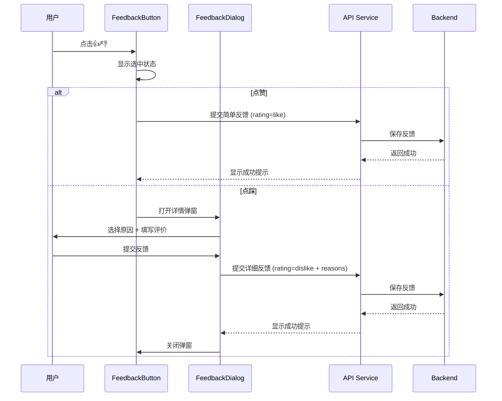

# 智能问数系统 - FE-05 反馈收集组件详细设计文档

**文档版本**: V2.0  
**最后更新**: 2026-04-02  
**适用对象**: 前端开发工程师  
**关联任务**: FE-05 反馈收集组件  
**前置依赖**: FE-01 (TraceID 生成与注入), FE-02 (SSE 流式聊天), BE-09 (异步审计日志)  
**后续依赖**: FE-07 (聊天窗口集成), 数据分析后台

**技术栈**: Vue 2.6.12 + Element-UI 2.5.12

---

## 1. 任务概述

### 1.1 背景
反馈收集组件是智能问数系统持续优化的核心数据来源。通过收集用户对 AI 回答的满意度评价（点赞/点踩）及具体原因，可以帮助团队识别系统问题、优化意图识别准确率、改进知识库内容。本组件提供轻量级、非侵入式的反馈收集界面，支持多种反馈类型和原因选择。

### 1.2 目标
| 目标 | 说明 | 验收标准 |
|------|------|----------|
| **轻量级** | 不干扰主要对话流程 | 组件大小 < 50KB |
| **多类型** | 支持点赞、点踩、详细评价 | 3 种反馈类型 |
| **低门槛** | 一键反馈，可选填原因 | 点击即可反馈 |
| **可追溯** | 反馈与 TraceID、MessageID 关联 | 关联率 100% |
| **隐私保护** | 可选匿名反馈 | 匿名选项可用 |
| **兼容性** | 兼容 Vue 2.6.12 + Element-UI 2.5.12 | 无版本冲突 |

### 1.3 范围
| 功能 | 说明 | 风险等级 |
|------|------|----------|
| 点赞/点踩按钮 | 基础满意度评价 | 🟢 低 |
| 点踩原因选择 | 选择反馈原因 | 🟢 低 |
| 文本评价 | 填写详细评价 | 🟢 低 |
| 联系方式 (可选) | 留下联系方式 | 🟡 中 |
| 匿名反馈 | 不记录用户信息 | 🟡 中 |
| 反馈状态显示 | 已提交/未提交状态 | 🟢 低 |
| 反馈统计 | 显示点赞/点踩数 | 🟡 中 |
| 防重复提交 | 防止重复反馈 | 🟡 中 |

### 1.4 反馈类型定义
| 反馈类型 | 值 | 说明 | 是否必填原因 |
|----------|-----|------|-------------|
| **点赞** | `like` | 回答有帮助 | 否 |
| **点踩** | `dislike` | 回答无帮助 | 是 (弹窗选择) |
| **举报** | `report` | 内容违规/错误 | 是 (必须填写) |

### 1.5 点踩原因分类
| 原因代码 | 原因名称 | 说明 |
|----------|----------|------|
| `inaccurate` | 数据不准确 | 回答的数据与实际情况不符 |
| `irrelevant` | 内容不相关 | 回答与问题无关 |
| `incomplete` | 信息不完整 | 回答缺少关键信息 |
| `unclear` | 表达不清晰 | 回答难以理解 |
| `outdated` | 信息过时 | 数据或信息已过时 |
| `slow` | 响应太慢 | 回答速度太慢 |
| `other` | 其他原因 | 其他需要改进的地方 |

---

## 2. 技术选型

### 2.1 技术栈
| 组件 | 技术 | 版本 | 选型理由 |
|------|------|------|----------|
| UI 框架 | Element-UI | 2.5.12 | 项目已有依赖 |
| 对话框 | El-Dialog | 2.5.12 | Element-UI 内置 |
| 表单 | El-Form | 2.5.12 | Element-UI 内置 |
| 评分 | El-Rate | 2.5.12 | Element-UI 内置 |
| 状态管理 | Vuex (可选) | 3.6.0 | 项目已有依赖 |
| 剪贴板 | vue-clipboard2 | 3.3.1 | 复制 TraceID |

### 2.2 组件架构
```mermaid
flowchart TB
    subgraph "FeedbackButton.vue"
        A[主组件] --> B[点赞按钮]
        A --> C[点踩按钮]
        A --> D[反馈状态]
    end
    
    subgraph "FeedbackDialog.vue"
        E[详情弹窗] --> F[评分选择]
        E --> G[原因选择]
        E --> H[文本评价]
        E --> I[联系方式 (可选)]
    end
    
    subgraph "逻辑层"
        A --> J[反馈提交]
        A --> K[状态管理]
        E --> L[表单验证]
        E --> M[数据脱敏]
    end
    
    subgraph "服务层"
        J --> N[Feedback API]
        N --> O[后端服务]
        O --> P[数据分析后台]
    end
    
    subgraph "状态层"
        A --> Q[Vuex Store]
        Q --> R[反馈统计]
    end
```

### 2.3 反馈流程


---

## 3. 详细实现方案

### 3.1 反馈配置中心

**文件路径**: `src/config/feedback-config.js`

```javascript
/**
 * 反馈配置中心
 * 定义反馈类型、原因、评分等配置
 * 
 * ⚠️ 注意事项:
 * 1. 配置与代码分离，便于维护
 * 2. 支持动态加载
 * 3. 支持多语言
 */

export default {
  /**
   * 反馈类型定义
   */
  feedbackTypes: {
    like: {
      code: 'like',
      name: '点赞',
      icon: 'el-icon-thumb',
      color: '#67C23A',
      tooltip: '有帮助',
      submittedTooltip: '您已点赞'
    },
    dislike: {
      code: 'dislike',
      name: '点踩',
      icon: 'el-icon-thumb',
      color: '#F56C6C',
      tooltip: '无帮助',
      submittedTooltip: '您已点踩'
    },
    report: {
      code: 'report',
      name: '举报',
      icon: 'el-icon-warning-outline',
      color: '#E6A23C',
      tooltip: '内容违规',
      submittedTooltip: '您已举报'
    }
  },
  
  /**
   * 点踩原因定义
   */
  dislikeReasons: [
    {
      value: 'inaccurate',
      label: '数据不准确',
      description: '回答的数据与实际情况不符',
      icon: 'el-icon-warning-outline'
    },
    {
      value: 'irrelevant',
      label: '内容不相关',
      description: '回答与我的问题无关',
      icon: 'el-icon-close'
    },
    {
      value: 'incomplete',
      label: '信息不完整',
      description: '回答缺少关键信息',
      icon: 'el-icon-document-copy'
    },
    {
      value: 'unclear',
      label: '表达不清晰',
      description: '回答难以理解',
      icon: 'el-icon-question'
    },
    {
      value: 'outdated',
      label: '信息过时',
      description: '数据或信息已过时',
      icon: 'el-icon-time'
    },
    {
      value: 'slow',
      label: '响应太慢',
      description: '回答速度太慢',
      icon: 'el-icon-loading'
    },
    {
      value: 'other',
      label: '其他原因',
      description: '其他需要改进的地方',
      icon: 'el-icon-more-outline'
    }
  ],
  
  /**
   * 评分配置
   */
  rating: {
    // 是否启用评分
    enabled: true,
    // 最大评分
    max: 5,
    // 评分颜色
    colors: ['#F7BA2A', '#F7BA2A', '#F7BA2A'],
    // 评分图标
    iconClasses: ['el-icon-star-on', 'el-icon-star-on', 'el-icon-star-on']
  },
  
  /**
   * 文本评价配置
   */
  comment: {
    // 是否启用
    enabled: true,
    // 最大长度
    maxLength: 500,
    // 占位符
    placeholder: '请详细描述您遇到的问题，帮助我们改进...',
    // 是否显示字数限制
    showWordLimit: true,
    // 行数
    rows: 4
  },
  
  /**
   * 联系方式配置
   */
  contact: {
    // 是否启用
    enabled: true,
    // 是否必填
    required: false,
    // 类型选项
    types: [
      { value: 'email', label: '邮箱' },
      { value: 'phone', label: '手机' }
    ],
    // 占位符
    placeholder: '邮箱或手机号，方便我们与您联系',
    // 提示文案
    hint: '仅用于问题跟进，不会用于其他用途'
  },
  
  /**
   * 匿名反馈配置
   */
  anonymous: {
    // 是否允许匿名
    enabled: true,
    // 默认匿名
    defaultAnonymous: false
  },
  
  /**
   * 提交配置
   */
  submit: {
    // 防止重复提交
    preventDuplicate: true,
    // 重复提交提示
    duplicateMessage: '您已经提交过反馈了',
    // 提交成功提示
    successMessage: '反馈已提交，感谢您的宝贵意见！',
    // 提交失败提示
    errorMessage: '反馈提交失败，请重试'
  },
  
  /**
   * 统计显示配置
   */
  statistics: {
    // 是否显示统计
    enabled: false,
    // 显示点赞数
    showLikeCount: true,
    // 显示点踩数
    showDislikeCount: true,
    // 显示满意度
    showSatisfactionRate: true
  },
  
  /**
   * 动画配置
   */
  animation: {
    // 按钮点击动画
    buttonClick: 'pulse',
    // 弹窗动画
    dialog: 'fade',
    // 动画时长 (ms)
    duration: 300
  }
};
```

### 3.2 反馈按钮组件

**文件路径**: `src/views/askdata/components/FeedbackButton.vue`

```vue
<template>
  <div class="feedback-button" :class="{ 'submitted': isSubmitted }">
    <!-- ⚠️ 点赞按钮 -->
    <el-tooltip :content="likeTooltip" placement="top">
      <el-button
        type="text"
        size="mini"
        :class="{ 'active': rating === 'like' }"
        :disabled="isSubmitted || disabled"
        @click="handleFeedback('like')"
      >
        <i class="el-icon-thumb" :class="{ 'is-like': rating === 'like' }"></i>
        <span class="count" v-if="showCount && likeCount > 0">{{ likeCount }}</span>
      </el-button>
    </el-tooltip>

    <!-- ⚠️ 点踩按钮 -->
    <el-tooltip :content="dislikeTooltip" placement="top">
      <el-button
        type="text"
        size="mini"
        :class="{ 'active': rating === 'dislike' }"
        :disabled="isSubmitted || disabled"
        @click="handleFeedback('dislike')"
      >
        <i class="el-icon-thumb" :class="{ 'is-dislike': rating === 'dislike' }"></i>
        <span class="count" v-if="showCount && dislikeCount > 0">{{ dislikeCount }}</span>
      </el-button>
    </el-tooltip>

    <!-- ⚠️ 反馈成功提示 -->
    <transition name="fade">
      <span v-if="isSubmitted" class="submitted-hint">
        <i class="el-icon-check"></i> 感谢反馈
      </span>
    </transition>

    <!-- ⚠️ 反馈详情弹窗 (点踩时显示) -->
    <feedback-dialog
      :visible="dialogVisible"
      :trace-id="traceId"
      :message-id="messageId"
      :rating="rating"
      @submit="handleDialogSubmit"
      @close="handleDialogClose"
    />
  </div>
</template>

<script>
import FeedbackDialog from './FeedbackDialog.vue';
import feedbackConfig from '@/config/feedback-config';
import { submitFeedback } from '@/api/feedback';

export default {
  name: 'FeedbackButton',
  components: {
    FeedbackDialog
  },
  props: {
    // 链路追踪 ID
    traceId: {
      type: String,
      required: true
    },
    
    // 消息 ID
    messageId: {
      type: String,
      required: true
    },
    
    // 是否显示计数
    showCount: {
      type: Boolean,
      default: false
    },
    
    // 点赞数
    likeCount: {
      type: Number,
      default: 0
    },
    
    // 点踩数
    dislikeCount: {
      type: Number,
      default: 0
    },
    
    // 是否禁用
    disabled: {
      type: Boolean,
      default: false
    },
    
    // 初始评分
    initialRating: {
      type: String,
      default: '',
      validator: value => ['', 'like', 'dislike'].includes(value)
    }
  },
  data() {
    return {
      rating: '',
      isSubmitted: false,
      dialogVisible: false,
      submitting: false,
      config: feedbackConfig
    };
  },
  computed: {
    likeTooltip() {
      if (this.rating === 'like') {
        return this.config.feedbackTypes.like.submittedTooltip;
      }
      return this.config.feedbackTypes.like.tooltip;
    },
    
    dislikeTooltip() {
      if (this.rating === 'dislike') {
        return this.config.feedbackTypes.dislike.submittedTooltip;
      }
      return this.config.feedbackTypes.dislike.tooltip;
    }
  },
  watch: {
    initialRating: {
      handler(newVal) {
        if (newVal) {
          this.rating = newVal;
          this.isSubmitted = true;
        }
      },
      immediate: true
    }
  },
  methods: {
    /**
     * ⚠️ 处理反馈点击
     */
    async handleFeedback(rating) {
      if (this.submitting || this.isSubmitted) {
        return;
      }
      
      this.rating = rating;
      
      // 点赞直接提交
      if (rating === 'like') {
        await this.submitFeedback({
          rating: 'like',
          reasons: [],
          comment: ''
        });
      } 
      // 点踩打开详情弹窗
      else if (rating === 'dislike') {
        this.dialogVisible = true;
      }
    },

    /**
     * ⚠️ 提交反馈
     */
    async submitFeedback(feedbackData) {
      this.submitting = true;
      
      try {
        await submitFeedback({
          traceId: this.traceId,
          messageId: this.messageId,
          rating: feedbackData.rating,
          reasons: feedbackData.reasons || [],
          comment: feedbackData.comment || '',
          contact: feedbackData.contact || ''
        });
        
        this.isSubmitted = true;
        this.$emit('submit', {
          rating: feedbackData.rating,
          traceId: this.traceId,
          messageId: this.messageId
        });
        
        // 成功提示
        if (feedbackData.rating === 'like') {
          this.$message.success(this.config.submit.successMessage);
        } else {
          this.$message.success('反馈已提交，我们会持续改进');
        }
        
      } catch (error) {
        console.error('[Feedback] Submit failed:', error);
        this.$message.error(this.config.submit.errorMessage);
        this.rating = '';
      } finally {
        this.submitting = false;
      }
    },

    /**
     * ⚠️ 处理弹窗提交
     */
    handleDialogSubmit(feedbackData) {
      this.submitFeedback(feedbackData);
      this.dialogVisible = false;
    },

    /**
     * ⚠️ 处理弹窗关闭
     */
    handleDialogClose() {
      this.dialogVisible = false;
      // 如果用户取消点踩，重置状态
      if (!this.isSubmitted) {
        this.rating = '';
      }
    },

    /**
     * 重置反馈状态
     */
    reset() {
      this.rating = '';
      this.isSubmitted = false;
      this.dialogVisible = false;
      this.submitting = false;
    }
  }
};
</script>

<style scoped lang="scss">
.feedback-button {
  display: inline-flex;
  align-items: center;
  gap: 8px;
  padding: 8px 0;
  border-top: 1px solid #e0e0e0;
  margin-top: 12px;
  
  &.submitted {
    .el-button {
      opacity: 0.5;
      cursor: default;
    }
  }
}

.el-button {
  color: #999;
  font-size: 16px;
  padding: 4px 8px;
  transition: all 0.3s;
  
  &:hover:not(:disabled) {
    color: #667eea;
    transform: scale(1.1);
  }
  
  &.active {
    color: #667eea;
  }
  
  .is-like {
    color: #67C23A;
  }
  
  .is-dislike {
    color: #F56C6C;
  }
  
  .count {
    font-size: 12px;
    margin-left: 4px;
    color: #999;
  }
}

.submitted-hint {
  font-size: 12px;
  color: #67C23A;
  margin-left: 8px;
  animation: fade-in 0.3s ease-out;
}

@keyframes fade-in {
  from {
    opacity: 0;
    transform: translateY(-5px);
  }
  to {
    opacity: 1;
    transform: translateY(0);
  }
}

.fade-enter-active,
.fade-leave-active {
  transition: opacity 0.3s;
}

.fade-enter,
.fade-leave-to {
  opacity: 0;
}
</style>
```

### 3.3 反馈详情弹窗组件

**文件路径**: `src/views/askdata/components/FeedbackDialog.vue`

```vue
<template>
  <el-dialog
    :visible="visible"
    title="帮助我们改进"
    width="500px"
    :close-on-click-modal="false"
    @close="handleClose"
  >
    <el-form
      ref="formRef"
      :model="formData"
      :rules="formRules"
      label-position="top"
    >
      <!-- ⚠️ 评分选择 (可选) -->
      <el-form-item
        v-if="config.rating.enabled"
        label="您的评价"
        prop="rating"
      >
        <el-radio-group v-model="formData.rating" size="medium">
          <el-radio-button label="like">
            <i class="el-icon-thumb" style="color: #67C23A"></i> 有帮助
          </el-radio-button>
          <el-radio-button label="dislike">
            <i class="el-icon-thumb" style="color: #F56C6C"></i> 无帮助
          </el-radio-button>
        </el-radio-group>
      </el-form-item>

      <!-- ⚠️ 点踩原因 (仅点踩时显示) -->
      <el-form-item
        v-if="formData.rating === 'dislike'"
        label="请告诉我们哪里需要改进"
        prop="reasons"
      >
        <el-checkbox-group v-model="formData.reasons">
          <el-checkbox
            v-for="reason in config.dislikeReasons"
            :key="reason.value"
            :label="reason.value"
          >
            <i :class="reason.icon" style="margin-right: 4px"></i>
            {{ reason.label }}
            <el-tooltip :content="reason.description" placement="top">
              <i class="el-icon-question" style="margin-left: 4px; color: #999"></i>
            </el-tooltip>
          </el-checkbox>
        </el-checkbox-group>
      </el-form-item>

      <!-- ⚠️ 详细评价 -->
      <el-form-item
        v-if="config.comment.enabled && formData.rating === 'dislike'"
        label="详细描述 (可选)"
        prop="comment"
      >
        <el-input
          v-model="formData.comment"
          type="textarea"
          :rows="config.comment.rows"
          :placeholder="config.comment.placeholder"
          :maxlength="config.comment.maxLength"
          :show-word-limit="config.comment.showWordLimit"
        ></el-input>
      </el-form-item>

      <!-- ⚠️ 联系方式 (可选) -->
      <el-form-item
        v-if="config.contact.enabled"
        label="联系方式 (可选)"
        prop="contact"
      >
        <el-input
          v-model="formData.contact"
          :placeholder="config.contact.placeholder"
          :maxlength="50"
        >
          <template slot="prepend">
            <el-select
              v-model="contactType"
              placeholder="类型"
              style="width: 80px"
            >
              <el-option
                v-for="type in config.contact.types"
                :key="type.value"
                :label="type.label"
                :value="type.value"
              ></el-option>
            </el-select>
          </template>
        </el-input>
        <div class="form-hint" v-if="config.contact.hint">
          <i class="el-icon-info"></i> {{ config.contact.hint }}
        </div>
      </el-form-item>

      <!-- ⚠️ 匿名反馈 -->
      <el-form-item
        v-if="config.anonymous.enabled"
        label=""
      >
        <el-checkbox v-model="formData.isAnonymous">
          匿名提交 (不记录我的个人信息)
        </el-checkbox>
      </el-form-item>
    </el-form>

    <span slot="footer">
      <el-button @click="handleClose">
        取消
      </el-button>
      <el-button
        type="primary"
        :loading="submitting"
        @click="handleSubmit"
      >
        提交反馈
      </el-button>
    </span>
  </el-dialog>
</template>

<script>
import feedbackConfig from '@/config/feedback-config';
import { mapGetters } from 'vuex';

export default {
  name: 'FeedbackDialog',
  props: {
    visible: {
      type: Boolean,
      default: false
    },
    traceId: {
      type: String,
      required: true
    },
    messageId: {
      type: String,
      required: true
    },
    rating: {
      type: String,
      default: 'dislike'
    }
  },
  data() {
    return {
      formData: {
        rating: 'dislike',
        reasons: [],
        comment: '',
        contact: '',
        isAnonymous: false
      },
      contactType: 'email',
      submitting: false,
      config: feedbackConfig
    };
  },
  computed: {
    ...mapGetters('user', ['userInfo']),
    
    formRules() {
      return {
        rating: [
          { required: true, message: '请选择评价', trigger: 'change' }
        ],
        reasons: [
          {
            required: this.formData.rating === 'dislike',
            message: '请至少选择一个原因',
            trigger: 'change'
          }
        ],
        contact: [
          {
            validator: (rule, value, callback) => {
              if (!value) {
                callback();
                return;
              }
              
              if (this.contactType === 'email') {
                const emailRegex = /^[^\s@]+@[^\s@]+\.[^\s@]+$/;
                if (!emailRegex.test(value)) {
                  callback(new Error('请输入有效的邮箱地址'));
                } else {
                  callback();
                }
              } else if (this.contactType === 'phone') {
                const phoneRegex = /^1[3-9]\d{9}$/;
                if (!phoneRegex.test(value)) {
                  callback(new Error('请输入有效的手机号'));
                } else {
                  callback();
                }
              } else {
                callback();
              }
            },
            trigger: 'blur'
          }
        ]
      };
    }
  },
  watch: {
    visible(newVal) {
      if (newVal) {
        // 重置表单
        this.formData = {
          rating: this.rating,
          reasons: [],
          comment: '',
          contact: '',
          isAnonymous: this.config.anonymous.defaultAnonymous
        };
        
        // 预填用户联系方式
        if (this.userInfo) {
          this.formData.contact = this.userInfo.email || this.userInfo.phone || '';
          this.contactType = this.userInfo.email ? 'email' : 'phone';
        }
        
        // 重置表单验证
        this.$nextTick(() => {
          if (this.$refs.formRef) {
            this.$refs.formRef.clearValidate();
          }
        });
      }
    }
  },
  methods: {
    /**
     * ⚠️ 提交反馈
     */
    handleSubmit() {
      this.$refs.formRef.validate(valid => {
        if (!valid) {
          return;
        }
        
        this.submitting = true;
        
        this.$emit('submit', {
          rating: this.formData.rating,
          reasons: this.formData.reasons,
          comment: this.formData.comment,
          contact: this.formData.contact,
          contactType: this.contactType,
          isAnonymous: this.formData.isAnonymous
        });
      });
    },

    /**
     * ⚠️ 关闭弹窗
     */
    handleClose() {
      this.$emit('close');
    }
  }
};
</script>

<style scoped lang="scss">
.form-hint {
  font-size: 12px;
  color: #999;
  margin-top: 4px;
  
  i {
    margin-right: 4px;
  }
}

.el-form-item {
  margin-bottom: 20px;
}

.el-checkbox-group {
  display: flex;
  flex-direction: column;
  gap: 12px;
}
</style>
```

### 3.4 反馈 API 服务

**文件路径**: `src/api/feedback.js`

```javascript
/**
 * 反馈 API 服务
 * 
 * ⚠️ 注意事项:
 * 1. 所有反馈请求必须携带 TraceID
 * 2. 敏感信息需脱敏
 * 3. 防止重复提交
 */

import request from '@/utils/request';

/**
 * 提交反馈
 * @param {Object} data - 反馈数据
 * @returns {Promise}
 */
export function submitFeedback(data) {
  return request({
    url: '/askdata/api/feedback',
    method: 'post',
    data: {
      traceId: data.traceId,
      messageId: data.messageId,
      rating: data.rating,
      reasons: data.reasons || [],
      comment: data.comment || '',
      contact: data.contact || '',
      contactType: data.contactType || 'email',
      isAnonymous: data.isAnonymous || false,
      timestamp: Date.now(),
      userAgent: navigator.userAgent,
      pageUrl: window.location.href
    }
  });
}

/**
 * 获取反馈统计
 * @param {string} messageId - 消息 ID
 * @returns {Promise}
 */
export function getFeedbackStats(messageId) {
  return request({
    url: `/askdata/api/feedback/stats/${messageId}`,
    method: 'get'
  });
}

/**
 * 获取用户反馈历史
 * @param {number} page - 页码
 * @param {number} size - 每页数量
 * @returns {Promise}
 */
export function getUserFeedbackHistory(page = 1, size = 10) {
  return request({
    url: '/askdata/api/feedback/history',
    method: 'get',
    params: { page, size }
  });
}

/**
 * 更新反馈 (管理员)
 * @param {string} feedbackId - 反馈 ID
 * @param {Object} data - 更新数据
 * @returns {Promise}
 */
export function updateFeedback(feedbackId, data) {
  return request({
    url: `/askdata/api/feedback/${feedbackId}`,
    method: 'put',
    data
  });
}

export default {
  submitFeedback,
  getFeedbackStats,
  getUserFeedbackHistory,
  updateFeedback
};
```

### 3.5 Vuex Store 模块

**文件路径**: `src/store/modules/feedback.js`

```javascript
/**
 * 反馈状态 Vuex Module
 * 管理反馈统计、用户反馈历史等
 */

const state = {
  // 用户提交的反馈列表
  feedbacks: [],
  
  // 反馈统计
  stats: {
    total: 0,
    likes: 0,
    dislikes: 0,
    rate: 0
  },
  
  // 提交状态
  submitting: false,
  
  // 最后提交时间
  lastSubmitTime: null
};

const getters = {
  feedbacks: state => state.feedbacks,
  stats: state => state.stats,
  submitting: state => state.submitting,
  lastSubmitTime: state => state.lastSubmitTime,
  
  // 满意度
  satisfactionRate: state => {
    if (state.stats.total === 0) {
      return 0;
    }
    return Math.round((state.stats.likes / state.stats.total) * 100);
  },
  
  // 获取某消息的反馈
  getFeedbackByMessageId: state => messageId => {
    return state.feedbacks.find(f => f.messageId === messageId);
  }
};

const mutations = {
  ADD_FEEDBACK(state, feedback) {
    state.feedbacks.push(feedback);
    state.lastSubmitTime = Date.now();
    
    // 更新统计
    if (feedback.rating === 'like') {
      state.stats.likes++;
    } else {
      state.stats.dislikes++;
    }
    state.stats.total++;
    state.stats.rate = Math.round((state.stats.likes / state.stats.total) * 100);
  },
  
  SET_STATS(state, stats) {
    state.stats = stats;
  },
  
  SET_SUBMITTING(state, submitting) {
    state.submitting = submitting;
  },
  
  CLEAR_FEEDBACKS(state) {
    state.feedbacks = [];
  }
};

const actions = {
  // 添加反馈
  addFeedback({ commit }, feedback) {
    commit('ADD_FEEDBACK', feedback);
  },
  
  // 加载反馈统计
  async loadStats({ commit }, messageId) {
    try {
      const { getFeedbackStats } = await import('@/api/feedback');
      const stats = await getFeedbackStats(messageId);
      commit('SET_STATS', stats.data || {});
    } catch (error) {
      console.error('[Feedback] Load stats failed:', error);
    }
  },
  
  // 清除反馈
  clearFeedbacks({ commit }) {
    commit('CLEAR_FEEDBACKS');
  }
};

export default {
  namespaced: true,
  state,
  getters,
  mutations,
  actions
};
```

---

## 4. 注意事项 ⚠️

### 4.1 防重复提交
```javascript
// ❌ 错误：不检查是否已提交
async handleFeedback(rating) {
  await this.submitFeedback({ rating }); // 可重复提交
}

// ✅ 正确：检查提交状态
async handleFeedback(rating) {
  if (this.isSubmitted) {
    this.$message.warning('您已经提交过反馈了');
    return;
  }
  await this.submitFeedback({ rating });
}
```

### 4.2 敏感信息脱敏
```javascript
// ❌ 错误：直接提交用户输入
submitFeedback({
  comment: this.formData.comment // 可能含敏感信息
});

// ✅ 正确：脱敏后提交
submitFeedback({
  comment: this.sanitizeInput(this.formData.comment)
});

sanitizeInput(text) {
  return text
    .replace(/1[3-9]\d{9}/g, '***') // 手机号脱敏
    .replace(/\d{17}[\dXx]/g, '***'); // 身份证脱敏
}
```

### 4.3 表单验证
```javascript
// ❌ 错误：不验证直接提交
handleSubmit() {
  this.$emit('submit', this.formData); // 可能数据不完整
}

// ✅ 正确：验证后提交
handleSubmit() {
  this.$refs.formRef.validate(valid => {
    if (!valid) return;
    this.$emit('submit', this.formData);
  });
}
```

### 4.4 隐私保护
```javascript
// ❌ 错误：强制收集联系方式
contact: {
  required: true // 用户必须填写
}

// ✅ 正确：可选填写
contact: {
  required: false, // 可选
  hint: '仅用于问题跟进，不会用于其他用途' // 说明用途
}
```

### 4.5 状态同步
```javascript
// ❌ 错误：直接修改 props
handleDialogClose() {
  this.visible = false; // Vue 警告
}

// ✅ 正确：触发事件
handleDialogClose() {
  this.$emit('close'); // 父组件控制 visible
}
```

---

## 5. 需要特别关注的点 🔴

### 5.1 陷阱防护矩阵

| 陷阱类型 | 风险描述 | 防护措施 | 验证方法 |
|----------|----------|----------|----------|
| **重复提交** | 用户多次提交反馈 | 提交后禁用按钮 + 状态标记 | 提交后按钮禁用 |
| **敏感泄露** | 反馈含手机号/身份证 | 输入脱敏 + 传输加密 | 检查提交数据 |
| **表单验证缺失** | 无效数据提交到后端 | 前端表单验证 | 非法数据被拦截 |
| **隐私侵犯** | 强制收集个人信息 | 联系方式可选 + 匿名选项 | 可匿名提交 |
| **状态不同步** | 父子组件状态不一致 | 使用 v-model 或事件 | 状态同步正确 |
| **XSS 攻击** | 文本评价注入脚本 | 输入过滤 + 后端转义 | 脚本不执行 |
| **生产环境日志** | console.log 泄露信息 | 生产环境关闭日志 | 生产包无 console |
| **响应式失效** | 移动端显示不全 | 响应式样式 | 移动端正常显示 |

### 5.2 关键代码审查点

```javascript
// 审查清单
□ 是否防止重复提交
□ 敏感信息是否脱敏
□ 表单验证是否完整
□ 隐私保护是否到位
□ 状态同步是否正确
□ 输入是否过滤 XSS
□ 生产环境日志是否关闭
□ 样式是否响应式
□ 取消功能是否正常
□ 提交成功提示是否显示
□ 提交失败处理是否完善
□ 加载状态是否显示
□ 组件是否可复用
□ 无障碍访问是否支持
□ TraceID 是否透传
```

### 5.3 性能影响评估

| 操作 | 耗时 | 优化建议 |
|------|------|----------|
| 按钮点击 | < 10ms | 无需优化 |
| 弹窗显示 | < 50ms | 无需优化 |
| 表单提交 | 100-500ms | 异步提交 |
| 统计更新 | < 10ms | 无需优化 |
| **总开销** | **< 500ms** | **可接受** |

### 5.4 监控指标

```javascript
// 前端监控指标 (可选)
window.feedbackMetrics = {
  submitCount: 0,
  likeCount: 0,
  dislikeCount: 0,
  errorCount: 0,
  
  trackSubmit(rating) {
    this.submitCount++;
    if (rating === 'like') {
      this.likeCount++;
    } else {
      this.dislikeCount++;
    }
  },
  
  trackError() {
    this.errorCount++;
    // 上报到监控系统
  }
};

// 组件中调用
methods: {
  async submitFeedback(data) {
    try {
      await api.submitFeedback(data);
      window.feedbackMetrics.trackSubmit(data.rating);
    } catch (error) {
      window.feedbackMetrics.trackError();
    }
  }
}
```

---

## 6. 验收标准

### 6.1 功能验收
| 验收项 | 验收方法 | 通过标准 |
|--------|----------|----------|
| 点赞功能 | 点击👍按钮 | 提交成功，显示提示 |
| 点踩功能 | 点击👎按钮 | 弹窗显示，可提交 |
| 原因选择 | 选择点踩原因 | 原因可多选 |
| 文本评价 | 填写详细评价 | 内容可提交 |
| 联系方式 | 填写联系方式 | 格式验证生效 |
| 匿名反馈 | 勾选匿名选项 | 匿名提交成功 |
| 防重复提交 | 提交后再次点击 | 按钮禁用，提示已提交 |
| 表单验证 | 提交空表单 | 验证错误提示 |
| 取消功能 | 点击取消按钮 | 弹窗关闭，状态重置 |
| 统计显示 | 查看点赞/点踩数 | 数字显示正确 |
| 成功提示 | 提交反馈 | 显示成功消息 |
| 失败处理 | 模拟网络错误 | 显示错误消息 |

### 6.2 兼容性验收
| 检查项 | 验收方法 | 通过标准 |
|--------|----------|----------|
| Vue 2.6.12 | 运行项目 | 无版本冲突 |
| Element-UI 2.5.12 | 使用 UI 组件 | 正常显示 |
| Chrome 80+ | 浏览器测试 | 功能正常 |
| Firefox 75+ | 浏览器测试 | 功能正常 |
| Safari 13+ | 浏览器测试 | 功能正常 |
| 移动端 | 手机浏览器测试 | 响应式正常 |

### 6.3 性能验收
| 指标 | 目标值 | 测量方法 |
|------|--------|----------|
| 按钮响应 | < 10ms | console.time |
| 弹窗显示 | < 50ms | console.time |
| 提交延迟 | < 500ms | Network 面板 |
| 内存占用 | 无泄漏 | Chrome DevTools |

### 6.4 安全验收
| 检查项 | 验收方法 | 通过标准 |
|--------|----------|----------|
| XSS 防护 | 输入脚本标签 | 脚本不执行 |
| 敏感信息 | 提交含手机号 | 脱敏后提交 |
| 隐私保护 | 不填联系方式 | 可匿名提交 |
| 传输加密 | 抓包分析 | HTTPS 加密 |

---

## 7. 测试用例

### 7.1 单元测试

**文件路径**: `tests/unit/components/FeedbackButton.spec.js`

```javascript
import { mount } from '@vue/test-utils';
import FeedbackButton from '@/views/askdata/components/FeedbackButton.vue';

describe('FeedbackButton', () => {
  test('should render like and dislike buttons', () => {
    const wrapper = mount(FeedbackButton, {
      propsData: {
        traceId: 'test-trace',
        messageId: 'test-msg'
      }
    });
    
    const buttons = wrapper.findAll('.el-button');
    expect(buttons.length).toBe(2);
  });

  test('should emit submit event on like click', async () => {
    const wrapper = mount(FeedbackButton, {
      propsData: {
        traceId: 'test-trace',
        messageId: 'test-msg'
      }
    });
    
    // Mock API
    wrapper.vm.submitFeedback = jest.fn();
    
    wrapper.findAll('.el-button').at(0).trigger('click');
    await wrapper.vm.$nextTick();
    
    expect(wrapper.vm.submitFeedback).toHaveBeenCalled();
  });

  test('should open dialog on dislike click', async () => {
    const wrapper = mount(FeedbackButton, {
      propsData: {
        traceId: 'test-trace',
        messageId: 'test-msg'
      }
    });
    
    wrapper.findAll('.el-button').at(1).trigger('click');
    await wrapper.vm.$nextTick();
    
    expect(wrapper.vm.dialogVisible).toBe(true);
  });

  test('should disable buttons after submit', async () => {
    const wrapper = mount(FeedbackButton, {
      propsData: {
        traceId: 'test-trace',
        messageId: 'test-msg'
      }
    });
    
    wrapper.setData({ isSubmitted: true });
    await wrapper.vm.$nextTick();
    
    const buttons = wrapper.findAll('.el-button');
    expect(buttons.at(0).attributes('disabled')).toBeDefined();
    expect(buttons.at(1).attributes('disabled')).toBeDefined();
  });

  test('should show count when showCount is true', () => {
    const wrapper = mount(FeedbackButton, {
      propsData: {
        traceId: 'test-trace',
        messageId: 'test-msg',
        showCount: true,
        likeCount: 10,
        dislikeCount: 2
      }
    });
    
    const counts = wrapper.findAll('.count');
    expect(counts.length).toBe(2);
    expect(counts.at(0).text()).toBe('10');
    expect(counts.at(1).text()).toBe('2');
  });

  test('should prevent duplicate submission', async () => {
    const wrapper = mount(FeedbackButton, {
      propsData: {
        traceId: 'test-trace',
        messageId: 'test-msg'
      }
    });
    
    wrapper.setData({ isSubmitted: true });
    wrapper.vm.submitFeedback = jest.fn();
    
    wrapper.findAll('.el-button').at(0).trigger('click');
    await wrapper.vm.$nextTick();
    
    expect(wrapper.vm.submitFeedback).not.toHaveBeenCalled();
  });
});
```

### 7.2 集成测试

**文件路径**: `tests/e2e/specs/feedback.spec.js`

```javascript
describe('Feedback E2E Tests', () => {
  it('should submit like feedback', () => {
    cy.visit('/askdata');
    
    // 找到反馈按钮
    cy.get('[data-test="feedback-button"]').should('be.visible');
    
    // 点击点赞
    cy.get('[data-test="like-button"]').click();
    
    // 验证成功提示
    cy.get('[data-test="success-message"]').should('contain', '感谢');
  });

  it('should submit dislike feedback with reasons', () => {
    cy.visit('/askdata');
    
    // 点击点踩
    cy.get('[data-test="dislike-button"]').click();
    
    // 验证弹窗显示
    cy.get('[data-test="feedback-dialog"]').should('be.visible');
    
    // 选择原因
    cy.get('[data-test="reason-checkbox"]').first().click();
    
    // 填写评价
    cy.get('[data-test="comment-input"]').type('测试评价');
    
    // 提交
    cy.get('[data-test="submit-button"]').click();
    
    // 验证提交成功
    cy.get('[data-test="success-message"]').should('be.visible');
  });

  it('should validate form before submit', () => {
    cy.visit('/askdata');
    
    // 点击点踩
    cy.get('[data-test="dislike-button"]').click();
    
    // 不选原因直接提交
    cy.get('[data-test="submit-button"]').click();
    
    // 验证错误提示
    cy.get('[data-test="form-error"]').should('be.visible');
  });

  it('should allow anonymous feedback', () => {
    cy.visit('/askdata');
    
    // 点击点踩
    cy.get('[data-test="dislike-button"]').click();
    
    // 勾选匿名
    cy.get('[data-test="anonymous-checkbox"]').click();
    
    // 提交
    cy.get('[data-test="submit-button"]').click();
    
    // 验证匿名提交
    cy.get('[data-test="success-message"]').should('be.visible');
  });

  it('should prevent duplicate submission', () => {
    cy.visit('/askdata');
    
    // 第一次提交
    cy.get('[data-test="like-button"]').click();
    
    // 验证按钮禁用
    cy.get('[data-test="like-button"]').should('be.disabled');
    cy.get('[data-test="dislike-button"]').should('be.disabled');
    
    // 再次点击
    cy.get('[data-test="like-button"]').click();
    
    // 验证无新提交
    cy.get('[data-test="success-message"]').should('have.length', 1);
  });

  it('should close dialog on cancel', () => {
    cy.visit('/askdata');
    
    // 点击点踩
    cy.get('[data-test="dislike-button"]').click();
    
    // 点击取消
    cy.get('[data-test="cancel-button"]').click();
    
    // 验证弹窗关闭
    cy.get('[data-test="feedback-dialog"]').should('not.be.visible');
  });

  it('should validate contact info', () => {
    cy.visit('/askdata');
    
    // 点击点踩
    cy.get('[data-test="dislike-button"]').click();
    
    // 填写无效邮箱
    cy.get('[data-test="contact-input"]').type('invalid-email');
    
    // 提交
    cy.get('[data-test="submit-button"]').click();
    
    // 验证错误提示
    cy.get('[data-test="form-error"]').should('contain', '邮箱');
  });

  it('should display feedback count', () => {
    cy.visit('/askdata');
    
    // 验证计数显示
    cy.get('[data-test="like-count"]').should('contain', '10');
    cy.get('[data-test="dislike-count"]').should('contain', '2');
  });

  it('should handle submit error', () => {
    cy.visit('/askdata');
    
    // 模拟网络错误
    cy.intercept('POST', '/api/feedback', { statusCode: 500 });
    
    // 点击点赞
    cy.get('[data-test="like-button"]').click();
    
    // 验证错误提示
    cy.get('[data-test="error-message"]').should('be.visible');
  });

  it('should cleanup on destroy', () => {
    cy.visit('/askdata');
    
    // 点击点踩
    cy.get('[data-test="dislike-button"]').click();
    
    // 离开页面
    cy.visit('/');
    
    // 验证资源清理 (需通过内存监控验证)
  });
});
```

### 7.3 手动测试用例

| 用例 ID | 测试场景 | 操作步骤 | 预期结果 |
|---------|----------|----------|----------|
| FE-TC-001 | 点赞功能 | 点击👍按钮 | 提交成功，显示提示 |
| FE-TC-002 | 点踩功能 | 点击👎按钮 | 弹窗显示 |
| FE-TC-003 | 原因选择 | 选择点踩原因 | 原因可多选 |
| FE-TC-004 | 文本评价 | 填写详细评价 | 内容可提交 |
| FE-TC-005 | 联系方式 | 填写邮箱/手机 | 格式验证生效 |
| FE-TC-006 | 匿名反馈 | 勾选匿名选项 | 匿名提交成功 |
| FE-TC-007 | 防重复提交 | 提交后再次点击 | 按钮禁用 |
| FE-TC-008 | 表单验证 | 提交空表单 | 验证错误提示 |
| FE-TC-009 | 取消功能 | 点击取消按钮 | 弹窗关闭 |
| FE-TC-010 | 统计显示 | 查看点赞/点踩数 | 数字显示正确 |
| FE-TC-011 | 成功提示 | 提交反馈 | 显示成功消息 |
| FE-TC-012 | 失败处理 | 模拟网络错误 | 显示错误消息 |
| FE-TC-013 | 响应式 | 调整窗口大小 | 布局自适应 |
| FE-TC-014 | 移动端 | 手机浏览器测试 | 功能正常 |
| FE-TC-015 | 生产环境 | 部署生产环境 | 无 console 日志 |

---

## 8. 部署配置

### 8.1 环境变量

**文件路径**: `.env.development`
```bash
# 开发环境配置
VUE_APP_BASE_API=/api
VUE_APP_FEEDBACK_DEBUG=true
VUE_APP_FEEDBACK_ENABLED=true
```

**文件路径**: `.env.production`
```bash
# 生产环境配置
VUE_APP_BASE_API=https://api.company.com
VUE_APP_FEEDBACK_DEBUG=false
VUE_APP_FEEDBACK_ENABLED=true
```

### 8.2 Webpack 配置

```javascript
// vue.config.js
module.exports = {
  configureWebpack: {
    // ⚠️ 生产环境移除 console.log
    optimization: {
      minimizer: [
        new TerserPlugin({
          terserOptions: {
            compress: {
              drop_console: process.env.NODE_ENV === 'production',
              drop_debugger: process.env.NODE_ENV === 'production'
            }
          }
        })
      ]
    }
  },
  
  // ⚠️ 配置反馈相关的全局变量
  definePlugin: {
    'process.env.VUE_APP_FEEDBACK_DEBUG': process.env.VUE_APP_FEEDBACK_DEBUG
  }
};
```

---

## 9. 常见问题 (FAQ)

**Q1: 反馈按钮不显示怎么办？**
A: 1. 检查组件是否正确注册；2. 检查 props 是否传递；3. 查看控制台错误信息。

**Q2: 重复提交如何防止？**
A: 1. 提交后禁用按钮；2. 设置 isSubmitted 状态；3. 后端也做幂等校验。

**Q3: 表单验证不生效怎么办？**
A: 1. 检查 rules 配置；2. 确保 ref 正确绑定；3. 调用 validate 方法。

**Q4: 敏感信息如何脱敏？**
A: 1. 前端输入时脱敏；2. 传输时加密；3. 后端存储时加密。

**Q5: 匿名反馈如何实现？**
A: 1. 提供匿名选项；2. 提交时不传用户信息；3. 后端匿名存储。

**Q6: 生产环境如何关闭调试日志？**
A: 使用 `process.env.NODE_ENV` 判断，生产环境不打印 console.log。已在代码中实现。

**Q7: 如何自定义反馈原因？**
A: 修改 `feedback-config.js` 中的 `dislikeReasons` 配置。

**Q8: 组件销毁后弹窗还在怎么办？**
A: 确保弹窗的 `visible` 由父组件控制，组件销毁时父组件关闭弹窗。

**Q9: 如何支持多语言反馈？**
A: 1. 使用 `vue-i18n` 插件；2. 反馈文案提取到语言包；3. 根据语言动态加载。

**Q10: 如何优化移动端体验？**
A: 1. 增大点击区域；2. 优化弹窗高度；3. 适配手机键盘；4. 触摸友好设计。

**Q11: 如何统计反馈数据？**
A: 1. 前端埋点统计；2. 后端聚合分析；3. 数据可视化展示。

**Q12: 如何处理大量反馈？**
A: 1. 分页加载；2. 异步处理；3. 数据归档；4. 定期清理。

---

## 10. 变更历史

| 版本 | 日期 | 变更内容 | 负责人 |
|------|------|----------|--------|
| V1.0 | 2026-03-25 | 初始版本 | 前端组 |
| V2.0 | 2026-04-02 | 增加防重复提交、隐私保护、陷阱防护 | 前端组 |

---

## 11. 工时与优先级

| 项目 | 内容 |
|------|------|
| **工时** | 3 MD (开发 2 天 + 测试 1 天) |
| **优先级** | P1 (重要交互组件) |
| **依赖任务** | FE-01, BE-09 |
| **被依赖任务** | FE-07, 数据分析后台 |

---

## 12. 最佳实践建议

### 12.1 防重复提交
```javascript
// ✅ 推荐：多重防护
async handleFeedback(rating) {
  if (this.submitting || this.isSubmitted) {
    return; // 状态检查
  }
  this.submitting = true; // 锁定状态
  try {
    await submitFeedback();
    this.isSubmitted = true; // 标记已提交
  } finally {
    this.submitting = false; // 释放锁定
  }
}

// ❌ 不推荐：单一防护
async handleFeedback(rating) {
  await submitFeedback(); // 无防护
}
```

### 12.2 隐私保护
```javascript
// ✅ 推荐：明确告知用户
contact: {
  enabled: true,
  required: false, // 可选
  hint: '仅用于问题跟进，不会用于其他用途' // 说明用途
}

// ❌ 不推荐：强制收集
contact: {
  required: true, // 强制
  hint: '' // 无说明
}
```

### 12.3 表单验证
```javascript
// ✅ 推荐：完整验证
formRules: {
  reasons: [
    {
      required: true,
      message: '请至少选择一个原因',
      trigger: 'change'
    }
  ],
  contact: [
    {
      validator: (rule, value, callback) => {
        // 自定义验证逻辑
      },
      trigger: 'blur'
    }
  ]
}

// ❌ 不推荐：无验证
formRules: {}
```

### 12.4 用户体验
```javascript
// ✅ 推荐：友好提示
submitFeedback() {
  this.$message.success('反馈已提交，感谢您的宝贵意见！');
}

// ❌ 不推荐：生硬提示
submitFeedback() {
  this.$message.success('提交成功');
}
```

---

**文档结束**  
**下一步**: 完成代码开发后，请提交测试团队进行 FE-05 专项验收，重点验证反馈提交流程、表单验证、隐私保护和防重复提交机制。