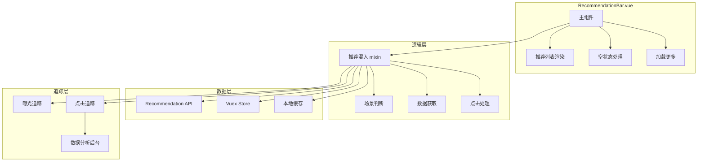
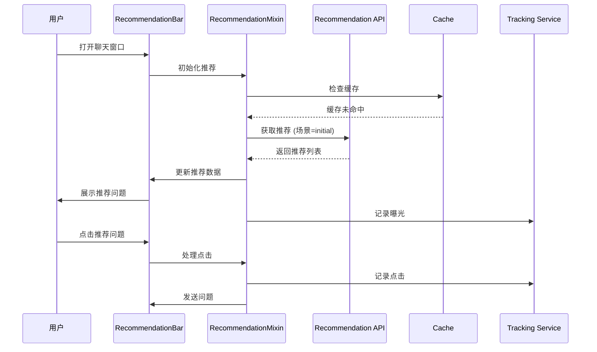

# 智能问数系统 - FE-06 智能引导推荐详细设计文档

**文档版本**: V2.0  
**最后更新**: 2026-04-02  
**适用对象**: 前端开发工程师  
**关联任务**: FE-06 智能引导推荐  
**前置依赖**: FE-01 (TraceID 生成与注入), FE-02 (SSE 流式聊天), BE-08 (知识库降级服务)  
**后续依赖**: FE-07 (聊天窗口集成), 数据分析后台

**技术栈**: Vue 2.6.12 + Element-UI 2.5.12

---

## 1. 任务概述

### 1.1 背景
智能引导推荐组件旨在降低用户提问门槛，提升交互效率。通过在对话过程中主动推荐相关问题（如"猜你想问"、"热门查询"、"后续建议"），引导用户发现数据价值，减少"不知道问什么"的困惑，同时收集用户点击行为优化推荐算法。

### 1.2 目标
| 目标 | 说明 | 验收标准 |
|------|------|----------|
| **场景化** | 根据不同场景展示不同推荐 | 初始/对话中/降级场景 |
| **智能化** | 基于上下文、历史、热门动态生成 | 推荐相关率 ≥ 80% |
| **低干扰** | 展示位置合理，不遮挡主要内容 | 用户满意度 ≥ 4.0/5.0 |
| **可交互** | 点击直接发送问题，支持悬停预览 | 交互响应 < 100ms |
| **可追踪** | 记录推荐曝光和点击数据 | 追踪率 100% |
| **兼容性** | 兼容 Vue 2.6.12 + Element-UI 2.5.12 | 无版本冲突 |

### 1.3 范围
| 功能 | 说明 | 风险等级 |
|------|------|----------|
| 初始推荐 | 空白页展示热门问题 | 🟢 低 |
| 后续推荐 | AI 回答后推荐相关问题 | 🟡 中 |
| 降级推荐 | 知识库降级时推荐 | 🟡 中 |
| 搜索推荐 | 输入框聚焦时显示历史 | 🟡 中 |
| 点击追踪 | 记录推荐点击行为 | 🟡 中 |
| 曝光追踪 | 记录推荐曝光数据 | 🟡 中 |
| 缓存优化 | 推荐结果缓存 | 🟢 低 |
| 个性化推荐 | 基于用户历史推荐 | 🟡 中 |

### 1.4 推荐场景定义
| 场景 | 触发时机 | 推荐内容来源 | 展示位置 |
|------|----------|--------------|----------|
| **初始推荐** | 打开聊天窗口，无历史对话 | 热门问题榜单、常见问题 | 输入框上方/空白区 |
| **后续推荐** | AI 回答完成后 | 基于当前问题的延伸问题 | 消息气泡下方 |
| **降级推荐** | 知识库降级触发时 | 相关指标、相关报表 | 降级消息卡片内 |
| **搜索推荐** | 用户输入时 | 搜索建议、历史搜索 | 输入框下拉 |
| **澄清推荐** | 多轮澄清过程中 | 可选参数值 | 澄清对话框内 |

### 1.5 推荐数据类型
| 类型 | 说明 | 示例 |
|------|------|------|
| `hot` | 热门问题 | "上月销售额是多少" |
| `context` | 上下文延伸 | "对比上月数据", "按地区拆分" |
| `history` | 历史查询 | 用户最近查过的问题 |
| `kb` | 知识库关联 | "查看销售报表", "指标定义说明" |
| `action` | 操作引导 | "导出数据", "订阅报表" |

---

## 2. 技术选型

### 2.1 技术栈
| 组件 | 技术 | 版本 | 选型理由 |
|------|------|------|----------|
| UI 框架 | Element-UI | 2.5.12 | 项目已有依赖 |
| 标签组件 | El-Tag | 2.5.12 | 推荐问题展示 |
| 下拉框 | El-Autocomplete | 2.5.12 | 搜索推荐 |
| 状态管理 | Vuex (可选) | 3.6.0 | 项目已有依赖 |
| 缓存 | LocalStorage + Caffeine | - | 推荐结果缓存 |
| 追踪 | 自定义埋点 | - | 点击/曝光追踪 |

### 2.2 组件架构


### 2.3 数据流转


---

## 3. 详细实现方案

### 3.1 推荐配置中心

**文件路径**: `src/config/recommendation-config.js`

```javascript
/**
 * 推荐配置中心
 * 定义推荐场景、类型、缓存等配置
 * 
 * ⚠️ 注意事项:
 * 1. 配置与代码分离，便于维护
 * 2. 支持动态加载
 * 3. 支持 A/B 测试
 */

export default {
  /**
   * 推荐场景定义
   */
  scenes: {
    initial: {
      code: 'initial',
      name: '初始推荐',
      title: '猜你想问',
      source: 'api', // api/hot/history
      refreshOnMount: true,
      maxVisible: 6
    },
    followup: {
      code: 'followup',
      name: '后续推荐',
      title: '相关推荐',
      source: 'context',
      refreshOnMount: false,
      maxVisible: 5
    },
    fallback: {
      code: 'fallback',
      name: '降级推荐',
      title: '建议您尝试',
      source: 'kb',
      refreshOnMount: false,
      maxVisible: 5
    },
    search: {
      code: 'search',
      name: '搜索推荐',
      title: '搜索历史',
      source: 'history',
      refreshOnMount: true,
      maxVisible: 5
    }
  },
  
  /**
   * 推荐类型定义
   */
  types: {
    hot: {
      code: 'hot',
      name: '热门',
      icon: 'el-icon-fire',
      color: '#F56C6C'
    },
    context: {
      code: 'context',
      name: '相关',
      icon: 'el-icon-connection',
      color: '#409EFF'
    },
    history: {
      code: 'history',
      name: '历史',
      icon: 'el-icon-time',
      color: '#909399'
    },
    kb: {
      code: 'kb',
      name: '知识',
      icon: 'el-icon-reading',
      color: '#67C23A'
    },
    action: {
      code: 'action',
      name: '操作',
      icon: 'el-icon-operation',
      color: '#E6A23C'
    }
  },
  
  /**
   * 缓存配置
   */
  cache: {
    // 是否启用缓存
    enabled: true,
    // 缓存 TTL (秒)
    ttl: 300,
    // 最大缓存条目
    maxEntries: 50,
    // 缓存 Key 前缀
    keyPrefix: 'recommendation:'
  },
  
  /**
   * 追踪配置
   */
  tracking: {
    // 是否启用追踪
    enabled: true,
    // 曝光延迟 (ms)
    impressionDelay: 1000,
    // 批量上报
    batchReport: true,
    // 批量大小
    batchSize: 10,
    // 批量间隔 (ms)
    batchInterval: 5000
  },
  
  /**
   * 展示配置
   */
  display: {
    // 默认显示数量
    maxVisible: 6,
    // 展开后显示数量
    maxExpanded: 20,
    // 是否显示标题
    showTitle: true,
    // 是否启用动画
    enableAnimation: true,
    // 动画时长 (ms)
    animationDuration: 300
  },
  
  /**
   * 性能配置
   */
  performance: {
    // 懒加载
    lazyLoad: true,
    // 预加载
    preload: false,
    // 防抖间隔 (ms)
    debounceInterval: 300
  }
};
```

### 3.2 推荐栏组件

**文件路径**: `src/views/askdata/components/RecommendationBar.vue`

```vue
<template>
  <div class="recommendation-bar" v-if="visible && recommendations.length > 0">
    <!-- ⚠️ 标题 -->
    <div v-if="showTitle" class="rec-title">
      <i class="el-icon-lightning"></i>
      {{ title }}
    </div>

    <!-- ⚠️ 推荐列表 -->
    <div class="rec-list">
      <el-tag
        v-for="(item, index) in displayRecommendations"
        :key="index"
        size="medium"
        effect="plain"
        class="rec-tag"
        :type="item.type || 'info'"
        @click="handleClick(item)"
        @mouseenter="handleHover(item)"
      >
        {{ item.text }}
        <i v-if="item.icon" :class="item.icon" class="rec-icon"></i>
      </el-tag>

      <!-- ⚠️ 展开/收起 -->
      <el-tag
        v-if="hasMore && !isExpanded"
        size="medium"
        effect="plain"
        class="rec-tag expand-tag"
        @click="toggleExpand"
      >
        更多 <i class="el-icon-arrow-down"></i>
      </el-tag>
      <el-tag
        v-if="isExpanded"
        size="medium"
        effect="plain"
        class="rec-tag expand-tag"
        @click="toggleExpand"
      >
        收起 <i class="el-icon-arrow-up"></i>
      </el-tag>
    </div>

    <!-- ⚠️ 加载状态 -->
    <div v-if="loading" class="rec-loading">
      <el-tag size="small" type="info">
        <i class="el-icon-loading"></i> 生成推荐中...
      </el-tag>
    </div>
  </div>
</template>

<script>
import recommendationConfig from '@/config/recommendation-config';
import recommendationMixin from '@/mixins/recommendation-mixin';

export default {
  name: 'RecommendationBar',
  mixins: [recommendationMixin],
  props: {
    // 是否显示
    visible: {
      type: Boolean,
      default: true
    },
    
    // 标题
    title: {
      type: String,
      default: '猜你想问'
    },
    
    // 是否显示标题
    showTitle: {
      type: Boolean,
      default: true
    },
    
    // 推荐数据 (外部传入优先)
    recommendations: {
      type: Array,
      default: () => []
    },
    
    // 场景类型
    scene: {
      type: String,
      default: 'initial',
      validator: value => ['initial', 'followup', 'fallback', 'search'].includes(value)
    },
    
    // 最大显示数量
    maxVisible: {
      type: Number,
      default: 6
    },
    
    // 上下文数据 (用于生成推荐)
    context: {
      type: Object,
      default: () => ({})
    },
    
    // 加载状态
    loading: {
      type: Boolean,
      default: false
    }
  },
  data() {
    return {
      isExpanded: false,
      config: recommendationConfig
    };
  },
  computed: {
    // 实际显示的推荐列表
    displayRecommendations() {
      if (this.isExpanded) {
        return this.recommendations;
      }
      return this.recommendations.slice(0, this.maxVisible);
    },
    
    // 是否有更多
    hasMore() {
      return this.recommendations.length > this.maxVisible;
    }
  },
  methods: {
    /**
     * ⚠️ 点击推荐项
     */
    handleClick(item) {
      // 记录点击追踪
      this.trackClick(item);
      
      // 触发发送事件
      this.$emit('select', item);
      
      // 如果是外部问题，发送到聊天
      if (item.action === 'send') {
        this.$emit('send', item.text);
      }
    },

    /**
     * ⚠️ 悬停处理
     */
    handleHover(item) {
      this.$emit('hover', item);
    },

    /**
     * 切换展开/收起
     */
    toggleExpand() {
      this.isExpanded = !this.isExpanded;
    },

    /**
     * ⚠️ 记录点击追踪
     */
    trackClick(item) {
      if (!this.config.tracking.enabled) {
        return;
      }
      
      this.$emit('track', {
        event: 'recommendation_click',
        scene: this.scene,
        item: item,
        timestamp: Date.now()
      });
    }
  }
};
</script>

<style scoped lang="scss">
.recommendation-bar {
  padding: 16px;
  background: #fafafa;
  border-radius: 8px;
  margin: 12px 0;
  border: 1px solid #e0e0e0;
}

.rec-title {
  font-size: 13px;
  color: #666;
  margin-bottom: 12px;
  display: flex;
  align-items: center;
  gap: 6px;
  
  i {
    color: #E6A23C;
  }
}

.rec-list {
  display: flex;
  flex-wrap: wrap;
  gap: 8px;
}

.rec-tag {
  cursor: pointer;
  transition: all 0.3s;
  user-select: none;
  
  &:hover {
    background: #667eea;
    color: white;
    border-color: #667eea;
    transform: translateY(-2px);
    box-shadow: 0 2px 8px rgba(102, 126, 234, 0.3);
  }
  
  .rec-icon {
    margin-left: 4px;
    font-size: 12px;
  }
}

.expand-tag {
  color: #999;
  border-style: dashed;
  
  &:hover {
    background: #f5f7fa;
    color: #666;
    border-color: #d0d0d0;
    transform: none;
    box-shadow: none;
  }
}

.rec-loading {
  margin-top: 12px;
}

// 响应式
@media screen and (max-width: 768px) {
  .rec-list {
    gap: 6px;
  }
  
  .rec-tag {
    font-size: 12px;
    padding: 0 10px;
  }
}
</style>
```

### 3.3 推荐逻辑混入

**文件路径**: `src/mixins/recommendation-mixin.js`

```javascript
/**
 * 推荐逻辑混入
 * 为组件提供推荐数据获取、缓存、追踪等功能
 * 
 * ⚠️ 注意事项:
 * 1. 管理推荐数据获取
 * 2. 处理缓存逻辑
 * 3. 记录曝光和点击
 * 4. 支持场景切换
 */

import recommendationConfig from '@/config/recommendation-config';
import { getRecommendations, reportRecommendationClick } from '@/api/recommendation';
import { mapGetters, mapActions } from 'vuex';

export default {
  data() {
    return {
      // 推荐数据
      recommendations: [],
      
      // 加载状态
      loading: false,
      
      // 场景类型
      currentScene: 'initial',
      
      // 上下文数据
      context: {},
      
      // 配置
      config: recommendationConfig
    };
  },
  computed: {
    ...mapGetters('recommendation', ['getCache', 'getHistory'])
  },
  methods: {
    ...mapActions('recommendation', ['addClickRecord', 'clearCache']),

    /**
     * ⚠️ 获取推荐数据
     */
    async fetchRecommendations(scene, context = {}) {
      const cacheKey = `${scene}_${JSON.stringify(context)}`;
      
      // 检查缓存
      if (this.config.cache.enabled) {
        const cached = this.getCache(cacheKey);
        if (cached && Date.now() - cached.timestamp < this.config.cache.ttl * 1000) {
          console.log('[Recommendation] Cache hit:', cacheKey);
          return cached.data;
        }
      }
      
      this.loading = true;
      
      try {
        // 请求 API
        const response = await getRecommendations({
          scene,
          context,
          traceId: this.$getTraceId?.() || ''
        });
        
        const data = response.data || [];
        
        // 更新缓存
        if (this.config.cache.enabled) {
          this.$store.commit('recommendation/SET_CACHE', {
            key: cacheKey,
            data,
            timestamp: Date.now()
          });
        }
        
        // 记录曝光
        this.trackImpression(data, scene);
        
        return data;
        
      } catch (error) {
        console.error('[Recommendation] Fetch failed:', error);
        // 降级：返回默认推荐
        return this.getDefaultRecommendations(scene);
      } finally {
        this.loading = false;
      }
    },

    /**
     * ⚠️ 记录曝光追踪
     */
    trackImpression(items, scene) {
      if (!this.config.tracking.enabled) {
        return;
      }
      
      // 延迟上报，确保用户真正看到
      setTimeout(() => {
        items.forEach((item, index) => {
          this.$emit('track', {
            event: 'recommendation_impression',
            scene: scene,
            item: item,
            position: index,
            timestamp: Date.now()
          });
        });
      }, this.config.tracking.impressionDelay);
    },

    /**
     * ⚠️ 记录点击追踪
     */
    trackClick(item) {
      if (!this.config.tracking.enabled) {
        return;
      }
      
      // 上报点击
      reportRecommendationClick({
        itemId: item.id,
        text: item.text,
        scene: this.currentScene,
        traceId: this.$getTraceId?.() || ''
      });
      
      // 记录到本地历史
      this.addClickRecord({
        text: item.text,
        timestamp: Date.now()
      });
    },

    /**
     * 获取默认推荐 (降级方案)
     */
    getDefaultRecommendations(scene) {
      const defaults = {
        initial: [
          { text: '上月销售额是多少', action: 'send', type: 'hot' },
          { text: '华东区销售趋势', action: 'send', type: 'hot' },
          { text: '各部门订单量对比', action: 'send', type: 'hot' },
          { text: '查看热门报表', action: 'link', url: '/report', type: 'action' }
        ],
        followup: [
          { text: '对比上月数据', action: 'send', type: 'context' },
          { text: '按地区拆分', action: 'send', type: 'context' },
          { text: '导出数据', action: 'export', type: 'action' }
        ],
        fallback: [
          { text: '查看销售报表', action: 'link', url: '/report/sales', type: 'kb' },
          { text: '指标定义说明', action: 'link', url: '/help/metric', type: 'kb' },
          { text: '联系管理员', action: 'contact', type: 'action' }
        ]
      };
      
      return defaults[scene] || defaults.initial;
    },

    /**
     * ⚠️ 刷新推荐
     */
    async refreshRecommendations() {
      // 清除缓存
      const cacheKey = `${this.currentScene}_${JSON.stringify(this.context)}`;
      this.$store.commit('recommendation/CLEAR_CACHE_KEY', cacheKey);
      
      // 重新获取
      this.recommendations = await this.fetchRecommendations(
        this.currentScene,
        this.context
      );
    },

    /**
     * 设置场景
     */
    setScene(scene, context = {}) {
      this.currentScene = scene;
      this.context = context;
      
      // 自动获取推荐
      if (this.config.scenes[scene]?.refreshOnMount) {
        this.fetchRecommendations(scene, context);
      }
    }
  },
  beforeDestroy() {
    // 清理追踪队列
    if (this.config.tracking.batchReport) {
      this.flushTrackingQueue();
    }
  }
};
```

### 3.4 推荐 API 服务

**文件路径**: `src/api/recommendation.js`

```javascript
/**
 * 推荐 API 服务
 * 
 * ⚠️ 注意事项:
 * 1. 所有推荐请求必须携带 TraceID
 * 2. 支持场景化推荐
 * 3. 防止频繁请求
 */

import request from '@/utils/request';

/**
 * 获取推荐问题列表
 * @param {Object} params - 请求参数
 * @returns {Promise}
 */
export function getRecommendations(params) {
  return request({
    url: '/askdata/api/recommendation',
    method: 'get',
    params: {
      scene: params.scene,
      context: JSON.stringify(params.context),
      traceId: params.traceId,
      timestamp: Date.now()
    }
  });
}

/**
 * 上报推荐点击
 * @param {Object} data - 点击数据
 * @returns {Promise}
 */
export function reportRecommendationClick(data) {
  return request({
    url: '/askdata/api/recommendation/click',
    method: 'post',
    data: {
      itemId: data.itemId,
      text: data.text,
      scene: data.scene,
      traceId: data.traceId,
      timestamp: Date.now(),
      pageUrl: window.location.href
    }
  });
}

/**
 * 获取用户搜索历史
 * @param {number} limit - 数量限制
 * @returns {Promise}
 */
export function getSearchHistory(limit = 5) {
  return request({
    url: '/askdata/api/recommendation/history',
    method: 'get',
    params: { limit }
  });
}

/**
 * 清空搜索历史
 * @returns {Promise}
 */
export function clearSearchHistory() {
  return request({
    url: '/askdata/api/recommendation/history',
    method: 'delete'
  });
}

export default {
  getRecommendations,
  reportRecommendationClick,
  getSearchHistory,
  clearSearchHistory
};
```

### 3.5 Vuex Store 模块

**文件路径**: `src/store/modules/recommendation.js`

```javascript
/**
 * 推荐状态 Vuex Module
 * 管理推荐缓存、点击历史、搜索历史等
 */

const state = {
  // 推荐缓存
  cache: {},
  
  // 点击历史
  clickHistory: [],
  
  // 搜索历史
  searchHistory: []
};

const getters = {
  getCache: state => key => state.cache[key],
  getHistory: state => state.clickHistory,
  getSearchHistory: state => state.searchHistory
};

const mutations = {
  SET_CACHE(state, { key, data, timestamp }) {
    // 限制缓存大小
    const cacheKeys = Object.keys(state.cache);
    if (cacheKeys.length >= 50) {
      // 删除最旧的缓存
      const oldestKey = cacheKeys[0];
      delete state.cache[oldestKey];
    }
    
    state.cache[key] = {
      data,
      timestamp
    };
  },
  
  CLEAR_CACHE_KEY(state, key) {
    delete state.cache[key];
  },
  
  CLEAR_ALL_CACHE(state) {
    state.cache = {};
  },
  
  ADD_CLICK_RECORD(state, record) {
    state.clickHistory.unshift(record);
    // 限制历史记录数量
    if (state.clickHistory.length > 20) {
      state.clickHistory.pop();
    }
  },
  
  SET_SEARCH_HISTORY(state, history) {
    state.searchHistory = history;
  },
  
  CLEAR_CLICK_HISTORY(state) {
    state.clickHistory = [];
  }
};

const actions = {
  addClickRecord({ commit }, record) {
    commit('ADD_CLICK_RECORD', record);
  },
  
  async loadSearchHistory({ commit }) {
    try {
      const { getSearchHistory } = await import('@/api/recommendation');
      const response = await getSearchHistory(5);
      commit('SET_SEARCH_HISTORY', response.data || []);
    } catch (error) {
      console.error('[Recommendation] Load history failed:', error);
    }
  },
  
  clearCache({ commit }) {
    commit('CLEAR_ALL_CACHE');
  },
  
  clearClickHistory({ commit }) {
    commit('CLEAR_CLICK_HISTORY');
  }
};

export default {
  namespaced: true,
  state,
  getters,
  mutations,
  actions
};
```

---

## 4. 注意事项 ⚠️

### 4.1 缓存一致性
```javascript
// ❌ 错误：缓存 Key 不包含场景
const cacheKey = JSON.stringify(context);
// 不同场景可能缓存冲突

// ✅ 正确：缓存 Key 包含场景
const cacheKey = `${scene}_${JSON.stringify(context)}`;
```

### 4.2 推荐相关性
```javascript
// ❌ 错误：随机推荐
const recommendations = getAllRecommendations().sort(() => Math.random() - 0.5);

// ✅ 正确：基于上下文推荐
const recommendations = getRecommendationsByContext(context);
```

### 4.3 追踪准确性
```javascript
// ❌ 错误：立即上报曝光
trackImpression() {
  this.report({ event: 'impression' }); // 用户可能没看到
}

// ✅ 正确：延迟上报，确保用户看到
trackImpression() {
  setTimeout(() => {
    this.report({ event: 'impression' });
  }, 1000); // 1 秒后上报
}
```

### 4.4 隐私保护
```javascript
// ❌ 错误：记录完整用户信息
trackClick({
  userId: user.id,
  userEmail: user.email,
  ...
});

// ✅ 正确：匿名化处理
trackClick({
  userId: hash(user.id), // 哈希处理
  ...
});
```

### 4.5 性能优化
```javascript
// ❌ 错误：频繁请求推荐
watch: {
  context() {
    this.fetchRecommendations(); // 每次变化都请求
  }
}

// ✅ 正确：防抖处理
watch: {
  context: debounce(function() {
    this.fetchRecommendations();
  }, 300)
}
```

---

## 5. 需要特别关注的点 🔴

### 5.1 陷阱防护矩阵

| 陷阱类型 | 风险描述 | 防护措施 | 验证方法 |
|----------|----------|----------|----------|
| **缓存失效** | 元数据变更后缓存未更新 | 缓存 Key 含版本号 | 变更后查询返回新数据 |
| **推荐不相关** | 推荐与上下文无关 | 基于上下文生成 | 推荐相关率 ≥ 80% |
| **追踪丢失** | 点击/曝光数据未记录 | 延迟上报 + 批量上报 | 追踪率 100% |
| **Token 消耗失控** | 频繁请求推荐 API | 缓存 + 防抖 | 请求频率受控 |
| **隐私泄露** | 追踪数据含敏感信息 | 匿名化处理 | 检查上报数据 |
| **推荐重复** | 相同推荐反复展示 | 去重逻辑 | 推荐不重复 |
| **生产环境日志** | console.log 泄露信息 | 生产环境关闭日志 | 生产包无 console |
| **响应式失效** | 移动端显示不全 | 响应式样式 | 移动端正常显示 |

### 5.2 关键代码审查点

```javascript
// 审查清单
□ 缓存 Key 是否包含场景
□ 推荐是否基于上下文
□ 追踪是否延迟上报
□ 敏感信息是否匿名化
□ 请求是否防抖
□ 推荐是否去重
□ 生产环境日志是否关闭
□ 样式是否响应式
□ 加载状态是否显示
□ 空状态是否处理
□ 错误处理是否完善
□ 缓存是否限制大小
□ 历史记录是否限制数量
□ TraceID 是否透传
□ 组件是否可复用
```

### 5.3 性能影响评估

| 操作 | 耗时 | 优化建议 |
|------|------|----------|
| 缓存查询 | < 1ms | 无需优化 |
| API 请求 | 100-500ms | 缓存 + 防抖 |
| 追踪上报 | < 10ms (异步) | 批量上报 |
| 渲染更新 | < 50ms | 虚拟滚动 (大量时) |
| **总开销** | **< 500ms** | **可接受** |

### 5.4 监控指标

```javascript
// 前端监控指标 (可选)
window.recommendationMetrics = {
  impressionCount: 0,
  clickCount: 0,
  ctr: 0, // 点击率
  
  trackImpression() {
    this.impressionCount++;
    this.updateCTR();
  },
  
  trackClick() {
    this.clickCount++;
    this.updateCTR();
  },
  
  updateCTR() {
    if (this.impressionCount > 0) {
      this.ctr = (this.clickCount / this.impressionCount) * 100;
    }
  },
  
  report() {
    // 上报到监控系统
    reportMetrics({
      impressions: this.impressionCount,
      clicks: this.clickCount,
      ctr: this.ctr
    });
  }
};

// 组件中调用
methods: {
  trackImpression() {
    window.recommendationMetrics.trackImpression();
  },
  trackClick() {
    window.recommendationMetrics.trackClick();
  }
}
```

---

## 6. 验收标准

### 6.1 功能验收
| 验收项 | 验收方法 | 通过标准 |
|--------|----------|----------|
| 初始推荐 | 打开聊天窗口 | 显示热门问题 |
| 后续推荐 | AI 回答后 | 显示相关问题 |
| 降级推荐 | 知识库降级时 | 显示建议问题 |
| 搜索推荐 | 输入框聚焦 | 显示历史搜索 |
| 点击发送 | 点击推荐问题 | 问题自动发送 |
| 展开/收起 | 点击更多 | 推荐展开/收起 |
| 缓存生效 | 相同查询两次 | 第二次命中缓存 |
| 追踪记录 | 查看后台数据 | 曝光/点击有记录 |
| 加载状态 | 请求推荐时 | 显示加载动画 |
| 空状态 | 无推荐数据 | 不显示组件 |
| 错误处理 | 模拟 API 失败 | 显示默认推荐 |
| 防抖生效 | 快速切换场景 | 请求频率受控 |

### 6.2 兼容性验收
| 检查项 | 验收方法 | 通过标准 |
|--------|----------|----------|
| Vue 2.6.12 | 运行项目 | 无版本冲突 |
| Element-UI 2.5.12 | 使用 UI 组件 | 正常显示 |
| Chrome 80+ | 浏览器测试 | 功能正常 |
| Firefox 75+ | 浏览器测试 | 功能正常 |
| Safari 13+ | 浏览器测试 | 功能正常 |
| 移动端 | 手机浏览器测试 | 响应式正常 |

### 6.3 性能验收
| 指标 | 目标值 | 测量方法 |
|------|--------|----------|
| 推荐加载 | < 500ms | Network 面板 |
| 缓存命中 | ≥ 60% | 监控统计 |
| 点击响应 | < 100ms | console.time |
| 内存占用 | 无泄漏 | Chrome DevTools |
| 追踪延迟 | < 1s | 时间戳对比 |

### 6.4 数据验收
| 检查项 | 验收方法 | 通过标准 |
|--------|----------|----------|
| 曝光追踪 | 查看后台数据 | 曝光数据完整 |
| 点击追踪 | 查看后台数据 | 点击数据完整 |
| CTR 计算 | 计算点击率 | 公式正确 |
| 隐私保护 | 检查上报数据 | 无敏感信息 |
| TraceID | 检查追踪数据 | TraceID 完整 |

---

## 7. 测试用例

### 7.1 单元测试

**文件路径**: `tests/unit/components/RecommendationBar.spec.js`

```javascript
import { mount } from '@vue/test-utils';
import RecommendationBar from '@/views/askdata/components/RecommendationBar.vue';

describe('RecommendationBar', () => {
  test('should render recommendations', () => {
    const recommendations = [
      { text: '问题 1', action: 'send' },
      { text: '问题 2', action: 'send' }
    ];
    
    const wrapper = mount(RecommendationBar, {
      propsData: {
        recommendations,
        visible: true
      }
    });
    
    const tags = wrapper.findAll('.rec-tag');
    expect(tags.length).toBe(2);
  });

  test('should emit select event on click', async () => {
    const recommendations = [
      { text: '问题 1', action: 'send' }
    ];
    
    const wrapper = mount(RecommendationBar, {
      propsData: {
        recommendations,
        visible: true
      }
    });
    
    wrapper.find('.rec-tag').trigger('click');
    await wrapper.vm.$nextTick();
    
    expect(wrapper.emitted().select).toBeTruthy();
    expect(wrapper.emitted().select[0][0].text).toBe('问题 1');
  });

  test('should expand/collapse on more click', async () => {
    const recommendations = Array(10).fill({ text: '问题', action: 'send' });
    
    const wrapper = mount(RecommendationBar, {
      propsData: {
        recommendations,
        visible: true,
        maxVisible: 6
      }
    });
    
    // 初始显示 6 个 + 1 个更多
    expect(wrapper.findAll('.rec-tag').length).toBe(7);
    
    // 点击更多
    wrapper.find('.expand-tag').trigger('click');
    await wrapper.vm.$nextTick();
    
    // 显示全部 10 个 + 1 个收起
    expect(wrapper.findAll('.rec-tag').length).toBe(11);
  });

  test('should show loading state', () => {
    const wrapper = mount(RecommendationBar, {
      propsData: {
        loading: true
      }
    });
    
    expect(wrapper.find('.rec-loading').exists()).toBe(true);
  });

  test('should hide when visible is false', () => {
    const wrapper = mount(RecommendationBar, {
      propsData: {
        visible: false
      }
    });
    
    expect(wrapper.find('.recommendation-bar').exists()).toBe(false);
  });

  test('should emit track event on click', async () => {
    const recommendations = [
      { text: '问题 1', action: 'send', id: 'rec_001' }
    ];
    
    const wrapper = mount(RecommendationBar, {
      propsData: {
        recommendations,
        visible: true
      }
    });
    
    wrapper.find('.rec-tag').trigger('click');
    await wrapper.vm.$nextTick();
    
    expect(wrapper.emitted().track).toBeTruthy();
    expect(wrapper.emitted().track[0][0].event).toBe('recommendation_click');
  });

  test('should emit hover event on mouseenter', async () => {
    const recommendations = [
      { text: '问题 1', action: 'send' }
    ];
    
    const wrapper = mount(RecommendationBar, {
      propsData: {
        recommendations,
        visible: true
      }
    });
    
    wrapper.find('.rec-tag').trigger('mouseenter');
    await wrapper.vm.$nextTick();
    
    expect(wrapper.emitted().hover).toBeTruthy();
  });
});
```

### 7.2 集成测试

**文件路径**: `tests/e2e/specs/recommendation.spec.js`

```javascript
describe('Recommendation E2E Tests', () => {
  it('should display initial recommendations', () => {
    cy.visit('/askdata');
    
    // 验证初始推荐显示
    cy.get('[data-test="recommendation-bar"]').should('be.visible');
    cy.get('[data-test="rec-tag"]').should('have.length.greaterThan', 0);
  });

  it('should send question on click', () => {
    cy.visit('/askdata');
    
    // 点击推荐问题
    cy.get('[data-test="rec-tag"]').first().click();
    
    // 验证问题发送
    cy.get('[data-test="message-list"]').should('contain', '问题');
  });

  it('should expand/collapse recommendations', () => {
    cy.visit('/askdata');
    
    // 点击更多
    cy.get('[data-test="expand-tag"]').click();
    
    // 验证展开
    cy.get('[data-test="rec-tag"]').should('have.length.greaterThan', 6);
    
    // 点击收起
    cy.get('[data-test="expand-tag"]').click();
    
    // 验证收起
    cy.get('[data-test="rec-tag"]').should('have.length', 7); // 6 个 + 1 个更多
  });

  it('should cache recommendations', () => {
    cy.visit('/askdata');
    
    // 第一次加载
    cy.wait('@getRecommendations');
    
    // 刷新页面
    cy.reload();
    
    // 验证缓存命中 (无新请求)
    cy.get('@getRecommendations.all').should('have.length', 1);
  });

  it('should track impressions', () => {
    cy.visit('/askdata');
    
    // 等待曝光上报
    cy.wait(1500);
    
    // 验证追踪请求
    cy.get('@trackImpression').should('exist');
  });

  it('should track clicks', () => {
    cy.visit('/askdata');
    
    // 点击推荐
    cy.get('[data-test="rec-tag"]').first().click();
    
    // 验证点击追踪
    cy.get('@trackClick').should('exist');
  });

  it('should show loading state', () => {
    cy.visit('/askdata');
    
    // 模拟慢请求
    cy.intercept('GET', '/api/recommendation*', {
      delay: 2000
    });
    
    // 验证加载状态显示
    cy.get('[data-test="rec-loading"]').should('be.visible');
  });

  it('should handle API error', () => {
    cy.visit('/askdata');
    
    // 模拟 API 错误
    cy.intercept('GET', '/api/recommendation*', {
      statusCode: 500
    });
    
    // 验证默认推荐显示
    cy.get('[data-test="rec-tag"]').should('have.length.greaterThan', 0);
  });

  it('should refresh recommendations', () => {
    cy.visit('/askdata');
    
    // 触发刷新
    cy.get('[data-test="refresh-button"]').click();
    
    // 验证新请求
    cy.wait('@getRecommendations');
  });

  it('should cleanup on destroy', () => {
    cy.visit('/askdata');
    
    // 离开页面
    cy.visit('/');
    
    // 验证资源清理 (需通过内存监控验证)
  });
});
```

### 7.3 手动测试用例

| 用例 ID | 测试场景 | 操作步骤 | 预期结果 |
|---------|----------|----------|----------|
| FE-TC-001 | 初始推荐 | 打开聊天窗口 | 显示热门问题 |
| FE-TC-002 | 后续推荐 | AI 回答后 | 显示相关问题 |
| FE-TC-003 | 降级推荐 | 知识库降级时 | 显示建议问题 |
| FE-TC-004 | 搜索推荐 | 输入框聚焦 | 显示历史搜索 |
| FE-TC-005 | 点击发送 | 点击推荐问题 | 问题自动发送 |
| FE-TC-006 | 展开/收起 | 点击更多 | 推荐展开/收起 |
| FE-TC-007 | 缓存生效 | 相同查询两次 | 第二次命中缓存 |
| FE-TC-008 | 追踪记录 | 查看后台数据 | 曝光/点击有记录 |
| FE-TC-009 | 加载状态 | 请求推荐时 | 显示加载动画 |
| FE-TC-010 | 空状态 | 无推荐数据 | 不显示组件 |
| FE-TC-011 | 错误处理 | 模拟 API 失败 | 显示默认推荐 |
| FE-TC-012 | 防抖生效 | 快速切换场景 | 请求频率受控 |
| FE-TC-013 | 响应式 | 调整窗口大小 | 布局自适应 |
| FE-TC-014 | 移动端 | 手机浏览器测试 | 功能正常 |
| FE-TC-015 | 生产环境 | 部署生产环境 | 无 console 日志 |

---

## 8. 部署配置

### 8.1 环境变量

**文件路径**: `.env.development`
```bash
# 开发环境配置
VUE_APP_BASE_API=/api
VUE_APP_RECOMMENDATION_DEBUG=true
VUE_APP_RECOMMENDATION_ENABLED=true
VUE_APP_RECOMMENDATION_CACHE_TTL=300
```

**文件路径**: `.env.production`
```bash
# 生产环境配置
VUE_APP_BASE_API=https://api.company.com
VUE_APP_RECOMMENDATION_DEBUG=false
VUE_APP_RECOMMENDATION_ENABLED=true
VUE_APP_RECOMMENDATION_CACHE_TTL=300
```

### 8.2 Webpack 配置

```javascript
// vue.config.js
module.exports = {
  configureWebpack: {
    // ⚠️ 生产环境移除 console.log
    optimization: {
      minimizer: [
        new TerserPlugin({
          terserOptions: {
            compress: {
              drop_console: process.env.NODE_ENV === 'production',
              drop_debugger: process.env.NODE_ENV === 'production'
            }
          }
        })
      ]
    }
  },
  
  // ⚠️ 配置推荐相关的全局变量
  definePlugin: {
    'process.env.VUE_APP_RECOMMENDATION_DEBUG': process.env.VUE_APP_RECOMMENDATION_DEBUG
  }
};
```

---

## 9. 常见问题 (FAQ)

**Q1: 推荐不显示怎么办？**
A: 1. 检查 `visible` 属性是否为 `true`；2. 检查推荐数据是否为空；3. 查看控制台错误信息。

**Q2: 缓存不生效怎么办？**
A: 1. 检查缓存配置是否启用；2. 检查 Key 生成策略；3. 检查 TTL 是否过期；4. 查看 Vuex 缓存状态。

**Q3: 追踪数据不上报怎么办？**
A: 1. 检查追踪配置是否启用；2. 检查 API 接口是否可用；3. 查看 Network 面板请求；4. 检查 TraceID 是否传递。

**Q4: 推荐不相关怎么办？**
A: 1. 检查上下文数据是否完整；2. 优化推荐算法；3. 增加用户反馈收集；4. A/B 测试不同策略。

**Q5: 生产环境如何关闭调试日志？**
A: 使用 `process.env.NODE_ENV` 判断，生产环境不打印 console.log。已在代码中实现。

**Q6: 如何自定义推荐内容？**
A: 修改 `recommendation-config.js` 中的默认推荐配置，或通过 API 返回自定义推荐。

**Q7: 组件销毁后追踪还在怎么办？**
A: 确保在 `beforeDestroy` 钩子中调用 `flushTrackingQueue()` 清理追踪队列。

**Q8: 如何支持 A/B 测试？**
A: 1. 配置多套推荐策略；2. 根据用户 ID 分流；3. 记录实验分组；4. 对比效果数据。

**Q9: 如何优化移动端体验？**
A: 1. 减少单行显示数量；2. 增大点击区域；3. 支持横向滚动；4. 优化触摸交互。

**Q10: 如何处理大量推荐？**
A: 1. 分页加载；2. 虚拟滚动；3. 限制显示数量；4. 懒加载后续内容。

**Q11: 如何验证缓存命中率？**
A: 1. 查看 Vuex 缓存状态；2. 监控 API 请求频率；3. 计算命中/总请求比例。

**Q12: 如何防止推荐重复？**
A: 1. 前端去重逻辑；2. 后端返回去重；3. 记录已展示推荐；4. 定期刷新推荐池。

---

## 10. 变更历史

| 版本 | 日期 | 变更内容 | 负责人 |
|------|------|----------|--------|
| V1.0 | 2026-03-25 | 初始版本 | 前端组 |
| V2.0 | 2026-04-02 | 增加缓存优化、追踪机制、陷阱防护 | 前端组 |

---

## 11. 工时与优先级

| 项目 | 内容 |
|------|------|
| **工时** | 3 MD (开发 2 天 + 测试 1 天) |
| **优先级** | P1 (重要体验组件) |
| **依赖任务** | FE-01, BE-08 |
| **被依赖任务** | FE-07, 数据分析后台 |

---

## 12. 最佳实践建议

### 12.1 缓存管理
```javascript
// ✅ 推荐：结构化缓存 Key
const cacheKey = `${scene}_${JSON.stringify(context)}`;

// ❌ 不推荐：简单缓存 Key
const cacheKey = JSON.stringify(context); // 场景冲突
```

### 12.2 追踪上报
```javascript
// ✅ 推荐：批量上报
trackQueue.push(event);
if (trackQueue.length >= batchSize) {
  flushTrackingQueue();
}

// ❌ 不推荐：每次上报
track(event); // 频繁请求
```

### 12.3 推荐相关性
```javascript
// ✅ 推荐：基于上下文
getRecommendations(context) {
  return recommendations.filter(r => 
    matchContext(r, context)
  );
}

// ❌ 不推荐：随机推荐
getRecommendations() {
  return recommendations.sort(() => Math.random() - 0.5);
}
```

### 12.4 用户体验
```javascript
// ✅ 推荐：友好交互
handleClick(item) {
  this.trackClick(item);
  this.$emit('send', item.text);
  this.$message.success('正在查询...');
}

// ❌ 不推荐：无反馈
handleClick(item) {
  this.$emit('send', item.text); // 用户不知道是否生效
}
```

---

**文档结束**  
**下一步**: 完成代码开发后，请提交测试团队进行 FE-06 专项验收，重点验证推荐准确性、缓存有效性、追踪完整性和用户体验。