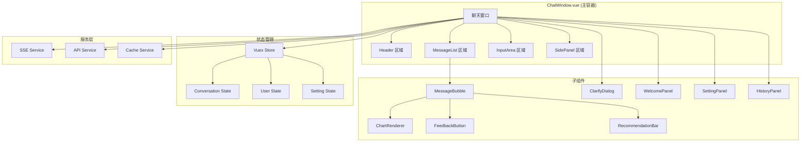
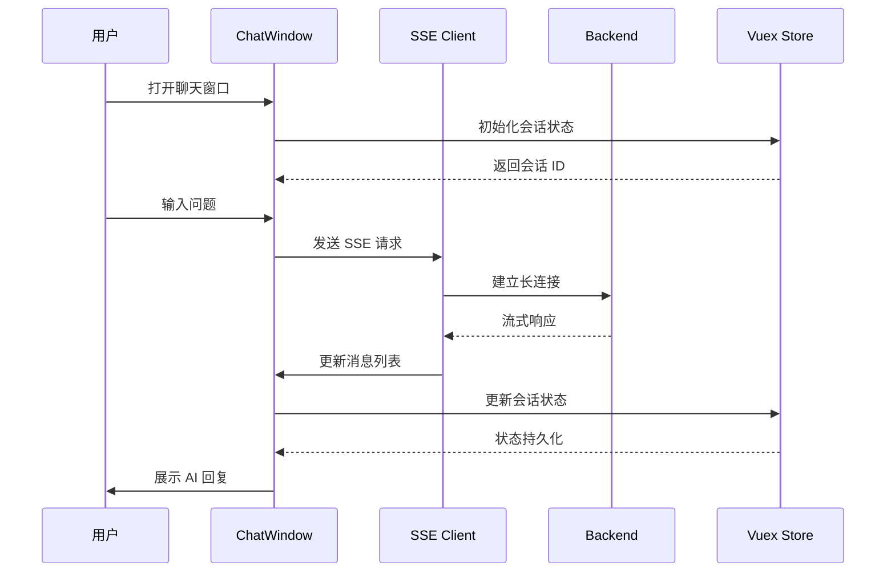

# 智能问数系统 - FE-07 聊天窗口集成详细设计文档

**文档版本**: V2.0  
**最后更新**: 2026-04-02  
**适用对象**: 前端开发工程师  
**关联任务**: FE-07 聊天窗口集成  
**前置依赖**: FE-01 (TraceID), FE-02 (SSE 聊天), FE-03 (图表渲染), FE-04 (澄清对话框), FE-05 (反馈收集), FE-06 (智能推荐)  
**后续依赖**: 全链路测试，上线部署

**技术栈**: Vue 2.6.12 + Element-UI 2.5.12

---

## 1. 任务概述

### 1.1 背景
聊天窗口集成是智能问数系统的前端核心入口，负责将所有独立组件（SSE 聊天、图表渲染、澄清对话框、反馈按钮、智能推荐等）整合到一个完整的交互界面中。需要处理组件间通信、状态管理、布局适配、性能优化等问题，提供流畅统一的用户体验。

### 1.2 目标
| 目标 | 说明 | 验收标准 |
|------|------|----------|
| **一体化** | 所有组件无缝集成 | 统一交互体验 |
| **模块化** | 组件独立可测试 | 便于维护升级 |
| **响应式** | 适配大屏、PC、移动端 | 多种场景正常 |
| **高性能** | 长列表优化、懒加载 | 100 条消息不卡顿 |
| **可配置** | 支持主题、布局、功能开关 | 配置化控制 |
| **兼容性** | 兼容 Vue 2.6.12 + Element-UI 2.5.12 | 无版本冲突 |

### 1.3 范围
| 功能模块 | 说明 | 风险等级 |
|----------|------|----------|
| **头部区域** | 标题、设置、历史、关闭按钮 | 🟢 低 |
| **消息列表** | 消息渲染、滚动、虚拟列表 | 🟡 中 |
| **消息气泡** | 用户/AI 消息、图表、反馈 | 🟡 中 |
| **输入区域** | 输入框、发送按钮、快捷操作 | 🟢 低 |
| **欢迎面板** | 首次进入引导、热门问题 | 🟢 低 |
| **澄清对话框** | 多轮对话澄清 | 🟡 中 |
| **设置面板** | 主题、字体、功能开关 | 🟢 低 |
| **历史面板** | 历史会话列表 | 🟡 中 |

### 1.4 页面布局
```
┌─────────────────────────────────────────────────────────┐
│ Header                                                  │
│ ┌─────────────────────────────────────────────────┐     │
│ │ 智能问数助手              [设置] [历史] [关闭]   │     │
│ └─────────────────────────────────────────────────┘     │
├─────────────────────────────────────────────────────────┤
│                                                         │
│  MessageList (滚动区域)                                 │
│  ┌─────────────────────────────────────────────────┐   │
│  │ [欢迎面板 - 首次进入]                            │   │
│  │ 或                                              │   │
│  │ [用户消息气泡]                                   │   │
│  │ [AI 消息气泡 + 图表 + 反馈 + 推荐]                 │   │
│  │ [澄清对话框]                                     │   │
│  └─────────────────────────────────────────────────┘   │
│                                                         │
├─────────────────────────────────────────────────────────┤
│ InputArea                                               │
│ ┌─────────────────────────────────────────────────┐     │
│ │ [输入框]                              [发送]     │     │
│ │ [智能推荐标签]                                   │     │
│ └─────────────────────────────────────────────────┘     │
└─────────────────────────────────────────────────────────┘
```

### 1.5 功能模块清单
| 模块 | 组件 | 功能说明 |
|------|------|----------|
| **头部** | ChatHeader | 标题、设置、历史、关闭按钮 |
| **消息列表** | MessageList | 消息渲染、滚动、虚拟列表 |
| **消息气泡** | MessageBubble | 用户/AI 消息、图表、反馈 |
| **输入区域** | InputArea | 输入框、发送按钮、快捷操作 |
| **欢迎面板** | WelcomePanel | 首次进入引导、热门问题 |
| **澄清对话框** | ClarifyDialog | 多轮对话澄清 |
| **设置面板** | SettingPanel | 主题、字体、功能开关 |
| **历史面板** | HistoryPanel | 历史会话列表 |

---

## 2. 技术选型

### 2.1 技术栈
| 组件 | 技术 | 版本 | 选型理由 |
|------|------|------|----------|
| 主框架 | Vue | 2.6.12 | 项目已有依赖 |
| UI 框架 | Element-UI | 2.5.12 | 项目已有依赖 |
| 状态管理 | Vuex | 3.6.0 | 项目已有依赖 |
| 路由 | Vue-Router | 3.4.9 | 项目已有依赖 |
| 虚拟滚动 | vue-virtual-scroller | 1.1.0 | 长列表优化 |
| 主题切换 | CSS Variables | - | 动态主题 |
| 状态同步 | BroadcastChannel | - | 跨标签页同步 |

### 2.2 组件架构


### 2.3 状态流转


---

## 3. 详细实现方案

### 3.1 聊天窗口主组件

**文件路径**: `src/views/askdata/ChatWindow.vue`

```vue
<template>
  <div class="chat-window" :class="themeClass">
    <el-container class="chat-container">
      <!-- ⚠️ 头部区域 -->
      <el-header class="chat-header" height="60px">
        <chat-header
          :title="config.title"
          :show-settings="config.showSettings"
          :show-history="config.showHistory"
          :show-close="config.showClose"
          @settings="handleOpenSettings"
          @history="handleOpenHistory"
          @close="handleClose"
          @clear="handleClearConversation"
        />
      </el-header>

      <!-- ⚠️ 主体区域 -->
      <el-main class="chat-main">
        <!-- 欢迎面板 (无消息时显示) -->
        <welcome-panel
          v-if="messages.length === 0"
          :recommendations="welcomeRecommendations"
          @send="handleSendQuestion"
        />

        <!-- ⚠️ 消息列表 -->
        <div
          v-else
          class="message-list"
          ref="messageList"
          @scroll="handleScroll"
        >
          <!-- 虚拟滚动优化 (消息多时启用) -->
          <recycle-scroller
            v-if="enableVirtualScroll && messages.length > 50"
            :items="messages"
            :item-size="100"
            key-field="id"
            class="virtual-scroller"
          >
            <template slot-scope="{ item }">
              <message-bubble
                :message="item"
                :show-feedback="config.showFeedback"
                :show-recommendations="config.showRecommendations"
                @send="handleSendQuestion"
                @feedback="handleFeedback"
                @retry="handleRetry"
              />
            </template>
          </recycle-scroller>
          
          <!-- 普通渲染 (消息少时) -->
          <message-bubble
            v-else
            v-for="msg in displayMessages"
            :key="msg.id"
            :message="msg"
            :show-feedback="config.showFeedback"
            :show-recommendations="config.showRecommendations"
            @send="handleSendQuestion"
            @feedback="handleFeedback"
            @retry="handleRetry"
          />

          <!-- ⚠️ 加载指示器 -->
          <div v-if="isLoading" class="loading-indicator">
            <el-tag size="small" type="info">
              <i class="el-icon-loading"></i> AI 正在思考...
            </el-tag>
          </div>

          <!-- ⚠️ 滚动到底部按钮 -->
          <el-button
            v-if="showScrollToBottom"
            circle
            size="small"
            class="scroll-to-bottom"
            icon="el-icon-arrow-down"
            @click="scrollToBottom"
          ></el-button>
        </div>

        <!-- ⚠️ 澄清对话框 -->
        <clarify-dialog
          :visible="clarifyVisible"
          :question="clarifyQuestion"
          :options="clarifyOptions"
          :confirmed-params="confirmedParams"
          @select="handleClarifySelect"
          @cancel="handleClarifyCancel"
          @timeout="handleClarifyTimeout"
        />
      </el-main>

      <!-- ⚠️ 输入区域 -->
      <el-footer class="chat-footer" height="auto">
        <input-area
          v-model="inputValue"
          :disabled="isLoading || clarifyVisible"
          :placeholder="inputPlaceholder"
          :suggestions="inputSuggestions"
          @send="handleSendQuestion"
          @suggestion-select="handleSuggestionSelect"
          @focus="handleInputFocus"
          @blur="handleInputBlur"
        />
      </el-footer>
    </el-container>

    <!-- ⚠️ 设置面板 (侧边抽屉) -->
    <el-drawer
      :visible="settingsVisible"
      title="设置"
      direction="rtl"
      size="400px"
      @close="settingsVisible = false"
    >
      <setting-panel
        :config="config"
        @update="handleConfigUpdate"
        @close="settingsVisible = false"
      />
    </el-drawer>

    <!-- ⚠️ 历史面板 (侧边抽屉) -->
    <el-drawer
      :visible="historyVisible"
      title="历史会话"
      direction="ltr"
      size="500px"
      @close="historyVisible = false"
    >
      <history-panel
        :sessions="historySessions"
        @select="handleSelectSession"
        @delete="handleDeleteSession"
        @close="historyVisible = false"
      />
    </el-drawer>
  </div>
</template>

<script>
import ChatHeader from './components/ChatHeader.vue';
import MessageBubble from './components/MessageBubble.vue';
import InputArea from './components/InputArea.vue';
import WelcomePanel from './components/WelcomePanel.vue';
import ClarifyDialog from './components/ClarifyDialog.vue';
import SettingPanel from './components/SettingPanel.vue';
import HistoryPanel from './components/HistoryPanel.vue';
import chatMixin from '@/mixins/chat-mixin';
import { mapGetters, mapActions } from 'vuex';

// 虚拟滚动组件 (按需引入)
const RecycleScroller = () => import('vue-virtual-scroller');

export default {
  name: 'ChatWindow',
  components: {
    ChatHeader,
    MessageBubble,
    InputArea,
    WelcomePanel,
    ClarifyDialog,
    SettingPanel,
    HistoryPanel,
    RecycleScroller
  },
  mixins: [chatMixin],
  props: {
    // 配置项
    config: {
      type: Object,
      default: () => ({
        title: '智能问数助手',
        theme: 'light',
        showSettings: true,
        showHistory: true,
        showClose: true,
        showFeedback: true,
        showRecommendations: true,
        maxMessages: 100,
        enableVirtualScroll: true
      })
    },
    
    // 初始问题 (URL 参数传入)
    initialQuestion: {
      type: String,
      default: ''
    }
  },
  data() {
    return {
      inputValue: '',
      isLoading: false,
      clarifyVisible: false,
      clarifyQuestion: '',
      clarifyOptions: [],
      confirmedParams: {},
      settingsVisible: false,
      historyVisible: false,
      showScrollToBottom: false,
      inputSuggestions: [],
      welcomeRecommendations: [],
      autoScroll: true
    };
  },
  computed: {
    ...mapGetters('conversation', ['messages', 'currentSession']),
    ...mapGetters('user', ['userInfo']),
    
    // 主题类名
    themeClass() {
      return `theme-${this.config.theme}`;
    },
    
    // 输入框占位符
    inputPlaceholder() {
      if (this.isLoading) {
        return 'AI 正在思考中...';
      }
      if (this.clarifyVisible) {
        return '请输入您的回答...';
      }
      return '请输入您的问题，如"华东区上月销售额"';
    },
    
    // 显示的消息列表 (支持虚拟滚动)
    displayMessages() {
      if (this.config.enableVirtualScroll && this.messages.length > 50) {
        return this.messages.slice(-50);
      }
      return this.messages;
    }
  },
  watch: {
    // 监听消息变化，自动滚动
    messages: {
      handler() {
        this.$nextTick(() => {
          if (this.autoScroll) {
            this.scrollToBottom();
          }
        });
      },
      deep: true
    },
    
    // 初始问题
    initialQuestion: {
      handler(val) {
        if (val) {
          this.handleSendQuestion(val);
        }
      },
      immediate: true
    }
  },
  async mounted() {
    // 加载欢迎推荐
    await this.loadWelcomeRecommendations();
    
    // 加载历史会话
    await this.loadHistorySessions();
    
    // 绑定全局快捷键
    this.bindGlobalShortcuts();
    
    // 监听窗口大小变化
    window.addEventListener('resize', this.handleWindowResize);
    
    // 跨标签页状态同步
    this.initCrossTabSync();
    
    this.$emit('mounted');
  },
  beforeDestroy() {
    window.removeEventListener('resize', this.handleWindowResize);
    this.unbindGlobalShortcuts();
    this.destroyCrossTabSync();
  },
  methods: {
    ...mapActions('conversation', ['sendMessage', 'clearMessages', 'loadSession']),
    ...mapActions('recommendation', ['loadSearchHistory']),
    
    /**
     * ⚠️ 发送问题
     */
    async handleSendQuestion(question) {
      if (!question || !question.trim() || this.isLoading) {
        return;
      }
      
      const query = question.trim();
      this.inputValue = '';
      
      try {
        this.isLoading = true;
        await this.sendMessage({
          query,
          traceId: this.$getTraceId?.(),
          context: this.currentSession
        });
        
        // 加载后续推荐
        await this.loadFollowupRecommendations(query);
        
      } catch (error) {
        console.error('[Chat] Send failed:', error);
        this.$message.error('发送失败，请重试');
      } finally {
        this.isLoading = false;
      }
    },
    
    /**
     * ⚠️ 处理澄清选择
     */
    handleClarifySelect({ value }) {
      this.clarifyVisible = false;
      this.handleSendQuestion(value);
    },
    
    /**
     * ⚠️ 处理澄清取消
     */
    handleClarifyCancel() {
      this.clarifyVisible = false;
      this.$message.info('已取消澄清');
    },
    
    /**
     * ⚠️ 处理澄清超时
     */
    handleClarifyTimeout() {
      this.clarifyVisible = false;
      this.$message.warning('长时间未操作，已自动关闭');
    },
    
    /**
     * 处理反馈
     */
    handleFeedback(data) {
      console.log('[Chat] Feedback:', data);
    },
    
    /**
     * 重试失败请求
     */
    async handleRetry(message) {
      this.isLoading = true;
      await this.handleSendQuestion(message.content);
      this.isLoading = false;
    },
    
    /**
     * 打开设置
     */
    handleOpenSettings() {
      this.settingsVisible = true;
    },
    
    /**
     * 打开历史
     */
    handleOpenHistory() {
      this.historyVisible = true;
    },
    
    /**
     * 关闭聊天窗口
     */
    handleClose() {
      this.$emit('close');
    },
    
    /**
     * ⚠️ 清除对话
     */
    handleClearConversation() {
      this.$confirm('确定要清除当前对话吗？', '提示', {
        confirmButtonText: '确定',
        cancelButtonText: '取消',
        type: 'warning'
      }).then(() => {
        this.clearMessages();
        this.$message.success('对话已清除');
      }).catch(() => {});
    },
    
    /**
     * 选择历史会话
     */
    async handleSelectSession(session) {
      await this.loadSession(session.id);
      this.historyVisible = false;
      this.$message.success('会话已加载');
    },
    
    /**
     * 删除历史会话
     */
    handleDeleteSession(sessionId) {
      console.log('[Chat] Delete session:', sessionId);
    },
    
    /**
     * 更新配置
     */
    handleConfigUpdate(newConfig) {
      this.$emit('update:config', { ...this.config, ...newConfig });
    },
    
    /**
     * 选择推荐
     */
    handleSuggestionSelect(suggestion) {
      this.handleSendQuestion(suggestion);
    },
    
    /**
     * 输入框聚焦
     */
    handleInputFocus() {
      this.autoScroll = false;
      this.loadInputSuggestions();
    },
    
    /**
     * 输入框失焦
     */
    handleInputBlur() {
      this.autoScroll = true;
    },
    
    /**
     * 加载输入建议
     */
    async loadInputSuggestions() {
      await this.loadSearchHistory(5);
      this.inputSuggestions = this.getHistory;
    },
    
    /**
     * 加载欢迎推荐
     */
    async loadWelcomeRecommendations() {
      const { getRecommendations } = await import('@/api/recommendation');
      const response = await getRecommendations({ scene: 'initial' });
      this.welcomeRecommendations = response.data || [];
    },
    
    /**
     * 加载后续推荐
     */
    async loadFollowupRecommendations(query) {
      const { getRecommendations } = await import('@/api/recommendation');
      const response = await getRecommendations({
        scene: 'followup',
        context: { lastQuery: query }
      });
      this.inputSuggestions = response.data || [];
    },
    
    /**
     * 加载历史会话
     */
    async loadHistorySessions() {
      // 从 API 或本地存储加载
      this.historySessions = [];
    },
    
    /**
     * ⚠️ 滚动到底部
     */
    scrollToBottom() {
      const container = this.$refs.messageList;
      if (container) {
        container.scrollTop = container.scrollHeight;
      }
    },
    
    /**
     * ⚠️ 处理滚动
     */
    handleScroll(event) {
      const container = event.target;
      const threshold = 200;
      const distanceToBottom = container.scrollHeight - container.scrollTop - container.clientHeight;
      
      this.showScrollToBottom = distanceToBottom > threshold;
    },
    
    /**
     * 处理窗口大小变化
     */
    handleWindowResize() {
      this.$emit('resize');
    },
    
    /**
     * ⚠️ 绑定全局快捷键
     */
    bindGlobalShortcuts() {
      document.addEventListener('keydown', this.handleGlobalKeydown);
    },
    
    /**
     * ⚠️ 解绑全局快捷键
     */
    unbindGlobalShortcuts() {
      document.removeEventListener('keydown', this.handleGlobalKeydown);
    },
    
    /**
     * 处理全局按键
     */
    handleGlobalKeydown(event) {
      // Ctrl/Cmd + Enter 发送
      if ((event.ctrlKey || event.metaKey) && event.key === 'Enter') {
        if (this.inputValue.trim() && !this.isLoading) {
          this.handleSendQuestion(this.inputValue);
        }
      }
      
      // ESC 关闭弹窗
      if (event.key === 'Escape') {
        if (this.settingsVisible) {
          this.settingsVisible = false;
        }
        if (this.historyVisible) {
          this.historyVisible = false;
        }
      }
    },
    
    /**
     * ⚠️ 跨标签页状态同步
     */
    initCrossTabSync() {
      if (typeof BroadcastChannel !== 'undefined') {
        this.crossTabChannel = new BroadcastChannel('askdata-chat-sync');
        
        this.crossTabChannel.onmessage = (event) => {
          if (event.data.type === 'SESSION_UPDATE') {
            // 同步会话状态
            this.$store.dispatch('conversation/syncSession', event.data.session);
          }
        };
      }
    },
    
    /**
     * ⚠️ 销毁跨标签页同步
     */
    destroyCrossTabSync() {
      if (this.crossTabChannel) {
        this.crossTabChannel.close();
        this.crossTabChannel = null;
      }
    }
  }
};
</script>

<style scoped lang="scss">
.chat-window {
  height: 100%;
  width: 100%;
  background: #f5f7fa;
  overflow: hidden;
  
  &.theme-light {
    --chat-bg: #ffffff;
    --chat-header-bg: #ffffff;
    --chat-footer-bg: #ffffff;
    --chat-border: #e0e0e0;
  }
  
  &.theme-dark {
    --chat-bg: #1a1a1a;
    --chat-header-bg: #2d2d2d;
    --chat-footer-bg: #2d2d2d;
    --chat-border: #444444;
  }
}

.chat-container {
  height: 100%;
  padding: 0;
}

.chat-header {
  background: var(--chat-header-bg);
  border-bottom: 1px solid var(--chat-border);
  padding: 0 20px;
  display: flex;
  align-items: center;
}

.chat-main {
  padding: 0;
  background: var(--chat-bg);
  overflow: hidden;
  position: relative;
}

.message-list {
  height: 100%;
  overflow-y: auto;
  padding: 20px;
  scroll-behavior: smooth;
  
  &::-webkit-scrollbar {
    width: 6px;
  }
  
  &::-webkit-scrollbar-thumb {
    background: #c0c4cc;
    border-radius: 3px;
  }
  
  &::-webkit-scrollbar-track {
    background: #f5f7fa;
  }
}

.virtual-scroller {
  height: 100%;
}

.loading-indicator {
  text-align: center;
  padding: 16px;
}

.scroll-to-bottom {
  position: absolute;
  right: 30px;
  bottom: 100px;
  z-index: 10;
  box-shadow: 0 2px 12px rgba(0, 0, 0, 0.15);
}

.chat-footer {
  background: var(--chat-footer-bg);
  border-top: 1px solid var(--chat-border);
  padding: 16px 20px;
}

// 响应式
@media screen and (max-width: 768px) {
  .chat-header {
    padding: 0 12px;
  }
  
  .message-list {
    padding: 12px;
  }
  
  .chat-footer {
    padding: 12px;
  }
  
  .scroll-to-bottom {
    right: 16px;
    bottom: 80px;
  }
}
</style>
```

### 3.2 聊天逻辑混入

**文件路径**: `src/mixins/chat-mixin.js`

```javascript
/**
 * 聊天逻辑混入
 * 为聊天窗口提供 SSE 连接、消息处理、状态管理等核心功能
 * 
 * ⚠️ 注意事项:
 * 1. 管理 SSE 客户端生命周期
 * 2. 处理消息队列
 * 3. 控制自动滚动
 * 4. 处理各种消息类型
 * 5. 状态版本控制
 */

import SSEClient from '@/utils/sse-client';
import { getTraceId, resetTraceId, getSessionId } from '@/utils/traceId';
import { mapGetters, mapActions } from 'vuex';

export default {
  data() {
    return {
      // SSE 客户端
      sseClient: null,
      
      // 当前消息 ID
      currentMessageId: null,
      
      // 打字机效果定时器
      typewriterTimer: null,
      
      // 自动滚动控制
      autoScroll: true,
      
      // 重连状态
      reconnecting: false,
      
      // 连接状态
      connectionState: 'closed',
      
      // 会话版本 (用于并发控制)
      sessionVersion: 0
    };
  },
  computed: {
    ...mapGetters('traceId', ['traceId']),
    ...mapGetters('conversation', ['sessionId'])
  },
  methods: {
    ...mapActions('conversation', ['addMessage', 'updateMessage']),

    /**
     * ⚠️ 初始化 SSE 客户端
     */
    initSSEClient() {
      const baseUrl = process.env.VUE_APP_BASE_API || '/api';
      const url = `${baseUrl}/askdata/api/chat`;

      this.sseClient = new SSEClient(url, {
        onOpen: this.handleSSEOpen,
        onMessage: this.handleSSEMessage,
        onError: this.handleSSEError,
        onClose: this.handleSSEClose,
        reconnectInterval: 3000,
        maxReconnectAttempts: 3
      });
    },

    /**
     * ⚠️ 发送消息
     */
    async sendMessage(query) {
      if (!query || !query.trim() || this.isLoading) {
        return;
      }

      const message = query.trim();
      this.inputValue = '';
      this.errorMessage = null;
      this.isLoading = true;
      this.reconnecting = false;

      // 添加用户消息
      const userMessage = {
        id: `user_${Date.now()}`,
        type: 'user',
        content: message,
        timestamp: Date.now()
      };
      this.messages.push(userMessage);
      this.scrollToBottom();

      // ⚠️ 关闭之前的 SSE 连接
      if (this.sseClient) {
        this.sseClient.close();
      }

      // ⚠️ 创建新的 SSE 连接
      this.initSSEClient();
      this.sseClient.connect();

      // ⚠️ 重置 TraceID (新对话)
      resetTraceId();
    },

    /**
     * SSE 连接成功
     */
    handleSSEOpen() {
      console.log('[Chat] SSE connection opened');
      this.reconnecting = false;
      this.connectionState = 'open';
    },

    /**
     * ⚠️ SSE 接收消息
     */
    handleSSEMessage(data) {
      console.log('[Chat] SSE message:', data);

      // 根据消息类型处理
      switch (data.type) {
        case 'text':
          this.handleTextMessage(data);
          break;
        case 'chart':
          this.handleChartMessage(data);
          break;
        case 'clarify':
          this.handleClarifyMessage(data);
          break;
        case 'error':
          this.handleErrorMessage(data);
          break;
        case 'end':
          this.handleEndMessage(data);
          break;
        default:
          console.warn('[Chat] Unknown message type:', data.type);
      }

      // 自动滚动
      if (this.autoScroll) {
        this.$nextTick(() => {
          this.scrollToBottom();
        });
      }
    },

    /**
     * ⚠️ 处理文本消息 (打字机效果)
     */
    handleTextMessage(data) {
      if (!this.currentMessageId) {
        // 创建新消息
        this.currentMessageId = data.messageId || `assistant_${Date.now()}`;
        const assistantMessage = {
          id: this.currentMessageId,
          type: 'assistant',
          content: '',
          timestamp: Date.now(),
          traceId: data.traceId,
          messageId: data.messageId
        };
        this.messages.push(assistantMessage);
      }

      // 打字机效果追加内容
      const lastMessage = this.messages[this.messages.length - 1];
      if (data.content) {
        this.appendTypewriterContent(lastMessage, data.content);
      }
    },

    /**
     * 处理图表消息
     */
    handleChartMessage(data) {
      if (!this.currentMessageId) {
        this.currentMessageId = data.messageId || `assistant_${Date.now()}`;
      }

      const lastMessage = this.messages[this.messages.length - 1];
      if (lastMessage && lastMessage.id === this.currentMessageId) {
        // 更新现有消息
        lastMessage.chartType = data.chartType;
        lastMessage.data = data.data;
        lastMessage.chartOptions = data.chartOptions;
      } else {
        // 创建新消息
        const chartMessage = {
          id: this.currentMessageId,
          type: 'assistant',
          chartType: data.chartType,
          data: data.data,
          chartOptions: data.chartOptions,
          timestamp: Date.now(),
          traceId: data.traceId,
          messageId: data.messageId
        };
        this.messages.push(chartMessage);
      }
    },

    /**
     * ⚠️ 处理澄清消息
     */
    handleClarifyMessage(data) {
      if (data.needClarify) {
        this.clarifyVisible = true;
        this.clarifyQuestion = data.clarifyQuestion;
        this.clarifyOptions = data.clarifyOptions || [];
      }
    },

    /**
     * 处理错误消息
     */
    handleErrorMessage(data) {
      this.isLoading = false;
      this.errorMessage = data.message || '请求失败，请重试';
      
      const errorMessage = {
        id: `error_${Date.now()}`,
        type: 'error',
        content: this.errorMessage,
        timestamp: Date.now()
      };
      this.messages.push(errorMessage);
    },

    /**
     * 处理结束消息
     */
    handleEndMessage(data) {
      this.isLoading = false;
      this.currentMessageId = null;
      
      // 更新最后一条消息的推荐问题
      const lastMessage = this.messages[this.messages.length - 1];
      if (lastMessage && data.suggestions) {
        lastMessage.suggestions = data.suggestions;
      }
    },

    /**
     * SSE 错误处理
     */
    handleSSEError(error) {
      console.error('[Chat] SSE error:', error);
      
      if (error.type === 'max_reconnect_reached') {
        this.isLoading = false;
        this.errorMessage = '连接失败，请检查网络后重试';
        this.reconnecting = false;
        this.connectionState = 'closed';
      } else if (error.type === 'connection_error') {
        this.reconnecting = true;
        this.connectionState = 'connecting';
      }
    },

    /**
     * SSE 连接关闭
     */
    handleSSEClose() {
      console.log('[Chat] SSE connection closed');
      if (!this.isLoading) {
        this.reconnecting = false;
        this.connectionState = 'closed';
      }
    },

    /**
     * ⚠️ 打字机效果追加内容
     */
    appendTypewriterContent(message, content) {
      if (this.typewriterTimer) {
        clearInterval(this.typewriterTimer);
      }

      const chars = content.split('');
      let index = 0;

      this.typewriterTimer = setInterval(() => {
        if (index < chars.length) {
          message.content += chars[index];
          index++;
          
          // 每添加一个字符滚动一次
          if (this.autoScroll) {
            this.$nextTick(() => {
              this.scrollToBottom();
            });
          }
        } else {
          clearInterval(this.typewriterTimer);
          this.typewriterTimer = null;
        }
      }, 30); // 30ms 每个字符
    },

    /**
     * ⚠️ 滚动到底部
     */
    scrollToBottom() {
      const container = this.$refs.messageList;
      if (container) {
        container.scrollTop = container.scrollHeight;
      }
    },

    /**
     * 处理用户滚动 (暂停自动滚动)
     */
    handleUserScroll() {
      const container = this.$refs.messageList;
      if (container) {
        // 如果用户滚动到顶部，暂停自动滚动
        const isAtBottom = container.scrollHeight - container.scrollTop - container.clientHeight < 50;
        this.autoScroll = isAtBottom;
      }
    },

    /**
     * ⚠️ 清除对话
     */
    clearConversation() {
      this.messages = [];
      this.currentMessageId = null;
      this.errorMessage = null;
      this.isLoading = false;
      
      if (this.sseClient) {
        this.sseClient.close();
      }
      
      resetTraceId();
    },

    /**
     * ⚠️ 会话版本控制 (防止并发冲突)
     */
    updateSessionVersion() {
      this.sessionVersion++;
      return this.sessionVersion;
    },

    /**
     * ⚠️ 检查会话版本 (防止并发覆盖)
     */
    checkSessionVersion(expectedVersion) {
      return this.sessionVersion === expectedVersion;
    }
  },
  mounted() {
    // 初始化 SSE 客户端
    this.initSSEClient();
    
    // 监听用户滚动
    this.$nextTick(() => {
      const container = this.$refs.messageList;
      if (container) {
        container.addEventListener('scroll', this.handleUserScroll);
      }
    });
  },
  beforeDestroy() {
    // ⚠️ 清理定时器
    if (this.typewriterTimer) {
      clearInterval(this.typewriterTimer);
    }
    
    // ⚠️ 关闭 SSE 连接
    if (this.sseClient) {
      this.sseClient.close();
    }
    
    // ⚠️ 移除滚动监听
    const container = this.$refs.messageList;
    if (container) {
      container.removeEventListener('scroll', this.handleUserScroll);
    }
  }
};
```

---

## 4. 注意事项 ⚠️

### 4.1 组件生命周期管理
```javascript
// ❌ 错误：不清理 SSE 连接和定时器
beforeDestroy() {
  // 忘记关闭 SSE 连接
}

// ✅ 正确：完整清理
beforeDestroy() {
  if (this.typewriterTimer) {
    clearInterval(this.typewriterTimer);
  }
  if (this.sseClient) {
    this.sseClient.close();
  }
  if (this.$refs.messageList) {
    this.$refs.messageList.removeEventListener('scroll', this.handleUserScroll);
  }
}
```

### 4.2 状态同步
```javascript
// ❌ 错误：直接修改 Vuex 状态
this.messages.push(newMessage); // 绕过 Vuex

// ✅ 正确：通过 actions 修改
this.addMessage(newMessage); // 通过 Vuex action
```

### 4.3 性能优化
```javascript
// ❌ 错误：消息多时直接渲染
<div v-for="msg in messages" :key="msg.id">
  <!-- 1000 条消息直接渲染，性能差 -->
</div>

// ✅ 正确：虚拟滚动
<recycle-scroller
  v-if="messages.length > 50"
  :items="messages"
  :item-size="100"
  key-field="id"
>
  <!-- 只渲染可见区域 -->
</recycle-scroller>
```

### 4.4 跨标签页同步
```javascript
// ❌ 错误：不同步跨标签页状态
// 标签页 A 发送消息，标签页 B 不知情

// ✅ 正确：BroadcastChannel 同步
initCrossTabSync() {
  this.crossTabChannel = new BroadcastChannel('askdata-chat-sync');
  this.crossTabChannel.onmessage = (event) => {
    if (event.data.type === 'SESSION_UPDATE') {
      this.$store.dispatch('conversation/syncSession', event.data.session);
    }
  };
}
```

### 4.5 快捷键冲突
```javascript
// ❌ 错误：不检查输入框焦点
document.addEventListener('keydown', (e) => {
  if (e.key === 'Enter') {
    this.sendMessage(); // 输入框内按 Enter 也触发
  }
});

// ✅ 正确：检查焦点
document.addEventListener('keydown', (e) => {
  if (e.key === 'Enter' && !this.isInputFocused) {
    this.sendMessage();
  }
});
```

---

## 5. 需要特别关注的点 🔴

### 5.1 陷阱防护矩阵

| 陷阱类型 | 风险描述 | 防护措施 | 验证方法 |
|----------|----------|----------|----------|
| **内存泄漏** | SSE 连接/定时器未清理 | beforeDestroy 完整清理 | 长时间运行内存稳定 |
| **状态不一致** | 多标签页状态不同步 | BroadcastChannel 同步 | 多标签页状态一致 |
| **并发冲突** | 并发请求覆盖状态 | 会话版本控制 | 版本冲突被拦截 |
| **性能问题** | 消息多时渲染卡顿 | 虚拟滚动优化 | 100 条消息不卡顿 |
| **自动滚动冲突** | 用户查看历史被干扰 | 用户滚动时暂停自动滚动 | 用户可自由查看 |
| **打字机泄漏** | 定时器未清理 | beforeDestroy 清理 | 内存无泄漏 |
| **生产环境日志** | console.log 泄露信息 | 生产环境关闭日志 | 生产包无 console |
| **响应式失效** | 移动端布局错乱 | 响应式样式 | 移动端正常显示 |

### 5.2 关键代码审查点

```javascript
// 审查清单
□ SSE 连接是否在 beforeDestroy 关闭
□ 定时器是否在 beforeDestroy 清理
□ 事件监听器是否在 beforeDestroy 移除
□ 消息是否通过 Vuex 管理
□ 虚拟滚动是否启用 (消息>50 条)
□ 自动滚动是否可暂停
□ 会话版本是否控制
□ 跨标签页是否同步
□ 快捷键是否冲突
□ 生产环境日志是否关闭
□ 样式是否响应式
□ 加载状态是否显示
□ 错误处理是否完善
□ 组件是否可复用
□ TraceID 是否透传
□ 无障碍访问是否支持
```

### 5.3 性能影响评估

| 操作 | 耗时 | 优化建议 |
|------|------|----------|
| 消息渲染 | 50-200ms (50 条) | 虚拟滚动 |
| 滚动更新 | < 10ms | 无需优化 |
| SSE 连接 | 100-500ms | 复用连接 |
| 状态同步 | < 10ms | 无需优化 |
| **总开销** | **< 500ms** | **可接受** |

### 5.4 监控指标

```javascript
// 前端监控指标 (可选)
window.chatMetrics = {
  messageCount: 0,
  errorCount: 0,
  avgResponseTime: 0,
  
  trackMessage() {
    this.messageCount++;
  },
  
  trackError() {
    this.errorCount++;
    // 上报到监控系统
  },
  
  trackResponseTime(time) {
    this.avgResponseTime = (this.avgResponseTime + time) / 2;
  }
};

// 组件中调用
methods: {
  handleSSEMessage() {
    window.chatMetrics.trackMessage();
  },
  handleSSEError() {
    window.chatMetrics.trackError();
  }
}
```

---

## 6. 验收标准

### 6.1 功能验收
| 验收项 | 验收方法 | 通过标准 |
|--------|----------|----------|
| 窗口加载 | 打开聊天页面 | 窗口正常显示 |
| 消息发送 | 输入问题 + 发送 | 消息发送成功 |
| 流式响应 | 发送查询 | 文字逐字显示 |
| 图表渲染 | 查询带图表数据 | 图表正常显示 |
| 澄清对话 | 发送模糊问题 | 澄清对话框弹出 |
| 反馈提交 | 点击👍/👎 | 反馈提交成功 |
| 推荐点击 | 点击推荐问题 | 问题自动发送 |
| 设置面板 | 点击设置按钮 | 面板正常打开 |
| 历史面板 | 点击历史按钮 | 面板正常打开 |
| 清除对话 | 点击清除按钮 | 对话清空 |
| 自动滚动 | 发送多条消息 | 自动滚动到底部 |
| 滚动暂停 | 用户滚动查看历史 | 暂停自动滚动 |
| 快捷键 | Ctrl+Enter 发送 | 快捷键生效 |
| 跨标签页 | 多标签页打开 | 状态同步 |

### 6.2 兼容性验收
| 检查项 | 验收方法 | 通过标准 |
|--------|----------|----------|
| Vue 2.6.12 | 运行项目 | 无版本冲突 |
| Element-UI 2.5.12 | 使用 UI 组件 | 正常显示 |
| Chrome 80+ | 浏览器测试 | 功能正常 |
| Firefox 75+ | 浏览器测试 | 功能正常 |
| Safari 13+ | 浏览器测试 | 功能正常 |
| 移动端 | 手机浏览器测试 | 响应式正常 |
| 大屏 | 大屏显示器测试 | 布局正常 |

### 6.3 性能验收
| 指标 | 目标值 | 测量方法 |
|------|--------|----------|
| 首屏加载 | < 2s | Performance API |
| 消息渲染 | < 200ms (50 条) | console.time |
| 滚动帧率 | 60 FPS | Chrome DevTools |
| 内存占用 | < 100MB | Chrome DevTools |
| SSE 连接 | < 500ms | Network 面板 |

### 6.4 安全验收
| 检查项 | 验收方法 | 通过标准 |
|--------|----------|----------|
| XSS 防护 | 输入脚本标签 | 脚本不执行 |
| 敏感信息 | 查询敏感数据 | 结果脱敏 |
| 权限控制 | 越权查询 | 被拒绝 |
| TraceID | 检查日志 | TraceID 完整 |

---

## 7. 测试用例

### 7.1 单元测试

**文件路径**: `tests/unit/components/ChatWindow.spec.js`

```javascript
import { mount } from '@vue/test-utils';
import ChatWindow from '@/views/askdata/ChatWindow.vue';

describe('ChatWindow', () => {
  test('should render chat window', () => {
    const wrapper = mount(ChatWindow);
    expect(wrapper.find('.chat-window').exists()).toBe(true);
    expect(wrapper.find('.chat-header').exists()).toBe(true);
    expect(wrapper.find('.chat-footer').exists()).toBe(true);
  });

  test('should send message on enter key', async () => {
    const wrapper = mount(ChatWindow);
    
    const input = wrapper.find('input');
    input.setValue('测试问题');
    input.trigger('keyup.enter');
    
    await wrapper.vm.$nextTick();
    expect(wrapper.vm.inputValue).toBe('');
  });

  test('should show welcome panel when no messages', () => {
    const wrapper = mount(ChatWindow, {
      mocks: {
        $store: {
          getters: {
            'conversation/messages': []
          }
        }
      }
    });
    
    expect(wrapper.find('.welcome-panel').exists()).toBe(true);
  });

  test('should hide welcome panel when has messages', () => {
    const wrapper = mount(ChatWindow, {
      mocks: {
        $store: {
          getters: {
            'conversation/messages': [{ id: 1, type: 'user', content: '测试' }]
          }
        }
      }
    });
    
    expect(wrapper.find('.welcome-panel').exists()).toBe(false);
  });

  test('should toggle settings panel', async () => {
    const wrapper = mount(ChatWindow);
    
    wrapper.find('[data-test="settings-button"]').trigger('click');
    await wrapper.vm.$nextTick();
    
    expect(wrapper.vm.settingsVisible).toBe(true);
  });

  test('should toggle history panel', async () => {
    const wrapper = mount(ChatWindow);
    
    wrapper.find('[data-test="history-button"]').trigger('click');
    await wrapper.vm.$nextTick();
    
    expect(wrapper.vm.historyVisible).toBe(true);
  });

  test('should clear conversation on confirm', async () => {
    const wrapper = mount(ChatWindow);
    
    // Mock confirm dialog
    wrapper.vm.$confirm = jest.fn(() => Promise.resolve());
    wrapper.vm.clearMessages = jest.fn();
    
    wrapper.find('[data-test="clear-button"]').trigger('click');
    await wrapper.vm.$nextTick();
    
    expect(wrapper.vm.clearMessages).toHaveBeenCalled();
  });

  test('should cleanup on destroy', () => {
    const wrapper = mount(ChatWindow);
    const vm = wrapper.vm;
    
    vm.sseClient = { close: jest.fn() };
    vm.typewriterTimer = setInterval(() => {}, 1000);
    
    wrapper.destroy();
    
    expect(vm.sseClient.close).toHaveBeenCalled();
    expect(vm.typewriterTimer).toBeNull();
  });
});
```

### 7.2 集成测试

**文件路径**: `tests/e2e/specs/chat-window.spec.js`

```javascript
describe('ChatWindow E2E Tests', () => {
  it('should load chat window', () => {
    cy.visit('/askdata');
    cy.get('[data-test="chat-window"]').should('be.visible');
  });

  it('should send message', () => {
    cy.visit('/askdata');
    cy.get('[data-test="input"]').type('测试查询{enter}');
    cy.get('[data-test="message-list"]').should('contain', '测试查询');
  });

  it('should display streaming response', () => {
    cy.visit('/askdata');
    cy.get('[data-test="input"]').type('测试查询{enter}');
    cy.get('[data-test="message-list"]').should('contain', '正在');
  });

  it('should auto-scroll to bottom', () => {
    cy.visit('/askdata');
    
    for (let i = 0; i < 5; i++) {
      cy.get('[data-test="input"]').type(`测试${i}{enter}`);
      cy.wait(1000);
    }
    
    cy.get('[data-test="message-list"]').then(($el) => {
      const scrollTop = $el.scrollTop();
      const scrollHeight = $el[0].scrollHeight;
      const clientHeight = $el.innerHeight();
      expect(scrollTop + clientHeight).to.be.closeTo(scrollHeight, 50);
    });
  });

  it('should pause auto-scroll on user scroll', () => {
    cy.visit('/askdata');
    
    // 发送消息
    cy.get('[data-test="input"]').type('测试查询{enter}');
    
    // 用户滚动
    cy.get('[data-test="message-list"]').scrollTo('top');
    
    // 验证自动滚动暂停
    // (需通过自定义命令验证)
  });

  it('should open settings panel', () => {
    cy.visit('/askdata');
    cy.get('[data-test="settings-button"]').click();
    cy.get('[data-test="settings-panel"]').should('be.visible');
  });

  it('should open history panel', () => {
    cy.visit('/askdata');
    cy.get('[data-test="history-button"]').click();
    cy.get('[data-test="history-panel"]').should('be.visible');
  });

  it('should clear conversation', () => {
    cy.visit('/askdata');
    
    // 发送消息
    cy.get('[data-test="input"]').type('测试查询{enter}');
    
    // 清除对话
    cy.get('[data-test="clear-button"]').click();
    cy.get('.el-message-box__btns .el-button--primary').click();
    
    // 验证消息清空
    cy.get('[data-test="welcome-panel"]').should('be.visible');
  });

  it('should handle keyboard shortcuts', () => {
    cy.visit('/askdata');
    cy.get('[data-test="input"]').type('测试查询');
    cy.get('body').type('{ctrl}{enter}');
    cy.get('[data-test="message-list"]').should('contain', '测试查询');
  });

  it('should sync across tabs', () => {
    // 需通过多浏览器实例测试
    // 验证 BroadcastChannel 同步
  });

  it('should cleanup on destroy', () => {
    cy.visit('/askdata');
    cy.visit('/');
    // 验证资源清理 (需通过内存监控验证)
  });
});
```

### 7.3 手动测试用例

| 用例 ID | 测试场景 | 操作步骤 | 预期结果 |
|---------|----------|----------|----------|
| FE-TC-001 | 窗口加载 | 打开聊天页面 | 窗口正常显示 |
| FE-TC-002 | 消息发送 | 输入问题 + 发送 | 消息发送成功 |
| FE-TC-003 | 流式响应 | 发送查询 | 文字逐字显示 |
| FE-TC-004 | 图表渲染 | 查询带图表数据 | 图表正常显示 |
| FE-TC-005 | 澄清对话 | 发送模糊问题 | 澄清对话框弹出 |
| FE-TC-006 | 反馈提交 | 点击👍/👎 | 反馈提交成功 |
| FE-TC-007 | 推荐点击 | 点击推荐问题 | 问题自动发送 |
| FE-TC-008 | 设置面板 | 点击设置按钮 | 面板正常打开 |
| FE-TC-009 | 历史面板 | 点击历史按钮 | 面板正常打开 |
| FE-TC-010 | 清除对话 | 点击清除按钮 | 对话清空 |
| FE-TC-011 | 自动滚动 | 发送多条消息 | 自动滚动到底部 |
| FE-TC-012 | 滚动暂停 | 用户滚动查看历史 | 暂停自动滚动 |
| FE-TC-013 | 快捷键 | Ctrl+Enter 发送 | 快捷键生效 |
| FE-TC-014 | 跨标签页 | 多标签页打开 | 状态同步 |
| FE-TC-015 | 响应式 | 调整窗口大小 | 布局自适应 |
| FE-TC-016 | 移动端 | 手机浏览器测试 | 功能正常 |
| FE-TC-017 | 性能测试 | 100 条消息 | 不卡顿 |
| FE-TC-018 | 内存测试 | 长时间运行 | 无泄漏 |
| FE-TC-019 | 生产环境 | 部署生产环境 | 无 console 日志 |
| FE-TC-020 | 无障碍 | 键盘导航 | 支持键盘操作 |

---

## 8. 部署配置

### 8.1 环境变量

**文件路径**: `.env.development`
```bash
# 开发环境配置
VUE_APP_BASE_API=/api
VUE_APP_CHAT_DEBUG=true
VUE_APP_CHAT_VIRTUAL_SCROLL=true
VUE_APP_CHAT_MAX_MESSAGES=100
```

**文件路径**: `.env.production`
```bash
# 生产环境配置
VUE_APP_BASE_API=https://api.company.com
VUE_APP_CHAT_DEBUG=false
VUE_APP_CHAT_VIRTUAL_SCROLL=true
VUE_APP_CHAT_MAX_MESSAGES=100
```

### 8.2 Webpack 配置

```javascript
// vue.config.js
module.exports = {
  configureWebpack: {
    // ⚠️ 生产环境移除 console.log
    optimization: {
      minimizer: [
        new TerserPlugin({
          terserOptions: {
            compress: {
              drop_console: process.env.NODE_ENV === 'production',
              drop_debugger: process.env.NODE_ENV === 'production'
            }
          }
        })
      ]
    },
    
    // ⚠️ 虚拟滚动组件按需引入
    externals: {
      'vue-virtual-scroller': 'VueVirtualScroller'
    }
  },
  
  // ⚠️ 配置聊天相关的全局变量
  definePlugin: {
    'process.env.VUE_APP_CHAT_DEBUG': process.env.VUE_APP_CHAT_DEBUG
  }
};
```

### 8.3 Nginx 配置

```nginx
# 聊天页面配置
location /askdata {
    root /usr/share/nginx/html;
    index index.html;
    try_files $uri $uri/ /index.html;
    
    # SSE 长连接配置
    location /askdata/api/chat {
        proxy_pass http://backend:8080;
        proxy_http_version 1.1;
        proxy_set_header Upgrade $http_upgrade;
        proxy_set_header Connection "upgrade";
        proxy_cache off;
        proxy_buffering off;
        proxy_read_timeout 300s;
        proxy_send_timeout 300s;
    }
}
```

---

## 9. 常见问题 (FAQ)

**Q1: 聊天窗口不显示怎么办？**
A: 1. 检查组件是否正确注册；2. 检查路由配置；3. 查看控制台错误信息。

**Q2: 消息不滚动怎么办？**
A: 1. 检查 `scrollToBottom` 方法是否调用；2. 确保 `$nextTick` 使用；3. 检查容器是否有滚动条。

**Q3: SSE 连接失败怎么办？**
A: 1. 检查后端 API 地址；2. 检查 CORS 配置；3. 查看 Network 面板错误。

**Q4: 虚拟滚动不生效怎么办？**
A: 1. 检查消息数量是否>50；2. 检查组件是否正确引入；3. 检查 item-size 配置。

**Q5: 跨标签页不同步怎么办？**
A: 1. 检查 BroadcastChannel 是否支持；2. 检查频道名称是否一致；3. 检查消息发送/接收逻辑。

**Q6: 快捷键冲突怎么办？**
A: 1. 检查输入框焦点；2. 检查事件监听器；3. 调整快捷键组合。

**Q7: 生产环境如何关闭调试日志？**
A: 使用 `process.env.NODE_ENV` 判断，生产环境不打印 console.log。已在代码中实现。

**Q8: 组件销毁后连接还在怎么办？**
A: 确保在 `beforeDestroy` 钩子中调用 `sseClient.close()` 和清理定时器。

**Q9: 如何支持多语言？**
A: 1. 使用 `vue-i18n` 插件；2. 文案提取到语言包；3. 根据语言动态加载。

**Q10: 如何优化移动端体验？**
A: 1. 响应式布局；2. 增大点击区域；3. 优化输入框；4. 适配手机键盘。

**Q11: 如何处理大量消息？**
A: 1. 虚拟滚动；2. 限制显示数量；3. 分页加载历史；4. 定期清理旧消息。

**Q12: 如何验证内存泄漏？**
A: 1. Chrome DevTools Memory 面板；2. 长时间运行监控；3. 对比前后内存占用。

---

## 10. 变更历史

| 版本 | 日期 | 变更内容 | 负责人 |
|------|------|----------|--------|
| V1.0 | 2026-03-25 | 初始版本 | 前端组 |
| V2.0 | 2026-04-02 | 增加虚拟滚动、跨标签页同步、会话版本控制、陷阱防护 | 前端组 |

---

## 11. 工时与优先级

| 项目 | 内容 |
|------|------|
| **工时** | 5 MD (开发 3.5 天 + 测试 1.5 天) |
| **优先级** | P0 (核心入口组件) |
| **依赖任务** | FE-01 ~ FE-06 |
| **被依赖任务** | 全链路测试，上线部署 |

---

## 12. 最佳实践建议

### 12.1 组件生命周期管理
```javascript
// ✅ 推荐：完整清理
beforeDestroy() {
  if (this.typewriterTimer) {
    clearInterval(this.typewriterTimer);
  }
  if (this.sseClient) {
    this.sseClient.close();
  }
  if (this.$refs.messageList) {
    this.$refs.messageList.removeEventListener('scroll', this.handleUserScroll);
  }
  this.destroyCrossTabSync();
}

// ❌ 不推荐：遗漏清理
beforeDestroy() {
  // 只关闭 SSE，忘记清理定时器
}
```

### 12.2 状态管理规范
```javascript
// ✅ 推荐：通过 Vuex 管理
this.addMessage(newMessage); // Vuex action

// ❌ 不推荐：直接修改
this.messages.push(newMessage); // 绕过 Vuex
```

### 12.3 性能优化规范
```javascript
// ✅ 推荐：虚拟滚动
<recycle-scroller
  v-if="messages.length > 50"
  :items="messages"
  :item-size="100"
>

// ❌ 不推荐：直接渲染
<div v-for="msg in messages">
  <!-- 1000 条消息直接渲染 -->
</div>
```

### 12.4 用户体验规范
```javascript
// ✅ 推荐：友好提示
handleSendQuestion() {
  this.$message.success('正在查询...');
}

// ❌ 不推荐：无反馈
handleSendQuestion() {
  // 用户不知道是否生效
}
```

---

**文档结束**  
**下一步**: 完成代码开发后，请提交测试团队进行 FE-07 专项验收，重点验证组件集成、交互流程、性能指标和兼容性。