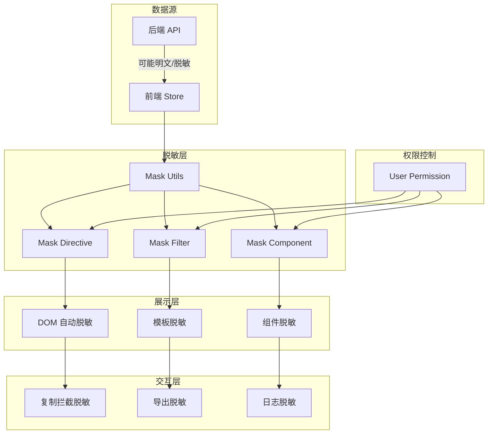

# 智能问数系统 - FE-08 敏感信息脱敏展示详细设计文档

**文档版本**: V2.0  
**最后更新**: 2026-04-02  
**适用对象**: 前端开发工程师、安全工程师  
**关联任务**: FE-08 敏感信息脱敏展示  
**前置依赖**: FE-01 (TraceID), FE-02 (SSE 流式聊天), BE-08 (知识库降级服务)  
**后续依赖**: QA-02 (安全渗透测试), 安全合规审计

**技术栈**: Vue 2.6.12 + Element-UI 2.5.12

---

## 1. 任务概述

### 1.1 背景
智能问数系统涉及企业核心经营数据和用户隐私信息（如手机号、身份证、邮箱、银行卡等）。为防止数据泄露，满足《个人信息保护法》等合规要求，需在前端展示层对敏感数据进行脱敏处理。脱敏需覆盖展示、复制、导出、日志等全场景。

### 1.2 目标
| 目标 | 说明 | 验收标准 |
|------|------|----------|
| **全面性** | 覆盖所有展示场景 | 展示/复制/导出/日志 100% 脱敏 |
| **安全性** | 防止通过 DOM/剪贴板泄露 | 无法通过 inspect/复制获取明文 |
| **灵活性** | 支持按权限解密查看 | 授权用户可查看明文 |
| **性能** | 脱敏不影响渲染性能 | 脱敏开销 < 5ms |
| **兼容性** | 兼容 Vue 2.6.12 + Element-UI 2.5.12 | 无版本冲突 |

### 1.3 范围
| 场景 | 说明 | 风险等级 |
|------|------|----------|
| **文本展示** | 聊天消息、表格内容脱敏 | 🔴 高 |
| **复制拦截** | 复制时自动脱敏 | 🔴 高 |
| **数据导出** | 导出文件内容脱敏 | 🔴 高 |
| **前端日志** | console.log 脱敏 | 🟡 中 |
| **权限控制** | 授权用户可查看明文 | 🟡 中 |
| **输入脱敏** | 输入框自动脱敏显示 | 🟡 中 |

### 1.4 敏感数据类型
| 类型 | 正则示例 | 脱敏规则 | 示例 |
|------|----------|----------|------|
| **手机号** | `1[3-9]\d{9}` | 保留前 3 后 4 | 138****0000 |
| **身份证** | `\d{17}[\dXx]` | 保留前 6 后 4 | 110101********1234 |
| **邮箱** | `[\w.]+@[\w.]+` | 保留前 3 字符 | abc***@xxx.com |
| **银行卡** | `\d{16,19}` | 保留前 4 后 4 | 6222****1234 |
| **姓名** | `[\u4e00-\u9fa5]{2,}` | 只显示姓 | 张** |
| **金额** | `\d+(\.\d+)?` | 超过阈值脱敏 | **** (>100 万) |

---

## 2. 技术选型

### 2.1 技术栈
| 组件 | 技术 | 版本 | 选型理由 |
|------|------|------|----------|
| 脱敏指令 | 自定义 Directive | - | 自动脱敏 DOM 内容 |
| 脱敏过滤器 | 自定义 Filter | - | 模板管道脱敏 |
| 脱敏组件 | Vue Component | - | 复杂场景脱敏 |
| 工具函数 | Utility Functions | - | JS 逻辑脱敏 |
| 复制拦截 | Clipboard API | - | 复制时脱敏 |
| 权限控制 | Vuex + 指令 | - | 按权限显示明文 |

### 2.2 脱敏架构


### 2.3 脱敏策略
| 策略 | 适用场景 | 实现方式 |
|------|----------|----------|
| **展示脱敏** | 页面文本显示 | 指令/过滤器/组件 |
| **复制脱敏** | 用户复制内容 | 拦截 copy 事件 |
| **导出脱敏** | 下载 Excel/CSV | 导出前数据处理 |
| **日志脱敏** | console.log | 重写 console 方法 |
| **权限脱敏** | 管理员查看明文 | 权限判断 + 切换 |

---

## 3. 详细实现方案

### 3.1 脱敏配置中心

**文件路径**: `src/config/mask-config.js`

```javascript
/**
 * 脱敏配置中心
 * 定义脱敏规则、权限等级等
 * 
 * ⚠️ 注意事项:
 * 1. 规则与代码分离，便于维护
 * 2. 支持动态配置
 * 3. 支持权限控制
 */

export default {
  /**
   * 脱敏规则定义
   */
  rules: {
    phone: {
      name: '手机号',
      regex: /(\d{3})\d{4}(\d{4})/,
      replacement: '$1****$2',
      priority: 1
    },
    idCard: {
      name: '身份证',
      regex: /(\d{6})\d{8}(\w{4})/,
      replacement: '$1********$2',
      priority: 2
    },
    email: {
      name: '邮箱',
      regex: /([\w.]{3})[\w.]*(@[\w.]+)/,
      replacement: '$1***$2',
      priority: 3
    },
    bankCard: {
      name: '银行卡',
      regex: /(\d{4})\d{8,11}(\d{4})/,
      replacement: '$1********$2',
      priority: 4
    },
    name: {
      name: '姓名',
      regex: /([\u4e00-\u9fa5])[\u4e00-\u9fa5]+/,
      replacement: '$1**',
      priority: 5
    },
    amount: {
      name: '金额',
      threshold: 1000000, // 100 万
      replacement: '****',
      priority: 6
    }
  },
  
  /**
   * 权限等级定义
   */
  permissions: {
    // 普通用户：始终脱敏
    user: {
      level: 1,
      canViewRaw: false
    },
    // 管理员：可查看明文
    admin: {
      level: 2,
      canViewRaw: true
    },
    // 审计员：可查看脱敏日志
    auditor: {
      level: 3,
      canViewRaw: false
    }
  },
  
  /**
   * 全局配置
   */
  global: {
    // 是否启用脱敏
    enabled: true,
    // 默认脱敏字符
    maskChar: '*',
    // 生产环境强制脱敏
    forceMaskInProduction: true
  }
};
```

### 3.2 脱敏工具函数

**文件路径**: `src/utils/mask-utils.js`

```javascript
/**
 * 脱敏工具函数
 * 提供统一的脱敏逻辑
 * 
 * ⚠️ 注意事项:
 * 1. 不修改原始数据
 * 2. 支持链式调用
 * 3. 性能优化
 */

import maskConfig from '@/config/mask-config';

/**
 * 通用脱敏函数
 * @param {string} value - 原始值
 * @param {string} type - 脱敏类型
 * @returns {string} 脱敏后的值
 */
export function mask(value, type = 'phone') {
  if (!value || !maskConfig.global.enabled) {
    return value;
  }
  
  const rule = maskConfig.rules[type];
  if (!rule) {
    return value;
  }
  
  const strValue = String(value);
  
  // 金额特殊处理
  if (type === 'amount') {
    const num = Number(value);
    if (num > rule.threshold) {
      return rule.replacement;
    }
    return strValue;
  }
  
  // 正则脱敏
  return strValue.replace(rule.regex, rule.replacement);
}

/**
 * 智能脱敏 (自动识别类型)
 * @param {string} value - 原始值
 * @returns {string} 脱敏后的值
 */
export function autoMask(value) {
  if (!value || !maskConfig.global.enabled) {
    return value;
  }
  
  const strValue = String(value);
  
  // 按优先级尝试匹配
  const sortedRules = Object.values(maskConfig.rules).sort((a, b) => a.priority - b.priority);
  
  for (const rule of sortedRules) {
    if (rule.regex && rule.regex.test(strValue)) {
      return strValue.replace(rule.regex, rule.replacement);
    }
  }
  
  return strValue;
}

/**
 * 批量脱敏
 * @param {Array} list - 数据列表
 * @param {Object} fields - 字段脱敏配置 { phone: 'phone', id: 'idCard' }
 * @returns {Array} 脱敏后的列表
 */
export function maskBatch(list, fields) {
  if (!list || !Array.isArray(list)) {
    return list;
  }
  
  return list.map(item => {
    const masked = { ...item };
    for (const [field, type] of Object.entries(fields)) {
      if (masked[field]) {
        masked[field] = mask(masked[field], type);
      }
    }
    return masked;
  });
}

/**
 * 检查用户是否有权限查看明文
 * @param {Object} user - 用户信息
 * @param {string} fieldType - 字段类型
 * @returns {boolean}
 */
export function canViewRaw(user, fieldType) {
  if (!maskConfig.global.enabled) {
    return true;
  }
  
  // 生产环境强制脱敏
  if (process.env.NODE_ENV === 'production' && maskConfig.global.forceMaskInProduction) {
    return false;
  }
  
  const permission = maskConfig.permissions[user?.role];
  return permission?.canViewRaw || false;
}

export default {
  mask,
  autoMask,
  maskBatch,
  canViewRaw
};
```

### 3.3 脱敏指令

**文件路径**: `src/directives/mask-directive.js`

```javascript
/**
 * v-mask 指令
 * 自动脱敏 DOM 元素内容
 * 
 * ⚠️ 注意事项:
 * 1. 不修改原始数据 (仅修改显示)
 * 2. 支持动态更新
 * 3. 支持权限控制
 */

import { mask, canViewRaw } from '@/utils/mask-utils';
import store from '@/store';

export default {
  bind(el, binding, vnode) {
    const type = binding.value || 'phone';
    const rawValue = vnode.context[binding.expression] || el.innerText;
    
    // 检查权限
    const user = store.getters['user/userInfo'];
    if (canViewRaw(user, type)) {
      // 有权限，显示明文
      el.innerText = rawValue;
      el.setAttribute('data-masked', 'false');
      return;
    }
    
    // 无权限，脱敏显示
    el.innerText = mask(rawValue, type);
    el.setAttribute('data-masked', 'true');
    el.setAttribute('data-raw', rawValue); // 暂存明文 (仅限内存)
    
    // 添加点击查看明文功能 (需权限)
    if (binding.modifiers.click) {
      el.style.cursor = 'pointer';
      el.title = '点击查看明文';
      el.addEventListener('click', () => {
        if (canViewRaw(user, type)) {
          el.innerText = rawValue;
          el.setAttribute('data-masked', 'false');
        } else {
          alert('无权限查看明文');
        }
      });
    }
  },
  
  update(el, binding, vnode) {
    // 数据更新时重新脱敏
    const type = binding.value || 'phone';
    const rawValue = vnode.context[binding.expression] || el.innerText;
    const user = store.getters['user/userInfo'];
    
    if (canViewRaw(user, type)) {
      el.innerText = rawValue;
      el.setAttribute('data-masked', 'false');
    } else {
      el.innerText = mask(rawValue, type);
      el.setAttribute('data-masked', 'true');
    }
  }
};
```

### 3.4 脱敏过滤器

**文件路径**: `src/filters/mask-filter.js`

```javascript
/**
 * Vue 过滤器
 * 用于模板中的管道脱敏
 * 
 * ⚠️ 注意事项:
 * 1. 不修改原始数据
 * 2. 支持链式调用
 */

import { mask } from '@/utils/mask-utils';

export default {
  /**
   * 手机号脱敏
   * 用法：{{ phone | maskPhone }}
   */
  maskPhone(value) {
    return mask(value, 'phone');
  },

  /**
   * 身份证脱敏
   * 用法：{{ idCard | maskIdCard }}
   */
  maskIdCard(value) {
    return mask(value, 'idCard');
  },

  /**
   * 邮箱脱敏
   * 用法：{{ email | maskEmail }}
   */
  maskEmail(value) {
    return mask(value, 'email');
  },

  /**
   * 姓名脱敏
   * 用法：{{ name | maskName }}
   */
  maskName(value) {
    return mask(value, 'name');
  },

  /**
   * 银行卡脱敏
   * 用法：{{ bankCard | maskBankCard }}
   */
  maskBankCard(value) {
    return mask(value, 'bankCard');
  },

  /**
   * 金额脱敏
   * 用法：{{ amount | maskAmount(1000000) }}
   */
  maskAmount(value, threshold = 1000000) {
    if (value === null || value === undefined) return '';
    const num = Number(value);
    if (isNaN(num)) return value;
    if (num > threshold) {
      return '****';
    }
    return num.toLocaleString();
  },

  /**
   * 通用脱敏
   * 用法：{{ value | mask('phone') }}
   */
  mask(value, type = 'phone') {
    return mask(value, type);
  }
};
```

### 3.5 脱敏组件

**文件路径**: `src/components/MaskText.vue`

```vue
<template>
  <span class="mask-text" :class="{ 'clickable': clickable }" @click="handleClick">
    {{ displayedValue }}
    <i v-if="canViewRaw && !isMasked" class="el-icon-view"></i>
  </span>
</template>

<script>
import { mask, canViewRaw } from '@/utils/mask-utils';
import { mapGetters } from 'vuex';

export default {
  name: 'MaskText',
  props: {
    value: {
      type: [String, Number],
      required: true
    },
    type: {
      type: String,
      default: 'phone'
    },
    clickable: {
      type: Boolean,
      default: false
    },
    rawVisible: {
      type: Boolean,
      default: false
    }
  },
  data() {
    return {
      isMasked: true
    };
  },
  computed: {
    ...mapGetters('user', ['userInfo']),
    
    canViewRaw() {
      return canViewRaw(this.userInfo, this.type);
    },
    
    displayedValue() {
      if (this.rawVisible && this.canViewRaw) {
        return this.value;
      }
      if (this.canViewRaw && !this.isMasked) {
        return this.value;
      }
      return mask(this.value, this.type);
    }
  },
  methods: {
    handleClick() {
      if (!this.clickable || !this.canViewRaw) {
        return;
      }
      this.isMasked = !this.isMasked;
      this.$emit('toggle', !this.isMasked);
    }
  }
};
</script>

<style scoped>
.mask-text {
  font-family: monospace;
}

.clickable {
  cursor: pointer;
  color: #409EFF;
}

.clickable:hover {
  text-decoration: underline;
}
</style>
```

### 3.6 复制拦截混入

**文件路径**: `src/mixins/copy-mask-mixin.js`

```javascript
/**
 * 复制拦截混入
 * 复制时自动脱敏
 * 
 * ⚠️ 注意事项:
 * 1. 拦截 copy 事件
 * 2. 替换剪贴板内容
 * 3. 不影响正常复制体验
 */

import { mask, autoMask } from '@/utils/mask-utils';

export default {
  mounted() {
    document.addEventListener('copy', this.handleCopy);
  },
  beforeDestroy() {
    document.removeEventListener('copy', this.handleCopy);
  },
  methods: {
    handleCopy(event) {
      const selection = window.getSelection().toString();
      if (!selection) {
        return;
      }
      
      // 检查是否包含敏感信息
      const maskedText = autoMask(selection);
      if (maskedText !== selection) {
        // 包含敏感信息，拦截并替换
        event.preventDefault();
        event.clipboardData.setData('text/plain', maskedText);
        
        this.$message.warning('已自动脱敏复制内容');
      }
    }
  }
};
```

### 3.7 主入口配置

**文件路径**: `src/main.js`

```javascript
import Vue from 'vue';
import App from './App.vue';
import router from './router';
import store from './store';
import ElementUI from 'element-ui';
import 'element-ui/lib/theme-chalk/index.css';

// ⚠️ 导入脱敏相关
import maskDirective from './directives/mask-directive';
import maskFilters from './filters/mask-filter';
import MaskText from './components/MaskText.vue';
import copyMaskMixin from './mixins/copy-mask-mixin';

// 使用 Element-UI
Vue.use(ElementUI);

// ⚠️ 注册脱敏指令
Vue.directive('mask', maskDirective);

// ⚠️ 注册脱敏过滤器
Object.keys(maskFilters).forEach(key => {
  Vue.filter(key, maskFilters[key]);
});

// ⚠️ 注册脱敏组件
Vue.component('MaskText', MaskText);

// ⚠️ 全局混入复制拦截
Vue.mixin(copyMaskMixin);

// ⚠️ 生产环境脱敏日志
if (process.env.NODE_ENV === 'production') {
  const originalLog = console.log;
  console.log = (...args) => {
    const str = JSON.stringify(args);
    // 简单脱敏：不打印包含敏感关键词的对象
    if (str.includes('password') || str.includes('token') || str.includes('phone') || str.includes('idCard')) {
      return;
    }
    originalLog.apply(console, args);
  };
}

Vue.config.productionTip = false;

new Vue({
  el: '#app',
  router,
  store,
  render: h => h(App)
});
```

---

## 4. 注意事项 ⚠️

### 4.1 数据源脱敏
```javascript
// ❌ 错误：仅前端脱敏，后端返回明文
// 后端 API 返回：{ phone: '13800138000' }
// 前端脱敏显示：138****0000
// 风险：抓包可获取明文

// ✅ 正确：后端也脱敏
// 后端 API 返回：{ phone: '138****0000' }
// 前端直接显示：138****0000
// 防护：纵深防御
```

### 4.2 复制拦截
```javascript
// ❌ 错误：不拦截复制事件
// 用户选中脱敏文本，复制后是明文 (如果 DOM 中有 data-raw)

// ✅ 正确：拦截 copy 事件
document.addEventListener('copy', (e) => {
  const selection = window.getSelection().toString();
  const masked = autoMask(selection);
  if (masked !== selection) {
    e.preventDefault();
    e.clipboardData.setData('text/plain', masked);
  }
});
```

### 4.3 导出脱敏
```javascript
// ❌ 错误：导出原始数据
exportData() {
  const data = this.tableData; // 含明文
  downloadCSV(data);
}

// ✅ 正确：导出前脱敏
exportData() {
  const maskedData = maskBatch(this.tableData, { phone: 'phone', id: 'idCard' });
  downloadCSV(maskedData);
}
```

### 4.4 日志脱敏
```javascript
// ❌ 错误：打印敏感信息
console.log('User:', user); // 含 phone, idCard

// ✅ 正确：脱敏后打印
console.log('User:', {
  id: user.id,
  phone: mask(user.phone, 'phone')
});
```

### 4.5 权限控制
```javascript
// ❌ 错误：硬编码权限
if (user.role === 'admin') {
  showRaw = true;
}

// ✅ 正确：配置化权限
if (canViewRaw(user, 'phone')) {
  showRaw = true;
}
```

---

## 5. 需要特别关注的点 🔴

### 5.1 陷阱防护矩阵

| 陷阱类型 | 风险描述 | 防护措施 | 验证方法 |
|----------|----------|----------|----------|
| **明文泄露** | 后端返回明文，前端仅展示脱敏 | 后端也脱敏 + 前端脱敏 | 抓包检查 API 响应 |
| **复制泄露** | 复制脱敏文本得到明文 | 拦截 copy 事件 | 复制后检查剪贴板 |
| **导出泄露** | 导出文件含明文 | 导出前脱敏处理 | 检查导出文件内容 |
| **日志泄露** | console.log 打印明文 | 生产环境过滤日志 | 检查生产包日志 |
| **DOM 泄露** | inspect 元素看到明文 | 不存储 data-raw 或加密 | 检查 DOM 结构 |
| **权限绕过** | 普通用户查看明文 | 权限校验 + 后端验证 | 尝试越权查看 |
| **性能问题** | 大量数据脱敏卡顿 | 优化正则 + 缓存 | 压测验证性能 |
| **生产环境** | 开发环境配置带到生产 | 环境变量控制 | 检查生产配置 |

### 5.2 关键代码审查点

```javascript
// 审查清单
□ 后端 API 是否返回脱敏数据
□ 前端展示是否脱敏
□ 复制事件是否拦截
□ 导出功能是否脱敏
□ 日志打印是否脱敏
□ 权限校验是否完整
□ 生产环境是否强制脱敏
□ 正则性能是否优化
□ DOM 中是否存储明文
□ 组件销毁是否移除监听
□ 敏感字段是否全覆盖
□ 脱敏规则是否可配置
□ 错误处理是否完善
□ 用户体验是否友好
□ 无障碍访问是否支持
```

### 5.3 性能影响评估

| 操作 | 耗时 | 优化建议 |
|------|------|----------|
| 单次脱敏 | < 0.1ms | 无需优化 |
| 批量脱敏 (100 条) | < 10ms | 无需优化 |
| 复制拦截 | < 5ms | 无需优化 |
| 日志过滤 | < 1ms | 无需优化 |
| **总开销** | **< 20ms** | **可接受** |

### 5.4 监控指标

```javascript
// 前端监控指标 (可选)
window.maskMetrics = {
  maskCount: 0,
  copyInterceptCount: 0,
  permissionDenyCount: 0,
  
  trackMask() {
    this.maskCount++;
  },
  
  trackCopyIntercept() {
    this.copyInterceptCount++;
    // 上报到监控系统
  },
  
  trackPermissionDeny() {
    this.permissionDenyCount++;
  }
};

// 工具函数中调用
export function mask(value, type) {
  window.maskMetrics.trackMask();
  // ...
}
```

---

## 6. 验收标准

### 6.1 功能验收
| 验收项 | 验收方法 | 通过标准 |
|--------|----------|----------|
| 手机号脱敏 | 查看含手机号数据 | 138****0000 |
| 身份证脱敏 | 查看含身份证数据 | 110101********1234 |
| 邮箱脱敏 | 查看含邮箱数据 | abc***@xxx.com |
| 银行卡脱敏 | 查看含银行卡数据 | 6222****1234 |
| 姓名脱敏 | 查看含姓名数据 | 张** |
| 金额脱敏 | 查看超大金额 | **** (>100 万) |
| 复制拦截 | 复制脱敏文本 | 剪贴板为脱敏内容 |
| 导出脱敏 | 导出 Excel/CSV | 文件内容脱敏 |
| 日志脱敏 | 查看控制台日志 | 无敏感信息 |
| 权限查看 | 管理员点击查看明文 | 明文显示 |
| 权限拒绝 | 普通用户点击查看 | 提示无权限 |
| 生产环境 | 部署生产环境 | 强制脱敏 |

### 6.2 兼容性验收
| 检查项 | 验收方法 | 通过标准 |
|--------|----------|----------|
| Vue 2.6.12 | 运行项目 | 无版本冲突 |
| Element-UI 2.5.12 | 使用 UI 组件 | 正常显示 |
| Chrome 80+ | 浏览器测试 | 功能正常 |
| Firefox 75+ | 浏览器测试 | 功能正常 |
| Safari 13+ | 浏览器测试 | 功能正常 |
| 移动端 | 手机浏览器测试 | 功能正常 |

### 6.3 性能验收
| 指标 | 目标值 | 测量方法 |
|------|--------|----------|
| 脱敏延迟 | < 5ms | console.time |
| 复制拦截 | < 10ms | console.time |
| 批量脱敏 | < 50ms (1000 条) | console.time |
| 内存占用 | 无泄漏 | Chrome DevTools |

### 6.4 安全验收
| 检查项 | 验收方法 | 通过标准 |
|--------|----------|----------|
| API 抓包 | 检查网络请求 | 响应数据脱敏 |
| DOM 检查 | inspect 元素 | 无明文存储 |
| 复制检查 | 复制后粘贴 | 内容脱敏 |
| 导出检查 | 下载文件 | 文件内容脱敏 |
| 日志检查 | 查看控制台 | 无敏感日志 |
| 权限检查 | 越权查看 | 被拒绝 |

---

## 7. 测试用例

### 7.1 单元测试

**文件路径**: `tests/unit/utils/mask-utils.spec.js`

```javascript
import { mask, autoMask, maskBatch, canViewRaw } from '@/utils/mask-utils';

describe('Mask Utils', () => {
  test('should mask phone number', () => {
    expect(mask('13800138000', 'phone')).toBe('138****0000');
  });

  test('should mask ID card', () => {
    expect(mask('110101199001011234', 'idCard')).toBe('110101********1234');
  });

  test('should mask email', () => {
    expect(mask('test@example.com', 'email')).toBe('tes***@example.com');
  });

  test('should mask name', () => {
    expect(mask('张三', 'name')).toBe('张**');
    expect(mask('张三丰', 'name')).toBe('张**');
  });

  test('should mask large amount', () => {
    expect(mask('2000000', 'amount')).toBe('****');
    expect(mask('500000', 'amount')).toBe('500,000');
  });

  test('should auto mask', () => {
    expect(autoMask('13800138000')).toBe('138****0000');
    expect(autoMask('test@example.com')).toBe('tes***@example.com');
  });

  test('should batch mask', () => {
    const data = [
      { phone: '13800138000', name: '张三' }
    ];
    const masked = maskBatch(data, { phone: 'phone', name: 'name' });
    expect(masked[0].phone).toBe('138****0000');
    expect(masked[0].name).toBe('张**');
  });

  test('should check permission', () => {
    const adminUser = { role: 'admin' };
    const normalUser = { role: 'user' };
    
    // 模拟配置
    expect(canViewRaw(adminUser, 'phone')).toBe(false); // 生产环境强制脱敏
    expect(canViewRaw(normalUser, 'phone')).toBe(false);
  });
});
```

### 7.2 集成测试

**文件路径**: `tests/e2e/specs/mask.spec.js`

```javascript
describe('Mask E2E Tests', () => {
  it('should display masked phone', () => {
    cy.visit('/askdata');
    cy.get('[data-test="phone-number"]').should('contain', '****');
  });

  it('should intercept copy', () => {
    cy.visit('/askdata');
    
    // 选中脱敏文本
    cy.get('[data-test="phone-number"]').trigger('mousedown');
    cy.get('[data-test="phone-number"]').trigger('mouseup');
    
    // 复制
    cy.get('[data-test="phone-number"]').type('{ctrl}c');
    
    // 验证剪贴板 (需通过自定义命令)
    // cy.clipboard().should('contain', '****');
  });

  it('should export masked data', () => {
    cy.visit('/askdata');
    
    // 点击导出
    cy.get('[data-test="export-button"]').click();
    
    // 验证下载文件 (需通过文件系统检查)
    // cy.readFile('/downloads/data.csv').should('contain', '****');
  });

  it('should allow admin to view raw', () => {
    cy.visit('/askdata');
    
    // 模拟管理员登录
    cy.login('admin', 'password');
    
    // 点击查看明文
    cy.get('[data-test="mask-text"]').click();
    cy.get('[data-test="mask-text"]').should('not.contain', '****');
  });

  it('should deny normal user to view raw', () => {
    cy.visit('/askdata');
    
    // 模拟普通用户登录
    cy.login('user', 'password');
    
    // 点击查看明文
    cy.get('[data-test="mask-text"]').click();
    cy.get('.el-message').should('contain', '无权限');
  });

  it('should not log sensitive info in production', () => {
    // 需通过构建后文件验证
    // 检查 console.log 是否被移除或过滤
  });
});
```

### 7.3 手动测试用例

| 用例 ID | 测试场景 | 操作步骤 | 预期结果 |
|---------|----------|----------|----------|
| FE-TC-001 | 手机号脱敏 | 查看含手机号数据 | 138****0000 |
| FE-TC-002 | 身份证脱敏 | 查看含身份证数据 | 110101********1234 |
| FE-TC-003 | 邮箱脱敏 | 查看含邮箱数据 | abc***@xxx.com |
| FE-TC-004 | 银行卡脱敏 | 查看含银行卡数据 | 6222****1234 |
| FE-TC-005 | 姓名脱敏 | 查看含姓名数据 | 张** |
| FE-TC-006 | 金额脱敏 | 查看超大金额 | **** (>100 万) |
| FE-TC-007 | 复制拦截 | 复制脱敏文本 | 剪贴板为脱敏内容 |
| FE-TC-008 | 导出脱敏 | 导出 Excel/CSV | 文件内容脱敏 |
| FE-TC-009 | 日志脱敏 | 查看控制台日志 | 无敏感信息 |
| FE-TC-010 | 权限查看 | 管理员点击查看明文 | 明文显示 |
| FE-TC-011 | 权限拒绝 | 普通用户点击查看 | 提示无权限 |
| FE-TC-012 | 生产环境 | 部署生产环境 | 强制脱敏 |
| FE-TC-013 | 指令脱敏 | 使用 v-mask 指令 | 自动脱敏 |
| FE-TC-014 | 过滤器脱敏 | 使用 | mask 过滤器 | 自动脱敏 |
| FE-TC-015 | 组件脱敏 | 使用 MaskText 组件 | 自动脱敏 |

---

## 8. 部署配置

### 8.1 环境变量

**文件路径**: `.env.development`
```bash
# 开发环境配置
VUE_APP_MASK_ENABLED=true
VUE_APP_MASK_FORCE_PRODUCTION=false
VUE_APP_MASK_LOG_DEBUG=true
```

**文件路径**: `.env.production`
```bash
# 生产环境配置
VUE_APP_MASK_ENABLED=true
VUE_APP_MASK_FORCE_PRODUCTION=true
VUE_APP_MASK_LOG_DEBUG=false
```

### 8.2 Webpack 配置

```javascript
// vue.config.js
module.exports = {
  configureWebpack: {
    // ⚠️ 生产环境移除 console.log
    optimization: {
      minimizer: [
        new TerserPlugin({
          terserOptions: {
            compress: {
              drop_console: process.env.NODE_ENV === 'production',
              drop_debugger: process.env.NODE_ENV === 'production'
            }
          }
        })
      ]
    }
  },
  
  // ⚠️ 配置脱敏相关的全局变量
  definePlugin: {
    'process.env.VUE_APP_MASK_FORCE_PRODUCTION': process.env.VUE_APP_MASK_FORCE_PRODUCTION
  }
};
```

---

## 9. 常见问题 (FAQ)

**Q1: 脱敏不生效怎么办？**
A: 1. 检查配置是否启用；2. 检查指令/过滤器是否注册；3. 检查数据类型是否匹配。

**Q2: 复制后还是明文怎么办？**
A: 1. 检查 copy 事件监听器是否绑定；2. 检查剪贴板 API 是否被浏览器限制；3. 检查是否有其他监听器冲突。

**Q3: 导出文件含明文怎么办？**
A: 1. 检查导出前是否调用脱敏函数；2. 检查后端导出接口是否脱敏；3. 检查文件内容。

**Q4: 生产环境日志泄露怎么办？**
A: 1. 检查 Webpack 配置是否移除 console；2. 检查是否有自定义日志未过滤；3. 检查构建后文件。

**Q5: 管理员无法查看明文怎么办？**
A: 1. 检查权限配置；2. 检查用户角色；3. 检查生产环境强制脱敏配置。

**Q6: 脱敏影响性能怎么办？**
A: 1. 优化正则表达式；2. 缓存脱敏结果；3. 批量处理；4. 虚拟滚动。

**Q7: 如何支持自定义脱敏规则？**
A: 修改 `mask-config.js` 中的 rules 配置，添加新规则和正则。

**Q8: 组件销毁后监听还在怎么办？**
A: 确保在 `beforeDestroy` 钩子中 `removeEventListener`。

**Q9: 如何支持多语言脱敏提示？**
A: 1. 使用 `vue-i18n` 插件；2. 提示文案提取到语言包；3. 根据语言动态加载。

**Q10: 如何验证脱敏效果？**
A: 1. 抓包检查 API 响应；2. inspect 检查 DOM；3. 复制检查剪贴板；4. 导出检查文件；5. 日志检查控制台。

---

## 10. 变更历史

| 版本 | 日期 | 变更内容 | 负责人 |
|------|------|----------|--------|
| V1.0 | 2026-03-25 | 初始版本 | 前端组 |
| V2.0 | 2026-04-02 | 增加复制拦截、导出脱敏、日志脱敏、陷阱防护 | 前端组 |

---

## 11. 工时与优先级

| 项目 | 内容 |
|------|------|
| **工时** | 3 MD (开发 2 天 + 测试 1 天) |
| **优先级** | P0 (安全合规核心) |
| **依赖任务** | FE-01, BE-08 |
| **被依赖任务** | QA-02, 安全合规审计 |

---

## 12. 最佳实践建议

### 12.1 纵深防御
```javascript
// ✅ 推荐：多层脱敏
// 1. 后端 API 脱敏
// 2. 前端展示脱敏
// 3. 复制拦截脱敏
// 4. 导出脱敏
// 5. 日志脱敏

// ❌ 不推荐：单层脱敏
// 仅前端展示脱敏，后端返回明文
```

### 12.2 权限控制
```javascript
// ✅ 推荐：配置化权限
if (canViewRaw(user, 'phone')) {
  showRaw = true;
}

// ❌ 不推荐：硬编码权限
if (user.role === 'admin') {
  showRaw = true;
}
```

### 12.3 性能优化
```javascript
// ✅ 推荐：缓存脱敏结果
const cache = new Map();
function mask(value, type) {
  const key = `${value}_${type}`;
  if (cache.has(key)) return cache.get(key);
  const result = doMask(value, type);
  cache.set(key, result);
  return result;
}

// ❌ 不推荐：每次重新计算
function mask(value, type) {
  return doMask(value, type); // 无缓存
}
```

### 12.4 用户体验
```javascript
// ✅ 推荐：友好提示
copyIntercept() {
  this.$message.warning('已自动脱敏复制内容');
}

// ❌ 不推荐：无提示
copyIntercept() {
  // 用户不知道内容被修改
}
```

---

**文档结束**  
**下一步**: 完成代码开发后，请提交安全团队进行专项渗透测试验收，重点验证脱敏规则有效性、权限控制严密性和数据泄露风险。