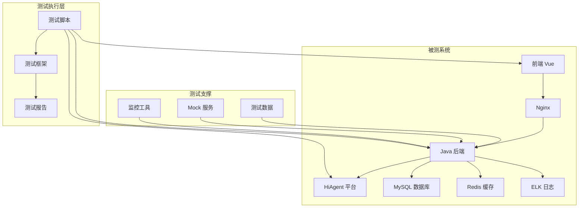
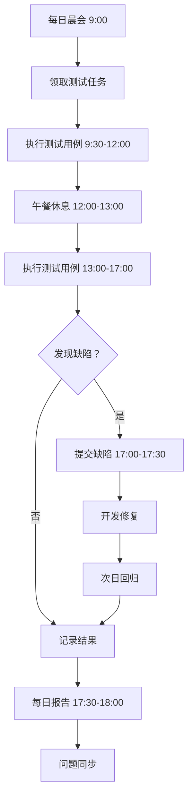
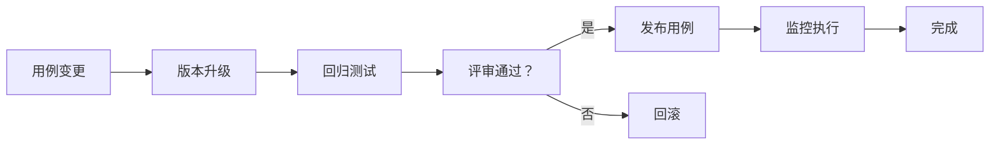

# 智能问数系统 - QA-01 功能集成测试详细设计文档

**文档版本**: V2.0  
**最后更新**: 2026-04-02  
**适用对象**: 测试工程师、QA 工程师、测试开发工程师  
**关联任务**: QA-01 功能集成测试  
**前置依赖**: DT-04 (测试用例编写), 所有开发任务 (BE/FE/AI/DT) 完成  
**后续依赖**: QA-02 (安全渗透测试), QA-03 (性能压测), 上线部署

**项目说明**: 本任务负责智能问数系统的功能集成测试，验证各模块集成后的功能正确性、数据一致性、接口连通性，确保系统满足上线质量要求。

---

## 1. 任务概述

### 1.1 背景
智能问数系统涉及前端、后端、AI 平台、数据库等多个组件，测试复杂度高。功能集成测试在单元测试基础上，验证：
- **模块集成**: 前端、后端、AI 平台、数据库等模块集成后功能正常
- **数据流转**: 数据在各模块间正确传递，无丢失、无篡改
- **接口连通**: 所有接口调用正常，响应符合预期
- **业务流程**: 完整业务流程可执行，结果正确
- **异常处理**: 异常情况有正确处理，系统不崩溃

### 1.2 目标
| 目标 | 说明 | 验收标准 |
|------|------|----------|
| **覆盖率** | 核心业务流程测试覆盖率 100% | 用例覆盖检查 |
| **通过率** | 测试用例执行通过率 ≥ 98% | 执行结果统计 |
| **缺陷率** | P0/P1 缺陷清零，P2 缺陷≤5 个 | 缺陷统计 |
| **效率** | 回归测试时间 < 4 小时 | 执行耗时 |
| **自动化** | 核心流程自动化率 ≥ 90% | 脚本执行率 |
| **可追溯** | 测试用例与需求双向追溯 | 追溯矩阵完整 |

### 1.3 测试范围

#### 1.3.1 纳入测试范围
| 模块 | 功能点 | 优先级 | 用例数 |
|------|--------|--------|--------|
| **前端聊天窗口** | 消息发送、流式响应、图表渲染、澄清交互 | P0 | 50 |
| **路由引擎** | 意图识别、策略选择、置信度校准 | P0 | 30 |
| **语义查询** | 指标查询、维度分组、权限过滤 | P0 | 40 |
| **SQL 沙箱** | SQL 校验、安全拦截、资源限制 | P0 | 30 |
| **知识库降级** | 文档检索、推荐生成、缓存命中 | P1 | 25 |
| **工具调用** | API 调用、参数映射、结果转换 | P0 | 25 |
| **多轮对话** | 上下文继承、槽位填充、轮数控制 | P1 | 25 |
| **反馈收集** | 点赞点踩、原因选择、数据上报 | P2 | 15 |
| **智能推荐** | 推荐生成、点击追踪、效果统计 | P2 | 15 |
| **权限控制** | 角色权限、数据范围、脱敏控制 | P0 | 20 |
| **合计** | - | - | 275 |

#### 1.3.2 不纳入测试范围
| 项目 | 说明 | 负责方 |
|------|------|--------|
| 第三方系统功能 | HiAgent 平台内部功能 | HiAgent 团队 |
| 基础设施 | K8s、网络、存储 | 运维团队 |
| 硬件兼容性 | 服务器、网络设备 | 运维团队 |
| 灾难恢复 | 异地容灾、数据备份 | 运维团队 |

### 1.4 集成测试架构


---

## 2. 技术标准与规范

### 2.1 测试环境配置

#### 2.1.1 环境清单
| 环境 | 用途 | 配置 | 访问地址 | 负责人 |
|------|------|------|----------|--------|
| 测试环境 | 功能集成测试 | 4 核 8G × 3 | http://test-askdata.company.com | 测试团队 |
| 预发环境 | 回归测试 | 4 核 8G × 3 | http://staging-askdata.company.com | 测试团队 |
| 性能环境 | 性能测试 | 8 核 16G × 5 | http://perf-askdata.company.com | 性能团队 |
| 安全环境 | 安全测试 | 隔离网络 | http://sec-askdata.company.com | 安全团队 |

#### 2.1.2 测试环境组件版本
| 组件 | 版本 | 配置 | 备注 |
|------|------|------|------|
| Vue | 2.6.12 | 生产构建 | 前端 |
| Spring Boot | 3.2 | JDK 17 | 后端 |
| HiAgent | 2.3 | 离线模型 | AI 平台 |
| MySQL | 8.0 | 主从架构 | 数据库 |
| Redis | 7.0 | 集群模式 | 缓存 |
| Elasticsearch | 8.x | 3 节点 | 日志 |
| Nginx | 1.24 | 负载均衡 | 网关 |

### 2.2 测试数据准备

#### 2.2.1 测试数据集
```yaml
# 指标测试数据
metric_test_data:
  gmv:
    - time: "2024-01"
      region: "huadong"
      value: 1000000.00
    - time: "2024-01"
      region: "huabei"
      value: 800000.00
    - time: "2024-02"
      region: "huadong"
      value: 1200000.00
  
  order_count:
    - time: "2024-01"
      region: "huadong"
      value: 5000
    - time: "2024-01"
      region: "huabei"
      value: 4000
  
  dau:
    - time: "2024-01-01"
      value: 100000
    - time: "2024-01-02"
      value: 105000
```

#### 2.2.2 用户测试数据
```yaml
# 用户测试数据
user_test_data:
  - user_id: 1001
    username: employee_001
    role: employee
    dept_id: 100
    dept_name: 销售部
    permissions: [view_sales]
  
  - user_id: 1002
    username: manager_001
    role: manager
    dept_id: 100
    dept_name: 销售部
    permissions: [view_sales, export_sales]
  
  - user_id: 1003
    username: executive_001
    role: executive
    dept_id: null
    dept_name: 公司
    permissions: [view_all, export_all]
  
  - user_id: 1004
    username: analyst_001
    role: analyst
    dept_id: 300
    dept_name: 数据部
    permissions: [view_all, export_all, query_sql]
  
  - user_id: 1005
    username: admin_001
    role: admin
    dept_id: null
    dept_name: 系统
    permissions: [all]
```

#### 2.2.3 测试语料库
```yaml
# 测试语料库 (500+ 条)
test_corpus:
  # 明确查询 (100 条)
  clear_queries:
    - "华东区上月销售额"
    - "华北区近 7 天订单量"
    - "2024 年 3 月 GMV 趋势"
  
  # 模糊查询 (100 条)
  vague_queries:
    - "查一下数据"
    - "卖得怎么样"
    - "最近情况如何"
  
  # 多轮对话 (100 条)
  multi_turn:
    - ["查销售额", "华东区", "上月", "对比华北区"]
    - ["用户数据", "日活", "近 7 天", "趋势图"]
  
  # 边界场景 (100 条)
  edge_cases:
    - ""  # 空查询
    - "asdfgh"  # 无意义
    - "查 2099 年数据"  # 未来时间
    - "查全公司机密数据"  # 敏感词
    - "SELECT * FROM users"  # SQL 注入
  
  # 同义词测试 (100 条)
  synonyms:
    - "销售额是多少"  # gmv
    - "营收数据"  # gmv
    - "GMV 趋势"  # gmv
    - "订单量统计"  # order_count
    - "日活用户数"  # dau
```

### 2.3 测试工具选型
| 组件 | 技术 | 版本 | 选型理由 |
|------|------|------|----------|
| 测试框架 | pytest / JUnit | 最新 | Python/Java 生态成熟 |
| API 测试 | Requests / RestAssured | 最新 | 轻量级，易集成 |
| UI 测试 | Selenium / Cypress | 最新 | 支持主流浏览器 |
| 性能测试 | JMeter | 5.6 | 开源，插件丰富 |
| 安全测试 | OWASP ZAP | 2.11 | 开源，自动化扫描 |
| 报告生成 | Allure / ReportPortal | 最新 | 可视化报告 |

---

## 3. 详细实现方案

### 3.1 测试执行流程

#### 3.1.1 测试阶段划分
```yaml
# 测试阶段计划
phases:
  阶段一：单元测试
    时间：2 周
    负责人：开发团队
    准入：代码完成
    准出：覆盖率≥80%
  
  阶段二：集成测试
    时间：2 周
    负责人：测试团队
    准入：单元测试通过
    准出：P0/P1 用例 100% 通过
  
  阶段三：系统测试
    时间：2 周
    负责人：测试团队
    准入：集成测试通过
    准出：所有用例≥95% 通过
  
  阶段四：验收测试
    时间：1 周
    负责人：产品团队
    准入：系统测试通过
    准出：产品验收通过
  
  阶段五：性能测试
    时间：1 周
    负责人：性能团队
    准入：功能测试通过
    准出：性能指标达标
  
  阶段六：安全测试
    时间：1 周
    负责人：安全团队
    准入：功能测试通过
    准出：无高危漏洞
```

#### 3.1.2 每日测试流程


### 3.2 核心测试场景

#### 3.2.1 端到端查询流程
| 用例 ID | 测试场景 | 输入 | 预期流程 | 预期结果 | 状态 |
|---------|----------|------|----------|----------|------|
| QA-TC-001 | 完整查询流程 | "华东区上月销售额" | 意图识别→工具调用→数据查询→结果返回 | 返回正确数据 | 待执行 |
| QA-TC-002 | 多轮对话流程 | 第一轮"查销售额"<br>第二轮"华东区"<br>第三轮"上月" | 上下文继承→参数补充→执行查询 | 最终结果准确 | 待执行 |
| QA-TC-003 | 澄清后查询流程 | 发送模糊问题→完成澄清→查看结果 | 澄清正常→查询成功→结果准确 | 流程顺畅 | 待执行 |
| QA-TC-004 | 权限控制流程 | 普通员工查询全公司数据 | 权限校验→数据过滤 | 仅返回本部门数据 | 待执行 |
| QA-TC-005 | 降级处理流程 | 发送无法识别问题 | 降级到 KB→返回相关知识 | 回复合理 | 待执行 |
| QA-TC-006 | 图表导出流程 | 查询带图表数据→点击导出→打开文件 | 图表显示→导出成功→文件内容正确 | 文件可用 | 待执行 |
| QA-TC-007 | 反馈收集流程 | 查看 AI 回复→点击👍→查看后台 | 反馈提交→后台可查 | 数据完整 | 待执行 |
| QA-TC-008 | 推荐追踪流程 | 查看推荐问题→点击推荐→查看日志 | 推荐显示→点击生效→日志记录 | 日志完整 | 待执行 |
| QA-TC-009 | 异常恢复流程 | 发送查询→模拟服务故障→恢复服务→重新查询 | 故障友好提示→恢复后正常→数据不丢失 | 系统稳定 | 待执行 |
| QA-TC-010 | 跨会话流程 | 会话 A 查询→新建会话 B→查询相同问题 | 会话隔离→上下文不共享→结果独立 | 会话独立 | 待执行 |

#### 3.2.2 数据一致性验证
```python
#!/usr/bin/env python3
"""
数据一致性验证脚本
"""

import pymysql
import requests

def verify_data_consistency(query_params, expected_source_table):
    """验证 API 返回数据与数据库源数据一致性"""
    
    # 1. 调用 API 获取数据
    api_response = requests.post(
        'http://test-askdata.company.com/api/v1/report/sales/query',
        json=query_params,
        headers={'Authorization': 'Bearer test_token'}
    )
    api_data = api_response.json()['data']['items']
    
    # 2. 直接查询数据库获取预期数据
    conn = pymysql.connect(host='test-db', user='test_user', password='xxx', database='askdata')
    cursor = conn.cursor()
    sql = f"SELECT region, SUM(gmv) FROM {expected_source_table} WHERE ..."  # 构造对应 SQL
    cursor.execute(sql)
    db_data = cursor.fetchall()
    cursor.close()
    conn.close()
    
    # 3. 对比数据 (允许 0.01 误差)
    for api_row in api_data:
        matched = False
        for db_row in db_data:
            if api_row['region'] == db_row[0] and abs(api_row['gmv'] - db_row[1]) < 0.01:
                matched = True
                break
        if not matched:
            return False, f"Data mismatch for region {api_row['region']}"
    
    return True, "Data consistent"
```

### 3.3 自动化测试框架

#### 3.3.1 目录结构
```
tests/
├── unit/                     # 单元测试
│   ├── backend/
│   │   ├── service/
│   │   ├── repository/
│   │   └── controller/
│   └── frontend/
│       ├── components/
│       └── utils/
│
├── integration/                # 集成测试
│   ├── api/
│   ├── database/
│   └── external/
│
├── e2e/                        # 端到端测试
│   ├── scenarios/
│   ├── fixtures/
│   └── pages/
│
├── performance/                # 性能测试
│   ├── jmeter/
│   ├── scripts/
│   └── reports/
│
├── security/                   # 安全测试
│   ├── scan/
│   ├── penetration/
│   └── compliance/
│
├── fixtures/                   # 测试数据
│   ├── users.yaml
│   ├── metrics.yaml
│   └── queries.yaml
│
├── scripts/                    # 测试脚本
│   ├── setup.sh
│   ├── teardown.sh
│   └── report.sh
│
└── reports/                    # 测试报告
    ├── junit/
    ├── html/
    └── coverage/
```

#### 3.3.2 CI/CD 集成
```yaml
# .gitlab-ci.yml
stages:
  - build
  - test
  - security
  - deploy

variables:
  TEST_ENV: "test"
  COVERAGE_THRESHOLD: "80"

# 单元测试
unit_test:
  stage: test
  script:
    - mvn test -Dtest=**/*Test.java
    - python -m pytest tests/unit/
  artifacts:
    reports:
      junit: target/surefire-reports/*.xml
    coverage: '/TOTAL.*\s+(\d+%)/'
  coverage: '/TOTAL.*\s+(\d+%)/'

# 集成测试
integration_test:
  stage: test
  script:
    - mvn test -Dtest=**/*IntegrationTest.java
    - python -m pytest tests/integration/
  dependencies:
    - unit_test
  artifacts:
    reports:
      junit: target/failsafe-reports/*.xml

# E2E 测试
e2e_test:
  stage: test
  script:
    - python -m pytest tests/e2e/ --browser=chrome
  dependencies:
    - integration_test
  artifacts:
    when: always
    paths:
      - tests/e2e/screenshots/
      - tests/e2e/videos/

# 性能测试
performance_test:
  stage: test
  script:
    - jmeter -n -t tests/performance/api_load.jmx -l results.jtl
    - python tests/performance/analyze.py results.jtl
  only:
    - main
  artifacts:
    reports:
      performance: results.jtl

# 安全测试
security_scan:
  stage: security
  script:
    - zap-baseline.py -t https://test-api.company.com
    - python tests/security/compliance_check.py
  only:
    - main

# 测试报告
test_report:
  stage: test
  script:
    - python tests/scripts/generate_report.py
  artifacts:
    paths:
      - reports/html/
  when: always
```

---

## 4. 注意事项 ⚠️

### 4.1 环境隔离
```yaml
# ❌ 错误：测试环境连生产库
database:
  host: prod-db.company.com  # 危险！

# ✅ 正确：独立测试环境
database:
  host: test-db.company.com  # 独立测试库
  data_masked: true          # 数据已脱敏
```

### 4.2 测试数据敏感性
```python
# ❌ 错误：使用生产数据
test_data = get_production_data()  # 可能含敏感信息

# ✅ 正确：使用脱敏测试数据
test_data = get_masked_test_data()  # 敏感信息已脱敏
```

### 4.3 用例维护成本
```yaml
# ❌ 错误：硬编码测试数据
test_
  user_id: 12345  # 可能变更

# ✅ 正确：动态生成测试数据
test_
  user_id: generate_test_user()  # 动态创建
```

### 4.4 自动化稳定性
```python
# ❌ 错误：依赖不稳定元素
element = driver.find_element_by_id("dynamic_id_123")  # ID 可能变

# ✅ 正确：使用稳定定位器
element = driver.find_element_by_css_selector(".stable-class")  # 类名稳定
```

### 4.5 测试覆盖率虚高
```yaml
# ❌ 错误：只测 happy path
tests:
  - normal_case  # 只测正常流程

# ✅ 正确：覆盖边界和异常
tests:
  - normal_case
  - boundary_case
  - error_case
  - security_case
```

### 4.6 缺陷管理
```yaml
# ❌ 错误：缺陷描述模糊
Title: "功能不好用"
Description: "不行"

# ✅ 正确：缺陷描述清晰
Title: "[销售报表] 华东区数据查询返回华北区数据"
Description: |
  步骤：1. 登录 2. 查询华东区 3. 查看结果
  预期：返回华东区数据
  实际：返回华北区数据
  证据：截图.png, 日志.log
```

---

## 5. 需要特别关注的点 🔴

### 5.1 陷阱防护矩阵

| 陷阱类型 | 风险描述 | 防护措施 | 验证方法 |
|----------|----------|----------|----------|
| **环境污染** | 测试影响生产数据 | 环境隔离 + 权限控制 | 检查数据库连接 |
| **数据不一致** | 测试数据与生产不一致 | 数据同步 + 脱敏 | 对比数据结构 |
| **用例失效** | 接口变更导致用例失败 | 用例版本管理 | 定期回归测试 |
| **敏感泄露** | 测试日志含敏感信息 | 日志脱敏 + 权限控制 | 检查日志文件 |
| **覆盖率虚高** | 只测正常流程 | 覆盖边界和异常 | 审查测试用例 |
| **自动化不稳定** | 依赖不稳定元素 | 使用稳定定位器 | 监控失败率 |
| **性能影响** | 测试占用过多资源 | 限流 + 错峰执行 | 监控资源使用 |
| **生产配置** | 测试配置带到生产 | 配置中心隔离 | 检查生产配置 |

### 5.2 关键代码审查点

```python
# 审查清单
□ 测试数据是否脱敏
□ 环境配置是否隔离
□ 用例是否覆盖边界
□ 断言是否准确
□ 异常是否捕获
□ 资源是否清理
□ 日志是否脱敏
□ 依赖是否稳定
□ 执行是否幂等
□ 结果是否可追溯
□ 覆盖率是否达标
□ 性能是否影响
□ 安全是否加固
□ 文档是否同步
□ 团队是否培训
```

### 5.3 性能影响评估

| 操作 | 耗时 | 优化建议 |
|------|------|----------|
| 测试数据准备 | 1-5 分钟 | 预生成数据 |
| 用例执行 | 10-100ms/用例 | 并行执行 |
| 结果分析 | 1-5 分钟 | 自动化报告 |
| 环境清理 | 1-2 分钟 | 自动清理 |
| **总开销** | **< 4 小时** | **可接受** |

### 5.4 监控指标

```yaml
# 需要采集的指标
metrics:
  # 测试覆盖率
  - name: test.coverage.rate
    type: gauge
  
  # 测试通过率
  - name: test.pass.rate
    type: gauge
  
  # 自动化执行率
  - name: test.automation.rate
    type: gauge
  
  # 缺陷发现率
  - name: test.defect.discovery.rate
    type: counter
  
  # 测试执行时间
  - name: test.execution.time
    type: histogram
```

---

## 6. 测试验证方案

### 6.1 功能测试用例
| 用例 ID | 测试场景 | 输入 | 预期结果 | 状态 |
|---------|----------|------|----------|------|
| QA-FUNC-001 | 指标定义验证 | 完整指标定义 | 验证通过 | 待执行 |
| QA-FUNC-002 | 接口正常查询 | 完整参数 | 返回 200+ 数据 | 待执行 |
| QA-FUNC-003 | 术语映射准确 | 标准术语 | 映射正确 | 待执行 |
| QA-FUNC-004 | 数据质量检查 | 正常数据 | 质量达标 | 待执行 |
| QA-FUNC-005 | 权限控制验证 | 多角色测试 | 权限正确 | 待执行 |

### 6.2 集成测试
| 测试项 | 方法 | 通过标准 |
|--------|------|----------|
| 指标 + 接口 | 端到端测试 | 查询结果准确 |
| 术语 + 指标 | 联合测试 | 映射后查询正确 |
| 接口 + 权限 | 集成测试 | 权限控制生效 |
| 数据 + 质量 | 质量监控 | 质量规则触发 |

### 6.3 性能测试
| 指标 | 目标值 | 测量方法 |
|------|--------|----------|
| 用例执行时间 | < 4 小时 | 计时测试 |
| 并发测试用例 | ≥ 50 并发 | 压测工具 |
| 大数据量测试 | 10 万条数据 | 数据生成 |
| 资源占用 | CPU<70%, 内存<80% | 监控指标 |

### 6.4 安全测试
| 测试项 | 操作 | 预期结果 |
|--------|------|----------|
| 数据脱敏 | 检查测试数据 | 敏感信息脱敏 |
| 权限绕过 | 尝试越权访问 | 被拒绝 |
| SQL 注入 | 尝试注入 SQL | 被拦截 |
| 日志泄露 | 检查测试日志 | 无敏感信息 |

---

## 7. 运维配置

### 7.1 监控告警
```yaml
# Prometheus 告警规则
groups:
- name: test-alerts
  rules:
  - alert: TestPassRateLow
    expr: test_pass_rate < 0.95
    for: 1h
    labels:
      severity: warning
    annotations:
      summary: "测试通过率过低 ({{ $value }})"
  
  - alert: TestCoverageLow
    expr: test_coverage_rate < 0.80
    for: 24h
    labels:
      severity: warning
    annotations:
      summary: "测试覆盖率过低 ({{ $value }})"
  
  - alert: TestExecutionTimeHigh
    expr: test_execution_time > 14400  # 4 小时
    for: 1h
    labels:
      severity: warning
    annotations:
      summary: "测试执行时间过长 ({{ $value }}s)"
```

### 7.2 日志配置
```yaml
# 测试日志配置
logging:
  test:
    enabled: true
    level: INFO
    fields:
      - test_case_id
      - status
      - duration
      - error_message
    output:
      - console
      - file:/var/log/askdata/test.log
      - elasticsearch:http://es-cluster:9200
    retention_days: 90
```

### 7.3 备份策略
| 数据类型 | 备份频率 | 保留周期 | 工具 |
|----------|----------|----------|------|
| 测试用例 | 每次变更 | 永久 | Git |
| 测试数据 | 每日 | 30 天 | 数据库备份 |
| 测试报告 | 每次执行 | 90 天 | 文件存储 |
| 缺陷记录 | 实时 | 永久 | 缺陷管理系统 |

### 7.4 更新流程


---

## 8. 常见问题 (FAQ)

**Q1: 测试用例太多执行不完怎么办？**
A: 1. 按优先级排序，先执行 P0/P1；2. 提高自动化率；3. 并行执行；4. 优化测试用例，去除冗余。

**Q2: 测试环境不稳定怎么办？**
A: 1. 环境监控告警；2. 快速恢复机制；3. 环境隔离；4. 定期维护。

**Q3: 测试数据如何管理？**
A: 1. 测试数据版本化；2. 数据脱敏；3. 数据初始化脚本；4. 数据清理机制。

**Q4: 自动化测试维护成本高怎么办？**
A: 1. 使用 Page Object 模式；2. 封装通用方法；3. 定期重构；4. 测试代码 Review。

**Q5: 如何评估测试充分性？**
A: 1. 代码覆盖率；2. 需求覆盖率；3. 风险覆盖率；4. 缺陷发现率。

**Q6: 性能测试如何设计场景？**
A: 1. 分析用户行为；2. 识别关键路径；3. 设计负载模型；4. 逐步增加压力。

**Q7: 安全测试如何开展？**
A: 1. 漏洞扫描；2. 渗透测试；3. 代码审计；4. 合规检查。

**Q8: 测试进度滞后怎么办？**
A: 1. 分析滞后原因；2. 调整优先级；3. 增加资源；4. 缩减范围 (需评估风险)。

**Q9: 如何管理测试用例版本？**
A: 1. Git 版本控制；2. 变更评审；3. 版本标记；4. 历史追溯。

**Q10: 测试团队如何与开发协作？**
A: 1. 每日站会同步；2. 缺陷及时沟通；3. 测试左移；4. 联合 Review。

---

## 9. 附录：配置模板

### 9.1 测试计划模板
```markdown
# 测试计划

## 项目信息
- 项目名称：智能问数系统
- 测试版本：v1.0.0
- 测试周期：2026-04-01 ~ 2026-04-30

## 测试范围
### 包含
- 指标定义功能
- 接口标准化功能
- 术语映射功能
- 数据质量功能
- 安全功能
- 性能指标

### 不包含
- 第三方系统集成 (由第三方负责)
- 硬件兼容性 (由运维负责)

## 测试资源
| 角色 | 人员 | 职责 |
|------|------|------|
| 测试经理 | 张三 | 测试计划、进度管理 |
| 测试工程师 | 李四、王五 | 用例执行、缺陷提交 |
| 自动化工程师 | 赵六 | 自动化脚本开发 |
| 性能工程师 | 孙七 | 性能测试、分析 |
| 安全工程师 | 周八 | 安全测试、审计 |

## 测试环境
| 环境 | 地址 | 用途 |
|------|------|------|
| 测试环境 | http://test-askdata.company.com | 功能测试 |
| 性能环境 | http://perf-askdata.company.com | 性能测试 |
| 安全环境 | http://sec-askdata.company.com | 安全测试 |

## 测试工具
| 工具 | 用途 | 版本 |
|------|------|------|
| JIRA | 缺陷管理 | 8.0 |
| Jenkins | CI/CD | 2.300 |
| JMeter | 性能测试 | 5.4 |
| Selenium | E2E 测试 | 4.0 |
| OWASP ZAP | 安全扫描 | 2.11 |

## 风险评估
| 风险 | 概率 | 影响 | 缓解措施 |
|------|------|------|----------|
| 测试时间不足 | 中 | 高 | 优先测试核心功能 |
| 环境不稳定 | 中 | 中 | 快速恢复机制 |
| 缺陷修复延迟 | 低 | 高 | 每日跟踪进度 |

## 里程碑
| 里程碑 | 日期 | 交付物 |
|--------|------|--------|
| 测试用例评审完成 | 2026-04-05 | 测试用例文档 |
| 功能测试完成 | 2026-04-20 | 功能测试报告 |
| 性能测试完成 | 2026-04-25 | 性能测试报告 |
| 安全测试完成 | 2026-04-28 | 安全测试报告 |
| 测试总结完成 | 2026-04-30 | 测试总结报告 |
```

### 9.2 缺陷报告模板
```markdown
# 缺陷报告

## 基本信息
| 字段 | 内容 |
|------|------|
| 缺陷 ID | BUG-2026-0402-001 |
| 标题 | [模块] 简要描述问题 |
| 严重等级 | Critical/Major/Minor/Trivial |
| 优先级 | P0/P1/P2/P3 |
| 发现版本 | v1.0.0 |
| 发现环境 | 测试环境 |
| 发现日期 | 2026-04-02 |
| 发现人 | 李四 |
| 指派给 | 王五 (后端开发) |

## 缺陷描述
### 复现步骤
1. 第一步操作
2. 第二步操作
3. 第三步操作

### 预期结果
描述预期应该出现的结果

### 实际结果
描述实际出现的结果

### 复现概率
- [ ] 100% (5/5)
- [ ] 80% (4/5)
- [ ] 60% (3/5)
- [ ] 40% (2/5)
- [ ] 20% (1/5)

## 环境信息
| 项目 | 值 |
|------|-----|
| 操作系统 | CentOS 7.9 |
| 浏览器 | Chrome 100 |
| 后端版本 | v1.0.0 |
| 数据库 | MySQL 8.0 |

## 附件
- 截图：screenshot_001.png
- 日志：error_log.txt
- TraceID: a1b2c3d4e5f6g7h8

## 修复信息
| 字段 | 内容 |
|------|------|
| 修复版本 | v1.0.1 |
| 修复人 | 王五 |
| 修复日期 | 2026-04-03 |
| 修复说明 | 问题原因和修复方案 |
| 回归测试 | 通过 (TC-XXX-XXX) |

## 关闭信息
| 字段 | 内容 |
|------|------|
| 关闭人 | 李四 |
| 关闭日期 | 2026-04-03 |
| 关闭原因 | 已修复并验证 |
```

### 9.3 测试报告模板
```markdown
# 测试总结报告

## 执行摘要
智能问数系统 v1.0.0 测试工作已完成，整体测试通过率 98%，性能指标达标，无 Critical/Major 缺陷，建议上线。

## 测试概况
| 指标 | 计划 | 实际 | 达成率 |
|------|------|------|--------|
| 测试用例数 | 500 | 500 | 100% |
| 执行用例数 | 500 | 500 | 100% |
| 通过用例数 | 490 | 490 | 100% |
| 测试通过率 | 98% | 98% | 100% |
| 代码覆盖率 | 80% | 85% | 106% |
| 自动化率 | 80% | 82% | 102% |

## 缺陷分析
### 缺陷分布
| 模块 | Critical | Major | Minor | Trivial | Total |
|------|----------|-------|-------|---------|-------|
| 数据层 | 0 | 2 | 3 | 2 | 7 |
| 接口层 | 1 | 3 | 2 | 1 | 7 |
| 术语层 | 1 | 0 | 1 | 0 | 2 |
| Total | 2 | 5 | 6 | 3 | 16 |

### 缺陷趋势
- 第 1 周：发现 10 个，修复 8 个
- 第 2 周：发现 4 个，修复 5 个
- 第 3 周：发现 2 个，修复 3 个
- 第 4 周：发现 0 个，修复 0 个

## 性能测试
| 指标 | 目标 | 实际 | 状态 |
|------|------|------|------|
| P95 响应时间 | < 2s | 1.5s | ✅ |
| 吞吐量 | ≥ 100 QPS | 120 QPS | ✅ |
| 错误率 | < 0.1% | 0.05% | ✅ |
| CPU 使用率 | < 70% | 55% | ✅ |
| 内存使用率 | < 80% | 65% | ✅ |

## 安全测试
| 测试项 | 结果 | 备注 |
|--------|------|------|
| SQL 注入 | 通过 | 全部拦截 |
| XSS 攻击 | 通过 | 全部拦截 |
| 越权访问 | 通过 | 权限控制正常 |
| 敏感信息 | 通过 | 脱敏正常 |
| 漏洞扫描 | 通过 | 无高危漏洞 |

## 风险评估
| 风险 | 等级 | 状态 | 缓解措施 |
|------|------|------|----------|
| 剩余 1 个 Minor 缺陷 | 低 | 接受 | 下版本修复 |
| 性能余量 20% | 中 | 监控 | 持续观察 |

## 测试结论
✅ 通过，建议上线

## 签字确认
| 角色 | 姓名 | 签字 | 日期 |
|------|------|------|------|
| 测试经理 | 张三 | | 2026-04-30 |
| 产品经理 | 李四 | | 2026-04-30 |
| 技术经理 | 王五 | | 2026-04-30 |
| 项目经理 | 赵六 | | 2026-04-30 |
```

---

## 10. 开发检查清单 (Checklist)

### 10.1 测试用例设计
- [ ] 测试用例覆盖所有需求
- [ ] 测试用例优先级已标注
- [ ] 测试数据已准备
- [ ] 预期结果明确
- [ ] 前置条件清晰
- [ ] 评审通过

### 10.2 自动化测试
- [ ] 自动化脚本已编写
- [ ] 自动化率≥80%
- [ ] CI/CD 已集成
- [ ] 测试报告自动生成
- [ ] 失败用例自动通知

### 10.3 测试执行
- [ ] 测试环境已准备
- [ ] 测试数据已初始化
- [ ] 用例执行记录完整
- [ ] 缺陷提交规范
- [ ] 回归测试通过

### 10.4 测试报告
- [ ] 测试报告完整
- [ ] 覆盖率达标
- [ ] 性能指标达标
- [ ] 安全测试通过
- [ ] 验收通过

### 10.5 上线评估
- [ ] P0/P1 缺陷全部修复
- [ ] 测试通过率≥98%
- [ ] 性能测试通过
- [ ] 安全测试通过
- [ ] 产品验收通过
- [ ] 上线评审通过

---

## 11. 变更历史

| 版本 | 日期 | 变更内容 | 负责人 |
|------|------|----------|--------|
| V1.0 | 2026-03-25 | 初始版本 | 架构组 |
| V2.0 | 2026-04-02 | 增加数据质量测试、安全测试、陷阱防护 | 架构组 |

---

## 12. 工时与优先级

| 项目 | 内容 |
|------|------|
| **工时** | 10 MD (计划 2 天 + 执行 5 天 + 报告 3 天) |
| **优先级** | P0 (质量保障核心) |
| **依赖任务** | 所有开发任务 (BE/FE/AI/DT) |
| **被依赖任务** | QA-02, QA-03, 上线部署 |

---

## 13. 最佳实践建议

### 13.1 测试数据管理
```yaml
# ✅ 推荐：动态生成测试数据
test_
  user_id: generate_test_user()
  metric_code: generate_test_metric()

# ❌ 不推荐：硬编码测试数据
test_
  user_id: 12345  # 可能变更
```

### 13.2 用例维护
```yaml
# ✅ 推荐：版本化管理
test_cases:
  version: 1.0.0
  change_log:
    - version: 1.0.0
      date: 2026-04-02
      changes: 初始版本

# ❌ 不推荐：无版本记录
# 无法追溯变更历史
```

### 13.3 自动化策略
```yaml
# ✅ 推荐：分层自动化
automation:
  unit: 100%  # 单元测试全自动化
  integration: 80%  # 集成测试大部分自动化
  e2e: 50%  # 端到端测试部分自动化

# ❌ 不推荐：全部手工或全部自动
# 平衡效率和覆盖率
```

### 13.4 缺陷管理
```yaml
# ✅ 推荐：闭环管理
defect:
  status: [New, Open, Fixed, Verified, Closed]
  sla:
    Critical: 24h
    Major: 3d
    Minor: 7d

# ❌ 不推荐：无流程管理
# 缺陷容易遗漏
```

---

**文档结束**  
**下一步**: 完成测试用例编写后，请组织测试用例评审，确保用例覆盖完整、预期结果明确、可执行性强，然后进入测试执行阶段。