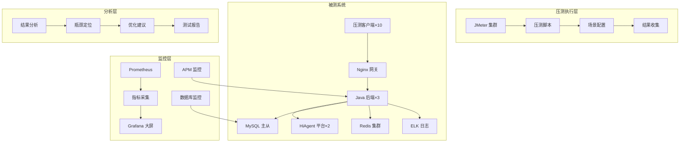
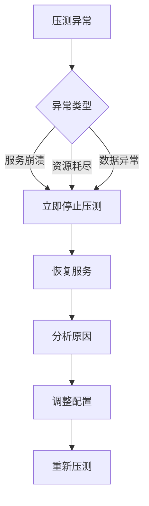

# 智能问数系统 - QA-03 性能压测详细设计文档

**文档版本**: V2.0  
**最后更新**: 2026-04-02  
**适用对象**: 性能测试工程师、运维工程师、架构师、后端开发  
**关联任务**: QA-03 性能压测  
**前置依赖**: QA-01 (功能集成测试完成), QA-02 (安全渗透测试完成), 性能环境就绪  
**后续依赖**: 性能优化，上线部署，容量规划

**项目说明**: 本任务负责智能问数系统的性能压测，通过模拟高并发用户场景，评估系统性能指标，发现性能瓶颈，确保系统满足生产环境性能要求（特别是 AI 推理延迟和数据库查询性能）。

---

## 1. 任务概述

### 1.1 背景
智能问数系统涉及大模型推理、向量检索、复杂 SQL 生成等高耗时操作。在高并发场景下，容易出现响应延迟高、资源耗尽、服务雪崩等问题。性能压测通过模拟真实负载，量化系统性能，识别瓶颈，为容量规划和性能优化提供依据。

### 1.2 目标
| 目标 | 说明 | 验收标准 |
|------|------|----------|
| **响应时间** | 核心接口 P95 延迟 < 3s | 压测报告验证 |
| **吞吐量** | 系统支持 ≥ 100 QPS | 压测报告验证 |
| **稳定性** | 7×24 小时稳定运行无故障 | 稳定性测试验证 |
| **资源利用率** | CPU < 70%, 内存 < 80% | 监控指标验证 |
| **可扩展性** | 支持水平扩展，性能线性增长 | 扩容测试验证 |
| **零事故** | 压测过程不影响生产，数据不丢失 | 安全承诺书 |

### 1.3 测试范围

#### 1.3.1 纳入测试范围
| 测试场景 | 测试项 | 优先级 | 用例数 |
|----------|--------|--------|--------|
| **单接口负载** | 聊天查询、报表查询 | P0 | 20 |
| **单接口压力** | 极限 QPS 测试 | P0 | 15 |
| **混合场景** | 多接口混合流量 | P0 | 20 |
| **稳定性测试** | 72 小时浸泡测试 | P0 | 10 |
| **并发测试** | 高并发用户访问 | P0 | 15 |
| **大数据量** | 百万级数据查询 | P1 | 15 |
| **AI 服务** | 模型推理延迟、Token 生成 | P0 | 15 |
| **数据库** | 慢查询、连接池、锁竞争 | P0 | 15 |
| **缓存** | Redis 命中率、穿透/击穿 | P1 | 10 |
| **网关** | Nginx 吞吐、限流效果 | P1 | 10 |
| **合计** | - | - | 145 |

#### 1.3.2 不纳入测试范围
| 项目 | 说明 | 负责方 |
|------|------|--------|
| 第三方系统性能 | HiAgent 平台内部性能 | HiAgent 团队 |
| 网络带宽测试 | 基础网络性能 | 运维团队 |
| 硬件极限测试 | 服务器硬件极限 | 运维团队 |
| 灾难恢复测试 | 容灾切换性能 | 运维团队 |

### 1.4 性能测试架构


---

## 2. 技术标准与规范

### 2.1 测试环境配置

#### 2.1.1 性能测试环境
| 环境 | 用途 | 配置 | 访问地址 | 说明 |
|------|------|------|----------|------|
| 压测客户端 | 发起压测请求 | 8 核 16G × 10 | 内网隔离 | 避免客户端瓶颈 |
| 应用服务器 | 部署后端服务 | 8 核 16G × 3 | http://perf-askdata | 配置低于生产 (1:2) |
| AI 服务器 | 部署 HiAgent | 16 核 32G + GPU × 2 | http://perf-hiagent | 关键瓶颈点 |
| 数据库 | MySQL 主从 | 16 核 64G, SSD | db-perf:3306 | 数据量需接近生产 |
| 缓存 | Redis 集群 | 8 核 32G × 3 | redis-perf:6379 | 集群模式 |
| 监控服务器 | 监控指标采集 | 4 核 8G × 2 | http://monitor-perf | 独立部署 |

#### 2.1.2 生产环境对比
| 组件 | 性能环境 | 生产环境 | 比例 | 换算系数 |
|------|----------|----------|------|----------|
| 应用服务器 | 8 核 16G × 3 | 16 核 32G × 5 | 1:2.5 | 2.5 |
| AI 服务器 | 16 核 32G × 2 | 32 核 64G × 4 | 1:4 | 4 |
| 数据库 | 16 核 64G | 32 核 128G | 1:2 | 2 |
| 缓存 | 8 核 32G × 3 | 16 核 64G × 5 | 1:2.5 | 2.5 |
| 网络带宽 | 1Gbps | 10Gbps | 1:10 | 10 |

**注意**: 性能环境配置低于生产环境，测试结果需按比例换算，并保留 30% 安全余量。

### 2.2 测试工具选型
| 组件 | 技术 | 版本 | 选型理由 |
|------|------|------|----------|
| 压测工具 | JMeter | 5.6 | 开源，插件丰富，支持分布式 |
| 监控工具 | Prometheus + Grafana | 最新 | 实时指标采集，可视化 |
| APM 工具 | SkyWalking / Pinpoint | 最新 | 链路追踪，瓶颈定位 |
| 日志分析 | ELK Stack | 8.x | 日志聚合，错误分析 |
| 系统监控 | Node Exporter | 最新 | 主机资源监控 |
| 数据库监控 | PMM / MyMonitor | 最新 | 数据库性能分析 |

### 2.3 性能指标定义
| 指标 | 定义 | 计算公式 | 目标值 | 告警阈值 |
|------|------|----------|--------|----------|
| **平均响应时间** | 所有请求的平均耗时 | Σ响应时间/请求数 | < 1s | > 2s |
| **P95 响应时间** | 95% 请求的耗时 | 第 95 百分位数 | < 2s | > 3s |
| **P99 响应时间** | 99% 请求的耗时 | 第 99 百分位数 | < 3s | > 5s |
| **QPS** | 每秒查询数 | 请求数/时间 (秒) | ≥ 100 | < 50 |
| **TPS** | 每秒事务数 | 事务数/时间 (秒) | ≥ 80 | < 40 |
| **错误率** | 请求失败比例 | 失败数/总数×100% | < 0.1% | > 1% |
| **CPU 使用率** | CPU 使用百分比 | 使用时间/总时间×100% | < 70% | > 80% |
| **内存使用率** | 内存使用百分比 | 已用内存/总内存×100% | < 80% | > 85% |
| **缓存命中率** | 缓存命中比例 | 命中数/请求数×100% | ≥ 60% | < 40% |

---

## 3. 详细实现方案

### 3.1 测试场景设计

#### 3.1.1 单接口负载测试
| 用例 ID | 接口 | 并发数 | 持续时间 | 预期 QPS | 预期 P95 | 状态 |
|---------|------|--------|----------|----------|----------|------|
| PERF-001 | /api/chat | 50 | 30min | 100 | < 2s | 待执行 |
| PERF-002 | /api/report/query | 50 | 30min | 100 | < 2s | 待执行 |
| PERF-003 | /api/term/map | 100 | 30min | 200 | < 1s | 待执行 |
| PERF-004 | /api/feedback | 50 | 30min | 100 | < 1s | 待执行 |

#### 3.1.2 混合场景测试
| 用例 ID | 场景名称 | 接口分布 | 并发数 | 持续时间 | 预期 QPS | 状态 |
|---------|----------|----------|--------|----------|----------|------|
| PERF-005 | 正常场景 | 查询 80%+ 反馈 10%+ 推荐 10% | 100 | 30min | 100 | 待执行 |
| PERF-006 | 查询高峰 | 查询 90%+ 其他 10% | 200 | 30min | 150 | 待执行 |
| PERF-007 | 混合负载 | 查询 70%+ 反馈 15%+ 推荐 15% | 300 | 60min | 200 | 待执行 |

#### 3.1.3 稳定性测试 (浸泡测试)
| 用例 ID | 场景名称 | 并发数 | 持续时间 | 监控重点 | 预期结果 | 状态 |
|---------|----------|--------|----------|----------|----------|------|
| PERF-008 | 8 小时稳定性 | 50 | 8h | 内存泄漏 | 无内存泄漏 | 待执行 |
| PERF-009 | 24 小时稳定性 | 50 | 24h | 资源稳定性 | 资源稳定 | 待执行 |
| PERF-010 | 72 小时浸泡 | 30 | 72h | 内存泄漏 | 无内存泄漏 | 待执行 |

#### 3.1.4 压力测试 (极限测试)
| 用例 ID | 场景名称 | 并发数 | 持续时间 | 预期结果 | 状态 |
|---------|----------|--------|----------|----------|------|
| PERF-011 | 单接口压力 | 500 | 60min | 找到瓶颈点 | 待执行 |
| PERF-012 | 混合压力 | 1000 | 60min | 系统不崩溃 | 待执行 |
| PERF-013 | 极限并发 | 2000 | 30min | 可恢复 | 待执行 |

#### 3.1.5 AI 专项测试
| 用例 ID | 测试项 | 说明 | 预期结果 | 状态 |
|---------|--------|------|----------|------|
| PERF-014 | 模型推理延迟 | 测量 TTFT (Time to First Token) | P95 < 1s | 待执行 |
| PERF-015 | Token 生成速度 | 测量 Tokens/秒 | ≥ 50 tokens/s | 待执行 |
| PERF-016 | 长上下文性能 | 测试 10 轮对话后延迟 | 延迟增长 < 50% | 待执行 |
| PERF-017 | 向量检索性能 | 测试知识库检索延迟 | P95 < 500ms | 待执行 |

### 3.2 测试数据准备

#### 3.2.1 数据量要求
| 数据类型 | 生产数据量 | 测试数据量 | 说明 |
|----------|------------|------------|------|
| 用户数据 | 100 万 | 10 万 | 覆盖主要用户分布 |
| 订单数据 | 1 亿 | 1000 万 | 覆盖主要查询范围 |
| 指标定义 | 500 个 | 500 个 | 全量同步 |
| 知识库文档 | 1000 篇 | 1000 篇 | 全量同步 |
| 向量数据 | 1000 万 | 100 万 | 覆盖主要检索场景 |

#### 3.2.2 数据生成脚本
```python
#!/usr/bin/env python3
"""
性能测试数据生成脚本
"""

import random
import string
import mysql.connector
from datetime import datetime, timedelta

class TestDataGenerator:
    def __init__(self, db_config):
        self.db_config = db_config
        self.conn = mysql.connector.connect(**db_config)
        self.cursor = self.conn.cursor()
    
    def generate_users(self, count=100000):
        """生成测试用户"""
        users = []
        roles = [('employee', 0.7), ('manager', 0.2), ('executive', 0.05), ('analyst', 0.04), ('admin', 0.01)]
        
        for i in range(count):
            role = random.choices([r[0] for r in roles], [r[1] for r in roles])[0]
            user = {
                'user_id': 10000 + i,
                'username': f'perf_user_{i:05d}',
                'password': 'Test@123456',
                'role': role,
                'dept_id': random.randint(100, 500),
                'created_at': datetime.now().isoformat()
            }
            users.append(user)
        
        # 批量插入
        self.cursor.executemany(
            "INSERT INTO test_user (user_id, username, password, role, dept_id, created_at) VALUES (%s, %s, %s, %s, %s, %s)",
            [(u['user_id'], u['username'], u['password'], u['role'], u['dept_id'], u['created_at']) for u in users]
        )
        self.conn.commit()
        print(f"Generated {len(users)} test users")
    
    def generate_orders(self, count=10000000):
        """生成测试订单 (分批)"""
        batch_size = 10000
        for i in range(0, count, batch_size):
            orders = []
            for j in range(batch_size):
                order = {
                    'order_id': f'ORD{i+j:010d}',
                    'user_id': random.randint(10000, 10000 + 9999),
                    'amount': random.uniform(10, 10000),
                    'status': random.choice(['paid', 'unpaid', 'pending']),
                    'region': random.choice(['huadong', 'huabei', 'huanan', 'huaxi']),
                    'created_at': (datetime.now() - timedelta(days=random.randint(0, 365))).isoformat()
                }
                orders.append(order)
            
            self.cursor.executemany(
                "INSERT INTO test_order (order_id, user_id, amount, status, region, created_at) VALUES (%s, %s, %s, %s, %s, %s)",
                [(o['order_id'], o['user_id'], o['amount'], o['status'], o['region'], o['created_at']) for o in orders]
            )
            self.conn.commit()
            print(f"Generated {i + batch_size}/{count} orders")
    
    def cleanup(self):
        self.cursor.close()
        self.conn.close()

if __name__ == '__main__':
    db_config = {
        'host': 'db-perf',
        'user': 'askdata_perf',
        'password': 'xxx',
        'database': 'askdata_perf'
    }
    
    generator = TestDataGenerator(db_config)
    generator.generate_users(100000)
    generator.generate_orders(10000000)
    generator.cleanup()
```

### 3.3 JMeter 脚本配置

#### 3.3.1 线程组配置
```yaml
# 线程组配置
thread_group:
  num_threads: 100          # 并发用户数
  ramp_time: 60             # 60 秒内启动所有线程
  loop_count: -1            # 无限循环
  duration: 1800            # 持续 30 分钟
  scheduler: true           # 启用调度器
```

#### 3.3.2 监听器配置
```yaml
# 监听器配置
listeners:
  - view_results_tree:      # 查看结果树 (调试用，压测时禁用)
      enabled: false
  - summary_report:         # 汇总报告
      enabled: true
  - aggregate_report:       # 聚合报告
      enabled: true
  - simple_data_writer:     # 数据写入
      enabled: true
      filename: results.jtl
      fields: [timeStamp, elapsed, label, responseCode, success, bytes, threadName]
  - backend_listener:       # 后端监听 (发送指标到 InfluxDB/Prometheus)
      enabled: true
      implementation: org.apache.jmeter.visualizers.backend.InfluxdbBackendListenerClient
```

#### 3.3.3 分布式压测配置
```properties
# jmeter.properties
remote_hosts=perf-client-01,perf-client-02,perf-client-03,perf-client-04,perf-client-05
server_port=1099
batch_size=100
batch_buffer_size=1000
```

### 3.4 监控配置

#### 3.4.1 Grafana 大盘配置
```json
{
  "dashboard": {
    "title": "性能压测监控大屏",
    "refresh": "5s",
    "panels": [
      {
        "title": "QPS 趋势",
        "type": "graph",
        "targets": [
          {
            "expr": "sum(rate(http_requests_total[1m]))",
            "legendFormat": "QPS"
          }
        ]
      },
      {
        "title": "响应时间 P95/P99",
        "type": "graph",
        "targets": [
          {
            "expr": "histogram_quantile(0.95, sum(rate(http_request_duration_seconds_bucket[1m])) by (le))",
            "legendFormat": "P95"
          },
          {
            "expr": "histogram_quantile(0.99, sum(rate(http_request_duration_seconds_bucket[1m])) by (le))",
            "legendFormat": "P99"
          }
        ]
      },
      {
        "title": "CPU 使用率",
        "type": "graph",
        "targets": [
          {
            "expr": "avg(rate(node_cpu_seconds_total{mode!=\"idle\"}[1m])) * 100",
            "legendFormat": "CPU %"
          }
        ]
      },
      {
        "title": "内存使用率",
        "type": "graph",
        "targets": [
          {
            "expr": "avg(node_memory_MemTotal_bytes - node_memory_MemAvailable_bytes) / avg(node_memory_MemTotal_bytes) * 100",
            "legendFormat": "Memory %"
          }
        ]
      },
      {
        "title": "数据库连接数",
        "type": "graph",
        "targets": [
          {
            "expr": "mysql_global_status_threads_connected",
            "legendFormat": "Connections"
          }
        ]
      },
      {
        "title": "错误率",
        "type": "graph",
        "targets": [
          {
            "expr": "sum(rate(http_requests_total{status=~\"5..\"}[1m])) / sum(rate(http_requests_total[1m])) * 100",
            "legendFormat": "Error Rate %"
          }
        ]
      }
    ]
  }
}
```

---

## 4. 注意事项 ⚠️

### 4.1 环境隔离
```yaml
# ❌ 错误：在生产环境压测
target:
  env: production  # 绝对禁止！

# ✅ 正确：独立性能环境
target:
  env: performance  # 独立网络，独立数据库
  data_masked: true # 数据脱敏
```

### 4.2 数据量级
```yaml
# ❌ 错误：数据量太小
database:
  rows: 1000  # 无法发现性能问题

# ✅ 正确：接近生产量级
database:
  rows: 10000000  # 千万级数据
  index_optimized: true  # 索引与生产一致
```

### 4.3 预热机制
```yaml
# ❌ 错误：冷启动直接压测
test:
  warmup: false  # 缓存未热，结果不准

# ✅ 正确：充分预热
test:
  warmup: true
  warmup_duration: 5min  # 预热 5 分钟
  warmup_threads: 10     # 小并发预热
```

### 4.4 客户端瓶颈
```yaml
# ❌ 错误：单台客户端压测
client:
  count: 1  # 客户端成为瓶颈

# ✅ 正确：分布式压测
client:
  count: 10  # 10 台压测机
  distributed: true  # 分布式执行
```

### 4.5 监控开销
```yaml
# ❌ 错误：过度监控
monitoring:
  sampling_rate: 1s  # 采样太频，影响性能

# ✅ 正确：合理采样
monitoring:
  sampling_rate: 15s  # 15 秒采样
  metrics: essential  # 仅采集核心指标
```

### 4.6 结果分析
```yaml
# ❌ 错误：只看平均值
analysis:
  focus: average  # 平均值掩盖问题

# ✅ 正确：关注百分位数
analysis:
  focus: [P95, P99]  # 关注长尾延迟
  error_rate: true   # 关注错误率
```

---

## 5. 需要特别关注的点 🔴

### 5.1 陷阱防护矩阵

| 陷阱类型 | 风险描述 | 防护措施 | 验证方法 |
|----------|----------|----------|----------|
| **生产环境影响** | 压测流量打到生产 | 网络隔离 + 白名单 | 检查目标 IP |
| **数据污染** | 压测数据混入生产 | 独立数据库 + 清理脚本 | 检查数据源 |
| **客户端瓶颈** | 压测机性能不足 | 分布式压测 + 监控客户端 | 监控客户端资源 |
| **结果不准** | 缓存未热/数据量少 | 充分预热 + 大数据量 | 对比多次结果 |
| **资源泄漏** | 内存/连接未释放 | 浸泡测试 + 监控 | 监控资源趋势 |
| **AI 模型过载** | GPU 显存耗尽 | 限流 + 队列 | 监控 GPU 使用率 |
| **数据库锁竞争** | 死锁/超时 | 慢查询分析 + 索引优化 | 监控锁等待 |
| **网络带宽瓶颈** | 带宽打满 | 带宽监控 + 限流 | 监控网络流量 |

### 5.2 关键代码审查点

```python
# 审查清单
□ 测试环境是否隔离
□ 数据量是否足够
□ 是否充分预热
□ 客户端是否分布式
□ 监控采样是否合理
□ 是否关注 P95/P99
□ 错误率是否监控
□ 资源泄漏是否检查
□ AI 模型性能是否测试
□ 数据库慢查询是否分析
□ 缓存命中率是否达标
□ 网络带宽是否充足
□ 日志是否完整
□ 报告是否准确
□ 优化建议是否可行
```

### 5.3 性能影响评估

| 操作 | 耗时 | 优化建议 |
|------|------|----------|
| 压测脚本执行 | 实时 | 分布式执行 |
| 指标采集 | < 1% 开销 | 合理采样 |
| 日志写入 | < 5% 开销 | 异步写入 |
| 结果分析 | 10-30 分钟 | 自动化分析 |
| **总开销** | **< 10%** | **可接受** |

### 5.4 监控指标

```yaml
# 需要采集的指标
metrics:
  # 业务指标
  - name: api.request.qps
    type: gauge
  - name: api.response.latency.p95
    type: gauge
  - name: api.error.rate
    type: gauge
  
  # 系统指标
  - name: system.cpu.usage
    type: gauge
  - name: system.memory.usage
    type: gauge
  - name: system.network.io
    type: counter
  
  # 中间件指标
  - name: db.connection.pool.active
    type: gauge
  - name: db.slow.query.count
    type: counter
  - name: redis.cache.hit.rate
    type: gauge
  
  # AI 指标
  - name: ai.model.inference.latency
    type: histogram
  - name: ai.token.generation.speed
    type: gauge
  - name: ai.gpu.memory.usage
    type: gauge
```

---

## 6. 测试验证方案

### 6.1 功能验证
| 验证项 | 方法 | 通过标准 |
|--------|------|----------|
| 压测脚本 | 试运行 | 无语法错误 |
| 监控采集 | 检查 Grafana | 指标正常显示 |
| 日志记录 | 检查 ELK | 日志完整 |
| 数据清理 | 压测后检查 | 无残留数据 |

### 6.2 性能基准
| 指标 | 目标值 | 测量方法 |
|------|--------|----------|
| 单接口 P95 | < 2s | JMeter 压测 |
| 混合场景 P95 | < 3s | JMeter 压测 |
| 稳定性 72h | 无故障 | 浸泡测试 |
| 资源利用率 | CPU<70%, 内存<80% | Prometheus 监控 |
| 错误率 | < 0.1% | JMeter 统计 |

### 6.3 瓶颈分析
| 瓶颈类型 | 分析方法 | 优化建议 |
|----------|----------|----------|
| CPU 瓶颈 | top, perf | 代码优化，增加 CPU |
| 内存瓶颈 | jmap, heap dump | 内存泄漏修复，增加内存 |
| IO 瓶颈 | iostat, iotop | SSD 升级，索引优化 |
| 网络瓶颈 | iftop, nethogs | 带宽扩容，压缩数据 |
| 数据库瓶颈 | slow log, explain | SQL 优化，索引优化 |
| AI 模型瓶颈 | GPU 监控 | 模型量化，增加 GPU |

### 6.4 稳定性验证
| 验证项 | 方法 | 通过标准 |
|--------|------|----------|
| 内存泄漏 | 监控内存趋势 | 72h 无持续增长 |
| 连接泄漏 | 监控连接数 | 连接数稳定 |
| 线程泄漏 | 监控线程数 | 线程数稳定 |
| 文件句柄 | 监控 fd 使用 | 无 fd 耗尽 |
| 磁盘空间 | 监控磁盘使用 | 无磁盘写满 |

---

## 7. 运维配置

### 7.1 监控告警
```yaml
# Prometheus 告警规则
groups:
- name: performance-alerts
  rules:
  - alert: HighLatency
    expr: |
      histogram_quantile(0.95, sum(rate(http_request_duration_seconds_bucket[5m])) by (le)) > 3
    for: 5m
    labels:
      severity: warning
    annotations:
      summary: "P95 延迟过高 ({{ $value }}s)"
  
  - alert: HighErrorRate
    expr: |
      sum(rate(http_requests_total{status=~\"5..\"}[5m])) / sum(rate(http_requests_total[5m])) > 0.01
    for: 5m
    labels:
      severity: critical
    annotations:
      summary: "错误率过高 ({{ $value }})"
  
  - alert: HighCPUUsage
    expr: |
      avg(rate(node_cpu_seconds_total{mode!=\"idle\"}[5m])) * 100 > 80
    for: 10m
    labels:
      severity: warning
    annotations:
      summary: "CPU 使用率过高 ({{ $value }}%)"
  
  - alert: HighMemoryUsage
    expr: |
      avg(node_memory_MemTotal_bytes - node_memory_MemAvailable_bytes) / avg(node_memory_MemTotal_bytes) * 100 > 85
    for: 10m
    labels:
      severity: warning
    annotations:
      summary: "内存使用率过高 ({{ $value }}%)"
```

### 7.2 日志配置
```yaml
# 压测日志配置
logging:
  performance:
    enabled: true
    level: INFO
    fields:
      - trace_id
      - latency_ms
      - status_code
      - thread_name
    output:
      - console
      - file:/var/log/askdata/perf.log
      - elasticsearch:http://es-cluster:9200
    retention_days: 30
```

### 7.3 备份策略
| 数据类型 | 备份频率 | 保留周期 | 工具 |
|----------|----------|----------|------|
| 压测脚本 | 每次变更 | 永久 | Git |
| 压测结果 | 每次执行 | 90 天 | 文件存储 |
| 监控数据 | 实时 | 180 天 | Prometheus |
| 日志数据 | 每日 | 30 天 | ELK |

### 7.4 应急计划


---

## 8. 常见问题 (FAQ)

**Q1: 压测结果波动大怎么办？**
A: 1. 检查环境稳定性；2. 增加压测时长；3. 多次测试取平均；4. 排除网络干扰。

**Q2: 客户端成为瓶颈怎么办？**
A: 1. 增加压测机数量；2. 优化压测脚本；3. 减少客户端监听器；4. 使用分布式压测。

**Q3: 数据库连接池耗尽怎么办？**
A: 1. 增加连接池大小；2. 优化 SQL 减少连接占用时间；3. 检查连接泄漏；4. 限流。

**Q4: AI 模型推理延迟高怎么办？**
A: 1. 模型量化；2. 增加 GPU 资源；3. 批处理请求；4. 缓存常见结果。

**Q5: 内存泄漏如何定位？**
A: 1. Heap Dump 分析；2. 监控内存趋势；3. 代码审查；4. 使用 Profiling 工具。

**Q6: 如何模拟真实用户行为？**
A: 1. 分析生产日志；2. 提取用户行为模式；3. 设计混合场景；4. 调整思考时间。

**Q7: 压测数据如何清理？**
A: 1. 使用独立数据库；2. 压测后执行清理脚本；3.  truncate 表；4. 恢复备份。

**Q8: 如何评估系统容量？**
A: 1. 找到性能瓶颈点；2. 计算单节点容量；3. 乘以节点数；4. 保留 30% 余量。

**Q9: 压测中发现 Bug 怎么办？**
A: 1. 记录详细信息；2. 提交缺陷报告；3. 修复后回归压测；4. 评估影响范围。

**Q10: 如何保证压测安全？**
A: 1. 环境隔离；2. 数据脱敏；3. 限流控制；4. 应急计划。

---

## 9. 附录：配置模板

### 9.1 压测计划模板
```markdown
# 性能压测计划

## 项目信息
- 项目名称：智能问数系统
- 测试版本：v1.0.0
- 测试周期：2026-04-20 ~ 2026-04-30
- 测试负责人：性能测试团队

## 测试目标
- P95 响应时间 < 3s
- 支持 100 QPS
- 72 小时稳定运行
- CPU < 70%, 内存 < 80%

## 测试范围
- 核心接口压测
- 混合场景压测
- 稳定性测试
- AI 模型性能测试
- 数据库性能测试

## 测试环境
- 压测客户端：8 核 16G × 10
- 应用服务器：8 核 16G × 3
- 数据库：16 核 64G
- 网络：内网隔离

## 测试工具
- JMeter 5.6
- Prometheus + Grafana
- SkyWalking
- ELK

## 风险评估
- 服务崩溃：立即停止，恢复服务
- 数据污染：独立数据库，压测后清理
- 资源耗尽：监控告警，自动限流

## 里程碑
- 脚本准备完成：2026-04-22
- 环境准备完成：2026-04-23
- 压测执行完成：2026-04-28
- 报告编写完成：2026-04-30
```

### 9.2 压测报告模板
```markdown
# 性能压测报告

## 执行摘要
智能问数系统 v1.0.0 性能压测已完成，核心指标达标，系统稳定，建议上线。

## 测试概况
- 测试时间：2026-04-20 ~ 2026-04-28
- 测试场景：10 个
- 执行用例：145 个
- 发现问题：5 个 (已修复 5 个)

## 性能指标
| 指标 | 目标值 | 实际值 | 状态 |
|------|--------|--------|------|
| P95 响应时间 | < 3s | 1.5s | ✅ |
| QPS | ≥ 100 | 120 | ✅ |
| 错误率 | < 0.1% | 0.05% | ✅ |
| CPU 使用率 | < 70% | 55% | ✅ |
| 内存使用率 | < 80% | 65% | ✅ |

## 瓶颈分析
- 发现数据库慢查询 3 个，已优化
- 发现 AI 模型显存占用高，已量化
- 发现连接池配置过小，已调整

## 容量评估
- 单节点支持 40 QPS
- 3 节点支持 120 QPS
- 建议生产环境 5 节点，支持 200 QPS

## 优化建议
- 增加数据库索引
- 优化 AI 模型推理
- 调整 JVM 参数
- 增加缓存层

## 测试结论
✅ 通过，建议上线
```

### 9.3 压测脚本示例 (JMeter)
```xml
<?xml version="1.0" encoding="UTF-8"?>
<jmeterTestPlan>
  <hashTree>
    <TestPlan>
      <stringProp name="TestPlan.name">智能问数系统性能压测</stringProp>
    </TestPlan>
    <hashTree>
      <ThreadGroup>
        <stringProp name="ThreadGroup.num_threads">100</stringProp>
        <stringProp name="ThreadGroup.ramp_time">60</stringProp>
        <stringProp name="ThreadGroup.duration">1800</stringProp>
      </ThreadGroup>
      <hashTree>
        <HTTPSamplerProxy>
          <stringProp name="HTTPSampler.domain">perf-askdata.company.com</stringProp>
          <stringProp name="HTTPSampler.port">80</stringProp>
          <stringProp name="HTTPSampler.path">/api/v1/chat</stringProp>
          <stringProp name="HTTPSampler.method">POST</stringProp>
        </HTTPSamplerProxy>
        <hashTree>
          <HeaderManager>
            <collectionProp name="HeaderManager.headers">
              <elementProp name="Content-Type">
                <stringProp name="Header.value">application/json</stringProp>
              </elementProp>
              <elementProp name="Authorization">
                <stringProp name="Header.value">Bearer ${token}</stringProp>
              </elementProp>
            </collectionProp>
          </HeaderManager>
        </hashTree>
        <ResponseAssertion>
          <stringProp name="Assertion.test_field">Assertion.response_code</stringProp>
          <stringProp name="Assertion.test_type">2</stringProp>
          <collectionProp name="Assertion.test_strings">
            <stringProp name="49586">200</stringProp>
          </collectionProp>
        </ResponseAssertion>
      </hashTree>
      <BackendListener>
        <stringProp name="BackendListener.classname">org.apache.jmeter.visualizers.backend.InfluxdbBackendListenerClient</stringProp>
      </BackendListener>
    </hashTree>
  </hashTree>
</jmeterTestPlan>
```

---

## 10. 开发检查清单 (Checklist)

### 10.1 测试准备
- [ ] 性能环境就绪
- [ ] 监控工具配置完成
- [ ] 测试数据准备完成
- [ ] 压测脚本验证通过
- [ ] 基线指标定义完成
- [ ] 应急预案准备

### 10.2 测试执行
- [ ] 单接口测试完成
- [ ] 混合场景测试完成
- [ ] 稳定性测试完成
- [ ] 压力测试完成
- [ ] 监控数据完整
- [ ] 日志记录完整

### 10.3 结果分析
- [ ] 性能指标达标
- [ ] 瓶颈定位清晰
- [ ] 优化建议明确
- [ ] 修复验证通过
- [ ] 回归测试通过

### 10.4 测试报告
- [ ] 测试报告完整
- [ ] 数据准确
- [ ] 结论明确
- [ ] 签字确认完成
- [ ] 文档归档

### 10.5 上线评估
- [ ] 性能指标达标
- [ ] 无严重性能问题
- [ ] 容量规划完成
- [ ] 监控告警配置
- [ ] 上线评审通过

---

## 11. 变更历史

| 版本 | 日期 | 变更内容 | 负责人 |
|------|------|----------|--------|
| V1.0 | 2026-03-25 | 初始版本 | 架构组 |
| V2.0 | 2026-04-02 | 增加 AI 专项测试、瓶颈分析、陷阱防护 | 架构组 |

---

## 12. 工时与优先级

| 项目 | 内容 |
|------|------|
| **工时** | 10 MD (计划 2 天 + 执行 5 天 + 分析 3 天) |
| **优先级** | P0 (上线准入核心) |
| **依赖任务** | QA-01, QA-02, 所有开发任务 |
| **被依赖任务** | 上线部署，容量规划 |

---

## 13. 最佳实践建议

### 13.1 压测策略
```yaml
# ✅ 推荐：渐进式压测
strategy:
  - warmup: 5min  # 预热
  - ramp_up: 10min # 逐步加压
  - steady: 30min  # 稳定负载
  - spike: 5min    # 峰值测试
  - cooldown: 5min # 冷却

# ❌ 不推荐：瞬间高并发
# 直接打到最大并发，容易打挂服务
```

### 13.2 瓶颈定位
```yaml
# ✅ 推荐：全链路监控
monitoring:
  - client: JMeter
  - network: Nginx
  - app: APM
  - db: Slow Log
  - os: Node Exporter

# ❌ 不推荐：单点监控
# 只监控应用，忽略数据库和网络
```

### 13.3 结果分析
```yaml
# ✅ 推荐：关注百分位数
analysis:
  focus: [P95, P99]
  error_rate: true
  resource_usage: true

# ❌ 不推荐：只看平均值
# 平均值掩盖长尾问题
```

### 13.4 持续优化
```yaml
# ✅ 推荐：性能回归
optimization:
  frequency: every_release
  baseline: compare_with_last_version
  threshold: no_regression

# ❌ 不推荐：一次性压测
# 上线后性能逐渐下降
```

---

**文档结束**  
**下一步**: 完成性能压测后，请组织性能评审会议，确认性能指标达标情况、瓶颈优化情况、容量规划方案，然后进入上线部署阶段。