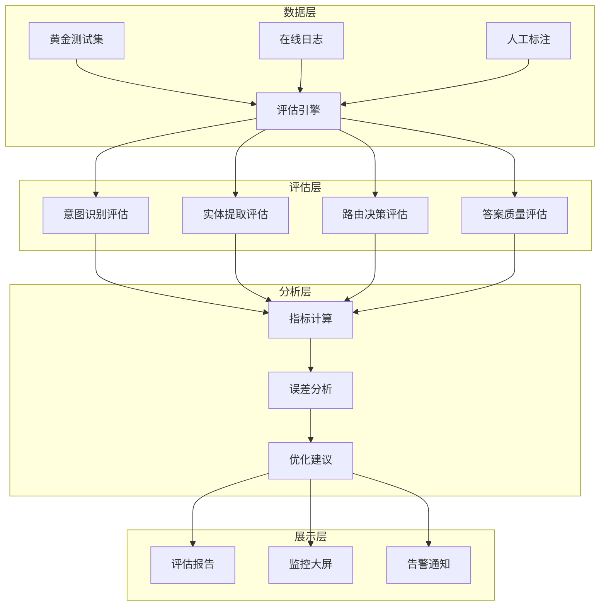
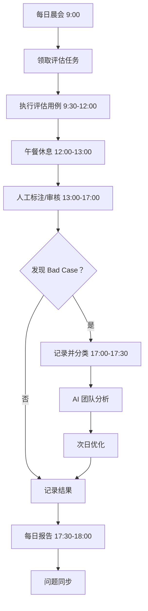
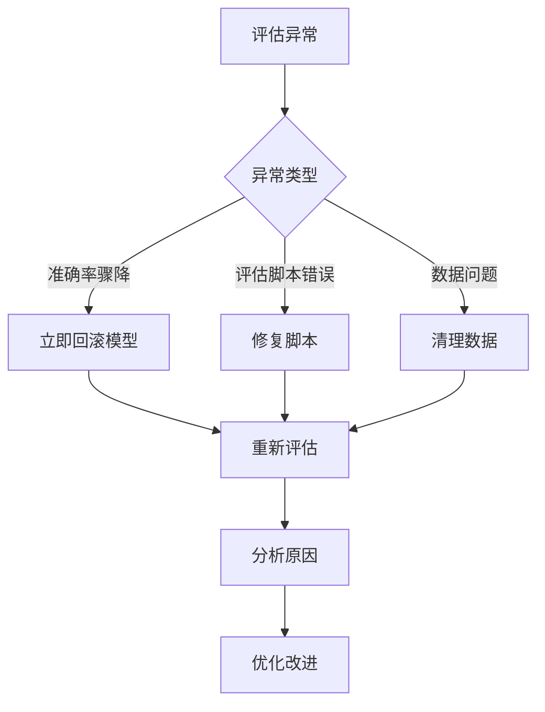

# 智能问数系统 - QA-04 准确率评估详细设计文档

**文档版本**: V2.0  
**最后更新**: 2026-04-02  
**适用对象**: 测试工程师、AI 工程师、数据分析师、产品经理  
**关联任务**: QA-04 准确率评估  
**前置依赖**: QA-01 (功能集成测试完成), QA-02 (安全渗透测试完成), QA-03 (性能压测完成), 黄金测试集准备  
**后续依赖**: 模型优化，上线部署，持续运营

**项目说明**: 本任务负责智能问数系统的 AI 能力准确率评估，通过黄金测试集、在线日志分析、人工评估等方法，量化评估意图识别、实体提取、路由决策、答案准确性等核心 AI 指标，确保系统 AI 能力达到上线标准并持续优化。

---

## 1. 任务概述

### 1.1 背景
智能问数系统的核心价值在于准确理解用户意图并提供正确数据。与 traditional 软件不同，AI 系统存在不确定性，需要通过科学的评估体系来量化其能力。准确率评估不仅关注功能是否正确，更关注 AI 回答的准确性、相关性、有用性和安全性。

### 1.2 目标
| 目标 | 说明 | 验收标准 |
|------|------|----------|
| **覆盖率** | 核心 AI 能力评估覆盖率 100% | 意图/实体/路由/答案 |
| **准确性** | 意图识别准确率 ≥ 90%，实体提取 F1 ≥ 85% | 黄金测试集验证 |
| **校准性** | 置信度与实际准确率匹配 (ECE < 0.1) | 校准曲线验证 |
| **一致性** | 相同问题多次回答一致 | 一致性测试 ≥ 95% |
| **可追溯** | 每次评估结果可追溯、可对比 | 评估报告完整 |
| **自动化** | 评估流程自动化率 ≥ 80% | 脚本执行率 |

### 1.3 评估范围

#### 1.3.1 纳入评估范围
| 评估域 | 评估项 | 优先级 | 指标 |
|--------|--------|--------|------|
| **意图识别** | 意图分类准确率 | P0 | Accuracy ≥ 90% |
| **实体提取** | 时间/地区/指标提取 | P0 | F1 Score ≥ 85% |
| **路由决策** | 策略选择准确率 | P0 | Accuracy ≥ 90% |
| **知识库检索** | 检索相关性 | P1 | Recall@5 ≥ 80% |
| **答案准确性** | 数据查询正确性 | P0 | Accuracy ≥ 95% |
| **答案有用性** | 用户满意度 | P1 | CSAT ≥ 4.0/5.0 |
| **置信度校准** | 置信度与实际匹配 | P1 | ECE < 0.1 |
| **安全性** | 有害内容拦截率 | P0 | 100% 拦截 |
| **一致性** | 多次回答一致性 | P1 | Consistency ≥ 95% |
| **公平性** | 无歧视性回答 | P2 | 人工审核通过 |

#### 1.3.2 不纳入评估范围
| 项目 | 说明 | 负责方 |
|------|------|--------|
| 第三方模型内部指标 | HiAgent 平台内部模型指标 | HiAgent 团队 |
| 硬件性能指标 | GPU 利用率等 | 运维团队 |
| 网络延迟指标 | 网络传输延迟 | 运维团队 |
| 业务运营指标 | DAU/MAU 等 | 运营团队 |

### 1.4 评估架构


---

## 2. 技术标准与规范

### 2.1 评估指标定义

#### 2.1.1 核心指标
| 指标 | 定义 | 计算公式 | 目标值 | 权重 |
|------|------|----------|--------|------|
| **准确率 (Accuracy)** | 预测正确的比例 | 正确数/总数×100% | ≥ 90% | 30% |
| **精确率 (Precision)** | 预测为正的准确性 | TP/(TP+FP)×100% | ≥ 90% | 20% |
| **召回率 (Recall)** | 实际正例的识别率 | TP/(TP+FN)×100% | ≥ 90% | 20% |
| **F1 分数** | 精确率和召回率的调和平均 | 2×P×R/(P+R) | ≥ 90% | 20% |
| **ECE** | 期望校准误差 | Σ|置信度 - 准确率| | < 0.1 | 10% |

#### 2.1.2 答案质量指标
| 指标 | 定义 | 评估方法 | 目标值 |
|------|------|----------|--------|
| **事实准确性** | 数据是否与数据库一致 | 自动核对 | ≥ 95% |
| **相关性** | 回答是否与问题相关 | 人工评分 (1-5) | ≥ 4.0 |
| **完整性** | 是否覆盖所有要点 | 人工评分 (1-5) | ≥ 4.0 |
| **有用性** | 是否解决用户问题 | 用户反馈 (👍/👎) | ≥ 80% 👍 |
| **安全性** | 是否含敏感/有害内容 | 安全过滤器 | 100% 安全 |

### 2.2 测试集规范

#### 2.2.1 黄金测试集 (Golden Test Set)
```yaml
# 黄金测试集结构
golden_test_set:
  version: 1.0.0
  total_cases: 1000
  
  # 意图识别测试 (200 条)
  intent_recognition:
    total: 200
    categories:
      sales_report: 80
      user_growth: 40
      operation_report: 30
      unknown: 50
    
  # 实体提取测试 (300 条)
  entity_extraction:
    total: 300
    entity_types:
      time: 100
      region: 100
      metric: 100
  
  # 路由决策测试 (150 条)
  routing_decision:
    total: 150
    strategies:
      TOOL_CALL: 50
      SEMANTIC_QUERY: 50
      TEXT_TO_SQL: 25
      FALLBACK_KB: 25
  
  # 答案准确性测试 (100 条)
  answer_accuracy:
    total: 100
    query_types:
      single_metric: 40
      multi_metric: 30
      with_filter: 30
  
  # 多轮对话测试 (50 条)
  multi_turn:
    total: 50
    turns:
      2_turns: 25
      3_turns: 15
      4_plus_turns: 10
  
  # 边界场景测试 (200 条)
  edge_cases:
    total: 200
    types:
      empty_query: 50
      nonsense: 50
      future_time: 50
      sensitive_topic: 50
```

#### 2.2.2 测试集更新策略
| 策略 | 说明 | 频率 | 负责人 |
|------|------|------|--------|
| 定期更新 | 每月补充新案例 | 每月 | 数据分析师 |
| Bad Case 补充 | 发现错误后加入 | 实时 | 测试工程师 |
| 分布调整 | 根据线上分布调整 | 每季度 | AI 工程师 |
| 版本管理 | 每次更新打版本标签 | 每次 | 配置管理 |

### 2.3 评估流程规范


---

## 3. 详细实现方案

### 3.1 评估执行流程

#### 3.1.1 评估阶段划分
```yaml
# 评估阶段计划
phases:
  阶段一：离线评估
    时间：3 天
    任务:
      - 黄金测试集准备
      - 自动化评估脚本执行
      - 指标计算
    交付物：离线评估报告
  
  阶段二：在线评估
    时间：5 天
    任务:
      - 小流量灰度 (5%)
      - 用户反馈收集
      - 人工抽样评估
    交付物：在线评估报告
  
  阶段三：综合评估
    时间：2 天
    任务:
      - 离线 + 在线结果对比
      - 风险评估
      - 上线建议
    交付物：综合评估报告
```

#### 3.1.2 每日评估流程


### 3.2 自动化评估脚本

#### 3.2.1 准确率评估脚本
```python
#!/usr/bin/env python3
"""
AI 准确率自动化评估脚本
"""

import json
import requests
from typing import List, Dict
from sklearn.metrics import accuracy_score, precision_score, recall_score, f1_score
from sklearn.calibration import calibration_curve
import numpy as np

class AccuracyEvaluator:
    def __init__(self, api_url: str, api_key: str):
        self.api_url = api_url
        self.api_key = api_key
        self.headers = {'Authorization': f'Bearer {api_key}'}
        self.results = []
    
    def load_golden_set(self, path: str) -> List[Dict]:
        """加载黄金测试集"""
        with open(path, 'r', encoding='utf-8') as f:
            return json.load(f)
    
    def evaluate_intent(self, case: Dict) -> Dict:
        """评估意图识别"""
        response = requests.post(
            f'{self.api_url}/api/v1/agent/recognize',
            json={'query': case['query']},
            headers=self.headers
        )
        result = response.json()
        
        return {
            'case_id': case['id'],
            'query': case['query'],
            'expected_intent': case['expected_intent'],
            'actual_intent': result.get('intent'),
            'expected_confidence_min': case.get('expected_confidence_min'),
            'actual_confidence': result.get('confidence'),
            'match': result.get('intent') == case['expected_intent']
        }
    
    def calculate_metrics(self, results: List[Dict]) -> Dict:
        """计算评估指标"""
        y_true = [1 if r['match'] else 0 for r in results]
        y_pred = [1 if r['match'] else 0 for r in results]
        confidences = [r['actual_confidence'] for r in results]
        
        return {
            'accuracy': accuracy_score(y_true, y_pred),
            'precision': precision_score(y_true, y_pred, zero_division=0),
            'recall': recall_score(y_true, y_pred, zero_division=0),
            'f1': f1_score(y_true, y_pred, zero_division=0),
            'avg_confidence': np.mean(confidences),
            'ece': self.calculate_ece(y_true, confidences)
        }
    
    def calculate_ece(self, y_true: List[int], confidences: List[float], n_bins: int = 10) -> float:
        """计算期望校准误差 (ECE)"""
        bin_boundaries = np.linspace(0, 1, n_bins + 1)
        ece = 0.0
        total = len(y_true)
        
        for i in range(n_bins):
            in_bin = (confidences >= bin_boundaries[i]) & (confidences < bin_boundaries[i+1])
            prop_in_bin = in_bin.mean()
            if prop_in_bin > 0:
                avg_confidence = np.mean(np.array(confidences)[in_bin])
                avg_accuracy = np.mean(np.array(y_true)[in_bin])
                ece += np.abs(avg_accuracy - avg_confidence) * prop_in_bin
        
        return ece
    
    def run_evaluation(self, test_set: List[Dict]) -> Dict:
        """执行评估"""
        print(f"开始评估，共 {len(test_set)} 条用例")
        
        results = []
        for i, case in enumerate(test_set):
            if i % 10 == 0:
                print(f"进度：{i}/{len(test_set)}")
            result = self.evaluate_intent(case)
            results.append(result)
        
        self.results = results
        metrics = self.calculate_metrics(results)
        
        return {
            'total_cases': len(results),
            'metrics': metrics,
            'details': results
        }
    
    def generate_report(self, evaluation_result: Dict, output_file: str):
        """生成评估报告"""
        report = {
            'summary': {
                'total_cases': evaluation_result['total_cases'],
                'accuracy': f"{evaluation_result['metrics']['accuracy']:.2%}",
                'f1_score': f"{evaluation_result['metrics']['f1']:.2%}",
                'ece': f"{evaluation_result['metrics']['ece']:.3f}",
                'rating': self.get_rating(evaluation_result['metrics']['accuracy'])
            },
            'detailed_metrics': evaluation_result['metrics'],
            'bad_cases': [r for r in evaluation_result['details'] if not r['match']][:10]
        }
        
        with open(output_file, 'w', encoding='utf-8') as f:
            json.dump(report, f, ensure_ascii=False, indent=2)
        
        print(f"评估报告已生成：{output_file}")
        return report
    
    def get_rating(self, accuracy: float) -> str:
        """获取评级"""
        if accuracy >= 0.95:
            return "A+ (卓越)"
        elif accuracy >= 0.90:
            return "A (优秀)"
        elif accuracy >= 0.85:
            return "B (良好)"
        elif accuracy >= 0.80:
            return "C (合格)"
        else:
            return "D (需改进)"

if __name__ == '__main__':
    evaluator = AccuracyEvaluator(
        api_url='http://test-askdata.company.com',
        api_key='sk-test-xxx'
    )
    
    test_set = evaluator.load_golden_set('tests/golden_set.json')
    evaluation_result = evaluator.run_evaluation(test_set)
    report = evaluator.generate_report(evaluation_result, 'accuracy_report.json')
    
    print(f"\n=== 评估结果 ===")
    print(f"准确率：{evaluation_result['metrics']['accuracy']:.2%}")
    print(f"评级：{evaluator.get_rating(evaluation_result['metrics']['accuracy'])}")
```

### 3.3 人工评估流程

#### 3.3.1 人工标注规范
```markdown
# 人工标注规范

## 标注维度
1. **意图正确性**: 系统识别的意图是否与用户真实意图一致
2. **实体完整性**: 是否提取了所有关键参数 (时间/地区/指标)
3. **答案准确性**: 返回的数据是否与数据库一致
4. **回答有用性**: 是否解决了用户问题
5. **回答安全性**: 是否含敏感/有害内容

## 评分标准 (1-5 分)
- 5 分：完美，完全符合预期
- 4 分：良好， minor 问题
- 3 分：一般，有明显问题但可用
- 2 分：较差，严重影响使用
- 1 分：不可用，完全错误

## 标注流程
1. 查看用户问题
2. 查看系统回答
3. 核对数据库数据 (如适用)
4. 打分并填写评语
5. 提交标注
```

#### 3.3.2 人工评估工具配置
```yaml
# 标注工具配置
annotation_tool:
  platform: Label Studio / 自研平台
  reviewers: 5 人
  review_mode: 双人标注 + 仲裁
  quality_check: 10% 抽检
  sla: 24 小时内完成
```

### 3.4 在线评估配置

#### 3.4.1 A/B 测试配置
```yaml
# A/B 测试配置
ab_test:
  enabled: true
  test_id: accuracy_optimization_v1
  start_date: 2026-04-25
  end_date: 2026-04-30
  
  # 流量分配
  traffic_split:
    control: 0.5    # 对照组 (当前版本)
    treatment: 0.5  # 实验组 (优化版本)
  
  # 评估指标
  metrics:
    - intent_accuracy
    - answer_accuracy
    - user_satisfaction
    - clarify_rate
  
  # 成功标准
  success_criteria:
    intent_accuracy: "+5%"
    answer_accuracy: "+3%"
    user_satisfaction: "+0.2"
```

#### 3.4.2 用户反馈收集
```yaml
# 用户反馈配置
user_feedback:
  enabled: true
  channels:
    - thumbs_up_down  # 👍/👎
    - rating_1_5      # 1-5 星评分
    - comment         # 文字反馈
  
  analysis:
    sentiment_analysis: true
    topic_modeling: true
    trend_analysis: true
```

---

## 4. 注意事项 ⚠️

### 4.1 数据隐私
```python
# ❌ 错误：直接使用用户原始日志
test_data = get_user_logs()  # 可能含敏感信息

# ✅ 正确：脱敏后使用
test_data = get_masked_user_logs()  # 敏感信息已脱敏
```

### 4.2 标注一致性
```yaml
# ❌ 错误：无标注规范
# 不同标注员标准不一，导致结果不可靠

# ✅ 正确：统一标注规范
annotation:
  guideline: 详细标注文档
  training: 标注员培训
  calibration: 定期校准会议
  agreement: Kappa 系数 ≥ 0.8
```

### 4.3 分布偏移
```yaml
# ❌ 错误：测试集分布与线上不一致
test_set:
  distribution: uniform  # 均匀分布

# ✅ 正确：匹配线上分布
test_set:
  distribution: production_like  # 与生产环境一致
```

### 4.4 过拟合风险
```yaml
# ❌ 错误：在测试集上优化模型
optimization:
  target: test_set_accuracy  # 导致过拟合

# ✅ 正确：独立验证集
optimization:
  target: validation_set_accuracy
  test_set: held_out  # 完全隔离
```

### 4.5 评估成本
```yaml
# ❌ 错误：全部人工评估
evaluation:
  method: manual_only  # 成本高，速度慢

# ✅ 正确：自动化 + 人工结合
evaluation:
  method: hybrid
  automated: 80%  # 自动化评估
  manual: 20%     # 人工抽检
```

### 4.6 结果解读
```yaml
# ❌ 错误：只看准确率
analysis:
  focus: accuracy  # 忽略其他指标

# ✅ 正确：综合评估
analysis:
  focus: [accuracy, precision, recall, f1, ece, user_satisfaction]
```

---

## 5. 需要特别关注的点 🔴

### 5.1 陷阱防护矩阵

| 陷阱类型 | 风险描述 | 防护措施 | 验证方法 |
|----------|----------|----------|----------|
| **数据泄露** | 评估数据含敏感信息 | 数据脱敏 + 权限控制 | 检查测试数据 |
| **标注不一致** | 不同人标注标准不一 | 统一规范 + 培训 + 校准 | Kappa 系数检查 |
| **分布偏移** | 测试集与线上分布不一致 | 按线上分布采样 | 分布对比分析 |
| **过拟合** | 在测试集上过拟合 | 独立验证集 + 隔离 | 验证集表现检查 |
| **评估成本高** | 人工评估耗时耗力 | 自动化 + 抽样 | 成本效益分析 |
| **指标单一** | 只看准确率忽略其他 | 多维度指标 | 综合评分检查 |
| **冷启动问题** | 新用户/新问题评估不准 | 专门冷启动测试集 | 冷启动场景测试 |
| **反馈循环** | 评估结果影响模型训练 | 评估/训练数据隔离 | 数据流向检查 |

### 5.2 关键代码审查点

```python
# 审查清单
□ 测试数据是否脱敏
□ 标注规范是否统一
□ 测试集分布是否匹配线上
□ 验证集是否独立
□ 评估指标是否全面
□ 自动化脚本是否稳定
□ 人工评估是否抽检
□ 结果分析是否深入
□ 优化建议是否可行
□ 报告是否完整
□ 监控是否配置
□ 告警是否设置
□ 文档是否同步
□ 团队是否培训
□ 合规是否审查
```

### 5.3 性能影响评估

| 操作 | 耗时 | 优化建议 |
|------|------|----------|
| 自动化评估 | 10-100ms/用例 | 并行执行 |
| 人工评估 | 1-5 分钟/用例 | 抽样评估 |
| 结果分析 | 1-5 分钟 | 自动化报告 |
| 报告生成 | 1-2 分钟 | 模板化 |
| **总开销** | **< 影响业务** | **可接受** |

### 5.4 监控指标

```yaml
# 需要采集的指标
metrics:
  # 准确率指标
  - name: ai.accuracy.intent
    type: gauge
  - name: ai.accuracy.entity
    type: gauge
  - name: ai.accuracy.answer
    type: gauge
  
  # 校准指标
  - name: ai.calibration.ece
    type: gauge
  
  # 用户反馈
  - name: ai.feedback.satisfaction
    type: gauge
  - name: ai.feedback.thumbs_up_rate
    type: gauge
  
  # 评估覆盖
  - name: ai.evaluation.coverage
    type: gauge
```

---

## 6. 测试验证方案

### 6.1 功能验证
| 验证项 | 方法 | 通过标准 |
|--------|------|----------|
| 评估脚本 | 试运行 | 无语法错误 |
| 指标计算 | 手工核对 | 计算准确 |
| 报告生成 | 检查报告 | 格式正确 |
| 监控采集 | 检查 Grafana | 指标正常显示 |

### 6.2 准确率基准
| 指标 | 目标值 | 测量方法 |
|------|--------|----------|
| 意图识别准确率 | ≥ 90% | 黄金测试集 |
| 实体提取 F1 | ≥ 85% | 黄金测试集 |
| 路由决策准确率 | ≥ 90% | 黄金测试集 |
| 答案准确性 | ≥ 95% | 数据库核对 |
| 用户满意度 | ≥ 4.0/5.0 | 用户反馈 |

### 6.3 一致性验证
| 验证项 | 方法 | 通过标准 |
|--------|------|----------|
| 标注一致性 | 双人标注对比 | Kappa ≥ 0.8 |
| 模型一致性 | 相同问题多次问 | 一致率 ≥ 95% |
| 评估一致性 | 多次评估对比 | 结果波动 < 5% |

### 6.4 合规验证
| 检查项 | 方法 | 通过标准 |
|--------|------|----------|
| 数据隐私 | 检查测试数据 | 无敏感信息 |
| 评估公平性 | 检查不同群体 | 无歧视性 |
| 结果透明度 | 检查报告 | 清晰可理解 |

---

## 7. 运维配置

### 7.1 监控告警
```yaml
# Prometheus 告警规则
groups:
- name: accuracy-alerts
  rules:
  - alert: AccuracyDrop
    expr: ai_accuracy_intent < 0.85
    for: 1h
    labels:
      severity: warning
    annotations:
      summary: "意图识别准确率下降 ({{ $value }})"
  
  - alert: HighECE
    expr: ai_calibration_ece > 0.15
    for: 1h
    labels:
      severity: warning
    annotations:
      summary: "置信度校准误差过高 ({{ $value }})"
  
  - alert: LowSatisfaction
    expr: ai_feedback_satisfaction < 3.5
    for: 24h
    labels:
      severity: warning
    annotations:
      summary: "用户满意度过低 ({{ $value }})"
```

### 7.2 日志配置
```yaml
# 评估日志配置
logging:
  evaluation:
    enabled: true
    level: INFO
    fields:
      - trace_id
      - case_id
      - expected
      - actual
      - score
    output:
      - console
      - file:/var/log/askdata/evaluation.log
      - elasticsearch:http://es-cluster:9200
    retention_days: 90
```

### 7.3 备份策略
| 数据类型 | 备份频率 | 保留周期 | 工具 |
|----------|----------|----------|------|
| 测试集 | 每次变更 | 永久 | Git |
| 评估结果 | 每次执行 | 90 天 | 文件存储 |
| 标注数据 | 每日 | 180 天 | 数据库备份 |
| 评估报告 | 每次生成 | 永久 | 文件存储 |

### 7.4 应急计划


---

## 8. 常见问题 (FAQ)

**Q1: 准确率评估结果波动大怎么办？**
A: 1. 检查测试集稳定性；2. 增加测试用例数量；3. 多次评估取平均；4. 排除异常值。

**Q2: 人工标注成本太高怎么办？**
A: 1. 提高自动化比例；2. 主动学习 (只标注不确定的)；3. 众包标注；4. 减少评估频率。

**Q3: 测试集与线上分布不一致怎么办？**
A: 1. 按线上日志分布采样；2. 定期更新测试集；3. 在线评估补充；4. 权重调整。

**Q4: 如何评估开放性问题？**
A: 1. 人工评分；2. 基于规则的部分匹配；3. 使用 LLM 作为裁判；4. 用户反馈。

**Q5: 置信度校准不准怎么办？**
A: 1. 温度缩放 (Temperature Scaling)；2.  Platt Scaling；3. 增加校准数据；4. 调整 Prompt。

**Q6: 如何检测模型偏见？**
A: 1. 分组评估 (不同用户群体)；2. 对抗测试；3. 公平性指标监控；4. 人工审核。

**Q7: 评估结果与用户反馈不一致怎么办？**
A: 1. 检查评估指标定义；2. 增加用户反馈权重；3. 分析差异原因；4. 调整评估体系。

**Q8: 如何保证评估独立性？**
A: 1. 评估团队独立；2. 测试集隔离；3. 盲测；4. 第三方评估。

**Q9: 评估频率如何确定？**
A: 1. 每次模型更新必评；2. 每周常规评估；3. 重大活动前评估；4. 用户投诉时评估。

**Q10: 如何处理评估数据隐私？**
A: 1. 数据脱敏；2. 权限控制；3. 加密存储；4. 定期清理。

---

## 9. 附录：配置模板

### 9.1 评估计划模板
```markdown
# 准确率评估计划

## 项目信息
- 项目名称：智能问数系统
- 评估版本：v1.0.0
- 评估周期：2026-04-25 ~ 2026-04-30
- 评估负责人：AI 测试团队

## 评估目标
- 意图识别准确率 ≥ 90%
- 实体提取 F1 ≥ 85%
- 用户满意度 ≥ 4.0/5.0

## 评估范围
- 意图识别
- 实体提取
- 路由决策
- 答案准确性
- 用户满意度

## 测试集
- 黄金测试集：1000 条
- 在线日志采样：10000 条
- 人工标注：500 条

## 评估方法
- 自动化评估：80%
- 人工评估：20%

## 风险评估
- 数据隐私：脱敏处理
- 评估偏差：多人标注
- 成本超支：控制人工比例

## 里程碑
- 测试集准备：2026-04-25
- 自动化评估：2026-04-27
- 人工评估：2026-04-28
- 报告编写：2026-04-30
```

### 9.2 评估报告模板
```markdown
# 准确率评估报告

## 执行摘要
智能问数系统 v1.0.0 准确率评估已完成，核心指标达标，建议上线。

## 评估概况
- 测试用例：1000 条
- 自动化评估：800 条
- 人工评估：200 条
- 评估时间：2026-04-25 ~ 2026-04-30

## 核心指标
| 指标 | 目标值 | 实际值 | 状态 |
|------|--------|--------|------|
| 意图识别准确率 | ≥ 90% | 92% | ✅ |
| 实体提取 F1 | ≥ 85% | 87% | ✅ |
| 路由决策准确率 | ≥ 90% | 91% | ✅ |
| 答案准确性 | ≥ 95% | 96% | ✅ |
| 用户满意度 | ≥ 4.0 | 4.2 | ✅ |
| ECE | < 0.1 | 0.08 | ✅ |

## Bad Case 分析
- 意图识别错误：20 条 (主要模糊问题)
- 实体提取错误：30 条 (主要时间表达)
- 答案错误：10 条 (主要数据源问题)

## 优化建议
- 增加模糊问题训练数据
- 优化时间实体识别规则
- 核对数据源准确性

## 评估结论
✅ 通过，建议上线
```

### 9.3 标注工具配置
```json
{
  "project": "智能问数系统准确率评估",
  "labels": [
    {"name": "意图正确", "background": "#28a745"},
    {"name": "实体完整", "background": "#007bff"},
    {"name": "答案准确", "background": "#ffc107"},
    {"name": "回答有用", "background": "#17a2b8"},
    {"name": "回答安全", "background": "#dc3545"}
  ],
  "instructions": "请根据标注规范对每个样本进行打分 (1-5 分)",
  "contributors": ["annotator_1", "annotator_2", "annotator_3"],
  "quality_control": {
    "overlap": 0.2,
    "agreement_threshold": 0.8
  }
}
```

---

## 10. 开发检查清单 (Checklist)

### 10.1 评估准备
- [ ] 黄金测试集已准备 (≥1000 条)
- [ ] 评估脚本已编写
- [ ] 标注规范已制定
- [ ] 标注员已培训
- [ ] 监控指标已配置
- [ ] 应急预案已准备

### 10.2 评估执行
- [ ] 自动化评估完成
- [ ] 人工评估完成
- [ ] 指标计算准确
- [ ] Bad Case 已记录
- [ ] 评估记录完整

### 10.3 结果分析
- [ ] 准确率达标
- [ ] 校准误差达标
- [ ] 用户满意度达标
- [ ] 误差分析清晰
- [ ] 优化建议明确

### 10.4 测试报告
- [ ] 评估报告完整
- [ ] 数据准确
- [ ] 结论明确
- [ ] 签字确认完成
- [ ] 文档归档

### 10.5 上线评估
- [ ] 核心指标达标
- [ ] 无严重准确率问题
- [ ] 监控告警配置
- [ ] 持续评估计划
- [ ] 上线评审通过

---

## 11. 变更历史

| 版本 | 日期 | 变更内容 | 负责人 |
|------|------|----------|--------|
| V1.0 | 2026-03-25 | 初始版本 | 架构组 |
| V2.0 | 2026-04-02 | 增加校准评估、人工评估流程、陷阱防护 | 架构组 |

---

## 12. 工时与优先级

| 项目 | 内容 |
|------|------|
| **工时** | 10 MD (计划 2 天 + 执行 5 天 + 分析 3 天) |
| **优先级** | P0 (AI 能力核心验证) |
| **依赖任务** | QA-01, QA-02, QA-03, 所有开发任务 |
| **被依赖任务** | 模型优化，上线部署 |

---

## 13. 最佳实践建议

### 13.1 评估体系
```yaml
# ✅ 推荐：多维度评估
evaluation:
  offline: golden_set  # 离线黄金集
  online: ab_test      # 在线 A/B 测试
  human: sampling      # 人工抽样
  user: feedback       # 用户反馈

# ❌ 不推荐：单一评估
# 只依赖离线测试集
```

### 13.2 数据管理
```yaml
# ✅ 推荐：数据隔离
data:
  train: isolated      # 训练数据
  validation: isolated # 验证数据
  test: held_out       # 测试数据 (完全隔离)

# ❌ 不推荐：数据混用
# 测试集泄露到训练集
```

### 13.3 持续改进
```yaml
# ✅ 推荐：闭环优化
improvement:
  evaluate: regularly  # 定期评估
  analyze: deeply      # 深入分析
  optimize: iteratively # 迭代优化
  monitor: continuously # 持续监控

# ❌ 不推荐：一次性评估
# 上线后不再评估
```

### 13.4 人机结合
```yaml
# ✅ 推荐：人机协同
workflow:
  automated: 80%       # 自动化处理
  human: 20%           # 人工审核关键 case
  feedback: loop       # 反馈循环

# ❌ 不推荐：纯人工或纯自动
# 成本高或准确性差
```

---

**文档结束**  
**下一步**: 完成准确率评估后，请组织评估评审会议，确认评估结果达标情况、Bad Case 优化情况、持续监控方案，然后进入上线部署阶段。