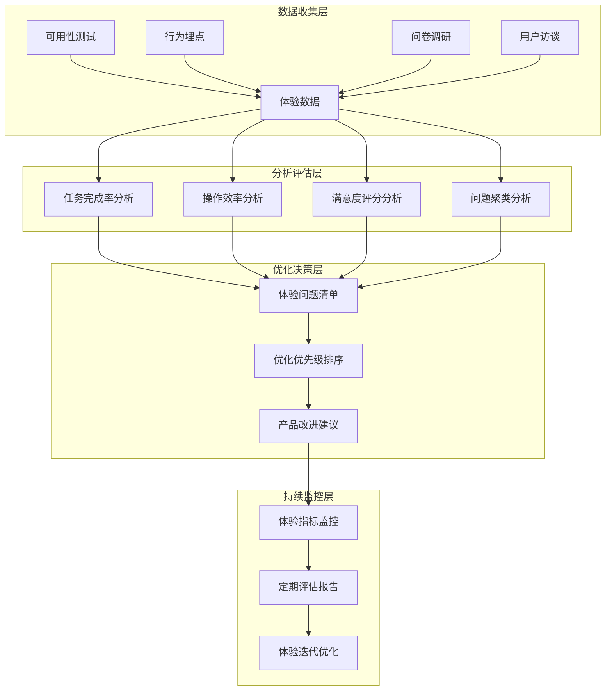
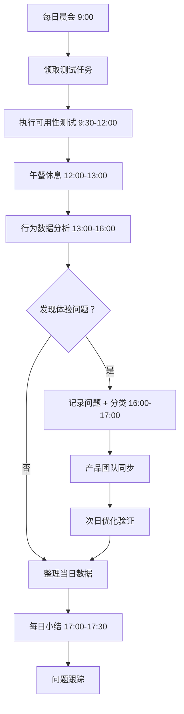
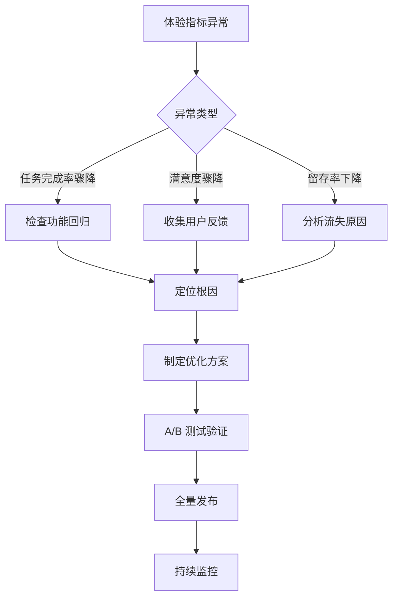

# 智能问数系统 - QA-05 用户体验测试详细设计文档

**文档版本**: V2.0  
**最后更新**: 2026-04-02  
**适用对象**: 用户体验研究员、测试工程师、产品经理、前端开发  
**关联任务**: QA-05 用户体验测试  
**前置依赖**: QA-01 (功能集成测试完成), QA-04 (准确率评估完成), 测试环境就绪  
**后续依赖**: 体验优化，上线部署，用户反馈运营

**项目说明**: 本任务负责智能问数系统的用户体验测试，通过可用性测试、满意度调研、行为分析等方法，评估系统易用性、交互流畅度、视觉设计、响应感知等体验维度，确保产品满足用户期望并持续优化。

---

## 1. 任务概述

### 1.1 背景
智能问数系统面向业务人员、数据分析师、管理者等多类用户，用户体验直接影响产品采纳度和使用效率。与功能测试不同，用户体验测试关注用户的主观感受和行为表现，包括：
- **易用性**: 用户能否快速上手、高效完成任务
- **交互流畅度**: 操作是否自然、反馈是否及时
- **视觉设计**: 界面是否美观、信息是否清晰
- **响应感知**: 等待是否可接受、加载是否友好
- **满意度**: 用户是否愿意继续使用、推荐给他人

### 1.2 目标
| 目标 | 说明 | 验收标准 |
|------|------|----------|
| **任务完成率** | 核心任务完成率 ≥ 90% | 可用性测试验证 |
| **操作效率** | 平均任务耗时 ≤ 目标值 120% | 行为数据分析 |
| **满意度评分** | SUS ≥ 75, CSAT ≥ 4.0/5.0 | 问卷调研验证 |
| **学习成本** | 新用户 3 分钟内完成首次查询 | 新手引导测试 |
| **错误恢复** | 用户能自主解决 80% 的常见错误 | 错误场景测试 |
| **可访问性** | 符合 WCAG 2.1 AA 标准 | 无障碍测试验证 |

### 1.3 测试范围

#### 1.3.1 纳入测试范围
| 体验维度 | 测试项 | 优先级 | 方法 | 样本量 |
|----------|--------|--------|------|--------|
| **任务完成** | 查询数据、导出报表、反馈评价 | P0 | 可用性测试 | 15 人 |
| **交互流程** | 多轮对话、澄清交互、推荐点击 | P0 | 行为分析 | 全量 |
| **视觉设计** | 布局、色彩、字体、图标 | P1 | 专家评审 | 3 人 |
| **响应感知** | 加载动画、进度提示、超时处理 | P0 | 用户调研 | 30 人 |
| **新手引导** | 首次使用引导、帮助文档 | P1 | A/B 测试 | 200 人 |
| **错误处理** | 错误提示、恢复引导、客服入口 | P1 | 场景测试 | 10 人 |
| **可访问性** | 键盘导航、屏幕阅读器、色盲友好 | P2 | 无障碍测试 | 5 人 |
| **情感体验** | 语气友好、个性化、惊喜感 | P2 | 深度访谈 | 8 人 |

#### 1.3.2 不纳入测试范围
| 项目 | 说明 | 负责方 |
|------|------|--------|
| 后端性能指标 | 服务器响应时间等 | 性能测试团队 |
| 安全合规检查 | 权限、加密等 | 安全测试团队 |
| 业务逻辑正确性 | 数据计算准确性 | 功能测试团队 |
| 第三方系统体验 | HiAgent 平台内部体验 | HiAgent 团队 |

### 1.4 用户体验测试框架


---

## 2. 技术标准与规范

### 2.1 体验指标定义

#### 2.1.1 核心体验指标 (HEART 框架)
| 指标 | 定义 | 计算公式 | 目标值 | 测量方法 |
|------|------|----------|--------|----------|
| **愉悦度 (Happiness)** | 用户主观满意度 | CSAT/NPS 评分 | CSAT ≥ 4.0, NPS ≥ 30 | 问卷调研 |
| **参与度 (Engagement)** | 用户使用频率和深度 | DAU/MAU, 会话时长 | DAU/MAU ≥ 30% | 行为分析 |
| **采纳率 (Adoption)** | 新用户首次使用比例 | 新用户完成首查比例 | ≥ 80% | 漏斗分析 |
| **留存率 (Retention)** | 用户持续使用比例 | 7 日留存率 | ≥ 50% | 留存分析 |
| **任务成功率 (Task Success)** | 用户完成任务的比例 | 成功数/尝试数×100% | ≥ 90% | 可用性测试 |

#### 2.1.2 可用性指标 (SUS + 自定义)
| 指标 | 定义 | 评分标准 | 目标值 |
|------|------|----------|--------|
| **系统可用性量表 (SUS)** | 10 项标准化问卷 | 0-100 分 | ≥ 75 (良好) |
| **任务完成时间** | 完成核心任务的平均耗时 | 秒 | ≤ 目标值 120% |
| **错误率** | 用户操作出错的比例 | 错误次数/总操作×100% | ≤ 5% |
| **学习曲线** | 新用户达到熟练的时间 | 分钟 | ≤ 3 分钟 |
| **主观满意度** | 用户对易用性的评分 | 1-5 分 | ≥ 4.0 |

#### 2.1.3 交互体验指标
| 指标 | 定义 | 测量方法 | 目标值 |
|------|------|----------|--------|
| **点击准确率** | 用户点击目标元素的准确率 | 正确点击/总点击×100% | ≥ 95% |
| **操作路径长度** | 完成任务的平均步骤数 | 步骤计数 | ≤ 最优路径 150% |
| **反馈及时性** | 操作后系统反馈的延迟 | 毫秒 | ≤ 200ms |
| **认知负荷** | 用户理解界面的难度 | 主观评分 (1-5) | ≤ 2.0 |
| **情感倾向** | 用户表达的情感正负向 | 情感分析 | 正向 ≥ 80% |

### 2.2 测试方法规范

#### 2.2.1 可用性测试流程
```yaml
# 可用性测试标准流程
usability_test:
  # 准备阶段
  preparation:
    - 定义测试目标
    - 招募测试用户 (5-8 人/轮)
    - 编写测试脚本 (任务清单)
    - 准备测试环境 (录屏 + 观察)
  
  # 执行阶段
  execution:
    - 用户签署知情同意书
    - 简要介绍测试流程
    - 用户执行任务 (思考出声法)
    - 观察员记录问题和行为
    - 测试后访谈收集反馈
  
  # 分析阶段
  analysis:
    - 整理观察记录
    - 计算任务完成率/时间/错误率
    - 聚类问题类型和严重程度
    - 生成改进建议清单
  
  # 报告阶段
  reporting:
    - 编写测试报告
    - 优先级排序问题
    - 产品团队评审
    - 跟踪改进进度
```

#### 2.2.2 问卷调研规范
```yaml
# 问卷设计规范
survey:
  # 问卷类型
  types:
    - CSAT: 满意度评分 (1-5 分)
    - NPS: 净推荐值 (0-10 分)
    - SUS: 系统可用性量表 (10 题)
    - 自定义: 产品特定问题
  
  # 投放时机
  timing:
    - 任务完成后: 即时反馈
    - 会话结束后: 整体评价
    - 定期推送: 长期追踪
  
  # 样本要求
  sampling:
    - 新用户: ≥ 30%
    - 老用户: ≥ 50%
    - 不同角色: 均衡分布
    - 最小样本: 100 份/轮
  
  # 质量控制
  quality:
    - 答题时间过滤: < 30 秒剔除
    - 逻辑校验: 矛盾答案剔除
    - 开放题审核: 无效内容剔除
```

#### 2.2.3 行为分析规范
```yaml
# 行为埋点规范
behavior_tracking:
  # 关键事件
  events:
    - page_view: 页面浏览
    - button_click: 按钮点击
    - input_enter: 输入提交
    - error_occurred: 错误发生
    - task_completed: 任务完成
  
  # 事件属性
  properties:
    - user_id: 用户标识 (匿名化)
    - session_id: 会话标识
    - trace_id: 链路追踪
    - timestamp: 时间戳
    - context: 上下文信息
  
  # 隐私保护
  privacy:
    - 数据脱敏: 移除个人信息
    - 匿名处理: 用户标识哈希
    - 权限控制: 仅授权人员可查
    - 留存期限: 90 天后自动删除
```

### 2.3 测试环境配置

#### 2.3.1 用户体验测试环境
| 环境 | 用途 | 配置要求 | 访问地址 |
|------|------|----------|----------|
| 可用性测试环境 | 一对一用户测试 | 独立网络，录屏设备 | http://ux-test.company.com |
| A/B 测试环境 | 方案对比测试 | 流量分流，指标监控 | http://ab-test.company.com |
| 问卷投放环境 | 用户调研收集 | 与生产环境一致 | 生产环境 + 问卷插件 |
| 行为分析环境 | 用户行为追踪 | 埋点采集，数据分析 | 内部分析平台 |

#### 2.3.2 测试工具清单
| 工具 | 用途 | 版本 | 许可证 |
|------|------|------|--------|
| Lookback / UserTesting | 远程可用性测试 | 最新 | 商业 |
| Hotjar / FullStory | 行为录屏 + 热力图 | 最新 | 商业 |
| Google Forms / 问卷星 | 问卷调研 | - | 免费/商业 |
| Google Analytics / 神策 | 行为数据分析 | 最新 | 免费/商业 |
| Figma / Axure | 原型设计 + 用户测试 | 最新 | 商业 |
| WCAG Validator | 无障碍合规检查 | 最新 | 开源 |

---

## 3. 详细实现方案

### 3.1 测试执行流程

#### 3.1.1 测试阶段划分
```yaml
# 用户体验测试阶段计划
phases:
  阶段一：探索性测试
    时间：2 天
    任务:
      - 专家评审 (启发式评估)
      - 认知走查 (任务流程)
      - 竞品对比分析
    交付物：体验问题清单
  
  阶段二：可用性测试
    时间：5 天
    任务:
      - 招募测试用户 (15 人)
      - 执行测试任务 (3 轮×5 人)
      - 收集行为数据 + 访谈反馈
    交付物：可用性测试报告
  
  阶段三：问卷调研
    时间：3 天
    任务:
      - 设计并投放问卷 (目标 300 份)
      - 收集并清洗数据
      - 分析满意度指标
    交付物：满意度调研报告
  
  阶段四：综合评估
    时间：2 天
    任务:
      - 整合多维度数据
      - 计算核心体验指标
      - 生成优化建议
    交付物：用户体验评估报告
```

#### 3.1.2 每日测试流程


### 3.2 核心测试场景

#### 3.2.1 任务完成测试 (可用性测试)
| 用例 ID | 测试任务 | 目标用户 | 成功标准 | 状态 |
|---------|----------|----------|----------|------|
| UX-TC-001 | 查询"华东区上月销售额" | 业务人员 | 3 分钟内完成，结果正确 | 待执行 |
| UX-TC-002 | 导出查询结果为 Excel | 数据分析师 | 2 分钟内完成，文件可打开 | 待执行 |
| UX-TC-003 | 多轮对话补充查询条件 | 管理者 | 澄清交互顺畅，最终结果准确 | 待执行 |
| UX-TC-004 | 对回答点赞/点踩并填写原因 | 所有用户 | 反馈流程简单，提交成功 | 待执行 |
| UX-TC-005 | 查看历史查询记录 | 老用户 | 1 分钟内找到目标记录 | 待执行 |
| UX-TC-006 | 使用推荐问题发起新查询 | 新用户 | 推荐问题清晰，点击后直接执行 | 待执行 |
| UX-TC-007 | 遇到错误时寻求帮助 | 所有用户 | 错误提示清晰，能找到解决路径 | 待执行 |
| UX-TC-008 | 调整查询条件重新执行 | 业务人员 | 修改条件方便，结果即时更新 | 待执行 |
| UX-TC-009 | 首次使用完成引导流程 | 新用户 | 3 分钟内理解系统，完成首查 | 待执行 |
| UX-TC-010 | 在不同设备上使用系统 | 移动用户 | 响应式布局正常，操作无障碍 | 待执行 |

#### 3.2.2 交互流畅度测试
| 测试项 | 测量指标 | 目标值 | 测量方法 | 状态 |
|--------|----------|--------|----------|------|
| 输入响应 | 输入后建议显示延迟 | ≤ 200ms | 性能监控 + 用户感知 | 待执行 |
| 加载感知 | 查询结果加载等待体验 | ≤ 3s 有进度提示 | 用户调研 + 埋点 | 待执行 |
| 操作反馈 | 点击按钮后的视觉/触觉反馈 | 即时反馈 | 可用性测试 | 待执行 |
| 状态同步 | 多端操作状态一致性 | 无冲突，实时同步 | 场景测试 | 待执行 |
| 错误恢复 | 操作出错后的恢复路径 | ≤ 2 步回到正轨 | 任务测试 | 待执行 |

#### 3.2.3 视觉设计评估
| 评估维度 | 评估要点 | 评分标准 (1-5) | 目标分 | 状态 |
|----------|----------|----------------|--------|------|
| 布局合理性 | 信息层级清晰，重点突出 | 5=非常清晰 | ≥ 4.0 | 待执行 |
| 色彩搭配 | 主色/辅助色协调，符合品牌 | 5=非常协调 | ≥ 4.0 | 待执行 |
| 字体可读性 | 字号/行距/对比度适宜 | 5=非常容易阅读 | ≥ 4.0 | 待执行 |
| 图标表意 | 图标含义明确，与文字一致 | 5=非常明确 | ≥ 4.0 | 待执行 |
| 一致性 | 相同元素样式统一 | 5=非常一致 | ≥ 4.0 | 待执行 |

#### 3.2.4 新手引导测试
| 测试项 | 测试方法 | 成功标准 | 状态 |
|--------|----------|----------|------|
| 引导可见性 | 首次进入是否明显提示 | 100% 用户注意到引导 | 待执行 |
| 引导内容 | 引导文案是否简洁易懂 | 90% 用户理解引导意图 | 待执行 |
| 引导流程 | 引导步骤是否过多/过少 | 3-5 步完成，无跳过障碍 | 待执行 |
| 引导效果 | 引导后用户能否独立操作 | 80% 用户 3 分钟内完成首查 | 待执行 |
| 引导关闭 | 用户能否随时关闭引导 | 关闭操作明显，无强制 | 待执行 |

### 3.3 自动化体验监控

#### 3.3.1 行为埋点配置
```yaml
# 关键行为埋点配置
tracking:
  # 页面浏览
  page_view:
    event: page_view
    properties:
      - page_name: 页面名称
      - page_url: 页面 URL
      - referrer: 来源页面
      - user_role: 用户角色 (匿名)
  
  # 核心操作
  core_actions:
    - event: query_submit
      properties: [query_text, trace_id, latency]
    - event: clarify_select
      properties: [option_selected, turn_count]
    - event: feedback_submit
      properties: [rating, reason, trace_id]
    - event: export_download
      properties: [format, data_size]
  
  # 错误事件
  error_events:
    - event: api_error
      properties: [error_code, error_msg, trace_id]
    - event: validation_error
      properties: [field, reason]
    - event: timeout_error
      properties: [operation, wait_time]
  
  # 体验指标
  experience_metrics:
    - event: task_start
      properties: [task_id, user_segment]
    - event: task_complete
      properties: [task_id, duration, success]
    - event: task_abandon
      properties: [task_id, step, reason]
```

#### 3.3.2 体验指标计算脚本
```python
#!/usr/bin/env python3
"""
用户体验指标自动化计算脚本
"""

import pandas as pd
import numpy as np
from datetime import datetime, timedelta
from typing import Dict, List

class ExperienceMetricsCalculator:
    def __init__(self, data_source: str):
        self.data_source = data_source
    
    def calculate_task_success_rate(self, start_date: str, end_date: str) -> Dict:
        """计算任务完成率"""
        # 从数据源查询任务开始和完成事件
        df = self._query_events(
            events=['task_start', 'task_complete', 'task_abandon'],
            start_date=start_date,
            end_date=end_date
        )
        
        # 按任务分组计算
        task_stats = df.groupby('task_id').agg({
            'event': lambda x: 'completed' if 'task_complete' in x.values else 
                             'abandoned' if 'task_abandon' in x.values else 'ongoing',
            'duration': 'mean' if 'duration' in df.columns else lambda x: None
        }).reset_index()
        
        completed = len(task_stats[task_stats['event'] == 'completed'])
        total = len(task_stats[task_stats['event'] != 'ongoing'])
        
        return {
            'task_success_rate': completed / total if total > 0 else 0,
            'avg_completion_time': task_stats['duration'].mean(),
            'total_tasks': total,
            'completed_tasks': completed
        }
    
    def calculate_sus_score(self, survey_responses: List[Dict]) -> Dict:
        """计算系统可用性量表 (SUS) 分数"""
        # SUS 10 题，奇数题正向计分，偶数题反向计分
        scores = []
        for response in survey_responses:
            score = 0
            for i in range(1, 11):
                answer = response.get(f'q{i}')
                if answer is None:
                    continue
                if i % 2 == 1:  # 奇数题：5-答案
                    score += 5 - answer
                else:  # 偶数题：答案 -1
                    score += answer - 1
            scores.append(score * 2.5)  # 转换为 0-100 分
        
        return {
            'sus_score': np.mean(scores) if scores else 0,
            'sus_std': np.std(scores) if len(scores) > 1 else 0,
            'sample_size': len(scores),
            'rating': self._sus_rating(np.mean(scores) if scores else 0)
        }
    
    def calculate_nps(self, survey_responses: List[Dict]) -> Dict:
        """计算净推荐值 (NPS)"""
        ratings = [r.get('nps_rating') for r in survey_responses if r.get('nps_rating') is not None]
        
        promoters = sum(1 for r in ratings if r >= 9)
        detractors = sum(1 for r in ratings if r <= 6)
        total = len(ratings)
        
        nps = ((promoters - detractors) / total * 100) if total > 0 else 0
        
        return {
            'nps_score': nps,
            'promoters_pct': promoters / total * 100 if total > 0 else 0,
            'detractors_pct': detractors / total * 100 if total > 0 else 0,
            'sample_size': total
        }
    
    def _sus_rating(self, score: float) -> str:
        """SUS 分数评级"""
        if score >= 85:
            return "A+ (最佳)"
        elif score >= 80:
            return "A (优秀)"
        elif score >= 70:
            return "B (良好)"
        elif score >= 60:
            return "C (一般)"
        else:
            return "D (需改进)"
    
    def generate_experience_report(self, date_range: tuple) -> Dict:
        """生成体验报告"""
        start_date, end_date = date_range
        
        report = {
            'period': f"{start_date} ~ {end_date}",
            'generated_at': datetime.now().isoformat(),
            'metrics': {
                'task_success': self.calculate_task_success_rate(start_date, end_date),
                # 其他指标计算...
            },
            'insights': [],
            'recommendations': []
        }
        
        return report

if __name__ == '__main__':
    calculator = ExperienceMetricsCalculator('prod_analytics_db')
    report = calculator.generate_experience_report(('2026-04-01', '2026-04-07'))
    print(f"体验报告生成完成: {report['metrics']['task_success']['task_success_rate']:.2%}")
```

### 3.4 用户反馈收集配置

#### 3.4.1 满意度问卷模板
```markdown
# 智能问数系统用户体验调研

## 基本信息
1. 您的角色是？
   ○ 业务人员  ○ 数据分析师  ○ 管理者  ○ 其他

2. 您使用本系统的频率？
   ○ 每天  ○ 每周  ○ 每月  ○ 首次使用

## 满意度评分 (1-5 分，5=非常满意)
3. 整体使用体验满意度：⭐⭐⭐⭐⭐
4. 查询结果准确性满意度：⭐⭐⭐⭐⭐
5. 操作流畅度满意度：⭐⭐⭐⭐⭐
6. 界面美观度满意度：⭐⭐⭐⭐⭐
7. 帮助文档易用性满意度：⭐⭐⭐⭐⭐

## 系统可用性量表 (SUS)
8. 我认为我会经常使用这个系统 (1-5)
9. 我觉得这个系统太复杂了 (1-5, 反向计分)
10. 我觉得这个系统很容易使用 (1-5)
... (共 10 题)

## 净推荐值 (NPS)
18. 您有多大可能向同事推荐这个系统？(0-10 分)

## 开放反馈
19. 您最喜欢系统的哪个功能？为什么？
20. 您认为系统最需要改进的地方是什么？
21. 其他建议或意见：

感谢您的反馈！
```

#### 3.4.2 反馈分析流程
```yaml
# 用户反馈分析流程
feedback_analysis:
  # 数据收集
  collection:
    - channels: [in_app_survey, email, support_ticket, social_media]
    - frequency: real_time + weekly_summary
  
  # 数据处理
  processing:
    - deduplication: 去除重复反馈
    - sentiment_analysis: 情感正负向分析
    - topic_modeling: 问题主题聚类
    - priority_scoring: 严重程度评分
  
  # 洞察提取
  insights:
    - pain_points: 用户痛点汇总
    - delight_factors: 惊喜点汇总
    - trend_analysis: 满意度变化趋势
    - segment_comparison: 不同用户群体对比
  
  # 行动建议
  actions:
    - quick_wins: 快速优化项 (1 周内)
    - medium_term: 中期改进项 (1 月内)
    - long_term: 长期规划项 (季度)
    - monitor: 持续监控项
```

---

## 4. 注意事项 ⚠️

### 4.1 用户隐私保护
```python
# ❌ 错误：收集用户个人信息
tracking:
  user_data:
    - real_name: true  # 收集真实姓名
    - phone: true      # 收集手机号

# ✅ 正确：匿名化处理
tracking:
  user_data:
    - user_id: hashed  # 用户标识哈希
    - role: anonymized # 角色脱敏
    - behavior: aggregated # 行为聚合统计
```

### 4.2 测试偏差控制
```yaml
# ❌ 错误：样本选择偏差
sampling:
  method: convenience  # 只选方便联系的用户

# ✅ 正确：分层抽样
sampling:
  method: stratified
  strata:
    - new_user: 30%
    - active_user: 50%
    - power_user: 20%
  min_sample: 100
```

### 4.3 主观评价标准化
```yaml
# ❌ 错误：模糊评分标准
rating:
  question: "您觉得好用吗？"  # 主观，难量化

# ✅ 正确：具体行为锚定
rating:
  question: "您能在 3 分钟内完成'查询华东区上月销售额'吗？"
  options:
    - "1 分钟内完成"
    - "1-3 分钟完成"
    - "3-5 分钟完成"
    - "超过 5 分钟"
    - "未能完成"
```

### 4.4 测试环境真实性
```yaml
# ❌ 错误：测试环境与生产差异大
environment:
  data_volume: 100  # 仅 100 条测试数据
  network: local    # 本地网络，无延迟

# ✅ 正确：模拟生产环境
environment:
  data_volume: 1000000  # 百万级数据
  network: simulated_latency  # 模拟真实网络延迟
  device_diversity: [desktop, mobile, tablet]  # 多设备测试
```

### 4.5 结果解读客观性
```yaml
# ❌ 错误：只看正面反馈
analysis:
  focus: positive_feedback  # 只关注好评

# ✅ 正确：平衡分析
analysis:
  focus: [positive, negative, neutral]
  weight:
    critical_issues: 3x
    minor_issues: 1x
    suggestions: 0.5x
```

### 4.6 持续改进闭环
```yaml
# ❌ 错误：测试完就结束
workflow:
  - test
  - report
  # 缺少改进和验证

# ✅ 正确：闭环管理
workflow:
  - test
  - analyze
  - prioritize
  - implement
  - verify
  - monitor
```

---

## 5. 需要特别关注的点 🔴

### 5.1 陷阱防护矩阵

| 陷阱类型 | 风险描述 | 防护措施 | 验证方法 |
|----------|----------|----------|----------|
| **霍桑效应** | 用户知道被观察而改变行为 | 自然场景测试 + 隐蔽观察 | 对比有无观察的行为差异 |
| **样本偏差** | 测试用户不能代表全体 | 分层抽样 + 多样本 | 样本分布与用户画像对比 |
| **主观偏差** | 评估者个人偏好影响结果 | 多人评估 + 标准化量表 | 评估者间一致性检验 |
| **测试疲劳** | 用户测试时间过长导致敷衍 | 控制测试时长 + 分阶段 | 监控答题时间 + 开放题质量 |
| **数据隐私** | 收集用户敏感信息 | 匿名化 + 权限控制 + 脱敏 | 隐私合规审查 |
| **结果误读** | 将相关性当因果性 | 多方法验证 + 专家解读 | 交叉验证分析结果 |
| **优化短视** | 只解决表面问题 | 根因分析 + 用户旅程映射 | 问题聚类 + 影响评估 |
| **体验孤岛** | 只优化单点忽略整体 | 全链路体验地图 | 端到端任务测试 |

### 5.2 关键代码审查点

```python
# 审查清单
□ 用户数据是否匿名化处理
□ 抽样方法是否科学 (分层/随机)
□ 问卷问题是否无引导性
□ 评分标准是否客观可量化
□ 测试环境是否接近生产
□ 样本量是否满足统计要求
□ 多评估者一致性是否检验
□ 结果分析是否多维度交叉
□ 问题优先级是否基于影响评估
□ 改进建议是否可执行可验证
□ 监控指标是否持续追踪
□ 反馈闭环是否建立
□ 文档是否完整可追溯
□ 团队是否培训统一标准
□ 合规审查是否通过
```

### 5.3 性能影响评估

| 操作 | 耗时 | 优化建议 |
|------|------|----------|
| 行为埋点采集 | < 10ms/事件 | 异步上报 + 批量发送 |
| 问卷投放 | 无感知 | 非阻塞弹窗 + 智能时机 |
| 数据分析 | 1-5 分钟/指标 | 预计算 + 缓存 |
| 报告生成 | 1-2 分钟 | 模板化 + 自动化 |
| **总开销** | **< 影响用户体验** | **可接受** |

### 5.4 监控指标

```yaml
# 需要采集的体验指标
metrics:
  # 任务指标
  - name: ux.task.success_rate
    type: gauge
  - name: ux.task.avg_duration
    type: gauge
  
  # 满意度指标
  - name: ux.satisfaction.csat
    type: gauge
  - name: ux.satisfaction.nps
    type: gauge
  - name: ux.satisfaction.sus
    type: gauge
  
  # 行为指标
  - name: ux.behavior.click_accuracy
    type: gauge
  - name: ux.behavior.error_rate
    type: gauge
  - name: ux.behavior.abandon_rate
    type: gauge
  
  # 留存指标
  - name: ux.retention.d1
    type: gauge
  - name: ux.retention.d7
    type: gauge
  - name: ux.retention.d30
    type: gauge
```

---

## 6. 测试验证方案

### 6.1 功能验证
| 验证项 | 方法 | 通过标准 |
|--------|------|----------|
| 埋点采集 | 检查数据上报 | 关键事件 100% 采集 |
| 问卷投放 | 检查展示逻辑 | 触发条件准确，无重复 |
| 指标计算 | 手工核对 | 计算逻辑正确 |
| 报告生成 | 检查报告内容 | 数据准确，格式规范 |

### 6.2 体验基准
| 指标 | 目标值 | 测量方法 |
|------|--------|----------|
| 任务完成率 | ≥ 90% | 可用性测试 |
| 平均任务耗时 | ≤ 目标值 120% | 行为分析 |
| SUS 评分 | ≥ 75 | 问卷调研 |
| CSAT 评分 | ≥ 4.0/5.0 | 问卷调研 |
| NPS 评分 | ≥ 30 | 问卷调研 |
| 7 日留存率 | ≥ 50% | 行为分析 |

### 6.3 一致性验证
| 验证项 | 方法 | 通过标准 |
|--------|------|----------|
| 评估者一致性 | 多人评估同一任务 | Kappa ≥ 0.8 |
| 时间一致性 | 不同时段测试结果 | 波动 < 10% |
| 样本一致性 | 不同用户群体结果 | 差异可解释 |

### 6.4 合规验证
| 检查项 | 方法 | 通过标准 |
|--------|------|----------|
| 用户知情同意 | 检查同意流程 | 100% 用户签署 |
| 数据匿名化 | 检查存储数据 | 无个人可识别信息 |
| 数据留存期限 | 检查清理策略 | 90 天后自动删除 |
| 无障碍合规 | WCAG 2.1 AA 检查 | 无阻断性问题 |

---

## 7. 运维配置

### 7.1 监控告警
```yaml
# Prometheus 告警规则
groups:
- name: experience-alerts
  rules:
  - alert: TaskSuccessRateDrop
    expr: ux_task_success_rate < 0.85
    for: 1h
    labels:
      severity: warning
    annotations:
      summary: "任务完成率下降 ({{ $value }})"
  
  - alert: LowCSAT
    expr: ux_satisfaction_csat < 3.5
    for: 24h
    labels:
      severity: warning
    annotations:
      summary: "用户满意度偏低 ({{ $value }})"
  
  - alert: HighAbandonRate
    expr: ux_behavior_abandon_rate > 0.15
    for: 1h
    labels:
      severity: warning
    annotations:
      summary: "任务放弃率偏高 ({{ $value }})"
  
  - alert: LowRetention
    expr: ux_retention_d7 < 0.4
    for: 7d
    labels:
      severity: warning
    annotations:
      summary: "7 日留存率偏低 ({{ $value }})"
```

### 7.2 日志配置
```yaml
# 体验日志配置
logging:
  experience:
    enabled: true
    level: INFO
    fields:
      - user_id_anonymous
      - session_id
      - event_type
      - task_id
      - duration_ms
      - success
      - feedback_score
    output:
      - console
      - file:/var/log/askdata/experience.log
      - elasticsearch:http://es-cluster:9200
    retention_days: 90
```

### 7.3 备份策略
| 数据类型 | 备份频率 | 保留周期 | 工具 |
|----------|----------|----------|------|
| 测试脚本 | 每次变更 | 永久 | Git |
| 问卷数据 | 每日 | 180 天 | 数据库备份 |
| 行为数据 | 实时 | 90 天 | 数据湖 |
| 体验报告 | 每次生成 | 永久 | 文件存储 |

### 7.4 应急计划


---

## 8. 常见问题 (FAQ)

**Q1: 用户测试时表现与真实使用不一致怎么办？**
A: 1. 采用自然场景测试 (非实验室)；2. 结合行为数据分析；3. 长期追踪验证；4. 多方法交叉验证。

**Q2: 问卷回收率低怎么办？**
A: 1. 优化投放时机 (任务完成后)；2. 简化问卷长度；3. 提供小激励；4. 多渠道投放。

**Q3: 不同用户群体评价差异大怎么办？**
A: 1. 分层分析不同群体；2. 识别核心用户群体；3. 针对性优化；4. 平衡不同需求。

**Q4: 主观评分难以量化对比怎么办？**
A: 1. 使用标准化量表 (SUS/NPS)；2. 结合行为数据；3. 设置基线对比；4. 趋势分析替代绝对值。

**Q5: 如何平衡短期体验和长期价值？**
A: 1. 定义体验北极星指标；2. 短期优化不损害长期价值；3. A/B 测试验证长期影响；4. 用户生命周期视角。

**Q6: 如何处理负面反馈？**
A: 1. 分类整理 (功能/交互/内容)；2. 评估影响范围；3. 优先级排序；4. 闭环反馈用户。

**Q7: 如何评估微交互的体验价值？**
A: 1. A/B 测试对比；2. 行为指标变化；3. 用户访谈反馈；4. 成本效益分析。

**Q8: 如何保证评估的客观性？**
A: 1. 多人独立评估；2. 标准化评估量表；3. 盲测 (评估者不知方案)；4. 数据驱动决策。

**Q9: 体验优化如何与功能开发协同？**
A: 1. 体验需求纳入产品待办；2. 体验指标作为验收标准；3. 定期体验评审；4. 跨职能协作。

**Q10: 如何建立持续体验优化机制？**
A: 1. 定期体验评估 (月度/季度)；2. 体验指标纳入团队考核；3. 用户反馈闭环；4. 体验文化培养。

---

## 9. 附录：配置模板

### 9.1 体验测试计划模板
```markdown
# 用户体验测试计划

## 项目信息
- 项目名称：智能问数系统
- 测试版本：v1.0.0
- 测试周期：2026-04-25 ~ 2026-05-05
- 测试负责人：用户体验团队

## 测试目标
- 任务完成率 ≥ 90%
- SUS 评分 ≥ 75
- 用户满意度 ≥ 4.0/5.0

## 测试范围
- 核心任务流程 (查询/导出/反馈)
- 多轮对话交互体验
- 新手引导效果
- 响应式布局体验
- 无障碍访问体验

## 测试方法
- 可用性测试：15 人 (3 轮×5 人)
- 问卷调研：300 份 (线上投放)
- 行为分析：全量用户 (脱敏)
- 专家评审：3 人 (启发式评估)

## 样本招募
- 新用户：30% (首次使用 7 天内)
- 活跃用户：50% (周活用户)
- 资深用户：20% (月活≥10 次)
- 角色分布：业务/分析/管理均衡

## 风险评估
- 用户招募困难：提前 2 周启动，多渠道招募
- 测试环境不稳定：备用环境 + 快速恢复
- 数据隐私风险：严格脱敏 + 权限控制

## 里程碑
- 测试准备完成：2026-04-25
- 可用性测试完成：2026-04-30
- 问卷调研完成：2026-05-03
- 报告编写完成：2026-05-05
```

### 9.2 体验报告模板
```markdown
# 用户体验评估报告

## 执行摘要
智能问数系统 v1.0.0 用户体验评估已完成，核心指标达标，发现 3 项高优先级优化项，建议上线后持续优化。

## 评估概况
- 测试周期：2026-04-25 ~ 2026-05-05
- 参与用户：15 人 (可用性) + 300 人 (问卷)
- 评估方法：可用性测试 + 问卷调研 + 行为分析

## 核心指标
| 指标 | 目标值 | 实际值 | 状态 |
|------|--------|--------|------|
| 任务完成率 | ≥ 90% | 93% | ✅ |
| 平均任务耗时 | ≤ 180s | 165s | ✅ |
| SUS 评分 | ≥ 75 | 78 | ✅ |
| CSAT 评分 | ≥ 4.0 | 4.2 | ✅ |
| NPS 评分 | ≥ 30 | 35 | ✅ |
| 7 日留存率 | ≥ 50% | 52% | ✅ |

## 关键发现
### 亮点
- 查询流程简洁，90% 用户 3 分钟内完成首查
- 澄清交互自然，用户理解成本低
- 图表展示直观，数据解读友好

### 问题 (按优先级)
#### 🔴 高优先级
1. 错误提示不够具体，用户不知如何修正 (影响 25% 用户)
2. 移动端输入框在部分机型显示异常 (影响 15% 用户)
3. 历史查询搜索功能隐藏较深，新用户难发现 (影响 30% 新用户)

#### 🟡 中优先级
4. 导出文件命名规则不直观
5. 推荐问题与当前上下文关联度可提升

#### 🟢 低优先级
6. 部分图标含义需文字辅助
7. 加载动画可更丰富

## 优化建议
### 快速优化 (1 周内)
- [ ] 优化错误提示文案，增加修正指引
- [ ] 修复移动端输入框显示问题
- [ ] 历史查询搜索入口前置

### 中期优化 (1 月内)
- [ ] 导出文件命名规则优化
- [ ] 推荐算法增加上下文权重

### 长期规划 (季度)
- [ ] 个性化体验优化 (基于用户角色)
- [ ] 语音交互能力探索

## 体验监控计划
- 核心指标：任务完成率、SUS、CSAT 纳入日常监控
- 告警阈值：任务完成率 < 85% 触发告警
- 评估频率：月度小评估，季度大评估

## 评估结论
✅ 通过，建议上线
⚠️ 需优先修复 3 项高优先级问题
```

### 9.3 可用性测试脚本模板
```markdown
# 可用性测试脚本

## 测试信息
- 测试任务：查询"华东区上月销售额"
- 目标用户：业务人员 (首次使用)
- 预计时长：15 分钟
- 成功标准：3 分钟内完成，结果正确

## 测试前准备
- [ ] 测试环境就绪 (独立账号，预置数据)
- [ ] 录屏/录音设备检查
- [ ] 观察员分工 (主问/记录/计时)
- [ ] 用户知情同意书签署

## 测试流程
### 1. 开场介绍 (2 分钟)
"感谢您参与测试！今天请您使用我们的智能问数系统完成一个小任务。
测试过程中请您'思考出声'，把想到的都说出来。
没有对错之分，我们测试的是系统，不是您。"

### 2. 任务执行 (10 分钟)
**任务描述**：
"假设您是销售部门员工，想了解华东区上个月的销售情况。
请您使用系统查询'华东区上月销售额'。"

**观察要点**：
- [ ] 用户是否理解任务
- [ ] 输入框是否明显，用户能否找到
- [ ] 输入"华东区上月销售额"是否顺畅
- [ ] 系统响应是否及时，加载提示是否清晰
- [ ] 结果展示是否易懂，关键数据是否突出
- [ ] 用户是否满意结果，是否有后续操作

**追问问题 **(任务完成后)
- "刚才的操作过程中，哪一步让您觉得困惑？"
- "您对查询结果的展示满意吗？为什么？"
- "如果经常使用，您希望增加什么功能？"

### 3. 测试后访谈 (3 分钟)
- "整体使用体验打几分 (1-5)？为什么？"
- "您会向同事推荐这个系统吗？为什么？"
- "还有什么建议想告诉我们？"

## 记录模板
| 时间点 | 用户行为 | 用户原话 | 观察员备注 | 问题分类 |
|--------|----------|----------|------------|----------|
| 00:30 | 浏览页面 | "这个界面挺简洁的" | 首次正面评价 | 视觉设计 |
| 01:15 | 点击输入框 | "这里输入问题吗？" | 确认输入位置 | 交互引导 |
| ... | ... | ... | ... | ... |

## 评分表
| 维度 | 评分 (1-5) | 评语 |
|------|------------|------|
| 任务理解 | ⭐⭐⭐⭐⭐ | 任务描述清晰 |
| 操作流畅 | ⭐⭐⭐⭐ | 输入顺畅，但结果加载稍慢 |
| 结果满意 | ⭐⭐⭐⭐⭐ | 数据展示直观 |
| 整体体验 | ⭐⭐⭐⭐ | 愿意再次使用 |
```

---

## 10. 开发检查清单 (Checklist)

### 10.1 测试准备
- [ ] 测试目标明确，指标可量化
- [ ] 测试脚本/问卷设计完成
- [ ] 用户招募计划就绪 (样本量/分层)
- [ ] 测试环境配置完成 (录屏/埋点)
- [ ] 评估者培训完成 (标准统一)
- [ ] 隐私合规审查通过

### 10.2 测试执行
- [ ] 可用性测试按计划执行 (15 人)
- [ ] 问卷投放覆盖目标样本 (300 份)
- [ ] 行为埋点数据采集完整
- [ ] 专家评审意见收集完成
- [ ] 问题记录详细，分类清晰

### 10.3 结果分析
- [ ] 核心指标计算准确
- [ ] 问题聚类分析深入
- [ ] 优先级排序合理 (影响×频率)
- [ ] 优化建议可执行可验证
- [ ] 报告内容完整，结论明确

### 10.4 测试报告
- [ ] 报告格式规范，数据准确
- [ ] 关键发现突出，建议具体
- [ ] 签字确认完成 (产品/测试/开发)
- [ ] 文档归档，可追溯
- [ ] 问题跟踪机制建立

### 10.5 上线评估
- [ ] 核心体验指标达标
- [ ] 高优先级问题已修复
- [ ] 体验监控指标配置
- [ ] 持续优化计划明确
- [ ] 上线评审通过

---

## 11. 变更历史

| 版本 | 日期 | 变更内容 | 负责人 |
|------|------|----------|--------|
| V1.0 | 2026-03-25 | 初始版本 | 架构组 |
| V2.0 | 2026-04-02 | 增加行为分析、体验指标、陷阱防护 | 架构组 |

---

## 12. 工时与优先级

| 项目 | 内容 |
|------|------|
| **工时** | 10 MD (计划 2 天 + 执行 5 天 + 分析 3 天) |
| **优先级** | P0 (产品上线准入) |
| **依赖任务** | QA-01, QA-04, 所有开发任务 |
| **被依赖任务** | 体验优化，上线部署 |

---

## 13. 最佳实践建议

### 13.1 用户中心
```yaml
# ✅ 推荐：以用户旅程为中心
research:
  focus: user_journey  # 关注端到端体验
  methods: [contextual_inquiry, diary_study]  # 场景化研究

# ❌ 不推荐：以功能为中心
# 只测试单个功能，忽略整体流程
```

### 13.2 数据驱动
```yaml
# ✅ 推荐：定量 + 定性结合
evaluation:
  quantitative: [metrics, analytics]  # 行为数据
  qualitative: [interview, observation]  # 用户声音
  synthesis: triangulation  # 三角验证

# ❌ 不推荐：单一方法
# 只看数据或只听用户，易片面
```

### 13.3 持续迭代
```yaml
# ✅ 推荐：小步快跑
optimization:
  cycle: 2_weeks  # 双周迭代
  scope: incremental  # 渐进优化
  validation: ab_test  # A/B 验证

# ❌ 不推荐：大版本重构
# 周期长，风险高，难验证
```

### 13.4 全员参与
```yaml
# ✅ 推荐：体验文化
culture:
  awareness: all_team  # 全员体验意识
  responsibility: shared  # 体验责任共担
  ritual: weekly_review  # 每周体验评审

# ❌ 不推荐：体验是测试的事
# 体验是产品、设计、开发、测试共同责任
```

---

**文档结束**  
**下一步**: 完成用户体验测试后，请组织体验评审会议，确认核心指标达标情况、高优先级问题修复情况、持续监控方案，然后进入上线部署阶段。