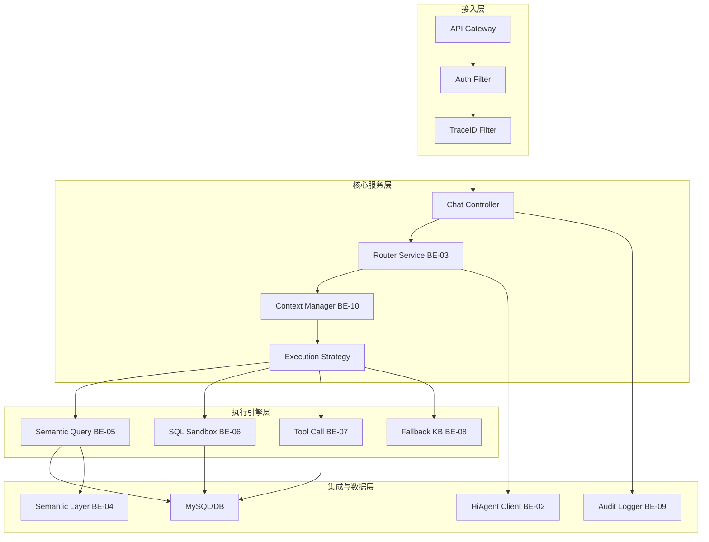
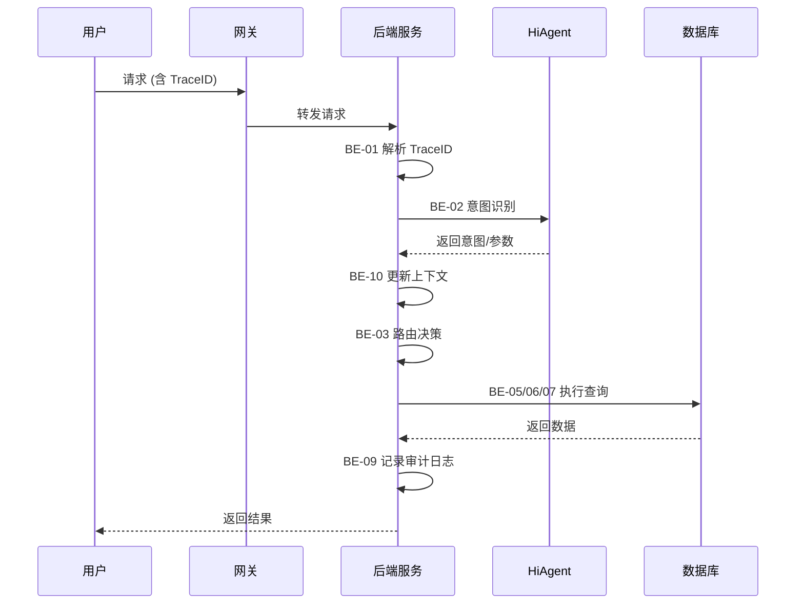

# 智能问数系统 - 卷 1：后端核心实现详细设计文档

**文档版本**: V2.0  
**最后更新**: 2026-04-02  
**适用对象**: 后端开发工程师、架构师、技术经理  
**关联任务**: BE-01 ~ BE-10 (后端核心任务集)  
**前置依赖**: 基础设施就绪 (K8s, MySQL, Redis, HiAgent 平台)  
**后续依赖**: 全链路测试 (QA-01 ~ QA-05), 上线部署

**项目说明**: 本文档是智能问数系统后端核心实现的总体设计文档，整合了 BE-01 至 BE-10 共 10 个核心任务的技术方案、标准规范、集成架构及注意事项，旨在确保后端系统的一致性、安全性、高性能和可维护性。

---

## 1. 概述

### 1.1 背景
智能问数系统后端是连接前端用户、AI 平台 (HiAgent) 和数据仓库的核心枢纽。负责意图路由、上下文管理、查询执行、安全管控、审计日志等关键功能。为确保系统质量，需统一技术标准，明确模块边界，防范常见陷阱。

### 1.2 目标
| 目标 | 说明 | 验收标准 |
|------|------|----------|
| **一致性** | 代码风格、接口规范、日志格式统一 | 代码审查通过率 100% |
| **安全性** | 无高危漏洞，权限控制严密 | 安全渗透测试通过 |
| **高性能** | 核心接口 P95 延迟 < 2s | 性能压测达标 |
| **可观测** | 全链路 TraceID 透传，日志完整 | 链路追踪覆盖率 100% |
| **可维护** | 模块解耦，文档完整，测试覆盖率高 | 单元测试覆盖率 ≥ 80% |

### 1.3 范围
| 模块分类 | 包含任务 | 说明 |
|----------|----------|------|
| **基础设施** | BE-01 (TraceID), BE-09 (审计日志) | 跨切面关注点 |
| **核心逻辑** | BE-03 (路由), BE-10 (上下文) | 对话状态与决策 |
| **执行引擎** | BE-05 (语义), BE-06 (SQL), BE-07 (工具), BE-08 (降级) | 查询执行策略 |
| **数据与集成** | BE-02 (HiAgent), BE-04 (语义层) | 外部集成与元数据 |

---

## 2. 架构设计

### 2.1 逻辑架构


### 2.2 数据流架构


### 2.3 技术栈
| 组件 | 技术 | 版本 | 说明 |
|------|------|------|------|
| 框架 | Spring Boot | 3.2 | 核心框架 |
| 语言 | Java | 17 | LTS 版本 |
| 数据库 | MySQL | 8.0 | 持久化存储 |
| 缓存 | Redis | 7.0 | 会话/元数据缓存 |
| 日志 | Logback + ELK | 8.x | 日志采集 |
| 监控 | Prometheus + Grafana | 最新 | 指标监控 |
| 链路追踪 | SkyWalking | 9.x | 链路追踪 |

---

## 3. 统一技术标准

### 3.1 接口规范
| 规范项 | 要求 | 示例 |
|--------|------|------|
| **URL 风格** | RESTful, 小写，连字符 | `/api/v1/chat/query` |
| **请求方法** | 查询用 GET/POST, 修改用 PUT/DELETE | `POST /api/v1/chat` |
| **响应格式** | 统一封装 `Result<T>` | `{code, message, data, traceId}` |
| **错误码** | 统一错误码表 (见 BE-03) | `200 成功，400 参数错误` |
| **版本控制** | URL 中包含版本号 | `/api/v1/...` |

### 3.2 日志规范
| 规范项 | 要求 | 示例 |
|--------|------|------|
| **TraceID** | 所有日志必须包含 TraceID | `traceId=abc123` |
| **日志级别** | INFO 正常，WARN 异常可恢复，ERROR 严重错误 | `log.info("Query success")` |
| **敏感信息** | 手机号/身份证/密码必须脱敏 | `138****0000` |
| **异步日志** | 审计日志必须异步写入 | `@Async` |
| **日志格式** | JSON 格式，便于 ELK 解析 | `{"timestamp":..., "level":...}` |

### 3.3 异常处理
```java
// ✅ 推荐：全局异常处理
@RestControllerAdvice
public class GlobalExceptionHandler {
    @ExceptionHandler(BusinessException.class)
    public Result<?> handleBusinessException(BusinessException e) {
        return Result.error(e.getCode(), e.getMessage());
    }
    
    @ExceptionHandler(Exception.class)
    public Result<?> handleException(Exception e) {
        log.error("System error", e);
        return Result.error(500, "系统繁忙");
    }
}

// ❌ 不推荐：分散 try-catch
public void query() {
    try {
        // ...
    } catch (Exception e) {
        e.printStackTrace(); // 日志不规范
        return null; // 返回 null 难处理
    }
}
```

### 3.4 安全规范
| 规范项 | 要求 | 实现方式 |
|--------|------|----------|
| **SQL 注入** | 禁止拼接 SQL | 使用 PreparedStatement/ORM |
| **XSS 防护** | 输入输出过滤 | HTML 转义，CSP 策略 |
| **权限控制** | 接口级 + 数据级权限 | Spring Security + AOP |
| **敏感数据** | 存储加密，传输 HTTPS | AES-256, TLS 1.2+ |
| **限流熔断** | 防止雪崩 | Resilience4j, Sentinel |

---

## 4. 核心模块实现概要

### 4.1 基础设施层 (BE-01, BE-09)

#### 4.1.1 TraceID 全链路透传 (BE-01)
*   **实现**: `OncePerRequestFilter` 生成/获取 TraceID，放入 MDC 和 Header。
*   **关键点**: 异步线程需使用 `TaskDecorator` 传递 MDC。
*   **陷阱**: 忘记清理 MDC 导致内存泄漏/日志混乱。
*   **代码**:
    ```java
    // 清理 MDC
    try {
        filterChain.doFilter(request, response);
    } finally {
        MDC.clear(); // 必须清理
    }
    ```

#### 4.1.2 异步审计日志 (BE-09)
*   **实现**: `@Async` + 队列缓冲 + 批量写入 DB/ELK。
*   **关键点**: 队列满时的降级策略 (丢弃或本地文件)。
*   **陷阱**: 同步写入阻塞主线程。
*   **配置**:
    ```yaml
    audit:
      async:
        enabled: true
        queue_capacity: 10000
        batch_size: 100
    ```

### 4.2 核心逻辑层 (BE-03, BE-10)

#### 4.2.1 路由决策引擎 (BE-03)
*   **实现**: 策略模式 + 责任链。
*   **关键点**: 置信度阈值可配置，支持动态调整。
*   **陷阱**: 硬编码阈值，无法适应模型变化。
*   **配置**:
    ```yaml
    router:
      thresholds:
        tool_call: 0.85
        semantic: 0.60
        sql: 0.40
    ```

#### 4.2.2 多轮对话上下文 (BE-10)
*   **实现**: Redis 存储 Session，版本号乐观锁控制并发。
*   **关键点**: 上下文过期清理，敏感信息脱敏。
*   **陷阱**: 并发更新覆盖，上下文无限增长。
*   **代码**:
    ```java
    // 版本检查
    if (!session.getVersion().equals(clientVersion)) {
        throw new ConcurrentModificationException();
    }
    ```

### 4.3 执行引擎层 (BE-05, BE-06, BE-07, BE-08)

#### 4.3.1 语义查询 (BE-05)
*   **实现**: 动态 SQL 生成 (JPA Criteria)。
*   **关键点**: 权限过滤自动注入。
*   **陷阱**: SQL 注入，权限绕过。

#### 4.3.2 SQL 沙箱 (BE-06)
*   **实现**: Druid SQL Parser 语法树分析。
*   **关键点**: 只读账号，操作白名单，行数限制。
*   **陷阱**: 绕过解析直接执行，资源耗尽。
*   **配置**:
    ```yaml
    sql_sandbox:
      read_only: true
      max_rows: 10000
      timeout_seconds: 5
      blocked_keywords: [DROP, DELETE, UPDATE]
    ```

#### 4.3.3 工具调用 (BE-07)
*   **实现**: 适配器模式封装现有 API。
*   **关键点**: 参数映射校验，熔断降级。
*   **陷阱**: 工具参数幻觉，循环调用。

#### 4.3.4 知识库降级 (BE-08)
*   **实现**: 调用 HiAgent 知识库检索 API。
*   **关键点**: 超时控制，缓存优化。
*   **陷阱**: 检索延迟高，缓存不一致。

### 4.4 数据与集成层 (BE-02, BE-04)

#### 4.4.1 HiAgent 客户端 (BE-02)
*   **实现**: RestTemplate/WebClient 封装，熔断重试。
*   **关键点**: 置信度校准，超时控制。
*   **陷阱**: 同步阻塞，无熔断。

#### 4.4.2 语义层元数据 (BE-04)
*   **实现**: 指标/维度定义管理，缓存同步。
*   **关键点**: 变更通知，版本管理。
*   **陷阱**: 缓存未更新，元数据不一致。

---

## 5. 注意事项与陷阱防护 ⚠️

### 5.1 通用陷阱防护矩阵

| 陷阱类型 | 风险描述 | 防护措施 | 验证方法 |
|----------|----------|----------|----------|
| **内存泄漏** | MDC 未清理，缓存无过期 | `finally` 清理，设置 TTL | 长时间运行监控 |
| **并发冲突** | 上下文更新覆盖 | 乐观锁 (Version) | 并发测试 |
| **SQL 注入** | 拼接 SQL | 参数化查询，ORM | 安全扫描 |
| **敏感泄露** | 日志/响应含敏感信息 | 脱敏组件，注解控制 | 日志审计 |
| **雪崩效应** | 依赖服务故障传播 | 熔断器，超时控制 | 故障注入测试 |
| **缓存穿透** | 查询不存在的数据 | 缓存空值，布隆过滤器 | 压测验证 |
| **死锁** | 数据库/锁竞争 | 固定锁顺序，超时 | 死锁检测 |
| **配置泄露** | 敏感配置硬编码 | 配置中心，环境变量 | 代码扫描 |

### 5.2 关键代码审查清单

```java
// 审查清单
□ TraceID 是否透传 (MDC/Header)
□ 敏感信息是否脱敏 (日志/响应)
□ SQL 是否参数化 (防注入)
□ 异常是否统一处理 (全局Advice)
□ 异步任务是否清理资源 (ThreadLocal)
□ 缓存是否设置过期时间 (TTL)
□ 并发更新是否加锁/版本号
□ 外部调用是否设超时/熔断
□ 权限校验是否执行 (接口/数据)
□ 日志级别是否合理 (INFO/ERROR)
□ 配置是否外部化 (非硬编码)
□ 单元测试是否覆盖核心逻辑
□ 文档是否同步更新
```

### 5.3 性能优化建议

| 优化点 | 建议 | 预期收益 |
|--------|------|----------|
| 数据库查询 | 添加索引，避免全表扫描 | 查询速度提升 10 倍 + |
| 缓存使用 | 热点数据缓存 (Redis) | 减少 DB 压力 80% |
| 异步处理 | 日志/通知异步化 | 主流程延迟降低 50% |
| 连接池 | 合理配置 DB/HTTP 连接池 | 避免连接耗尽 |
| 序列化 | 使用 JSON 而非 XML | 序列化速度提升 |
| 批量操作 | 批量插入/查询 | 网络交互减少 |

### 5.4 安全加固建议

| 加固点 | 建议 | 实施难度 |
|--------|------|----------|
| 输入校验 | 所有输入参数校验 (JSR-303) | 低 |
| 输出脱敏 | 敏感字段自动脱敏 | 中 |
| 权限控制 | 接口级 + 数据级权限 | 中 |
| 依赖扫描 | 定期扫描第三方库漏洞 | 低 |
| 密钥管理 | 密钥不入库，使用 KMS | 中 |
| 审计日志 | 关键操作留痕 | 低 |

---

## 6. 开发检查清单 (Checklist)

### 6.1 设计阶段
- [ ] 接口定义完成 (Swagger)
- [ ] 数据库设计完成 (ER 图)
- [ ] 技术方案评审通过
- [ ] 风险评估完成 (安全/性能)
- [ ] 依赖关系明确

### 6.2 编码阶段
- [ ] 代码规范符合 (Checkstyle)
- [ ] 单元测试编写 (JUnit)
- [ ] 敏感信息脱敏
- [ ] 异常处理统一
- [ ] 日志记录完整
- [ ] TraceID 透传
- [ ] 配置外部化
- [ ] 无硬编码密钥

### 6.3 测试阶段
- [ ] 单元测试通过 (覆盖率≥80%)
- [ ] 集成测试通过
- [ ] 安全扫描通过 (无高危漏洞)
- [ ] 性能测试达标 (P95 < 2s)
- [ ] 代码审查通过 (Merge Request)

### 6.4 部署阶段
- [ ] 配置中心配置完成
- [ ] 数据库脚本准备
- [ ] 监控告警配置
- [ ] 回滚方案准备
- [ ] 上线评审通过

---

## 7. 部署与运维

### 7.1 环境配置
| 环境 | 用途 | 配置 | 访问控制 |
|------|------|------|----------|
| 开发环境 | 开发调试 | 最低配置 | 开发团队 |
| 测试环境 | 集成测试 | 中等配置 | 测试团队 |
| 预发环境 | 回归测试 | 接近生产 | 核心团队 |
| 生产环境 | 线上服务 | 高配集群 | 运维 + 审批 |

### 7.2 监控告警
```yaml
# 核心监控指标
metrics:
  - api.request.qps
  - api.response.latency.p95
  - api.error.rate
  - db.connection.pool.active
  - cache.hit.rate
  - jvm.memory.used
  - system.cpu.usage

# 告警规则
alerts:
  - name: HighErrorRate
    condition: error_rate > 1%
    duration: 5m
  - name: HighLatency
    condition: p95_latency > 3s
    duration: 5m
  - name: LowCacheHit
    condition: cache_hit_rate < 40%
    duration: 10m
```

### 7.3 日志管理
| 日志类型 | 存储位置 | 保留周期 | 采集方式 |
|----------|----------|----------|----------|
| 应用日志 | ELK | 30 天 | Filebeat |
| 审计日志 | MySQL + ELK | 180 天 | 异步写入 |
| 访问日志 | Nginx + ELK | 90 天 | Logstash |
| 慢查询日志 | MySQL | 30 天 | PMM |

### 7.4 应急预案
| 故障类型 | 应急措施 | 负责人 |
|----------|----------|--------|
| 服务不可用 | 重启服务，切换流量 | 运维 |
| 数据库故障 | 切换主从，限流降级 | DBA |
| 缓存故障 | 降级查库，重建缓存 | 开发 |
| 安全攻击 | 封禁 IP，启用 WAF | 安全 |
| 数据错误 | 回滚版本，恢复备份 | 开发 + 运维 |

---

## 8. 附录：相关文档索引

| 文档名称 | 版本 | 说明 | 链接/路径 |
|----------|------|------|----------|
| BE-01 TraceID 详细设计 | V2.0 | 链路追踪实现 | `/docs/BE-01.md` |
| BE-02 HiAgent 客户端 | V2.0 | 外部集成实现 | `/docs/BE-02.md` |
| BE-03 路由决策引擎 | V2.0 | 核心路由逻辑 | `/docs/BE-03.md` |
| BE-04 语义层元数据 | V2.0 | 指标管理实现 | `/docs/BE-04.md` |
| BE-05 语义查询执行 | V2.0 | 查询生成实现 | `/docs/BE-05.md` |
| BE-06 SQL 沙箱安全 | V2.0 | 安全解析实现 | `/docs/BE-06.md` |
| BE-07 工具调用执行 | V2.0 | 工具适配实现 | `/docs/BE-07.md` |
| BE-08 知识库降级 | V2.0 | 降级服务实现 | `/docs/BE-08.md` |
| BE-09 异步审计日志 | V2.0 | 日志审计实现 | `/docs/BE-09.md` |
| BE-10 多轮对话上下文 | V2.0 | 会话管理实现 | `/docs/BE-10.md` |
| DT-01 核心指标梳理 | V2.0 | 指标定义文档 | `/docs/DT-01.md` |
| QA-01 功能集成测试 | V2.0 | 测试用例文档 | `/docs/QA-01.md` |

---

## 9. 变更历史

| 版本 | 日期 | 变更内容 | 负责人 |
|------|------|----------|--------|
| V1.0 | 2026-03-25 | 初始版本，包含基础架构 | 架构组 |
| V2.0 | 2026-04-02 | 整合 BE-01~BE-10 细节，增加陷阱防护矩阵，统一标准 | 架构组 |

---

## 10. 签字确认

| 角色 | 姓名 | 签字 | 日期 | 意见 |
|------|------|------|------|------|
| 架构师 | | | | |
| 后端负责人 | | | | |
| 测试负责人 | | | | |
| 安全负责人 | | | | |
| 产品经理 | | | | |

---

**文档结束**  
**下一步**: 各后端开发小组根据本文档及细分任务文档 (BE-01 ~ BE-10) 进行代码实现，完成后提交代码审查和单元测试。