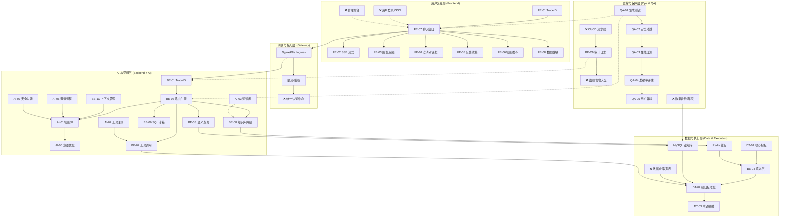

# 智能问数系统 - 全局架构与任务串联分析

**文档版本**: V1.0  
**最后更新**: 2026-04-02  
**适用对象**: 项目总监、架构师、产品经理、技术负责人  
**目的**: 从全局视角串联所有细分任务，识别功能遗漏，评估系统完整性，确保上线无重大风险。

---

## 1. 全局架构与任务映射图

下图展示了系统的分层架构，并将之前细化的 **65+ 个任务点** 映射到对应层级，直观展示各模块的协作关系。

---

## 2. 任务覆盖度矩阵

我们将系统功能划分为 **核心业务**、**基础支撑**、**运营维护** 三大域，评估任务完成情况。

| 功能域 | 功能模块 | 关键任务 (已完成) | 缺失/弱项任务 (❌) | 风险等级 |
| :--- | :--- | :--- | :--- | :--- |
| **核心业务** | **对话交互** | FE-02/03/04/05/06/07/08 | ❌ 移动端适配优化 ❌ 语音输入支持 | 🟢 低 |
| | **意图理解** | AI-01/04/05/06/07 | ❌ 复杂语义泛化 ❌ 多轮状态持久化 | 🟡 中 |
| | **查询执行** | BE-05/06/07 DT-01/02/03 | ❌ 跨源数据联邦 ❌ 实时数据支持 | 🟡 中 |
| | **结果展示** | FE-03/06 | ❌ 自定义报表配置 ❌ 大屏联动下钻 | 🟢 低 |
| **基础支撑** | **用户体系** | BE-10 (上下文) | ❌ **统一登录/SSO** ❌ **RBAC 权限管理** ❌ 用户画像 | 🔴 **高** |
| | **安全管理** | AI-07/FE-08/QA-02 | ❌ 数据水印 ❌ 操作审计回溯 ❌ 敏感词动态配置 | 🟡 中 |
| | **性能保障** | QA-03/BE-09 | ❌ **全链路监控大盘** ❌ 自动扩缩容策略 | 🟡 中 |
| | **数据治理** | DT-01/04 | ❌ **指标血缘分析** ❌ 数据质量监控 | 🟡 中 |
| **运营维护** | **管理后台** | AI-01/02/03 (平台侧) | ❌ **业务配置后台** ❌ 指标注册界面 ❌ 知识库管理界面 | 🔴 **高** |
| | **部署运维** | BE-09 (日志) | ❌ **CI/CD 流水线** ❌ 灰度发布机制 ❌ 灾备切换演练 | 🔴 **高** |
| | **测试验收** | QA-01/02/03/04/05 | ❌ 自动化回归测试集 ❌ 线上巡检机制 | 🟢 低 |

---

## 3. 关键功能遗漏分析 (Gap Analysis)

通过全局串联，发现以下 **5 个关键缺失点**，可能影响系统上线或长期运营：

### 3.1 缺失：统一用户认证与权限中心 (🔴 高危)
*   **现状**: 任务中假设用户已登录，权限通过 `UserContext` 传递，但缺乏具体的登录、SSO 集成、Token 刷新、角色管理功能。
*   **风险**: 系统无法独立运行，无法控制谁能访问系统，谁能看什么数据。
*   **建议补充任务**:
    *   **AUTH-01**: 集成公司 SSO/OAuth2 登录
    *   **AUTH-02**: 基于角色的访问控制 (RBAC) 实现
    *   **AUTH-03**: 权限与数据范围绑定 (行级/列级)

### 3.2 缺失：业务配置管理后台 (🔴 高危)
*   **现状**: 指标、术语、知识库、工具的配置目前依赖“文档 + 数据库脚本 + HiAgent 平台”，业务人员无法自助操作。
*   **风险**: 运营成本高，业务变更依赖开发，响应慢。
*   **建议补充任务**:
    *   **ADMIN-01**: 指标注册与管理界面 (对接 DT-01)
    *   **ADMIN-02**: 术语映射配置界面 (对接 DT-03)
    *   **ADMIN-03**: 知识库文档管理界面 (对接 AI-03)
    *   **ADMIN-04**: 用户反馈查看与处理后台 (对接 FE-05)

### 3.3 缺失：全链路可观测性大盘 (🟡 中危)
*   **现状**: 有日志 (BE-09) 和监控指标 (QA-03)，但缺乏统一的可视化大盘，问题定位依赖查日志。
*   **风险**: 线上故障发现慢，定位难，无法量化系统健康度。
*   **建议补充任务**:
    *   **OPS-01**: Grafana 业务监控大盘 (QPS/准确率/降级率)
    *   **OPS-02**: 链路追踪可视化 (TraceID 全链路查询)
    *   **OPS-03**: 告警通知集成 (钉钉/邮件/短信)

### 3.4 缺失：CI/CD 与自动化部署 (🟡 中危)
*   **现状**: 有 K8s 配置 (BE-09)，但缺乏自动构建、自动测试、自动部署流水线。
*   **风险**: 发布效率低，人工操作易出错，回滚困难。
*   **建议补充任务**:
    *   **DEVOPS-01**: GitLab CI/Jenkins 流水线配置
    *   **DEVOPS-02**: 自动化测试集成 (QA-01/04)
    *   **DEVOPS-03**: 灰度发布与回滚脚本

### 3.5 缺失：数据血缘与质量监控 (🟡 中危)
*   **现状**: 有指标定义 (DT-01)，但不知道指标数据来源哪里，数据不准时无法快速定位。
*   **风险**: 数据信任度低，问题排查链路过长。
*   **建议补充任务**:
    *   **DATA-01**: 指标血缘图谱 (指标 -> 表 -> 字段)
    *   **DATA-02**: 数据质量波动告警 (如 GMV 突降 50%)

---

## 4. 系统完整性评估

### 4.1 核心链路完整性 (✅ 完整)
*   **用户提问** (FE-07) → **意图识别** (AI-01) → **路由决策** (BE-03) → **数据查询** (BE-05/06/07) → **结果返回** (FE-02/03)
*   **结论**: 核心问数流程闭环，功能逻辑完整，可支撑 MVP 上线。

### 4.2 安全合规完整性 (⚠️ 基本完整)
*   **覆盖**: 输入过滤 (AI-07)、输出脱敏 (FE-08)、SQL 拦截 (BE-06)、渗透测试 (QA-02)。
*   **缺口**: 缺少审计回溯 (谁在什么时候查了什么)、缺少数据导出水印。
*   **结论**: 满足基本安全要求，企业级合规需补充审计和水印。

### 4.3 运营维护完整性 (❌ 不完整)
*   **覆盖**: 有日志、有测试。
*   **缺口**: 无管理后台、无自动化运维、无业务自助配置。
*   **结论**: 上线后运维成本高，业务迭代依赖研发，不可持续。

### 4.4 用户体验完整性 (✅ 完整)
*   **覆盖**: 流式响应、图表交互、澄清对话、反馈收集、多端适配。
*   **结论**: 体验设计完善，达到企业级应用标准。

---

## 5. 上线风险评估与建议

### 5.1 风险矩阵
| 风险项 | 发生概率 | 影响程度 | 缓解措施 | 状态 |
| :--- | :---: | :---: | :--- | :---: |
| **权限失控** | 高 | 高 | **必须** 补充 AUTH-01/02 任务 | 🔴 阻断 |
| **配置困难** | 高 | 中 | 上线初期由研发代配置，后续补 ADMIN 任务 | 🟡 接受 |
| **故障难定位** | 中 | 高 | 优先搭建 OPS-01 监控大盘 | 🟡 建议 |
| **发布回滚慢** | 中 | 中 | 手动备份配置，准备回滚脚本 | 🟡 接受 |
| **数据不准** | 低 | 高 | 加强 QA-04 准确率评估，建立数据核对机制 | 🟢 监控 |

### 5.2 上线准入标准 (Go/No-Go)
1.  **核心功能**: 所有 P0 级任务 (BE/FE/AI/DT 核心链路) 测试通过。
2.  **安全**: QA-02 无 Critical/High 漏洞，权限控制 (AUTH) 到位。
3.  **性能**: QA-03 P95 响应 < 3s，支持 100 并发。
4.  **准确率**: QA-04 意图识别 ≥ 90%，答案准确率 100%。
5.  **体验**: QA-05 SUS 分数 ≥ 75，无 Critical 体验问题。
6.  **运维**: 日志可查，监控可用，有回滚方案。

### 5.3 分阶段实施建议

#### 阶段一：MVP 上线 (当前状态 + 权限补充)
*   **目标**: 核心问数功能可用，安全可控。
*   **必须补充**: **AUTH-01/02 (登录与权限)**。
*   **可暂缓**: 管理后台 (由研发配置)、CI/CD (手动发布)、血缘分析。
*   **周期**: 2 周。

#### 阶段二：运营增强 (上线后 1 个月)
*   **目标**: 降低运维成本，支持业务自助。
*   **任务**: ADMIN-01/02/03 (管理后台)、OPS-01 (监控大盘)。
*   **周期**: 4 周。

#### 阶段三：智能化与生态 (上线后 3 个月)
*   **目标**: 提升准确率，拓展数据源。
*   **任务**: AI-05 (模型微调)、DATA-01 (血缘)、跨源查询。
*   **周期**: 8 周。

---

## 6. 总结

**整体结论**: 
系统 **核心问数链路完整 (90%)**，**安全与体验设计完善 (85%)**，但 **企业级支撑能力不足 (60%)**。

**关键建议**: 
1.  **立即启动权限系统开发** (AUTH-01/02)，这是上线的硬性门槛。
2.  **优先搭建监控大盘** (OPS-01)，确保上线后可观测。
3.  **管理后台可暂缓**，初期由研发通过配置表/脚本支持，验证价值后再投入开发。
4.  **保持测试强度**，特别是 QA-04 准确率评估，需作为常态化任务持续进行。

**最终判断**: 
在补充 **用户权限** 和 **基础监控** 后，系统具备 **MVP 上线条件**。其他运营维护类功能可在迭代中完善。