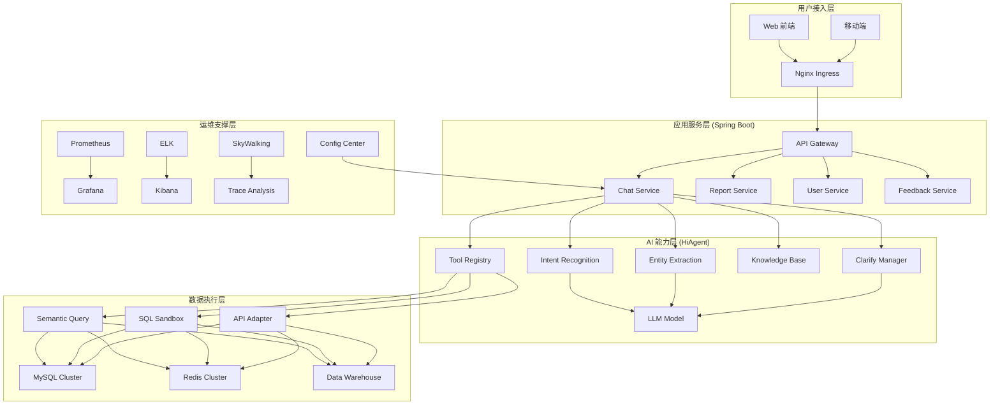
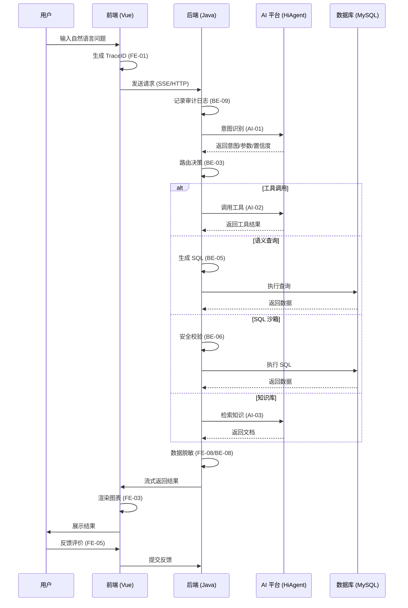
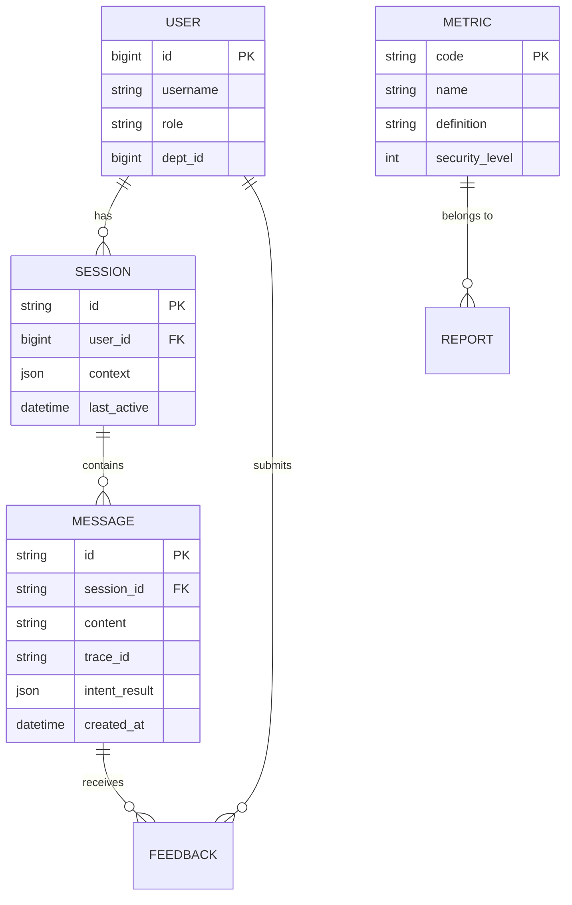

# 智能问数系统 - 技术设计方案文档

**文档版本**: V2.0  
**最后更新**: 2026-04-02  
**适用对象**: 架构师、技术经理、全体开发/测试/运维人员  
**关联文档**: 卷 1 (后端核心), 卷 2 (前端与 AI), 卷 3 (运维与测试)  
**前置依赖**: 需求规格说明书，基础设施规划  
**后续依赖**: 详细设计文档，代码实现，测试验收

**项目说明**: 本文档是智能问数系统的总体技术设计方案，作为卷 1、卷 2、卷 3 的统领性文档。它定义了系统架构、技术选型、核心流程、安全策略及关键风险防控措施，确保各团队在统一的技术框架下协作，实现高质量交付。

---

## 1. 概述

### 1.1 背景
企业数据查询门槛高，业务人员依赖技术人员取数，效率低。智能问数系统通过自然语言交互 (NL2SQL/Tool Calling)，结合大模型 (LLM) 与语义层，实现"对话即查询"，降低数据使用门槛，提升决策效率。

### 1.2 建设目标
| 目标维度 | 具体指标 | 验收标准 |
|----------|----------|----------|
| **功能完备** | 支持查询、图表、多轮对话、澄清、反馈 | 需求覆盖率 100% |
| **准确智能** | 意图识别≥90%，答案准确率≥95% | 黄金测试集验证 |
| **安全合规** | 数据脱敏，权限控制，SQL 沙箱 | 安全渗透测试通过 |
| **性能稳定** | P95 延迟<3s，可用性≥99.9% | 性能压测验证 |
| **体验优良** | SUS≥75，CSAT≥4.0 | 用户体验测试验证 |
| **可维护性** | 配置热更新，自动化部署，监控全覆盖 | 运维验收通过 |

### 1.3 设计原则
| 原则 | 说明 | 实施策略 |
|------|------|----------|
| **安全第一** | 数据隐私与系统安全优先 | 沙箱执行，脱敏展示，权限校验 |
| **用户体验** | 降低认知负荷，响应及时 | 流式响应，智能推荐，友好错误 |
| **架构解耦** | 模块独立，便于扩展 | 微服务化，接口标准化，事件驱动 |
| **可观测性** | 全链路追踪，问题可定位 | TraceID 透传，日志聚合，指标监控 |
| **成本可控** | 优化 AI 调用，资源合理利用 | 缓存优化，模型量化，按需伸缩 |

---

## 2. 系统架构

### 2.1 总体架构图


### 2.2 技术栈选型
| 层级 | 组件 | 技术选型 | 版本 | 选型理由 |
|------|------|----------|------|----------|
| **前端** | 框架 | Vue.js | 2.6.12 | 团队熟悉，生态成熟 |
| | UI 库 | Element-UI | 2.5.12 | 组件丰富，风格统一 |
| | 图表 | ECharts | 5.4.0 | 功能强大，支持大数据 |
| **后端** | 框架 | Spring Boot | 3.2 | 生态完善，性能优秀 |
| | 语言 | Java | 17 | LTS 版本，特性新 |
| | ORM | MyBatis Plus | 3.5 | 灵活，性能可控 |
| **AI** | 平台 | HiAgent | 2.3+ | 内网部署，支持私有模型 |
| | 模型 | Qwen-14B-Chat | - | 中文能力强，性价比高 |
| | 向量 | bge-large-zh | v1.5 | 中文检索效果最佳 |
| **数据** | 关系库 | MySQL | 8.0 | 稳定，支持事务 |
| | 缓存 | Redis | 7.0 | 高性能，数据结构丰富 |
| | 日志 | Elasticsearch | 8.x | 检索快，扩展性好 |
| **运维** | 容器 | Kubernetes | 1.28 | 标准编排，弹性伸缩 |
| | 监控 | Prometheus | 最新 | 云原生监控标准 |
| | CI/CD | Jenkins | 最新 | 流水线灵活，插件多 |

### 2.3 数据流架构


---

## 3. 核心模块设计概要

### 3.1 后端核心 (参考卷 1)
| 模块 | 任务 ID | 核心职责 | 关键技术 |
|------|--------|----------|----------|
| **链路追踪** | BE-01 | TraceID 生成与透传 | MDC, Filter, Interceptor |
| **AI 集成** | BE-02 | HiAgent 客户端封装 | RestTemplate, 熔断重试 |
| **路由决策** | BE-03 | 意图分发与策略选择 | 策略模式，置信度阈值 |
| **语义层** | BE-04 | 指标/维度元数据管理 | 缓存同步，版本控制 |
| **查询执行** | BE-05 | 动态 SQL 生成与执行 | JPA Criteria, 权限注入 |
| **安全沙箱** | BE-06 | SQL 解析与安全校验 | Druid Parser, 白名单 |
| **工具调用** | BE-07 | 现有 API 适配与调用 | 适配器模式，参数映射 |
| **降级服务** | BE-08 | 知识库检索与推荐 | 向量检索，缓存优化 |
| **审计日志** | BE-09 | 异步日志记录 | 队列缓冲，批量写入 |
| **上下文管理** | BE-10 | 多轮对话状态维护 | Redis, 乐观锁，脱敏 |

### 3.2 前端与 AI 配置 (参考卷 2)
| 模块 | 任务 ID | 核心职责 | 关键技术 |
|------|--------|----------|----------|
| **TraceID 注入** | FE-01 | 前端请求头注入 | Axios Interceptor |
| **流式聊天** | FE-02 | SSE 连接与打字机效果 | EventSource, 队列渲染 |
| **图表渲染** | FE-03 | 动态图表配置与渲染 | ECharts, 响应式 |
| **澄清交互** | FE-04 | 多轮对话澄清组件 | 模态框，槽位填充 |
| **反馈收集** | FE-05 | 点赞/点踩与原因收集 | 防重复提交，脱敏 |
| **智能推荐** | FE-06 | 猜你想问与场景推荐 | 缓存，点击追踪 |
| **窗口集成** | FE-07 | 主容器与状态管理 | Vuex, 跨标签页同步 |
| **敏感脱敏** | FE-08 | 前端展示脱敏 | 自定义指令，过滤器 |
| **智能体配置** | AI-01 | Prompt 与模型配置 | 结构化 Prompt, Few-Shot |
| **工具注册** | AI-02 | API 工具定义与注册 | JSON Schema, 认证 |
| **知识库** | AI-03 | 文档编写与上传 | Markdown, 元数据 |
| **索引构建** | AI-04 | 向量索引与重排序 | Embedding, Rerank |
| **意图优化** | AI-05 | 准确率评估与调优 | 黄金测试集，A/B 测试 |
| **澄清流程** | AI-06 | 可视化流程编排 | 槽位优先级，超时 |
| **安全过滤** | AI-07 | 注入检测与内容过滤 | 敏感词，频率限制 |

### 3.3 运维与测试 (参考卷 3)
| 模块 | 任务 ID | 核心职责 | 关键技术 |
|------|--------|----------|----------|
| **功能测试** | QA-01 | 集成测试用例执行 | JUnit, Selenium |
| **安全测试** | QA-02 | 渗透测试与漏洞扫描 | OWASP ZAP, SQLMap |
| **性能测试** | QA-03 | 压测与瓶颈分析 | JMeter, Prometheus |
| **准确率评估** | QA-04 | AI 能力量化评估 | 黄金测试集，人工标注 |
| **体验测试** | QA-05 | 可用性与满意度调研 | SUS, CSAT, 行为分析 |
| **部署发布** | Ops | CI/CD 与灰度发布 | Jenkins, K8s, Istio |
| **监控告警** | Ops | 指标采集与告警 | Prometheus, Grafana |
| **日志审计** | Ops | 日志采集与分析 | ELK, Filebeat |

---

## 4. 关键技术方案

### 4.1 全链路追踪方案
*   **目标**: 任何请求可通过 TraceID 串联前端、后端、AI、数据库日志。
*   **实现**:
    1.  前端生成 UUID 放入 `X-Trace-ID` Header (FE-01)。
    2.  后端 Filter 解析 TraceID 放入 MDC (BE-01)。
    3.  异步线程通过 `TaskDecorator` 传递 MDC。
    4.  日志格式包含 `trace_id` 字段。
    5.  ELK 通过 `trace_id` 关联检索。
*   **注意**: 必须清理 MDC，防止内存泄漏。

### 4.2 安全沙箱方案
*   **目标**: 防止 AI 生成的 SQL 危害数据库。
*   **实现**:
    1.  **语法解析**: 使用 Druid Parser 解析 SQL AST (BE-06)。
    2.  **白名单**: 仅允许 `SELECT`，禁止 `DROP/DELETE/UPDATE` 等。
    3.  **权限校验**: 检查表/字段访问权限。
    4.  **资源限制**: 限制 `JOIN` 数量，子查询深度，执行超时。
    5.  **只读账号**: 数据库账号仅授予 `SELECT` 权限。
*   **注意**: 防止绕过解析器直接执行，防止 SQL 注入。

### 4.3 多轮对话上下文方案
*   **目标**: 支持用户多轮追问，继承已确认参数。
*   **实现**:
    1.  **存储**: Redis 存储 Session 上下文 (BE-10)。
    2.  **版本控制**: 使用 Version 字段防止并发覆盖。
    3.  **槽位填充**: 识别缺失参数，触发澄清 (AI-06)。
    4.  **过期清理**: 设置 TTL，定时清理过期 Session。
    5.  **脱敏**: 上下文中敏感信息脱敏存储。
*   **注意**: 上下文污染问题，需支持参数修正/撤销。

### 4.4 AI 准确率保障方案
*   **目标**: 确保意图识别和答案准确。
*   **实现**:
    1.  **Prompt 工程**: 结构化 Prompt，Few-Shot 示例 (AI-01)。
    2.  **置信度校准**: 调整阈值，区分确定/不确定 (AI-05)。
    3.  **知识库增强**: 补充指标定义，同义词 (AI-03)。
    4.  **人工反馈**: 收集👍/👎反馈，优化模型 (FE-05)。
    5.  **持续评估**: 黄金测试集定期回归 (QA-04)。
*   **注意**: 防止过拟合测试集，防止 AI 幻觉。

### 4.5 高性能响应方案
*   **目标**: 降低用户感知延迟。
*   **实现**:
    1.  **流式响应**: SSE 流式返回，首字快速展示 (FE-02)。
    2.  **缓存优化**: 元数据/热点查询 Redis 缓存 (BE-04/08)。
    3.  **异步处理**: 审计日志/反馈异步写入 (BE-09)。
    4.  **数据库优化**: 索引优化，慢查询治理。
    5.  **前端优化**: 懒加载，资源压缩，CDN 加速。
*   **注意**: 缓存一致性，流式连接管理。

---

## 5. 数据设计与安全

### 5.1 核心数据模型


### 5.2 数据安全策略
| 数据类型 | 存储安全 | 传输安全 | 展示安全 | 访问控制 |
|----------|----------|----------|----------|----------|
| **用户密码** | BCrypt 加密 | HTTPS | 不展示 | 仅本人/管理员 |
| **手机号** | AES-256 加密 | HTTPS | 138****0000 | 权限控制 |
| **身份证** | AES-256 加密 | HTTPS | 110101****1234 | 权限控制 |
| **查询结果** | 不落库/临时表 | HTTPS | 脱敏/水印 | 行级/列级权限 |
| **审计日志** | 防篡改存储 | HTTPS | 脱敏 | 仅审计员 |
| **AI 密钥** | Vault 管理 | 内网通信 | 不展示 | 仅服务账号 |

### 5.3 隐私合规措施
*   **最小化收集**: 仅收集必要用户信息。
*   **用户授权**: 首次使用签署隐私协议。
*   **数据脱敏**: 日志/展示/存储全链路脱敏。
*   **留存期限**: 日志 90 天，行为数据 180 天，到期自动删除。
*   **用户权利**: 支持查询/导出/删除个人数据。

---

## 6. 基础设施与部署

### 6.1 资源规划 (生产环境)
| 组件 | 规格 | 数量 | 说明 |
|------|------|------|------|
| **前端 Nginx** | 4C8G | 2 | 负载均衡，静态资源 |
| **后端服务** | 8C16G | 5 | K8s Pod，HPA 自动伸缩 |
| **MySQL** | 16C64G | 1 主 2 从 | SSD 存储，MHA 高可用 |
| **Redis** | 8C32G | 3 节点集群 | 持久化，哨兵监控 |
| **AI 平台** | 16C32G+GPU | 2+4 GPU | 离线模型，向量检索 |
| **ELK** | 8C32G | 3 节点 | 日志存储分析 |
| **监控** | 4C8G | 2 节点 | Prometheus+Grafana |

### 6.2 网络规划
| 区域 | 网段 | 访问控制 | 说明 |
|------|------|----------|------|
| **DMZ 区** | 10.0.1.0/24 | 公网入站 80/443 | Nginx 入口 |
| **应用区** | 10.0.2.0/24 | 仅 DMZ 访问 | 后端服务 |
| **数据区** | 10.0.3.0/24 | 仅应用区访问 | MySQL/Redis |
| **AI 区** | 10.0.4.0/24 | 仅应用区访问 | HiAgent 平台 |
| **运维区** | 10.0.5.0/24 | 堡垒机访问 | 监控/日志/管理 |

### 6.3 高可用设计
*   **多副本**: 所有无服务至少 2 副本。
*   **负载均衡**: Nginx + K8s Service。
*   **故障转移**: 数据库主从切换，Redis 哨兵。
*   **限流熔断**: Sentinel/Resilience4j 保护后端。
*   **异地备份**: 数据每日备份到异地存储。

---

## 7. 质量保证体系

### 7.1 测试策略
| 测试阶段 | 测试类型 | 负责人 | 准入条件 | 准出条件 |
|----------|----------|--------|----------|----------|
| **开发阶段** | 单元测试 | 开发 | 代码完成 | 覆盖率≥80% |
| **集成阶段** | 接口测试 | 测试 | 单元测试通过 | 核心流程 100% |
| **系统阶段** | 功能/安全/性能 | 测试 | 集成测试通过 | 无 P0/P1 缺陷 |
| **验收阶段** | 准确率/体验 | 产品/AI | 系统测试通过 | 指标达标 |
| **上线阶段** | 回归测试 | 测试 | 验收通过 | 冒烟测试通过 |

### 7.2 质量门禁
```yaml
# CI/CD 质量门禁
quality_gates:
  # 代码质量
  code:
    sonar_quality_gate: Passed
    coverage_threshold: 80%
    blocker_issues: 0
  
  # 安全扫描
  security:
    vuln_scan: No High/Critical
    secret_scan: No Secrets
  
  # 测试通过
  test:
    unit_test: 100% Passed
    integration_test: 100% Passed
  
  # 性能基准
  performance:
    p95_latency: < 3s
    error_rate: < 0.1%
```

### 7.3 持续改进
*   **缺陷分析**: 每周缺陷复盘，根因分析。
*   **性能优化**: 定期压测，识别瓶颈。
*   **准确率优化**: 每月 Bad Case 分析，模型迭代。
*   **体验优化**: 季度用户调研，NPS 追踪。

---

## 8. 风险管理与应对

### 8.1 技术风险
| 风险项 | 可能性 | 影响 | 应对措施 |
|--------|--------|------|----------|
| **AI 幻觉** | 高 | 高 | 置信度校验，人工审核，知识库增强 |
| **SQL 注入** | 中 | 高 | 沙箱解析，只读账号，参数化查询 |
| **性能瓶颈** | 中 | 中 | 缓存优化，异步处理，容量规划 |
| **数据泄露** | 低 | 高 | 脱敏展示，权限控制，审计日志 |
| **服务不可用** | 低 | 高 | 多副本，熔断降级，应急预案 |

### 8.2 业务风险
| 风险项 | 可能性 | 影响 | 应对措施 |
|--------|--------|------|----------|
| **用户不接受** | 中 | 高 | 用户体验优化，培训推广，反馈闭环 |
| **数据不准确** | 中 | 高 | 数据源核对，口径统一，误差提示 |
| **合规风险** | 低 | 高 | 隐私合规审查，数据留存控制 |
| **成本超支** | 中 | 中 | AI 调用优化，资源监控，预算控制 |

### 8.3 应急预案
*   **故障分级**: P0(致命), P1(严重), P2(一般), P3(轻微)。
*   **响应时间**: P0(5 分钟), P1(15 分钟), P2(1 小时)。
*   **回滚机制**: 一键回滚脚本，版本快照。
*   **值班制度**: 7×24 小时 on-call 轮值。

---

## 9. 注意事项与特别关注点 ⚠️

### 9.1 核心注意事项
| 关注点 | 风险描述 | 防控要求 | 责任方 |
|--------|----------|----------|--------|
| **TraceID 清理** | MDC 未清理导致内存泄漏/日志混乱 | `finally` 块必须 `MDC.clear()` | 后端 |
| **敏感信息脱敏** | 日志/响应/ DOM 含明文敏感信息 | 全链路脱敏组件，代码扫描 | 全团队 |
| **SQL 沙箱绕过** | 恶意 SQL 绕过解析器执行 | 多重校验，只读账号，最小权限 | 后端/安全 |
| **AI 提示词注入** | 用户覆盖系统 Prompt | 输入过滤，指令隔离，安全模型 | AI/后端 |
| **上下文并发冲突** | 多请求同时更新 Session 覆盖 | 乐观锁 (Version), 幂等设计 | 后端 |
| **缓存一致性** | 元数据变更缓存未更新 | 失效策略，版本号，事件通知 | 后端 |
| **前端资源泄漏** | 组件销毁未清理定时器/监听器 | `beforeDestroy` 清理清单 | 前端 |
| **生产配置泄露** | 敏感配置硬编码或误提交 | 配置中心，环境变量，密钥管理 | 运维 |
| **测试数据污染** | 测试数据混入生产环境 | 环境隔离，数据脱敏，清理脚本 | 测试/运维 |
| **上线回滚失败** | 回滚脚本未验证或依赖变更 | 回滚演练，向下兼容，快照 | 运维/开发 |

### 9.2 特别关注点 (Key Focus Points)
1.  **AI 不确定性管理**:
    *   **问题**: LLM 输出不可控，可能产生错误 SQL 或幻觉答案。
    *   **对策**: 置信度阈值控制 (低置信度降级)，SQL 沙箱校验，答案来源标注，人工反馈闭环。
    *   **指标**: 意图识别准确率≥90%，答案准确率≥95%。

2.  **数据安全第一**:
    *   **问题**: 企业数据敏感，泄露后果严重。
    *   **对策**: 行级/列级权限控制，展示脱敏，传输加密，审计日志，SQL 只读沙箱。
    *   **指标**: 安全测试 0 高危漏洞，敏感信息 0 明文泄露。

3.  **用户体验感知**:
    *   **问题**: AI 推理延迟高，用户等待焦虑。
    *   **对策**: SSE 流式响应 (首字<1s)，加载动画，进度提示，智能推荐减少输入。
    *   **指标**: P95 延迟<3s，首屏<2s，SUS≥75。

4.  **系统可观测性**:
    *   **问题**: 分布式系统问题定位难。
    *   **对策**: 全链路 TraceID，结构化日志，核心指标监控，告警通知。
    *   **指标**: 链路追踪覆盖率 100%，告警准确率≥90%。

5.  **成本与性能平衡**:
    *   **问题**: AI 调用成本高，大并发性能压力大。
    *   **对策**: 缓存热点查询，模型量化，按需伸缩，连接池优化。
    *   **指标**: 单次查询 AI 成本可控，资源利用率 60-80%。

---

## 10. 附录：文档索引

| 文档卷 | 文档名称 | 版本 | 说明 | 路径 |
|--------|----------|------|------|------|
| **卷 1** | 后端核心实现 | V2.0 | BE-01 ~ BE-10 详细设计 | `/docs/vol-1-backend.md` |
| **卷 2** | 前端与 AI 配置 | V2.0 | FE-01 ~ FE-08, AI-01 ~ AI-07 | `/docs/vol-2-frontend-ai.md` |
| **卷 3** | 运维部署与测试 | V2.0 | QA-01 ~ QA-05, Ops/Deploy | `/docs/vol-3-ops-test.md` |
| **本卷** | 技术设计方案 | V2.0 | 总体架构与关键技术 | `/docs/vol-0-tech-design.md` |
| **需求** | 需求规格说明书 | V1.5 | 业务需求与功能列表 | `/docs/requirements.md` |
| **接口** | API 接口文档 | V2.0 | Swagger/OpenAPI 定义 | `/docs/api-spec.md` |
| **数据** | 数据库设计文档 | V2.0 | ER 图，字典，变更脚本 | `/docs/db-design.md` |

---

## 11. 变更历史

| 版本 | 日期 | 变更内容 | 负责人 | 审批人 |
|------|------|----------|--------|--------|
| V1.0 | 2026-03-25 | 初始版本，完成架构设计 | 架构组 | 技术总监 |
| V2.0 | 2026-04-02 | 整合卷 1/2/3 内容，增加风险防控，统一标准 | 架构组 | 技术总监 |

---

## 12. 签字确认

| 角色 | 姓名 | 签字 | 日期 | 意见 |
|------|------|------|------|------|
| 架构师 | | | | |
| 后端负责人 | | | | |
| 前端负责人 | | | | |
| AI 负责人 | | | | |
| 测试负责人 | | | | |
| 运维负责人 | | | | |
| 安全负责人 | | | | |
| 产品负责人 | | | | |
| 技术总监 | | | | |

---

**文档结束**  
**下一步**: 各团队根据本技术设计方案及卷 1/2/3 详细文档开展实施工作，定期同步进度，确保技术架构落地一致。