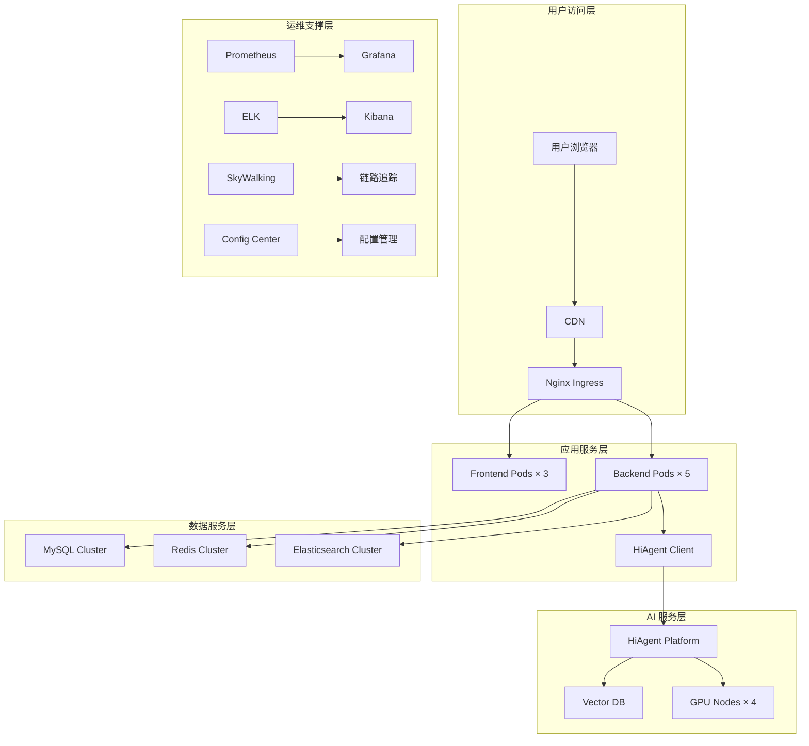
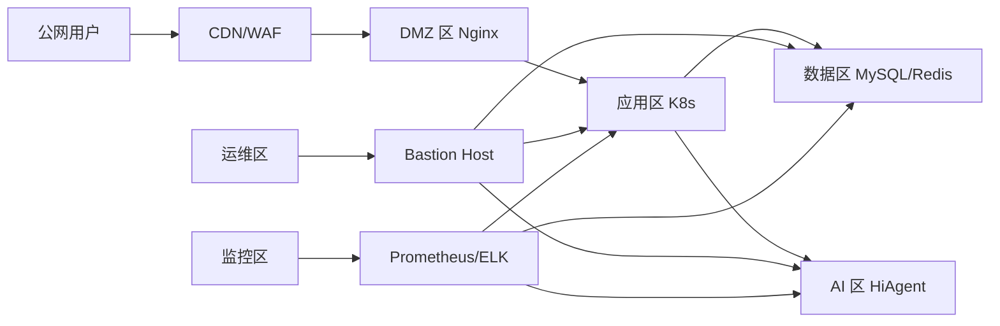
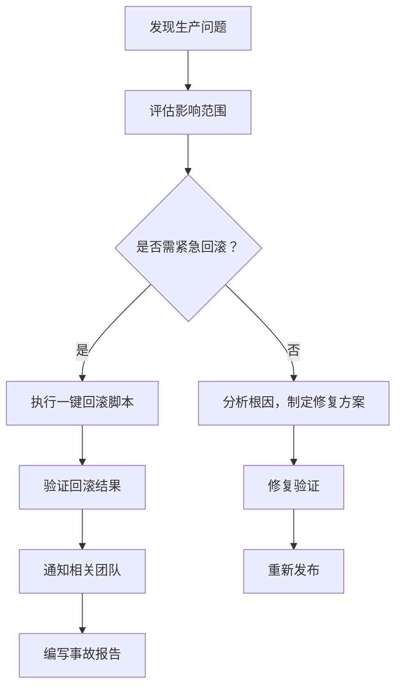
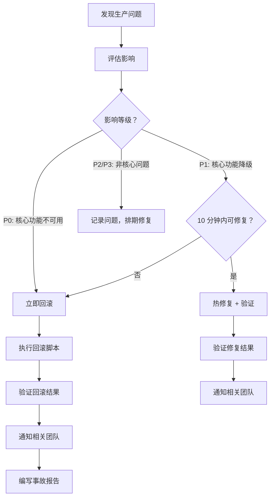
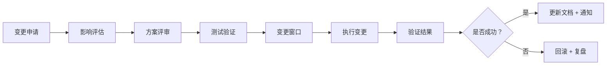

# 智能问数系统 - 卷 3：运维部署与测试验收手册

**文档版本**: V2.0  
**最后更新**: 2026-04-02  
**适用对象**: 运维工程师、测试工程师、发布经理、安全工程师  
**关联任务**: QA-01 ~ QA-05 (测试验收任务集), 运维部署任务  
**前置依赖**: 卷 1 (后端核心实现) 完成，卷 2 (前端与 AI 配置) 完成，基础设施就绪  
**后续依赖**: 正式上线，持续运营

**项目说明**: 本手册是智能问数系统运维部署与测试验收的总体实施指南，整合了环境准备、部署流程、监控告警、测试验收、上线发布等关键环节的技术方案、操作规范、检查清单及应急预案，旨在确保系统安全、稳定、高效上线。

---

## 1. 概述

### 1.1 背景
智能问数系统涉及前端、后端、AI 平台、数据库、缓存、日志等多个组件，部署复杂度高，测试维度多。运维部署与测试验收是系统上线前的最后关口，直接关系到生产环境的稳定性和用户体验。

### 1.2 目标
| 目标 | 说明 | 验收标准 |
|------|------|----------|
| **部署自动化** | 一键部署，支持灰度/回滚 | 部署脚本通过率 100% |
| **环境一致性** | 开发/测试/生产环境配置一致 | 配置差异检查通过 |
| **监控全覆盖** | 核心指标监控 + 告警 | 监控覆盖率 100% |
| **测试充分性** | 功能/安全/性能/体验测试通过 | 测试用例通过率 ≥ 98% |
| **上线零事故** | 上线过程无故障，回滚方案完备 | 上线评审通过 |

### 1.3 范围
| 模块分类 | 包含内容 | 说明 |
|----------|----------|------|
| **环境准备** | K8s 集群，MySQL，Redis，ELK，Prometheus | 基础设施部署 |
| **配置管理** | 配置中心，环境变量，密钥管理 | 配置标准化 |
| **部署流程** | 构建，镜像，发布，灰度，回滚 | 自动化部署 |
| **监控告警** | 指标采集，日志分析，告警规则 | 可观测性建设 |
| **测试验收** | 功能/安全/性能/准确率/体验测试 | 质量保障 |
| **上线发布** | 上线检查，灰度策略，应急方案 | 平稳上线 |

---

## 2. 架构设计

### 2.1 部署架构


### 2.2 网络架构


### 2.3 技术栈
| 组件 | 技术 | 版本 | 说明 |
|------|------|------|------|
| **容器编排** | Kubernetes | 1.28 | 容器管理 |
| **服务网格** | Istio | 1.20 | 流量管理 (可选) |
| **配置中心** | Apollo / Nacos | 最新 | 配置管理 |
| **监控告警** | Prometheus + Grafana | 最新 | 指标监控 |
| **日志系统** | ELK Stack | 8.x | 日志采集分析 |
| **链路追踪** | SkyWalking | 9.x | 分布式追踪 |
| **CI/CD** | Jenkins + GitLab | 最新 | 持续集成部署 |
| **安全扫描** | Trivy + OWASP ZAP | 最新 | 镜像/应用安全 |

---

## 3. 环境准备规范

### 3.1 基础设施要求

#### 3.1.1 K8s 集群配置
| 环境 | 节点数 | CPU/内存 | 存储 | 网络 |
|------|--------|----------|------|------|
| 开发环境 | 3 | 4C8G × 3 | 100GB SSD | 1Gbps |
| 测试环境 | 5 | 8C16G × 5 | 500GB SSD | 1Gbps |
| 预发环境 | 5 | 8C16G × 5 | 500GB SSD | 10Gbps |
| 生产环境 | 10+ | 16C32G × 10+ | 2TB SSD + 备份 | 10Gbps+ |

#### 3.1.2 数据库配置
| 组件 | 版本 | 配置 | 高可用 | 备份策略 |
|------|------|------|--------|----------|
| MySQL | 8.0 | 16C64G, SSD | 主从 + MHA | 每日全备 + binlog |
| Redis | 7.0 | 8C32G, 集群模式 | Cluster + Sentinel | RDB + AOF |
| Elasticsearch | 8.x | 8C32G × 3 | 多副本 | 快照备份 |

#### 3.1.3 AI 平台配置
| 组件 | 配置 | 说明 |
|------|------|------|
| HiAgent 平台 | 16C32G × 2 + GPU × 4 | 离线大模型部署 |
| 向量数据库 | Milvus 2.3, 8C32G × 3 | 向量检索 |
| GPU 资源 | NVIDIA A100 × 4 | 模型推理加速 |

### 3.2 配置管理规范

#### 3.2.1 配置中心使用规范
```yaml
# ✅ 推荐：配置分层管理
config:
  # 公共配置
  common:
    app:
      name: askdata
      version: 1.0.0
    
  # 环境配置
  env:
    dev:
      log_level: DEBUG
      db_url: jdbc:mysql://dev-db:3306/askdata
    prod:
      log_level: INFO
      db_url: jdbc:mysql://prod-db:3306/askdata
  
  # 功能开关
  feature:
    ai_enabled: true
    cache_enabled: true
    audit_log_enabled: true
  
  # 敏感配置 (加密存储)
  secret:
    db_password: ${ENC:AES256:xxx}
    api_key: ${ENC:AES256:xxx}

# ❌ 不推荐：配置硬编码
// 代码中直接写配置
String dbUrl = "jdbc:mysql://localhost:3306/askdata";
```

#### 3.2.2 环境变量规范
| 变量名 | 说明 | 示例 | 是否敏感 |
|--------|------|------|----------|
| `APP_ENV` | 环境标识 | `prod`/`test`/`dev` | 否 |
| `DB_URL` | 数据库连接 | `jdbc:mysql://...` | 是 |
| `DB_PASSWORD` | 数据库密码 | `***` | 是 |
| `REDIS_URL` | Redis 连接 | `redis://...` | 是 |
| `AI_API_KEY` | AI 平台密钥 | `sk-xxx` | 是 |
| `TRACE_ENABLED` | 链路追踪开关 | `true` | 否 |
| `LOG_LEVEL` | 日志级别 | `INFO` | 否 |

#### 3.2.3 密钥管理规范
```yaml
# 密钥管理策略
secret_management:
  # 存储方式
  storage:
    type: vault  # 使用 HashiCorp Vault
    encryption: AES-256-GCM
  
  # 访问控制
  access:
    - role: app_service
      permissions: [read]
    - role: ops_admin
      permissions: [read, write]
  
  # 轮换策略
  rotation:
    enabled: true
    interval: 90d  # 90 天轮换
    notify_before: 7d  # 提前 7 天通知
  
  # 审计日志
  audit:
    enabled: true
    log_all_access: true
```

### 3.3 安全基线配置

#### 3.3.1 主机安全基线
| 检查项 | 要求 | 验证方法 |
|--------|------|----------|
| 系统更新 | 定期更新安全补丁 | `yum update --security` |
| 用户权限 | 最小权限原则，禁用 root 远程 | `sudo -l`, `sshd_config` |
| 防火墙 | 仅开放必要端口 | `iptables -L`, `firewall-cmd` |
| 入侵检测 | 安装 fail2ban, auditd | `fail2ban-client status` |
| 文件权限 | 敏感文件 600/644 权限 | `find / -perm -002` |

#### 3.3.2 容器安全基线
| 检查项 | 要求 | 验证方法 |
|--------|------|----------|
| 镜像扫描 | 部署前扫描漏洞 | `trivy image <image>` |
| 非 root 运行 | 容器内使用非 root 用户 | `docker inspect --format='{{.Config.User}}'` |
| 只读文件系统 | 敏感目录挂载为只读 | `securityContext.readOnlyRootFilesystem: true` |
| 资源限制 | 设置 CPU/内存限制 | `resources.limits` in K8s YAML |
| 网络策略 | 限制容器间通信 | `NetworkPolicy` in K8s |

#### 3.3.3 应用安全基线
| 检查项 | 要求 | 验证方法 |
|--------|------|----------|
| 依赖扫描 | 定期扫描第三方库漏洞 | `mvn dependency-check:check` |
| SQL 注入防护 | 使用参数化查询 | 代码审查 + 安全测试 |
| XSS 防护 | 输入输出过滤转义 | 安全测试 + 代码审查 |
| CSRF 防护 | 启用 CSRF Token | 安全测试 |
| 敏感信息 | 日志/响应脱敏 | 日志审计 + 安全测试 |

---

## 4. 部署流程规范

### 4.1 CI/CD 流水线设计

#### 4.1.1 流水线阶段


#### 4.1.2 Jenkins Pipeline 示例
```groovy
pipeline {
    agent any
    
    environment {
        APP_NAME = 'askdata'
        REGISTRY = 'registry.company.com'
        K8S_NAMESPACE = 'askdata-prod'
    }
    
    stages {
        stage('Checkout') {
            steps {
                checkout scm
            }
        }
        
        stage('Code Scan') {
            steps {
                sh 'mvn sonar:sonar -Dsonar.projectKey=${APP_NAME}'
                sh 'trivy fs --severity HIGH,CRITICAL .'
            }
        }
        
        stage('Unit Test') {
            steps {
                sh 'mvn test -DskipITs'
                junit 'target/surefire-reports/*.xml'
            }
        }
        
        stage('Build Image') {
            steps {
                script {
                    dockerImage = docker.build("${REGISTRY}/${APP_NAME}:${BUILD_NUMBER}")
                }
            }
        }
        
        stage('Scan Image') {
            steps {
                sh "trivy image --severity HIGH,CRITICAL ${REGISTRY}/${APP_NAME}:${BUILD_NUMBER}"
            }
        }
        
        stage('Deploy to Test') {
            when { branch 'develop' }
            steps {
                sh "kubectl set image deployment/${APP_NAME} ${APP_NAME}=${REGISTRY}/${APP_NAME}:${BUILD_NUMBER} -n ${K8S_NAMESPACE}-test"
                sh "kubectl rollout status deployment/${APP_NAME} -n ${K8S_NAMESPACE}-test --timeout=300s"
            }
        }
        
        stage('Integration Test') {
            when { branch 'develop' }
            steps {
                sh 'mvn verify -Dtest=*IntegrationTest'
            }
        }
        
        stage('Deploy to Staging') {
            when { branch 'release/*' }
            steps {
                input message: 'Deploy to staging?', ok: 'Deploy'
                sh "kubectl set image deployment/${APP_NAME} ${APP_NAME}=${REGISTRY}/${APP_NAME}:${BUILD_NUMBER} -n ${K8S_NAMESPACE}-staging"
                sh "kubectl rollout status deployment/${APP_NAME} -n ${K8S_NAMESPACE}-staging --timeout=300s"
            }
        }
        
        stage('Production Deploy') {
            when { branch 'main' }
            steps {
                input message: 'Deploy to production?', ok: 'Deploy'
                // 灰度发布
                sh "kubectl set image deployment/${APP_NAME} ${APP_NAME}=${REGISTRY}/${APP_NAME}:${BUILD_NUMBER} -n ${K8S_NAMESPACE}-prod --record"
                sh "kubectl rollout status deployment/${APP_NAME} -n ${K8S_NAMESPACE}-prod --timeout=600s"
                // 验证
                sh './scripts/verify-deployment.sh'
            }
        }
    }
    
    post {
        always {
            cleanWs()
        }
        failure {
            mail to: 'devops@company.com',
                 subject: "Build Failed: ${APP_NAME} #${BUILD_NUMBER}",
                 body: "Check console: ${BUILD_URL}"
        }
    }
}
```

### 4.2 部署策略

#### 4.2.1 蓝绿部署
```yaml
# 蓝绿部署配置
deployment_strategy:
  type: blue_green
  
  blue:
    name: askdata-blue
    replicas: 5
    version: v1.0.0
    traffic: 100%  # 初始流量
  
  green:
    name: askdata-green
    replicas: 5
    version: v1.1.0
    traffic: 0%  # 初始无流量
  
  switch:
    method: ingress_weight  # 通过 Ingress 权重切换
    steps:
      - traffic: 10%  # 先切 10%
        verify_duration: 5m
      - traffic: 50%
        verify_duration: 10m
      - traffic: 100%
        verify_duration: 30m
    
  rollback:
    auto: true  # 自动回滚
    conditions:
      - error_rate > 1%
      - latency_p95 > 3s
      - health_check_failed
```

#### 4.2.2 金丝雀发布
```yaml
# 金丝雀发布配置
deployment_strategy:
  type: canary
  
  stable:
    name: askdata-stable
    replicas: 9
    version: v1.0.0
  
  canary:
    name: askdata-canary
    replicas: 1
    version: v1.1.0
  
  traffic_routing:
    method: istio_virtual_service  # 使用 Istio 流量管理
    steps:
      - canary_weight: 10%
        duration: 10m
        metrics:
          - name: error_rate
            threshold: 1%
          - name: latency_p95
            threshold: 2s
      - canary_weight: 50%
        duration: 20m
      - canary_weight: 100%
        duration: 30m
  
  analysis:
    enabled: true
    interval: 1m
    success_threshold: 3  # 连续 3 次成功才继续
    failure_threshold: 2  # 连续 2 次失败则回滚
```

### 4.3 回滚方案

#### 4.3.1 自动回滚条件
```yaml
# 自动回滚配置
rollback:
  enabled: true
  
  # 触发条件
  conditions:
    - metric: error_rate
      operator: '>'
      threshold: 5%
      duration: 2m
    
    - metric: latency_p95
      operator: '>'
      threshold: 5s
      duration: 2m
    
    - metric: health_check
      operator: '=='
      threshold: false
      duration: 1m
    
    - metric: business_metric
      operator: '<'
      threshold: 80%  # 如任务完成率
      duration: 5m
  
  # 回滚动作
  actions:
    - kubectl rollout undo deployment/askdata -n prod
    - notify: slack_channel '#prod-alerts'
    - create_incident: true
  
  # 回滚后验证
  post_rollback:
    - wait: 2m
    - verify_health_check
    - verify_basic_functionality
    - notify_team: 'Rollback completed'
```

#### 4.3.2 手动回滚流程


---

## 5. 监控告警规范

### 5.1 监控指标体系

#### 5.1.1 核心业务指标
| 指标名称 | 说明 | 采集方式 | 告警阈值 |
|----------|------|----------|----------|
| `api.request.qps` | API 请求每秒数 | Prometheus | - |
| `api.response.latency.p95` | P95 响应时间 | Prometheus | > 3s |
| `api.error.rate` | 请求错误率 | Prometheus | > 1% |
| `ai.intent.accuracy` | 意图识别准确率 | 自定义埋点 | < 85% |
| `ai.answer.correctness` | 答案准确性 | 自定义埋点 | < 90% |
| `user.task.success_rate` | 任务完成率 | 自定义埋点 | < 80% |
| `user.satisfaction.csat` | 用户满意度 | 问卷/反馈 | < 3.5/5.0 |

#### 5.1.2 系统资源指标
| 指标名称 | 说明 | 采集方式 | 告警阈值 |
|----------|------|----------|----------|
| `node.cpu.usage` | CPU 使用率 | Node Exporter | > 80% |
| `node.memory.usage` | 内存使用率 | Node Exporter | > 85% |
| `node.disk.usage` | 磁盘使用率 | Node Exporter | > 90% |
| `k8s.pod.restart.count` | Pod 重启次数 | K8s Metrics | > 3/hour |
| `db.connection.pool.active` | 数据库活跃连接 | MySQL Exporter | > 80% |
| `redis.memory.usage` | Redis 内存使用 | Redis Exporter | > 80% |
| `jvm.gc.pause.time` | JVM GC 暂停时间 | Micrometer | > 1s |

#### 5.1.3 安全审计指标
| 指标名称 | 说明 | 采集方式 | 告警阈值 |
|----------|------|----------|----------|
| `security.auth.failure.count` | 认证失败次数 | 应用日志 | > 10/5min |
| `security.permission.denied.count` | 权限拒绝次数 | 应用日志 | > 5/5min |
| `security.sensitive.access.count` | 敏感数据访问 | 审计日志 | 实时告警 |
| `security.sql.injection.attempt` | SQL 注入尝试 | WAF 日志 | 实时告警 |
| `security.xss.attempt` | XSS 攻击尝试 | WAF 日志 | 实时告警 |

### 5.2 告警规则配置

#### 5.2.1 Prometheus 告警规则
```yaml
# prometheus-rules.yml
groups:
- name: askdata-alerts
  rules:
  
  # 业务告警
  - alert: HighErrorRate
    expr: sum(rate(http_requests_total{status=~"5.."}[5m])) / sum(rate(http_requests_total[5m])) > 0.01
    for: 5m
    labels:
      severity: critical
      team: backend
    annotations:
      summary: "API 错误率过高 ({{ $value }})"
      description: "服务 {{ $labels.instance }} 错误率超过 1%"
  
  - alert: HighLatency
    expr: histogram_quantile(0.95, sum(rate(http_request_duration_seconds_bucket[5m])) by (le)) > 3
    for: 5m
    labels:
      severity: warning
      team: backend
    annotations:
      summary: "P95 延迟过高 ({{ $value }}s)"
  
  - alert: LowIntentAccuracy
    expr: ai_intent_accuracy < 0.85
    for: 1h
    labels:
      severity: warning
      team: ai
    annotations:
      summary: "意图识别准确率下降 ({{ $value }})"
  
  # 资源告警
  - alert: HighCPUUsage
    expr: avg(rate(node_cpu_seconds_total{mode!="idle"}[5m])) * 100 > 80
    for: 10m
    labels:
      severity: warning
      team: infra
    annotations:
      summary: "CPU 使用率过高 ({{ $value }}%)"
  
  - alert: HighMemoryUsage
    expr: (node_memory_MemTotal_bytes - node_memory_MemAvailable_bytes) / node_memory_MemTotal_bytes * 100 > 85
    for: 10m
    labels:
      severity: warning
      team: infra
    annotations:
      summary: "内存使用率过高 ({{ $value }}%)"
  
  - alert: PodCrashLooping
    expr: rate(kube_pod_container_status_restarts_total[15m]) * 60 * 5 > 3
    for: 5m
    labels:
      severity: critical
      team: infra
    annotations:
      summary: "Pod {{ $labels.pod }} 频繁重启"
  
  # 数据库告警
  - alert: MySQLHighConnections
    expr: mysql_global_status_threads_connected / mysql_global_variables_max_connections * 100 > 80
    for: 5m
    labels:
      severity: warning
      team: dba
    annotations:
      summary: "MySQL 连接池使用率过高 ({{ $value }}%)"
  
  - alert: MySQLSlowQueries
    expr: rate(mysql_global_status_slow_queries[5m]) > 10
    for: 5m
    labels:
      severity: warning
      team: dba
    annotations:
      summary: "MySQL 慢查询过多 ({{ $value }}/s)"
```

#### 5.2.2 告警通知配置
```yaml
# alertmanager.yml
global:
  smtp_smarthost: 'smtp.company.com:587'
  smtp_from: 'alert@company.com'

route:
  group_by: ['alertname', 'severity']
  group_wait: 30s
  group_interval: 5m
  repeat_interval: 4h
  receiver: 'default'
  routes:
    - match:
        severity: critical
      receiver: 'critical-team'
    - match:
        team: ai
      receiver: 'ai-team'
    - match:
        team: dba
      receiver: 'dba-team'

receivers:
  - name: 'default'
    email_configs:
      - to: 'devops@company.com'
    webhook_configs:
      - url: 'http://slack-webhook/notify'

  - name: 'critical-team'
    email_configs:
      - to: 'critical-oncall@company.com'
    pagerduty_configs:
      - service_key: '${PAGERDUTY_KEY}'
    webhook_configs:
      - url: 'http://slack-webhook/critical'

  - name: 'ai-team'
    email_configs:
      - to: 'ai-team@company.com'
    webhook_configs:
      - url: 'http://slack-webhook/ai'

  - name: 'dba-team'
    email_configs:
      - to: 'dba-team@company.com'
    webhook_configs:
      - url: 'http://slack-webhook/dba'

# 抑制规则 (避免告警风暴)
inhibit_rules:
  - source_match:
      severity: 'critical'
    target_match:
      severity: 'warning'
    equal: ['alertname', 'instance']
```

### 5.3 日志管理规范

#### 5.3.1 日志采集配置
```yaml
# filebeat.yml
filebeat.inputs:
- type: log
  enabled: true
  paths:
    - /var/log/askdata/*.log
  fields:
    app: askdata
    env: ${ENVIRONMENT}
  multiline.pattern: '^\d{4}-\d{2}-\d{2}'
  multiline.negate: true
  multiline.match: after

- type: log
  enabled: true
  paths:
    - /var/log/nginx/access.log
  fields:
    app: nginx
    type: access_log

output.elasticsearch:
  hosts: ["${ELASTICSEARCH_HOSTS}"]
  index: "askdata-logs-%{+yyyy.MM.dd}"
  username: "${ELASTICSEARCH_USER}"
  password: "${ELASTICSEARCH_PASSWORD}"

processors:
  - add_host_metadata: ~
  - add_cloud_metadata: ~
  - decode_json_fields:
      fields: ["message"]
      target: "json"
      overwrite_keys: true
```

#### 5.3.2 日志保留策略
| 日志类型 | 热存储 (ES) | 温存储 (S3) | 冷存储 (归档) | 总保留期 |
|----------|-------------|-------------|---------------|----------|
| 应用日志 | 7 天 | 30 天 | 90 天 | 127 天 |
| 访问日志 | 7 天 | 30 天 | 90 天 | 127 天 |
| 审计日志 | 30 天 | 90 天 | 180 天 | 300 天 |
| 安全日志 | 90 天 | 180 天 | 365 天 | 635 天 |
| 慢查询日志 | 7 天 | 30 天 | 90 天 | 127 天 |

#### 5.3.3 日志分析看板
```json
{
  "dashboard": {
    "title": "智能问数系统日志分析",
    "panels": [
      {
        "title": "错误日志趋势",
        "type": "timeseries",
        "query": "log.level: ERROR AND app: askdata",
        "aggregation": "count over time"
      },
      {
        "title": "慢查询分析",
        "type": "table",
        "query": "type: slow_query AND duration_ms > 1000",
        "columns": ["trace_id", "sql", "duration_ms", "timestamp"]
      },
      {
        "title": "安全事件统计",
        "type": "pie",
        "query": "type: security_event",
        "group_by": "event_type"
      },
      {
        "title": "用户行为分析",
        "type": "sankey",
        "query": "type: user_action",
        "source": "action",
        "target": "result"
      }
    ]
  }
}
```

---

## 6. 测试验收规范

### 6.1 测试环境管理

#### 6.1.1 环境隔离策略
```yaml
# 环境配置
environments:
  dev:
    namespace: askdata-dev
    replicas: 1
    resources:
      requests: { cpu: 500m, memory: 1Gi }
      limits: { cpu: 1, memory: 2Gi }
    database: dev-db
    features:
      debug_mode: true
      mock_ai: false
  
  test:
    namespace: askdata-test
    replicas: 2
    resources:
      requests: { cpu: 1, memory: 2Gi }
      limits: { cpu: 2, memory: 4Gi }
    database: test-db
    features:
      debug_mode: true
      mock_ai: false
  
  staging:
    namespace: askdata-staging
    replicas: 3
    resources:
      requests: { cpu: 2, memory: 4Gi }
      limits: { cpu: 4, memory: 8Gi }
    database: staging-db  # 生产数据脱敏副本
    features:
      debug_mode: false
      mock_ai: false
  
  prod:
    namespace: askdata-prod
    replicas: 5+
    resources:
      requests: { cpu: 4, memory: 8Gi }
      limits: { cpu: 8, memory: 16Gi }
    database: prod-db
    features:
      debug_mode: false
      mock_ai: false
```

#### 6.1.2 测试数据管理
```yaml
# 测试数据策略
test_data:
  # 数据生成
  generation:
    method: synthetic  # 合成数据，避免使用生产数据
    volume:
      users: 10000
      orders: 1000000
      metrics: 500  # 指标定义
  
  # 数据脱敏 (如必须使用生产数据副本)
  masking:
    enabled: true
    rules:
      - field: phone
        method: replace
        pattern: "138****0000"
      - field: id_card
        method: replace
        pattern: "110101********1234"
      - field: email
        method: hash
        algorithm: SHA-256
  
  # 数据清理
  cleanup:
    schedule: "0 2 * * *"  # 每天 2 点清理
    retention_days: 7  # 保留 7 天
```

### 6.2 测试执行规范

#### 6.2.1 测试类型与准入准出
| 测试类型 | 准入条件 | 准出条件 | 负责人 |
|----------|----------|----------|--------|
| 单元测试 | 代码开发完成 | 覆盖率≥80%，全部通过 | 开发 |
| 集成测试 | 单元测试通过 | 核心流程 100% 通过 | 测试 |
| 功能测试 | 集成测试通过 | 用例通过率≥98% | 测试 |
| 安全测试 | 功能测试通过 | 无高危漏洞 | 安全 |
| 性能测试 | 安全测试通过 | 指标达标 (P95<3s) | 性能 |
| 准确率评估 | 功能测试通过 | 意图≥90%，实体≥85% | AI |
| 体验测试 | 功能测试通过 | SUS≥75, CSAT≥4.0 | 体验 |
| 用户验收 | 以上全部通过 | 产品确认签字 | 产品 |

#### 6.2.2 自动化测试配置
```yaml
# 自动化测试策略
automation:
  # 单元测试
  unit:
    framework: JUnit 5 + Mockito
    coverage_tool: JaCoCo
    threshold: 80%
    execution: on_commit
  
  # 集成测试
  integration:
    framework: TestContainers + Spring Boot Test
    database: Testcontainers MySQL
    execution: nightly
  
  # E2E 测试
  e2e:
    framework: Cypress / Selenium
    browsers: [chrome, firefox]
    execution: pre_release
  
  # 性能测试
  performance:
    tool: JMeter / k6
    scenarios:
      - name: chat_query
        users: 100
        duration: 10m
      - name: report_export
        users: 50
        duration: 5m
    execution: weekly
  
  # 安全扫描
  security:
    tools:
      - SAST: SonarQube
      - DAST: OWASP ZAP
      - SCA: Dependency-Check
    execution: on_commit + weekly
```

### 6.3 验收标准

#### 6.3.1 功能验收标准
```markdown
# 功能验收检查清单

## 核心功能
- [ ] 用户能成功登录/登出
- [ ] 用户能发送问题并收到回复
- [ ] 流式响应显示正常 (打字机效果)
- [ ] 图表能正确渲染 (柱状图/折线图/饼图)
- [ ] 澄清对话框能正常弹出和交互
- [ ] 反馈功能能正常提交
- [ ] 推荐问题能正常显示和点击
- [ ] 历史对话能正常查看

## 数据准确性
- [ ] 查询结果与数据库一致 (抽样核对)
- [ ] 图表数据与查询结果一致
- [ ] 脱敏字段正确显示 (手机号/身份证)
- [ ] 权限控制生效 (不同角色看到不同数据)

## 交互体验
- [ ] 输入框支持快捷键 (Ctrl+Enter 发送)
- [ ] 页面响应式适配 (移动端正常)
- [ ] 加载状态有友好提示
- [ ] 错误提示清晰可理解
- [ ] 操作有即时反馈

## 边界场景
- [ ] 空查询有友好提示
- [ ] 超长输入有截断处理
- [ ] 网络异常有重试/提示
- [ ] 服务降级有备选方案
```

#### 6.3.2 非功能验收标准
```markdown
# 非功能验收检查清单

## 性能指标
- [ ] 首屏加载时间 < 2s (3G 网络)
- [ ] 接口 P95 响应时间 < 3s
- [ ] 支持 100 QPS 并发
- [ ] 72 小时稳定性测试无故障
- [ ] 内存无泄漏 (长时间运行监控)

## 安全指标
- [ ] 无高危/中危安全漏洞
- [ ] 敏感信息传输加密 (HTTPS)
- [ ] 敏感信息存储加密/脱敏
- [ ] 权限控制无越权访问
- [ ] SQL 注入/XSS 防护生效

## 可靠性指标
- [ ] 服务可用性 ≥ 99.9%
- [ ] 故障自动恢复 < 5 分钟
- [ ] 数据备份可恢复
- [ ] 监控告警覆盖核心指标
- [ ] 日志完整可追溯

## 可维护性指标
- [ ] 配置外部化，支持热更新
- [ ] 日志格式统一，便于分析
- [ ] 监控指标完整，告警合理
- [ ] 部署脚本自动化，支持回滚
- [ ] 文档完整，新人可快速上手
```

---

## 7. 上线发布规范

### 7.1 上线检查清单

#### 7.1.1 预上线检查 (Pre-Release Checklist)
```markdown
# 预上线检查清单 (发布前 24 小时)

## 代码与构建
- [ ] 所有代码合并到 release 分支
- [ ] 代码审查 (Merge Request) 通过
- [ ] 单元测试覆盖率 ≥ 80%
- [ ] 集成测试 100% 通过
- [ ] 构建产物已签名，镜像已扫描

## 配置与依赖
- [ ] 生产环境配置已准备 (配置中心)
- [ ] 数据库迁移脚本已准备并验证
- [ ] 第三方依赖版本确认无高危漏洞
- [ ] 密钥/证书已更新，未硬编码

## 测试验证
- [ ] 功能测试通过率 ≥ 98%
- [ ] 安全扫描无高危漏洞
- [ ] 性能测试指标达标
- [ ] 准确率评估通过 (意图≥90%)
- [ ] 用户体验测试通过 (SUS≥75)

## 运维准备
- [ ] 监控告警规则已配置
- [ ] 日志采集已验证
- [ ] 备份策略已确认
- [ ] 回滚脚本已测试
- [ ] 应急预案已评审

## 沟通协调
- [ ] 上线时间已通知相关团队
- [ ] 值班人员已安排
- [ ] 回滚决策人已确认
- [ ] 用户通知已准备 (如有影响)
```

#### 7.1.2 上线执行检查 (Release Execution Checklist)
```markdown
# 上线执行检查清单 (发布窗口内)

## 发布前 (T-30min)
- [ ] 确认生产环境健康状态 (监控大屏)
- [ ] 确认无正在进行的维护操作
- [ ] 确认备份已完成
- [ ] 通知相关团队准备发布

## 灰度发布 (T-0)
- [ ] 执行灰度发布脚本 (10% 流量)
- [ ] 验证灰度实例健康状态
- [ ] 监控核心指标 (错误率/延迟)
- [ ] 抽样验证核心功能

## 逐步放量 (T+10min ~ T+30min)
- [ ] 流量逐步提升至 50%
- [ ] 持续监控指标，无异常
- [ ] 用户反馈收集 (如有)
- [ ] 流量提升至 100%

## 全量验证 (T+30min ~ T+60min)
- [ ] 验证所有实例健康状态
- [ ] 执行冒烟测试用例
- [ ] 确认核心业务指标正常
- [ ] 通知相关团队发布完成

## 发布后监控 (T+60min ~ T+24h)
- [ ] 持续监控核心指标
- [ ] 收集用户反馈
- [ ] 准备应急回滚 (如有需要)
- [ ] 编写发布报告
```

### 7.2 灰度发布策略

#### 7.2.1 基于用户特征的灰度
```yaml
# 灰度规则配置
canary_rules:
  # 按用户角色灰度
  - name: role_based
    condition: user.role in ['admin', 'analyst']
    percentage: 100%  # 管理员/分析师先体验
  
  # 按用户地域灰度
  - name: region_based
    condition: user.region in ['beijing', 'shanghai']
    percentage: 50%  # 一线城市 50% 灰度
  
  # 按用户活跃度灰度
  - name: activity_based
    condition: user.last_login > now() - 7d
    percentage: 20%  # 活跃用户 20% 灰度
  
  # 默认规则
  - name: default
    condition: true
    percentage: 5%  # 其他用户 5% 灰度
```

#### 7.2.2 基于流量权重的灰度
```yaml
# Istio VirtualService 配置
apiVersion: networking.istio.io/v1beta1
kind: VirtualService
metadata:
  name: askdata-canary
spec:
  hosts:
    - askdata.company.com
  http:
    - match:
        - headers:
            x-canary:
              exact: "true"  # 通过 Header 强制灰度
      route:
        - destination:
            host: askdata
            subset: canary
          weight: 100
    
    - route:
        - destination:
            host: askdata
            subset: stable
          weight: 95  # 95% 流量走稳定版
        - destination:
            host: askdata
            subset: canary
          weight: 5  # 5% 流量走灰度版
```

### 7.3 应急预案

#### 7.3.1 故障分级与响应
| 故障等级 | 定义 | 响应时间 | 处理流程 |
|----------|------|----------|----------|
| P0 (致命) | 核心功能不可用，数据丢失 | 5 分钟内 | 立即回滚 + 通知 + 应急小组 |
| P1 (严重) | 核心功能降级，影响 50%+ 用户 | 15 分钟内 | 限流/降级 + 通知 + 修复 |
| P2 (一般) | 非核心功能异常，影响 < 50% 用户 | 1 小时内 | 监控 + 排期修复 |
| P3 (轻微) | 体验问题，不影响功能 | 24 小时内 | 记录 + 迭代优化 |

#### 7.3.2 应急操作手册
```markdown
# 常见故障应急操作

## 场景 1: 服务不可用 (502/503)
1. 确认故障范围 (单实例/全集群)
2. 检查监控指标 (CPU/内存/连接数)
3. 尝试重启故障实例
4. 如无效，执行一键回滚
5. 通知相关团队，编写事故报告

## 场景 2: 数据库连接耗尽
1. 确认连接数监控
2. 检查慢查询日志
3. 临时增加连接池大小
4. 优化慢查询 / 添加索引
5. 如持续，考虑读写分离

## 场景 3: AI 服务响应超时
1. 确认 HiAgent 平台状态
2. 检查 GPU 资源使用
3. 临时降级到知识库模式
4. 联系 AI 平台团队
5. 调整超时/重试配置

## 场景 4: 安全攻击 (DDoS/注入)
1. 确认攻击类型和来源
2. 启用 WAF 防护规则
3. 封禁恶意 IP/用户
4. 通知安全团队
5. 加固防护策略

## 场景 5: 数据不一致/错误
1. 确认影响范围和数据
2. 暂停相关功能 (如导出)
3. 从备份恢复数据
4. 修复数据同步逻辑
5. 通知受影响用户
```

#### 7.3.3 回滚决策树


---

## 8. 持续运营规范

### 8.1 日常运维任务

#### 8.1.1 每日检查清单
```markdown
# 每日运维检查 (9:00 AM)

## 系统健康
- [ ] 检查监控大屏，无红色告警
- [ ] 确认核心指标正常 (错误率<1%, P95<3s)
- [ ] 确认数据库/缓存连接正常
- [ ] 确认磁盘空间充足 (>20%)

## 业务指标
- [ ] 确认昨日核心业务指标 (任务完成率/满意度)
- [ ] 检查用户反馈，处理紧急问题
- [ ] 确认 AI 准确率无异常波动

## 日志审计
- [ ] 检查安全日志，无异常访问
- [ ] 检查错误日志，分析新增错误
- [ ] 确认审计日志完整

## 备份验证
- [ ] 确认昨日备份成功
- [ ] 抽样验证备份可恢复性

## 待办事项
- [ ] 处理昨日遗留问题
- [ ] 安排今日计划任务
```

#### 8.1.2 每周运维任务
```markdown
# 每周运维任务 (周一)

## 系统维护
- [ ] 执行系统安全更新 (测试环境验证后)
- [ ] 清理过期日志/临时文件
- [ ] 验证监控告警规则有效性

## 数据维护
- [ ] 执行数据库优化 (分析慢查询，添加索引)
- [ ] 验证备份恢复流程 (抽样)
- [ ] 清理过期测试数据

## 安全审计
- [ ] 审查用户权限，移除离职/转岗人员权限
- [ ] 检查密钥/证书有效期，提前更新
- [ ] 执行漏洞扫描，修复中高危漏洞

## 性能分析
- [ ] 分析上周性能趋势，识别瓶颈
- [ ] 优化资源配置 (扩缩容)
- [ ] 更新容量规划

## 文档更新
- [ ] 更新运维手册 (如有变更)
- [ ] 编写周运维报告
- [ ] 同步团队知识
```

### 8.2 变更管理规范

#### 8.2.1 变更流程


#### 8.2.2 变更分类与审批
| 变更类型 | 示例 | 审批流程 | 执行窗口 |
|----------|------|----------|----------|
| 紧急变更 | 安全漏洞修复，生产故障 | 技术负责人 + 安全负责人 | 随时 (需记录) |
| 标准变更 | 配置更新，小功能发布 | 变更委员会 (CAB) | 维护窗口 (02:00-04:00) |
| 重大变更 | 架构调整，数据库迁移 | 技术委员会 + 业务方 | 计划窗口 (周末) |
| 日常变更 | 日志级别调整，监控规则 | 运维负责人 | 工作时间 |

### 8.3 容量规划

#### 8.3.1 容量评估模型
```yaml
# 容量规划参数
capacity_planning:
  # 当前负载
  current:
    users: 10000  # 日活用户
    qps: 50       # 平均 QPS
    peak_qps: 200 # 峰值 QPS
    data_volume: 1TB  # 数据量
  
  # 增长预测
  growth:
    user_growth_rate: 20%  # 用户月增长
    data_growth_rate: 10%  # 数据月增长
    planning_horizon: 6m   # 规划周期 6 个月
  
  # 资源需求计算
  resource_calculation:
    # 应用服务器
    app_servers:
      base: 5  # 基础数量
      per_qps: 0.05  # 每 QPS 需要 0.05 个实例
      buffer: 30%  # 缓冲余量
    
    # 数据库
    database:
      base_storage: 2TB
      growth_per_month: 100GB
      read_replicas: 2  # 读副本数量
    
    # AI 服务
    ai_service:
      gpu_per_100_qps: 1  # 每 100 QPS 需要 1 个 GPU
      model_cache_memory: 32GB  # 模型缓存内存
```

#### 8.3.2 弹性伸缩策略
```yaml
# K8s HPA 配置
autoscaling:
  app:
    min_replicas: 3
    max_replicas: 20
    metrics:
      - type: Resource
        resource:
          name: cpu
          target:
            type: Utilization
            average_utilization: 70
      - type: Resource
        resource:
          name: memory
          target:
            type: Utilization
            average_utilization: 80
  
  # 基于自定义指标 (QPS)
  custom_metrics:
    - name: http_requests_per_second
      target_value: 10  # 每个实例处理 10 QPS
  
  # 冷却时间
  stabilization_window:
    scale_up: 0s   # 扩容立即生效
    scale_down: 300s  # 缩容等待 5 分钟
```

---

## 9. 附录：相关文档索引

### 9.1 运维文档
| 文档名称 | 版本 | 说明 | 链接/路径 |
|----------|------|------|----------|
| 基础设施部署手册 | V2.0 | K8s/MySQL/Redis 部署 | `/docs/ops/infrastructure.md` |
| 配置中心使用指南 | V2.0 | Apollo/Nacos 配置 | `/docs/ops/config-center.md` |
| 监控告警配置手册 | V2.0 | Prometheus/Grafana 配置 | `/docs/ops/monitoring.md` |
| 日志管理规范 | V2.0 | ELK 日志采集分析 | `/docs/ops/logging.md` |
| 备份恢复手册 | V2.0 | 数据备份与恢复 | `/docs/ops/backup-restore.md` |
| 安全加固指南 | V2.0 | 主机/容器/应用安全 | `/docs/ops/security-hardening.md` |
| 应急预案手册 | V2.0 | 故障应急处理 | `/docs/ops/emergency.md` |

### 9.2 测试文档
| 文档名称 | 版本 | 说明 | 链接/路径 |
|----------|------|------|----------|
| QA-01 功能集成测试 | V2.0 | 功能测试用例 | `/docs/qa/functional.md` |
| QA-02 安全渗透测试 | V2.0 | 安全测试方案 | `/docs/qa/security.md` |
| QA-03 性能压测 | V2.0 | 性能测试方案 | `/docs/qa/performance.md` |
| QA-04 准确率评估 | V2.0 | AI 准确率评估 | `/docs/qa/accuracy.md` |
| QA-05 用户体验测试 | V2.0 | 体验评估方案 | `/docs/qa/ux.md` |
| 自动化测试框架 | V2.0 | 测试框架使用 | `/docs/qa/automation.md` |

### 9.3 发布文档
| 文档名称 | 版本 | 说明 | 链接/路径 |
|----------|------|------|----------|
| 上线检查清单 | V2.0 | 上线前检查项 | `/docs/release/checklist.md` |
| 灰度发布指南 | V2.0 | 灰度策略配置 | `/docs/release/canary.md` |
| 回滚操作手册 | V2.0 | 回滚流程与脚本 | `/docs/release/rollback.md` |
| 变更管理规范 | V2.0 | 变更流程与审批 | `/docs/release/change-management.md` |
| 发布报告模板 | V2.0 | 发布报告格式 | `/docs/release/report-template.md` |

---

## 10. 变更历史

| 版本 | 日期 | 变更内容 | 负责人 |
|------|------|----------|--------|
| V1.0 | 2026-03-25 | 初始版本，包含基础运维部署流程 | 运维组 |
| V2.0 | 2026-04-02 | 整合测试验收规范，增加陷阱防护矩阵，统一标准 | 运维组 + 测试组 |

---

## 11. 签字确认

| 角色 | 姓名 | 签字 | 日期 | 意见 |
|------|------|------|------|------|
| 运维负责人 | | | | |
| 测试负责人 | | | | |
| 安全负责人 | | | | |
| 发布经理 | | | | |
| 技术总监 | | | | |

---

**文档结束**  
**下一步**: 各运维、测试、发布团队根据本手册及细分任务文档执行环境准备、测试验收、上线发布工作，完成后提交上线评审。